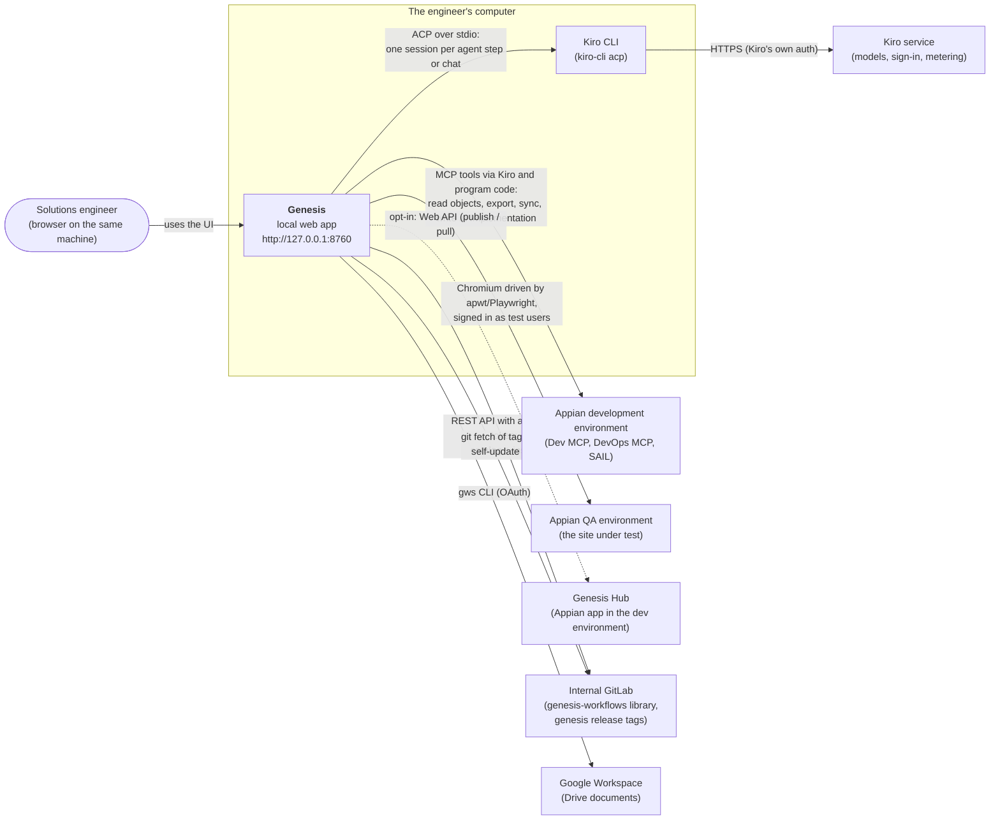

# 3. System context (C4 level 1)

> **Describes:** genesis v0.81.0 (Phase 51) · **Last reviewed:** 2026-11-11 · arc42 section 3

This is the outermost view: Genesis as one box, the person who uses it, and every outside system it talks to.
Nothing inside the box is shown here; [04-container-view.md](04-container-view.md) opens it.

## 3.1 Context diagram

The engineer uses Genesis from a browser on the same computer. Genesis starts Kiro CLI processes on that computer
and gives each one a narrow task. Kiro CLI calls the Kiro service for the language model. Genesis reaches the
Appian development environment for knowledge-base syncs and implementation, the QA environment for browser
tests, GitLab for workflows and its own updates, Google Workspace for documents and, when collaboration is
switched on, the Genesis Hub. The dotted line marks the one optional connection.

## 3.2 People

| Person | How they use Genesis |
|---|---|
| **Solutions engineer** | The only user. Opens `http://127.0.0.1:8760` in a browser on the same machine. Runs workflows, chats, reviews artifacts, approves gates, manages settings and credentials. Genesis acts with this person's own credentials. |
| **Teammates** (indirect) | Other engineers running their own Genesis. They never connect to this instance. When collaboration is on, they see what this instance published to the shared Hub, and this instance pulls what they published. |

## 3.3 Outside systems

| System | What Genesis uses it for | How Genesis connects | Credentials | When it is unavailable |
|---|---|---|---|---|
| **Kiro CLI** (`kiro-cli`, local program) | Every agent step in a workflow, every chat message, every skill | Genesis starts `kiro-cli acp` as a child process and speaks ACP (JSON-RPC 2.0, newline-delimited, over stdin/stdout) | The user's own Kiro sign-in, held by kiro-cli; Genesis only starts the sign-in flow | Agent steps and chat fail with a clear error; program steps and the rest of the UI still work |
| **Kiro service** (cloud) | The language model, sign-in and credit metering | Only through kiro-cli; Genesis never calls it directly | kiro-cli's | As above |
| **Appian development environment** (exactly one per install, marked Dev) | The knowledge-base sync (export, parse, diff), live object code for chat and agents, design and implementation lanes, delta packages, SAIL checks, Genesis Hub host | MCP servers started per session: `appian-dev` (read), `appian-dev-write` (Implementation only), `appian-dev-packages` (program code only), `appian-devops` (exports); plus the `sail` CLI | Per-environment credentials in the SecretProvider, resolved only from the Dev environment (ADR-048) | KB syncs and Appian-backed steps fail; the local KB and everything already synced still work |
| **Appian QA environment** (at most one, on its own host) | All test execution, recording, data setups and story verification | A Playwright Chromium browser driven by the `apwt` tool from the application's test workspace, signed in as one of the application's test users | Test-user passwords in the SecretProvider; they reach only the sign-in subprocess, never an agent (ADR-083) | Test executions cannot start; the Testing tab shows QA as not ready |
| **Genesis Hub** (an Appian application in the dev environment) | Opt-in sharing of a defined data subset: KB snapshots, feature stage artifacts, stories, board moves, Object Wiki entries | HTTPS calls to the Hub's frozen Web API contract | The Hub URL and the user's identity in collaboration settings | Collaboration is off by default. When the Hub is unreachable, publishing and pulling pause and local work continues |
| **Internal GitLab** | (1) the `genesis-workflows` library: catalog, workflows, skills, registries; (2) the `genesis` repo's release tags for self-update | (1) the GitLab REST API; (2) `git fetch` from the local clone | (1) a GitLab personal token in the SecretProvider (`GITLAB_TOKEN`); (2) the user's SSH key | Browsing and installing workflows needs the token; installed workflows keep running offline |
| **Google Workspace** | Importing Google Drive documents into the document library | The managed `gws` CLI with its own isolated config folder | Google OAuth, signed in through Genesis | Drive imports fail; uploaded documents still work |

`playwright-appian` (the `apwt` tool) is released to GitLab's npm registry, but a copy of its package ships inside
genesis (`genesis/testexec/vendor/`). Test runs install from that copy and need no registry access.

## 3.4 Trust boundaries

Three boundaries matter for security. [04-container-view.md](04-container-view.md) shows where they sit between
the running processes.

1. **The machine boundary.** Genesis listens on the loopback address only and has no login. Anything that can
   reach `127.0.0.1:8760` can do everything the user can (ADR-026). The reports origin on port 8860 serves only
   static report files (ADR-085).
2. **The agent boundary.** Genesis passes an agent only the MCP servers its step declares. Chat and skill sessions
   enforce a read-only trusted tool list and may write files only into their output folder. Credentials for
   Appian and the QA test users never enter an agent's prompt or tool list. In v0.81.0 this boundary is weaker
   for **workflow** agents: they run with permission requests auto-approved, they can use Kiro's shell with the
   run folder as working directory (the shell is not confined to it), and Kiro also gives them the servers from
   the user's global Kiro configuration. ADR-083 records these as accepted risks until full agent isolation
   ships (Phase 52).
3. **The Appian boundary.** Reads are unrestricted within the Dev environment. Design-object writes need the
   Implementation lane's blanket approval and never delete (ADR-068). Test traffic goes only to QA (ADR-082).
