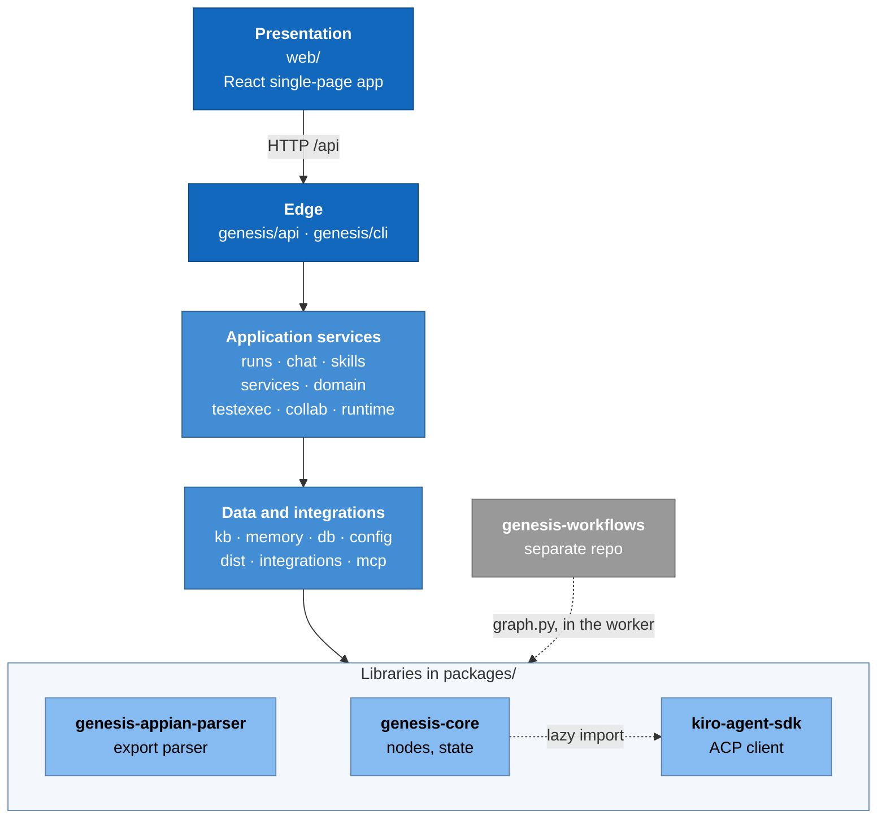

# 6. Building blocks: the module map

> **Describes:** genesis v0.81.0 (Phase 51) · **Last reviewed:** 2026-11-11 · arc42 section 5 (building block view)

This page breaks Genesis into its modules, says what each one is responsible for and where its code lives, and
shows the rules about which module may depend on which. Each module has its own detailed document
in [`modules/`](#62-the-modules).

## 6.1 The layers

Read the diagram top to bottom. Each box is one layer, and each layer uses only the layers below it. The browser
talks only to the edge layer: the API under `/api`, with the `genesis` command as a second way in. The edge calls
the application services, the services use the data and integration modules, and those use the three libraries
in `packages/`. Inside the libraries, genesis-core imports kiro-agent-sdk lazily. The workflow library (grey) is a
separate repo; its `graph.py` files are loaded only inside a run worker and are built on the libraries.

## 6.2 The modules

| Module | Code | Responsibility | Document |
|---|---|---|---|
| **Core engine** | `packages/genesis-core/` | The library every workflow is built from: node factories (program, agent, CLI, validator, gate, subgraph), the reliability trio, the healing tier, `PlatformState`, the `RunWorkspace` blackboard, MCP and CLI registries, validators, the `AgentProvider` seam, `CORE_MAJOR` | [modules/core-engine.md](modules/core-engine.md) |
| **Kiro agent SDK** | `packages/kiro-agent-sdk/` | The only code that talks to Kiro: starts `kiro-cli acp`, speaks ACP, answers permission and file requests, turns updates into typed messages, reads metered credits | [modules/kiro-agent-sdk.md](modules/kiro-agent-sdk.md) |
| **Runs and workers** | `genesis/runs/`, `genesis/runtime/{engine,checkpoint,context}.py` | Run lifecycle, subprocess workers, durable event log, live bus, gates, pause/resume/cancel/fork, restart recovery, step folds | [modules/runs-and-workers.md](modules/runs-and-workers.md) |
| **Appian parser** | `packages/genesis-appian-parser/` | Parses an exported Appian application into code-free objects, dependency edges and bundles; full and incremental modes; `KB_FORMAT_VERSION` | [modules/appian-parser.md](modules/appian-parser.md) |
| **API** | `genesis/api/` | `create_app`: wires every service, registers the route modules under `/api`, serves the SPA with history fallback, runs startup recoveries | [modules/api.md](modules/api.md) |
| **Web app** | `web/` | The React SPA: shell and navigation, feature folders per page, the API client, run graph and inspector, design tokens | [modules/web-app.md](modules/web-app.md) |
| **Data and migrations** | `genesis/db/` | The `Database` connection factory and the forward-only migration runner for `genesis.db` | [modules/data-and-migrations.md](modules/data-and-migrations.md) |
| **Distribution** | `genesis/dist/`, `genesis/cli/`, `genesis/runtime/{launcher,updater}.py`, `scripts/` | Library catalog, selective install, lockfile, loader and compat gate; the `genesis` command; `up`/`down`; self-update by tag; the install scripts | [modules/distribution.md](modules/distribution.md) |
| **Workflow library and authoring** | `genesis-workflows/`, `genesis/lint/`, `genesis/cli/{create_workflow,test_workflow}.py`, `genesis/testing/harness.py` | The workflows, skills, registries and bundles; the contract and reliability lints; the scaffolder and local test harness; the library's publish gates | [modules/workflow-library.md](modules/workflow-library.md) |
| **Configuration and secrets** | `genesis/config/`, `genesis/mcp/native/`, `genesis/cli_tools/` | SecretProvider, environments (Dev/QA/…), merged two-tier MCP and CLI registries, managed-native installs, health checks, retention | [modules/configuration-and-secrets.md](modules/configuration-and-secrets.md) |
| **Chat and skills** | `genesis/chat/`, `genesis/skills/`, `genesis/mcp/*_server.py` | Read-only chat sessions, copilot run control with confirms, the chat MCP servers, skills store and provisioning, chat-side finalizers | [modules/chat-and-skills.md](modules/chat-and-skills.md) |
| **Knowledge base and sync** | `genesis/kb/store.py` and its mixins, `genesis/kb/dev_mcp.py`, `genesis/kb/dev_packages.py`, `genesis/services/application_sync.py` | The code-free Appian KB: applications, objects, edges, bundles, business map, incremental package-scoped sync | [modules/knowledge-base.md](modules/knowledge-base.md) |
| **Documents** | `genesis/kb/{documents,doc_sync,doc_parsing}.py`, `genesis/integrations/{documents,gws}/` | One global document store linked into applications, parsing to Markdown, Google Drive through `gws` | [modules/documents.md](modules/documents.md) |
| **Features and stages** | `genesis/kb/{features,stages,spec_*,cr_*}.py`, `genesis/services/{spec_change,spec_clauses,stage_artifacts}.py`, `genesis/domain/` | Feature workspace, the five stage containers, spec clause ids, change requests, the lifecycle service | [modules/features-and-stages.md](modules/features-and-stages.md) |
| **Stories and Workbench** | `genesis/kb/{stories,story_stages,boards,object_wiki,story_trace}.py`, `genesis/chat/story_*_finalizer.py` | Finalized stories with `GNS_` ids, boards and lanes, the design, implementation and verification automations, the Object Wiki | [modules/stories-and-workbench.md](modules/stories-and-workbench.md) |
| **Test design and execution** | `genesis/testexec/`, `genesis/kb/{testdesign,testexec_store}.py`, `genesis/services/{testdesign_stage,testimpact}.py`, `genesis/integrations/apwt/` | Test cases and scenarios, the per-app test workspace, library actions and setups, executions on QA, regression, impact, the reports origin | [modules/testing.md](modules/testing.md) |
| **Collaboration Hub** | `genesis/collab/`, `genesis/runtime/collab_autopull.py` | Opt-in publish and pull of the shared data subset through the Hub provider | [modules/collaboration-hub.md](modules/collaboration-hub.md) |
| **Memory** | `genesis/memory/`, `genesis/runtime/memory_jobs.py` | `memory.db`, the local embedder, retrieval, consolidation and maintenance jobs | [modules/memory.md](modules/memory.md) |
| **Scheduler and jobs** | `genesis/runtime/{scheduler,schedule_store,sync_jobs}.py` | Fixed, backend-defined maintenance jobs and per-app regression schedules | [modules/scheduler-and-jobs.md](modules/scheduler-and-jobs.md) |
| **Observability and credits** | `genesis/runtime/logging.py`, `genesis/api/metrics.py`, `genesis/runs/eventlog.py` aggregates | Structured logs with correlation ids, run provenance, credit aggregation | [modules/observability-and-credits.md](modules/observability-and-credits.md) |

## 6.3 Dependency rules

These rules keep the modules apart. Breaking one is a design change, not a refactor.

1. **The app process never imports workflow Python.** Only the run worker loads a `graph.py`, by file path with
   `importlib` (ADR-012). Reading a workflow's metadata in the app uses `workflow.yaml`, never `graph.py`.
2. **A workflow's `graph.py` imports only `genesis_core`, LangGraph and the standard library.** It is loaded
   standalone, so it cannot import sibling files as a package. Platform features reach it only through
   `ctx.extras` (for example `ctx.extras["kb_store"]`), built in `genesis/runtime/context.py`.
3. **The libraries never import the app.** `genesis-core` imports `kiro-agent-sdk` lazily, only when an agent step
   runs, so a test can replace it. The parser imports neither.
4. **No internal package lists another as a dependency** in its `pyproject.toml` (ADR-080). The one install
   script installs them together; the CLI checks they are importable before its first internal import (L-098).
5. **Stores own SQL; migrations own schema.** A store module receives a `Database` and never creates tables. Every
   table change is a numbered migration in `genesis/db/migrations/`.
6. **Every domain status change goes through `LifecycleService.transition`** (ADR-050).
7. **Workflow agents depend on the `AgentProvider` protocol**, never on the Kiro client directly (ADR-051).
8. **The web client calls the API only through its central client**, which adds `/api` (ADR-028).

## 6.4 Binding decisions by module

The decisions each module must respect. The module documents explain each one in context.

| Module | Decisions |
|---|---|
| Core engine | ADR-001, ADR-002, ADR-004, ADR-010, ADR-011, ADR-018, ADR-019, ADR-021, ADR-029, ADR-051, ADR-067, ADR-069 |
| Kiro agent SDK | ADR-002, ADR-004, ADR-016, ADR-020, ADR-031, ADR-032, ADR-034, ADR-045 |
| Runs and workers | ADR-009, ADR-010, ADR-012, ADR-021, ADR-022, ADR-023, ADR-024, ADR-025, ADR-035 |
| API | ADR-023, ADR-026, ADR-028, ADR-085 |
| Web app | ADR-026, ADR-027, ADR-028, ADR-049, ADR-055 |
| Data and migrations | ADR-024, ADR-030, ADR-054 |
| Distribution | ADR-006, ADR-019, ADR-046, ADR-080 |
| Workflow library | ADR-005, ADR-006, ADR-007, ADR-011, ADR-014, ADR-029 |
| Configuration and secrets | ADR-005, ADR-013, ADR-020, ADR-029, ADR-038, ADR-040, ADR-048 |
| Chat and skills | ADR-031, ADR-033, ADR-034, ADR-045, ADR-069 |
| Knowledge base and sync | ADR-036, ADR-037, ADR-038, ADR-039, ADR-073, ADR-074 |
| Documents | ADR-041, ADR-052 |
| Features and stages | ADR-042, ADR-044, ADR-050, ADR-056, ADR-057, ADR-058, ADR-059, ADR-060, ADR-075, ADR-076, ADR-078 |
| Stories and Workbench | ADR-061, ADR-062, ADR-068, ADR-070, ADR-071, ADR-072, ADR-084 |
| Test design and execution | ADR-078, ADR-079, ADR-081, ADR-082, ADR-083, ADR-084, ADR-085 |
| Collaboration Hub | ADR-063, ADR-064, ADR-065 |
| Memory | ADR-053, ADR-054 |
| Scheduler and jobs | ADR-047, ADR-074 |
| Observability and credits | ADR-032, ADR-066 |
