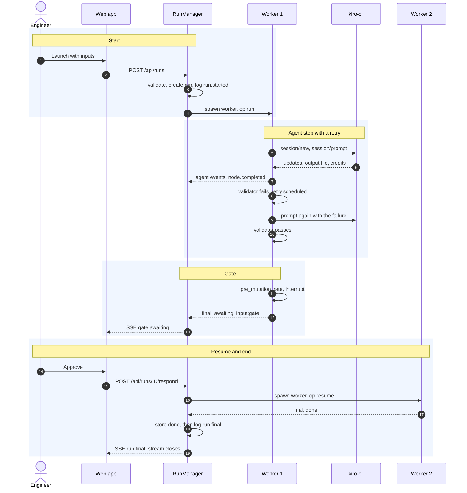
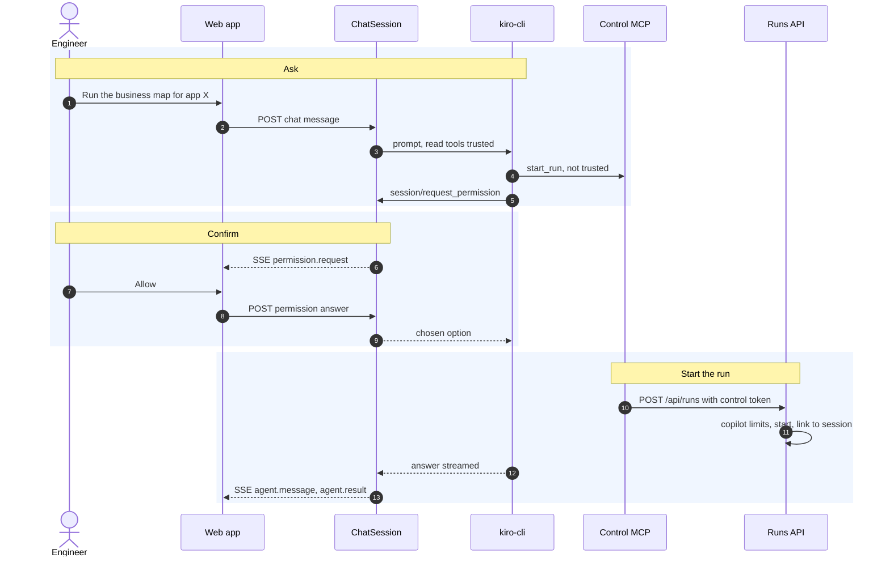
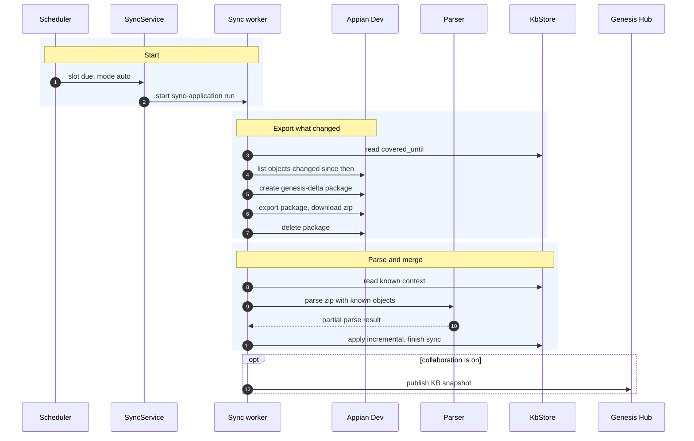
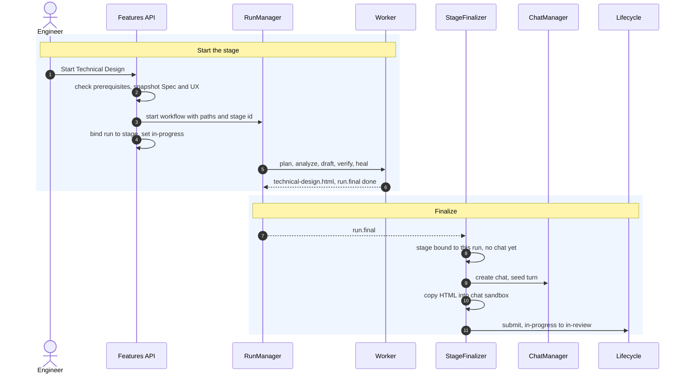
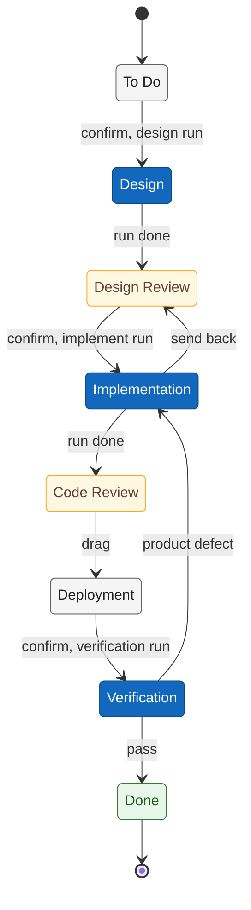
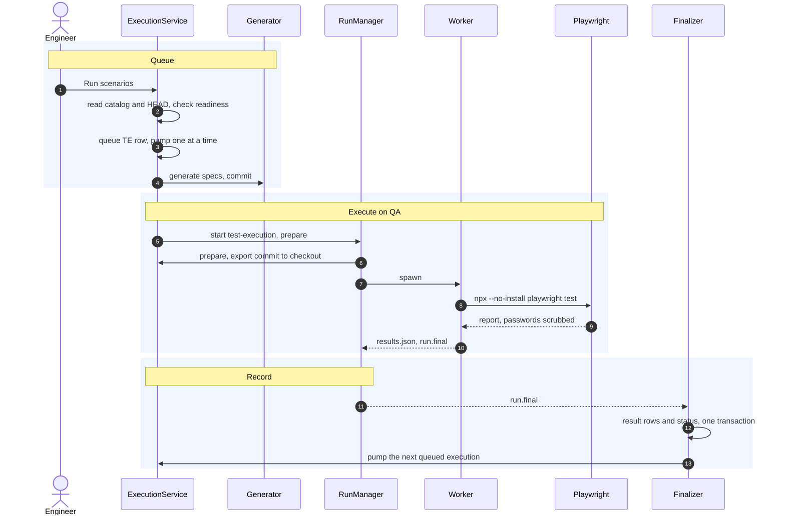

# 7. Runtime view: the main scenarios

> **Describes:** genesis v0.81.0 (Phase 51) · **Last reviewed:** 2026-11-11 · arc42 section 6

This page follows the most important things Genesis does, from the first click to the last write, across
modules. Each scenario is a short sequence with links to the module document that has the detail. Read
[04-container-view.md](04-container-view.md) first: it names the processes that appear here.

| # | Scenario | Modules involved |
|---|---|---|
| 7.1 | A workflow run with a retry and a gate | runs and workers, core engine, Kiro agent SDK, web app |
| 7.2 | A chat turn in copilot mode that starts a run | chat and skills, Kiro agent SDK, runs and workers |
| 7.3 | A scheduled incremental KB sync | scheduler and jobs, knowledge base, Appian parser, collaboration Hub |
| 7.4 | A feature stage analysis becomes a review chat | features and stages, runs and workers, chat and skills |
| 7.5 | A story moves through the Workbench | stories and Workbench, features and stages, testing |
| 7.6 | A test execution on QA | testing, runs and workers |
| 7.7 | The app restarts while runs are active | runs and workers, API, every finalizer |
| 7.8 | Genesis updates itself to a new tag | distribution |

## 7.1 A workflow run with a retry and a gate

The engineer launches a workflow. The app records the run and starts a worker. The worker runs the graph; an
agent step's output fails its check once, is retried with the reason and passes. The graph stops at a gate and
the worker exits. When the engineer approves, a new worker resumes from the checkpoint and the run ends.

1. **Start.** `RunManager.start` validates inputs against the workflow's schema, provisions uploaded files into
   the run folder, creates the run record and logs `run.started`. See
   [runs-and-workers.md](modules/runs-and-workers.md#52-starting-a-run).
2. **Worker.** `python -m genesis.runs.worker` imports `graph.py`, builds the context and streams the graph. It
   prints one JSON line per node and per event.
3. **Agent step.** `kiro_node` starts `kiro-cli acp` with only its MCP servers, captures the prompt into
   `_prompts/`, streams the conversation as events and records metered credits. See
   [core-engine.md](modules/core-engine.md#52-what-an-agent-node-does-step-by-step) and
   [kiro-agent-sdk.md](modules/kiro-agent-sdk.md#52-a-turn).
4. **Retry.** The validator reads the output file. On failure the trio adds 1 to the retry count and routes back
   to the agent, which reads the failure message in its next prompt.
5. **Gate.** `hitl_gate` calls `interrupt()`. The worker reports `awaiting_input:gate` and exits. The app logs
   `gate.awaiting` and keeps the live stream open.
6. **Resume.** `respond` logs `gate.resolved` and starts a new worker with `Command(resume=decision)`.
7. **End.** The app stores `done` with a compare-and-set, then logs exactly one `run.final`, closes the stream and
   deletes the tool-output store. Observers react to `run.final` (L-093).

## 7.2 A chat turn in copilot mode that starts a run

The engineer asks in chat. The agent decides to start a run and calls the control server's `start_run` tool.
That tool is not trusted, so Kiro asks the client for permission. The session shows a confirm card and waits.
Only after the engineer allows it does the control server call `/api/runs` with the session's token. The API
applies the copilot limits, starts the run and links it to the session.

- The trusted tools are a short read-only list in `@server/tool` form; mutating tools always ask (ADR-033).
- Read-only chat runs with `auto_deny`, so the same call would simply be refused.
- When the linked run reaches a gate or ends, the chat run supervisor writes a note into the transcript. The
  copilot never answers a workflow gate without a confirm.

Detail: [chat-and-skills.md](modules/chat-and-skills.md#55-copilot-confirm-cards-and-the-control-token).

## 7.3 A scheduled incremental KB sync

The scheduler fires the application-sync job. The job asks the sync service to start the `sync-application`
workflow. The worker finds what changed in the Dev environment since this machine's last sync, exports only
those objects (plus the roots the parser needs) in a temporary package, parses it against what the knowledge
base already knows, and merges the result. A full sync happens instead when, for example, the recorded
`KB_FORMAT_VERSION` is lower than the parser's.

- Only the single Dev environment feeds the KB (ADR-036, ADR-048). The KB never stores SAIL code (ADR-037).
- Package tools are used only by program code, only on `genesis-delta-*` packages (ADR-073).
- The watermark is captured before the work it covers (L-080).

Detail: [knowledge-base.md](modules/knowledge-base.md#54-an-incremental-sync-end-to-end),
[appian-parser.md](modules/appian-parser.md), [scheduler-and-jobs.md](modules/scheduler-and-jobs.md).

## 7.4 A feature stage analysis becomes a review chat

The engineer starts the stage. The route checks the stage's prerequisites, writes the input documents to files
and starts the workflow with their paths. When the run ends, the stage finalizer checks that the stage is still
bound to this run, opens a review chat for the stage, copies the artifact into that chat's folder and moves the
stage to In review through the lifecycle service. From there the engineer refines the document in chat and
approves it.

Detail: [features-and-stages.md](modules/features-and-stages.md#57-how-an-analysis-stage-is-produced).

## 7.5 A story moves through the Workbench

A story card starts in To Do and moves down the lanes to Done. The three dark blue lanes (Design, Implementation,
Verification) each run a workflow: dragging a card into one opens a confirm, and the confirm starts the run. When
the run ends, its finalizer moves the card ("run done"): Design goes to Design Review, Implementation goes to Code
Review or back to Design Review, and Verification goes to Done on a pass or back to Implementation on a product
defect. The yellow lanes are human reviews, and the Deployment drag is plain. The agent never moves a card.

1. **Design.** The confirm starts `story-design-analysis` with the story and snapshots of the feature's Spec, UX
   Design and Technical Design. The finalizer opens a design-review chat and moves the card to Design Review.
2. **Implementation.** The confirm is the single blanket approval for every write of the run (ADR-068). The
   workflow writes a rollback document first, then creates and updates design objects in Dev through
   `appian-dev-write`, which has no delete tools. It writes Object Wiki entries. The finalizer moves the card to
   Code Review, or back to Design Review if the design no longer fits.
3. **Deployment.** A plain drag; the engineer deploys outside Genesis.
4. **Verification.** The engineer confirms QA has the changes. The run is queued with the test executions and
   runs on QA as the application's test users. Pass moves the card to Done; a product defect moves it to
   Implementation with a defect report; a blocked result stops at a gate (ADR-084).

Detail: [stories-and-workbench.md](modules/stories-and-workbench.md#51-the-lanes-and-which-transition-starts-which-workflow).

## 7.6 A test execution on QA

The engineer runs scenarios. The service checks that the scenarios are automated and QA is ready, queues the
execution, generates the scenario specs from the catalog and commits them. The run's `prepare` hook exports that
commit into the run folder before the worker starts, so the run uses exactly the committed code (ADR-081). The
worker runs Playwright; credentials for the test users exist only in that child process's environment, and the
report is scrubbed of them. The finalizer stores the results and starts the next queued execution.

Detail: [testing.md](modules/testing.md#59-starting-an-execution).

## 7.7 The app restarts while runs are active

1. The app process stops. Its workers lose their parent and stop when their pipes close.
2. On the next `genesis serve`, `RunManager` migrates the database.
3. The first startup hook takes the run-owner lock (`~/.genesis/run/runs.lock`). If another live Genesis process
   holds it, nothing is touched (L-097).
4. Every `pending` or `running` run without a worker is checked against the event log. A run whose log already
   shows a terminal `run.final` (or a gate as its last event) adopts that status. Any other run is failed with
   "worker lost across a server restart". Paused and gated runs are never touched.
5. Then every finalizer reconciles: stage, story design, story verification, test executions, captures, composes,
   test links and top-ups. Each one finishes the domain work of runs that ended while the app was down (L-058).
6. The scheduler and the collaboration auto-pull loop start.

Detail: [runs-and-workers.md](modules/runs-and-workers.md#58-recovering-after-a-restart) and
[api.md](modules/api.md#54-startup-and-shutdown).

## 7.8 Genesis updates itself to a new tag

1. The web app polls `GET /api/system/update`. The updater fetches tags and compares the highest `vX.Y.Z` tag
   with the deployed version. A developer checkout (no `~/.genesis/dist.json`) never reports an update.
2. The engineer clicks Update. `POST /api/system/update` streams progress lines while it checks out the tag,
   runs that tag's `scripts/install-packages.sh`, runs `genesis db upgrade`, refreshes the workflow library and
   records the deployed version.
3. It starts a detached `genesis down` + `genesis up`. The web app polls `/api/config/health` and reloads.

Detail: [distribution.md](modules/distribution.md#59-updating-in-place-by-release-tag).
