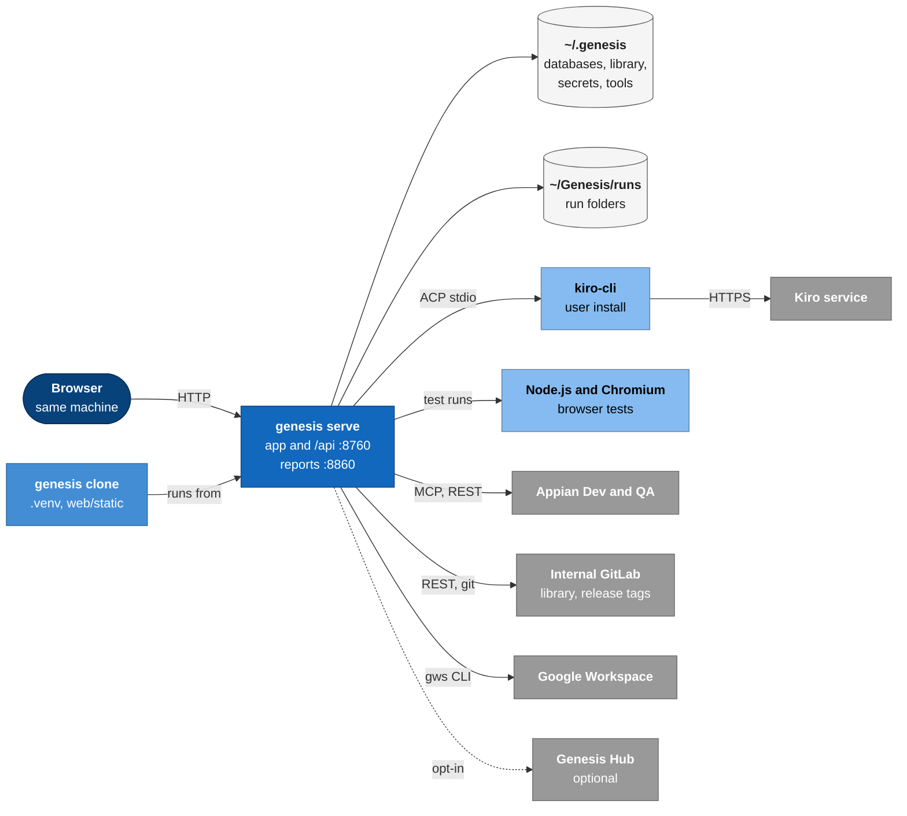

# 9. Deployment view

> **Describes:** genesis v0.81.0 (Phase 51) · **Last reviewed:** 2026-11-11 · arc42 section 7

Genesis has one deployment shape: everything runs on the engineer's own computer. This page shows what is
installed where, which ports are used, and the two variants (a developer checkout and a two-instance test
fleet). Installation steps for users are in `docs/INSTALL.md` of the genesis repo; the install and update
mechanics are in [distribution.md](modules/distribution.md).

## 9.1 One machine

Everything except the grey boxes runs on the engineer's computer. `genesis serve` runs from the clone's virtual environment and listens on two loopback ports: 8760 for the app and 8860 for reports. It keeps its data in `~/.genesis` and `~/Genesis/runs`. Kiro CLI, Node.js and Chromium are local programs: the user installs Kiro CLI and Node.js, and Genesis installs Chromium. The grey boxes are outside the computer. Genesis reaches Appian, GitLab and Google directly, and the Kiro service only through kiro-cli. The dotted line is the optional Genesis Hub, used only when collaboration is on.

## 9.2 What is installed where

| Item | Location | Installed by |
|---|---|---|
| Genesis code | A clone of `genesis` (default `~/genesis`, or the developer's checkout) | `git clone`; then `scripts/install.sh` |
| Python packages | `<clone>/.venv` | `scripts/install-packages.sh` (the only install command, ADR-080) |
| Built web app | `<clone>/web/static/` (committed); in a wheel, `genesis/web_static` | Comes with the code |
| Workflows and skills | `~/.genesis/library/`, `~/.genesis/.kiro/skills/` | `genesis install` or the Catalog page |
| Dev and DevOps MCP servers | `~/.genesis/mcp-servers/<id>/versions/<v>/` with their own `.venv` | Settings → Integrations, or `genesis mcp install-native` |
| `gws`, `sail` | `~/.genesis/cli-tools/<id>/versions/<v>/` | Settings, or `genesis cli install-native`; `sail` comes inside the Dev MCP bundle |
| Chromium for tests | `~/.genesis/testing/browsers/` | Testing → Setup → Install Chromium |
| `playwright-appian` | Vendored tarball inside genesis, installed into each test workspace | Testing → Setup |
| Kiro CLI | User's PATH (for example `~/.local/bin/kiro-cli`) | The user |
| Node.js 20+ | User's PATH | The user |

## 9.3 Ports and processes

| Port | Listener | Notes |
|---|---|---|
| 8760 | The app: `/api`, the SPA, Swagger at `/docs` | Loopback by default; `--port` to change |
| 8860 | The reports origin | App port + 100 by default; `--reports-port` or `GENESIS_REPORTS_PORT` |
| 5173 | Vite dev server (development only) | Proxies `/api` to 8760 |

`genesis up` runs `genesis serve` in the background and writes `~/.genesis/run/genesis.pid` and `genesis.log`.
`genesis down` stops it. The run-owner lock `~/.genesis/run/runs.lock` belongs to the serving process.

## 9.4 Variants

**Managed install (a user).** `scripts/install.sh` creates the clone, the virtual environment and
`~/.genesis/dist.json`, which marks the clone as managed. The in-app updater works only on a managed install
(section 7.8 of [07-runtime-view.md](07-runtime-view.md#78-genesis-updates-itself-to-a-new-tag)).

**Developer checkout.** The developer runs `scripts/install-packages.sh --editable --dev` in their checkout. No
`dist.json` exists, so the updater never touches it. `npm run dev` in `web/` serves the SPA from source on
:5173.

**Two-instance fleet (testing collaboration).** A separate developer tool, `genesis-fleet` (`gsm`), runs several
Genesis instances on one machine. For each instance it sets `GENESIS_STATE_DIR`, `GENESIS_ARTIFACTS_DIR`, the
collaboration variables and a port, then calls the normal `genesis` commands. The current fleet runs `main` on
:8760 (reports :8860) and `userb` on :8761 (reports :8861) from the editable developer environment. The fleet is
not part of the product; nothing in Genesis depends on it.

## 9.5 Environments Genesis talks to

| Environment | How many | Used for |
|---|---|---|
| Appian Dev | Exactly one, marked Dev in Settings → Environments | KB sync, live object code, design and implementation lanes, the Genesis Hub app |
| Appian QA | At most one, on its own host | All test execution and agent browser sessions (ADR-082) |
| Other types (UAT, Production, Other) | Any | Recorded only; no automated traffic |

Credentials for each environment are stored in the SecretProvider under that environment's scope, never in
`environments.json` (ADR-048).
