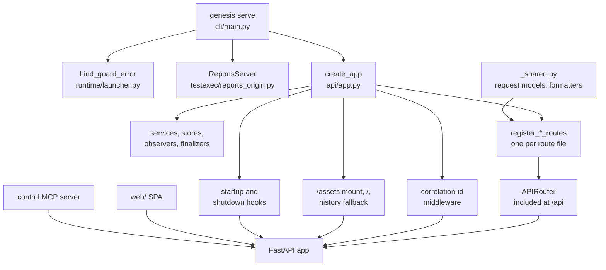
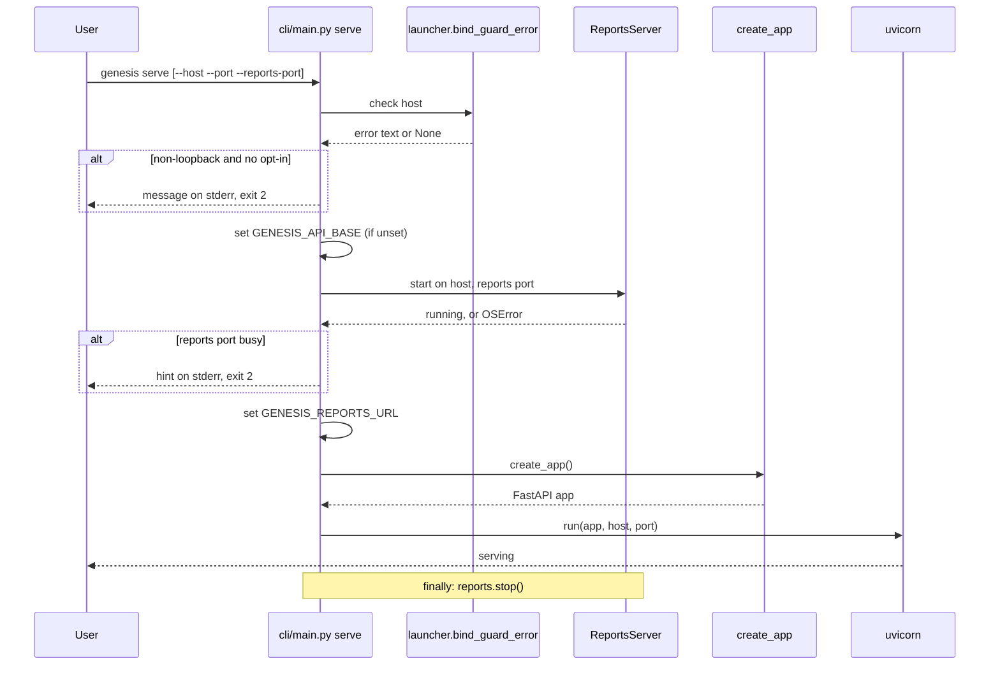
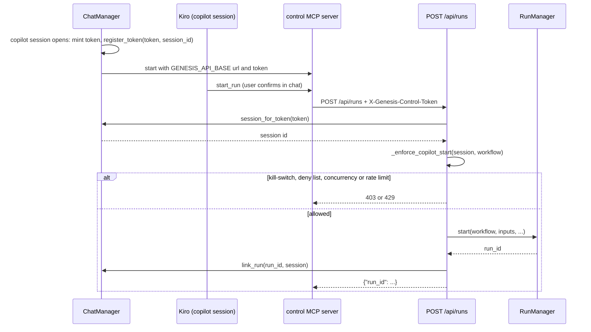

# Module: API (`genesis/api/`)

> **Describes:** genesis v0.81.0 (Phase 51) · **Last reviewed:** 2026-11-11 · C4 level 3 · area `api`

## 1. Purpose

The API module is the front door of the Genesis app process. It builds one FastAPI application, wires every
service into it, registers the HTTP routes of every other module under the `/api` prefix, and serves the built web
app (the SPA) from the same origin.

Its central idea is that `genesis/api/app.py` is the **one place where the app process is assembled**. The function
`create_app` creates each service, attaches each run observer and finalizer, hands the right services to each route
module, and declares what happens at startup and shutdown. The route modules hold thin HTTP code. The logic lives in
the modules that own it (runs, chat, knowledge base, testing, and so on), and each of those has its own document.

This document covers the assembly, the shared conventions (prefix, errors, status codes, the copilot control token),
how `genesis serve` binds its ports, the routes the API module owns itself, and an index that tells you which
module document describes each route file.

## 2. At a glance

| Item | Value |
|---|---|
| Code | `genesis/api/` (assembly in `app.py`, shared request models in `_shared.py`, one `register_*_routes` function per route file) |
| Runs in | The app process (`genesis serve`, or `genesis up` which starts `serve` in the background). Never in a run worker. |
| Depends on | FastAPI 0.139 (the version in the dev venv), Starlette, `sse-starlette`, `uvicorn`; almost every `genesis/` package: `runs`, `chat`, `skills`, `kb`, `services`, `testexec`, `collab`, `config`, `dist`, `memory`, `runtime` |
| Used by | The web app (`web/`), the control MCP server (`genesis/mcp/control_server.py`, which calls back into `/api`), the launcher health check, tests |
| Stores | Nothing of its own. It owns no table and no data folder. |
| Entry points | `genesis.api.create_app` (also `genesis/api/__init__.py`), the `serve` branch of `genesis/cli/main.py` |
| Ids and versions | `FastAPI(title="Genesis", version="0.81.0")` is a literal in `app.py`. A release must change it by hand. |
| Prefix | Every endpoint the SPA calls is under `/api` (ADR-028). The one exception is the reports origin, a different listener (section 5.7). |

## 3. Concepts

| Term | Meaning |
|---|---|
| **`create_app`** | The factory in `genesis/api/app.py`. It returns the FastAPI app. Tests call it with their own `RunManager` and `Settings`. |
| **Route module** | A file in `genesis/api/` that defines `register_<name>_routes(api, ...)`. The function adds handlers to a shared `APIRouter` and receives its services as arguments. |
| **The `api` router** | One `APIRouter()` created in `create_app`. Every route module adds its handlers to it. At the end `app.include_router(api, prefix="/api")` mounts it. |
| **Observer / finalizer** | An object that watches run events (`attach()`) and turns a finished run into a domain record. `create_app` builds them and attaches them. See [runs-and-workers.md](runs-and-workers.md) for the event side. |
| **Startup reconcile** | A catch-up pass run at app start that finishes the work of runs that ended while the app was down (L-058). |
| **`app.state`** | Attributes on the FastAPI app that expose services to tests and to the run-supervision bridge. |
| **SPA shell** | The built `index.html` of the React app. The backend serves it for `/` and for every path that is not `/api/...` or `/assets/...`. |
| **History fallback** | Serving the SPA shell for client-side routes such as `/runs/r-abc`, so a reload or a deep link works. |
| **Correlation id** | A 12-character request id bound to the logging context for the length of one request. |
| **Control token** | A per-session secret that a copilot chat session sends in the `X-Genesis-Control-Token` header so the API can tell a copilot call from a browser call (ADR-033). |
| **Reports origin** | A second loopback listener, by default the app port plus 100, that serves Playwright reports as static files and has no `/api` (ADR-085). |
| **Bind guard** | The check that refuses to serve on a non-loopback address unless the user opts in (ADR-026). |

## 4. Structure



The CLI checks the bind, starts the reports origin, then calls `create_app`. `create_app` builds the services, hands
them to the route modules, and ends with one FastAPI app that carries the `/api` router, the middleware, the lifecycle
hooks and the SPA routes. The SPA and the control MCP server are the two callers.

| File | What it contains |
|---|---|
| `app.py` | `create_app`, `_resolve_web_static`, `WEB_STATIC`, `_default_source_factory`, the correlation-id middleware, the startup and shutdown hooks, the SPA routes |
| `_shared.py` | Request models used by several route files (`StartRun`, `Respond`, `Fork`, `StatePatch`, `TokenBody`, `SecretBody`, `EnvBody`, `DevEnvBody`, `InstallBody`, `UpdateBody`), preview and media-type tables for artifacts, formatters `_record`, `_card`, `_cli_card`, `_field`. Depends only on the standard library and pydantic, so route files do not import `app.py` (this removed an import cycle in Phase 25). |
| `run_routes.py` | Run start (with copilot enforcement), upload, list, get, state, pause, resume, cancel, respond, fork, artifacts, events, steps, transitions, node iterations, SSE stream; the per-session skill-output file routes |
| `catalog_routes.py` | `/catalog`, `/catalog/available`, `/library/*`, `/workflows/{id}`, `/home`; the `_INTERNAL_MCP` filter |
| `home.py` | `build_home(manager, config, loader)`: the pure aggregation behind `GET /api/home` |
| `search.py` | `GET /api/search` |
| `system.py` | Update check and apply, Kiro sign-in, first-run preflight, memory status |
| `config_routes.py` | Settings and integrations (health, GitLab token, MCP and CLI cards, secrets, environments, retention) |
| `chat.py`, `skills.py`, `applications.py`, `documents.py`, `features.py`, `change_requests.py`, `testdesign.py`, `testing.py`, `workbench.py`, `object_wiki.py`, `collab.py`, `collab_sync.py`, `memory.py`, `metrics.py`, `schedules.py`, `native_mcp.py`, `native_cli.py` | Route modules for other modules' features (index in section 6.2) |
| `studio.py` | Not part of the app. It builds one installed workflow's graph at import time, for the interim LangGraph Studio debug harness (`langgraph dev`). Reads `GENESIS_STUDIO_WORKFLOW`. `create_app` never imports it (ADR-023). |
| `__init__.py` | Exports `create_app` |

## 5. How it works

### 5.1 How `genesis serve` starts the app



The bind guard runs first, so a refused host opens neither port. The reports origin starts before the app, and
`serve` stops it in a `finally` block when uvicorn returns.

Steps, from the `serve` branch of `genesis/cli/main.py`:

1. Parse `--host` (default `127.0.0.1`), `--port` (default `8760`), `--i-understand-no-auth` and `--reports-port`.
2. Call `bind_guard_error(host, allow=flag)`. If it returns text, print it to stderr and exit with code 2. If the host
   is not loopback but the user opted in, log the warning from `bind_warning`.
3. Compute the callback host. `0.0.0.0` and `::` cannot be dialled, so they become `127.0.0.1`. Then
   `os.environ.setdefault("GENESIS_API_BASE", "http://<callback_host>:<port>")`. `setdefault` keeps a value the user
   already exported.
4. Load `Settings` and pick the reports port: `--reports-port`, else `settings.reports_port` (env
   `GENESIS_REPORTS_PORT`), else app port plus 100 (`PORT_OFFSET`). Start `ReportsServer(host, port, default_roots(artifacts_dir))`.
   On `OSError`, print "could not open its reports port" with a hint and exit 2.
5. Set `os.environ["GENESIS_REPORTS_URL"] = "http://<callback_host>:<reports port>"`. This one is assigned, not
   `setdefault`, so it always matches the listener that just started.
6. Print the two addresses, then `uvicorn.run(create_app(), host=host, port=port)`.

Steps 3 and 5 come before `create_app()` on purpose: `Settings.load()` inside `create_app` reads both variables
(`api_base`, `reports_url`). `api_base` becomes the base URL of the control MCP server in copilot chats. `reports_url`
is what the testing code uses to build report links; when it is empty the API answers no report links.

`genesis up` is the background form. It runs the same bind guard, then `launcher.up(host, port, open_browser)`:

1. If the PID file `<state dir>/run/genesis.pid` names a live process, print the address and stop (optionally open the
   browser).
2. Otherwise start `genesis serve --host <h> --port <p>` as a detached child (`start_new_session=True`), with output
   appended to `<state dir>/run/genesis.log`, and write its PID.
3. Poll `GET /api/config/health` once a second for up to 30 seconds. A 2xx answer means healthy. If the child exits
   first, print the last 20 log lines and return 1.
4. Open the browser unless `--no-open`.

`genesis down` sends SIGTERM, waits up to 10 seconds, then SIGKILL. `genesis status` reports "running + healthy",
"running but health failing" or "stopped". `genesis logs [-f]` prints or follows the log.

### 5.2 How `create_app` assembles the app

`create_app(manager=None, settings=None, source_factory=None)` runs top to bottom once. The order matters because
later steps use objects built earlier, and because an observer must exist before any run can start.

Setup, before any route:

1. Resolve `settings` (the argument, else the manager's, else `Settings.load()`), call `configure_logging()`.
2. Create `RunManager(settings)` unless one was passed. Its constructor migrates `genesis.db`.
3. Call `migrate_memory(settings)`. The separate `memory.db` has its own migration set (ADR-054).
4. Create `Loader(settings.library_dir, settings.lockfile_path)` and `ConfigService(settings)`.
5. Pick the library `source_factory`. The default reads the secret `GITLAB_TOKEN`, answers 400 if it is missing, and
   builds a `GitLabClient` for `https://gitlab.appian-stratus.com`, project `ramaswamy.u/genesis-workflows`. Tests pass
   a factory that returns a local source, so they run offline.
6. Create `FastAPI(title="Genesis", version="0.81.0")`, add the correlation-id middleware, and create the shared
   `api = APIRouter()`.

Then services and routes, in this order (each row builds what it names and calls the listed `register_*` function):

| # | Built | Attached to run events | Routes registered | Why it sits here |
|---|---|---|---|---|
| 1 | `ChatManager`, `ChatRunSupervisor` | `supervisor.attach()` | `register_chat_routes` | The supervisor must observe events before any run starts. |
| 2 | `StageFinalizer` | `attach()` | (used by later routes) | Turns `ux-design-analysis` runs into stage artifacts. |
| 3 | `SkillService(settings.skills_dir)` | none | `register_skills_routes` | Also stored as `app.state.skills`. |
| 4 | none | none | `register_native_mcp_routes`, `register_native_cli_routes` | Managed-native Dev/DevOps MCP and `gws`. |
| 5 | `KbStore`, then `CollaborationService` | none | `register_applications_routes` | The collaboration service is built before applications because the KB pull and publish surface shares that one instance. |
| 6 | none | none | `register_documents_routes` | |
| 7 | `TestImpactService`, `TestDesignStageService` | `SyncLinkObserver`, `TopupRunObserver` | `register_testdesign_routes` | Registered **before** the features routes (section 5.3). |
| 8 | `TestingJobs` (setup jobs, library replays) | none | `register_testing_routes` | Job registry first; error text is scrubbed of test passwords. |
| 9 | `TestExecutionService`, `TestExecutionFinalizer` | `attach()` | `register_execution_routes` | One execution at a time per machine. |
| 10 | `RegressionService` | none | `register_regression_routes` | Needs the execution service. |
| 11 | `ApwtFactory`, `TestLibraryService`, `RecordingService`, `ComposeService`, `ProposalService`, `CaptureFinalizer`, `ComposeFinalizer` | both finalizers `attach()` | `register_library_routes` | Library, recordings and compose. |
| 12 | none | none | `register_features_routes` (registers the change-request routes itself) | After the test design routes. |
| 13 | `StoryDesignFinalizer`, `StoryImplementationFinalizer`, `StoryVerificationService`, `StoryVerificationFinalizer` | each `attach()` | `register_workbench_routes` | Finalizers are built first so the routes can call their on-read recovery. |
| 14 | none | none | `register_search_routes`, `register_object_wiki_routes`, `register_collab_routes`, `register_collab_sync_routes` | |
| 15 | `CollabAutoPuller` (not started yet) | none | none | Stored as `app.state.collab_autopull`. |
| 16 | none | none | `register_system_routes`, `register_memory_routes`, `register_metrics_routes` | |
| 17 | `ScheduleStore`, `Scheduler` with the sync, memory and regression jobs registered | none | `register_schedules_routes` | The scheduler is not started until the startup hook. |
| 18 | none | none | `register_catalog_routes`, `register_config_routes`, `register_run_routes` | Last of the `api` registrations. |

After the last registration:

- `app.include_router(api, prefix="/api")` mounts everything under `/api`.
- The SPA routes are added (section 5.5). They come after the API include, so an API path always matches first.

The services are also kept on `app.state` (for example `chat`, `run_manager`, `kb_store`, `test_impact`,
`test_design`, `test_executions`, `test_library`, `story_verification`, `collab`, `scheduler`, `schedule_store`).
Tests and the run-supervision bridge read them there. Not every service is on `app.state`; for example
`test_execution_finalizer` and `story_impl_finalizer` are only passed to the routes that need them.

Observers attach in the order shown. Every `attach()` call happens during `create_app`, before uvicorn accepts a
request, so no run can start without its observers in place.

### 5.3 How route order is kept correct (L-096)

FastAPI matches routes in registration order. A generic route such as `/features/{feature_id}/stages/{stage}/start`
would answer for `/features/3/stages/test_design/start` if it came first, and it answers 400 for every stage except
Technical Design. So `register_testdesign_routes` runs before `register_features_routes` in `app.py`, and the comment
there says why.

The same rule shows up inside route files:

- `run_routes.py` registers `/runs/{run_id}/artifacts/{name:path}/download` before
  `/runs/{run_id}/artifacts/{name:path}`, because the greedy `:path` converter would swallow the `/download` suffix.
  `{name:path}` also lets nested names such as `_toolcalls/call_1.out` resolve.
- Literal paths are registered before the parameter route that would also match them. Examples: `/applications/available`
  before `/applications/{app_uuid}`, `/documents/search` before `/documents/{document_id}`, `/skills/available`
  before `/skills/{skill_id}`, `/config/environments/dev/check` before the `{label}` routes, `/memory/review`,
  `/memory/graph` and `/memory/entities` before `/memory/{memory_id}`.

Two practical points from L-096 for tests and new code:

- In FastAPI 0.139 an included router appears in `app.routes` as one `_IncludedRouter` entry. A route-order test must
  read its `original_router.routes`, and it should also check that the specific handler answered (a response field
  only it sets).
- With postponed annotations (`from __future__ import annotations`), a request body model that is imported inside the
  registering function is read as a query parameter. Import body models at module level. `testing.py` does this for
  `ImpactBody` and `ScenarioCreate`, with a comment.

### 5.4 Startup and shutdown

The hooks use `@app.on_event`. Starlette runs the handlers of each list one after another, in the order they were
registered. The startup hooks are marked `# pragma: no cover`.

**Startup**, in order:

1. `_bind_supervisor`
   1. `supervisor.bind_loop(asyncio.get_event_loop())` so the supervisor can schedule work on the app's loop.
   2. `manager.fail_orphaned_runs()` through `asyncio.to_thread`. This comes first so every later reconcile sees a
      terminal status and a `run.final` instead of a `running` record that can never finish. Only the process that
      holds the run-owner lock fails runs (L-097); the lock is described in [runs-and-workers.md](runs-and-workers.md).
      A failure here is logged and boot continues.
   3. `supervisor.reconcile()`, `stage_finalizer.reconcile()`, `story_design_finalizer.reconcile()`, each in its own
      `try`. A failure in these three is swallowed without a log line.
2. `_reconcile_test_links`, every call through `asyncio.to_thread` so blocking database work stays off the event loop
   (L-026):
   1. `test_impact.reconcile_all()`
   2. `test_design.reconcile_topups()`
   3. `test_execution_finalizer.reconcile()` (executions whose run ended while down, then the queue)
   4. `story_verify_finalizer.reconcile()`
   5. `capture_finalizer.reconcile()` and `compose_finalizer.reconcile()`, then only if
      `manager.holds_run_owner_lock()`: `test_recordings.reap_stale()`, `test_library.reap_stale_replays()`,
      `test_jobs.reap_stale()`, `test_library.prune_replays()` (keeps the newest 20 per application, per the comment).
      Items 3, 4 and 5 each have their own `try`. Inside item 5 the calls share one `try`, so a failure in the first
      call skips the rest of that group.
   Each failure is logged and boot continues.
3. `_start_scheduler` calls `scheduler.start()`.
4. `_start_collab_autopull` calls `collab_autopull.start()`.

**Shutdown**, in order: `chat.aclose_all()`, `scheduler.stop()`, `collab_autopull.stop()`. The reports origin is not
part of the app. `serve` stops it after uvicorn returns.

The rule behind the reconcile calls is L-058: an observer can miss a live terminal event, so each finalizer also
recovers at startup and, for most, on read. The reconcile code belongs to the owning modules; the API module only
decides when it runs.

### 5.5 How the SPA is served

1. At import time `WEB_STATIC = _resolve_web_static()` runs. The function checks two folders and returns the first one
   that contains `index.html`: `genesis/web_static` (an installed wheel) and `<repo>/web/static` (the editable dev
   tree). If neither has it, it returns the packaged path, so a missing bundle means "API only" and not a wrong path.
2. If `WEB_STATIC/index.html` exists, `create_app` adds:
   - `app.mount("/assets", StaticFiles(directory=WEB_STATIC/"assets"))`. These files have content-hashed names.
   - `GET /` returning `index.html`.
   - `GET /{full_path:path}` returning `index.html` for any other path (the history fallback).
3. Both HTML responses carry `Cache-Control: no-cache, must-revalidate` (L-068). The browser then revalidates the shell
   on every reload and picks up the newest hashed bundle. The `/assets` files get no cache header from the app.
4. The fallback answers 404 `{"detail": "not found"}` when the path starts with `api/` or `assets/`. A mistyped API
   path therefore returns JSON 404, not the SPA shell (test: `test_spa_history_fallback`).

The built bundle is committed in `web/static/`. The wheel ships it as package data: `pyproject.toml` has
`[tool.hatch.build.targets.wheel.force-include]` mapping `web/static` to `genesis/web_static` (L-048). Without that
line the wheel contained no SPA and `/` returned 404 on a real install while `/api` worked.

### 5.6 How the copilot control token works (ADR-033)

ADR-033 lets a chat copilot start and supervise runs, but only at the run-management layer and only with a human
confirm. The API side of that rule is the control token.



The control server adds the header; the API resolves it to a chat session and applies the copilot limits before it
starts anything.

Details from the code:

- A copilot-mode session mints `secrets.token_urlsafe(24)` when its client is built, and registers it with
  `ChatManager.register_token`. The map from token to session is an in-memory dict, so tokens do not survive an app
  restart. Other chat modes mint no token.
- `POST /api/runs` reads the optional header `X-Genesis-Control-Token`. No token means a browser call. A token that
  resolves to a session means a copilot call.
- For a copilot call `_enforce_copilot_start` refuses with:
  - 403 when the copilot kill-switch is off (`chat.copilot.enabled` false),
  - 403 when `launch_allowed(workflow_id)` is false (allow or deny list),
  - 429 when the session already has `max_active_runs` runs that are not `done`, `failed` or `cancelled`,
  - 429 when the session started `rate_limit_per_min` or more runs in the last 60 seconds. The window is a list of
    start times per session, kept in memory in the route function.
- After a successful start, `chat.link_run(run_id, session_id)` ties the run to the session so the supervisor can
  watch it.
- `GET /api/chat/runs` accepts the same header, or a `session` query parameter from the UI.
- `POST /api/runs/upload` takes no token. Its docstring calls it browser launch only.

What the token is not: it is not authentication. A caller that leaves the header out is treated as a browser and skips
the copilot limits. Only run start checks the token. `respond`, `cancel` and the other run routes do not read it.
The human confirm for those actions is enforced in chat by the ACP permission prompt (ADR-033), not by this API.
This follows from Genesis having no authentication (ADR-026).

### 5.7 The reports origin and the `/api` rule

ADR-028 says every endpoint lives under `/api`, so the API never collides with the SPA's client routes (`/runs`,
`/catalog`, `/settings`). The web client adds the prefix in one place and rejects non-JSON answers (L-010).

ADR-085 adds one exception outside the app: Playwright reports run their own scripts and contain untrusted text from
the QA site. Served from the app's origin, a report script could call `/api` and drive every route, since there is no
auth. So `serve` also starts a minimal read-only file server on a second loopback port. It has no `/api`, answers only
GET and HEAD, checks the `Host` header, and serves only registered report folders. Its code and rules are described in
[testing.md](testing.md). The API module's part is small:

- `serve` starts it before the app and stops it after (section 5.1).
- `GENESIS_REPORTS_URL` tells the testing routes where to point report links.
- The old report path `GET /api/applications/{app_uuid}/testing/executions/{key}/report/{path}` answers 410 with a
  `report_url` that points at the new origin.

### 5.8 Routes owned by the API module

**`GET /api/home`** (`catalog_routes.py`, `home.py`). `build_home` reads up to 10,000 runs from the run store and
returns `metrics` (totals, success rate, average duration, tool-call count, metered credits with provenance, `tokens`
always null), a 14-day `trend`, up to 20 `active_runs` newest first with the workflow name, `integrations` (one entry
per MCP card, CLI card and the GitLab token) and `installed` workflows. Credits come from the event log aggregates and
carry their provenance (ADR-032). It is a pure function, so tests call it without FastAPI.

**Catalog and library** (`catalog_routes.py`).
- `GET /api/catalog` lists installed workflows. `required_mcp` is filtered by `_INTERNAL_MCP`: the servers Genesis
  injects itself (`genesis-kb`, `genesis-memory`, `genesis-introspection`, `genesis-control`, `appian-dev`,
  `appian-devops`, `appian-dev-write`, `appian-dev-packages`) are removed, so they never show as prerequisites that
  disable Launch.
- `GET /api/catalog/available` reads the library through `source_factory`, takes its latest tag (or `main`), and lists
  workflows not yet installed. A library read error becomes 502.
- `POST /api/library/install` and `POST /api/library/update` call `Installer.install_selection`. A workflow id that is
  not in the library is 404, any other failure is 502, a missing token is 400 from the source factory. Update always
  installs the latest compatible ref.
- `DELETE /api/library/{workflow_id}` needs no source or token. It edits only the lockfile and files.
- `GET /api/workflows/{id}` returns the workflow META through the loader, `GET /api/workflows/{id}/graph` its graph
  description. A workflow that is not installed is 404. Install and the lockfile belong to [distribution.md](distribution.md).

**Search** (`search.py`). `GET /api/search?q=<term>&limit=6` returns `{"results": [...]}` over applications (name or
uuid), features (name) and documents (title and section text). The limit applies to each type, not the whole list.
Each hit is `{type, id, title, subtitle, url}` and `url` is the client route to open. An empty term returns an empty
list. A failing source is skipped, so search does not return 500. Matching is a case-insensitive substring test.

**System** (`system.py`).
- `GET /api/system/update` returns the update status (`current`, `latest`, `update_available`, `on_tracked_branch`,
  `scope`, `repo_available`, `managed`). A development checkout reports no update, because applying one would overwrite
  the editable installs. `POST /api/system/update?host=&port=` streams progress lines as plain text (fetch tags,
  checkout, install packages, `db upgrade`, library refresh) and ends by scheduling a detached restart. The SPA polls
  `/api/config/health` and reloads. The updater is described in [distribution.md](distribution.md).
- `GET /api/system/kiro` returns `{installed, authenticated, email?, start_url?}` from `kiro-cli whoami --format json`;
  tokens are never returned. `POST /api/system/kiro/login` (body `start_url`, `region`) starts a device-flow login on
  a pseudo-terminal in a background thread, `GET /api/system/kiro/login` is the poll (state, user code, verification
  URI), `POST /api/system/kiro/logout` signs out. There is one module-level login state, guarded by a lock, which fits a
  single-user app.
- `GET /api/system/preflight` returns `{items, ready}`. Required items: Kiro sign-in, database migrated, server
  healthy. Optional items: Appian dev environment, `uv`, Node.js 20 or newer, Playwright Chromium, the Google
  Workspace connector, and (only when a Hub is configured) the collaboration identity. `ready` means every required
  item is ok. Each item has `id`, `label`, `status`, `required`, `hint` and `fix_link`.
- `GET /api/system/memory` returns the read-only memory status (owner, `memory.db` version, counts, last runs). It is
  served here but described in [memory.md](memory.md).

## 6. Interfaces

### 6.1 Conventions that every route module follows

**Prefix and format.** Handlers are added to the shared router with paths such as `/runs`, so the public path is
`/api/runs`. Handlers return JSON, except artifact and report downloads, `GET /api/workbench/design-sdk.js`, the
design artifact (HTML) and a few text exports.

**Sync and async.** Most handlers are plain `def`, which FastAPI runs in its thread pool. A few are `async def`:
the SSE stream, run upload, chat mode changes and `sync-settings/run-now`.

**Error body.** Errors are `HTTPException`, so the body is `{"detail": ...}`. `detail` is a string for simple cases.
For conflicts it is an object with an `error` code. Examples seen in the code:
- run start with bad inputs: 400 `{"detail": {"error": "<message>", "details": [...]}}`,
- spec and change-request conflicts: 409 `{"detail": {"error": "illegal_transition" | "precondition_failed" | "stale_write", ...}}`,
- the testing routes: a refusal helper returns `{"detail": "...", "problems": [...]}` (top level, not nested), a type
  check failure returns 422 `{"detail": "...", "typecheck": [...]}`, and a compare-and-set conflict returns 409
  `{"detail": {"error": "stale_write", "expected": ..., "actual": ...}}`.

FastAPI's own request validation also answers 422 with its standard error list.

**Status codes.**

| Code | Used for |
|---|---|
| 200 | Success. Most mutating handlers also return 200 with a small JSON body such as `{"ok": true}` or `{"run_id": ...}`. |
| 202 | Work started in the background (setup jobs, workspace creation, Chromium install). The body is the job record. |
| 204 | A delete with no body (test cases and scenarios, regression note dismiss). |
| 400 | Invalid input: bad run inputs, a state patch that breaks the editing rules, a gate answer the gate does not accept, a failed file upload, a missing token for the library source. |
| 401 | The Hub rejected the service-account key (applications publish, collaboration sync). |
| 403 | A copilot start refused by the kill-switch or the allow/deny list. |
| 404 | The named entity does not exist (run, session, artifact, application, feature, workflow not installed). Each route module has a small `_require`-style helper for this. |
| 409 | State conflict: an illegal lifecycle transition, a stale write, resume or respond on a run that cannot take it, collaboration disabled, a one-time action already done. |
| 410 | The old in-app report route. |
| 413, 415 | Artifact or output too large for `mode=full`; binary content in a preview. Both say to use `/download`. |
| 422 | A required part of the request is missing or the target is not ready (for example finalize with no backlog, a test impact source without its ids). |
| 429 | A copilot concurrency or rate limit. |
| 502 | An upstream read or install failed (workflow library, skills library, MCP introspection). |
| 503 | The Hub is unreachable, the scheduler is not running, or composing is not available. |

**Pagination.** `GET /api/runs` takes `status`, `workflow`, `q`, `limit` (clamped to 1 to 100, default 20) and
`offset`. It returns `{runs, total, limit, offset}`.

**Streaming.** `GET /api/runs/{run_id}/events/stream` is Server-Sent Events through `sse-starlette`. It first replays
events after `after` from the durable log, then tails the live bus and skips any `seq` it has already sent (L-003).
`sse-starlette` ends frames with CRLF, so a reader must accept both separators (L-018). The run side is in
[runs-and-workers.md](runs-and-workers.md).

### 6.2 Route index: every route file, its URL prefixes and the document that owns it

Public paths start with `/api`. Paths below omit it. The "Owner" column names the document that describes the
endpoints. This document describes only the rows marked "this document".

| Route file | Registered by | URL prefixes | Owner |
|---|---|---|---|
| `run_routes.py` | `register_run_routes` | `/runs`, `/runs/upload`, `/runs/{run_id}` and its `/state`, `/pause`, `/resume`, `/cancel`, `/respond`, `/fork`, `/artifacts`, `/events`, `/events/stream`, `/steps`, `/transitions`, `/nodes/{node}/iterations` | [runs-and-workers.md](runs-and-workers.md); the copilot start check is in section 5.6 of this document |
| `run_routes.py` | same | `/chat/sessions/{session_id}/outputs` (list, content, download) | [chat-and-skills.md](chat-and-skills.md) |
| `metrics.py` | `register_metrics_routes` | `/system/metrics`, `/runs/{run_id}/provenance` | [observability-and-credits.md](observability-and-credits.md) |
| `chat.py` | `register_chat_routes` | `/chat/sessions` (and `/chat/sessions/{id}/...`), `/chat/actions`, `/chat/commands`, `/chat/models`, `/chat/runs`, `/config/copilot` | [chat-and-skills.md](chat-and-skills.md) |
| `skills.py` | `register_skills_routes` | `/skills`, `/skills/available`, `/skills/install`, `/skills/update`, `/skills/{skill_id}` | [chat-and-skills.md](chat-and-skills.md) |
| `applications.py` | `register_applications_routes` | `/applications`, `/applications/available`, `/applications/{app_uuid}` with `/sync`, `/sync-status`, `/objects`, `/bundles`, `/business-map` | [knowledge-base.md](knowledge-base.md) |
| `applications.py` | same | `/applications/{app_uuid}/pull`, `/applications/{app_uuid}/publish` | [collaboration-hub.md](collaboration-hub.md) |
| `object_wiki.py` | `register_object_wiki_routes` | `/applications/{app_uuid}/wiki`, `/applications/{app_uuid}/wiki/{object_uuid}` | [stories-and-workbench.md](stories-and-workbench.md) |
| `documents.py` | `register_documents_routes` | `/documents` (upload, gdrive, search, sync, `/{document_id}` with `/link`, `/sync`, `/tables`), `/applications/{app_uuid}/documents/sync` | [documents.md](documents.md) |
| `features.py` | `register_features_routes` | `/applications/{app_uuid}/features`, `/features/{feature_id}` with `/spec`, `/stages`, `/activity` | [features-and-stages.md](features-and-stages.md) |
| `features.py` | same | `/features/{feature_id}/stories` (finalize and story CRUD) | [stories-and-workbench.md](stories-and-workbench.md) |
| `change_requests.py` | `register_change_request_routes`, called from `features.py` | `/features/{feature_id}/change-requests` | [features-and-stages.md](features-and-stages.md) |
| `testdesign.py` | `register_testdesign_routes` | `/features/{feature_id}/stages/test_design/...`, `/features/{feature_id}/test-suite`, `/features/{feature_id}/test-cases`, `/features/{feature_id}/test-scenarios`, `/test-cases/{case_id}`, `/test-scenarios/{scenario_id}`, `/test-topups/{topup_id}`, `/applications/{app_uuid}/test-impact`, `/applications/{app_uuid}/stories/{story_id}/test-cases`, `/applications/{app_uuid}/objects/{object_uuid}/test-cases` | [testing.md](testing.md) |
| `testing.py` | `register_testing_routes`, `register_execution_routes`, `register_regression_routes`, `register_library_routes` | `/applications/{app_uuid}/testing/...` (setup, users, workspace, executions, regression, library items, captures, recordings, compose, schedule, changes, summary), `/applications/{app_uuid}/test-cases/{case_key}/script`, `/applications/{app_uuid}/test-scenarios/{key}/setup`, `/applications/{app_uuid}/test-impact/run`, `/config/testing/...`, `/testing/jobs/{job_id}` | [testing.md](testing.md) |
| `workbench.py` | `register_workbench_routes` | `/workbench/boards...`, `/workbench/applications/available`, `/workbench/design-sdk.js`, `/applications/{app_uuid}/stories/{story_id}/verification...`, `/applications/{app_uuid}/stories/{story_id}/workspace` | [stories-and-workbench.md](stories-and-workbench.md) |
| `collab.py` | `register_collab_routes` | `/collab/status`, `/collab/availability`, `/collab/config`, `/collab/identity`, `/collab/teams`, `/collab/active-team`, `/collab/changes` | [collaboration-hub.md](collaboration-hub.md) |
| `collab_sync.py` | `register_collab_sync_routes` | `/collab/publish...`, `/collab/pull`, `/collab/adopt...`, `/collab/activity...` | [collaboration-hub.md](collaboration-hub.md) |
| `memory.py` | `register_memory_routes` | `/memory`, `/memory/{memory_id}`, `/memory/bulk`, `/memory/entities`, `/memory/graph`, `/memory/relationships`, `/memory/review` | [memory.md](memory.md) |
| `schedules.py` | `register_schedules_routes` | `/system/schedules`, `/system/sync-settings`, `/system/sync-settings/run-now` | [scheduler-and-jobs.md](scheduler-and-jobs.md) |
| `config_routes.py` | `register_config_routes` | `/config/health`, `/config/gitlab-token`, `/config/mcp-cards`, `/config/cli-cards`, `/config/mcp-servers`, `/config/clis`, `/config/devmcp`, `/config/secrets`, `/config/environments`, `/config/retention`, `/artifacts/usage` | [configuration-and-secrets.md](configuration-and-secrets.md) |
| `native_mcp.py` | `register_native_mcp_routes` | `/config/native-mcp` | [configuration-and-secrets.md](configuration-and-secrets.md) |
| `native_cli.py` | `register_native_cli_routes` | `/config/gws`, `/config/native-cli` | [configuration-and-secrets.md](configuration-and-secrets.md) |
| `catalog_routes.py` | `register_catalog_routes` | `/catalog`, `/catalog/available`, `/library/install`, `/library/update`, `/library/{workflow_id}`, `/workflows/{workflow_id}`, `/workflows/{workflow_id}/graph`, `/home` | this document (section 5.8); install and lockfile in [distribution.md](distribution.md) |
| `search.py` | `register_search_routes` | `/search` | this document |
| `system.py` | `register_system_routes` | `/system/update` | this document (route); updater in [distribution.md](distribution.md) |
| `system.py` | same | `/system/kiro`, `/system/kiro/login`, `/system/kiro/logout`, `/system/preflight` | this document |
| `system.py` | same | `/system/memory` | [memory.md](memory.md) |

A handler's prefix does not always match its file's topic, because routes follow the data they serve. For example,
`workbench.py` serves the story verification pages under `/applications/...`, and `testdesign.py` serves
`/applications/{app_uuid}/test-impact`.

### 6.3 Python API for other modules

| Name | Use |
|---|---|
| `genesis.api.create_app(manager=None, settings=None, source_factory=None)` | Build the app. `serve` calls it with no arguments. Tests pass a manager and settings. |
| `genesis.api.app.WEB_STATIC`, `_resolve_web_static()` | Where the SPA is served from. Tested directly. |
| `genesis.api._shared` | Request models and formatters shared by route files. |
| `genesis.api.home.build_home(manager, config, loader)` | The `/home` aggregation, callable without HTTP. |
| `register_<name>_routes(api, ...)` | One per route file. The signatures are in the files; each takes the services it needs as keyword arguments. |

### 6.4 Environment and CLI interface

| Name | Effect |
|---|---|
| `genesis serve --host --port --i-understand-no-auth --reports-port` | Starts the reports origin and the app in the foreground (section 5.1). |
| `genesis up`, `down`, `status`, `logs` | Background launcher (section 5.1). `up` accepts `--host`, `--port`, `--no-open`, `--i-understand-no-auth`. |
| `GENESIS_API_BASE` | The base URL of this app for in-process callers, mainly the control MCP server. Default `http://127.0.0.1:8760`. |
| `GENESIS_REPORTS_URL` | The base URL of the reports origin. Empty when not serving, which means no report links. |
| `X-Genesis-Control-Token` (request header) | Identifies a copilot session on `POST /api/runs` and `GET /api/chat/runs` (section 5.6). |

## 7. Data

The API module has no tables and writes no data files. It reads and writes through the services it wires. The
following files and folders are touched by the parts of this module:

| Path | Owner in this module | Written by | Read by |
|---|---|---|---|
| `genesis/web_static/` (wheel) or `web/static/` (repo) | `WEB_STATIC` | The web build (`npm run build`, committed) and the wheel build | `create_app` at start, on every SPA request |
| `<state dir>/run/genesis.pid`, `<state dir>/run/genesis.log` | `runtime/launcher.py` | `genesis up` | `up`, `down`, `status`, `logs` |

The state dir is `~/.genesis` unless configured. The run-owner lock `~/.genesis/run/runs.lock` lives in the same
folder but belongs to the runs module.

## 8. Failure handling

| Situation | Behaviour |
|---|---|
| `serve` with a non-loopback host and no opt-in | Message on stderr, exit 2, neither port opened. |
| Reports port already in use | Message with the port and the `--reports-port` hint, exit 2. |
| `GITLAB_TOKEN` not set when a library route needs the source | 400 "GitLab token not set". |
| Library or skills library cannot be read | 502 with the error text. |
| No built SPA (`index.html` missing) | `/assets`, `/` and the fallback are not registered. The API still works; browser paths return the default 404. |
| Unknown `/api/...` path with the SPA present | 404 `{"detail": "not found"}` from the fallback. |
| Run orphaned by a restart | `fail_orphaned_runs` at startup fails it (only in the process that holds the run-owner lock). |
| A startup reconcile raises | The orphaned-run sweep and every group in the test-link hook log the failure. The supervisor, stage and story design reconciles swallow it without a log line. Boot continues in all cases. |
| Copilot start while the kill-switch is off, a workflow is denied, or limits are hit | 403 or 429 before any run is created. |
| Search source fails | The source is skipped; the request still returns 200. |
| Scheduler not running when `run-now` is called | 503. |
| Update on a development checkout | `check` reports no update; `apply` yields an error line and does nothing. |
| App stops | Shutdown hooks close chat clients, stop the scheduler and the auto-puller. Worker processes are handled by the runs module. |
| All `/api/*` calls fail with 500 in the browser during development | The backend is not running. The Vite proxy answers 500 on connection refused (L-010). Check `curl http://127.0.0.1:8760/api/config/health` first. |

## 9. Configuration

| Setting | Default | Where |
|---|---|---|
| `--host` | `127.0.0.1` | `serve`, `up` |
| `--port` | `8760` | `serve`, `up`, `status` |
| `--reports-port`, `GENESIS_REPORTS_PORT`, `settings.reports_port` | app port + 100 | `serve` (order: flag, setting, offset) |
| `--i-understand-no-auth`, `GENESIS_ALLOW_NON_LOOPBACK` (`1`, `true` or `yes`) | off | Bind guard override (ADR-026) |
| `GENESIS_API_BASE` | `http://127.0.0.1:8760` (set from the port by `serve` if unset) | `Settings.api_base` |
| `GENESIS_REPORTS_URL` | empty (set by `serve`) | `Settings.reports_url` |
| `GENESIS_STUDIO_WORKFLOW` | first installed workflow | `studio.py` only |
| Loopback hosts accepted by the guard | `127.0.0.1`, `::1`, `localhost`, empty string | `launcher.is_loopback` |
| Launcher health wait | 30 seconds, 2-second request timeout | `launcher.py` constants |
| Artifact preview and full limits | 256 KB preview, 10 MB full | `_shared.py` |
| Run list page size | default 20, maximum 100 | `run_routes.list_runs` |

Settings that other modules read (artifacts folder, state folder, library folder) are described in
[configuration-and-secrets.md](configuration-and-secrets.md).

## 10. Extending this module

**Add an endpoint to an existing route module.** Add the handler inside the `register_*_routes` function using the
shared `api` router and a path without `/api`. Use `HTTPException` with the codes in section 6.1. Before you commit,
list the file's other routes and check that no earlier parameter route matches your literal path (L-096). If the new
path shares a prefix with a generic route in another file, check the registration order in `app.py`.

**Add a new route module.**
1. Create `genesis/api/<name>.py` with `register_<name>_routes(api, <services>)`. Import request body models at
   module level.
2. In `create_app`, construct the service where its dependencies already exist, call `attach()` on any observer
   immediately, and call your `register_*` function. Put it before any file whose generic route could shadow yours.
3. If the service needs a startup catch-up, add it to `_reconcile_test_links` with its own `try`, log failures, and
   run blocking work through `asyncio.to_thread`.
4. If tests need the service, set it on `app.state`.
5. Add the file to the index in section 6.2.

**Add a run observer or finalizer.** Build it after the services it uses, call `attach()` in `create_app` (before any
run can start), pass it to the routes that call its on-read recovery, and add a `reconcile()` call to the startup hook
(L-058, L-093).

**Share a request model across files.** Put it in `_shared.py`. Keep that file free of imports from `app.py`.

**Change what the SPA serves.** Rebuild with `npm run build` in `web/` and commit `web/static/` (the stale-bundle guard
requires it). Do not set a long cache time on `index.html` (L-068).

**Change the bind or ports.** Keep `bind_guard_error` ahead of every `bind` and every listener. Any new port must pass
the same guard (ADR-026).

**Release.** Update the `version=` literal in `create_app` with the other version bumps.

## 11. Design decisions

| Decision | In plain words | ADR |
|---|---|---|
| FastAPI embeds LangGraph | The backend is an ordinary FastAPI app that uses LangGraph as a library. It is not a LangGraph Server, because Genesis also owns catalog, config, secrets, retention and health. Studio is only a debug harness (`studio.py`). | ADR-023 |
| Local, single user, no auth | The app ships without authentication, so it refuses to listen on a non-loopback address unless the user opts in by flag or environment variable. | ADR-026 |
| Everything under `/api` | The SPA uses real URL paths, so the API gets its own prefix. The web client adds it in one place. | ADR-028 |
| SPA history fallback | The backend returns the SPA shell for non-API paths so deep links and reloads work from the same origin. | ADR-028 |
| Reports on their own origin | Playwright reports hold untrusted scripts. They are served from a second loopback port with no `/api`, so a report script cannot call the API. | ADR-085 |
| Copilot limits at the API edge | A copilot run start carries a session token. The API applies the kill-switch, allow/deny list, concurrency cap and rate limit. Run management only, human-confirmed, no config or secret tools. | ADR-033 |
| Subprocess workers, not in-app graph code | The API starts runs through `RunManager`; it never imports workflow code. | ADR-012 |

## 12. Known pitfalls

- A route registered after a generic parameter route can be unreachable. Register the literal route first and prove it
  by calling it, not only by reading `app.routes` (L-096).
- A body model imported inside the registering function is read as a query parameter when the file uses postponed
  annotations. Import it at module level (L-096).
- The wheel contains the SPA only because of the `force-include` line in `pyproject.toml`. A check against the editable
  tree cannot catch a missing bundle; test the installed artifact, and check that `/` returns the shell, not only
  `/api/config/health` (L-048).
- `index.html` must keep `Cache-Control: no-cache, must-revalidate`, or an open tab can stay on an old bundle (L-068).
- Many 500s at once on `/api/*` in the browser usually mean the backend is down, not that every route broke (L-010).
- An observer attached late misses events. Attach in `create_app`, and add a startup reconcile because a live event can
  still be missed (L-058).
- Blocking database work in a startup hook must go through `asyncio.to_thread`. A blocking write inside an async path
  can deadlock the checkpointer (L-026).
- A startup sweep that fails orphaned runs must hold the run-owner lock first. `create_app` guards the recording and
  replay sweeps with `holds_run_owner_lock()` for the same reason (L-097).
- SSE readers must accept CRLF frame separators, and the stream must stay open until the run is terminal (L-018, L-003).
- The control token only labels a call. It does not authenticate it, and only run start checks it (section 5.6).

## 13. Tests

All files are under `tests/` in the genesis repo. Descriptions come from the test names and the files that were read.

| File | What it covers |
|---|---|
| `test_api.py` | API smoke tests with `TestClient`: catalog and run, gate respond, state-patch guardrail, 404, `/home` and workflow META, credits in `/home`, config endpoints, SPA served at `/`, history fallback with `/api/does-not-exist` still 404, run upload, nested artifact open, dev environment toggle, native MCP status |
| `test_web_static_packaging.py` | `WEB_STATIC` resolves to an existing `index.html`; the resolver prefers the packaged folder, then the dev tree |
| `test_bind_guard.py` | Loopback and non-loopback hosts, the guard with and without the flag or env, and `serve` refusing a non-loopback host |
| `test_launcher.py` | Wildcard host mapping, PID file reading, health false on a refused connection, `status` and `down` output |
| `test_reports_origin.py` | The reports origin (served files, refusals, symlinks, GET and HEAD only, Host check, report URL building) and `serve` refusing a non-loopback host before opening either port |
| `test_copilot_safety.py` | Copilot start refusals through the API (kill-switch, deny, allow, concurrency, rate limit), browser start unaffected, actions endpoint, copilot config endpoints |
| `test_copilot_e2e.py`, `test_copilot_mode.py`, `test_control_server.py` | Copilot mode and the control server (named by the file names; not read in detail) |
| `test_testing_api.py` | Includes `test_no_route_is_shadowed_by_an_earlier_path_parameter_route` and `test_literal_routes_answer_beside_their_parameter_siblings` (the whole-route-table checks from L-096) |
| `test_test_design_api.py` | Includes the checks that the specific test design stage routes are registered before the generic ones and that the specific handler answers |
| `test_metrics_api.py` | `/system/metrics` and `/runs/{run_id}/provenance` |
| `test_preflight.py`, `test_kiro_auth.py`, `test_updater.py` | The preflight checklist, Kiro auth helpers and updater behind `system.py` (named by the file names) |
| `test_applications_api.py`, `test_documents_api.py`, `test_features_api.py`, `test_chat_api.py`, `test_skills_api.py`, `test_memory_api.py`, `test_object_wiki_api.py`, `test_workbench_api.py`, `test_native_cli_api.py` | Route-level tests for the matching module |

Gates (from the `api` area):

```
cd genesis && .venv/bin/python -m pytest -q -p no:warnings
cd genesis && .venv/bin/ruff check genesis
```

## 14. Code map

| To change… | Look in |
|---|---|
| The order services, observers and routes are built | `genesis/api/app.py` (`create_app`) |
| What runs at startup or shutdown | `genesis/api/app.py` (`@app.on_event` handlers near the end of `create_app`) |
| Where the SPA is found, or its cache header | `genesis/api/app.py` (`_resolve_web_static`, the `_NO_CACHE` block); `pyproject.toml` (`force-include`) |
| The `/api` prefix | `app.include_router(api, prefix="/api")` in `app.py`; the client's central prefix in `web/src` (see [web-app.md](web-app.md)) |
| Correlation ids in logs | `_correlation_ids` in `app.py`; `genesis/runtime/logging.py` (`bind`, `reset`) |
| Request models shared by several routes | `genesis/api/_shared.py` |
| Run start, copilot limits, uploads, SSE | `genesis/api/run_routes.py` |
| Control token mint and lookup | `genesis/chat/manager.py` (`register_token`, `session_for_token`); header sent by `genesis/mcp/control_server.py` |
| Catalog, library install, hidden internal MCP servers | `genesis/api/catalog_routes.py` (`_INTERNAL_MCP`) |
| The Overview numbers | `genesis/api/home.py` |
| Global search | `genesis/api/search.py` |
| Update, Kiro sign-in, preflight items | `genesis/api/system.py`; `genesis/runtime/{updater,kiro_auth,preflight}.py` |
| Bind guard and the background launcher | `genesis/runtime/launcher.py`; the `serve` and `up` branches of `genesis/cli/main.py` |
| Reports port and URL | `genesis/cli/main.py` (`serve`), `genesis/testexec/reports_origin.py`, `genesis/runtime/settings.py` (`reports_port`, `reports_url`) |
| Which route file serves a path | Section 6.2 of this document |
| The LangGraph Studio debug entry | `genesis/api/studio.py` |
