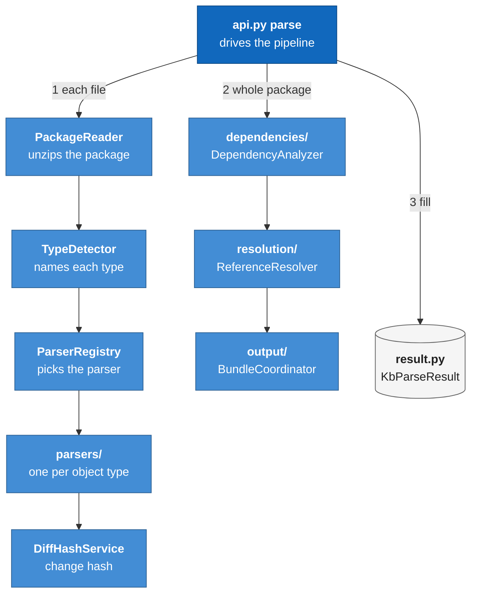
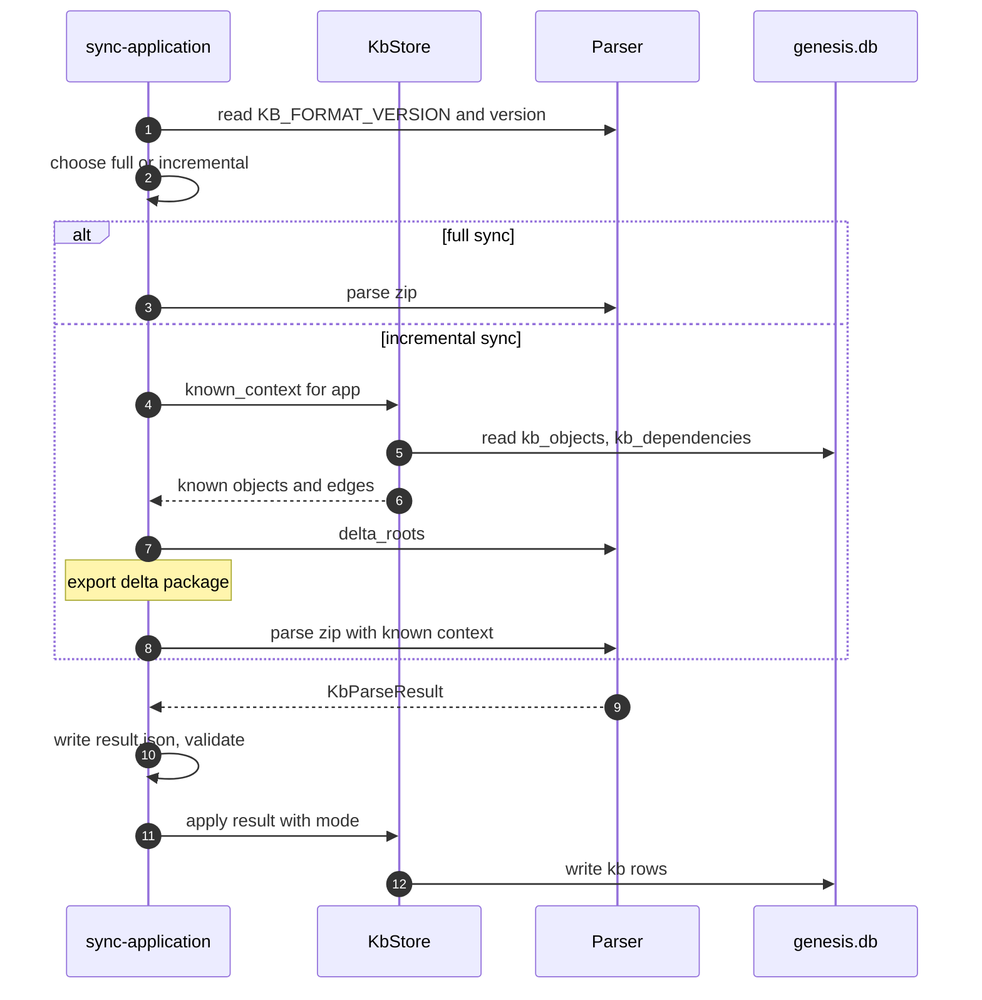

# Module: Appian parser (`packages/genesis-appian-parser/`)

> **Describes:** genesis v0.81.0 (Phase 51) · **Last reviewed:** 2026-11-11 · C4 level 3 · area `parser`

## 1. Purpose

`genesis-appian-parser` turns an exported Appian application (a zip file) into a plain, in-memory description of
that application: its design objects, the dependency edges between them, and its bundles (groups of objects that
belong to one entry point). The Genesis knowledge base stores this description. Chat, the Object Wiki, the business
map and the feature stages read it later.

The central promise is that the result describes the application's structure and never contains its SAIL code
(ADR-037). The parser reads SAIL only to find references to other objects and then drops it. When Genesis needs code,
it asks the Appian Dev MCP for it live.

The parser has two modes. A full parse reads a whole export. An incremental parse reads a small "delta" export and
uses the objects the knowledge base already knows as context, so the result equals what a full parse of the whole
application would have produced (ADR-074).

The parser is a library. It uses only the Python standard library, writes no files, starts no processes and knows
nothing about the database, the app or the workflow engine.

## 2. At a glance

| Item | Value |
|---|---|
| Package / import name | `genesis-appian-parser` / `genesis_appian_parser` |
| Code | `packages/genesis-appian-parser/genesis_appian_parser/` |
| Runs in | The process that calls it. In practice that is the run worker, inside the `sync-application` workflow; the app process only builds the "known" context for it |
| Depends on | The Python standard library only (`dependencies = []` in `pyproject.toml`; Python 3.13 or newer). Dev extras: `pytest`, `ruff` |
| Used by | `genesis-workflows/workflows/sync-application/graph.py` (calls `parse`, `delta_roots`, reads `KB_FORMAT_VERSION`); `genesis/kb/store.py` (`KbStore.known_context` builds `KnownObject` and `KnownEdge`); `genesis/cli/main.py` (checks the package can be imported) |
| Stores | Nothing. It never writes files and keeps no state between calls. Temporary files (an extracted copy of the zip) are removed before `parse` returns |
| Entry points | `parse(source, *, locale, exclude_types, known_objects, known_edges)` and `delta_roots(known_objects)` in `api.py`; debug command `python -m genesis_appian_parser <package.zip>` |
| Key versions | `__version__` equals the repo's shared version (ADR-080), so it is not a format marker. `KB_FORMAT_VERSION` is the format marker (see section 5.7) |
| Change rule | Change `KB_FORMAT_VERSION` only together with a parse-output change that needs a full re-sync of every knowledge base. A test pins the value |

## 3. Concepts

| Term | Meaning |
|---|---|
| **Export package** | The zip that the Appian Deployment REST API produces. It holds one XML file per design object, plus content files, `.properties` files and metadata. The zip may contain nested zips |
| **Object** | One Appian design object, such as an Interface, Expression Rule, Process Model, Record Type, CDT, Constant, Site or Web API. Identified by its UUID. Result class `KbObject` |
| **Object type** | The human type name the parser assigns, for example `Expression Rule` or `Process Model`. Chosen by `TypeDetector` from the XML root tag |
| **ParsedObject** | The parser's internal object (`domain/models.py`): `uuid`, `name`, `object_type`, a `data` dict that still holds SAIL, the `diff_hash` and the source file. It never leaves the parser |
| **Code-free metadata** | The small `metadata` dict on a `KbObject`: type-specific structure fields plus graph counts. Built by `_code_free_metadata` from a fixed field list, with SAIL keys removed |
| **Edge** | A dependency between two objects: source, target and a `dep_type` such as `CALLS`, `USES_CONSTANT`, `USES_CDT`, `USES_RECORD_TYPE`. Result class `KbEdge` |
| **Entry point** | An object (or a record type action or page) from which a user or system starts a flow: action, process, page, site, dashboard or web API. Each entry point roots one bundle |
| **Bundle** | The set of objects reachable from one entry point, with a `members` list, `key_objects`, entry-point detail and, for process flows, a `flow` graph. Result class `KbBundle` |
| **Hub** | An Expression Rule with at least 20 inbound edges (`_HUB_CALLER_THRESHOLD`). Bundle walks do not expand through a hub |
| **Orphan** | An object with no incoming and no outgoing edge, and not a cross-app integration point. Not the same as "not in a bundle" (L-035) |
| **Integration point** | An object classified as a cross-app `entrypoint` or `appref` by its name or by a `rulereferencebyname` call (L-037) |
| **Prefixed id** | An Appian id of the form `_a-<base uuid>_<suffix>` (or `_e-`). Several objects can share the same base (L-036) |
| **Diff hash** | A SHA-512 over an object's parsed data, used by the knowledge base to detect change. Excludes volatile fields (L-079) |
| **Known object / known edge** | `KnownObject` and `KnownEdge`: what the knowledge base already holds, given back to the parser for an incremental parse |
| **Stub** | A `ParsedObject` made from a `KnownObject` (`_stub` in `api.py`). It has metadata only, so it can be looked up and named but not parsed again |
| **Delta package** | A partial export that holds the changed objects plus the objects `delta_roots` names |
| **`KB_FORMAT_VERSION`** | An integer in `__init__.py`. A knowledge base recorded with a lower value must be rebuilt by a full sync |

## 4. Structure



The diagram shows the pipeline that `parse()` drives. The reader unpacks the zip, the detector names each file's
type, the registry hands the file to the right parser, and the diff hash is computed from the parser's output. Then
`parse()` runs dependency analysis, reference resolution and bundle building, and fills the result classes. The
`domain/` folder (constants, models, field walker) holds shared helpers used by the last three steps; it is left
out of the diagram.

| File | Main classes and functions |
|---|---|
| `__init__.py` | Public exports, `__version__`, `KB_FORMAT_VERSION` |
| `__main__.py` | `main()`: prints a JSON summary (counts and stats, no code) for a zip path |
| `api.py` | `parse`, `delta_roots`, `_parse_all`, `_stub`, `_known_dependency`, `_known_integration`, `_code_free_metadata`, `_strip_sail`, `_TYPE_SPECIFIC_FIELDS`, `_SAIL_KEYS`, `_ROOT_TYPES` |
| `result.py` | `KbParseResult`, `KbApplicationInfo`, `KbObject`, `KbEdge`, `KbBundle`, `KbBundleMember`, `ParseError`, `KnownObject`, `KnownEdge` |
| `package_reader.py` | `PackageReader.read` (unzip, nested zips, file lists), `PackageReader.cleanup`, `PackageContents`, `PackageReadError` |
| `type_detector.py` | `TypeDetector.detect`, `TAG_TYPE_MAP`, `CONTENT_HAUL_CHILD_MAP`, `DEFAULT_EXCLUDED` |
| `parser_registry.py` | `ParserRegistry`: maps an object type to a parser; falls back to `UnknownObjectParser` |
| `parsers/` | `BaseParser` and one parser per type: interface, expression rule, process model (the largest), record type, CDT, integration, web API, site, group, constant, connected system, control panel, translation set and string, data store, application, document, folder, AI skill, decision. Also `write_extractor.py` (finds which record or table a process node writes) |
| `diff_hash.py` | `DiffHashService.generate_hash` and `EXCLUDED_FIELDS` |
| `dependencies/analyzer.py` | `DependencyAnalyzer.analyze`, `Dependency` |
| `dependencies/cross_app.py` | `classify`, `build_cross_app_map` |
| `resolution/reference_resolver.py` | `ReferenceResolver`: builds lookup caches and rewrites references in place |
| `resolution/uuid_resolver.py`, `uuid_utils.py` | `UUIDResolver` (`#"_a-…"` to `rule!Name`), `UUIDUtils` (id shapes, `extract_base_uuid`) |
| `resolution/record_type_resolver.py` | `RecordTypeURNResolver`: record type, field and relationship URNs to names |
| `resolution/translation_resolver.py` | `TranslationResolver`: translation-string URNs to text for a locale |
| `resolution/label_bundle_resolver.py` | `LabelBundleResolver`: reads `.properties` files and replaces label-bundle calls with text |
| `output/bundle_coordinator.py` | `BundleCoordinator.build_all_v3`, entry-point discovery, dependency walk, `EntryPoint` |
| `output/bundle_file_builder.py` | `BundleFileBuilder.build`: one bundle dict (`_metadata`, `entry_point`, `flow`, `members`, `key_objects`) |
| `output/bundle_structure_builder.py` | `BundleStructureBuilder`: entry-point detail and the process-flow graph |
| `output/bundle_code_builder.py` | `BundleCodeBuilder`: a code builder inherited from the Atlas parser; `build_all_v3` does not call it (it is used only by the older `build_all`, which `parse()` does not use) |
| `domain/constants.py` | Regular expressions for ids and references, `SAIL_CODE_FIELDS`, `UUID_FIELDS`, `STRUCTURAL_FIELDS`, `infer_dependency_type` |
| `domain/` (others) | `models.py`, `field_walker.py` (walk `a.b[].c` paths), `node_types/` (process node type registry), `appian_type_resolver.py`, `name_utils.py`, `enriched_models.py`, `enums.py` |

## 5. How it works

### 5.1 What an export package contains, as far as the parser cares

The parser needs only three kinds of file inside the zip:

- `.xml` and `.xsd` files. Each is one design object. CDTs are `.xsd` files. The file name of an object is its UUID
  (CDT files are named from their namespace and type name).
- `.properties` files. These are i18n label bundles. They are collected only to turn label-bundle calls into text.
- Everything else only adds to `total_files`.

`PackageReader.read` extracts the zip into a temporary directory. Appian exports are often an outer zip that holds an
inner zip, so the reader extracts every nested `.zip` in place and deletes it. It skips nested zips whose file name
contains `AdminConsole`. While walking the tree it prunes three folders: `tempoReport`, `processModelFolder` and
`groupType`.

The vendored test fixture shows the usual folder layout: `application`, `aiAgent`, `aiSkill`, `connectedSystem`,
`content`, `dataStore`, `datatype`, `group`, `processModel`, `recordType`, `site`, `translationSet`,
`translationString` and `META-INF`. The parser does not depend on the folder names. It decides the type from the XML.

`TypeDetector` reads the XML root tag and maps it through `TAG_TYPE_MAP` (for example `interfaceHaul` to `Interface`,
`processModelHaul` to `Process Model`). A `contentHaul` root is a wrapper, so the detector looks at the first child
whose tag is in `CONTENT_HAUL_CHILD_MAP` (rules, constants, integrations, documents, folders, decisions and others).
A file with no known tag is `Unknown`. By default the types `report`, `groupType` and `file` are excluded. Passing
`exclude_types` to `parse` replaces that default set, it does not add to it.

### 5.2 Full mode: the `parse()` pipeline

`parse(source)` accepts a path or the zip bytes. Bytes are written to a temporary file first. The steps below follow
the order in `api.py`.

1. **Read.** `PackageReader.read` unpacks the zip. A failure raises `PackageReadError`.
2. **Parse each file** (`_parse_all`). For every XML file the detector names the type. Excluded and unknown files are
   skipped without an error. The registry returns the parser for the type, and the parser returns a `data` dict. A
   result without a `uuid` is skipped. Otherwise a `ParsedObject` is made, and its `diff_hash` is computed from the
   raw `data` at this point, before any reference is rewritten. The raw XML text is kept in a temporary dict keyed by
   UUID, only for step 3. An exception in one file becomes a `ParseError` and the parse goes on, so a bad file never
   stops the whole parse.
3. **Dependency analysis, on raw data** (section 5.5). This runs before references are resolved on purpose.
4. **Cross-app classification** (section 5.6), also on raw data.
5. **Reference resolution** (section 5.4). `ReferenceResolver` rewrites UUIDs and URNs in the objects' data to readable
   names. From here on the data holds readable names, not ids.
6. **Bundles** (section 5.8). `BundleCoordinator.build_all_v3` finds the entry points, walks the graph and returns
   assignments, hub UUIDs and one bundle dict per entry point.
7. **Orphans and counts.** The parser counts inbound and outbound edges per object. An object is an orphan only when
   it has neither and is not an integration point.
8. **Build the result.** For each object a `KbObject` is made with the code-free metadata (section 5.3) plus
   `inbound_count`, `outbound_count`, `is_hub` and `is_bundled`. Integration points also get `is_integration_point`,
   `integration_role`, `integration_peer` and `integration_category`. Edges become `KbEdge`, bundle dicts become
   `KbBundle`. The application name and UUID come from the single `Application` object if there is one, else from the
   zip file name (the UUID is then `None`). `application.version` is always `None`.
9. **Clean up.** A `finally` block deletes the extraction directory and the temporary zip.

`stats` carries `object_counts`, `dependency_counts`, a `coverage` block (total, bundled, connected, orphaned,
integration points), `cross_app`, file counts and the parse time.

### 5.3 Why the output never contains SAIL (ADR-037)

ADR-037 says the knowledge base stores only metadata, structure, the dependency graph and bundles. Code, current and
historical, is fetched live from the Dev MCP. The parser enforces this in three ways:

1. **A fixed allow-list of fields per type.** `_TYPE_SPECIFIC_FIELDS` names the fields that go into `KbObject.metadata`
   for each type, for example `inputs` and `output_type` for an Expression Rule, `parameters` for an Interface,
   `variables`, `total_nodes` and `complexity_score` for a Process Model. Anything not listed is not copied. The
   sources of SAIL (`sail_code`, `definition`, node expressions, `ui_expr` and so on) are not on the list.
2. **A key deny-list applied recursively.** `_strip_sail` removes every key in `_SAIL_KEYS` (for example `sail_code`,
   `definition`, `form_expression`, `ui_expr`, `visibility_expr`, `expressions`, `condition`, `gateway_conditions`,
   `test_cases`, `settings_json_raw`, `request_body`) from nested metadata values.
3. **Transient use.** The raw XML text and the full `data` exist only inside `parse()`. They are used for edges, then
   dropped. `ParsedObject` never leaves the module.

Two things are worth knowing:

- The diff hash is computed from the full parsed data, which includes code. The hash is a one-way value, so it does
  not store code. It does change when code changes, which is the point.
- The no-SAIL guard in the tests checks object metadata. Bundles are built by a separate path (section 5.8). The
  bundle `entry_point` dict for an action carries the action's `expressions`, and a `flow` node can carry
  `gateway_conditions` with a `condition` text (`output/bundle_structure_builder.py`). Neither goes through
  `_strip_sail`. See section 11 for the note on this.

### 5.4 UUID and name resolution

Appian objects reference each other by id in the XML, but people need names. Resolution is the step that turns one
into the other. Three kinds of lookup exist, and they must not be confused.

**Id shapes** (`resolution/uuid_utils.py`, `domain/constants.py`):

- a standard UUID, `0006eed1-0f7f-8000-0020-7f0000014e7a`;
- a prefixed id, `_a-0000e6a4-3c85-8000-9ba5-011c48011c48_43398` (also `_e-`);
- a UUID with a text suffix, `82127412-76f3-43c7-9b98-c2201b1e158b-as_rm_pro`.

For a prefixed id there are three keys: the full id, the *canonical* form (`_a-<base>_<digits>`, matched by
`CANONICAL_RE`) and the *base* UUID without prefix and suffix (`UUIDUtils.extract_base_uuid`).

**Lookups built per parse.** `ReferenceResolver` builds three caches from all objects: a UUID-to-name cache (full id,
base and canonical forms, added with `setdefault` so the first object indexed under a key wins), a record type cache
(record type, field and relationship names), and a translation cache. `DependencyAnalyzer` builds its own UUID and
name lookups the same way, plus a QName lookup. Name lookups are lower-cased. A trailing `_v<N>` is also stripped as
an extra alias. When two objects share a name, the one indexed last wins in the name lookup (`name_lookup[...] = obj`)
and the one indexed first wins in the QName lookup. That is why order matters in incremental mode (section 5.9).

**What resolution rewrites.** `SAIL_CODE_FIELDS` lists, per type, the paths that hold SAIL. For those paths the
resolver runs all four resolvers in order: UUID references (`#"_a-…"` becomes `rule!Name`, `cons!Name` or `type!Name`),
record type URNs, translation-string URNs (replaced by the text for the requested `locale`, falling back to the
language and then to any text) and label-bundle calls (replaced by the text from the `.properties` files).
`UUID_FIELDS` lists paths that hold a bare UUID (for example a process node's `interface_uuid`); those are replaced by
the object name. Paths use the `a.b[].c` notation handled by `domain/field_walker.py`. Resolution rewrites only the
package objects' data. Stubs are used for lookup and are not rewritten.

### 5.5 How edges are found: scan everything (L-035)

`DependencyAnalyzer.analyze` runs on raw data, before step 5 of the pipeline. If it ran after resolution, the
`#"_a-uuid"` tokens it needs would already be names. For each package object it collects references in four passes,
and keeps one edge per target (a per-object `seen` set):

1. **Typed SAIL fields.** The paths in `SAIL_CODE_FIELDS` are scanned for named references: `rule!X` (`CALLS`),
   `cons!X` (`USES_CONSTANT`), `type!X` (`USES_CDT`), `recordType!X` (`USES_RECORD_TYPE`).
2. **A universal scan.** Every string anywhere in the object's `data` is scanned too. This is what fixed the original
   problem in L-035: reference extraction used to be limited to listed field paths, and several types (Constant, AI
   Skill, Decision, Translation String, Document) had no listed paths, so they produced no edges at all. The scan is
   type-blind, so it needs no per-type list.
3. **The raw XML.** The object's raw XML text is scanned for the same tokens. This catches references in XML sections
   that a type parser does not lift into `data`.
4. **Structural fields.** `STRUCTURAL_FIELDS` names direct UUID fields with an explicit edge type, for example a
   process node's `interface_uuid` (`CALLS`) or a record type's `source_uuid` (`USES_DATA_STORE`).

Each text scan looks for: translation-string URNs (`USES_TRANSLATION`), `ruleName: "X"` by-name references (`CALLS`),
CDT QNames written as `{urn:…}Type`, named references, record URNs for type, field, relationship and action
(`USES_RECORD_TYPE`), and full or standard UUIDs. For a UUID the edge type comes from the target's type through
`infer_dependency_type` (the default is `CALLS`).

Scans are gated by the known objects: a token produces an edge only if it matches an object in the lookup. This keeps
precision high. The accuracy test measures the edge set against an oracle built from the raw XML (section 13).

**Orphan versus unbundled (L-035).** The old definition said an object is an orphan when no entry-point bundle
reaches it. That labelled used-but-unbundled objects as orphans. The parser now sets `is_orphan` only when an object
has no incoming and no outgoing edge, and it is not an integration point. `is_bundled` is a separate flag, true when
some bundle contains the object.

**The prefixed-id group rule (L-036).** Several objects can share one base UUID, for example folder siblings. A base
UUID names a group, not an object. Resolving a reference by base alone can link to the wrong sibling and, in the
lesson, dropped precision from 0.999 to 0.80. Code that edits the lookups must match on the full or canonical id
first and treat the base as a weak key. The same trap exists in the test oracle, which therefore attributes each file
to its object by file name stem, not by the UUID inside the XML.

### 5.6 Cross-app integration points: ENTRYPOINT and APPREF (L-037)

Appian applications connect across environments by name, not by UUID. An application exposes an `…_ENTRYPOINT_…` rule.
Another application holds an `…_APPREF_…` rule that calls it with `rulereferencebyname(ruleName: "…")`. The peer is
usually in a different package, so the object has no in-package incoming edge and would look like an orphan.

`dependencies/cross_app.classify` handles this. It returns a role (`entrypoint` or `appref`), the peer application, an
operation category and the function name. Two regular expressions match the naming convention
(`{app}_ENTRYPOINT_[{peer}_][{category}_]{function}` and `{app}_APPREF_{target}_[{category}_]{function}`). The category
is one of `GETDATA`, `DISPLAY`, `STARTPROCESS`, `RECORDACTION`, `LOGIC`, `URL`, `SAVE`, `APPVERSION`, `REF`, `AI`. If
the name matches neither but the object's raw data contains `rulereferencebyname`, it is a generic `appref`.

`parse()` classifies on raw data, because the by-name call is visible only before resolution. Classified objects:

- get the four `is_integration_point` and `integration_*` metadata keys;
- are never orphans;
- are listed in `stats["cross_app"]`, built by `build_cross_app_map`: `entry_points`, `app_references`,
  `dependency_edges` (prefix-to-prefix `APPREF` calls) and `shared_library_usage` (calls between objects with
  different name prefixes in the same package).

### 5.7 The diff hash and `KB_FORMAT_VERSION`

**Diff hash.** `DiffHashService.generate_hash(data)` removes the keys in `EXCLUDED_FIELDS` at every depth
(`version_uuid`, `versionUuid`, `history`, `created_at`, `updated_at`, `id`, `object_id`, `package_id`, `parent_uuid`,
`raw_xml`), then dumps the data as JSON with sorted keys and compact separators, and returns the SHA-512 hex digest.
The result is stable for the same content.

**Per-export random values (L-079).** Appian generates a new random `versionKey` inside a Decision's
`a!decisiondesigner_cache(uuid: …, versionKey: "…")` text on every export. Without a fix, an unchanged Decision looked
modified on every sync. For any string that contains `decisiondesigner_cache`, the hash step replaces the value of
`versionKey` with an empty string before hashing. The rule is narrow on purpose: a `versionKey` in other text is still
part of the hash, and a real change to the Decision still changes it. The lesson's advice when an unchanged object
shows up as modified is to diff two exports of that object before suspecting the merge.

**`KB_FORMAT_VERSION`.** The constant (currently 1, the output of parser 0.3.x) says which shape of parse output the
knowledge base was built from. The parser does not use it itself. The `sync-application` workflow reads it and records
it in the sync's `details` as `kb_format_version`. On the next sync, `full_sync_reason` in the workflow compares:

- if the last full sync recorded a lower value, the sync must be full, because the existing knowledge base lacks what
  an incremental parse needs;
- if no value was recorded, a record from parser 0.3 or newer counts as format 1; anything older counts as unknown and
  forces a full sync;
- if the installed parser has no such constant (version skew), the workflow falls back to comparing parser minor
  versions.

Before the constant existed, the parser's minor version drove this. ADR-080 moved the decision to an explicit constant,
because all four packages now share one version number, which changes at every release even when the output does not.
`tests/test_kb_format_version.py` pins the value, so raising it is a visible, reviewed change in the same commit as the
output change.

### 5.8 Entry points, bundles and the flow graph

`BundleCoordinator.build_all_v3(universe, deps, entry_filter)` works in memory and returns four things: bundle
assignments (object to bundle ids), the hub set, index entries and the bundle dicts.

**Entry points** come from `_discover_entry_points`:

| Source | Bundle type |
|---|---|
| Each action of a Record Type | `action` (root is the action's target, usually a Process Model, else the record type) |
| A Record Type with at least one view that has a `ui_expr` | `page` |
| Each Site | `site` |
| Each Control Panel | `dashboard` |
| Each Web API | `web_api` |
| Each Process Model that is not the target of a record action and not a subprocess of another model | `process` |

**Walk.** From the root objects of an entry point, a depth-first walk follows the dependency edges. It adds a Record
Type to the bundle but does not walk out of it (`stop_types={'Record Type'}`), and it does not walk through a hub
unless the hub is itself a root. Roots are found per entry kind: for an action, its target plus objects its
expressions mention; for a site, the objects behind its pages; for a dashboard, its interfaces and primary record
type; for a page, the objects its view expressions mention.

**Bundle id.** The id is the entry-point name with characters outside `\w`, space and `-` removed, spaces turned into
underscores, and cut to 80 characters. A clash gets a `_2`, `_3` suffix.

**Contents.** `BundleFileBuilder.build` returns `_metadata` (id, type, root name, parent name, object count, and
`root_uuid` set to the entry point's UUID), `entry_point` (detail by type), `flow`, `members` (uuid, name, type) and
`key_objects` (the five names with the most edges in the bundle). For a bundle whose root is a Process Model, `flow`
is `{"process_model": <graph>, "subprocesses": [<graph>, …]}`. Each graph lists nodes with `name`, simplified `type`,
`next` node names, `writes` (record or table targets, found through the chain constant to data store entity to CDT to
table), and, where present, `gateway_conditions`, `subprocess` and `interface`. The KB stores this verbatim in
`kb_bundles.flow_json`.

An entry point sets `KbObject.is_entry_point` and `entry_point_kind` on its defining object. If two entry points have
the same defining object, the first one found sets the kind.

### 5.9 Incremental mode (ADR-074)

A full export of a large application is slow. ADR-074 lets the sync export only the objects changed since the last
sync. The parser has to produce, from that small package, the same result a full parse would, for everything the
package covers. The caller supplies the context.

**Calling pattern.**

1. The caller loads the app's current objects and edges from the knowledge base as `KnownObject` and `KnownEdge`
   (`KbStore.known_context`). Objects are in knowledge-base row order, which is the last full parse's order.
2. The caller calls `delta_roots(known_objects)`. The result is the set of UUIDs that must be in the delta package in
   addition to the changed ones: every KB entry point, every Process Model, Site, Web API and Control Panel, every
   Record Type that has actions or views, and every Document whose `filename` ends in `.properties` (label bundles
   resolve action titles). Expression Rules are never roots.
3. The caller exports a package with the changed objects and the roots, then calls
   `parse(zip, known_objects=…, known_edges=…)`.

**What the parser does differently.**

| Part | Full mode | Incremental mode |
|---|---|---|
| `objects` | every object in the package | only the package objects, with fresh `diff_hash` |
| `edges` | all edges | outgoing edges of package objects only, but references resolve against package and known objects |
| Lookup universe | the package objects | the package objects plus stubs of known objects that are not in the package, in knowledge-base order, with each package object in place of its stub and new objects last |
| Bundles | built from all entry points | built over the whole app: package objects, stubs, the known edges (minus edges whose source is a package object) and the new edges. An entry point whose *defining* object is a stub is not rebuilt |
| Orphans, counts, hubs | from the package | over the whole app |
| `application.total_objects` | package size | still the package size; the app size is `stats["coverage"]["total_objects"]` |
| Extra stats | none | `stats["derived"]` (per object: inbound, outbound, hub, bundled, orphan) and `stats["incremental"]` |

`stats["incremental"]` holds `package_objects`, `known_objects`, `edges_resolved_external`, `skipped_entry_points`
(entry points defined by an object missing from the package) and `incomplete_flow_bundles` (a bundle whose flow would
contain a process model that is only a stub, which has no nodes). The workflow and the store use the last two lists to
keep existing bundles instead of replacing them with incomplete ones.

Passing `known_edges` without `known_objects` raises `ValueError`.

**Two stub details.** `_stub` copies the stored metadata and adds `uuid`, `name` and `description`. For this reason
`_TYPE_SPECIFIC_FIELDS` includes a few fields that look unrelated, such as `filename` for Document, `table` for CDT,
`entities` for Data Store and `data_store_entity_uuid` for Constant: bundles rebuilt from stubs need them to find
label-bundle documents and to resolve what a process node writes. A knowledge base built before parser 0.3.0 lacks
these fields, which is why `KB_FORMAT_VERSION` exists.

**Why the result is safe to merge.** `KbStore.apply` refuses to treat an incremental result as a whole app: a result
with `stats.incremental` is rejected by `full`, `delta` and `baseline`, and mode `incremental` requires one (L-077).
The lesson behind this: merging a 40-object sub-package through the whole-app merge shrank a 2,763-object knowledge
base to 41 objects. The parser makes its result self-describing, and the store checks it.

### 5.10 Who calls the parser



The sequence shows one sync. The workflow decides full or incremental from the recorded format version. For an
incremental sync it fetches the known context from the store, asks the parser for the roots, exports a delta package
and parses it. The result is saved as `result.json` on the run's blackboard, validated, and handed to the store.

- `genesis-workflows/workflows/sync-application/graph.py` calls `parse` for full and incremental syncs, calls
  `delta_roots` to build the delta package, and records `KB_FORMAT_VERSION` and `__version__` in each sync's details.
- `genesis/kb/store.py` (`KbStore.known_context`) builds `KnownObject` and `KnownEdge` from the current `kb_*` rows.
  `KbStore.apply` consumes the result.
- `genesis/cli/main.py` only checks that `genesis_appian_parser` can be imported, so a missing package gives a clear
  message (L-098).

The knowledge base side of this (tables, merge modes, snapshots, business map) is described in
[knowledge-base.md](knowledge-base.md). The workflow itself is described under the workflow library in
[workflow-library.md](workflow-library.md).

## 6. Interfaces

This module has no HTTP endpoints, MCP tools or events. Its interface is the Python API in `genesis_appian_parser`.

| Name | Signature (summary) | Purpose |
|---|---|---|
| `parse` | `parse(source: str \| bytes, *, locale="en-US", exclude_types=None, known_objects=None, known_edges=None) -> KbParseResult` | Parse a zip path or zip bytes. Passing `known_objects` selects incremental mode |
| `delta_roots` | `delta_roots(known_objects: list[KnownObject]) -> set[str]` | UUIDs a delta package must contain besides the changed objects |
| `KB_FORMAT_VERSION` | `int` | Format marker for the parse output |
| `__version__` | `str` | The shared repo version |
| Result classes | `KbParseResult`, `KbApplicationInfo`, `KbObject`, `KbEdge`, `KbBundle`, `KbBundleMember`, `ParseError` | The only contract the knowledge base store depends on. All are dataclasses; all except `KbParseResult` are frozen |
| Context classes | `KnownObject`, `KnownEdge` | The incremental parse's input |
| Debug command | `python -m genesis_appian_parser <package.zip>` | Prints a JSON summary (application, counts, stats). Returns exit code 2 when no path is given |

`KbParseResult` fields: `application`, `objects`, `edges`, `bundles`, `orphans` (UUIDs), `errors` (a list of
`ParseError`) and `stats`.

## 7. Data

The parser owns no tables and no files. It holds data only while `parse()` runs.

| Where | What | Who writes | Who reads |
|---|---|---|---|
| Temporary directory (`tempfile.mkdtemp`) | The extracted zip | `PackageReader.read` | The parsers; deleted in the `finally` block of `parse()` |
| Temporary `.zip` file | The zip bytes, when `source` was bytes | `parse()` | `PackageReader`; deleted at the end |
| `KbParseResult` (memory) | The result | `parse()` | The workflow, which writes it to `result.json` on the run blackboard, and `KbStore.apply` |
| Test fixture `packages/genesis-appian-parser/tests/fixtures/AiDocumentCenterv4.3.1.zip` | A real captured export used by the tests | Vendored in the repo | The tests |

The knowledge base tables (`kb_objects`, `kb_dependencies`, `kb_bundles`, `kb_syncs` and others) belong to the
knowledge base module. See [knowledge-base.md](knowledge-base.md) and [data-and-migrations.md](data-and-migrations.md).
Where the code-free `metadata` and `flow` end up there is a concern of that module.

## 8. Failure handling

| Situation | Behaviour |
|---|---|
| The zip cannot be read or is not a zip | `PackageReader.read` raises `PackageReadError("Failed to read package: …")`. `parse()` does not catch it |
| A nested zip is bad | Ignored (`BadZipFile` is caught); the outer files are still read |
| One XML file fails to parse | A `ParseError(file, error, object_type)` is added to `errors`; `application.total_errors` counts them; the parse continues |
| A file has an unknown or excluded type | Skipped with no error |
| A parsed file has no `uuid` | Skipped with no error |
| The raw XML of one file cannot be read for the dependency scan | That object is scanned from its parsed data only |
| The same UUID appears twice in an export | The parser keeps both in its result. The store removes duplicates (see the note below this table) |
| `known_edges` given without `known_objects` | `ValueError("known_edges requires known_objects")` |
| An incremental result is applied as a full result | `KbStore.apply` raises `ValueError` and nothing is written (L-077) |
| An entry point is defined by an object missing from the delta package | Not rebuilt; listed in `stats["incremental"]["skipped_entry_points"]` |
| A bundle flow needs a process model that is missing from the delta package | The bundle is listed in `stats["incremental"]["incomplete_flow_bundles"]` |
| An empty or unrecognised package (0 objects) | `parse()` returns an empty result; the `sync-application` validator `check_parse` fails the sync |

**Duplicate UUIDs (L-032).** A real export can list the same `object_uuid` more than once. The parser does not remove
duplicates. `KbStore.apply` (full and baseline), `KbStore.hydrate_from_blob` and the incremental apply all call
`_dedupe_by` and keep the first occurrence of an object (by UUID) and of an edge (by source, target and edge type). The
database enforces unique `(app_uuid, object_uuid, valid_from_sync)`, so without this a baseline sync failed. As a
result, the workflow's check compares the objects written to the objects parsed with `0 < written <= parsed`, not
equality.

## 9. Configuration

The parser reads no environment variable, no settings file and no secret. Everything is a function argument.

| Setting | Where | Default | Effect |
|---|---|---|---|
| `locale` | `parse(...)` | `"en-US"` | Which language to use when a translation string is resolved |
| `exclude_types` | `parse(...)` | none, so `DEFAULT_EXCLUDED` (`report`, `groupType`, `file`) applies | If given, replaces the default excluded set. Entries are XML tags |
| `known_objects`, `known_edges` | `parse(...)` | `None` | Presence of `known_objects` selects incremental mode |
| `_HUB_CALLER_THRESHOLD` | `output/bundle_coordinator.py` | 20 | Inbound edges needed for an Expression Rule to be a hub. A constant, not a parameter |
| `KB_FORMAT_VERSION` | `__init__.py` | 1 | See section 5.7 |
| `GENESIS_APPIAN_PARSER_FIXTURE` | Tests only | the vendored fixture | Path of a different real export for `conftest.py` and `test_incremental.py` |
| `GENESIS_APPIAN_PARSER_EXPORT_A`, `_EXPORT_B` | Tests only | unset | Two real exports of one unchanged app for the optional diff-hash test |

Settings that drive when the workflow uses the parser (`full_every_days`, `max_changed`, `max_changed_pct`) belong to
the `sync-application` workflow, not to this module. See [workflow-library.md](workflow-library.md) and
[knowledge-base.md](knowledge-base.md).

## 10. Extending this module

**Add support for a new object type.**

1. Add the XML root tag (or the `contentHaul` child tag) to `TAG_TYPE_MAP` or `CONTENT_HAUL_CHILD_MAP` in
   `type_detector.py`.
2. Write a parser in `parsers/` that subclasses `BaseParser` and returns a dict with at least `uuid` and `name`. Register
   it in `parser_registry.py` and export it in `parsers/__init__.py`.
3. Decide which fields belong in the knowledge base and add them to `_TYPE_SPECIFIC_FIELDS` in `api.py`. Never add a field
   that holds SAIL. If the type has SAIL fields, add the paths to `SAIL_CODE_FIELDS` in `domain/constants.py`, so
   references are resolved, and add any new SAIL-bearing key names to `_SAIL_KEYS`.
4. If the type should give a typed edge, add it to `_DEP_TYPE_MAP` (`infer_dependency_type`) or `STRUCTURAL_FIELDS`.
5. Run the accuracy and no-SAIL tests (section 13). Decide whether the change needs `KB_FORMAT_VERSION` to move
   (below).

**Add a new reference form** (a new URN or token). Add its regular expression to `domain/constants.py`, extract it in
`DependencyAnalyzer._extract_from_text`, and keep the match gated by the known-object lookup. Check the accuracy
numbers before and after.

**Change what the result contains.** Ask: does an existing knowledge base need the new data to work? If yes, raise
`KB_FORMAT_VERSION` in `__init__.py` and update `tests/test_kb_format_version.py` in the same commit. Existing
knowledge bases then get one full sync (section 5.7). If the change only adds a field that old data can live without,
leave the constant alone. Check that `tests/test_incremental.py` still shows that an incremental parse equals a full
parse. If you add a field that an incremental parse needs from a stub, add it to `_TYPE_SPECIFIC_FIELDS`, because a stub
carries only stored metadata.

**Change what is hashed.** Edit `EXCLUDED_FIELDS` or the Decision rule in `diff_hash.py` only with a test that shows the
old case still hashes the same or the new case hashes differently on purpose. A hash change makes every affected object
look modified in the next full sync.

**Change bundles.** Entry-point rules, the walk and the hub threshold live in `output/bundle_coordinator.py`. A change
there alters bundle ids and members for every application. The incremental tests compare bundles field by field, so
they will show a mismatch if the change makes incremental and full parses differ.

**Do not** import the genesis app, the database or any third-party library into this package. A test and ADR-080 keep
the libraries independent, and the stdlib-only rule is in `pyproject.toml`.

## 11. Design decisions

| Decision | In plain words | ADR |
|---|---|---|
| Genesis owns its parser | The parser is a Genesis-native package ported from the Atlas parser, evolved here, with the knowledge base fed only by the Dev-tagged environment | ADR-036 |
| The result has no SAIL | SAIL is read for references and then dropped; code is fetched live from the Dev MCP | ADR-037 |
| Incremental, package-scoped sync | Export only changed objects plus entry-point roots, and parse them with the known objects as context | ADR-074 |
| One repo, one version, an explicit format constant | The package lives in `packages/` and shares the repo version, so format changes are carried by `KB_FORMAT_VERSION`, not by the version number | ADR-080 |
| Parse returns data and writes nothing | The parser has no file output, no database and no side effects, so it is easy to test and to call from a worker | ADR-036 |
| Stdlib only | No third-party runtime dependency | ADR-080 |

**Code note on ADR-037.** The ADR says the knowledge base stores no source code. Object `metadata` follows that rule, and
`_strip_sail` enforces it. The bundle dicts are built by `output/bundle_structure_builder.py`, which does not use
`_strip_sail`. In the code read for this document, an `action` bundle's `entry_point["expressions"]` is the action's
expression texts, and a `flow` node's `gateway_conditions` entries hold a `condition` field. The tests check metadata keys
and long slices of Interface, Expression Rule, Web API and Integration source, and do not check bundles for these
fields. This document describes the code as it is.

## 12. Known pitfalls

- **Real exports repeat UUIDs.** Do not assume `result.objects` has unique UUIDs. Dedupe at the store (L-032).
- **Orphan is not "unbundled".** A used object that no bundle reaches is not an orphan. Do not rewrite `is_orphan` in
  terms of bundles (L-035).
- **Extract dependencies from raw data, before resolution.** After `ReferenceResolver` runs, `#"_a-uuid"` tokens are
  gone. Moving the analysis later would lose edges (L-035).
- **Do not narrow the dependency scan to listed fields.** Types with no listed paths produced no edges until the
  universal scan was added (L-035).
- **A base UUID is a group id.** Prefer the full or canonical id when linking. The lookups index the base with
  `setdefault`, so the first object indexed under a base is the one a base-only reference finds (L-036).
- **ENTRYPOINT and APPREF links are by name.** The peer is normally in another package. Do not report these as orphans
  and do not expect an in-package edge (L-037).
- **Porting can drop whole layers.** The first port lost the cross-app builder, the graph builder (inbound, outbound,
  hub) and the enrichment package. Diff against the source when porting again (L-038).
- **A partial parse must never go through a whole-app merge.** Keep the self-describing `stats.incremental` marker, and
  keep the store's refusal (L-077).
- **Per-export random values break change detection.** If an unchanged object shows up as modified, diff two exports of
  it before looking at the merge. The Decision `versionKey` is the known case (L-079).
- **Name collisions make order matter.** In incremental mode the known objects must be given in the knowledge base's
  row order, or a name shared by two types can resolve to a different object than in a full parse (section 5.4).
- **Fixtures must be real.** The suite runs on a real export because synthetic inputs hid object-shape bugs before.

## 13. Tests

All files are under `packages/genesis-appian-parser/tests/` unless a path says otherwise.

| File | What it covers (from reading it) |
|---|---|
| `conftest.py` | Session fixtures: `sample_zip` (the vendored real export, or `$GENESIS_APPIAN_PARSER_FIXTURE`; skips if absent), `result` (one full parse), `raw_objects` (low-level `ParsedObject`s that still hold SAIL) |
| `test_parse.py` | Fixed object, edge, bundle, orphan and error counts for the fixture; application identity; stats shape; readable type names; resolved names; edges point at known objects; bundle members and types; entry points are flagged; orphan lists agree; hashes are deterministic; path and bytes give the same result; no SAIL keys in metadata; known code slices are absent from the serialised result |
| `test_incremental.py` | The equivalence oracle for ADR-074: with random delta packages of 60 changed objects plus `delta_roots`, the incremental parse equals the full parse (objects, edges with recall and precision 1.0, bundles, per-object derived fields, metadata, diff hash). Also: a missing root is reported and not rebuilt; a missing process model flags incomplete flows; `known_edges` without `known_objects` raises; `delta_roots` covers every bundle's root; brand-new objects; `__version__` matches `pyproject.toml` |
| `test_diff_hash.py` | A Decision's random `versionKey` does not change the hash; a real change still does; `versionKey` outside a decision cache still counts; an optional test with two real exports of an unchanged app (skipped unless both paths are set) |
| `test_kb_format_version.py` | `KB_FORMAT_VERSION` equals 1, is an `int`, and is exported in `__all__` |
| `test_cross_app.py` | `classify` for entrypoint, appref, missing peer or category, and behavioural appref; integration points are never orphans in the fixture; `stats["cross_app"]` has the four keys |
| `test_accuracy.py` | Hard gates on the fixture against the raw-XML oracle: edge recall and precision at least 0.95, referenced-object recall at least 0.95, false-orphan rate at most 0.05; metrics are well formed |
| `accuracy/oracle.py` | Not a test. The oracle: builds a reference graph from the raw XML (an object references another if the other's id token appears in its XML) and scores a result against it |
| `tests/test_kb_incremental.py` (genesis repo) | Incremental merge in the store (ADR-074), proven end to end with the real parser on the vendored export |
| `tests/test_object_types.py` (genesis repo) | The app's object-type normaliser, driven by the parser's display names |
| `tests/test_platform_packages.py`, `tests/test_no_internal_dependencies.py`, `tests/test_version_sync.py` (genesis repo) | Install origin of each library, no internal dependency entries, and equal versions across packages (ADR-080) |
| `genesis-workflows/workflows/sync-application/tests/test_incremental_sync.py` | The workflow side of incremental sync (file name only; not read in detail for this document) |

Gate commands, from `packages/genesis-appian-parser/` using the shared dev venv:

```bash
../../.venv/bin/ruff check .
../../.venv/bin/python -m pytest -q
```

The repo's CI runs lint and tests for every package on every pipeline (ADR-080).

## 14. Code map

| To change… | Look in |
|---|---|
| Which zip files are read, or which folders are skipped | `package_reader.py` |
| How a file's object type is chosen, or the default exclusions | `type_detector.py` |
| What is read from one object type | `parsers/<type>_parser.py`, registered in `parser_registry.py` |
| Which fields reach the knowledge base, or the SAIL deny-list | `api.py`: `_TYPE_SPECIFIC_FIELDS`, `_SAIL_KEYS`, `_code_free_metadata` |
| How edges are found, or which reference forms exist | `dependencies/analyzer.py`, `domain/constants.py` |
| The edge type for a target type | `domain/constants.py`: `infer_dependency_type`, `STRUCTURAL_FIELDS` |
| ENTRYPOINT and APPREF rules, categories, the cross-app map | `dependencies/cross_app.py` |
| How ids are turned into names | `resolution/reference_resolver.py`, `uuid_resolver.py`, `uuid_utils.py` |
| Record URNs, translations, label bundles | `resolution/record_type_resolver.py`, `translation_resolver.py`, `label_bundle_resolver.py` |
| Which paths hold SAIL or bare UUIDs | `domain/constants.py`: `SAIL_CODE_FIELDS`, `UUID_FIELDS` |
| Entry-point kinds, bundle walk, hubs, bundle ids | `output/bundle_coordinator.py` |
| Bundle contents, key objects | `output/bundle_file_builder.py` |
| Entry-point detail, the process flow graph, the `writes` data | `output/bundle_structure_builder.py`, `parsers/write_extractor.py` |
| The diff hash and its exclusions | `diff_hash.py` |
| The incremental contract (stubs, roots, derived stats) | `api.py`: `_stub`, `delta_roots`, `parse` |
| The result shape | `result.py` (the store and the workflow read it) |
| The format marker | `__init__.py`: `KB_FORMAT_VERSION`; `tests/test_kb_format_version.py`; the check in `genesis-workflows/workflows/sync-application/graph.py`: `full_sync_reason` |
| Building the known context in the app | `genesis/kb/store.py`: `KbStore.known_context` |
| De-duplication and the partial-result guard | `genesis/kb/store.py`: `_dedupe_by`, `KbStore.apply` |
