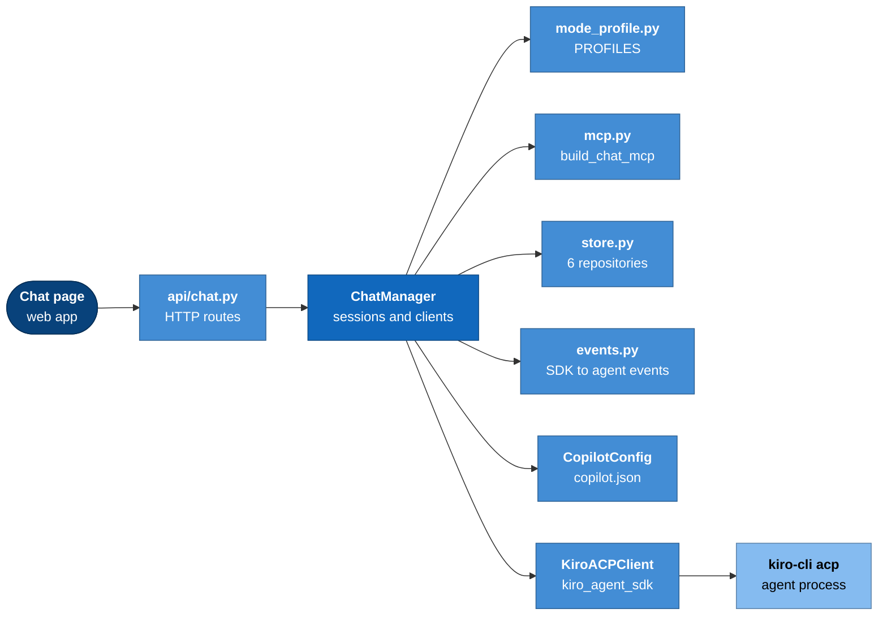
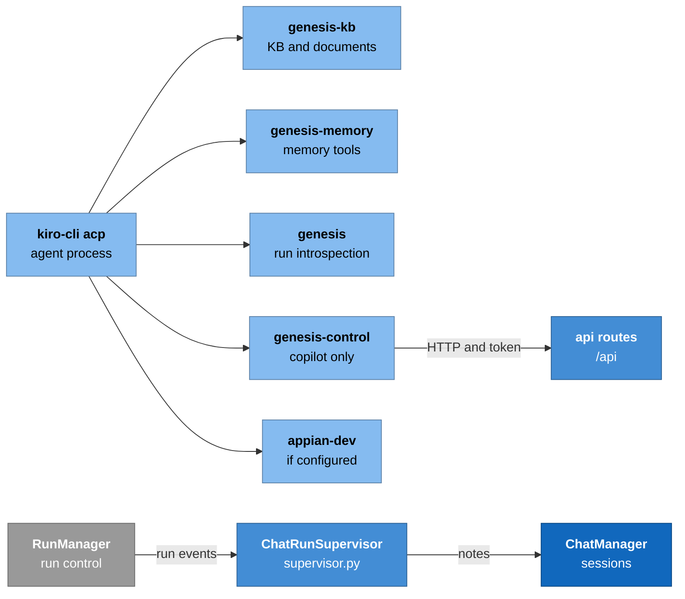
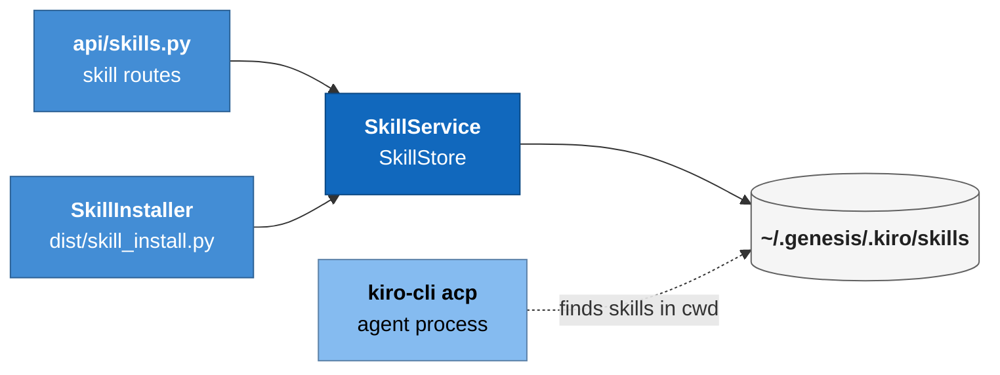
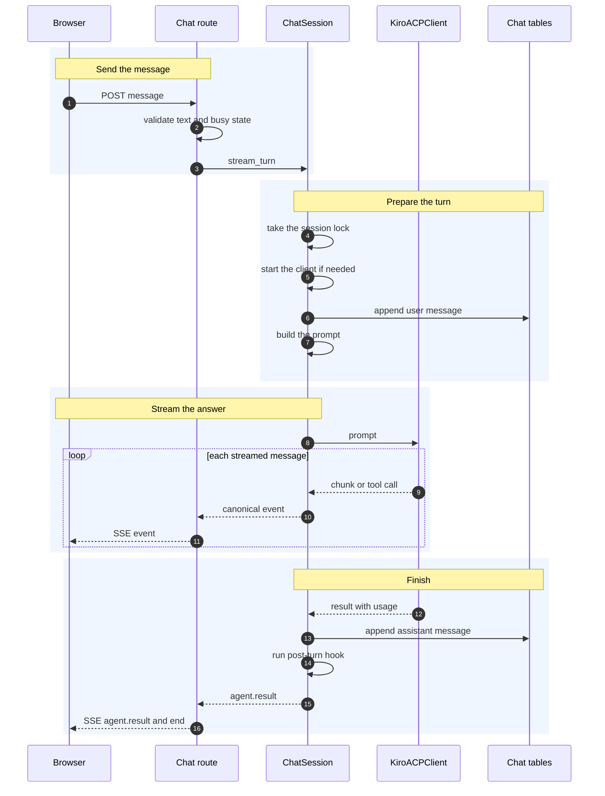
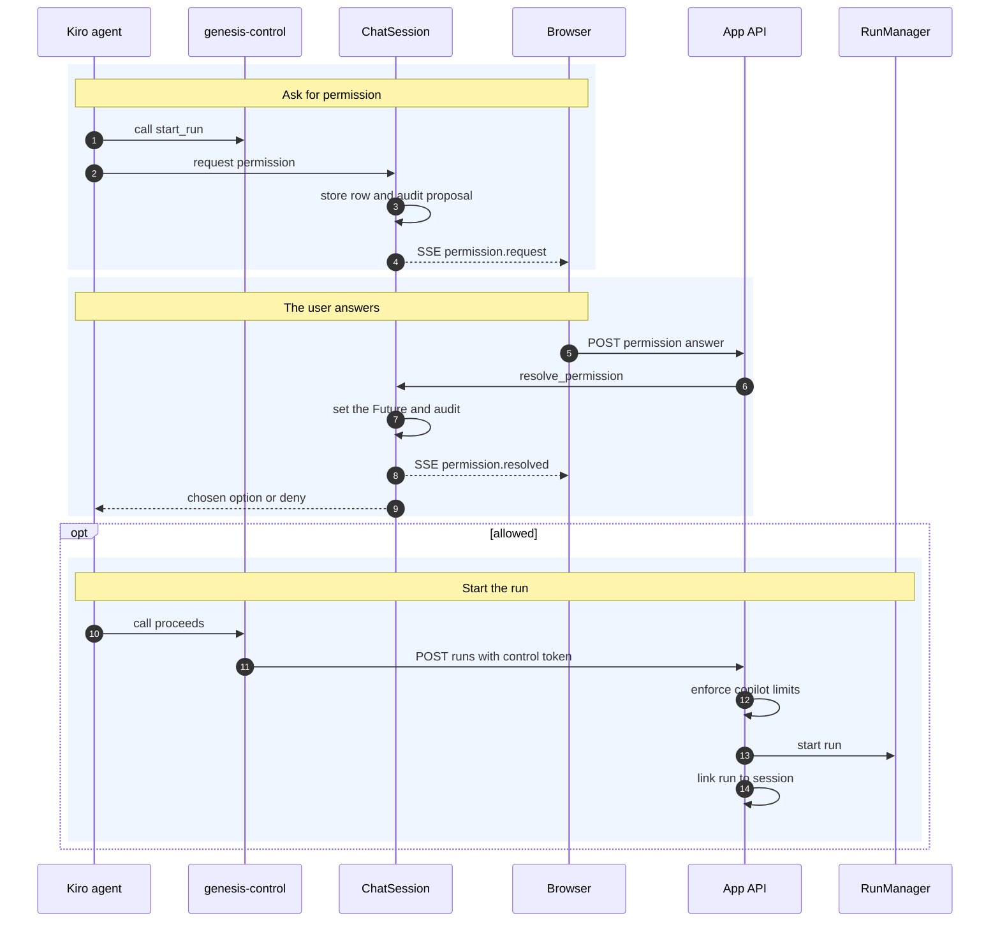

# Module: chat and skills (`genesis/chat/`, `genesis/skills/`)

> **Describes:** genesis v0.81.0 (Phase 51) · **Last reviewed:** 2026-11-11 · C4 level 3 · area `chat`

## 1. Purpose

This module runs the **Chat** page and everything that talks to Kiro on the user's behalf outside a workflow run.
It keeps chat sessions, starts one Kiro process per live session, streams each turn to the browser, and decides
what the agent in each session may read, write and run.

The central promise is that **the agent in a chat cannot change anything unless a program rule or the user allows
it**. Trust is built from a short read-only list. Every other tool is denied, except in copilot mode, where the
user must confirm each change. Writes land only in a per-session folder. The agent never owns control flow:
LangGraph still runs workflows, and the chat can only ask the run manager to do what the user could do in the
Runs page.

The module also holds **skills**: Kiro `SKILL.md` packages for standalone activities (draft a document, apply a
body of knowledge). Genesis stores skills as files in a managed folder that Kiro finds on its own. It does not
send them over ACP.

Four chat-side finalizers live in `genesis/chat/` but belong to other modules (section 4).

## 2. At a glance

| Item | Value |
|---|---|
| Code | `genesis/chat/`, `genesis/skills/`, `genesis/dist/skill_install.py`, `genesis/dist/skill_catalog.py`, `genesis/mcp/{introspection,kb,memory,control}_server.py`, `genesis/config/copilot.py`, routes in `genesis/api/{chat,skills,run_routes}.py` |
| Runs in | The app process. Chat executes no workflow Python, so it has no subprocess worker (ADR-031). Each live session owns one `kiro-cli` child process, started by the SDK. The four MCP servers are separate stdio processes that Kiro starts for each session. |
| Depends on | `kiro-agent-sdk` ([kiro-agent-sdk.md](kiro-agent-sdk.md)), imported lazily; `genesis/db` for the chat tables; `ConfigService` for the MCP registry ([configuration-and-secrets.md](configuration-and-secrets.md)); `RunManager` through the supervisor ([runs-and-workers.md](runs-and-workers.md)); the KB and memory stores through the MCP servers ([knowledge-base.md](knowledge-base.md), [memory.md](memory.md)) |
| Used by | The chat routes and the web Chat page ([web-app.md](web-app.md)); the feature and Workbench routes, which create stage chat sessions ([features-and-stages.md](features-and-stages.md), [stories-and-workbench.md](stories-and-workbench.md)); the run worker, which asks the skills folder for skills ([core-engine.md](core-engine.md)) |
| Stores | Six tables in `genesis.db` (section 7), `~/.genesis/skill-output/<session>/`, `~/.genesis/.kiro/skills/<skill>/`, `~/.genesis/copilot.json`, and the `skills` map of `installed.lock.json` |
| Key ids | ADR-031, ADR-033, ADR-034, ADR-042, ADR-045, ADR-069, ADR-076 · lessons L-017, L-021, L-024, L-041, L-042, L-044, L-045, L-046, L-047 |

## 3. Concepts

| Term | Meaning |
|---|---|
| **Chat session** | One conversation. A row in `chat_sessions` plus its messages. It may have a live client or none. |
| **Live session** | A `ChatSession` object in `ChatManager._live` that holds one running Kiro client. Sessions in the database without a live object are cold. |
| **Chat mode** | A string on the session row. `read_only` and `copilot` are conversational modes. `feature_spec`, `ux_design`, `technical_design`, `feature_breakdown`, `story_design` and `test_design` are **stage modes**, used by a feature or story stage. |
| **Mode profile** | A frozen `ChatModeProfile` that holds everything a mode changes: MCP surface, permission mode, control token, working folder, extra trust, steering text, kill-switch gate and post-turn hook. One profile is resolved per client start. |
| **Steering** | A text preamble, defined per mode, sent once with the first prompt of a fresh client. It shapes behaviour. It is a second layer, not a control. |
| **Read-only trust set** | The tools that run without asking, as `@server/tool` names. Built by `build_chat_mcp`. |
| **Session sandbox** | `~/.genesis/skill-output/<session_id>/`. The only place the agent may write. It is also the working folder of stage modes. |
| **Control token** | A random string minted for each copilot client. The control MCP server sends it in the `X-Genesis-Control-Token` header, so the app knows a request came from that copilot session. |
| **Control server** | `genesis-control`, the MCP server that gives the copilot its run-management tools. It is a thin HTTP client of `/api`. |
| **Confirm card** | The prompt the user sees before a mutating control tool runs. It is the answer to an ACP permission request. |
| **Preamble replay** | When a client starts for a session that already has messages, the last messages are put in front of the next prompt so the new Kiro process has context. |
| **Agent note** | A system message that the agent also receives (`enqueue_agent_note`), as opposed to a transcript-only system message (`enqueue_system_turn`). |
| **Post-turn hook** | A function a mode names, run after each non-command turn. Only `feature_spec` uses one (`spec_clauses`). |
| **Run notification** | A durable row in `chat_notifications` that says a copilot-linked run needs a decision or has ended. |
| **Copilot kill-switch** | `enabled` in `copilot.json`. When off, copilot sessions behave as `read_only` and the app refuses copilot run starts. |
| **Skill** | A folder `<skills_dir>/<id>/` with a required `SKILL.md` and optional `scripts/`, `references/`, `assets/` (ADR-034). |
| **Managed skills workspace** | `settings.skills_dir`, which is `~/.genesis/.kiro/skills/`. |
| **Slash command** | A prompt that starts with `/`, such as `/compact` or `/model`. Kiro answers it itself (L-046). |

## 4. Structure



The Chat page calls the routes, and the routes call `ChatManager`. The manager reads the mode profile and asks `build_chat_mcp` for the MCP list and the trust set. It reads and writes chat rows through the stores, maps SDK messages with `events.py`, and checks `CopilotConfig` for the kill-switch. It then starts an SDK client, and the SDK starts `kiro-cli`.



Kiro starts the MCP servers for the session. `genesis-control` runs only in copilot mode, and it calls back into the app's own `/api` with the control token. `ChatRunSupervisor` listens to run events from `RunManager` and writes notes into the chat through `ChatManager`.



Skills are plain files. The routes and the installer write them through `SkillService` into the managed skills folder. Kiro reads them from its working folder.

| File | Main classes and functions |
|---|---|
| `genesis/chat/manager.py` | `ChatManager` (sessions, models, slash commands, tokens, permissions, notifications, notes, idle reaping); `ChatSession` (`_ensure_started`, `stream_turn`, `_on_permission`, `_on_session_status`, `cancel`); `ChatBusyError`; `set_client_factory` (tests); `_build_preamble`; `_title_from` |
| `genesis/chat/mode_profile.py` | `ChatModeProfile`, `PROFILES`, `resolve_profile`; one steering text per mode; `_MEMORY_HINT` |
| `genesis/chat/mcp.py` | `build_chat_mcp`; server names and the read and mutating tool lists; the four `*_entry` builders |
| `genesis/chat/events.py` | `map_message_to_events`: SDK messages to canonical `agent.*` events |
| `genesis/chat/export.py` | `session_to_markdown`, `export_filename` |
| `genesis/chat/supervisor.py` | `ChatRunSupervisor`: `attach`, `bind_loop`, `_observe`, `_process`, `reconcile`, `check_sla` |
| `genesis/chat/store.py` | `ChatSessionRecord`, `ChatMessageRecord`; `ChatStore`, `ChatMessageStore`, `ChatRunLinkStore`, `ChatPermissionStore`, `ChatNotificationStore`, `CopilotActionStore`; `CHAT_MODES`, `STAGE_CHAT_MODES` |
| `genesis/chat/stage_finalizer.py` | `StageFinalizer`. It turns a finished `ux-design-analysis` run (and the later stage workflows bound to it) into a stage artifact and a stage chat session. Owned by [features-and-stages.md](features-and-stages.md). |
| `genesis/chat/story_design_finalizer.py` | `StoryDesignFinalizer`. It turns a finished `story-design-analysis` run into a Design card and a `story_design` chat session. Owned by [stories-and-workbench.md](stories-and-workbench.md). |
| `genesis/chat/story_implementation_finalizer.py` | `StoryImplementationFinalizer`. It turns a finished `story-implementation` run into an Implementation outcome and a lane move. Owned by [stories-and-workbench.md](stories-and-workbench.md). |
| `genesis/chat/story_verification_finalizer.py` | `StoryVerificationFinalizer`. It turns a finished `story-verification` run into an execution result, a story stage and a lane move. Owned by [stories-and-workbench.md](stories-and-workbench.md). |
| `genesis/skills/model.py` | `parse_skill_md`, `validate`, `SkillManifest`, `SkillInfo`, `SkillValidationError`, limits |
| `genesis/skills/store.py` | `SkillStore`: `list`, `get`, `exists`, `create`, `remove`; `SkillExistsError`, `SkillNotFoundError` |
| `genesis/skills/service.py` | `SkillService`: a facade over the store with an optional `on_change` hook |
| `genesis/dist/skill_install.py` | `SkillInstaller`: `catalog`, `install_selection`, `update`, `remove` |
| `genesis/dist/skill_catalog.py` | `SkillCatalog`, `SkillCatalogEntry`, `SKILLS_REGISTRY` |
| `genesis/mcp/introspection_server.py` | `Introspector` and the nine run and platform read tools |
| `genesis/mcp/kb_server.py` | `KbAccessor` and the twenty KB, live-code and document tools |
| `genesis/mcp/memory_server.py` | `MemoryAccessor` and the six memory tools |
| `genesis/mcp/control_server.py` | `Control` and the ten run-management tools; `MUTATING_TOOLS` |
| `genesis/config/copilot.py` | `CopilotConfig` |
| `genesis/api/chat.py` | `register_chat_routes` |
| `genesis/api/skills.py` | `register_skills_routes` |
| `genesis/api/run_routes.py` | `_enforce_copilot_start`, and the session-output routes (`/chat/sessions/{id}/outputs…`) |

## 5. How it works

### 5.1 Starting a client (lazy)

A session row costs nothing. The Kiro process starts only when the first turn, slash command, clear or compact
needs it. `ChatSession._ensure_started` does this in order:

1. Read the session row. Resolve the **mode profile** with `resolve_profile(mode, manager)`. An unknown mode gives
   `read_only`. A `copilot` session whose kill-switch is off also gives `read_only`, so the control server is
   never wired for it.
2. Create the sandbox folder `skill-output/<session_id>/` if it is missing.
3. If the profile uses a control token (copilot only), mint one with `secrets.token_urlsafe(24)` and register it
   with the manager (`register_token`: token to session id).
4. Call `build_chat_mcp(config, settings, profile.mcp_mode, base_url, token)`. It returns the ACP server list and
   the sorted trust set (section 5.2).
5. Add the profile's `extra_trust` to the trust set. Stage modes add `fs_read` and `fs_write`, Kiro's own file
   tools (L-041).
6. Pick the working folder: the sandbox for stage modes, `~/.genesis` (`state_dir`) for the others (L-041). The
   cwd also decides where Kiro looks for skills (section 5.8).
7. Build `KiroAgentOptions`: `trust_all_tools=False`, the trust list, the profile's `permission_mode`,
   `allow_fs_write=True` with `fs_write_root` set to the sandbox, the model (the session's model, else
   `GENESIS_CHAT_MODEL`, else the Kiro default), `on_session_status`, `turn_timeout` and `startup_timeout`.
   The SDK document explains these fields: [kiro-agent-sdk.md](kiro-agent-sdk.md#54-permission-requests).
8. If the profile asks for confirms (`permission_mode == "ask"`), also set `on_permission` and a
   `permission_timeout` equal to `chat_turn_timeout`.
9. If the session already has messages, build the **preamble** from them (section 5.4).
10. Create the client, call `start()`, and cache the agent catalog (models, modes, commands, tools) on the manager
    if it is still empty. Mark the client fresh so the next prompt carries the steering text.

### 5.2 What the agent can reach

`build_chat_mcp` assembles the servers and the trust set. Trust names use the form `@server/tool`, because
`kiro-cli` matches MCP tools by that namespaced name (L-017).

| Server | In which modes | Trusted tools | Notes |
|---|---|---|---|
| `genesis-kb` | All | All its tools | The code-free Appian KB and the document store, read-only. Replaced the older external Atlas server. |
| `genesis-memory` | All | All its tools | Read-only memory over `memory.db`, scoped to the configured owner. |
| `appian-dev` | All, if configured | The registry's allowlist for that server | Live object code. Added only if it is in the merged registry and its secrets resolve. Any failure drops it and chat continues without it. |
| `genesis` (introspection) | All | All nine tools | Run and platform state, read-only. |
| `genesis-control` | `copilot` only | The seven read tools | The three mutating tools are left out of the trust set on purpose. |

Every other tool is not trusted. For `read_only` and the stage modes, `permission_mode` is `auto_deny`, so a
request for an untrusted tool is refused. For `copilot` the mode is `ask`, so each untrusted call becomes a
confirm card (section 5.5). The mode table:

| Mode | MCP surface | Permission | Control token | Working folder | Extra trust | Post-turn hook |
|---|---|---|---|---|---|---|
| `read_only` | kb, memory, dev, introspection | `auto_deny` | no | `~/.genesis` | none | none |
| `copilot` | the above plus control | `ask` | yes | `~/.genesis` | none | none |
| `feature_spec` | as `read_only` | `auto_deny` | no | session sandbox | `fs_read`, `fs_write` | `spec_clauses` |
| `ux_design`, `technical_design`, `feature_breakdown`, `story_design`, `test_design` | as `read_only` | `auto_deny` | no | session sandbox | `fs_read`, `fs_write` | none |

Each mode has its own steering text. All of them end with a short hint that the memory tools exist and should be
queried first. The stage steering texts name the file the agent must write (`spec.html`, `analysis.html`,
`technical-design.html`, `breakdown.html`, `design.html`, `test-design.html`). The Feature Breakdown and Test
Design texts also require the agent to keep an embedded JSON block equal to the visible cards, because the
export or the Finalize step reads that block.

### 5.3 A turn



The browser posts a message. The route checks the text and the busy state, then streams server-sent events from the session. The session writes the user message first and the assistant message last, so a cancelled or failed turn still keeps its partial answer.

Steps in `ChatSession.stream_turn`:

1. If the session lock is held, raise `ChatBusyError`. The route checks `is_busy` first and answers 409. Only one
   turn runs per session.
2. Take the lock, start the client if needed, and append the user message to `chat_messages`.
3. If the text starts with `/`, send it **raw** through `prompt()` with no steering, preamble or notes. Kiro
   intercepts a leading-slash prompt and answers at once. The `_kiro.dev/commands/execute` extension is not used,
   because it times out headlessly (L-046).
4. Otherwise build the prompt. The pieces, joined by a `---` line, are in this order: the steering text (once per
   fresh client), the preamble (once per cold start), the queued agent notes (each as `Genesis: …`), and then
   `User: <text>`. If there are no extra pieces, the prompt is the plain text.
5. Start a pump task that reads the client's stream into one `asyncio.Queue`. The same queue receives out-of-band
   items: permission events from `_on_permission`, and compaction or clear status from `_on_session_status`. This
   is how a confirm card appears in the middle of a turn while the agent is blocked.
6. Read the queue. Map each SDK message with `map_message_to_events` (section 6.5), give it a running `seq`, add
   the answer text to a buffer, count tool calls, and yield it. Thoughts, tool calls and tool updates are also
   kept in a `folded` list. Permission events are kept too. Status events are streamed only.
7. At the end, store the assistant message with the joined answer text, the folded events and the `usage` that the
   SDK captured. This happens in a `finally` block.
8. For a non-command turn, run the mode's post-turn hook in a thread, while the session lock is still held. A
   hook failure is logged and never breaks the chat.
9. Yield an `error` event if the pump reported one, then a final `agent.result` with `ok`, `stop_reason`,
   `error`, `tool_calls`, `credits`, `context_pct` and `provenance`. The stream closes after it.

The first message of a new session with the default title renames the session from the text (`_title_from`, 48
characters).

### 5.4 Cold start and context recovery

Kiro keeps the conversation in its own process. When that process is gone (an app restart, a closed client, a
mode change), Genesis rebuilds context from the database.

1. `_ensure_started` reads up to 1000 stored messages. If there are any, `_build_preamble` makes a text block
   headed `[Earlier in this conversation]` from the **last 10**. A `system` message becomes `Genesis: <text>`,
   using the message's `agent_text` when it has one. Other messages become `User:` or `Assistant:` lines.
2. If the block is longer than 4000 characters, only the **last** 4000 characters are kept.
3. The preamble goes into the first non-command prompt of the new client. This is best effort; it replays text,
   not tool results.

`ChatManager.enqueue_agent_note` posts a note that the agent actually receives. It always appends a `system`
message. If the session has a running client, the note text is also queued and goes in front of the next
non-command turn. If not, the next cold start replays it from the transcript. Either way it is delivered once.
Closing a client clears its queue, because the replay covers it. The spec context documents and the change-request
dividers use this path (ADR-076). `enqueue_system_turn`, in contrast, only appends a transcript message.

### 5.5 Copilot: confirm cards and the control token

In copilot mode the control server gives the agent ten tools. The three that change things are untrusted, so
Kiro asks for permission before each call.



The agent calls a mutating tool. Kiro asks Genesis for permission. The session shows a confirm card in the open SSE stream and waits. The user answers through the permission route. Only then does the control server call `/api`, carrying the token. The app checks the safety limits, starts the run and links it to the session.

Steps:

1. `_on_permission` creates a `chat_permissions` row (`pending`) and a `copilot_actions` row (the proposal), puts a
   `permission.request` item on the turn queue, and awaits a Future.
2. `POST …/permissions/{tool_call_id}` calls `resolve_permission`. A non-null `option_id` marks the row `allowed`.
   Null marks it `denied`. The audit row records the same outcome. If a Future is pending, it receives the option
   id and a `permission.resolved` event is queued.
3. If nobody answers, the SDK's fail-closed timeout ends the wait. The `finally` block in `_on_permission` then
   marks the row `denied` and the audit outcome `timeout`.
4. `cancel()` fails every pending Future with `None`, unregisters the token and closes the client.

**Safety limits.** `POST /api/runs` reads the `X-Genesis-Control-Token` header. A known token means a copilot
call. `_enforce_copilot_start` then checks, in order:

| Check | Refusal |
|---|---|
| Kill-switch off | 403 |
| Workflow not allowed (`workflow_deny` always wins; a non-empty `workflow_allow` must contain it) | 403 |
| Non-terminal runs linked to this session at or above `max_active_runs` | 429 |
| Starts in the last 60 seconds at or above `rate_limit_per_min` | 429 |

Calls without a token, such as the browser Runs page, are not checked. The check covers the run start only.
`respond_to_gate` and `cancel_run` pass through the existing `/runs/{id}/respond` and `/runs/{id}/cancel` routes,
which do not read the token. The rate-limit buckets are kept in memory in the app process.

**The copilot never answers a workflow gate on its own.** `respond_to_gate` is a mutating tool, so it always
needs a confirm card. The control server also checks that a string decision is one of the gate's options before
it posts (ADR-033).

### 5.6 Supervising copilot runs

The supervisor lets a copilot hand a run over and be told later. It is created in `create_app` and attached to the
run manager as an event observer before any run starts.

1. `_observe` receives every canonical event on the **worker reader thread**. It ignores everything except
   `gate.awaiting` and `run.final`. It looks up the run in `chat_run_links`. A run with no link is ignored.
2. `_process` skips a non-terminal `run.final`. It builds a dedup key `run_id:kind:seq` and inserts a
   `chat_notifications` row. The unique key makes a second insert return nothing, so each event nudges once.
3. `_deliver` schedules, on the app loop (`call_soon_threadsafe`), two actions: add a deterministic system message
   to the transcript (`enqueue_system_turn`) and push a `run.notification` event to the session's notification
   SSE subscribers. The text names the run, the workflow, the gate node, the prompt and the options, or the final
   status. No model call is made, so no credits are spent. The text goes to the transcript only. A running agent
   learns the run state from its tools, such as `get_pending_gate`, or from the cold-start replay.
4. `reconcile` recovers state from durable data. It runs at startup for all links and on each notification-stream
   connect for one session. For a run in `awaiting_input:gate` it re-creates the gate note from the pending gate
   and the latest `gate.awaiting` event. For a terminal run it recovers the note only if a `run.final` event with
   the same status is already logged. This avoids a double nudge in the gap where the run manager has stored the
   terminal status but not yet logged `run.final` (L-058, L-093).
5. `check_sla` re-nudges a session whose unconsumed gate note is older than `gate_sla_minutes`. The dedup key
   includes the elapsed window, so there is one re-nudge per window. It never answers the gate. It runs when a
   notification stream connects; the SLA value comes from `copilot.json` first, then the setting.

### 5.7 Models, slash commands, clear and compact

- `GET /chat/models` and `GET /chat/commands` read the **agent catalog**. The first started client fills it. If it
  is empty, `ensure_agent_catalog` starts a short-lived client (no trust, `auto_deny`), reads the catalog, closes
  the client and caches the result. An error gives an empty catalog and the UI falls back to the default.
- A model is chosen at creation (`POST /chat/sessions` with `model`) or with `POST …/model`. The choice is stored
  in `chat_sessions.model` and applied the next time a client starts. A live client keeps its model.
- `POST …/clear` and `POST …/compact` call `run_slash_command` with `/clear` or `/compact`. It takes the session
  lock, starts the client if needed, drains the prompt stream and returns `{ok, error}`. A busy session gives 409.
- While a turn runs, `_on_session_status` puts compaction and clear status on the turn queue, and the browser sees
  `session.status` events.
- Images in a message are passed to `prompt(..., images=...)` for non-command turns. The SDK sends them only when
  the agent advertises image support.

### 5.8 Skills: files that Kiro finds

Skills are not sent over ACP. Kiro looks for `SKILL.md` folders under `<cwd>/.kiro/skills/` and
`~/.kiro/skills/` (L-024). The chat working folder for `read_only` and `copilot` is `~/.genesis`, so the managed
workspace `~/.genesis/.kiro/skills/` is found without any setting. Genesis does not set `KIRO_HOME`, which would
also hide the user's own Kiro agents and settings. A skill with the same name in both places: the workspace skill
wins, and `SkillInfo.shadows_personal` tells the UI.

Stage modes use the session sandbox as their working folder (section 5.1). Their cwd is therefore not the managed
workspace.

**Authoring.** `POST /skills` takes a JSON body `{skill_md, replace}` or a multipart form with `skill_md` and
optional `scripts`, `references` and `assets` files. The route parses and validates the manifest, then calls
`SkillService.create`. The store writes into a temporary folder and swaps it in, so a failed write leaves no
half skill.

**Validation.** `parse_skill_md` needs a leading YAML block between `---` lines. `validate` needs:

| Rule | Limit |
|---|---|
| `name` | lowercase letters, digits and hyphens, 1 to 64 characters, equal to the folder id |
| `description` | required, at most 1024 characters |
| `SKILL.md` size | at most 256 KiB |
| Body | at most 200,000 characters |
| Bundled files | each under `scripts/`, `references/` or `assets/`; no `..` or absolute paths; at most 200 files; each at most 5 MiB |

`SkillStore.list` skips a malformed skill rather than failing. Each skill folder carries a
`.genesis-source.json` marker with `source` (`library` or `local`), `ref` and `version`.

**Installing from the library.** `GET /skills/available` reads `skills-registry.json` from the library repo at the
latest tag through `SkillCatalog`, and lists entries not yet installed. It needs a GitLab token. `POST
/skills/install` and `/skills/update` call `SkillInstaller.install_selection`: fetch every file under the skill's
path, write it through `SkillStore.create(..., replace=True)` so it is validated like an authored skill, and
record `version`, `ref` and the file list in `installed.lock.json` under `skills`. Remove drops the folder and the
lockfile entry.

**Reload.** Every route that changes skills (create, delete, install, update) calls
`ChatManager.reload_all_skill_clients`, which closes every live client. The next turn starts a new Kiro process,
which finds the new skills, and the preamble restores the conversation. `POST /chat/sessions/{id}/reload` does the
same for one session. `SkillService` also has an `on_change` hook, but `create_app` does not set it; the routes
do the reload.

**Workflows.** A workflow agent node can declare skills with `kiro_node(skills=[...])` (ADR-069). The worker copies
each skill into the run folder's `.kiro/skills/`. The app supplies the lookup (`ctx.extras["skill_source"]`): the
managed workspace first, then `~/.kiro/skills`, with one special case for the `playwright-appian` skill. The
mechanism is described in [core-engine.md](core-engine.md#52-what-an-agent-node-does-step-by-step).

Skills carry no authority. A tool a skill asks for is still subject to the session's trust and permission rules.
Bundled `scripts/` are stored but never run by Genesis (ADR-034).

### 5.9 Session outputs and export

- `GET /chat/sessions/{id}/outputs` lists the files directly inside the sandbox (not subfolders), with size, media
  type and preview kind. `…/outputs/{name}` returns text content (preview is cut at a size limit; `mode=full`
  refuses very large files with 413; binary files give 415). `…/download` returns the file. A name that resolves
  outside the sandbox gives 404.
- `GET /chat/sessions/{id}/export.md` builds a Markdown transcript with `session_to_markdown`. Assistant turns show
  thoughts as blockquotes and tool calls as list items, then the answer and a credit line. Consecutive thought
  deltas are joined raw, without stripping, because each delta is about one token (L-047). The total may be a
  number or a `{credits}` dict (L-047).

## 6. Interfaces

### 6.1 HTTP endpoints

All paths are under `/api`.

| Method and path | Purpose |
|---|---|
| `GET /chat/sessions` | List conversational sessions (stage modes are hidden) |
| `POST /chat/sessions` | Create a `read_only` session (`title`, `model`) |
| `GET /chat/sessions/{id}` | Session, messages and the session credit total |
| `PATCH /chat/sessions/{id}` | Rename |
| `DELETE /chat/sessions/{id}` | Close the live client and delete the session and its rows |
| `POST /chat/sessions/{id}/messages` | Send a message. Returns SSE. 400 for empty or over-long text, 409 if busy |
| `POST /chat/sessions/{id}/cancel` | Close the live client (ends the running turn) |
| `POST /chat/sessions/{id}/mode` | Set the mode. The body is validated against `CHAT_MODES`; copilot is refused with 400 while the kill-switch is off. Closes the live client. |
| `POST /chat/sessions/{id}/model` | Store the model for the next client start |
| `POST /chat/sessions/{id}/clear`, `…/compact` | Run `/clear` or `/compact` |
| `POST /chat/sessions/{id}/reload` | Close the live client so skills are found again |
| `POST /chat/sessions/{id}/permissions/{tool_call_id}` | Answer a confirm card (`option_id` or null) |
| `GET /chat/sessions/{id}/notifications`, `POST …/{nid}/ack`, `GET …/stream` | Run notifications: list, mark consumed, SSE (reconciles and SLA-checks on connect) |
| `GET /chat/sessions/{id}/export.md` | Markdown transcript |
| `GET /chat/sessions/{id}/outputs`, `…/outputs/{name}`, `…/outputs/{name}/download` | Sandbox files (in `run_routes.py`) |
| `GET /chat/models`, `GET /chat/commands` | The agent catalog |
| `GET /chat/runs` | Runs of a session, with live status. The session comes from the control token or the `session` query |
| `GET /chat/actions` | The copilot audit trail |
| `GET /config/copilot`, `PUT /config/copilot` | Read or update the copilot safety controls |
| `GET /skills`, `GET /skills/{id}` | List skills; one skill with body and file list |
| `POST /skills`, `DELETE /skills/{id}` | Author a skill; remove a skill and its lockfile entry |
| `GET /skills/available`, `POST /skills/install`, `POST /skills/update` | Library skills |

The route file registers `/skills/available`, `/skills/install` and `/skills/update` before `/skills/{skill_id}`,
so the fixed paths match first.

### 6.2 Python API (`ChatManager`)

| Method | Used by |
|---|---|
| `create_session(title, mode, model)`, `list_sessions(exclude_modes)`, `get_session`, `rename_session`, `delete_session` | Chat routes; `features.py` and the finalizers create stage sessions with a non-default mode |
| `stream_turn(session_id, text, images)`, `is_busy`, `cancel`, `aclose_all`, `reap_idle` | Chat routes; app shutdown |
| `set_session_mode`, `set_session_model`, `run_slash_command`, `available_models`, `available_commands`, `ensure_agent_catalog` | Chat routes |
| `reload_skills`, `reload_all_skill_clients` | Chat and skills routes |
| `register_token`, `unregister_token`, `session_for_token`, `link_run`, `session_runs` | Control-token flow; `POST /runs` |
| `resolve_permission` | Permission route |
| `notify_session`, `subscribe_notifications` | Supervisor; notification SSE |
| `enqueue_system_turn`, `enqueue_agent_note` | Supervisor and finalizers (system turn); `features.py` and the change-request service (agent note) |
| `register_post_turn_hook(key, fn)` | `features.py` registers `spec_clauses` |

### 6.3 MCP tools

All four servers speak newline-delimited JSON-RPC over stdio, cap each result at 32 KB (a larger result becomes a
`truncated` object with a preview) and are launched with `python -m genesis.mcp.<name>`.

**`genesis` (introspection)**, started with `--db`, `--library`, `--lockfile`. It opens `genesis.db` with
`mode=ro`. Secret-looking input keys are redacted.
`list_runs`, `get_run`, `get_run_steps`, `get_run_events`, `list_failures`, `list_workflows`, `get_workflow`,
`integration_health`, `platform_stats`.

**`genesis-kb`**, started with `--db`, read-only (`mode=ro`). It stores no SAIL (ADR-037). Code comes live from
the Dev MCP, and the server returns `code_status: unavailable` with a reason if the call fails.
`list_applications`, `get_app_overview`, `search_objects`, `get_dependencies`, `get_object_detail`,
`get_entry_points_for_object`, `get_dependents_batch`, `get_precedents_batch`, `get_shared_objects`,
`search_bundles`, `get_bundle`, `list_orphans`, `get_orphan`, `get_object_code`, `get_dependency_path`,
`get_transitive_dependencies`, `get_hub_objects`, `list_documents`, `get_document`, `search_documents`.

**`genesis-memory`**, started with `--db <memory.db>` and `--owner`, read-only (`mode=ro`). Personal memory is
returned only for the configured owner. `search_memory` defaults to the shared scope. The server never writes,
including the recency bump.
`search_memory`, `get_personal_memory`, `get_entity`, `get_entity_memories`, `get_related_entities`,
`get_relationships`.

**`genesis-control`**, started with `--base-url` and `--token`. It holds no run logic. Each tool is one HTTP call
to `/api`, and the token goes in `X-Genesis-Control-Token`.

| Tool | Trusted | Calls |
|---|---|---|
| `list_launchable_workflows` | yes | `GET /catalog` |
| `get_workflow_inputs_schema` | yes | `GET /workflows/{id}` |
| `check_launch_readiness` | yes | `GET /workflows/{id}`, `/config/mcp-cards`, `/config/cli-cards` |
| `get_run_status`, `get_pending_gate` | yes | `GET /runs/{id}` |
| `get_run_steps` | yes | `GET /runs/{id}/steps` |
| `list_session_runs` | yes | `GET /chat/runs` |
| `start_run` | **no, confirm card** | `POST /runs` |
| `respond_to_gate` | **no, confirm card** | `GET /runs/{id}`, then `POST /runs/{id}/respond` |
| `cancel_run` | **no, confirm card** | `POST /runs/{id}/cancel` |

The mutating list exists twice: `MUTATING_TOOLS` in the control server and `CONTROL_MUTATING_TOOLS` /
`CONTROL_READ_TOOLS` in `mcp.py`. `tests/test_copilot_safety.py` checks that the mutating tools are never trusted.
There are deliberately no tools for configuration, secrets, registries, workflow definitions or deploys (ADR-033).

### 6.4 Server-sent events of a turn

Each SSE frame is named by its event type, and its data is the JSON event.

| Event | Meaning |
|---|---|
| `agent.message`, `agent.thought` | Text deltas |
| `agent.tool_call`, `agent.tool_update` | A tool call and its updates (update has a content preview cut at 2048 characters) |
| `permission.request`, `permission.resolved` | Copilot confirm card and its answer |
| `session.status` | Compaction or clear progress |
| `error` | The turn failed (`detail`) |
| `agent.result` | Final item: `ok`, `stop_reason`, `error`, `tool_calls`, `credits`, `context_pct`, `provenance` |

The notification stream sends `run.notification` events. Events carry a per-turn `seq`.

### 6.5 Event mapping

`map_message_to_events` is duck-typed on the class name of the SDK message, so the module does not import SDK
classes. `AgentMessageChunk`, `AgentThoughtChunk`, `ToolCall` and `ToolCallUpdate` map to the canonical
`agent.message`, `agent.thought`, `agent.tool_call` and `agent.tool_update` shapes, the same shapes workflow runs
use. The web app can therefore reuse its run-transcript code. The `ResultMessage` is not mapped; the session
handles it.

## 7. Data

| Table | Key columns | Meaning | Writer · reader |
|---|---|---|---|
| `chat_sessions` (m0002, `mode` m0004, `model` m0011) | `id` (`c-` + 12 hex), `title`, `mode`, `model`, `created_at`, `updated_at` | One conversation | `ChatStore` · routes, manager |
| `chat_messages` (m0002; `usage` m0003; `meta_json` m0024) | `seq` (autoincrement), `session_id`, `role` (`user`, `assistant`, `system`), `content`, `events` (JSON), `usage` (JSON), `meta_json`, `ts` | The transcript. Deleting a session cascades to it. | `ChatMessageStore` · routes, export, preamble |
| `chat_run_links` (m0004) | `run_id` (primary key), `session_id`, `created_at` | Which session started which copilot run | `link_run` · supervisor, `GET /chat/runs`, the concurrency cap |
| `chat_permissions` (m0004) | `tool_call_id` (primary key), `session_id`, `tool_name`, `args`, `options`, `status` (`pending`, `allowed`, `denied`), `decision` | Confirm cards | `_on_permission`, `resolve_permission` · the UI |
| `chat_notifications` (m0005) | `id`, `session_id`, `run_id`, `kind` (`gate`, `final`), `dedup_key` (unique), `payload`, `consumed_at` | Run-supervision notes | supervisor · notification routes |
| `copilot_actions` (m0006) | `tool_call_id` (unique), `session_id`, `tool`, `args_digest` (cut at 2000 characters), `run_id`, `proposed_at`, `confirmed_by_user`, `confirmed_at`, `outcome` (`allowed`, `denied`, `timeout`), `error` | Audit trail of agent-proposed changes | `_on_permission`, `resolve_permission` · `GET /chat/actions` |

`chat_messages.usage` holds the SDK's per-turn metering (`credits`, `context_pct`, `provenance`).
`session_usage_total` sums the credits. Credit rules and aggregation are in
[observability-and-credits.md](observability-and-credits.md) (ADR-032). The chat only stores what Kiro reports.

The schema is owned by the migrations; see [data-and-migrations.md](data-and-migrations.md).

Files and folders:

| Path | Owner | Content |
|---|---|---|
| `~/.genesis/skill-output/<session_id>/` | the agent (through the SDK's write root), the feature routes (context files) | The session sandbox. Stage modes also keep the stage HTML here. |
| `~/.genesis/.kiro/skills/<id>/` | `SkillStore` | `SKILL.md`, `.genesis-source.json`, optional `scripts/`, `references/`, `assets/` |
| `~/.genesis/copilot.json` | `CopilotConfig` | Persisted safety controls (atomic write under a path lock) |
| `~/.genesis/installed.lock.json` (`skills` map) | `SkillInstaller`, the delete route | `version`, `ref`, `files`, `installedAt` per library skill |

Live tokens, pending permission Futures, queued notes and notification subscribers are in memory only.

## 8. Failure handling

| Situation | Behaviour |
|---|---|
| A turn is requested while one runs | `ChatBusyError`; the route answers 409 before streaming. A busy slash command also gives 409. |
| Message empty, or longer than `chat_max_prompt_chars` | 400 |
| The Kiro stream fails or times out | The pump puts the error on the queue. The turn yields an `error` event, then `agent.result` with `ok: false`. The partial answer is stored. |
| The user cancels | The live client is closed. The next turn starts a new client and replays the preamble. |
| Copilot kill-switch off | New copilot clients resolve to the `read_only` profile (no control server). `POST …/mode` to copilot gives 400. `start_run` calls get 403. A client that was already running keeps its tools until it is closed. |
| Confirm card not answered | The SDK times out and denies. The permission row becomes `denied` and the audit outcome `timeout`. |
| Permission persistence or audit write fails | Swallowed. The round trip continues. |
| `appian-dev` missing, unconfigured or secrets unresolved | It is dropped from the servers and the trust set. Chat continues. `get_object_code` returns `code_status: unavailable`. |
| Post-turn hook raises | Logged with a stack trace; the turn is unaffected. |
| Supervisor delivery raises | Swallowed so the run is never affected. Level-triggered `reconcile` recovers missed items. |
| Same run event seen twice (live and reconcile) | The unique `dedup_key` makes the second insert a no-op. |
| App restart | Live sessions are gone. Rows persist. The next turn cold-starts with the preamble. The supervisor reconciles at startup. |
| `GET /chat/sessions/{id}/outputs/{name}` escapes the sandbox, or the file is missing | 404 |
| Skill `SKILL.md` malformed | Create gives 400 (409 if the id exists without `replace`). Listing skips the skill. |
| Skill library unreachable or no GitLab token | `available`: 400 without a token, 502 on network or parse errors. Install and update: 404 unknown skill, 400 invalid, 502 other. |
| Library skill without `SKILL.md` | Install fails with a clear error and writes nothing. |
| A workflow node declares a skill that cannot be found | The core provisioner stops the run before the turn (ADR-069). |
| Agent catalog cannot be read | An empty catalog; the UI uses the default model list. |
| Control server HTTP error | The tool returns `{error, detail}` to the agent; it does not crash. |

## 9. Configuration

| Setting | Default | Meaning |
|---|---|---|
| `GENESIS_CHAT_TURN_TIMEOUT` | 300 s | Longest a turn may run. Also the confirm-card timeout. |
| `GENESIS_CHAT_STARTUP_TIMEOUT` | 120 s | Longest wait for the Kiro session to start |
| `GENESIS_CHAT_MAX_PROMPT_CHARS` | 8000 | Longest accepted message |
| `GENESIS_CHAT_IDLE_MINUTES` | 30 | Idle age at which `reap_idle` closes a client (0 = never) |
| `GENESIS_CHAT_MODEL` | empty | Default model when the session has none |
| `GENESIS_API_BASE` | `http://127.0.0.1:8760` | URL the control server calls |
| `GENESIS_COPILOT_GATE_SLA_MINUTES` | 0 | Default gate SLA (0 = off) |

`~/.genesis/copilot.json`, edited in Settings through `PUT /config/copilot`. Unknown keys are ignored and values
are coerced.

| Key | Default | Meaning |
|---|---|---|
| `enabled` | true | The kill-switch |
| `max_active_runs` | 3 | Per-session cap on non-terminal copilot runs |
| `rate_limit_per_min` | 10 | Per-session cap on starts per minute |
| `gate_sla_minutes` | the env value | Minutes before a gate re-nudge (0 = off) |
| `workflow_allow` | empty | Allowed workflow ids; empty means all |
| `workflow_deny` | empty | Denied workflow ids; wins over allow |

Integer values below zero become 0. With `max_active_runs` or `rate_limit_per_min` at 0, the checks in section 5.5
refuse every start.

Skill limits are constants in `genesis/skills/model.py` and `store.py` (section 5.8).

## 10. Extending this module

**Add a chat mode.** Add a steering text and a `ChatModeProfile` to `PROFILES` in `mode_profile.py`. Add the mode
name to `STAGE_CHAT_MODES` (hidden from the Chat page) or `CONVERSATIONAL_CHAT_MODES` in `store.py`, because
`set_mode` validates against `CHAT_MODES`. Choose the fields deliberately: a mode that writes files needs
`cwd_sandbox=True` and `extra_trust=("fs_read", "fs_write")` together (L-041). Copy the posture of an existing
profile. `tests/test_chat_mode_profile.py` asserts the exact posture per mode; add a case. A test also checks that
no `if self.mode ==` branch is left in the session methods, so do not add one. Then create the session from the
feature or finalizer code with `chat.create_session(title, mode=...)`.

**Add a tool to a Genesis MCP server.** Add its entry to `TOOLS` and a branch in `_call` of the server. Read-only
servers must stay read-only (`mode=ro`). `genesis-kb` and `genesis-memory` tool names are read from their `TOOLS`
lists when `mcp.py` builds the trust set, so a new tool there is trusted automatically. The introspection and
control tool lists in `mcp.py` are written by hand, so update them too. A new mutating control tool must go in
`MUTATING_TOOLS` and `CONTROL_MUTATING_TOOLS` and stay out of the trust set. Keep the 32 KB cap.

**Add a copilot safety control.** Add the key to the defaults, the type tuples and `update` in `config/copilot.py`.
Enforce it app-side in `_enforce_copilot_start`, because the control server is not the authority.

**Add a post-turn hook.** Register a blocking `fn(session_id)` with `register_post_turn_hook(key, fn)` from the
service that owns it, and name `key` in the profile's `post_turn`.

**Add a note the agent must see.** Use `enqueue_agent_note`, not `enqueue_system_turn`.

**Change skill rules.** Edit `model.py` (`validate`, limits) and keep `SkillInstaller` going through `SkillStore.create`
so installed and authored skills are validated the same way.

**Add a skill to the library.** That is a library change: add the folder and a `skills-registry.json` entry in
`genesis-workflows`. See [workflow-library.md](workflow-library.md).

## 11. Design decisions

| Decision | In plain words | ADR |
|---|---|---|
| Chat observes; it does not orchestrate | The chat agent reads state and answers. LangGraph keeps all workflow control. Enforcement is layered: a short trust list, auto-deny, a sandboxed write root, read-only data sources, then steering text. | ADR-031 |
| Chat runs in the app process | Chat executes no workflow Python, and `kiro-cli` is already a separate process, so a chat worker would add nothing. | ADR-031 |
| The copilot is a second operator client | It may start, read, answer and cancel runs through the same API a person uses. Every change needs a confirm card. It never auto-approves a gate. It gets no config, secret, registry or deploy tools. A kill-switch returns everything to read-only. | ADR-033 |
| Skills are files, not wire parameters | ACP has no skills channel. Genesis writes skills into a managed workspace that is the chat's working folder. | ADR-034 |
| Writes only in a per-session sandbox | The SDK allows file writes only under `skill-output/<session>/`. This replaced the original "no file writes" rule of ADR-031. | ADR-034 |
| Spec authoring happens in chat | A feature spec is written conversationally. The HTML file in the sandbox is the source of truth. | ADR-042 |
| Chat mirrors the Kiro CLI surface | Model choice, slash commands, compaction and images are supported. Changes still need a confirm. | ADR-045 |
| Skills for workflow nodes | A workflow node can declare skills. The worker copies them into the run folder. The host's own skills are not relied on. | ADR-069 |
| A locked spec changes only by change request | Chat drafts the change request. Program code applies the plan. Chat notes use `enqueue_agent_note` so the agent sees them. | ADR-076 |
| One profile per mode | Mode behaviour lives in a data table, not in `if mode ==` branches. | ADR-031, ADR-033, ADR-034 |
| Supervisor is level-triggered | Live events are the fast path. Durable state is the truth. A restart or a missed event never loses a decision prompt. | ADR-033 |

Differences between code and ADR text: ADR-031 describes `allow_fs_write=False` for chat. The code sets
`allow_fs_write=True` with `fs_write_root` set to the session sandbox, as ADR-034 amended it. ADR-031 also names
the Atlas MCP; the code uses `genesis-kb`, which replaced it.

## 12. Known pitfalls

- **Trust must use the namespaced form and stay closed.** Build the list as `@server/tool`. Never use trust-all. A
  curated server without its own allowlist is capped only by the tool list you give (L-017).
- **A stage mode that writes files needs the sandbox as cwd and `fs_write` trusted.** The SDK's write gate and
  Kiro's tool permission gate are separate. Missing either one breaks authoring (L-041).
- **Give the agent bulk context as files.** Reference documents go into `./context/` in the sandbox with a short
  note. Pasting them into the transcript costs tokens on every turn (L-042).
- **Skills load from disk by working folder.** Do not look for an ACP parameter, and do not set `KIRO_HOME`
  (L-024).
- **Send slash commands through `prompt()`, raw.** The `_kiro.dev/commands/execute` extension hangs headlessly
  (L-046). The extension surface differs from the public documents, so check the installed CLI (L-044).
- **Widening chat means recording a decision.** Exposing more of the CLI surface changes the read-only promise.
  Keep the confirm bridge as the backstop and write the ADR (L-045).
- **Test renderers against real shapes.** The export once failed on a float total and shattered thought deltas
  (L-047).
- **Run-to-app bridges need a startup and on-read recovery, and must be loud on failure.** The supervisor and the
  finalizers can miss a live terminal event (L-058). Store the terminal state before announcing it (L-093).
- **A finalizer must scope to the stage's currently bound run.** A sweep over all finished runs misfires (L-061).
- **Never paste big tool output into a reply.** Save by reference (L-021).
- **Stage HTML lives in the sandbox until a milestone.** Resolve it through the sandbox-aware helper, not the raw
  column (L-073). Program-owned ids in agent HTML stay stable only if the normalizer edits start tags (L-086).
- **Web:** do not use `<Button asChild>` in the chat UI (L-069).

## 13. Tests

All files are in `tests/` of the genesis repo. Descriptions come from each file's docstring and test names.

| File | What it covers |
|---|---|
| `test_chat_store.py` | The m0002 migration and the chat stores |
| `test_chat_manager.py` | `ChatManager` and `ChatSession` with a fake persistent client: turns, persistence, read-only options, the feature-spec sandbox cwd, reuse of one client, delete, credits, model choice, catalog, slash commands |
| `test_chat_mode_profile.py` | The exact posture of each profile; unknown mode and kill-switch fallback; no mode branches left in the session methods |
| `test_chat_api.py` | Chat routes and SSE with a fake client; sandbox output list, read, download and traversal; reload; model, clear and compact; export Markdown, float or dict totals, thought coalescing |
| `test_copilot_mode.py` | Copilot trust set (reads trusted, mutations not), no control server in read-only, `genesis-kb` wiring, permission allow, deny and timeout, token registry, run links, mode route, `/chat/runs` scoping |
| `test_copilot_safety.py` | Kill-switch, concurrency cap, rate limit, allow and deny lists, audit rows, actions and config endpoints, mutating tools never trusted |
| `test_copilot_e2e.py` | A stubbed end-to-end copilot flow without a real `kiro-cli` |
| `test_supervisor.py` | Gate and terminal notifications, dedup, reconcile after restart, the run-final gap, SLA re-nudge |
| `test_control_server.py` | The control MCP server against a fake HTTP layer |
| `test_introspection_server.py`, `test_kb_server.py`, `test_memory_server.py` | The read-only MCP servers |
| `test_skills_store.py`, `test_skills_api.py` | Skill model and store; skills routes and chat reload |
| `test_skill_install.py` | Library skill install, offline through a local source |
| `test_workflow_skill_provisioning.py` | The skill lookup used by workflow nodes: managed workspace, global fallback, unsafe ids |

Web tests for the chat page are in `web/src/features/chat/` (`chat.test.tsx`, `copilot.test.tsx`,
`skills-chat.test.tsx`).

Gate commands (from the area `chat`):

```
cd genesis && .venv/bin/python -m pytest -q -p no:warnings
cd genesis && .venv/bin/ruff check genesis
cd genesis/web && npm run lint && npm run typecheck && npm test
cd genesis/web && npm run build   # then commit web/static/
```

## 14. Code map

| To change… | Look in |
|---|---|
| What a mode can read, write or run | `genesis/chat/mode_profile.py`, then `genesis/chat/mcp.py` |
| A steering text | `genesis/chat/mode_profile.py` |
| Which MCP servers a session gets, or what is trusted | `genesis/chat/mcp.py` (`build_chat_mcp`, tool lists) |
| How a client starts, the preamble, notes | `genesis/chat/manager.py` (`_ensure_started`, `_build_preamble`, `enqueue_agent_note`) |
| How a turn streams and is stored | `genesis/chat/manager.py` (`stream_turn`); event shapes in `genesis/chat/events.py` |
| The confirm card | `genesis/chat/manager.py` (`_on_permission`, `resolve_permission`); `POST …/permissions/…` in `genesis/api/chat.py` |
| Copilot start limits | `genesis/api/run_routes.py` (`_enforce_copilot_start`); `genesis/config/copilot.py` |
| Run notifications and SLA | `genesis/chat/supervisor.py` |
| The audit trail | `CopilotActionStore` in `genesis/chat/store.py` |
| Chat tables | `genesis/chat/store.py`; migrations m0002, m0003, m0004, m0005, m0006, m0011, m0024 |
| Markdown export | `genesis/chat/export.py` |
| A chat route | `genesis/api/chat.py` |
| Session output routes | `genesis/api/run_routes.py` |
| Run tools for the agent | `genesis/mcp/introspection_server.py` (read), `genesis/mcp/control_server.py` (copilot) |
| KB or memory tools for the agent | `genesis/mcp/kb_server.py`, `genesis/mcp/memory_server.py` |
| Skill rules and files | `genesis/skills/model.py`, `genesis/skills/store.py` |
| Skill routes | `genesis/api/skills.py` |
| Install a skill from the library | `genesis/dist/skill_install.py`, `genesis/dist/skill_catalog.py`, and `genesis-workflows/skills-registry.json` |
| Skills for a workflow node | `genesis/runtime/context.py` (`_skill_source`); `_provision_skills` in `packages/genesis-core/genesis_core/nodes/agent.py` |
| Stage and Workbench finalizers | [features-and-stages.md](features-and-stages.md), [stories-and-workbench.md](stories-and-workbench.md) |
| Settings | `genesis/runtime/settings.py` |
