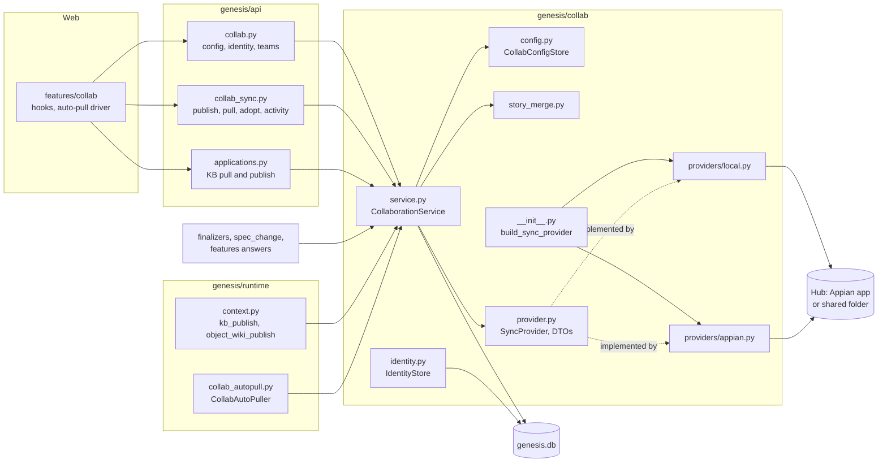
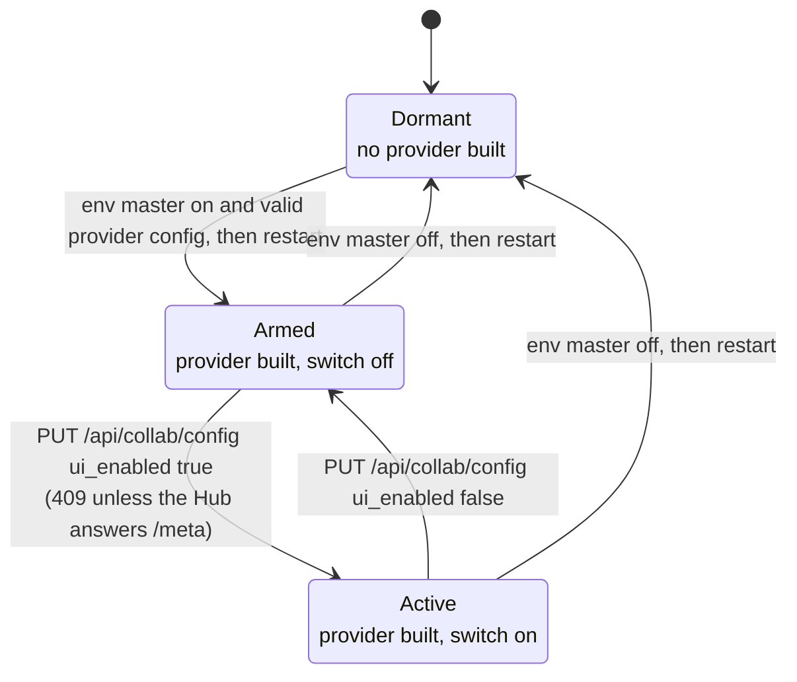
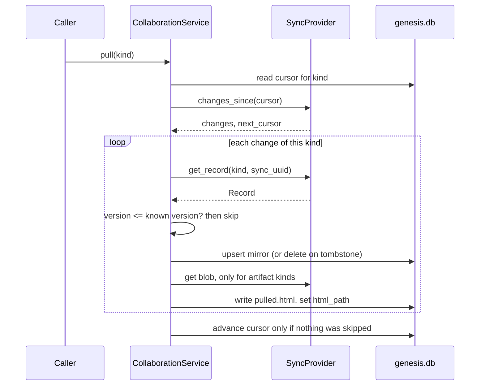
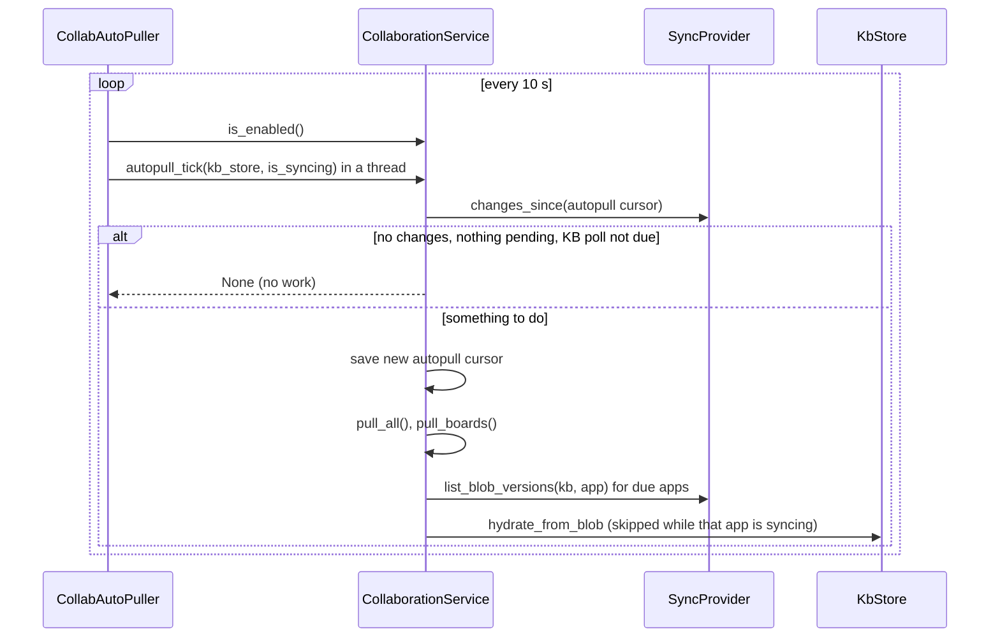

# Module: Collaboration Hub (`genesis/collab/`)

> **Describes:** genesis v0.81.0 (Phase 51) · **Last reviewed:** 2026-11-11 · C4 level 3 · area `collaboration-hub`

## 1. Purpose

Genesis is a local, single-user app. This module lets a small team share a chosen part of their work without
giving that up. When collaboration is on, one machine can **publish** shared data to a common store called the
**Hub**, and other machines can **pull** it and keep a read-only mirror. When collaboration is off, which is the
default, the module does nothing and a solo install behaves as if it did not exist (ADR-063).

The central promise is **opt-in, selective sharing**. Only a defined subset of data ever leaves the machine
(section 1.1). The rest stays local. Every write to the Hub is attributed to a named user, and no write ever
silently overwrites a teammate's newer version.

The Hub itself is an Appian application in the dev environment, built and maintained outside this repo. This
module only talks to its frozen Web API contract (ADR-064). The Appian side is out of scope here.

### 1.1 What is shared and what never leaves the machine

**Shared (published to the Hub, pulled by teammates).** These are the record kinds in `_BINDINGS` in
`genesis/collab/service.py`, plus two blob kinds:

| Shared item | Hub kind | How it travels |
|---|---|---|
| Feature (name, description, `app_uuid`, finalize stamp and other shared columns) | `feature` | Record |
| Feature stage artifact (spec, UX design, technical design, breakdown): status, content hash, upstream versions | `stage_artifact` | Record plus the artifact HTML as a blob keyed `<feature_sync_uuid>:<stage>` |
| Epic | `epic` | Record |
| Story (including acceptance criteria, questions, labels, spec references, answers, change log, `on_board`, status) | `story` | Record; list fields travel as arrays of strings |
| Board lane signal for a story | `board_state` | Record `{app_uuid, story_sync_uuid, status}` |
| Object Wiki page and its append-only entries | `wiki_page`, `wiki_entry` | Records (ADR-070) |
| A closed (applied or discarded) spec change request and its frozen document | `spec_change_request` | Record plus a blob keyed `<feature_sync_uuid>:cr-<nn>` |
| The Appian KB of a tracked application (metadata, structure, dependency graph; no SAIL code, ADR-037) | blob kind `kb`, key = `app_uuid` | Gzipped snapshot, content-hash deduplicated |
| Teams and memberships | `team`, `membership` | Records |
| Advisory "in progress by X" markers | activity | Short-lived markers |

**Never leaves the machine.**

- Chat sessions and messages, runs and their conversations, the workflow catalog and lockfile, documents and
  personal memory (ADR-063).
- Credentials. The Hub API key is read from the dev environment's secret scope and is sent only as the
  `appian-api-key` header. It is never put in a payload and never logged.
- Machine-local columns of shared rows. `_LOCAL_ONLY` in `service.py` removes `id`, `row_version`,
  `published_by`, `published_at`, `published_version`, `chat_session_id`, `run_id`, `html_path`,
  `source_doc_path`, `md_export_path` and `latest_entry_id` from every payload. A pulled row leaves them empty.
- The Test Design stage. `LOCAL_ONLY_STAGES = {"test_design"}` is refused on publish, left out of adoption and
  skipped on pull, because a teammate who finalized a pulled test design would allocate colliding `TC-` and
  `TS-` ids.
- Open spec change requests. Only a closed one is published.
- In-lane card order on a board and the choice of which boards a user curated. The lane itself is shared (it is
  the story `status`); position and board existence are not.
- Local-only parts of a change request: its stage id, directory, analysis fields and timestamps.
- Test cases, scenarios, the test workspace and executions. Their tables carry the collaboration columns but the
  Hub has no kind for them (see [testing.md](testing.md)).

Visibility among team members is open. Owner and team ids are stamped on rows for a future scoping feature, and
nothing enforces them (ADR-063).

## 2. At a glance

| Item | Value |
|---|---|
| Code | `genesis/collab/` (`config.py`, `identity.py`, `provider.py`, `providers/local.py`, `providers/appian.py`, `service.py`, `story_merge.py`), `genesis/runtime/collab_autopull.py`, `genesis/api/collab.py`, `genesis/api/collab_sync.py`; web: `web/src/features/collab/`, `web/src/lib/api/collab.ts` |
| Runs in | The app process (`genesis serve`). The auto-pull loop is an asyncio task started at app startup. The publish hooks run inside the worker subprocess through `ctx.extras` closures that build their own service. |
| Depends on | `genesis/db` (own tables, plus the shared tables of features, stories, wiki), `genesis/kb` (`KbStore` snapshot and hydrate, `StoryStore`, `kb/blob.py`), `genesis/config` (environments and secrets, to find the Hub URL and key), `genesis/runtime/settings.py`, `genesis_core.util.atomic_json`, `requests` for the Appian transport |
| Used by | `genesis/api/` (routes), `genesis/api/applications.py` (KB publish and pull), `genesis/api/features.py` (answers), `genesis/services/spec_change.py`, the story finalizers in `genesis/chat/`, `genesis/runtime/sync_jobs.py`, `genesis/runtime/context.py` (workflow hooks), `genesis/runtime/preflight.py` |
| Stores | `genesis.db`: `collab_identity`, `collab_teams`, `collab_memberships`, `collab_sync_state`, and `sync_uuid` / `row_version` / `published_*` columns on shared tables. Files: `~/.genesis/collab.json`; for the local emulator `~/.genesis/collab-hub/`. |
| Key ids | Hub contract version `1.0.0` (`CONTRACT_VERSION` in `providers/appian.py`) plus additive record kinds for the Object Wiki and spec change requests. Migrations `m0019_collab`, `m0020_story_on_board`, `m0021_object_wiki`, `m0024_spec_change_requests`. |
| Governing ADRs | ADR-063, ADR-064, ADR-065, ADR-070, ADR-074 |

## 3. Concepts

| Term | Meaning |
|---|---|
| **Hub** | The shared store. In production it is the `Genesis Hub` Appian application in the dev environment (ADR-064). In dev and tests it is a folder on disk. |
| **`SyncProvider`** | The Protocol in `provider.py` that hides the Hub transport. `CollaborationService` depends only on it. |
| **`LocalHubProvider`** | A file-backed emulator of the Hub over a shared folder. Two services with separate databases and the same folder act as two teammates. It is strict: it rejects unknown kinds and non-string story items, and it returns null text as `""`, as the live Hub does. |
| **`AppianHubProvider`** | The real provider. It maps each Protocol method to a Web API of the frozen contract. |
| **Record** | A shared entity as the Hub stores it: a JSON `payload` under a stable `sync_uuid`, a monotonic `version` and provenance. |
| **Blob** | Bytes stored by `(kind, key)` with versions and a content hash (KB snapshot, artifact HTML, frozen CR document). |
| **`sync_uuid`** | The stable global id of a synced entity. Added by `m0019` to the shared tables. Local integer ids collide across machines, so the wire never carries them. |
| **Base version / CAS** | A publish sends the version it last knew (`base_version`). The Hub accepts the write only if that is still the current version; otherwise it answers with a conflict (`HubConflict`). |
| **Entity binding** (`_EntityBinding`) | How one kind maps to a local table: parent references, JSON columns, blob kind, renames, local-only columns. |
| **Parent reference** (`_ParentRef`) | A local integer foreign key that is translated to the parent's `sync_uuid` on publish and back to a local id on pull. |
| **Mirror** | A pulled row. It is read-only by convention: its chat session and run stay empty, and the artifact is a copy of the publisher's HTML at `pulled.html`. |
| **Change manifest** | The Hub's ordered feed of "kind, sync_uuid, version" entries. `changes_since(cursor)` returns the entries after a cursor and the next cursor. |
| **Cursor** | A saved position in the manifest, kept in `collab_sync_state`. Several cursor keys exist (section 7). |
| **Tombstone** | A record with `_deleted: true`. A puller deletes its local mirror. |
| **Adoption** | A one-time, explicit bulk publish of work that existed before collaboration was turned on. |
| **Activity marker** | A soft "in progress by X" note with a time to live. It is advice only; the version check is the real guard. |
| **Two gates** | The environment master switch and the Settings switch. Both must be on (ADR-065). |
| **Canonical username** | The Appian username in `collab_identity`. It is the one user id used for attribution everywhere. |

## 4. Structure



The routes, the finalizers, the workflow hooks and the auto-pull loop all call one `CollaborationService`. The
service reads and writes `genesis.db` and talks to the Hub only through the `SyncProvider` Protocol. The composition
function `build_sync_provider` chooses the implementation at boot.

| File | Main classes and functions |
|---|---|
| `genesis/collab/__init__.py` | Public exports; `build_sync_provider(settings)` (returns `None` when disabled), `_resolve_hub_base_url`, `_resolve_hub_api_key` |
| `genesis/collab/config.py` | `CollabUiConfig`, `CollabConfigStore` over `~/.genesis/collab.json` |
| `genesis/collab/identity.py` | `Identity`, `IdentityStore` (identity singleton and the team cache), `current_user`, `canonical_username` |
| `genesis/collab/provider.py` | DTOs `Record`, `BlobRef`, `Change`, `Activity`, `PutResult`, `Team`, `Membership`; errors `HubConflict`, `HubTransportError`, `HubAuthError`; the `SyncProvider` Protocol |
| `genesis/collab/providers/local.py` | `LocalHubProvider`, `CONTRACT_KINDS`, `ContractViolation`, the null-text and array rules |
| `genesis/collab/providers/appian.py` | `AppianHubProvider`, `_default_transport`, `CONTRACT_VERSION`, the logical-endpoint to `urlAlias` map |
| `genesis/collab/service.py` | `CollaborationService`, `_BINDINGS`, `_EntityBinding`, `_ParentRef`, `_LOCAL_ONLY`, `LOCAL_ONLY_STAGES`, `NotOnboardedError`, `ElementTooLargeError`, `content_hash` |
| `genesis/collab/story_merge.py` | `merge_story`, `MERGEABLE` |
| `genesis/runtime/collab_autopull.py` | `CollabAutoPuller` |
| `genesis/api/collab.py` | `register_collab_routes`: config, availability, status, changes, identity, teams |
| `genesis/api/collab_sync.py` | `register_collab_sync_routes`: publish actions, pull, adoption, activity; HTTP error mapping |
| `genesis/runtime/context.py` | `_kb_publish`, `_object_wiki_publish` closures put into `ctx.extras` |
| `tests/fixtures/hub_contract/` | Contract fixtures: one JSON file per kind plus `activity`, `blobs`, `changes`, `conflict`, `meta`, `story_with_trace` |

## 5. How it works

### 5.1 The two gates and the provider

Collaboration is active only when **both** gates are on (ADR-065).

1. **Environment master.** `GENESIS_COLLAB_ENABLED` and `GENESIS_COLLAB_PROVIDER` are read once at boot into
   `Settings`. `build_sync_provider(settings)` returns a provider only if `collab_enabled` is true and the provider
   name is known. For `local` it builds a `LocalHubProvider` over `settings.collab_hub_dir`. For `appian` it
   resolves the base URL and the API key; if either is missing it returns `None` (collaboration stays off).
2. **Settings switch.** `ui_enabled` in `~/.genesis/collab.json`. It defaults to off. `CollaborationService.is_enabled()`
   is `provider is not None and ui_enabled`, read from the file on each call, so flipping it takes effect without
   a restart. Changing the environment master needs a restart because the provider is built once.

For the Appian provider, the base URL is the **dev-tagged environment's** URL plus `/suite/webapi`. The key is
`APPIAN_API_KEY`, resolved from the dev environment's secret scope (ADR-048). An explicit `collab_hub_url` is used
only when there is no dev environment.



In `Dormant` and `Armed` every service entry point either returns an empty result or raises "collaboration is
disabled" (`_require`). The API turns that into HTTP 409 for actions and into empty or `enabled: false` answers for
read endpoints. The switch can be turned **on** only when the provider exists and `is_available()` is true
(`PUT /api/collab/config` answers 409 otherwise and changes nothing).

### 5.2 Identity and onboarding

1. The user enters a name, Appian username and email in Settings → Collaboration. `PUT /api/collab/identity` stores
   them in the `collab_identity` singleton (self-asserted; Appian is not an identity provider).
2. `canonical_username(settings)` returns the stored Appian username, else `settings.memory_owner_username`, else
   `"local"`. It never raises, and it works when the table does not exist yet.
3. `is_onboarded()` is true when that value is not `""` or `"local"`. `require_onboarded()` raises
   `NotOnboardedError` otherwise. Every publish calls it first, so there is never an unattributed Hub write.
4. Teams are created on the client with a new UUID (offline-safe), written to the Hub with `upsert_team` and
   `upsert_membership`, and cached in `collab_teams` and `collab_memberships` for offline reads. Joining a team
   checks that the team exists on the Hub.

### 5.3 Publishing one record

`CollaborationService.publish(kind, sync_uuid)` is the single write path for record kinds.

1. Check the gates (`_require`) and onboarding.
2. Read the local row by `sync_uuid`. A missing row raises `KeyError`. An open change request raises `ValueError`.
   A `stage_artifact` for a local-only stage raises `ValueError`.
3. `_map_out` builds the payload: drop `_LOCAL_ONLY` columns; replace each local integer foreign key with the
   parent's `sync_uuid` (a missing parent `sync_uuid` raises `KeyError`, "publish the parent first"); apply renames
   (`upstream_versions_json` to `upstream_versions`, `summary_json` to `summary`); turn JSON-string columns into
   arrays; encode story trace elements as compact JSON strings (each element must be at most 4000 characters, else
   `ElementTooLargeError`); drop per-binding local-only columns. Then `published_by` is set to the canonical username.
4. If the binding has a blob kind, read the artifact file, upload it with `put_blob` first (so a puller that sees
   the metadata finds the bytes), and add `blob_key` and `content_hash` to the payload. A row with no file on disk
   publishes metadata only.
5. Choose the base version: the row's `published_version` where the table has that column, otherwise the cursor
   `<kind>:<sync_uuid>` in `collab_sync_state`.
6. `put_record(kind, sync_uuid, payload, base_version=...)`.
7. Record the version the Hub returned, in the same two places as step 5.

A `HubConflict` is never swallowed here. It travels to the caller (the "notify, then apply" signal).

The higher-level publishers wrap this:

| Method | What it publishes |
|---|---|
| `publish_feature_stage(stage_id)` | A **completed** stage. The parent feature is published first if it never was. A stage that is not `completed` raises `ValueError`. |
| `publish_feature_stage_by_kind(feature_id, stage)` | Same, found by feature and stage name (the web's handle). |
| `publish_feature_backlog(feature_id)` | The feature (always re-sent, because finalize sets a shared flag), all its epics once, all its stories. |
| `publish_epic`, `publish_story` | One epic or story, parents first. |
| `publish_story_merging(story_id, ours_fields, union=True)` | A story, with one automatic merge on conflict (section 5.5). |
| `publish_board_move(app_uuid, story_id)` | The story (its `status` is the lane), then a `board_state` record. |
| `publish_board_state` | Only the `board_state` record; its base version is the cursor `board_state:<story sync_uuid>`. |
| `publish_deletion(kind, sync_uuid)` | A tombstone `{sync_uuid, _deleted: true, published_by}`. The base is the local published version, or the Hub's current version if the row is already gone. |
| `publish_change_request(cr_id)` | A closed change request and its frozen `document.html`; the feature first. |
| `publish_object_wiki_page(page_id)` and `publish_object_wiki(app_uuid)` | A wiki page first, then every entry of that page (section 5.8). |
| `publish_kb(app_uuid, result)` | The KB snapshot as a blob (section 5.7). |

### 5.4 Pulling records



`pull(kind)` walks the manifest from that kind's cursor and handles each change of the kind in turn:

1. `get_record`. A record that no longer exists is ignored.
2. **Version guard (L-082).** `_known_version` is the row's `published_version`, or the `<kind>:<sync_uuid>` cursor
   for tables without that column. If the Hub version is not strictly greater, the record is treated as handled
   and nothing is written. This stops the machine from re-applying its own publish or an old change, which once
   flipped a local `under-change` spec back to `completed`.
3. A stage that is local-only (`test_design`) is skipped but counts as handled.
4. A tombstone deletes the local row. For a feature, the delete first notes the loss for the local regression
   suite, inside the same write transaction (`note_feature_delete`).
5. **Parent resolution.** Each parent `sync_uuid` is turned back into a local id. A blank string counts as "no
   parent" because the live Hub returns null text as `""` (L-084). A required parent that is not present locally yet
   makes the upsert return `False` (skipped).
6. Reverse the renames, keep only columns that exist on the local table and are not local-only, decode story
   trace elements (an unreadable element is dropped and logged as an error), encode arrays back to JSON strings.
7. **Reconstruct what the contract does not carry (L-072).** On an INSERT, every NOT NULL column without a default
   that the payload lacks is filled: `*_at` columns with now, `title` with a label from the stage name
   (`_STAGE_LABELS`), anything else with `""`. The Hub `stage_artifact` has no title, so this is what lets a stage
   mirror exist at all.
8. Write the row and, for tables with provenance columns, the `published_by`, `published_at` and `published_version`
   markers. Tables without them record the version in the `<kind>:<sync_uuid>` cursor.
9. For artifact kinds, fetch the latest blob for `blob_key` and write it to
   `<feature_stage_artifacts_dir>/<local id>/pulled.html`, then point `html_path` at it. A pulled change request
   writes `document.html` into its own folder, and only when the content differs.
10. **Cursor.** If every change was handled, the kind's cursor moves to `next_cursor`. If any change was skipped, the
    cursor stays where it was and the next pull re-reads the same range. Re-reading is harmless because of step 2.

`pull_all()` pulls every kind in the order of `_BINDINGS`: `feature`, `stage_artifact`, `epic`, `story`, `wiki_page`,
`wiki_entry`, `spec_change_request`. Parents come before children, so a child is rarely skipped for a missing parent.

A pulled change request is special. The puller derives the stage and the folder from its own spec stage. If the
spec stage is not pulled yet, the record is skipped and retried. If a local change request already holds the same
number for that feature, the pulled one is skipped and logged, and the local one is never overwritten.

`pull_boards()` handles the board signal. It reads the `board_state` manifest, seeds the per-story CAS cursors
`board_state:<sync_uuid>` from the pulled versions (so a later move by the puller publishes with the right base),
advances the `board_state` cursor, stamps `stories_finalized_at` on features that have stories (the Hub `feature`
record does not carry it, and the publisher only publishes a backlog at Finalize), and then runs
`reconcile_board_membership` for every local board. Reconciliation adds a card, at the end of the lane list, for
each story with `on_board = 1` that has no card yet. It only adds. It does not remove (see the pitfalls).

### 5.5 Conflicts and the story merge

A `HubConflict` means a teammate published the same record after this machine last saw it. Most publishers let
it propagate and the API answers 409. Stories that change through answers or change requests use
`publish_story_merging`:

1. Try `publish_story`. On success, done.
2. On `HubConflict`, `get_record` the Hub's story (if gone, retry as a create).
3. Decode the Hub's trace arrays and call `merge_story(ours, theirs, ours_fields, union)` from `story_merge.py`. It
   is pure. Fields the operation changed are taken from ours; other shared fields from theirs; `answers` and
   `change_log` are merged as unions by `(question, answered_at)` and `(cr_no, at)`; `spec_refs` are merged by
   `clause_id` with ours winning; `questions` are the Hub's minus the ones this operation answered, plus ones it
   added. With `union=False` (an answer operation) an answer set is not rebuilt as a union, so a reopen is not undone.
4. Write the merged story **locally** with a `row_version` compare-and-set, then publish once with the Hub's version
   as the base.
5. A second conflict propagates. The caller reports "publish pending".

### 5.6 Auto-pull

The browser also polls (`useAutoPull` in `web/src/features/collab/hooks.ts`: `/collab/changes` every 10 seconds
while a Workbench board is open and every 30 seconds otherwise, and a real pull only when the cursor advanced).
Browsers throttle background tabs, so the backend runs its own loop. It is described in
[web-app.md](web-app.md) from the UI side.



`CollabAutoPuller` (`genesis/runtime/collab_autopull.py`) owns one asyncio task, started on app startup and stopped
on shutdown. Each interval (default 10 seconds) it checks `is_enabled()` and, if true, runs
`autopull_tick` through `asyncio.to_thread`. The blocking pull must not run on the event loop because a blocking
`genesis.db` write there can deadlock the checkpointer (L-026). Any exception in a tick is caught and logged at
debug level, and the loop continues.

`autopull_tick` is change-gated:

1. Read the saved `autopull` cursor and ask the provider for changes since it.
2. If the cursor exists, there are no changes, no KB pull is pending and no KB poll is due, return `None`.
3. If the cursor is empty (first tick) or there are changes, save the new cursor, then run `pull_all()` and
   `pull_boards()`.
4. With a `kb_store`: work out which tracked applications are **due**. A `blob` or `kb` change whose key is a tracked
   app's uuid makes that app due. Apps deferred by an earlier tick (stored as a JSON list under the cursor key
   `autopull:kb-pending`, so a restart does not lose them) are due. Every `KB_POLL_SECONDS` (60) every tracked app
   other than the Hub app is due too, because the live Hub does not append `blob` rows to the manifest (found in
   Phase 45; L-078).
5. For each due app, if `is_syncing(app_uuid)` is true (a local sync of that app is running), defer it. Otherwise call
   `pull_kb_if_newer`. A failure for one app defers only that app. The new pending list is saved.

### 5.7 KB sharing (ADR-063, ADR-074)

A KB is shared as one gzipped snapshot per application. The key is the application's `app_uuid`.

**Publish.** `publish_kb(app_uuid, result)` refuses the Hub's own app (`is_hub_app`), requires onboarding, serializes
the result with `kb/blob.py` and calls `put_blob("kb", app_uuid, ...)` with the sha256 content hash. The Hub
deduplicates by hash, so an unchanged KB creates no new version. The returned version is saved as the cursor
`kb:<app_uuid>`, so this machine never pulls its own publish back.

Where the data comes from matters. Both callers publish `KbStore.export_snapshot(app_uuid)`, the **current** KB, and
never a run's `result.json`. An incremental sync's result is partial and would erase teammates' KBs when they hydrate
(ADR-074). The two callers are `POST /api/applications/{app_uuid}/publish` and the `kb_publish` closure in
`genesis/runtime/context.py`, which the `sync-application` workflow's `publish_hub` step calls after a successful
sync. The closure never raises. It returns `{published_version, content_hash}`, `{skipped: reason}` or
`{error: ...}`, and the workflow records the result.

**Pull.** `pull_kb_if_newer(app_uuid, kb_store)` lists the blob versions. If the newest is not greater than the
cursor `kb:<app_uuid>`, it returns `None` and does no work. Otherwise it downloads the blob, calls
`kb_store.hydrate_from_blob` (a diff-based replace of current state, no export or parse) and saves the cursor. It is
blocking, so callers run it in a thread. It is called by `POST /api/applications/{app_uuid}/pull`, by the auto-pull
loop, and by the scheduled `kb-hub-pull` job in `genesis/runtime/sync_jobs.py` (disabled by default). With
collaboration on, `app_sync_skip_reason` makes the scheduled app sync run only on the machine whose schedule option
`run_on_this_machine` is set. That is described in [scheduler-and-jobs.md](scheduler-and-jobs.md). The KB itself is
described in [knowledge-base.md](knowledge-base.md).

The watermark rule from L-080 applies on the sync side: a hydrated snapshot is not an anchor for the next
incremental listing, because its coverage point is the publisher's, not this machine's.

### 5.8 Object Wiki sharing (ADR-070)

The Object Wiki is a per-object change ledger kept in `wiki_object_pages` and `wiki_object_entries`. Entries are
append-only, so they do not conflict. The write path is local first:

1. The `story-implementation` workflow's `persist_wiki` step writes entries locally through `ctx.extras['object_wiki']`.
2. It then calls `ctx.extras['object_wiki_publish'](app_uuid)` inside a `try`. That closure in `context.py` builds a
   fresh service and publishes only if `is_enabled()`, `is_available()` and `is_onboarded()` are all true. Any exception
   is swallowed. The local write has already succeeded.
3. `publish_object_wiki(app_uuid)` calls `publish_object_wiki_page` for every page of the app. Each call publishes the
   page first (so a puller can resolve `page_sync_uuid`) and then all entries of that page. The page's
   `latest_entry_id` is a local integer and is never sent.
4. Pullers get pages and entries through `pull_all`. An entry whose page is not present yet is skipped and retried.

Timestamps that cross the Hub keep the author's string form (`Z`, `+00:00`, `+05:30`, with or without a fraction).
Consumers must compare them as instants, not as strings (L-084).

### 5.9 Adoption

Work completed before collaboration was enabled is not on the Hub. `adoption_preview()` counts the candidates and
`adopt_publish()` sends them. Both return zeros when collaboration is disabled. Candidates are:

- completed stages that are not local-only and have no `stage_artifact:<sync_uuid>` cursor;
- epics of features with `stories_finalized_at` set and no `epic:<sync_uuid>` cursor;
- stories of those features whose `published_version` is null;
- board cards whose story has no `board_state:<sync_uuid>` cursor.

Adoption publishes stages, then epics, then stories, then board states, and only unpublished items, so it is safe to
run twice. It runs only when a caller posts `POST /api/collab/adopt`; nothing triggers it by itself.

### 5.10 Who triggers a publish

| Trigger | Where | Calls |
|---|---|---|
| "Publish to team" on a completed stage | `StageArtifactWorkspace.tsx` via `usePublishStage` | `POST /api/collab/publish/feature/{id}/stage/{stage}` |
| Import onto a board, remove from a board, edit of a story | `web/src/features/workbench/hooks.ts` | `POST /api/collab/publish/story/{id}` |
| A manual lane move | `web/src/features/workbench/hooks.ts` | `POST /api/collab/publish/board-move` |
| A system lane move after a design, implementation or verification run | `StoryDesignFinalizer`, `StoryImplementationFinalizer`, `StoryVerificationFinalizer` | `publish_board_move` directly, best-effort, guarded by `is_enabled()` |
| An answer, edit or reopen of a story question | `genesis/api/features.py` (`_publish_answer`) | `publish_story_merging(..., ["answers", "questions"], union=False)` |
| Applying a spec change request | `genesis/services/spec_change.py` (`_publish_applied`) | `publish_feature_stage`, `publish_story_merging`, `publish_deletion`, `publish_change_request`; a conflict is reported as "pending" |
| Spec change activity | `spec_change.py` | `set_activity` / `clear_activity` on the spec stage, only if onboarded |
| A finished KB sync | `sync-application` workflow, `publish_hub` step | `ctx.extras['kb_publish']` |
| A finished implementation run | `story-implementation` workflow, `persist_wiki` step | `ctx.extras['object_wiki_publish']` |
| "Publish KB" button | `POST /api/applications/{app_uuid}/publish` | `publish_kb` |

The system lane moves exist for a reason: without them, the always-on pull would mirror the Hub's old status back
over the local change.

## 6. Interfaces

### 6.1 HTTP endpoints (all under `/api`, ADR-028)

Defined in `genesis/api/collab.py`:

| Method and path | Purpose |
|---|---|
| `GET /collab/config` | The two-gate state: `enabled`, `env_enabled`, `ui_enabled`, `available`, `hub_app_uuid`, `provider`, `hub_url`, `identity_set`, `active_team_uuid`. The web layer gates the whole UI on it. |
| `GET /collab/availability` | `env_enabled`, `available`, `can_enable`: whether the Settings switch may be turned on. |
| `PUT /collab/config` | Set `ui_enabled` and `hub_app_uuid`. Turning on needs the env master and a reachable Hub, else 409. |
| `GET /collab/status` | `enabled` and live `available`. Never 500s. |
| `GET /collab/changes?cursor=` | One page of the change manifest. Disabled gives an empty page with `enabled: false`; an unreachable Hub gives an empty page with `available: false`. |
| `GET /collab/identity`, `PUT /collab/identity` | Read and set the self-asserted identity. Work even when collaboration is off. |
| `GET /collab/teams`, `POST /collab/teams` | List teams (refreshes the local cache) and create one (needs an identity). |
| `POST /collab/teams/{team_uuid}/join` | Join a team (404 if unknown). |
| `PUT /collab/active-team` | Set the active team. |
| `GET /collab/teams/{team_uuid}/members` | List members from the Hub. |

Defined in `genesis/api/collab_sync.py`:

| Method and path | Purpose |
|---|---|
| `POST /collab/publish/stage/{stage_id}` | Publish a completed stage. |
| `POST /collab/publish/feature/{feature_id}/stage/{stage}` | Publish a completed stage by feature and name. |
| `POST /collab/publish/backlog/{feature_id}` | Publish the feature, epics and stories. |
| `POST /collab/publish/story/{story_id}` | Publish one story. |
| `POST /collab/publish/board-move` | Body `{app_uuid, story_id}`: publish the lane and the board signal. |
| `POST /collab/publish/deletion` | Body `{kind, sync_uuid}`: publish a tombstone. |
| `POST /collab/pull` | "Sync now": `pull_all` then `pull_boards`. |
| `GET /collab/adopt/preview` | Counts of unpublished candidates (zeros when disabled). |
| `POST /collab/adopt` | The explicit bulk publish. |
| `GET /collab/activity/{kind}` | List advisory markers (empty on any error). |
| `POST /collab/activity/{kind}/{sync_uuid}` | Heartbeat a marker (`{ok: false}` on error, never 500). |
| `DELETE /collab/activity/{kind}/{sync_uuid}` | Clear a marker. |

Error mapping in `collab_sync.py` (`_guard`): `NotOnboardedError`, `HubConflict` and `ValueError` give 409;
`HubAuthError` gives 401; `HubTransportError` gives 503; `KeyError` gives 404. Disabled collaboration gives 409
"collaboration is disabled".

KB endpoints that belong to this feature but live in `genesis/api/applications.py`: `POST /applications/{app_uuid}/pull`
and `POST /applications/{app_uuid}/publish` (see [knowledge-base.md](knowledge-base.md)).

### 6.2 Python API used by other modules

| Call | Used by |
|---|---|
| `CollaborationService(db, provider, settings=..., username=...)` | `genesis/api/app.py` builds the one shared instance and stores it as `app.state.collab`. The workflow hooks in `context.py` build their own. |
| `is_enabled()`, `hub_configured()`, `is_available()`, `is_onboarded()`, `require_onboarded()` | Routes, finalizers, scheduler jobs, schedules API (`collab_enabled` flag) |
| `publish_*`, `publish_deletion`, `publish_story_merging`, `publish_change_request`, `publish_kb`, `publish_object_wiki*` | See section 5.10 |
| `pull(kind)`, `pull_all()`, `pull_boards()`, `autopull_tick(kb_store, is_syncing=)`, `pull_kb_if_newer` | Routes, `CollabAutoPuller`, `kb-hub-pull` job |
| `adoption_preview()`, `adopt_publish()` | `collab_sync.py` |
| `set_activity`, `clear_activity`, `list_activity`, `put_blob`, `get_latest_blob`, `changes_since` | Routes and `spec_change.py` |
| `is_hub_app(app_uuid)` | `applications.py` (refuses to track the Hub's own app), KB publish and pull |
| `canonical_username(settings)`, `current_user`, `IdentityStore` | Many modules (lifecycle actor, memory owner, finalizers, test and spec services) |
| `build_sync_provider(settings)` | `api/app.py`, `context.py`, `preflight.py` |

### 6.3 The provider contract (`SyncProvider`)

Records: `put_record(kind, sync_uuid, payload, base_version)`, `get_record`, `list_records(kind, since)`. Blobs:
`put_blob(kind, key, data, content_hash, meta)`, `get_blob(ref)`, `list_blob_versions(kind, key)`. Manifest:
`changes_since(cursor)`. Activity: `set_activity`, `clear_activity`, `list_activity`. Identity: `upsert_team`,
`list_teams`, `upsert_membership`, `list_memberships`, `resolve_user`. Health: `is_available`.

`list_blob_versions` returns versions in ascending order in both providers, so `versions[-1]` is the latest.

### 6.4 The Appian wire contract

`AppianHubProvider` maps the Protocol onto Web APIs under the base URL. The logical endpoints and their `urlAlias`
values are in `_ALIAS`: `meta`, `records` (PUT), `records_get`, `records_list`, `changes`, `activity`,
`activity_clear`, `activity_list`, `blobs` (POST), `blobs_get`, `blobs_versions`. Behaviour grounded in the code:

- Auth: header `appian-api-key`. A 401 raises `HubAuthError`.
- `PUT` sends the payload plus `base_version` (null means create). 409 raises `HubConflict` with the Hub's
  `current_version`. 200 or 201 returns the Hub's `version`, which the provider trusts without re-reading, because
  reads on the Hub are eventually consistent.
- Blobs travel as base64 with `content_hash`. 200 means unchanged (deduplicated), 201 means a new version.
  `GET /blobs/{kind}/{key}` returns the latest bytes only, so `get_blob` ignores the version in its argument.
- `changes_since` drains pages of up to 500 until the cursor stops advancing.
- `list_records` asks for one page of 500 and does not page further.
- Teams and memberships are generic records. A membership's `sync_uuid` is a `uuid5` of `team_uuid:username`, so
  upserts are idempotent. `_upsert_record` reads the current version, writes, and retries once on a conflict.
- `is_available()` calls `/meta` and returns true for a 200. If `contract_version` differs from `1.0.0` it logs a
  warning and still returns true.
- The default transport uses `requests` with a 30 second timeout and three attempts for 429 and 5xx answers, with
  sleeps of 0.5 and 1.0 seconds. A network error raises `HubTransportError`. The transport is injectable, which is
  how the tests run without a network.

The contract fixtures in `tests/fixtures/hub_contract/` are the same files the Appian side passed. The Appian tests
drive the provider with them, so a change to the wire shape fails a test here (L-071, L-078).

### 6.5 Hooks into workflows

`genesis/runtime/context.py` adds two closures to `ctx.extras` for workflows: `kb_publish(app_uuid)` and
`object_wiki_publish(app_uuid)`. There are no MCP tools, no CLI commands and no run events in this module.

## 7. Data

### 7.1 Tables owned by this module (`m0019_collab`)

| Table | Key columns | Meaning |
|---|---|---|
| `collab_identity` | `id` (always 1), `name`, `appian_username`, `email`, `active_team_uuid` | The self-asserted identity. `appian_username` is the canonical user id. Written by `IdentityStore`, read by `canonical_username`. |
| `collab_teams` | `team_uuid` PK, `title`, `created_by` | Offline read cache of Hub teams. |
| `collab_memberships` | `(team_uuid, username)` PK, `name`, `email`, `joined_at` | Offline read cache of memberships. |
| `collab_sync_state` | `kind` PK, `last_cursor`, `last_pulled_at` | All cursors and per-entity version markers. |

### 7.2 Keys used in `collab_sync_state`

| Key | Holds |
|---|---|
| `<kind>` (`feature`, `stage_artifact`, `epic`, `story`, `wiki_page`, `wiki_entry`, `spec_change_request`) | The manifest cursor for that kind's pull |
| `board_state` | The manifest cursor for board signals |
| `board_state:<story sync_uuid>` | The last known Hub version of that story's board record (the CAS base) |
| `<kind>:<sync_uuid>` | The Hub version of one entity, used for tables without a `published_version` column (epics, stage artifacts, wiki rows and others) |
| `kb:<app_uuid>` | The newest KB blob version this machine published or hydrated |
| `autopull` | The auto-pull's manifest cursor |
| `autopull:kb-pending` | A JSON list of app uuids whose KB pull was deferred |

### 7.3 Columns this module adds to other tables

`m0019` adds `sync_uuid` (unique) to `kb_features`, `kb_feature_stages`, `kb_epics`, `kb_stories`, `workbench_boards`
and `kb_board_cards`; `row_version` where it was missing; `owner_username`, `team_uuid` and the publish markers
`published_by`, `published_at`, `published_version` on `kb_features`, `kb_stories` and `workbench_boards`; and
`upstream_versions_json` on the two stage tables. `m0020_story_on_board` adds `kb_stories.on_board`, the shared flag
that says a story was imported onto a board. `m0021_object_wiki` carries the same collaboration columns, and `m0024_spec_change_requests` adds a `sync_uuid` to its table. Other modules own those tables; this module reads and writes the
collaboration columns.

### 7.4 Files

| Path | Owner and use |
|---|---|
| `~/.genesis/collab.json` | `CollabConfigStore`: `ui_enabled` and `hub_app_uuid`. Written atomically with a read-modify-write lock. A missing or garbled file reads as off. |
| `~/.genesis/collab-hub/` (or `GENESIS_COLLAB_HUB_DIR`) | `LocalHubProvider` only: `records/<kind>/<sync_uuid>.json`, `blobs/<kind>/<key>/<version>.bin` and `.json`, `activity/`, `teams.json`, `memberships.json`, `changelog.jsonl`. |
| `<feature_stage_artifacts_dir>/<local stage id>/pulled.html` | The mirror of a pulled stage artifact. |
| `<feature_stage_artifacts_dir>/<spec stage id>/change-requests/CR-<nn>/document.html` | The mirror of a pulled change request document. |

## 8. Failure handling

| Situation | Behaviour |
|---|---|
| Either gate is off | `is_enabled()` is false. `_require` raises; routes answer 409 for actions and empty results for reads; the auto-pull loop does nothing. |
| Appian provider configured but no dev-environment URL or no `APPIAN_API_KEY` | `build_sync_provider` returns `None`. Collaboration stays off; the Settings switch cannot be turned on. |
| Hub unreachable (`is_available()` false) | `is_available` never raises. `GET /collab/changes` returns an empty page with `available: false`. Publishing through the API gives 503. The workflow hooks skip (`Hub unreachable` for KB, silent for the wiki). Local work continues. |
| 401 from the Hub | `HubAuthError`; the API answers 401. |
| Publish before onboarding | `NotOnboardedError`; the API answers 409 asking for the Appian username. |
| Publish of a stage that is not completed, or an open change request, or a local-only stage | `ValueError`; the API answers 409. |
| Parent not published yet when publishing a child | `KeyError` "publish the parent first". The higher-level publishers publish the parent first, so this appears only for direct calls. |
| `HubConflict` on publish | Propagates to the caller; 409 from the API. `publish_story_merging` merges once and retries once; a second conflict is reported as pending. Applying a change request reports pending items instead of failing. |
| Story trace element over 4000 characters | `ElementTooLargeError` at publish. It fails loudly and is never truncated. |
| Pulled record with a parent that is not local yet | Skipped, and that kind's cursor does not advance. The next pull retries. |
| Pulled record whose version is not newer than the local one | Treated as handled; nothing is written (L-082). |
| Pulled story element that will not parse | Dropped and logged at error level; the rest of the record applies. |
| Pulled change request whose number is taken locally | Skipped and logged; the local record is never overwritten. |
| Error inside an auto-pull tick | The loop catches it and logs at debug level. The `autopull` cursor is saved before `pull_all()` runs, so the loop does not retry that batch; the next Hub change or a manual `POST /collab/pull` pulls again. |
| One application's KB pull fails in the loop | Only that app is deferred; the pending list is saved. |
| A KB pull is due while a local sync of that app runs | Deferred until the sync ends. |
| `kb_publish` or `object_wiki_publish` fails | Swallowed or returned as `{error: ...}`. The local KB or wiki write already succeeded. |
| Settings switch turned on while the Hub is down | 409 and nothing changes. |
| `collab.json` unreadable | Reads as off (`ui_enabled` false). |
| Un-migrated database | `canonical_username` falls back to the legacy owner or `"local"`; `IdentityStore.get` returns `None`. |

## 9. Configuration

| Setting | Where | Default and effect |
|---|---|---|
| `GENESIS_COLLAB_ENABLED` | Environment, read at boot into `Settings.collab_enabled` | Off. The env master (gate 1). Restart to change. |
| `GENESIS_COLLAB_PROVIDER` | Environment, `Settings.collab_provider` | Empty. `local` or `appian`; anything else keeps collaboration off. |
| `GENESIS_COLLAB_HUB_URL` | Environment, `Settings.collab_hub_url` | Empty. A full Web API prefix, used only when there is no dev-tagged environment. |
| `GENESIS_COLLAB_HUB_DIR` | Environment | `~/.genesis/collab-hub`. Root of the local emulator. |
| `ui_enabled` | `~/.genesis/collab.json`, set in Settings → Collaboration | Off. The Settings switch (gate 2). Can be turned on only when the Hub answers. |
| `hub_app_uuid` | `~/.genesis/collab.json` | Empty. The Hub app's own `app_uuid`, excluded from KB tracking, publish and pull. The file value wins over `Settings.collab_hub_app_uuid`. |
| `Settings.collab_hub_app_uuid` | `Settings` field | Empty. Its comment names `GENESIS_COLLAB_HUB_APP_UUID`, but `Settings.from_env` does not read that variable (section 12). |
| Dev-tagged environment and its `APPIAN_API_KEY` | Settings → Environments and the secret provider | Provide the Hub URL (`<dev url>/suite/webapi`) and the service-account key (ADR-048, ADR-065). |
| Auto-pull interval | `CollabAutoPuller(interval=10.0)` | 10 seconds. `app.py` does not override it. |
| `CollaborationService.KB_POLL_SECONDS` | Class constant | 60 seconds between direct KB version checks. |
| `ELEMENT_MAX` | `service.py` | 4000 characters per story trace element. |
| `kb-hub-pull` job | `sync_jobs.py` default schedule | Disabled by default; one run at 06:30 on weekdays when enabled. |

## 10. Extending this module

**Share a new kind of entity.**

1. Make sure the table has `sync_uuid` (a migration; see [data-and-migrations.md](data-and-migrations.md)) and, if
   it should track the last Hub version, the `published_*` columns.
2. The Hub needs a record kind first. The Appian side is built separately and the contract is additive. Add the
   kind to `CONTRACT_KINDS` in `providers/local.py` so the strict emulator knows it, and add a fixture file to
   `tests/fixtures/hub_contract/`.
3. Add an `_EntityBinding` to `_BINDINGS` in `service.py`. Use the **Hub's** field names (`rename_out`), declare
   parents with `_ParentRef`, list JSON columns, and list any machine-local columns in `local_only`.
4. Put new `pull_all` ordering in mind: parents must come before children in the dict.
5. Add the publish trigger. Write a test that goes through the real trigger, not only the service method (L-085).
6. Check every column that is NOT NULL without a default, because a mirror INSERT must fill it (L-072).

**Add a machine-local column to a shared table.** Add it to `_LOCAL_ONLY` (all kinds) or the binding's `local_only`
(one kind). The no-leak test depends on this list.

**Add a provider.** Implement `SyncProvider`, register it in `build_sync_provider`, and make any emulator at least
as strict as the real peer: reject unknown kinds, enforce the field shapes and return null text as `""` (L-071,
L-084).

**Change a story field that can be edited by two people.** Add it to `MERGEABLE` in `story_merge.py` and decide
whether it is a union, "ours" or "theirs" field. Keep `merge_story` pure.

**Add a publish hook for a workflow.** Add a closure to `ctx.extras` in `context.py`. It must never raise, must
check `is_enabled()`, `is_onboarded()` and `is_available()`, and must return a small status dict.

## 11. Design decisions

| Decision | In plain words | ADR |
|---|---|---|
| Local first, share a subset | Genesis stays a solo app that works offline. Collaboration is an opt-in copy of a defined subset to a shared Hub. | ADR-063 |
| A provider seam | The service depends on a `SyncProvider` Protocol, not on Appian, so the Hub can be a folder in tests. | ADR-063 |
| Optimistic version check, no hard locks | A write names the version it saw. A mismatch is a conflict. A soft marker shows who is working, but never blocks. | ADR-063 |
| Self-asserted identity, Appian username as the id | Users enter their own name and Appian username. Appian is not an identity provider. | ADR-063 |
| Open visibility | Everyone on the Hub sees everything shared. Owner and team ids are stored for later and not enforced. | ADR-063 |
| The Hub is an Appian app with a frozen contract | The Hub lives in the existing dev environment. Genesis talks to fixed Web APIs and does not build or change the Hub. | ADR-064 |
| Two gates | The environment switch builds the provider; the Settings switch turns use on, and only when the Hub answers. A fresh install is dormant. | ADR-065 |
| Hub URL from the dev environment | No separate URL setting; the dev environment is the Hub. | ADR-065 |
| Object Wiki is append-only and shared | Wiki entries are never edited, so they sync without conflicts. Code is never stored. | ADR-070 |
| KB published as a snapshot after each sync, pulled diff-wise | The current KB is published, never a partial run result. Teammates hydrate. Sync is incremental and package-scoped. | ADR-074 |
| Pull by version, not by cursor | A pull applies a record only if its version is newer than the local one. | L-082 |
| Strict emulator | The local Hub rejects what the live Hub rejects. | L-071, L-084 |

## 12. Known pitfalls

- **A permissive emulator hides contract bugs.** The first live `stage_artifact` publish returned 400 because the
  binding used the wrong kind and field names while the emulator accepted anything. Bindings use the Hub's names,
  and a test checks that every binding kind is a contract kind (L-071).
- **The Hub stores only the contract fields.** A pulled mirror must rebuild fields the Hub does not carry (stage
  `title`, `stories_finalized_at`), and the UI must show a stage that has no local chat (L-072).
- **Do not rely on the cursor alone.** A skipped record keeps that kind's cursor in place, and pulls re-read the same
  range. The version guard makes this harmless. `pull()` has no escape hatch for a record that can never resolve; a
  stuck kind keeps re-reading its range (L-082).
- **Local-only state must survive an echo of your own publish.** Applying your own old record once overwrote an
  `under-change` spec (L-082).
- **Null text is `""` on the live Hub, and date-like strings may change form.** Treat blank as absent, and compare
  timestamps as instants (L-084).
- **A hook that nothing calls is invisible.** Test the trigger, not only the method (L-085). The
  `usePublishBacklog` hook in `hooks.ts` and the `POST /collab/publish/backlog/{feature_id}` endpoint exist; check
  that the Finalize action reaches them before relying on it.
- **Capture a watermark before the work it covers**, and never take it from another machine's snapshot. A hydrated
  KB is not an anchor for the next incremental listing (L-080).
- **A new default or a new stored home must respect old values.** The scheduled app sync skips when the installed
  `sync-application` workflow predates incremental sync, and a user's schedule edit is not overwritten on boot
  (L-081).
- **Board membership is explicit.** Auto-derived membership plus an always-on pull plus a wrong default status made a
  board that added everything. Membership is the shared `on_board` flag, and a finalized story defaults to `to-do`
  (L-074).
- **The live Hub can differ from the emulator.** It does not append `blob` rows to the manifest, so KB pulls poll
  versions directly (L-078).
- **Reconciliation only adds cards.** If a teammate sets `on_board = 0`, a puller's existing card is not removed by
  `reconcile_board_membership`. This is a known follow-up recorded in the ADR-061 amendment.
- **Keep the Hub app out of the KB.** `is_hub_app` is the only guard; set `hub_app_uuid` in Settings if the Hub app is
  visible in the dev environment.
- **Pulls are not draft-aware.** `pull` replaces a local mirror whenever the Hub version is strictly newer. The
  "notify before applying when a local draft exists" idea in ADR-063 is not implemented in the service; mirrors are
  read-only by convention in the UI.

## 13. Tests

| File | What it covers (from the test names) |
|---|---|
| `tests/test_collab.py` | Local provider CAS and conflict, round-trip fidelity, blob dedup, cursor advance, activity expiry, teams; the no-leak payload; disabled service is a no-op; two-instance publish and pull; canonical username fallbacks; lifecycle actor; the two-gate Settings toggle and availability guard; config, status and changes endpoints |
| `tests/test_collab_appian.py` | `AppianHubProvider` against the vendored contract fixtures: create and update, conflict to `HubConflict`, missing record, list and since, blob dedup and versions, change cursor, activity, teams and memberships, availability, contract version warning without leaking the key, 401 mapping, `build_sync_provider` for `appian` and disabled |
| `tests/test_collab_kb.py` | KB blob lossless, gzipped and deterministic; hydrate replaces state; two-instance KB publish and pull; dedup; Hub app excluded; publish needs onboarding; attribution; onboarding read offline |
| `tests/test_collab_sdlc.py` | Stage publish and read-only mirror; skip until the parent exists; incomplete stage rejected; conflict surfaces; backlog publish and pull; story round trip; edit and delete propagation; board membership and lane sync; in-lane order stays local; second contributor move; board conflict; sync API gating, onboarding and complete-gate; adoption (idempotent, never automatic, API); binding kinds match the contract; blank optional parent; derived stage title; board stamping; change-gated auto-pull tick and disabled no-op |
| `tests/test_collab_trace.py` | Story trace arrays and element cap; strict emulator; fixtures for stories and change requests; change request publish and pull with its document; open CR never published; merge rules; `publish_story_merging` and a second conflict; activity markers and answer publishing at the API; null-text emulation; local CR number collision; version-guard test `test_a_pull_never_reapplies_a_version_this_machine_already_has` |
| `tests/test_collab_migration.py` | Migration `m0019`: additive columns, stores emit `sync_uuid` and `row_version`, backfill of existing rows, idempotent `up` |
| `tests/test_kb_collab_sync.py` | Incremental sync reaching the puller in one tick; unchanged KB makes no new version; pull waits for a running sync and ignores untracked apps; repeat hydrate is a diff; publish endpoint uses the snapshot; best-effort `kb_publish`; KB auto-pull without blob rows |
| `tests/test_object_wiki_collab.py` | Wiki bindings; page and entries round trip; entry skipped until its page exists; local pointer never leaks; publish order and counts; missing page raises |
| `web/src/features/collab/*.test.tsx` (`collab.test.tsx`, `sync.test.tsx`, `SdlcControls.test.tsx`) | Web side of the collaboration UI (named only; not read in detail) |

Gate commands (from the area definition):

```
cd genesis && .venv/bin/python -m pytest -q -p no:warnings
cd genesis && .venv/bin/ruff check genesis
cd genesis/web && npm run lint && npm run typecheck && npm test
cd genesis/web && npm run build     # then commit web/static/
```

## 14. Code map

| To change… | Look in |
|---|---|
| Whether collaboration is on, or the Settings switch | `genesis/collab/config.py`, `CollaborationService.is_enabled`, `genesis/api/collab.py` (`PUT /collab/config`) |
| Which provider is built, the Hub URL or the API key lookup | `genesis/collab/__init__.py` (`build_sync_provider`, `_resolve_hub_base_url`, `_resolve_hub_api_key`) |
| Who the user is, onboarding, teams | `genesis/collab/identity.py`, `genesis/api/collab.py` |
| What leaves the machine | `_LOCAL_ONLY`, `LOCAL_ONLY_STAGES`, `_EntityBinding.local_only` in `genesis/collab/service.py` |
| A wire field name or kind | `_BINDINGS` in `service.py`, `CONTRACT_KINDS` in `providers/local.py`, `tests/fixtures/hub_contract/` |
| How a record is written or read back | `CollaborationService.publish`, `_map_out`, `_upsert_local` |
| Pull order, cursors or the version guard | `pull`, `pull_all`, `_known_version`, `_cursor` / `_set_cursor` |
| Board signals and board membership | `publish_board_state`, `pull_boards`, `reconcile_board_membership` |
| Conflict merging of stories | `genesis/collab/story_merge.py`, `publish_story_merging` |
| KB sharing | `publish_kb`, `pull_kb_if_newer`, `genesis/api/applications.py`, `kb_publish` in `genesis/runtime/context.py` |
| Object Wiki sharing | `publish_object_wiki*`, `object_wiki_publish` in `context.py`, `wiki_*` bindings |
| The background pull loop | `genesis/runtime/collab_autopull.py`, `CollaborationService.autopull_tick`, startup hooks in `genesis/api/app.py` |
| Adoption of old work | `_adoption_rows`, `adoption_preview`, `adopt_publish` |
| The Appian transport, retries or auth | `genesis/collab/providers/appian.py` |
| The local emulator | `genesis/collab/providers/local.py` |
| HTTP routes and error codes | `genesis/api/collab.py`, `genesis/api/collab_sync.py` |
| The web driver and publish calls | `web/src/features/collab/hooks.ts`, `web/src/lib/api/collab.ts`, `web/src/features/workbench/hooks.ts` |
| Tables and cursors | `genesis/db/migrations/m0019_collab.py`, `m0020_story_on_board.py`, `m0021_object_wiki.py`, `m0024_spec_change_requests.py` |

Related modules: [knowledge-base.md](knowledge-base.md), [features-and-stages.md](features-and-stages.md),
[stories-and-workbench.md](stories-and-workbench.md), [scheduler-and-jobs.md](scheduler-and-jobs.md),
[configuration-and-secrets.md](configuration-and-secrets.md), [data-and-migrations.md](data-and-migrations.md),
[api.md](api.md), [web-app.md](web-app.md).
