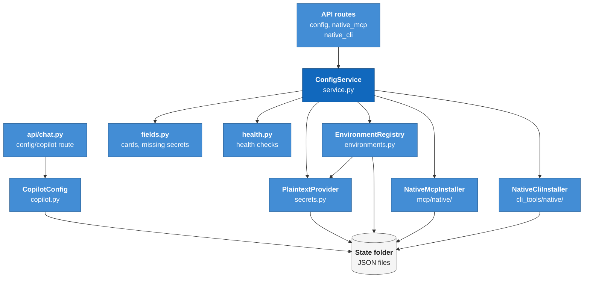
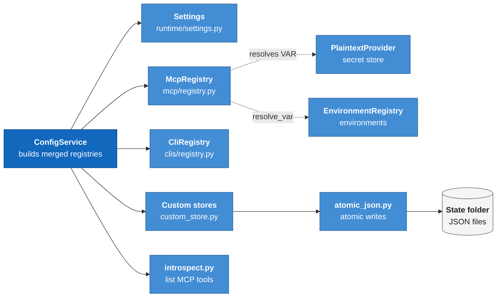
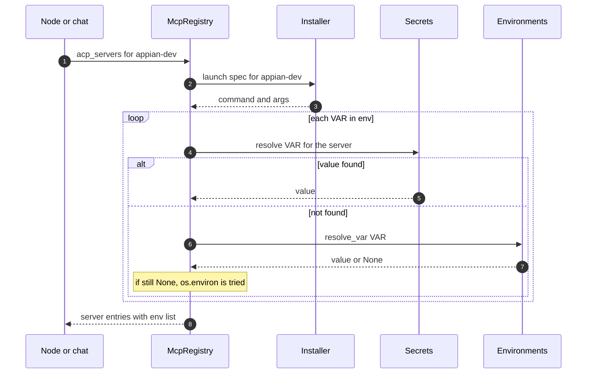
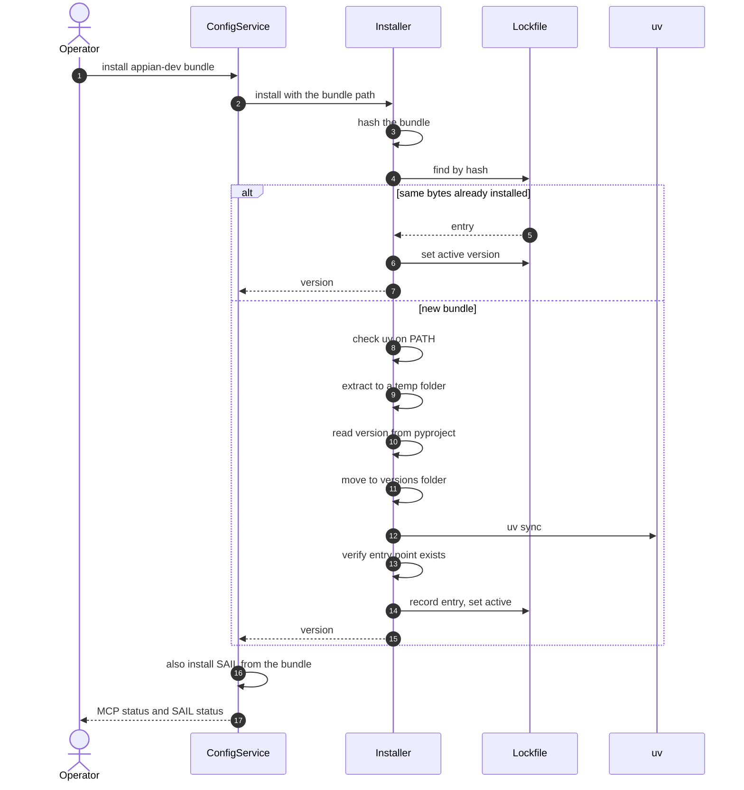

# Module: configuration and secrets (`genesis/config/`)

> **Describes:** genesis v0.81.0 (Phase 51) · **Last reviewed:** 2026-11-11 · C4 level 3 · area `config-secrets`

## 1. Purpose

This module holds everything a Genesis installation needs to know about itself and its connections, apart from the
run data in the database. That means the state folder layout and the settings read from environment variables, the
secret store, the list of Appian environments, the two-tier MCP and CLI registries, the locally installed ("managed
native") Appian MCP servers and command-line tools, the health checks, the copilot safety switches, and the run
retention policy.

The central promise is that **a secret value has exactly one home and never travels in an API response**. Secrets
live in `~/.genesis/secrets.json`, behind the `SecretProvider` interface. Every other file in this module is
credential-free, and every API route returns key names or yes/no flags, never values. A second promise is that
Genesis **never changes the user's own Kiro configuration**: MCP servers are handed to Kiro one agent turn at a
time, from registries Genesis owns (ADR-020, ADR-029).

## 2. At a glance

| Item | Value |
|---|---|
| Code | `genesis/config/` (`service.py`, `secrets.py`, `environments.py`, `fields.py`, `health.py`, `copilot.py`, `retention.py`); `genesis/runtime/settings.py`; `genesis/mcp/native/`; `genesis/cli_tools/native/`; `genesis/api/{config_routes,native_mcp,native_cli}.py`; in `genesis-core`: `genesis_core/mcp/{registry,custom_store,introspect}.py` and `genesis_core/clis/{registry,custom_store}.py` |
| Runs in | The app process (`ConfigService` and the routes). The run worker and the chat manager build their own `PlaintextProvider`, `EnvironmentRegistry` and registries from the same files. |
| Depends on | `genesis-core` (registries, custom stores, `atomic_write_json`, `path_lock`); `genesis/dist` (catalog and lockfile, to find which servers installed workflows need); `genesis/runs` (the retention service reads the run store and event log); `uv` on `PATH` (installing a managed MCP bundle only) |
| Used by | Nearly every module. Most important users: the run worker (`genesis/runs/worker.py`), the context builder (`genesis/runtime/context.py`), chat (`genesis/chat/mcp.py`, `genesis/chat/manager.py`), the Dev MCP clients (`genesis/kb/dev_mcp.py`), testing (`genesis/testexec/`, `genesis/integrations/{apwt,sail}/`), collaboration (`genesis/collab/`) |
| Stores | Files only, no database tables: `secrets.json`, `environments.json`, `mcp-custom.json`, `cli-custom.json`, `copilot.json`, `mcp-servers/` and `cli-tools/` (each with a `lockfile.json`) |
| Key ids | Secret key grammar `scope/VAR`; environment scope `env-<16 hex>`; managed ids `appian-dev`, `appian-devops` (MCP) and `gws`, `sail` (CLI); ADR-005, ADR-013, ADR-020, ADR-029, ADR-038, ADR-040, ADR-048, ADR-082 |

## 3. Concepts

| Term | Meaning |
|---|---|
| **State folder** | The root of all local state, `~/.genesis/` or `GENESIS_STATE_DIR`. `state_root()` in `settings.py` returns it. |
| **Artifacts root** | Where run blackboards live: `~/Genesis/runs/` or `GENESIS_ARTIFACTS_DIR` (ADR-022). Separate from the state folder. |
| **`Settings`** | A dataclass built once by `Settings.load()` from environment variables. It is read-only at run time. It also exposes computed paths for the state folder. |
| **SecretProvider** | The interface for the secret store: `get`, `set`, `delete`, `has`, `keys`, `resolve`. `PlaintextProvider` is the only implementation. |
| **Secret key** | A string `scope/VAR`. The scope is `global` or lower-case letters, digits and hyphens. `VAR` is `UPPER_SNAKE`. A bare `VAR` means `global/VAR`. |
| **Environment** | One Appian site Genesis knows about: a label, a URL, an API endpoint, products, notes and a type. Stored in `environments.json` without credentials. |
| **Environment type** | One of `dev`, `qa`, `uat`, `production`, `other` (ADR-082). Exactly one environment is `dev`. At most one is `qa`. |
| **`is_dev` mirror** | A boolean written next to `type` so an older Genesis reading the same file still finds the Dev environment. `type` is the stored home. |
| **Environment scope** | The SecretProvider scope `env-<first 16 hex of sha1(label)>` that holds one environment's core credentials (ADR-048). |
| **Core credentials** | `LCP_USERNAME`, `LCP_PASSWORD` and `APPIAN_API_KEY`: what the Dev MCP and DevOps MCP need. |
| **Curated tier / custom tier** | The two layers of the MCP and CLI registries. Curated comes from the library (`mcp-registry.json`, `cli-registry.json`), read-only in the app. Custom is the user's own, in `mcp-custom.json` and `cli-custom.json` (ADR-029). |
| **Merged registry** | Curated plus custom, with a custom entry replacing a curated entry of the same name. |
| **Card** | The view model of one MCP server (`McpCard`) or CLI (`CliCard`) for the Settings page: its secret and public fields and whether they are set. |
| **Managed-native** | An MCP server or CLI that Genesis installs under the state folder, versions and launches itself. A registry entry points to it with `"managed": "<id>"` (ADR-038, ADR-040). |
| **Drop-in** | The manual update model for managed-native tools: the operator supplies a newer bundle or binary. Genesis never downloads one. |
| **Active pointer** | The `active_version` in a managed-native `lockfile.json`. It selects the build that is launched. Rollback moves it. |
| **Launch provider** | A callable `id -> launch spec` handed to a registry so a managed entry gets its command from the installer. |
| **Copilot config** | The persisted safety switches of chat copilot mode (`copilot.json`). |

## 4. Structure



The routes call `ConfigService`, which owns the secret store, the environment registry, the card and health helpers and
the two native installers. The copilot config is reached by its own route and does not go through `ConfigService`. The retention service is
also reached by its own routes and is not drawn here. The secret store, the environment registry and the copilot config write their JSON files
through an atomic-write helper (next diagram). The installers write under the state folder.



`ConfigService` builds merged registries from `genesis-core` (`McpRegistry`, `CliRegistry` and the custom stores) and
reads `Settings`. It hands the registries the secret store and the environment registry to resolve variables. The
custom stores write through the atomic-write helper in `genesis-core`, as do the secret store and the environment
registry.

| File | Main classes and functions |
|---|---|
| `genesis/runtime/settings.py` | `Settings` (dataclass, `Settings.load()`), `state_root()`, `artifacts_root()`, `_int_env`, `_bool_env`, and one property per folder or file under the state folder |
| `genesis/config/service.py` | `ConfigService` (the facade), `default_service()` |
| `genesis/config/secrets.py` | `SecretProvider` (protocol), `PlaintextProvider`, `make_key`, `split_key`, `SecretError` |
| `genesis/config/environments.py` | `EnvironmentRegistry`, `Environment`, `normalize_record`, `env_scope`, `host_of`, `ENV_TYPES`, `CORE_CRED_VARS`, `EnvironmentError` |
| `genesis/config/fields.py` | `McpCard`, `CliCard`, `ConfigField`, `mcp_cards`, `cli_cards`, `secret_fields`, `missing_secrets`, `scope_for`, `GLOBAL_KEYS`, `ENV_MANAGED_SERVERS` |
| `genesis/config/health.py` | `HealthCheck`, `run_all`, `all_ok`, and the individual checks |
| `genesis/config/copilot.py` | `CopilotConfig` |
| `genesis/config/retention.py` | `disk_usage`, `prunable_runs`, `plan_prune`, `apply_prune`, `RetentionService`, `RetentionPlan`, `RetentionResult` |
| `genesis/mcp/native/installer.py`, `lockfile.py` | `NativeMcpInstaller`, `NativeMcpLockfile`, `NativeMcpError` |
| `genesis/cli_tools/native/installer.py`, `lockfile.py`, `sail_bundle.py` | `NativeCliInstaller`, `NativeCliLockfile`, `NativeCliError`, `extract_sail_binary`, `read_bundle_version`, `host_binary_name` |
| `genesis/api/config_routes.py` | `register_config_routes`: health, token, cards, secrets, environments, custom MCP and CLI CRUD, retention |
| `genesis/api/native_mcp.py`, `native_cli.py` | `register_native_mcp_routes`, `register_native_cli_routes` (the latter also holds the `gws` sign-in routes) |
| `packages/genesis-core/genesis_core/mcp/registry.py` | `McpRegistry` (`from_layers`, `acp_servers`, `allowlist`), `McpResolutionError` |
| `packages/genesis-core/genesis_core/mcp/custom_store.py`, `clis/custom_store.py` | `CustomMcpStore`, `CustomCliStore` |
| `packages/genesis-core/genesis_core/mcp/introspect.py` | `list_tools`, `McpTool`, `McpIntrospectError` |
| `packages/genesis-core/genesis_core/clis/registry.py` | `CliRegistry` (`from_layers`, `ensure`, `run`), `CliError` |

## 5. How it works

### 5.1 The state folder and how settings are read

`Settings.load()` runs once per process (the app, each worker, the CLI). It creates the state folder, the artifacts
root and `<state>/.kiro/skills/`, then reads each environment variable listed in section 9. A value that is empty,
or an integer that does not parse, falls back to its default. Booleans accept `1`, `true`, `yes` and `on`
(case-insensitive).

`Settings` is plain data. It is not written back. Anything a user can change from the Settings page lives in a JSON
file (`copilot.json`, `environments.json`, the custom registries, `collab.json`) or in the database, not in
`Settings`.

The properties of `Settings` fix the layout of the state folder. This module owns the files marked "config"; the
rest belong to the modules named in the last column.

| Path under the state folder | Property | Owner |
|---|---|---|
| `genesis.db` | `db_path` | [data-and-migrations.md](data-and-migrations.md) |
| `memory.db` | `memory_db_path` | [memory.md](memory.md) |
| `secrets.json` | `secrets_path` | config |
| `environments.json` | `environments_path` | config |
| `mcp-custom.json`, `cli-custom.json` | `custom_mcp_path`, `custom_cli_path` | config |
| `copilot.json` | (built in `CopilotConfig`) | config |
| `mcp-servers/` (with `lockfile.json`) | `mcp_servers_dir` | config |
| `cli-tools/` (with `lockfile.json`; `sail/home/`, `gws/config/`) | `cli_tools_dir`, `sail_home_dir`, `gws_config_dir` | config |
| `library/`, `installed.lock.json` | `library_dir`, `lockfile_path` | [distribution.md](distribution.md) |
| `.kiro/skills/`, `skill-output/` | `skills_dir`, `skill_output_dir` | [chat-and-skills.md](chat-and-skills.md) |
| `kb-documents/` | `kb_documents_dir` | [documents.md](documents.md) |
| `feature-specs/`, `feature-stage-artifacts/`, `story-stage-artifacts/` | `feature_specs_dir`, `feature_stage_artifacts_dir`, `story_stage_artifacts_dir` | [features-and-stages.md](features-and-stages.md), [stories-and-workbench.md](stories-and-workbench.md) |
| `testing/` (`browsers/`, `apps/`, `runtime/`) | `testing_dir`, `testing_browsers_dir`, `testing_apps_dir` | [testing.md](testing.md) |
| `collab.json`, `collab-hub/` | `collab_config_path`, `collab_hub_dir` | [collaboration-hub.md](collaboration-hub.md) |

### 5.2 How the secret store works

`PlaintextProvider` keeps one JSON document, `{"version": 1, "values": {"<scope>/<VAR>": "<value>"}}`.

1. **Key check.** `set` normalises a bare name to `global/<name>` and checks it against the grammar
   (`^(global|[a-z0-9][a-z0-9-]*)/[A-Z0-9_]+$`). A bad key raises `SecretError`.
2. **Write.** `set` and `delete` take the per-path lock from `genesis-core` (`path_lock`), read the file, change one
   value and write the whole file back with `atomic_write_json(path, data, mode=0o600)`. That helper writes a
   unique temp file in the same folder, applies the mode, then calls `os.replace`. Readers never see a half-written
   file, and two concurrent writers cannot lose each other's update (L-019).
3. **Read.** `get`, `has`, `keys` and `resolve` read the file without the lock. A missing file reads as empty.
4. **Resolve.** `resolve(var, server)` returns `<server>/<var>` if it is set and non-empty, otherwise
   `global/<var>`, otherwise `None`. An empty string counts as unset.

The lock covers threads in one process. Two separate processes writing the same file are not coordinated; the
`genesis-core` helper says this is out of scope for a single-user tool (ADR-026).

`collisions()` reports a variable name defined under more than one scope.

### 5.3 How an MCP server's `${VAR}` values are resolved

A registry entry lists environment variables as `{"NAME": "${NAME}"}` pairs. `McpRegistry.acp_servers(names)`
builds the entries handed to Kiro over ACP. For each `${VAR}` it tries three sources in order:

1. the SecretProvider: `<server>/VAR`, then `global/VAR`;
2. `EnvironmentRegistry.resolve_var(VAR)`;
3. the process environment.

If any variable stays unresolved after all servers are processed, the call raises `McpResolutionError` before Kiro
starts. The env list is a list of `{name, value}` objects, never a dict, because Kiro silently drops a dict (L-001).



The diagram shows the order for one managed server. The installer supplies only the command line (L-029). Secrets
and connection values come from the secret store, then from the environment registry. A missing value ends the call
with an error before Kiro is started.

Because the secret store is tried first, a leftover server-scoped secret such as `appian-dev/LCP_URL` wins over
the URL derived from the Dev environment. That is the L-070 trap, described in section 12.

### 5.4 How environments work

`environments.json` is `{"version": 1, "environments": {"<label>": {url, api_endpoint, products, type, notes,
is_dev}}}`. The allowed fields are fixed (`_ALLOWED`). A validator rejects any field name containing `token`, `key`,
`secret`, `password` or `credential`, so a credential cannot be saved here by accident.

**Types and the two single-select rules (ADR-082).**

```mermaid
flowchart LR
    start(( )):::startpt
    other("<b>Other</b><br/>the default"):::waiting
    dev("<b>Dev</b><br/>at most one"):::core
    qa("<b>QA</b><br/>at most one"):::core
    uat("<b>UAT</b>"):::comp
    prod("<b>Production</b>"):::comp

    start -- "new" --> other
    other <-- "set dev / demoted" --> dev
    other <-- "set qa / edit" --> qa
    other <-- "set uat / edit" --> uat
    other <-- "set production / edit" --> prod

    classDef core fill:#1168bd,stroke:#0b4884,color:#ffffff
    classDef comp fill:#438dd5,stroke:#2e6295,color:#ffffff
    classDef waiting fill:#fff8e1,stroke:#f9a825,color:#5d4037
    classDef startpt fill:#212121,stroke:#212121
```



The diagram shows how one environment record moves between types. Tagging another environment `dev` demotes the
current Dev environment to `other`, so there is never more than one. `qa` is refused if another environment is QA.
An arrow back to `other` without a label is a plain edit of the type.
Each arrow goes both ways: the first label sets the type, the second moves the record back to `other` (a plain edit of
the type, or for Dev a demotion).
Rules enforced in `EnvironmentRegistry.upsert` and `set_dev_environment`, under the file lock:

1. **One Dev.** Tagging `dev` demotes the previous Dev environment to `other`.
2. **At most one QA.** A second `qa` is refused with a message naming the existing one.
3. **QA host differs.** The QA URL's host must differ from every other environment's host, in both directions
   (adding a QA with a shared host, or adding another environment on the QA host, is refused). Tests write
   application data, so QA must not share a site with another environment.
4. **Dev and QA never on one record.** Both flags on one environment is refused.
5. **Old clients.** `is_dev` arrives as `None` when a client did not send it. `True` means `type=dev`. An explicit
   `False` wins over a typed `dev`. This keeps an older settings form working (L-081).

**Reading old files.** `normalize_record` runs on every read. A record with `is_dev: true` reads as `dev`. A
`type: dev` without the flag reads as `other`. Old free-text types map to the enum: `prod` or `production` becomes
`production`, any other text becomes `other` with the old text appended to `notes` once. If an edited file holds
two Dev records or two QA records, the first Dev (file order) and the first QA (by label) stay; the rest read as
`other`. `qa_host_conflicts()` re-checks the host rule on read, because the file can be edited by hand.

**Core credentials (ADR-048).** For the two core Appian MCPs only, `LCP_USERNAME`, `LCP_PASSWORD` and
`APPIAN_API_KEY` are entered on the environment form. `ConfigService.upsert_environment` splits them off before the
credential-free validator runs and stores them in the SecretProvider under `env-<hash>/<VAR>`, where the scope is
`"env-" + sha1(label)[:16]`. A hash is used because the key grammar forbids spaces and colons in a scope.
`None` leaves a credential unchanged, an empty string deletes it. `credential_status(label)` returns only
`{VAR: bool}`. `remove(label)` deletes the environment's credentials too.

**`resolve_var(var)`** maps a variable name to a connection value, in this order:

1. If a per-run active environment is set (the worker sets it from the job): `APPIAN_BASE_URL`, `APPIAN_ENV_URL`
   → its `url`; `APPIAN_API_ENDPOINT` → its `api_endpoint`.
2. The Dev environment's `url` for `LCP_URL` and `APPIAN_DOMAIN`.
3. The Dev environment's stored credential for `LCP_USERNAME`, `LCP_PASSWORD`, `APPIAN_API_KEY`.

It returns `None` for anything else. Credentials are only ever returned from the Dev environment's scope. This is the
one seam the worker, chat and the cards share.

**Workflow seam (L-053).** A workflow that needs a core credential must call `ctx.environments.resolve_var(...)`,
not `ctx.secrets.resolve(...)`. The secret provider's `resolve` knows only `server/VAR` and `global/VAR`, so it
cannot see the `env-<hash>` scope. `build_context` and the worker both create the `EnvironmentRegistry` with the
secret provider attached so the seam works inside a worker.

**Startup migration.** `ConfigService.__init__` calls `_migrate_legacy_core_secrets`. If a Dev environment exists
and an old key `appian-dev/LCP_USERNAME`, `appian-dev/LCP_PASSWORD` or `appian-devops/APPIAN_API_KEY` is present
while the environment scope has none, it copies the value to the environment scope and deletes the old key. It also
deletes an obsolete `appian-dev/LCP_API_PATH`. Any failure is swallowed so startup never blocks. It does not touch
a legacy `appian-dev/LCP_URL` (section 12).

### 5.5 How the two-tier registries merge

`ConfigService.mcp_registry()` and `cli_registry()` read `mcp-registry.json` and `cli-registry.json` from the
installed library folder (`~/.genesis/library/`); a missing file reads as `{}`. `merged_mcp_registry()` calls
`McpRegistry.from_layers(curated, custom, secrets=..., environments=..., launch_provider=native.launch_spec_for)`
and `merged_cli_registry()` calls `CliRegistry.from_layers(..., launch_provider=native_cli.active_launch_spec)`.
The merge is `{**curated, **custom}`, so a custom entry with the same name replaces the curated one.

The custom stores are small JSON files:

| Store | File | Shape | Validation |
|---|---|---|---|
| `CustomMcpStore` | `mcp-custom.json` | `{"version": 1, "servers": {name: spec}}` | name is alphanumeric with `-` or `_`; `command` required; `mode` one of `read-only`, `read-write`, `read-write-deploy`; `env` a dict; `args` a list |
| `CustomCliStore` | `cli-custom.json` | `{"version": 1, "clis": {name: spec}}` | same name rule; `binary` required |

Both stamp `source: "custom"` on every saved spec and write under `path_lock` with `atomic_write_json`.
`CustomMcpStore.set_allowlist` sets `tool_allowlist` (sorted, de-duplicated) or removes it when given an empty list.
A server without an allowlist has no server-side cap on its tools (ADR-029 and ADR-083; see
[core-engine.md](core-engine.md) for how trust is computed).

The Settings API shows the merge honestly. `list_mcp_servers` and `list_clis` return one row per name with
`source` (`curated` or `custom`), `overrides_curated`, and the winning spec. Creating, updating and deleting only
touch the custom tier. Deleting a custom entry that overrode a curated one makes the curated entry visible again.
The web client joins the card view (status and secret fields) with the raw custom entry by name (L-012).

**Where the merge is used.** `ConfigService` (cards, tests, introspection), chat (`genesis/chat/mcp.py` calls
`config.merged_mcp_registry()`) and the Dev MCP clients (`genesis/kb/dev_mcp.py`) use the merged registry. The run
worker does not. `_load_registries` in `genesis/runs/worker.py` loads only `mcp-registry.json` and
`cli-registry.json` from the library folder, and builds the `CliRegistry` without a launch provider. ADR-029 says
custom servers reach per-node injection automatically; in the code, a workflow agent node in a worker sees the
curated tier only.

### 5.6 How MCP and CLI cards and missing secrets are computed

`fields.py` turns a registry entry into UI fields. For each name in `secretKeys` it makes a secret `ConfigField`
whose scope is `global` for keys in `GLOBAL_KEYS` (only `GITLAB_TOKEN`) and the server name otherwise, and whose
`is_set` is `provider.resolve(key, server)`. For each name in `publicKeys` it makes a non-secret field whose default
is the registry env value when that value contains no `${`.

`appian-dev` and `appian-devops` are in `ENV_MANAGED_SERVERS` and produce no card, because their credentials come
from the Dev environment (ADR-048). `missing_secrets` returns the secret fields not set, scoped to servers required
by installed workflows (`ConfigService.installed_servers()` reads `required_mcp` from the catalog for each name in
the lockfile). `mcp_cards` and `cli_cards` in `ConfigService` use all merged servers instead, so custom servers get
cards.

`cli_cards` marks a CLI available when its managed id resolves through the installer, or, for a non-managed CLI,
when `shutil.which(binary)` finds it. It never runs the CLI.

### 5.7 How managed-native MCP servers are installed

This is ADR-038: the Dev MCP (`lcp-mcp-server`) and DevOps MCP (`appian-deployment-mcp`) are third-party bundles.
Genesis installs them as given and never edits them. Updates are a manual drop-in: Genesis never fetches a bundle.



The diagram shows one install. The same bytes install twice as a no-op that re-points the active version. A new
bundle is unpacked into a temporary folder, moved to `versions/VERSION/`, built with `uv sync`, and checked before the
lockfile is updated.

Steps in `NativeMcpInstaller.install(server_id, bundle_path)`:

1. Refuse an unknown id (only `appian-dev` and `appian-devops`) or a missing file.
2. Hash the bundle. If the lockfile already has that hash, set that version active and return it.
3. Require `uv` on `PATH` (unless `run_uv=False`, used by tests).
4. Extract with the tar `data` filter, which rejects path traversal, absolute paths and special files.
5. Find the folder with `pyproject.toml` (the unpack root, or its single wrapping child) and read
   `[project].version`. If that version is already recorded under a different hash, use `<version>+<first 8 of sha>`
   so a distinct build is never overwritten.
6. Move the project to `<state>/mcp-servers/<id>/versions/<version>/`, run `uv sync` there, and verify the entry:
   a module import check for the Dev MCP (`python -m lcp_mcp_server`), the console script for the DevOps MCP
   (`appian-deployment`).
7. Record `{version, source, sha256, installed_at, entry, python}` and make it active.

`rollback(id)` moves the active pointer to the version recorded just before the active one; it errors if there is
none. `active_launch_spec(id)` returns the command and args from the active version's own `.venv` and never uses
`uv` at launch. Its `env` is an empty list on purpose: the `${VAR}` list lives on the registry entry and
`McpRegistry` resolves it, so the installer never touches secrets (L-029). `status(id)` reports installed state,
active version, all versions, entry text, and whether the venv's interpreter or script exists.

**Dev MCP also installs SAIL (Phase 41).** `ConfigService.install_appian_dev_bundle` installs the MCP first (failure
raises `NativeMcpError`, shown as HTTP 400). Then it tries the SAIL CLI in the same tarball (section 5.8). SAIL is
best-effort: if the host platform has no binary in the bundle or the install fails, the MCP stays installed and the
response carries a reason. The `genesis mcp install-native appian-dev` command and the install route share this
path.

**The built-in `genesis-kb` server.** The library registry lists `genesis-kb` as managed too, but it is not a
bundle. The worker's `_launch_spec_for` and chat build its command (`python -m genesis.mcp.kb_server`) themselves;
only other ids go through `NativeMcpInstaller`. See [chat-and-skills.md](chat-and-skills.md).

### 5.8 How managed-native CLIs are installed

`NativeCliInstaller` is the simpler cousin (ADR-040): a CLI is one self-contained binary, so there is no `uv` and no
venv. Known ids are `gws` and `sail`.

1. `install(cli_id, binary_path, version=None)` refuses an unknown id or a missing file.
2. The version is the given `version`, or the binary's own `--version` output matched with a per-tool pattern.
   For SAIL the combined install passes the bundle's build id (from `BUILD-INFO.txt`: `build_timestamp`, else the
   first 12 characters of `composer_commit`), because SAIL does not print a semantic version.
3. The binary is copied to `<state>/cli-tools/<id>/versions/<version>/<id>`, marked executable, and on macOS its
   `com.apple.quarantine` attribute is removed so Gatekeeper does not kill the first run.
4. The entry `{version, source, sha256, installed_at, binary}` is recorded and made active.

`rollback` picks the most recently installed other version (sorted by `installed_at`), unlike the MCP rollback,
which picks the previous list entry. `active_launch_spec(id)` returns the binary path only if the file still
exists, else `None`, so `CliRegistry.ensure` fails with the registry's `install_hint`.

`sail_bundle.py` finds the SAIL binary inside the Dev MCP tarball. It accepts only a file in a `bin/` folder whose
name matches the host (`sail-darwin-arm64`, `sail-linux-amd64`, `sail-windows-amd64.exe`; `aarch64` is read as
`arm64`). A host with no entry returns `None` and the caller skips SAIL.

The two isolated folders matter: `gws_config_dir` defaults to `cli-tools/gws/config` and `sail_home_dir` to
`cli-tools/sail/home`, so Genesis never reads or disturbs the user's own `~/.config/gws` or `~/.sail`. Only the
OAuth client file is read from the user's folder (`gws_client_secret_path`, default
`~/.config/gws/client_secret.json`). The `gws` client itself belongs to [documents.md](documents.md). One fact from
L-054 matters here: `gws` 0.22.5 rejects an `--output` outside the process's current folder, so the client runs it
from the output folder with a relative path.

### 5.9 How MCP introspection and "Test" work

`genesis_core.mcp.introspect.list_tools(spec, resolved_env=..., startup_timeout=20.0)` talks to an MCP server
directly over stdio, with no Kiro involved:

1. Start the server's `command` and `args` with the process environment plus `resolved_env`.
2. Send `initialize`, wait for the reply, send `notifications/initialized`, then `tools/list`.
3. Return `McpTool(name, description, input_schema)` for each tool. Notifications and non-JSON lines are skipped.
4. Always kill and wait for the child in a `finally`.

The child's stdout and stderr readers get an 8 MiB line limit. The Dev MCP returns all its tools in one very long
line, past asyncio's 64 KiB default (L-028). Timeouts and spawn errors raise `McpIntrospectError`.

`ConfigService.introspect_mcp_server(name)` finds the entry in the merged registry. For a managed entry it replaces
`command` and `args` with the installed launch spec, or raises "not installed". It resolves each env var with
`secrets.resolve(k, name)`, then `environments.resolve_var(k)`, else an empty string, and runs the handshake in
`asyncio.run`.

`ConfigService.test_server(server)` returns `{server, ok, reason, tool_count, checked_at}`. It checks, in order:
the server exists; the card has no missing secrets; `docker` is on `PATH` when the command is `docker`; then a real
introspection handshake.

`dev_connection_check(live=False)` reports whether the Dev environment is tagged, which core credentials are set
(by key name), and whether each managed MCP is installed. With `live=true` and the Dev MCP installed it also calls
`genesis.kb.dev_mcp.version_info` to compare the server bundle with the site plugin and adds any mismatch to
`missing`.

### 5.10 Health checks

`health.run_all` returns a list of `HealthCheck(name, ok, detail, skipped)`: GitLab token present (optionally
probed through an injected function); one entry per missing required secret; Docker on `PATH`; optional CLI checks;
and a literal-env probe that is skipped unless a probe function is injected. Every outside call is injectable so
the suite runs offline. `ConfigService.health()` scopes secret checks to installed servers and passes no probe
functions, so in the app the token check does not call GitLab and the literal-env probe is marked skipped.
`ConfigService.is_ready()` is true when all checks are ok (skipped checks count as ok).

The first-run checklist in `genesis/runtime/preflight.py` (served at `/api/system/preflight`; see [api.md](api.md))
reuses these signals and adds the Dev environment, `uv`, Node and Chromium checks.

### 5.11 Copilot config

`CopilotConfig` (`copilot.json`) holds the safety switches of chat copilot mode (ADR-033):

| Key | Default | Meaning |
|---|---|---|
| `enabled` | `true` | Global kill-switch. Off means chat is read-only everywhere. |
| `max_active_runs` | `3` | Cap on concurrent non-terminal runs started by one copilot session. |
| `rate_limit_per_min` | `10` | Cap on copilot `start_run` calls per session per minute. |
| `gate_sla_minutes` | `Settings.copilot_gate_sla_minutes` (0) | Minutes a linked run may wait at a gate before the session is re-nudged; 0 is off. |
| `workflow_allow` | `[]` | If not empty, only these workflow ids may be launched. |
| `workflow_deny` | `[]` | Never launched; deny wins over allow. |

`get()` returns the file merged over the defaults, so a newly added key always exists; an unreadable file reads as
the defaults. `update(patch)` accepts only known keys, coerces them (booleans, non-negative integers, comma-separated
strings or lists to a clean list of strings), and writes under a per-path lock with a temp file and `os.replace`.
`launch_allowed(workflow_id)` applies deny then allow. `ChatManager` creates the single instance
(`self.copilot`); enforcement is described in [chat-and-skills.md](chat-and-skills.md).

### 5.12 Retention

`retention.py` plans and applies the cleanup of finished runs; the run-side effects are described in
[runs-and-workers.md](runs-and-workers.md).

1. `prunable_runs(runs, keep_last, max_age_days)` considers only `done`, `failed` and `cancelled` runs. A run is
   selected if it is beyond the N most recent by `updated_at`, or older than D days. A value of 0 disables that rule.
   A running or waiting run is never returned.
2. `RetentionService.plan()` lists up to 100,000 runs, selects ids, and estimates event rows and bytes.
3. `RetentionService.apply(ids)` re-reads each run and skips it if it is no longer terminal. For the rest it
   removes the blackboard folder and the run's events, and keeps the `runs` row as a record.
4. The policy comes from `Settings` (`GENESIS_RETENTION_KEEP_LAST`, `GENESIS_RETENTION_MAX_AGE_DAYS`). With
   `GENESIS_RETENTION_ON_START` on, `RunManager` applies it once at start; a failure is swallowed so startup is
   never blocked.

`plan_prune` and `apply_prune` are older folder-only helpers that work on `RunInfo` records.

## 6. Interfaces

### 6.1 HTTP endpoints

All under `/api` (ADR-028). Registered from `genesis/api/app.py`.

| Method and path | Purpose |
|---|---|
| `GET /config/health` | The health check list |
| `GET /config/gitlab-token`, `POST /config/gitlab-token` | Whether a token is set; store one (`global/GITLAB_TOKEN`) |
| `GET /config/mcp-cards`, `GET /config/cli-cards` | Card view models (status and fields, no values) |
| `POST /config/mcp-cards/{server}/test` | `ConfigService.test_server`: missing-secret and Docker checks, then a real handshake |
| `POST /config/secrets` | Store one secret from `{server, key, value}`; returns the key name only |
| `GET /config/environments` | Every environment with `credentials: {VAR: bool}` |
| `POST /config/environments` | Create or replace an environment; optional `lcp_username`, `lcp_password`, `appian_api_key`; a rule violation returns 400 |
| `POST /config/environments/{label}/dev` | Tag (or, with `is_dev=false`, untag) the Dev environment |
| `DELETE /config/environments/{label}` | Remove an environment and its stored credentials |
| `GET /config/environments/dev/check` | Dev readiness; `?live=true` adds the Dev MCP version comparison |
| `GET /config/devmcp/version` | Live plugin and bundle comparison for the Settings banner |
| `GET /config/mcp-servers`, `POST`, `PUT /{name}`, `DELETE /{name}` | List merged servers; create, update, delete custom ones |
| `POST /config/mcp-servers/{name}/tools` | Introspect tools (502 on failure) |
| `PUT /config/mcp-servers/{name}/allowlist` | Set or clear the allowlist of a custom server |
| `GET /config/clis`, `POST`, `PUT /{name}`, `DELETE /{name}` | The same for CLIs |
| `GET /artifacts/usage` | Artifacts root path and bytes used |
| `GET /config/retention/plan`, `POST /config/retention/apply` | Dry run and apply of the retention policy |
| `GET /config/native-mcp` | Status of each managed MCP |
| `POST /config/native-mcp/{server_id}/install` | Install a bundle by path; for `appian-dev` also installs SAIL |
| `POST /config/native-mcp/{server_id}/rollback` | Move the active pointer back |
| `GET /config/native-cli` | Status of each managed CLI |
| `POST /config/native-cli/{cli_id}/install`, `POST /config/native-cli/{cli_id}/rollback` | Install a binary by path; roll back |
| `GET /config/gws/auth`, `POST /config/gws/auth/login`, `GET /config/gws/auth/login/state`, `POST /config/gws/auth/logout` | `gws` OAuth state, begin sign-in, poll, sign out (409 when the client file or binary is missing) |
| `GET /config/copilot`, `PUT /config/copilot` | Read and patch the copilot config (defined in `genesis/api/chat.py`) |

There is no route to read a secret and none to update a managed tool: an update is another install.

### 6.2 Python API used by other modules

| Call | Used by |
|---|---|
| `Settings.load()` and the `Settings` properties | Every module that needs a folder or a flag |
| `PlaintextProvider(settings.secrets_path)` | The worker, `build_context`, the CLI, testing, collaboration |
| `EnvironmentRegistry(path, secrets=...)`: `dev_environment()`, `dev_environment_label()`, `qa_environment()`, `qa_host_conflicts()`, `resolve_var()`, `set_active()`, `summary()` | The worker, KB sync, workbench routes, testing, the SAIL and apwt factories |
| `ConfigService.merged_mcp_registry()`, `merged_cli_registry()` | Chat, the Dev MCP clients |
| `ConfigService.native`, `native_cli`, `gws()`, `gws_login()`, `sail()` | Routes, document sync, testing |
| `CopilotConfig.get()`, `update()`, `launch_allowed()` | Chat and run launch checks |
| `RetentionService.plan()`, `apply()` | The retention routes and `RunManager` |

### 6.3 CLI commands

| Command | Purpose |
|---|---|
| `genesis mcp install-native {appian-dev,appian-devops} --bundle PATH` | Install a bundle (for `appian-dev`, SAIL too) |
| `genesis mcp status`, `genesis mcp rollback-native {id}` | Show or roll back |
| `genesis cli install-native gws --binary PATH` | Install a CLI binary (the CLI accepts `gws` only; SAIL arrives through the Dev MCP bundle) |
| `genesis cli status`, `genesis cli rollback-native gws` | Show or roll back |

### 6.4 Contracts

- **MCP entry handed to Kiro:** `{name, command, args, env: [{name, value}]}` (L-001).
- **Registry entry keys read by this module:** `command`, `args`, `env`, `managed`, `mode`, `secretKeys`,
  `publicKeys`, `tool_allowlist`, `note`; CLI entries: `binary`, `managed`, `install_hint`, `note`.
- **Launch provider:** MCP `id -> {command, args, env} | None`; CLI `id -> path | None`.

## 7. Data

No database tables. Files, all under the state folder:

| File or folder | Shape and meaning | Written by | Read by |
|---|---|---|---|
| `secrets.json` | `{version, values: {"scope/VAR": value}}`, mode 0600 | `PlaintextProvider` | Everything that resolves secrets |
| `environments.json` | `{version, environments: {label: {url, api_endpoint, products, type, notes, is_dev}}}`; no credentials | `EnvironmentRegistry` | Worker, chat, KB, testing |
| `mcp-custom.json` | Custom MCP servers | `CustomMcpStore` | `ConfigService` |
| `cli-custom.json` | Custom CLIs | `CustomCliStore` | `ConfigService` |
| `copilot.json` | The keys of section 5.11 | `CopilotConfig` | Chat |
| `mcp-servers/lockfile.json` | `{version, servers: {id: {active_version, versions: [...]}}}` | `NativeMcpLockfile` | `NativeMcpInstaller` |
| `mcp-servers/<id>/versions/<version>/` | The unpacked bundle and its `.venv` | `NativeMcpInstaller` | MCP launch |
| `cli-tools/lockfile.json` | `{version, clis: {id: {active_version, versions: [...]}}}` | `NativeCliLockfile` | `NativeCliInstaller` |
| `cli-tools/<id>/versions/<version>/<id>` | The binary | `NativeCliInstaller` | CLI launch |

A corrupt or non-object native lockfile reads as empty. `PlaintextProvider` has no such tolerance: a corrupt
`secrets.json` raises on read. Both native lockfiles are written atomically under a per-path lock, but with their
own copy of the lock code rather than the shared `genesis-core` helper.

Secret keys you will meet:

| Key | Meaning |
|---|---|
| `global/GITLAB_TOKEN` | Library access token |
| `<server>/<VAR>` | A secret of one MCP server, from its card |
| `env-<hash>/LCP_USERNAME`, `LCP_PASSWORD`, `APPIAN_API_KEY` | Core credentials of one environment (ADR-048) |
| `testusers-<app hash>/<ROLE>_PASSWORD` | A test user's password (ADR-082); owned by [testing.md](testing.md) |

## 8. Failure handling

| Situation | Behaviour |
|---|---|
| Invalid secret key | `SecretError` from `make_key`, `split_key` or `set`. |
| Two concurrent secret writes | Serialized by the per-path lock; the file stays valid JSON (L-019). |
| `${VAR}` unresolved at launch | `McpResolutionError` listing the names, raised before Kiro starts. |
| Managed server not installed | `McpResolutionError` ("not installed") at launch; introspection raises `McpIntrospectError` with a pointer to Settings. |
| Unknown MCP server name | `McpResolutionError` at launch; `test_server` returns `ok: false`. |
| Environment field that looks like a credential, or is unknown | `EnvironmentError`; the route returns 400. |
| Second QA, QA host clash, Dev and QA on one record | `EnvironmentError` with the clashing label or host; the route returns 400. |
| Environment label unknown to `resolve` | `EnvironmentError`. |
| `environments.json` edited by hand into two Dev or two QA | Read-time normalisation keeps the first of each. |
| Legacy secret migration fails | Swallowed; startup continues. |
| `uv` missing at MCP install | `NativeMcpError`; HTTP 400. |
| Bundle cannot be extracted, has no single `pyproject.toml`, no version, `uv sync` fails, or the entry point is missing | `NativeMcpError` (the last 2000 characters of `uv` stderr are included); HTTP 400. |
| Rollback with no earlier version | `NativeMcpError` / `NativeCliError`; HTTP 400. |
| SAIL not shipped for this host or its install fails | The MCP stays installed; the response carries a `reason`. |
| Managed CLI binary deleted after install | `active_launch_spec` returns `None`; `CliRegistry.ensure` raises with the install hint. |
| MCP handshake timeout or spawn failure | `McpIntrospectError`; the route returns 502; the child process is always killed. |
| Health GitLab probe | Not run by `ConfigService.health()`; the check reports the token as present without calling GitLab. |
| Retention finds a run that is no longer terminal | Skipped and listed in `skipped`. |
| Retention on start fails | Swallowed. |
| `copilot.json` unreadable | Defaults are used. |
| Invalid copilot value | Unknown keys ignored; a number that does not parse is skipped; negatives become 0. |

## 9. Configuration

Read by `Settings.load()`:

| Setting | Environment variable | Default |
|---|---|---|
| `state_dir` | `GENESIS_STATE_DIR` | `~/.genesis` |
| `artifacts_dir` | `GENESIS_ARTIFACTS_DIR` | `~/Genesis/runs` |
| `retention_keep_last` | `GENESIS_RETENTION_KEEP_LAST` | `0` (off) |
| `retention_max_age_days` | `GENESIS_RETENTION_MAX_AGE_DAYS` | `0` (off) |
| `retention_on_start` | `GENESIS_RETENTION_ON_START` | off |
| `purge_tool_store_on_final` | `GENESIS_PURGE_TOOL_STORE_ON_FINAL` | on |
| `chat_turn_timeout` | `GENESIS_CHAT_TURN_TIMEOUT` | 300 seconds |
| `chat_startup_timeout` | `GENESIS_CHAT_STARTUP_TIMEOUT` | 120 seconds |
| `chat_max_prompt_chars` | `GENESIS_CHAT_MAX_PROMPT_CHARS` | 8000 |
| `chat_idle_minutes` | `GENESIS_CHAT_IDLE_MINUTES` | 30 (0 means never close) |
| `chat_model` | `GENESIS_CHAT_MODEL` | empty (Kiro default) |
| `api_base` | `GENESIS_API_BASE` | `http://127.0.0.1:8760` |
| `copilot_gate_sla_minutes` | `GENESIS_COPILOT_GATE_SLA_MINUTES` | 0 (off) |
| `memory_embedder_backend` | `GENESIS_MEMORY_EMBEDDER` | `model2vec` |
| `memory_embedder_model` | `GENESIS_MEMORY_EMBED_MODEL` | empty (backend default) |
| `memory_owner_username` | `GENESIS_MEMORY_OWNER` | empty |
| `collab_enabled` | `GENESIS_COLLAB_ENABLED` | off |
| `collab_provider` | `GENESIS_COLLAB_PROVIDER` | empty |
| `collab_hub_url` | `GENESIS_COLLAB_HUB_URL` | empty |
| `collab_hub_app_uuid` | none read by `Settings.load()` (field default empty) | empty |
| `reports_port` | `GENESIS_REPORTS_PORT` | 0 (app port + 100) |
| `reports_url` | `GENESIS_REPORTS_URL` | empty |

Path overrides read inside `Settings` properties: `GENESIS_SAIL_HOME`, `GENESIS_TESTING_DIR`,
`GENESIS_GWS_CONFIG_DIR`, `GENESIS_GWS_CLIENT_SECRET`, `GENESIS_COLLAB_HUB_DIR`.

Other behaviour fixed in code: the copilot defaults (section 5.11); the introspection start-up timeout of 20
seconds and 8 MiB line limit; the `uv sync` and `--version` calls (the latter has a 30 second timeout). The
connection to any Appian site is configured in Settings → Environments, not by environment variables.

Settings page sections that drive this module live in `web/src/features/settings/` (GitLab, Environments, MCP and
CLI tabs with a native install section, Copilot, Storage); see [web-app.md](web-app.md).

## 10. Extending this module

**Add a setting read from the environment.** Add a field with a default to `Settings`, read it in `Settings.load()`
with `_int_env` or `_bool_env`, and use `Settings` in the consumer. Add a computed folder as a property, not a field.
Add a test to `tests/test_config.py`. If a user needs to change it in the UI, store it in a JSON file instead (like
`copilot.json`), because `Settings` is not written back.

**Add a core credential.** Add the variable to `CORE_CRED_VARS`, to the `EnvBody` request model in `genesis/api/_shared.py`, to the `creds` map in the environments route in
`genesis/api/config_routes.py`, and to the registry entry's `env` map. Check what the installed bundle reads: L-049 shows a bundle that read bare `USERNAME` and `PASSWORD`, so the
library entry maps both names from the same secrets.

**Add a second SecretProvider.** Implement the six methods of the protocol and the `resolve` order, then pass it to
`ConfigService(settings, secrets=...)`. Callers that construct `PlaintextProvider(settings.secrets_path)` themselves
(the worker, `build_context`, the CLI, collaboration) need to change too: list them with a search before starting
(L-094).

**Add an environment type.** Extend `ENV_TYPES` and `ENV_TYPE_LABELS`, then check `normalize_record`, `_legacy_type`
and the web types. Keep `type` as the home and `is_dev` as the mirror, and keep an unset flag distinct from `false`
(L-081).

**Add a managed-native MCP server.** Add an entry to `_SERVERS` in `genesis/mcp/native/installer.py` (`module` or
`script`), the id to the `choices` of the CLI in `genesis/cli/main.py`, a registry entry with `"managed": "<id>"` in
`genesis-workflows/mcp-registry.json`, and make sure the env var names match what the bundle reads (L-049). A
platform-internal server (like `genesis-kb`) is not an installer entry; extend the worker's `_launch_spec_for` and
chat instead.

**Add a managed-native CLI.** Add an entry to `_TOOLS` (version argument and pattern) in
`genesis/cli_tools/native/installer.py` and a registry entry with `"managed": "<id>"`. If the tool confines its
output folder, run it with the output's folder as the working directory (L-054).

**Change the registry merge.** Change `from_layers` in `genesis-core` only additively: workflows depend on it
(see the change rule in [core-engine.md](core-engine.md)).

**Never** put a secret value in `environments.json`, a registry file, a log line or an API response.

## 11. Design decisions

| Decision | In plain words | ADR |
|---|---|---|
| The shared registry lives in the library | MCP and CLI launch definitions are curated in the library repo and changed by merge request; there are no per-user profiles. Later amended by the custom tier. | ADR-005 |
| Genesis owns its config UI | Token, MCP secrets and environments are set in Genesis itself. The retired predecessor contributed ideas only. | ADR-013 |
| No global Kiro configuration | Genesis never writes the user's Kiro `mcp.json`; servers are injected per agent turn. | ADR-020 |
| Two-tier registry | Curated entries are read-only; a user-writable custom file is merged over them by name; each server may carry a tool allowlist; tools can be listed by talking to the server directly. | ADR-029 |
| Managed-native MCP servers | The Dev and DevOps MCPs are installed from supplied bundles into versioned folders, launched from their own venv, never forked, updated only by hand, and roll-back-able. | ADR-038 |
| Managed-native CLI | `gws` (and SAIL) follow the same pattern with a single binary and no venv. | ADR-040 |
| Environment-scoped core credentials | The core Appian credentials are entered on the environment, stored in the secret store under a hashed environment scope, never in `environments.json`, and returned only for the Dev environment. | ADR-048 |
| Environment types and the QA environment | An environment has a type; exactly one Dev and at most one QA, whose host differs from every other. Tests run on QA only. | ADR-082 |

Differences between the ADR text and the code:

- ADR-048 says the scope is `env:<label>`. The code uses `env-<16 hex of sha1(label)>`, because the key grammar
  forbids `:` and spaces. The ADR also says `LCP_API_PATH` becomes a public environment field; Phase 41 removed it
  and the field is no longer allowed in `environments.json`.
- ADR-029 says custom servers appear in per-node injection automatically. The run worker loads only the curated
  registry files (section 5.5).

## 12. Known pitfalls

- **Secret writes must be atomic and serialized.** A plain write let two concurrent route handlers corrupt
  `secrets.json` and 500 the cards route. Keep going through `atomic_write_json` and `path_lock` (L-019).
- **Env must be a list of `{name, value}` for ACP.** A dict silently drops all env vars in Kiro (L-001).
- **The card view and the custom entry are two data sets.** The Settings UI must join `mcp-cards` with
  `mcp-servers` by name; the curated tier is read-only (L-012).
- **Large `tools/list` lines.** Keep the 8 MiB reader limit in `introspect.py`; the Dev MCP's answer exceeds the 64
  KiB default (L-028).
- **The installer returns the command only.** Keep secrets out of the installer; the registry resolves `${VAR}`
  (L-029).
- **A managed bundle can read different env names than the registry sends.** Diff the installed bundle against a
  known-good one before blaming credentials (L-049).
- **Workflows must use the environment seam for core credentials.** `ctx.secrets.resolve` cannot see the
  `env-<hash>` scope; an installed workflow older than the app breaks (L-053).
- **A single-binary CLI may confine `--output` to the current folder.** Run it from the output folder with a
  relative path (L-054).
- **A stale server-scoped secret overrides the environment.** Secrets are consulted before the environment
  registry, so an orphaned `appian-dev/LCP_URL` sends valid credentials to the wrong Appian site and returns 401.
  The startup migration removes only `appian-dev/LCP_API_PATH`, not `LCP_URL` or `APPIAN_DOMAIN`. If Dev calls
  return 401 with correct credentials, list the key names with `SecretProvider.keys()` and compare
  `dev_environment().url` with the URL the merged registry resolves (L-070).
- **New defaults and new homes must respect older clients.** Tell "not sent" apart from `false`, as the
  environment `type` and `is_dev` pair does (L-081).
- **Agents must not read CI variables.** `glab api …/variables` returns values in clear. Treat any value that
  reached agent output as leaked and rotate it (L-100). This applies to tokens such as the library token that
  Genesis stores under `global/GITLAB_TOKEN` as well.
- **Never put a secret value in this documentation, a log or a test fixture.** Refer to key names.

## 13. Tests

| File | What it covers (from the test names) |
|---|---|
| `tests/test_config.py` | Secret CRUD and resolution, collisions and invalid keys, no values in key lists, MCP cards and missing secrets, environment registry, single-select Dev, MCP resolution (server-scoped and environment fallback), retention plan and usage, offline health checks, `ConfigService` end to end, CLI card availability, the server readiness probe, config routes |
| `tests/test_secrets_concurrency.py` | Concurrent writes stay valid and lossless; the save is atomic with no trailing garbage |
| `tests/test_environment_types.py` | Old records map to types, `type: dev` without the flag, no duplicate note text, two QA read as one, upsert writes type and mirror, old Dev flag, single Dev, second QA refused, QA host rules in both directions, host conflicts from an edited file, API round trip, explicit `is_dev: false`, Dev and QA on one record refused |
| `tests/test_native_mcp.py` | Project-root detection and metadata, lockfile record and active pointer, corrupt lockfile tolerated, install for both bundle layouts, idempotent install by hash, same version with a different hash, rollback cases, launch spec, status; full installs with `uv` |
| `tests/test_native_cli_installer.py` | Version detection and activation, unknown id, rollback, missing prior version, status, unparseable version |
| `tests/test_native_cli_api.py` | Native CLI status route, `gws` auth status, login 409 when not installed, unknown id install returns 400 |
| `tests/test_sail_cli.py` | SAIL binary extraction for the host and the no-binary case, and the combined Dev MCP and SAIL install |
| `tests/test_retention.py` | Only terminal runs are pruned, keep-last, max-age, union of rules, disabled policy, apply keeps the row, skips a run that changed state, plan follows the policy |
| `tests/test_copilot_safety.py` | Kill-switch, workflow allow and deny, concurrency cap, rate limit, audit rows, and `GET`/`PUT /config/copilot` |
| `tests/test_testexec_settings.py` | Test users and passwords stored in their own places; the passwords never appear in route answers (belongs to [testing.md](testing.md)) |
| `packages/genesis-core/tests/test_atomic_json.py` | The shared atomic-write and lock helper |
| `web/src/features/settings/{settings,environments-type,copilot-settings,kiro}.test.tsx` | The Settings page sections |

I found no test file named for the custom stores, the registry merge in `genesis-core`, or `introspect.py`; the
introspection tests in `tests/test_introspection_server.py` are about a different module (the chat introspection
MCP server).

Gate commands (from the area definition):

```
cd genesis && .venv/bin/python -m pytest -q -p no:warnings
cd genesis && .venv/bin/ruff check genesis
cd genesis/web && npm run lint && npm run typecheck && npm test
cd genesis/web && npm run build   # then commit web/static/
```

## 14. Code map

| To change… | Look in |
|---|---|
| A folder or file location under the state folder | `genesis/runtime/settings.py` |
| An environment-variable setting | `genesis/runtime/settings.py` (`Settings`, `load`) |
| How secrets are stored or resolved | `genesis/config/secrets.py`, `packages/genesis-core/genesis_core/util/atomic_json.py` |
| Environment types, the QA rules, `resolve_var`, core credentials | `genesis/config/environments.py` |
| The legacy-secret migration and the Dev-connection check | `genesis/config/service.py` |
| What shows on an MCP or CLI card | `genesis/config/fields.py`, `genesis/api/_shared.py` (`_card`, `_cli_card`) |
| `${VAR}` resolution, the registry merge, tool allowlists | `packages/genesis-core/genesis_core/mcp/registry.py` |
| Custom MCP and CLI storage and validation | `packages/genesis-core/genesis_core/{mcp,clis}/custom_store.py` |
| Tool discovery and the handshake | `packages/genesis-core/genesis_core/mcp/introspect.py` |
| CLI lookup on PATH or from an installer | `packages/genesis-core/genesis_core/clis/registry.py` |
| Install, rollback and launch of the Dev and DevOps MCPs | `genesis/mcp/native/installer.py`, `lockfile.py` |
| Install of `gws` and SAIL, SAIL extraction from the bundle | `genesis/cli_tools/native/` |
| Registry entries for the managed servers and CLIs | `genesis-workflows/mcp-registry.json`, `genesis-workflows/cli-registry.json` (see [workflow-library.md](workflow-library.md)) |
| Health checks | `genesis/config/health.py`, `genesis/runtime/preflight.py` |
| Copilot safety switches | `genesis/config/copilot.py`, `genesis/api/chat.py` |
| Retention | `genesis/config/retention.py`, `genesis/runs/manager.py` (`_maybe_purge_on_start`) |
| Settings routes | `genesis/api/config_routes.py`, `native_mcp.py`, `native_cli.py` |
| Install commands | `genesis/cli/main.py` (`mcp` and `cli` subcommands) |
| The Settings screens | `web/src/features/settings/` |
| How the worker builds its registries | `genesis/runs/worker.py` (`_load_registries`) |
