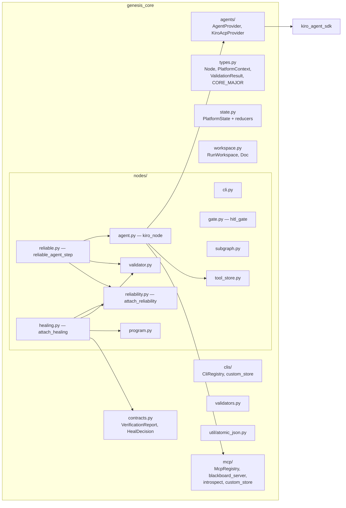
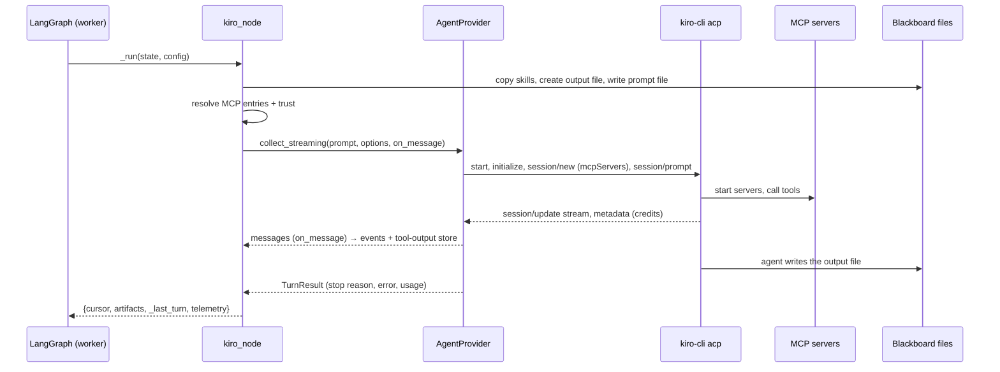
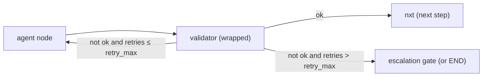
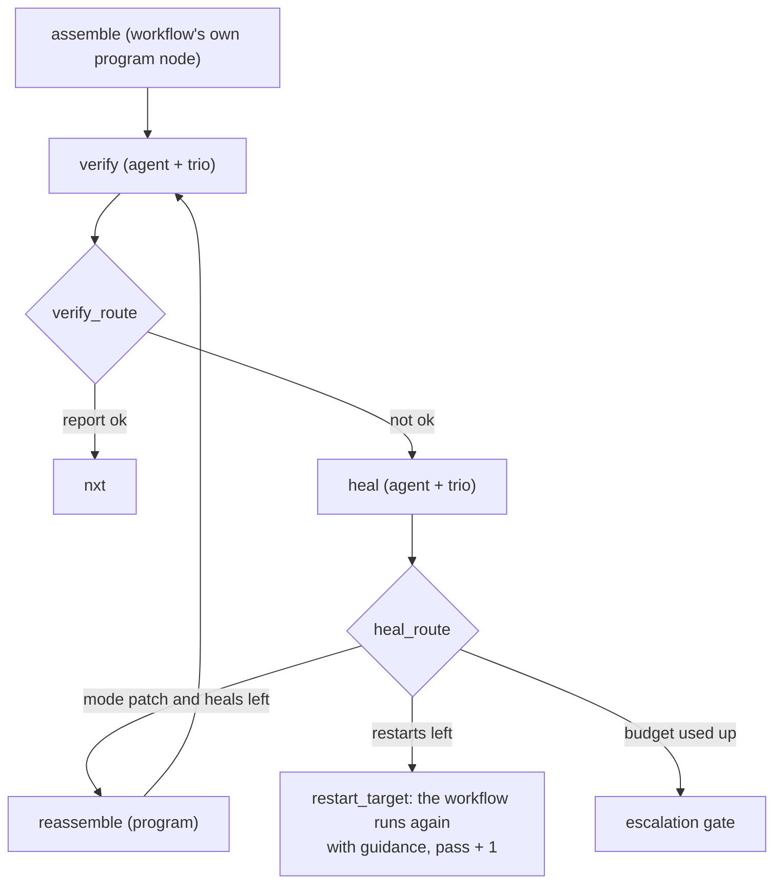

# Module: core engine (`genesis-core`)

> **Describes:** genesis v0.81.0 (Phase 51) · **Last reviewed:** 2026-11-11 · C4 level 3 · area `core-engine`

## 1. Purpose

`genesis-core` is the library every workflow is built from. It gives a workflow author a small set of building
blocks (node factories), the safety wiring that every agent step must wear (the reliability trio and the healing
tier), the shape of the run's state, the run's file folder (the blackboard), and the registries that turn an MCP
server or CLI name into something that can be launched.

It knows nothing about the web app, the database or the UI. It is the contract between the platform and the
workflows in the library: the platform injects a `PlatformContext`, the workflow builds a LangGraph graph from
core nodes, and the platform runs it.

## 2. At a glance

| Item | Value |
|---|---|
| Package / import name | `genesis-core` / `genesis_core` |
| Code | `packages/genesis-core/genesis_core/` |
| Depends on | `langgraph` (1.2 or newer, below 2), `langgraph-checkpoint-sqlite`, `aiosqlite`; `kiro-agent-sdk` only lazily, at the first agent turn |
| Used by | Every workflow's `graph.py`; the run worker (`genesis/runs/worker.py`); the context builder (`genesis/runtime/context.py`); the lints (`genesis/lint/`) |
| Compatibility key | `CORE_MAJOR = 1` in `types.py`. The loader refuses a library whose lockfile declares another major (ADR-019). The pip version is the shared repo version and is **not** the compatibility key (ADR-080). |
| Change rule | Additive only within a major. Removing or changing a public name breaks installed workflows. |

## 3. Concepts

| Term | Meaning |
|---|---|
| **Node** | One step of a workflow graph: a dataclass holding a `name`, an async function `fn(state, config)` and a `kind`. The factories below create them. Each node function is marked with `_genesis_kind` and `_genesis_name` so the lint can recognise it in a compiled graph. |
| **Node kinds** | `program` (plain Python), `agent` (one Kiro turn), `cli` (an external command), `validator` (a program check of an artifact), `gate` (a human-in-the-loop pause), `subgraph` (another compiled graph used as one step). |
| **PlatformContext** (`ctx`) | Everything a node may use at run time: `run_id`, `workspace` (the blackboard), `mcp` and `clis` registries, `settings`, `emit` (send an event), `secrets`, `environments`, `checkpointer` and `extras` (platform services such as the KB store). The engine injects it into every node through the LangGraph config under the key `genesis_ctx`. |
| **PlatformState** | The run's LangGraph state: a `TypedDict` of small, editable fields. Workflows extend it with their own keys. |
| **Blackboard** | The run's own folder, `<artifacts root>/<workflow_id>/<run_id>/`, wrapped by `RunWorkspace`. All bulk data lives here; state stores paths. |
| **Artifact** | A file on the blackboard, recorded in `state["artifacts"]` as *logical name → absolute path*. |
| **Reliability trio** | Agent step → validator → (pass → next step, fail → retry the agent, retries used up → escalation gate). Required for every agent node (ADR-011). |
| **Healing tier** | A second, optional loop over a finished artifact: verify → heal by patch or one guided restart → escalate (ADR-067). |
| **AgentProvider** | The interface an agent node calls to run a turn. The default is the Kiro/ACP provider (ADR-051). |
| **Tool-output store** | `<run>/_toolcalls/`: every MCP tool result of an agent session, written by the agent node, readable through the `blackboard` MCP server. |

## 4. Structure



The diagram shows the package's parts and the few dependencies between them. The agent node is the only part
that reaches outside the package: it calls the agent provider, which calls the SDK, and it uses the MCP registry
and the tool-output store. The one-call trio helper and the healing tier are built only from the other node
factories, so they add no new mechanism.

| File | What it contains |
|---|---|
| `types.py` | `CORE_MAJOR`, `CompatError`, `check_compat`, `Node`, `ValidationResult`, `PlatformContext`, `CTX_KEY = "genesis_ctx"`, `ctx_from_config(config)` |
| `state.py` | `PlatformState`, the reducers (`_merge`, `_inc_merge`, `_telemetry_merge`), `new_state`, `record_artifact`, `record_decision` |
| `workspace.py` | `RunWorkspace` (one run's folder), `Doc` (one file), `default_artifacts_root()` (`GENESIS_ARTIFACTS_DIR` or `~/Genesis/runs`) |
| `nodes/program.py` | `program_node(name, fn)`: wraps `fn(state, ctx) -> partial update` and adds timing telemetry |
| `nodes/agent.py` | `kiro_node(...)`: one Kiro turn with per-node MCP injection, trust, skills, images, prompt capture, streaming events, tool-output recording, credits; `set_collect_impl` for tests |
| `nodes/cli.py` | `cli_node(name, cmd_fn, parse_fn)`: runs a registry CLI; a non-zero exit raises |
| `nodes/validator.py` | `validator_node(name, check_fn, target_artifact)`: loads the artifact (JSON if it parses, else text) and records `{ok, message}` |
| `nodes/gate.py` | `hitl_gate(name, kind, prompt_fn, options)`: pauses with LangGraph `interrupt()` and records the decision |
| `nodes/subgraph.py` | `subgraph_node(name, compiled, input_map, output_map)`: runs another compiled graph as one step |
| `nodes/reliability.py` | `attach_reliability(g, agent, validator, retry_max, on_exhaust_gate, nxt)`: adds the trio's nodes and edges |
| `nodes/reliable.py` | `reliable_agent_step(...)` and `add_reliable_step(g, step, ...)`: the trio built in one call |
| `nodes/healing.py` | `attach_healing(...)`, `healing_bounds(meta)`, `read_guidance(state)` |
| `nodes/tool_store.py` | `ToolOutputStore` and `BLACKBOARD_TOOLS` |
| `agents/provider.py`, `agents/kiro.py` | `AgentProvider` protocol, `set_agent_provider`, `get_agent_provider`, `KiroAcpProvider` |
| `mcp/registry.py` | `McpRegistry`: `from_layers` (curated + custom), `allowlist(name)`, `acp_servers(names)` with `${VAR}` resolution |
| `mcp/blackboard_server.py` | A small stdio MCP server exposing the tool-output store to the agent |
| `mcp/introspect.py` | `list_tools`: start an MCP server and read its `tools/list` (used by Settings) |
| `mcp/custom_store.py`, `clis/custom_store.py` | The user-writable custom tier files (`mcp-custom.json`, `cli-custom.json`) |
| `clis/registry.py` | `CliRegistry`: resolve a CLI by PATH or from a managed install; `run(name, argv)` |
| `validators.py` | Reusable check functions (section 6.4) |
| `contracts.py` | The healing tier's wire contracts and their checks |
| `util/atomic_json.py` | `atomic_write_json`, `read_modify_write_json`, `path_lock`: crash-safe JSON files |

## 5. How it works

### 5.1 How a workflow uses the core

A workflow is a folder with `workflow.yaml` and `graph.py`. `graph.py` defines a static `META` dict and a
`build(ctx)` function that returns a compiled graph. This is the library's smallest real example,
`genesis-workflows/workflows/hello-appian/graph.py`, shortened:

```python
def build(ctx: PlatformContext):
    g = StateGraph(HelloAppianState)              # PlatformState plus workflow keys

    make_result = kiro_node(name="make_result", prompt_fn=_prompt, output_doc="result.json", mcp=[])
    v_result = validator_node(name="v_result", target_artifact="result.json",
                              check_fn=V.all_of([V.parses_json("result.json"),
                                                 V.required_keys(["value"], "result.json")]))
    finish = program_node(name="finish", fn=lambda s, c: {"status": "done"})
    escalate = hitl_gate(name="escalate", kind="escalation",
                         prompt_fn=lambda s, c: "make_result failed repeatedly — please review.")

    g.add_node("finish", finish.fn)
    g.add_node("escalate", escalate.fn)
    g.add_edge(START, "make_result")
    attach_reliability(g, agent=make_result, validator=v_result,
                       retry_max=META["retry_defaults"]["max"],
                       on_exhaust_gate="escalate", nxt="finish")
    g.add_edge("finish", END)
    g.add_edge("escalate", END)
    return g.compile(checkpointer=ctx.checkpointer)
```

The same trio can be written with one helper, which makes it impossible to forget the validator:

```python
step = reliable_agent_step(name="make_result", prompt_fn=_prompt, output_doc="result.json",
                           check_fn=..., retries=2, escalation_gate="escalate")
add_reliable_step(g, step, nxt="finish")
```

Rules a `graph.py` must follow:

- `META` must be importable with no side effects, and `workflow.yaml` must mirror it. A parity lint checks this;
  keys used only by the UI, such as `graph:`, are exempt (L-013).
- The file is loaded standalone by path, so it must be self-contained: no imports of sibling modules as a
  package. Put pure helper functions in `graph.py` itself.
- Do not use `from __future__ import annotations` in a `graph.py` whose state has custom reducer keys: the
  annotations become strings and LangGraph loses the reducers (L-022).
- Platform services come from `ctx.extras`, never from importing `genesis`.

### 5.2 What an agent node does, step by step

`kiro_node(...)` returns a node whose function does the following on every execution
(`nodes/agent.py`, `_run`):

1. **Provision skills.** If the node declares `skills=[...]`, copy each skill's folder into
   `<run>/.kiro/skills/<id>/`, where kiro-cli finds it. The platform resolves the source folder through
   `ctx.extras["skill_source"]`. A skill that cannot be found stops the step: it never runs without its
   instructions (ADR-069). `KIRO_HOME` is never set, so the user's own Kiro folder is untouched.
2. **Resolve the agent provider** (`get_agent_provider()`); by default the Kiro/ACP provider.
3. **Resolve MCP servers.** `ctx.mcp.acp_servers(mcp)` turns the node's server names into ACP entries, resolving
   every `${VAR}`. A missing variable raises `McpResolutionError` *before* Kiro starts (fail fast).
4. **Pre-create the output file** `output_doc` on the blackboard, and call `prompt_fn(state, ctx, out_path)` to
   build the prompt. The agent is told to write its result to that path and reply only "DONE"; bulk never comes
   back through chat.
5. **Load images** listed in `image_docs` as base64 parts (for example rendered PDF pages).
6. **Capture the prompt** into `<run>/_prompts/<node>-p<pass>[-i<item>]-a<attempt>-<ms>.txt`. Events carry only
   this pointer (ADR-066).
7. **Add the blackboard server** (unless `blackboard=False`) and open the tool-output store.
8. **Compute trust** (section 5.3) and build `KiroAgentOptions`: `cwd` = the run folder, the MCP list, model,
   `turn_timeout` (default 420 s), `startup_timeout` (default 120 s), `trust_all_tools` or `trust_tools`.
9. **Emit `agent.prompt`** with the prompt pointer, model, servers, trusted tools, attempt and iteration label.
10. **Run the turn**, streaming if the provider supports it. Each streamed message becomes an event
    (`agent.message`, `agent.thought`, `agent.tool_call`, `agent.tool_update`). Each completed tool result is
    written to the tool-output store. A completed `save_tool_output` call records the saved document as an
    artifact.
11. **Build telemetry** for the node and the run total: attempts, duration, tool calls, turns, credits and their
    provenance, context usage, retries, last error.
12. **Emit `agent.result`** (the turn summary, with credits) and return a small state update: `cursor`,
    `artifacts` (the output document plus any saved documents), `_last_turn` and `telemetry`.

The node never decides whether the output is good. A failed turn (Kiro reported an error) still returns normally;
the validator that follows finds the output missing or wrong and the trio retries.



The node prepares the files first, then hands one turn to the provider. The provider starts Kiro, which starts
the step's MCP servers. While the turn runs, every streamed message becomes an event and every tool result is
saved to the tool-output store. Kiro writes the output file itself. The node returns only pointers and
telemetry to LangGraph.

### 5.3 How tool trust is computed

Trust is the set of tools Kiro may call without asking. `_compute_effective_trust(node_tools, mcp_names,
registry)` combines the node's `tools=` list with each listed server's `tool_allowlist` (ADR-029):

| Node `tools=` | Any listed server has an allowlist | Result |
|---|---|---|
| not given | no | Trust everything (`--trust-all-tools`) |
| given | no | Trust exactly the node's list |
| not given | yes | Trust the union of the allowlists |
| given | yes | Trust the intersection of the node's list and the union of the allowlists |

When trust is restricted and the blackboard server is on, its three tools (`list_tool_outputs`,
`save_tool_output`, `read_tool_output`) are added so saving by reference never stalls on a permission prompt.

> **What trust does not do in v0.81.0.** `kiro_node` leaves the SDK's permission mode at its default,
> `auto_approve`, so when Kiro asks permission for an untrusted tool, the SDK answers "allow". The trusted set
> therefore decides which calls happen *without a permission round-trip*, not which calls are possible. A node
> with no tool list trusts every tool, including Kiro's shell. Kiro also loads the servers in the user's global
> `~/.kiro/settings/mcp.json` into every workflow turn, with full trust. ADR-083 records both as accepted risks
> until agent isolation ships (Phase 52); it amends ADR-029 to say so. Chat is different: it runs with
> `auto_deny`, so its trusted list is a real limit ([kiro-agent-sdk.md](kiro-agent-sdk.md#54-permission-requests)).

### 5.4 How validators and the trio route

`validator_node` loads `state["artifacts"][target_artifact]`, parses it as JSON when it can (otherwise passes the
text), and calls `check_fn(data, state, ctx)`. It records `state["_validation"][name] = {ok, message}`. If the
check returns a `normalized` value, it is written to `<artifact>.normalized` and recorded as an artifact.

`attach_reliability` wraps the validator. After a failed check it adds 1 to `state["retries"][agent]` and, if
retries remain, emits `retry.scheduled`. It always emits `validator.result`. Then a router decides:



With `retry_max = 2` the agent runs at most three times: the first try and two retries. On a retry the agent's
`prompt_fn` should read `state["_validation"][<validator>]["message"]` and include it, so the agent knows what to
fix. The retry counter is kept per agent node name for the whole run; the trio never resets it.

The lint `genesis/lint/reliability.py` checks every compiled agent node: it must have a validator as an immediate
successor, that validator must have an edge back to the agent, and it must have an escalation path (a gate node,
or a branch key named `escalate`). A plain "pass → END" edge does not count as escalation.

### 5.5 How gates work

`hitl_gate(name, kind, prompt_fn, options)` accepts only the kinds `approval`, `escalation`, `pre_mutation` and
`review`. When it runs, it builds a **gate descriptor**: `node`, `kind`, `prompt`, `options` (default
`["approve", "reject"]`), `context_refs` (the run's artifacts, for review) and `raised_at`. It passes the
descriptor to LangGraph's `interrupt()`. The graph stops; the worker reports the interrupt and exits.

When the person answers, a new worker resumes the graph with `Command(resume=decision)`. The gate records:

- a plain answer: `decisions["<gate>.outcome"] = "approve"` (or the chosen option);
- free-text feedback: `decisions["<gate>.outcome"] = "feedback"` and `decisions["<gate>.feedback"] = "..."`.

What happens next is the workflow's choice: it adds conditional edges that read those decisions. A gate that
leads to END must make sure the run ends in a terminal status (the worker treats a finished graph as `done`
unless the graph set `failed` or `cancelled`, L-065). The prompt shown at a gate must describe what will really
happen after each answer, given the run's state (L-106).

### 5.6 How the healing tier works

`attach_healing` adds a loop around an artifact that a workflow has already assembled:



- **verify** is an agent that writes a `VerificationReport` (`verify.json`): `ok`, `summary` and a list of
  item-keyed fixes, each with `target_id`, `issue`, `reason`, `evidence`, `suggested_change` and a severity of
  `blocker`, `major` or `minor`.
- **heal** is an agent that writes a `HealDecision` (`heal.json`): `mode` (`patch` or `restart`), `rationale`,
  and either `patches` (corrected items) or `guidance` (for a restart).
- Both agents wear the trio. Their validators are `check_verification_report` and `check_heal_decision` from
  `contracts.py`.
- The budget comes from `META.healing` (`max_heal`, `max_restart`, both default 1, read by `healing_bounds`).
  Bookkeeping is in `state["_healing"]`: `heals_used`, `restarts_used`, `guidance`. A restart also sets
  `state["_iteration"]["pass"]`, so the run's turn explorer can group turns by pass.
- A restarting agent reads the guidance with `read_guidance(state)` and adds it to its prompt.

The ladder ends at a person after at most one patch and one restart by default, so the loop can never spend
credits without limit.

### 5.7 How MCP servers are resolved

`McpRegistry` holds server specs. It can merge two tiers: the curated `mcp-registry.json` of the installed library,
and the user's custom tier (custom wins on a name clash, ADR-029). Which tiers a caller gets depends on how it
builds the registry: in v0.81.0 the run worker (`genesis/runs/worker.py`, `_load_registries`) loads only the curated
file, while the app's `ConfigService` uses the merged view. `acp_servers(names)` builds, for each name:

- `command` and `args`: from the spec, or, for a **managed** entry (`"managed": "<id>"`), from the platform's
  launch provider, which points at the locally installed bundle (ADR-038). An entry that is not installed fails
  with a message telling the user how to install it.
- `env`: a **list** of `{"name", "value"}` objects. ACP silently ignores an env given as a dict (L-001).
- Every `${VAR}` in args and env is resolved in this order: the SecretProvider (`<server>/VAR`, then
  `global/VAR`), then the environment registry (values of the active environment), then the process environment.

If any variable stays unresolved, it raises `McpResolutionError` listing all of them. `allowlist(name)` returns a
server's `tool_allowlist` or `None`.

`CliRegistry` works the same way for external commands: a managed entry resolves to its installed binary through a
launch provider; any other entry is found on `PATH`. The run worker builds its `CliRegistry` from the curated
`cli-registry.json` without a launch provider, so a managed CLI cannot be resolved through `ctx.clis` inside a run
in v0.81.0; workflows that need `gws` or `sail` reach them through `ctx.extras` services instead. `cli_node` raises
on a non-zero exit, which fails the run unless the graph handles it.

## 6. Interfaces

### 6.1 The public API

Everything in `genesis_core.__all__` is public and stable within `CORE_MAJOR = 1`:

- Types and gate: `CORE_MAJOR`, `CompatError`, `check_compat`, `PlatformContext`, `ValidationResult`, `Node`
- State: `PlatformState`, `new_state`, `record_artifact`, `record_decision`
- Blackboard: `RunWorkspace`, `Doc`, `default_artifacts_root`
- Registries: `McpRegistry`, `McpResolutionError`, `CliRegistry`, `CliError`
- Nodes: `program_node`, `kiro_node`, `cli_node`, `validator_node`, `hitl_gate`, `subgraph_node`
- Reliability: `attach_reliability`, `ReliableStep`, `reliable_agent_step`, `add_reliable_step`
- Healing: `attach_healing`, `healing_bounds`, `read_guidance`, `contracts`, `Fix`, `HealDecision`,
  `VerificationReport`, `check_verification_report`, `check_heal_decision`, `parse_verification_report`,
  `parse_heal_decision`
- Agent seam and tests: `AgentProvider`, `get_agent_provider`, `set_agent_provider`, `set_collect_impl`
- `validators`

### 6.2 Function signatures workflow code supplies

| Callback | Signature | Returns |
|---|---|---|
| Node function (any kind) | `async fn(state, config: RunnableConfig)` | A partial state update. LangGraph passes `config` only when the parameter is annotated `RunnableConfig`. |
| `program_node(fn=...)` | `fn(state, ctx)` | A small partial update, or `None` |
| `kiro_node(prompt_fn=...)` | `prompt_fn(state, ctx, out_path)` | The prompt text |
| `validator_node(check_fn=...)` | `check_fn(data, state, ctx)` | `ValidationResult(ok, message, normalized=None)` |
| `hitl_gate(prompt_fn=...)` | `prompt_fn(state, ctx)` | The text shown to the person |
| `cli_node(cmd_fn=..., parse_fn=...)` | `cmd_fn(state, ctx) -> argv`; `parse_fn(completed, state, ctx)` | `argv`; a partial update |
| `build` | `build(ctx: PlatformContext)` | A graph compiled with `checkpointer=ctx.checkpointer` |

### 6.3 `kiro_node` parameters

| Parameter | Default | Meaning |
|---|---|---|
| `name` | required | Node name; also the key for retries and telemetry |
| `prompt_fn` | required | Builds the prompt (section 6.2) |
| `output_doc` | required | Blackboard file the agent must write; pre-created empty |
| `mcp` | `()` | MCP server names to inject for this turn only |
| `tools` | `None` | Tools to trust; `None` trusts all unless an allowlist caps it |
| `model` | `None` | Model id for this turn; `None` uses Kiro's default |
| `turn_timeout` | 420 s | Longest a turn may run |
| `startup_timeout` | 120 s | Longest Kiro may take to start and open the session |
| `blackboard` | `True` | Inject the blackboard MCP server and record tool outputs |
| `image_docs` | `None` | Blackboard image files to attach to the prompt |
| `skills` | `None` | Kiro skill ids to provision into `<run>/.kiro/skills/` |

### 6.4 Validators library (`genesis_core.validators`)

Each function returns a `check_fn`. Combine them with `all_of([...])` or `any_of([...])`.

| Validator | Passes when |
|---|---|
| `non_empty` | the artifact exists and is not empty |
| `parses_json` | the artifact parses as JSON |
| `json_schema` | it matches a JSON Schema |
| `required_keys` | the listed keys are present |
| `values_in_set` | a field's values are all in an allowed set |
| `count_between` | a list's length is within bounds |
| `first_field_is` | a record's first field has the expected name |
| `excludes` | given strings do not appear |
| `referential_integrity` | references point to ids that exist |
| `all_items_present` | every expected item is present |
| `matches_predicate` | a custom predicate holds |

### 6.5 Events the core emits

Nodes report through `ctx.emit({...})`. The run manager stores the types in the first group under their own kind
in the durable event log; it stores every other type under the kind `custom` (see
[runs-and-workers.md](runs-and-workers.md#53-how-worker-output-becomes-events)).

| Event `type` | Emitted by | Stored as |
|---|---|---|
| `agent.prompt`, `agent.message`, `agent.thought`, `agent.tool_call`, `agent.tool_update`, `agent.result` | `kiro_node` | own kind |
| `validator.result`, `retry.scheduled` | `attach_reliability` | own kind |
| `agent_start`, `agent_end` (legacy), `validation`, `skills.provisioned`, `artifact.saved`, `tool_output.recorded`, `verify.result`, `heal.decision`, `heal.applied`, `workflow.restart` | various | `custom` |

## 7. Data

### 7.1 State fields

| Field | Type | Reducer | Holds |
|---|---|---|---|
| `run_id`, `workflow_id`, `workflow_version` | str | replace | identity |
| `inputs` | dict | replace | validated launch inputs |
| `artifacts` | dict | merge by key | logical name → blackboard path |
| `decisions` | dict | merge by key | small outputs, gate outcomes, routing flags |
| `status` | str | replace | `running`, `done`, `failed`, … as set by the graph |
| `cursor` | str | replace | the last node that ran |
| `retries` | dict | per key, last value wins | retry count per agent node |
| `errors` | list | append | error notes |
| `_validation` | dict | merge by key | `{validator: {ok, message}}` |
| `_last_turn` | dict | replace | the latest agent turn summary |
| `_iteration` | dict | replace | turn grouping label `{pass, item_label, item_index}` set by loop and heal nodes |
| `_healing` | dict | merge by key | `{heals_used, restarts_used, guidance}` |
| `telemetry` | dict | deep merge per node; counters and credits are summed; a missing credit value never erases a total | per-node metrics plus `_run` totals |

### 7.2 Blackboard layout

```text
<artifacts root>/<workflow_id>/<run_id>/
├── <output docs>            files agents and program steps write
├── uploads/                 files given at launch (written by the run manager)
├── _prompts/                the exact prompt of every agent turn
├── _toolcalls/              index.json + call_N.out — removed when the run ends
├── .kiro/skills/<id>/       skills provisioned for agent steps
└── <workflow-specific folders, e.g. checkout/, report/, .pids/>
```

## 8. Failure handling

| Failure | What happens |
|---|---|
| A declared skill cannot be found | `RuntimeError` before the turn; the run fails |
| An MCP variable does not resolve, or a managed server is not installed | `McpResolutionError` before Kiro starts; the run fails with the missing names |
| Kiro reports an error during the turn | The node returns normally with `last_error` in telemetry; the validator fails; the trio retries |
| The turn times out | The SDK ends the turn with an error; same as above |
| A validator check raises | The exception fails the run; write checks that return `ValidationResult(ok=False, ...)` instead |
| `cli_node` exits non-zero | `RuntimeError`; the run fails unless the graph handles it |
| `ctx.emit` raises | Ignored in the trio and healing code; observability never breaks the graph |
| A prompt capture write fails | The pointer is left empty; the turn still runs |

## 9. Configuration

| Setting | Where | Effect |
|---|---|---|
| `GENESIS_ARTIFACTS_DIR` | environment | Root of all blackboards (default `~/Genesis/runs`) |
| `META.retry_defaults.max` | workflow | Usual source of `retry_max` |
| `META.healing.{max_heal,max_restart}` | workflow | Healing budget (defaults 1 and 1) |
| `META.execution.recursion_limit` | workflow, read by the worker | LangGraph superstep ceiling; the worker's default is 150 (LangGraph's own is 25, L-020) |
| `META.auto_approve` | workflow | Whether the workflow runs without designed approval stops (default true, ADR-021) |
| `tool_allowlist` | registry entry | Hard cap on trusted tools for that server |

## 10. Extending the core

- **A new validator:** add a function to `validators.py` that returns `check(data, state, ctx)`. Keep it pure.
- **A new node helper:** compose existing factories, as `reliable.py` does, rather than adding a node kind. A new
  kind needs the reliability lint and the UI to understand it.
- **A second agent provider:** implement `AgentProvider` (`options_cls`, `supports_streaming`, `collect`,
  `collect_streaming`) and install it with `set_agent_provider`. Nodes do not change (ADR-051).
- **A change to a public name or signature:** it breaks installed workflows. Either keep the old name working, or
  raise `CORE_MAJOR` and coordinate a library release built for the new major.

## 11. Design decisions

| Decision | In plain words | ADR |
|---|---|---|
| LangGraph owns control flow | Edges in Python decide the next step; agents never orchestrate | ADR-001 |
| Narrow agent turns over ACP with per-node MCP | One turn, one job, only the servers it needs | ADR-002, ADR-004 |
| Small state, bulk on the blackboard | State has paths and decisions; files hold content | ADR-010, ADR-018 |
| The trio is mandatory | Every agent step is checked, retried and escalated | ADR-011 |
| Refuse a library built for another core major | Detection alone is not enough; loading is refused | ADR-019 |
| Pause only at sanctioned gates; `pre_mutation` before writes | Workflows run straight through except at approval, escalation or pre-mutation points | ADR-021 |
| Trust = node tools ∩ server allowlist | A workflow cannot exceed a server's curated cap | ADR-029 |
| Agent nodes depend on `AgentProvider` | A second runtime is an adapter | ADR-051 |
| Capture what each agent got and produced | Prompt files and per-turn events, by pointer | ADR-066 |
| The healing tier | Fix an assembled artifact in place before re-running everything | ADR-067 |
| Skills provisioned per run | A workflow never relies on the host's global skills | ADR-069 |

## 12. Known pitfalls

- **ACP env must be a list** of `{name, value}`; a dict is silently dropped and the server hangs without its
  secret (L-001).
- **`kiro_node` must build the real SDK options class**, so test stubs must accept the same keyword arguments
  (L-002).
- **Retries are keyed by agent node name**, and a looping graph needs a higher recursion limit (L-020).
- **Never paste a large tool result into a reply**; save it by reference (L-021).
- **No `from __future__ import annotations`** in a `graph.py` with custom reducer keys (L-022).
- **One agent turn cannot reliably emit a huge multi-part artifact**: it hits the turn timeout and truncates.
  Split it into parts and assemble with a program node (L-064).
- **Do not split one deliverable into per-item agent turns** when the items must agree with each other; the
  agent loses the cross-item context (L-076).
- **A blocking database write inside an async node can deadlock the checkpointer.** Run it off the event loop
  (L-026).

## 13. Tests

Tests live in `packages/genesis-core/tests/`. They run without Kiro by installing a fake through
`set_collect_impl(...)` or `set_agent_provider(...)`.

| Test file | Covers |
|---|---|
| `test_core_units.py` | Core units: types, state, nodes, validators, the trio |
| `test_reliable_step.py` | `reliable_agent_step` and `add_reliable_step` |
| `test_healing.py` | The healing tier |
| `test_agent_capture.py`, `test_agent_images.py`, `test_agent_skills.py`, `test_agent_provider.py` | Prompt capture, image parts, skill provisioning, the provider seam |
| `test_tool_store.py` | The tool-output store |
| `test_atomic_json.py` | Crash-safe JSON writes |
| `test_integrations.py` | Graphs built from core nodes, run with a fake agent |

Gate commands, from `packages/genesis-core/`:
`../../.venv/bin/ruff check genesis_core` and `../../.venv/bin/python -m pytest -q`.

## 14. Code map

| To change… | Look in |
|---|---|
| What an agent turn sends or records | `nodes/agent.py` (`kiro_node._run`, `_compute_effective_trust`, `_emit_message`) |
| Retry and escalation routing | `nodes/reliability.py` |
| The one-call trio | `nodes/reliable.py` |
| Gate payload or decision recording | `nodes/gate.py` |
| The healing ladder | `nodes/healing.py`, `contracts.py` |
| State fields and reducers | `state.py` |
| MCP launch and secret resolution | `mcp/registry.py` |
| Save-by-reference tools | `mcp/blackboard_server.py`, `nodes/tool_store.py` |
| The compatibility key | `types.py` (`CORE_MAJOR`) |
| The lint that enforces the trio | `genesis/lint/reliability.py` (in the app) |
