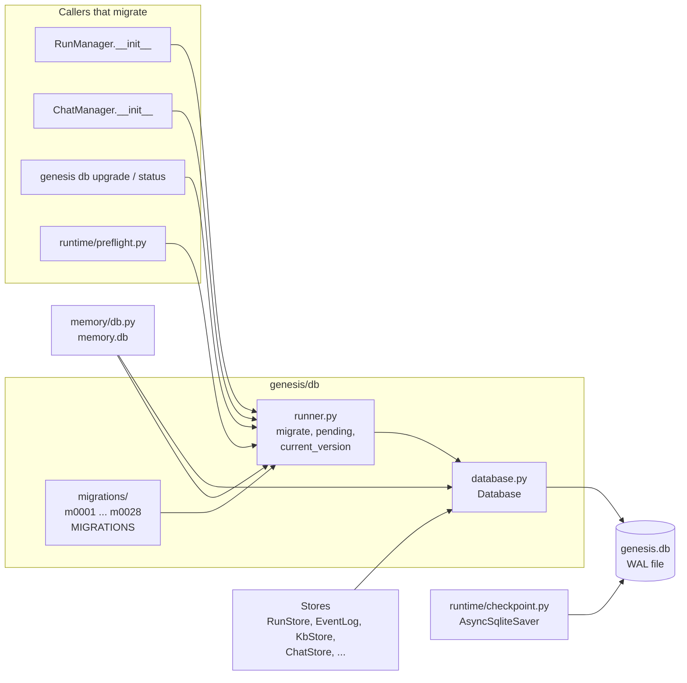
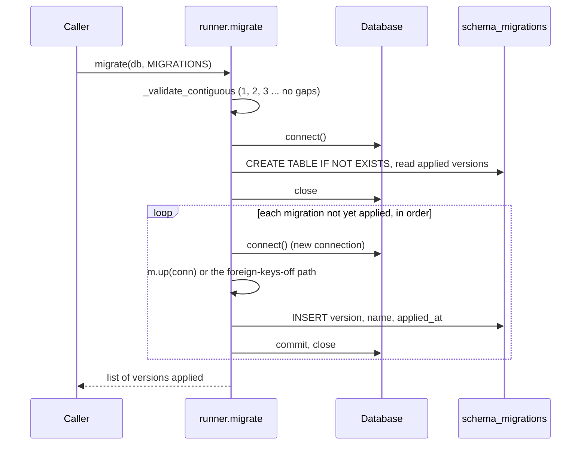

# Module: data and migrations (`genesis/db/`)

> **Describes:** genesis v0.81.0 (Phase 51) · **Last reviewed:** 2026-11-11 · C4 level 3 · area `db`

## 1. Purpose

`genesis/db/` owns how Genesis talks to its main SQLite file, `~/.genesis/genesis.db`. It has two jobs. First, it
hands out connections that all use the same settings (the `Database` class). Second, it changes the schema in
order, one numbered step at a time (the migration runner and the files in `genesis/db/migrations/`).

The central promise is this: **every table in `genesis.db` is created or changed by a numbered migration, and
nowhere else.** A store module (`RunStore`, `KbStore`, `ChatStore`, and so on) receives a `Database`, runs SQL
against tables that already exist, and never creates a table (L-004). The one exception is the pair of
checkpoint tables, which LangGraph's own saver creates (section 7.3).

The module also documents the data plane as a whole: what each table is for, which module writes it, and how the
app process, the worker processes and the async checkpointer share one file safely.

## 2. At a glance

| Item | Value |
|---|---|
| Code | `genesis/db/database.py`, `genesis/db/runner.py`, `genesis/db/migrations/` (28 migration files at v0.81.0) |
| Runs in | The app process (`genesis serve`), the worker subprocesses (`python -m genesis.runs.worker`), the CLI (`genesis db ...`) |
| Depends on | Python's `sqlite3` only. The runner has no other dependency. |
| Used by | Every store: `genesis/runs/` (`RunStore`, `EventLog`), `genesis/chat/`, `genesis/kb/`, `genesis/collab/`, `genesis/runtime/schedule_store.py`, `genesis/testexec/`, `genesis/services/`. Details in section 7. |
| Stores | `~/.genesis/genesis.db` (path from `Settings.db_path`). The separate `memory.db` uses the same classes with its own migration list; see [memory.md](memory.md). |
| Database engine | SQLite in WAL mode (ADR-030: SQLite stays until an explicit trigger such as multi-user use) |
| Key ids | `schema_migrations.version` (contiguous integers from 1); `MIGRATIONS` list; `Migration.foreign_keys_off` |
| Version at this release | Migrations `m0001` to `m0028` (m0029 belongs to unreleased Phase 53 work and is not described here) |

## 3. Concepts

| Term | Meaning |
|---|---|
| **`Database`** | The connection factory for one SQLite file. `connect()` opens a connection with the standard settings. `tx()` is a context manager that commits on success and rolls back on any error. |
| **Standard settings** | On every connection: `journal_mode=WAL`, `busy_timeout=30000` (30 s), `foreign_keys=ON`, and a `sqlite3.Row` row factory. The Python connect timeout is also 30 s. |
| **Migration** | A frozen dataclass `Migration(version, name, up, foreign_keys_off=False)`. `up` is a Python function that receives a connection and runs DDL (and, when needed, data copies). |
| **`MIGRATIONS`** | The ordered list in `genesis/db/migrations/__init__.py`. It is the single source of truth for the schema. |
| **`schema_migrations`** | The bookkeeping table: `version` (primary key), `name`, `applied_at`. The runner creates it. |
| **Contiguity check** | Before it does anything, the runner checks that versions run 1, 2, 3, ... with no gap and no duplicate. |
| **Forward-only** | A migration has no `down`. A bad migration is fixed by a new one. |
| **Idempotent `up`** | Each `up` is written so that running it twice changes nothing: `CREATE ... IF NOT EXISTS`, a column added only if `PRAGMA table_info` does not list it, `INSERT OR IGNORE` for seed rows. |
| **Table rebuild** | SQLite cannot drop a `NOT NULL` with `ALTER TABLE`. A rebuild creates a new table, copies rows, drops the old table and renames the new one. It needs foreign keys off (`foreign_keys_off=True`). |
| **`row_version`** | An integer column on mutable domain rows. Writers compare it before they update (optimistic locking, section 5.6). |
| **`sync_uuid`** | A client-generated global id on rows that can be shared through the Genesis Hub. See [collaboration-hub.md](collaboration-hub.md). |
| **`kb_sequences`** | A table of named counters. It gives out the numbers behind `GNS_`, `TC-`, `TS-`, `ACT-`, `DS-` and `TE-` ids (ADR-072). |
| **Checkpoint tables** | `checkpoints` and `writes`, created and owned by `langgraph-checkpoint-sqlite` in the same file. |

## 4. Structure



The diagram shows two paths into one file. Stores and the migration runner go through `Database`. The LangGraph
checkpointer opens its own `aiosqlite` connection and does not use `Database`. The memory module reuses
`Database` and `migrate` but points them at a different file.

| File | Main classes and functions |
|---|---|
| `genesis/db/__init__.py` | Exports `Database`, `Migration`, `migrate`, `current_version`, `pending`, `MIGRATIONS` |
| `genesis/db/database.py` | `Database` with `connect()` and `tx()` |
| `genesis/db/runner.py` | `Migration`, `ForeignKeyCheckError`, `migrate`, `current_version`, `pending`; private helpers `_validate_contiguous`, `_apply_with_foreign_keys_off`, `_ensure_meta_table`, `_applied_versions` |
| `genesis/db/migrations/__init__.py` | The `MIGRATIONS` list (28 entries at v0.81.0) |
| `genesis/db/migrations/m0001_baseline.py` ... `m0028_capture_request.py` | One `Migration` object each; the catalogue is in section 5.1 |
| `genesis/runtime/checkpoint.py` | `checkpointer(db_path)`: async context manager that opens `AsyncSqliteSaver` and applies WAL and `busy_timeout` |
| `genesis/memory/db.py` | `memory_database(settings)` and `migrate_memory(settings)`: `Database` and `migrate` pointed at `memory.db` |

## 5. How it works

### 5.1 The migration catalogue

This table lists every migration at v0.81.0. The file name is `genesis/db/migrations/<file>`. The `Migration`
object's `name` is sometimes shorter than the file name; the two migrations whose names differ are noted.

| Version | File | What it creates or changes |
|---|---|---|
| 1 | `m0001_baseline.py` | Creates `runs` and `run_events` (and `ix_run_events_run`). On an install that already had these tables it only records version 1. |
| 2 | `m0002_chat.py` | Creates `chat_sessions` and `chat_messages` (messages cascade with their session). |
| 3 | `m0003_chat_usage.py` | Adds `chat_messages.usage` (per-message credit metering as JSON). |
| 4 | `m0004_copilot.py` | Adds `chat_sessions.mode`; creates `chat_run_links` and `chat_permissions` for the copilot. |
| 5 | `m0005_supervision.py` | Creates `chat_notifications` with a unique `dedup_key` so a notification is never sent twice. |
| 6 | `m0006_copilot_actions.py` | Creates `copilot_actions`, the audit trail of mutating tool calls the copilot proposed. |
| 7 | `m0007_kb.py` | Creates the Knowledge Base: `kb_applications`, `kb_syncs`, `kb_objects`, `kb_dependencies`, `kb_bundles`, `kb_bundle_members`, `kb_releases`, with their indexes. Objects and dependencies carry `valid_from_sync` and `valid_to_sync` (a history model); no source code is stored (ADR-037). |
| 8 | `m0008_business_map.py` | Creates `kb_business_maps`, one current business map per application. |
| 9 | `m0009_documents.py` | Creates the global document store: `kb_documents`, `kb_document_links`, `kb_document_sections` (ADR-041). |
| 10 | `m0010_features.py` | Creates `kb_features`, `kb_feature_specs`, `kb_feature_spec_revisions` (ADR-042). |
| 11 | `m0011_chat_model.py` | Adds `chat_sessions.model`. |
| 12 | `m0012_scheduled_jobs.py` | Creates `scheduled_jobs`. |
| 13 | `m0013_lifecycle.py` | Creates `lifecycle_transitions`, the append-only record of every lifecycle change. |
| 14 | `m0014_row_version.py` | Adds `row_version` to `kb_features` and `kb_feature_specs` (optimistic locking). |
| 15 | `m0015_feature_stages.py` | Creates `kb_feature_stages` and `kb_feature_stage_revisions`, then copies existing spec rows into them as `stage='spec'`. It does not drop `kb_feature_specs`. |
| 16 | `m0016_stories.py` | Creates `kb_epics` and `kb_stories`; adds `kb_features.stories_finalized_at`, the one-time finalize marker (ADR-060). |
| 17 | `m0017_workbench.py` | Creates `workbench_boards` and `kb_board_cards`. |
| 18 | `m0018_story_stages.py` | Creates `kb_story_stages` and `kb_story_stage_revisions`. |
| 19 | `m0019_collab.py` | Adds `sync_uuid` (backfilled, with a unique index) to six synced tables; adds `row_version` to four; adds provenance columns to three; adds `upstream_versions_json` to the two stage tables; creates `collab_identity`, `collab_teams`, `collab_memberships`, `collab_sync_state`. |
| 20 | `m0020_story_on_board.py` | Adds `kb_stories.on_board` and sets it to 1 for every story that already has a board card. |
| 21 | `m0021_object_wiki.py` | Creates `wiki_object_pages` and `wiki_object_entries`, the append-only Object Wiki (ADR-070). |
| 22 | `m0022_story_sequence.py` | Creates `kb_sequences` and seeds the `story` counter at 1 (ADR-072). |
| 23 | `m0023_incremental_sync.py` | Adds `kb_syncs.details_json`, `scheduled_jobs.options_json` and `scheduled_jobs.user_modified` (ADR-074). |
| 24 | `m0024_spec_change_requests.py` | Adds `kb_stories.spec_refs`, `answers`, `change_log` and `chat_messages.meta_json`; creates `kb_spec_change_requests` with a unique index that allows one open change request per spec stage (ADR-075, ADR-076). |
| 25 | `m0025_test_design.py` | Creates the test design model: `kb_test_suites`, `kb_test_cases`, `kb_test_scenarios`, `kb_test_scenario_steps`, `kb_test_case_stories`, `kb_test_case_objects`, `kb_test_topups`; seeds the `test_case` and `test_scenario` counters. The `Migration` name is `test_design`. |
| 26 | `m0026_test_execution.py` | **Rebuilds `kb_test_suites`** (adds `kind` and `app_uuid`) with `foreign_keys_off=True`. Creates `kb_test_settings`, `kb_test_users`, `kb_test_actions`, `kb_test_setups`, `kb_test_case_scripts`, `kb_test_refs`, `kb_regression_items`, `kb_test_executions`, `kb_test_results`, `kb_test_captures`. Adds `setup_id` and `changes_shared_data` to `kb_test_scenarios`. Seeds the `test_action`, `test_setup` and `test_execution` counters. The `Migration` name is `test_execution`. |
| 27 | `m0027_regression_notes.py` | Creates `kb_regression_notes`, the notes that tell a person a deleted feature, case or scenario removed items from the regression suite. |
| 28 | `m0028_capture_request.py` | Adds `kb_test_captures.request_json`. |

The Python objects for m0025, m0026, m0027 and m0028 are named `testdesign`, `testexecution`, `regression_notes`
and `capture_request`, never `test_*`, so pytest does not collect an imported name as a test (L-092).

### 5.2 What `Database` does

`Database(db_path)` stores the path and creates the parent folder. It holds no connection.

1. `connect()` opens `sqlite3.connect(path, timeout=30)`, sets `row_factory = sqlite3.Row`, then runs
   `PRAGMA journal_mode=WAL`, `PRAGMA busy_timeout=30000` and `PRAGMA foreign_keys=ON`.
2. `tx()` calls `connect()`, yields the connection, and commits when the block ends normally. On any exception
   (including `BaseException`) it rolls back and re-raises. It always closes the connection.
3. Callers that only read use `connect()` and close the connection themselves, as `RunStore.get` and
   `FeatureStore.delete_feature` do.

Every call opens a new connection. There is no pool. `PRAGMA foreign_keys=ON` is a per-connection setting, so
the standard `connect()` turns it on each time. This is also why a migration that turns it off (section 5.4)
closes its connection afterwards.

### 5.3 How `migrate()` works



The diagram shows that each migration gets its own connection, and that the bookkeeping row is written on the
same connection as the schema change, so the two are committed together.

Steps:

1. `_validate_contiguous` sorts the list by version and raises `RuntimeError` if any version differs from its
   position (so a gap, a duplicate or a list that does not start at 1 stops startup).
2. The runner creates `schema_migrations` if it is missing and reads the set of applied versions.
3. For each migration whose version is not in that set, it opens a new connection and runs `up`.
4. It inserts the `schema_migrations` row on the same connection and commits.
5. On any error it rolls back, re-raises and closes the connection. Later migrations do not run.

`migrate` returns the versions it applied, so a second call returns an empty list. It is safe to call at every
start. `current_version(db)` returns the highest applied version (0 on a fresh file). `pending(db, migrations)`
returns the `Migration` objects not yet applied.

Because Python's `sqlite3` opens a transaction only at the first data-changing statement, DDL statements in a
normal migration run in autocommit (L-102). A normal migration is therefore safe to retry only because it is
written to be idempotent. A migration that needs a real all-or-nothing DDL transaction uses the path in 5.4.

### 5.4 Table rebuilds: `foreign_keys_off` (L-102)

m0026 rebuilds `kb_test_suites`, the first rebuild in Genesis. Dropping the old table with foreign keys on would
cascade into its children (`kb_test_cases`, `kb_test_scenarios`). `PRAGMA foreign_keys` does nothing inside a
transaction, so the runner handles this case in `_apply_with_foreign_keys_off`:

1. Run `PRAGMA foreign_keys=OFF`, then read the pragma back. If it is not 0, raise `RuntimeError`.
2. Record the foreign key violations that already exist (`PRAGMA foreign_key_check`). If there are any, log a
   warning. They are tolerated.
3. Run `BEGIN` explicitly. This makes the DDL part of one transaction.
4. Run `m.up(conn)`.
5. Run `PRAGMA foreign_key_check` again. Compare rows on `(table, rowid, parent)` only, because
   `ADD COLUMN ... REFERENCES` renumbers the `fkid` field. Any violation that was not there before raises
   `ForeignKeyCheckError(version, violations)`, and nothing is committed.
6. Back in `migrate`: insert the `schema_migrations` row and commit. On error, roll back.
7. The connection is closed, so the next `connect()` has foreign keys on again.

The m0026 rebuild keeps row ids and the `AUTOINCREMENT` counter (`sqlite_sequence`), so existing `suite_id`
values stay valid. It copies rows with a `LEFT JOIN`, so a suite whose feature is gone fails the new `NOT NULL`
loudly instead of disappearing.

The runner's own comment states a known limit: a new violation on a row that already violated a foreign key
towards the same parent table, through a different column, has the same comparison key and is tolerated. No
migration up to m0027 can produce one. A future migration that adds a second foreign key to an existing parent
must check this itself.

### 5.5 When migrations run

| Where | What happens |
|---|---|
| `RunManager.__init__` (`genesis/runs/manager.py`) | `migrate(self._db, MIGRATIONS)` right after creating the `Database`. `create_app` builds a `RunManager` unless it is given one, so starting the server migrates `genesis.db`. |
| `create_app` (`genesis/api/app.py`) | Calls `migrate_memory(settings)` for `memory.db`. |
| `ChatManager.__init__` (`genesis/chat/manager.py`) | Calls `migrate(self._db, MIGRATIONS)` again. This is a no-op when the file is current. |
| `genesis db upgrade` (`genesis/cli/main.py`) | Runs `migrate` on `genesis.db` and `migrate_memory` on `memory.db`, then prints what it applied. |
| `scripts/install.sh` | Step 6 runs `genesis db upgrade` unless `--no-migrate` is given. |
| `genesis update` / the update button (`genesis/runtime/updater.py`) | After installing the packages, runs `genesis db upgrade`; on a non-zero exit it stops with an error. |
| `runtime/preflight.py` | Does not migrate. It calls `pending()` and shows a "Database migrated" item (in `GET /api/system/preflight`) with the hint "Run `genesis db upgrade`". |

### 5.6 Optimistic locking with `row_version` (m0014)

Mutable domain rows carry `row_version INTEGER NOT NULL DEFAULT 0`. SQLite's WAL mode and `busy_timeout`
serialise physical writes, but they do not stop an application-level read-modify-write race. The store pattern is:

1. The caller reads the row and remembers `row_version` (or the current `status`).
2. The store runs `UPDATE ... SET ..., row_version = row_version + 1 WHERE id = ? AND row_version = ?` (and, for a
   status change, `AND status = ?`). `FeatureStore._cas_update` in `genesis/kb/features.py` is the common helper.
3. If the guard was supplied and no row matched, the store reads the row again and raises
   `StaleWriteError(kind, id, expected, actual)` (`genesis/domain/errors.py`). The API maps it to HTTP 409.
4. If the caller supplies no expected value, the write is unconditional but still bumps `row_version`. This is the
   single-user back-compat path.

The stage, story, board, test design and test execution stores use the same pattern. `tests/test_optimistic_locking.py`
pins it for `kb_features` and `kb_feature_specs`.

### 5.7 Taking the write lock first (L-091)

A transaction that reads to validate and then writes is not atomic with Python's default transaction control:
the transaction starts only at the first data-changing statement, so a concurrent writer can change the rows
between the check and the write. The rule is to take the write lock before the first read the decision depends
on. The code does this in two ways:

- `c.execute("BEGIN IMMEDIATE")` at the start of a `with db.tx() as c:` block. It is used in `genesis/kb/testexec_store.py`,
  `genesis/kb/features.py` (`delete_feature`), `genesis/runtime/schedule_store.py`, `genesis/collab/service.py`
  and `genesis/services/testimpact.py`.
- A compare-and-swap write, where the check and the write are one statement (section 5.6).

### 5.8 Counters in `kb_sequences` (ADR-072)

Human-readable ids come from one table of counters. Each row holds `name` and `next_val`, the next number to hand
out. The allocator runs inside the caller's open write transaction:

1. `INSERT OR IGNORE INTO kb_sequences (name, next_val) VALUES (?, 1)` (so a missing row is seeded).
2. `UPDATE kb_sequences SET next_val = next_val + 1 WHERE name = ? RETURNING next_val`.
3. The id is the returned value minus one, zero-padded to six digits with a prefix.

`_next_story_key` in `genesis/kb/stories.py` does this for `GNS_` (counter `story`); `allocate_key` in
`genesis/kb/testdesign.py` does it for the test counters. Migrations seed these counter names: `story` (m0022),
`test_case` and `test_scenario` (m0025), `test_action`, `test_setup` and `test_execution` (m0026). Because the
counter lives in the same transaction as the insert, an id is never reused and never renumbered.

### 5.9 One file, three kinds of writer

`genesis.db` is opened by three kinds of code at the same time:

- The **app process**: stores through `Database` (sync, short transactions).
- Each **worker subprocess**: it runs the graph. Its checkpointer is `AsyncSqliteSaver`, and program nodes may use
  stores such as `KbStore` through `Database`.
- The **CLI** (`genesis db upgrade`).

`genesis/runtime/checkpoint.py` opens the `AsyncSqliteSaver` with `AsyncSqliteSaver.from_conn_string(path)`, then
runs `PRAGMA journal_mode=WAL` and `PRAGMA busy_timeout=30000` on the saver's connection. These settings match
those of `Database.connect()`. A writer that finds the file locked waits up to 30 s instead of failing at once.

Settings are not enough (L-026). A synchronous, blocking store write inside an async node holds the event loop
while it waits for the SQLite write lock. The checkpointer's own write does an `execute` and then `await commit()`.
If a checkpoint write is in flight, its commit cannot run because the loop is blocked, so neither side can make
progress until the timeout, and the run fails with `database is locked`. The fix is to run blocking `genesis.db`
writes off the loop with `asyncio.to_thread`. The code follows this in many places, for example
`genesis/testexec/regression_job.py`, `genesis/runtime/collab_autopull.py` and `genesis/runtime/sync_jobs.py`; the
store modules say in their docstrings that async callers must use `to_thread`. Reads do not take the write lock, so
a sync read node is fine. `program_node` in genesis-core is synchronous, so a workflow node that writes to the
database must be a raw async node that calls `to_thread` (see [core-engine.md](core-engine.md)).

### 5.10 Derived rows must not outlive their source (L-103)

`kb_test_refs` is an index of the code's imports. It has no foreign key to the case scripts, so the database
cannot delete its rows for you. The deleting store (`delete_case`, `TestScriptStore.delete`) removes the rows in
the same transaction. Readers that treat the rows as live users join to the source row and skip rows whose source
is gone. Any cache, index or counter keyed by something another table owns needs the same two rules.

## 6. Interfaces

### 6.1 Python API

| Name | Use |
|---|---|
| `Database(db_path)` | `.db_path`, `.connect()`, `.tx()` |
| `migrate(db, migrations) -> list[int]` | Apply pending migrations; return the versions applied |
| `current_version(db) -> int` | Highest applied version, or 0 |
| `pending(db, migrations) -> list[Migration]` | Migrations not yet applied |
| `Migration(version, name, up, foreign_keys_off=False)` | One schema step |
| `ForeignKeyCheckError(version, violations)` | Raised by a `foreign_keys_off` migration that adds a violation |
| `MIGRATIONS` | The ordered list for `genesis.db` |
| `checkpointer(db_path)` (`genesis/runtime/checkpoint.py`) | Async context manager yielding the configured `AsyncSqliteSaver` |

### 6.2 CLI

| Command | Purpose |
|---|---|
| `genesis db upgrade` | Apply pending migrations to `genesis.db` and `memory.db`. Prints `applied migrations: [...]` or `already up to date`, and the same for memory. |
| `genesis db status` | Prints `schema version`, `pending`, `memory.db schema version` and `memory.db pending`. |

### 6.3 HTTP

This module has no routes of its own. Two routes expose related facts:

| Method and path | Purpose |
|---|---|
| `GET /api/system/preflight` | The first-run checklist; includes the required "Database migrated" item (from `pending()`). |
| `GET /api/system/memory` | Read-only memory status; includes the `memory.db` schema version read with `current_version`. |

## 7. Data

`genesis.db` holds these tables. The "Writer" column names the main module that inserts and updates the rows; the
table's schema is always owned by the migration shown in section 5.1. Owning-module documents describe how each
table is used.

### 7.1 Runs and events (migration m0001)

| Table | Key columns | Meaning | Writer |
|---|---|---|---|
| `runs` | `run_id` (PK), `workflow_id`, `version`, `inputs` (JSON), `status`, `cursor`, `artifacts_dir`, `detail`, `created_at`, `updated_at` | One row per run. The `run_id` is also the LangGraph `thread_id`. | `genesis/runs/store.py` (`RunStore`) |
| `run_events` | `seq` (autoincrement PK), `run_id`, `node`, `kind`, `payload` (JSON), `ts`; index on `(run_id, seq)` | The durable event log: the source of truth for a run's timeline and conversation. | `genesis/runs/eventlog.py` (`EventLog`) |

`run_events` has no foreign key to `runs`; `EventLog.purge(run_id)` deletes a run's events. See
[runs-and-workers.md](runs-and-workers.md).

### 7.2 LangGraph checkpoint tables

| Table | Key columns | Meaning |
|---|---|---|
| `checkpoints` | `thread_id`, `checkpoint_ns`, `checkpoint_id` (PK); `parent_checkpoint_id`, `type`, `checkpoint` (BLOB), `metadata` (BLOB) | The saved graph state after each superstep. A paused or crashed run resumes from the latest one. |
| `writes` | `thread_id`, `checkpoint_ns`, `checkpoint_id`, `task_id`, `idx` (PK); `channel`, `type`, `value` (BLOB) | Pending writes attached to a checkpoint. |

`langgraph-checkpoint-sqlite` creates these two tables itself (`CREATE TABLE IF NOT EXISTS` in
`langgraph/checkpoint/sqlite/aio.py`) the first time the saver is set up. They are **not** in any Genesis
migration. The `genesis/db/__init__.py` docstring states the rule: this module must never drop or alter them.
`thread_id` equals the Genesis `run_id`. See [core-engine.md](core-engine.md) and
[runs-and-workers.md](runs-and-workers.md).

### 7.3 Chat (migrations m0002 to m0006, m0011, m0024)

| Table | Key columns | Meaning | Writer |
|---|---|---|---|
| `chat_sessions` | `id`, `title`, `mode` (`read_only` or `copilot`), `model`, `created_at`, `updated_at` | One chat conversation. | `genesis/chat/store.py` |
| `chat_messages` | `seq`, `session_id` (FK, cascade), `role`, `content`, `events` (JSON), `usage` (JSON credit metering), `meta_json`, `ts` | The transcript. | `genesis/chat/store.py` |
| `chat_run_links` | `run_id` (PK), `session_id` (FK, cascade) | Which runs a copilot session started. | `genesis/chat/store.py` |
| `chat_permissions` | `tool_call_id` (PK), `session_id` (FK, cascade), `tool_name`, `args`, `options`, `status` (`pending`, `allowed`, `denied`), `decision` | Pending and decided confirm cards for copilot tool calls. | `genesis/chat/store.py` |
| `chat_notifications` | `id`, `session_id` (FK, cascade), `run_id`, `kind` (`gate` or `final`), `dedup_key` (unique), `payload`, `consumed_at` | Run events the copilot surfaced to a session; the unique key makes notifying idempotent. | `genesis/chat/store.py` |
| `copilot_actions` | `id`, `tool_call_id` (unique), `session_id` (FK, cascade), `tool`, `args_digest`, `run_id`, `confirmed_by_user`, `outcome`, `error` | Audit trail: proposal, human confirmation and outcome of each mutating copilot call. | `genesis/chat/store.py` |

`genesis/memory/chat_read.py` also reads `chat_sessions` and `chat_messages` to feed memory consolidation. See
[chat-and-skills.md](chat-and-skills.md).

### 7.4 Knowledge Base (m0007, m0008, m0023)

| Table | Key columns | Meaning |
|---|---|---|
| `kb_applications` | `app_uuid` (PK), `name`, `env_label`, `version_constant`, `baseline_sync_id`, `current_release`, `status` | One tracked Appian application. Most other KB tables cascade from it, so untracking an application removes its data. |
| `kb_syncs` | `sync_id`, `app_uuid` (FK, cascade), `kind`, `window_start`, `window_end`, `run_id`, `status`, `objects_added/modified/removed`, `details_json` (m0023) | Every sync attempt, with counts and per-sync detail. |
| `kb_objects` | `id`, `app_uuid`, `object_uuid`, `name`, `type`, `diff_hash`, `is_entry_point`, `is_orphan`, `metadata_json`, `valid_from_sync`, `valid_to_sync`; unique on `(app_uuid, object_uuid, valid_from_sync)` | Object metadata with a validity range (`valid_to_sync` NULL means current). No source code (ADR-037). |
| `kb_dependencies` | `id`, `app_uuid`, `source_uuid`, `target_uuid`, `dep_type`, names and types, `valid_from_sync`, `valid_to_sync` | Dependency edges with the same validity range. |
| `kb_bundles` | `id`, `app_uuid`, `bundle_id`, `bundle_type`, `root_uuid`, `name`, `object_count`, `flow_json`, `snapshot_sync`, `release_label` | Entry-point bundles, recomputed per sync. |
| `kb_bundle_members` | `bundle_pk` (FK, cascade), `object_uuid`, `role`, `flow_order` | Members of a bundle. |
| `kb_releases` | `app_uuid` (FK, cascade), `version_label`, `tagged_at`, `sync_id`, `env_version_ref`, `notes`; unique on `(app_uuid, version_label)` | A user-named point in time. |
| `kb_business_maps` | `app_uuid` (FK, cascade), `model_json`, `summary`, `domain`, `source_sync_id`, `status`, `run_id`, `credits`, `release_label`; unique on `(app_uuid, release_label)` | The generated business map; one current row per application. |

Writers: `genesis/kb/store.py` (`KbStore`) and its mixins. See [knowledge-base.md](knowledge-base.md).

### 7.5 Documents (m0009)

| Table | Key columns | Meaning |
|---|---|---|
| `kb_documents` | `id`, `source_type` (`upload` or `gdrive`), `dedup_key` (unique), `title`, `content_path`, `content_hash`, `tables_path`, `raw_path`, `status`, Drive fingerprint columns | The global document store. One row per unique document; the bulk content is on disk and the row holds pointers. |
| `kb_document_links` | `document_id` (FK, cascade), `app_uuid` (FK, cascade); primary key is both | Links a document to an application. Untracking an application removes the links, never the document (ADR-041). |
| `kb_document_sections` | `id`, `document_id` (FK, cascade), `ordinal`, `heading`, `text` | Heading-scoped chunks, the retrieval unit. |

Writers: `genesis/kb/documents.py`. See [documents.md](documents.md).

### 7.6 Features and stages (m0010, m0013 to m0016, m0024)

| Table | Key columns | Meaning |
|---|---|---|
| `kb_features` | `id`, `app_uuid` (FK, cascade), `name`, `description`, `row_version`, `stories_finalized_at`, collab columns | A feature of an application. |
| `kb_feature_specs`, `kb_feature_spec_revisions` | spec rows and their revisions | The original spec storage (m0010). m0015 copied these rows into `kb_feature_stages`. `genesis/kb/features.py` still reads and writes `kb_feature_specs`. |
| `kb_feature_stages` | `id`, `feature_id` (FK, cascade), `stage`, `status`, `chat_session_id`, `html_path`, `content_hash`, `source_doc_path`, `run_id`, `row_version`, `sync_uuid`, `upstream_versions_json`; unique on `(feature_id, stage)` | One artifact per stage per feature (Spec, UX Design, Technical Design, Feature Breakdown, Test Design). |
| `kb_feature_stage_revisions` | `stage_id` (FK, cascade), `revision_no`, `html_path`, `note`; unique on `(stage_id, revision_no)` | Milestone snapshots. |
| `kb_spec_change_requests` | `feature_id`, `stage_id` (FKs, cascade), `cr_no`, `status`, `base_revision_no`, `base_content_hash`, `dir_path`, `sync_uuid`, `row_version`; unique on `(feature_id, cr_no)` and a partial unique index on `stage_id` where `status='open'` | Spec change requests. At most one is open per spec stage. |
| `lifecycle_transitions` | `entity_kind`, `entity_id`, `from_state`, `to_state`, `action`, `actor`, `at` | Append-only record of every lifecycle change (ADR-050). Written by `genesis/kb/lifecycle_audit.py`. |

Writers: `genesis/kb/features.py`, `genesis/kb/stages.py`, `genesis/kb/spec_changes.py`. See
[features-and-stages.md](features-and-stages.md).

### 7.7 Stories, boards and the Object Wiki (m0016 to m0022, m0024)

| Table | Key columns | Meaning |
|---|---|---|
| `kb_epics` | `id`, `feature_id` (FK, cascade), `key`, `title`, `workstream`, `position`, `row_version`, `sync_uuid` | Epics created at finalize. |
| `kb_stories` | `id`, `feature_id` (FK, cascade), `epic_id` (FK, set null), `key` (`GNS_<6 digits>`), `title`, `story_type`, `category`, `acceptance_criteria` (JSON), `status` (the lane), `position`, `on_board`, `spec_refs`, `answers`, `change_log`, `row_version`, `sync_uuid` | The finalized backlog. The `status` column is the Workbench lane. |
| `kb_story_stages`, `kb_story_stage_revisions` | `story_id` (FK, cascade), `stage`, `status`, `html_path`, `run_id`, `row_version`; unique on `(story_id, stage)` | The per-story artifact (for example the design document) and its revisions. |
| `workbench_boards` | `id`, `app_uuid` (unique, FK, cascade), `row_version`, `sync_uuid` | One board per application added to the Workbench. |
| `kb_board_cards` | `board_id`, `story_id` (FKs, cascade), `board_position`; unique on `(board_id, story_id)` | Which stories are on a board and their order inside a lane. |
| `wiki_object_pages` | `app_uuid`, `object_uuid` (unique pair), `object_name`, `current_summary`, `latest_entry_id`, collab columns | One Object Wiki page per Appian object. |
| `wiki_object_entries` | `page_id` (FK, cascade), `change_kind`, `business_description`, `technical_description`, `story_key`, `is_bugfix`, `author_username`, collab columns | One immutable row per change (append-only, ADR-070). |

Writers: `genesis/kb/stories.py`, `genesis/kb/story_stages.py`, `genesis/kb/boards.py`, `genesis/kb/object_wiki.py`.
See [stories-and-workbench.md](stories-and-workbench.md).

### 7.8 Testing (m0025 to m0028)

| Table | Key columns | Meaning |
|---|---|---|
| `kb_test_suites` | `kind` (`feature` or `regression`), `feature_id` (unique, nullable), `app_uuid`, `finalized_at`; a CHECK ties `feature_id` to `kind`; a unique index allows one regression suite per application | One suite per feature, plus one regression suite per application. Rebuilt by m0026. |
| `kb_test_cases` | `suite_id` (FK, cascade), `key` (`TC-`), `gherkin_json`, `status` (`draft`, `ready`, `retired`), `automation_status`, `origin` | Reusable test cases. |
| `kb_test_scenarios` | `suite_id` (FK, cascade), `key` (`TS-`), `status`, `setup_id` (FK, set null), `changes_shared_data` | Scenarios. |
| `kb_test_scenario_steps` | `scenario_id`, `case_id` (FKs, cascade), `position`; unique on `(scenario_id, position)` | The ordered case references of a scenario. |
| `kb_test_case_stories` | `case_id`, `story_id` (FKs, cascade), `fingerprint`, `reviewed_at`; unique on `(case_id, story_id)` | Case-to-story links with the story fingerprint at link time. |
| `kb_test_case_objects` | `case_id` (FK, cascade), `app_uuid`, `object_uuid` (nullable), `object_name`, `object_type`, `diff_hash_at_link` | Case-to-object links. A NULL `object_uuid` is an unresolved link; there is no foreign key to the KB (L-095). |
| `kb_test_topups` | `feature_id` (FK, cascade), `run_id`, `status`, `proposals_json`, `decisions_json` | Post-finalize "generate tests for uncovered stories" runs. |
| `kb_test_settings` | `app_uuid` (PK, FK, cascade), `site_path`, `workspace_path`, `browser_channel`, `runtime_json` | Per-application test settings. |
| `kb_test_users` | `app_uuid` (FK, cascade), `role_key`, `role_label`, `username` | Test users by role. Passwords are not stored here; they live in the SecretProvider. |
| `kb_test_actions`, `kb_test_setups` | `app_uuid` (FK, cascade), `key` (`ACT-` or `DS-`), `slug`, `path`, `content_hash`, `contract_json`, `status`, `last_replay_json`, `ever_referenced` | The library catalogue. The code is in the per-application git workspace (ADR-081). |
| `kb_test_case_scripts` | `case_id` (unique, FK, cascade), `path`, `content_hash`, `last_commit` | The script file of a case. |
| `kb_test_refs` | `app_uuid` (FK, cascade), `from_kind`, `from_key`, `to_kind`, `to_key` | A derived index of imports in the test code (see 5.10). |
| `kb_regression_items` | `suite_id`, `scenario_id` (FKs, cascade), `position` | Feature scenarios that the regression suite references. |
| `kb_regression_notes` | `suite_id` (FK, cascade), `kind`, `cause`, `cause_key`, `detail_json`, `dismissed_at` | Notes about regression items removed by a delete. |
| `kb_test_executions` | `app_uuid` (FK, cascade), `key` (`TE-`), `kind`, `run_id`, `status`, `workspace_commit`, `selection_json`, `totals_json`, `report_dir` | One execution of committed test code. |
| `kb_test_results` | `execution_id` (FK, cascade), `scenario_id` and `case_id` (FKs, set null), `scenario_key`, `case_key`, `status`, `attempts`, `classification` | Result rows. They are kept when a scenario or case is deleted, with the stored key. |
| `kb_test_captures` | `app_uuid` (FK, cascade), `kind`, `role_key`, `run_id`, `trace_path`, `status`, `proposals_json`, `request_json` (m0028) | A recording or compose session and its reviewed proposals. |

Writers: `genesis/kb/testdesign.py` (m0025 tables), `genesis/kb/testexec_store.py` (m0026 tables), and
`genesis/kb/regression_notes.py`. See [testing.md](testing.md).

### 7.9 Schedules, collaboration and sequences

| Table | Key columns | Meaning | Writer |
|---|---|---|---|
| `scheduled_jobs` | `job_key` (unique), `name`, `enabled`, `schedule_json`, `options_json`, `user_modified`, `last_fired_slot`, `last_run_at`, `last_run_status` | One row per backend scheduled job. | `genesis/runtime/schedule_store.py` |
| `collab_identity` | `id` (CHECK `id = 1`, a single row), `name`, `appian_username`, `email`, `active_team_uuid` | The local user's identity for collaboration. | `genesis/collab/identity.py` |
| `collab_teams` | `team_uuid` (PK), `title`, `created_by` | Cached teams from the Hub. | `genesis/collab/identity.py` |
| `collab_memberships` | `team_uuid`, `username` (PK pair), `name`, `email` | Cached team members. | `genesis/collab/identity.py` |
| `collab_sync_state` | `kind` (PK), `last_cursor`, `last_pulled_at` | The pull cursor for each entity kind. | `genesis/collab/service.py` |
| `kb_sequences` | `name` (PK), `next_val` | The id counters (section 5.8). Names: `story`, `test_case`, `test_scenario`, `test_action`, `test_setup`, `test_execution`. | `genesis/kb/stories.py`, `genesis/kb/testdesign.py` |
| `schema_migrations` | `version` (PK), `name`, `applied_at` | The migration bookkeeping. | `genesis/db/runner.py` |

The shared tables also carry columns that serve collaboration: `sync_uuid` (unique), `row_version`,
`owner_username`, `team_uuid`, `published_by`, `published_at`, `published_version`. See
[scheduler-and-jobs.md](scheduler-and-jobs.md) and [collaboration-hub.md](collaboration-hub.md).

### 7.10 Files on disk

| Path | Owner | Meaning |
|---|---|---|
| `~/.genesis/genesis.db` (plus `-wal` and `-shm` files in WAL mode) | this module | The database. |
| `~/.genesis/memory.db` | `genesis/memory/` | The separate memory database; its own migration set `mm0001` in `genesis/memory/migrations/` and its own `schema_migrations` table. See [memory.md](memory.md) and ADR-054. |

Bulk data (HTML artifacts, blackboard folders, test code, reports) is on disk; the tables hold only pointers
and hashes (ADR-010).

## 8. Failure handling

| Situation | Behaviour |
|---|---|
| Versions are not contiguous from 1 | `_validate_contiguous` raises `RuntimeError` before anything runs. Startup stops. |
| A migration raises | The runner rolls back its connection, re-raises and stops. Later migrations do not run. DDL that ran in autocommit before the error stays; this is safe because each `up` is idempotent. |
| A `foreign_keys_off` migration leaves a new violation | `ForeignKeyCheckError`; nothing is committed. |
| Foreign key violations existed before a rebuild | Logged as a warning and tolerated, so an old orphan cannot stop startup. |
| Foreign keys could not be turned off | `RuntimeError` ("a transaction is open"). |
| A store write raises inside `tx()` | The transaction rolls back and the connection closes. |
| Another process holds the write lock | The writer waits up to 30 s (`busy_timeout`), then raises `sqlite3.OperationalError: database is locked`. |
| A blocking write on the event loop races a checkpoint write | Can deadlock until the timeout (L-026). Use `asyncio.to_thread`. |
| Stale `row_version` or status | `StaleWriteError`, shown as HTTP 409. The client refetches and retries. |
| The database is behind the code | The preflight "Database migrated" item is red and says "Run `genesis db upgrade`". Opening a `RunManager` also migrates. |
| `genesis update` cannot migrate | The update stops with "db upgrade failed" and does not restart the server. |
| The migration list is older than the file | Nothing in the runner checks for applied versions above the list's highest version; it only applies versions it does not find. |

## 9. Configuration

| Setting | Where | Value |
|---|---|---|
| `genesis.db` path | `Settings.db_path` (`genesis/runtime/settings.py`) | `<state dir>/genesis.db`, normally `~/.genesis/genesis.db` |
| `memory.db` path | `Settings.memory_db_path` | Separate file in the state dir |
| Journal mode | `Database.connect()` and `checkpointer()` | `WAL` (fixed in code) |
| Busy timeout | Both | 30000 ms (fixed in code); the Python connect timeout is 30 s |
| Foreign keys | `Database.connect()` | `ON` for every connection (fixed in code) |
| Skip migration at install | `scripts/install.sh --no-migrate` | Install without running `genesis db upgrade` |

There are no environment variables for the pragma values.

## 10. Extending this module

**Add a table or column.**
1. Create `genesis/db/migrations/m00NN_<name>.py` with an idempotent `_up(conn)` and a `Migration(version=NN, name=..., up=_up)`.
   Use `CREATE ... IF NOT EXISTS`, and check `PRAGMA table_info` before `ADD COLUMN`.
2. Import it in `genesis/db/migrations/__init__.py` and append it to `MIGRATIONS`. The number must be the next one.
3. Do not name the Python object `test_*` (L-092).
4. Put the SQL in the store, not the migration. The store takes a `Database` and never creates tables (L-004).
5. Add a test that a fresh file reaches the new version and that a second `migrate` applies nothing.

**Add a column to a table that is shared through the Hub.** Follow the m0019 and m0025 pattern: `sync_uuid` with a
unique index, `row_version`, and the provenance columns.

**Change a column's nullability or constraints.** Use a table rebuild with `foreign_keys_off=True` (section 5.4).
Copy ids and the `sqlite_sequence` high-water mark. Use a join that fails loudly rather than drops rows. If you
add a second foreign key to a parent that an existing row already violates, check that case yourself.

**Add a counter.** Seed it in the migration with `INSERT OR IGNORE INTO kb_sequences`. Allocate it inside the
caller's write transaction, as in section 5.8.

**Write a read-then-write method.** Take the lock first with `BEGIN IMMEDIATE`, or make the write a
compare-and-swap (L-091).

**Write a store used from async code.** Keep it synchronous. Call it with `asyncio.to_thread` (L-026).

**Write a derived index.** Delete its rows in the source's delete transaction and join to the source on read (L-103).

**Never edit a released migration.** Machines that already applied it will not run it again; write a new one.

## 11. Design decisions

| Decision | In plain words | ADR |
|---|---|---|
| SQLite stays | One local file is enough for one user. Postgres or pgvector is reconsidered only when a trigger such as multi-user use appears. Store signatures stay database-neutral. | ADR-030 |
| Async checkpointer on the same file | The engine runs the graph with the async API and `AsyncSqliteSaver`. App-side stores use plain `sqlite3`. | ADR-024 |
| Memory in its own file | `memory.db` has its own migrations so `genesis.db` is untouched. | ADR-054 |
| Documents are global | One row per unique document, linked into applications. Untracking removes the links only. | ADR-041 |
| Stories get a global id | `GNS_` ids come from a durable counter inside the finalize or create transaction. | ADR-072 |
| Features are intrinsic to the application | Feature rows cascade from the application. | ADR-042 |
| Finalize is one-time | A marker column, independent of story count, makes finalize irreversible. | ADR-060 |
| The Object Wiki is append-only | Entries are never updated; the page holds a pointer to the newest. | ADR-070 |
| Test code is files; the database holds the catalogue | Tables store paths, hashes and results, not code. | ADR-081 |
| Forward-only migrations as Python functions | Python allows data copies and conditional steps; a bad migration is fixed by the next one. | runner docstring (no separate ADR) |

## 12. Known pitfalls

- A blocking `genesis.db` write inside an async node can deadlock the checkpointer. Use `asyncio.to_thread` (L-026).
- A read-validate-write transaction is not atomic by default. Take the write lock first (L-091).
- A table rebuild with foreign keys on cascades into the children. Use `foreign_keys_off=True` (L-102).
- A derived index without a foreign key outlives its source unless the deleting store removes it (L-103).
- Hand-written DDL in a store is wrong. Schema belongs in a migration (L-004).
- A module or object named `test_*` can be collected by pytest, and two `tests/__init__.py` files make pytest import by
  module name twice (L-092).
- A list method must fill the same derived fields as the single-get method (L-039).
- Do not rely on `PRAGMA foreign_keys` inside a transaction; it does nothing (L-102).

## 13. Tests

| File | What it covers (from the code) |
|---|---|
| `tests/test_db.py` | At the v0.81.0 tag: fresh migrate and recorded `schema_migrations` rows; adoption of an existing database keeps its data; second and third `migrate` apply nothing; a gap, a duplicate and a start at zero raise; a later migration that adds a column; `Database.tx()` commits on success and rolls back on error; `current_version` and `pending`; `RunStore` and `EventLog` over a migrated database |
| `tests/test_testexec_migration.py` | m0026: a fresh database reaches the version with its tables, indexes and counters; a v25 database with data upgrades with every row intact; feature delete still cascades after the rebuild; re-running changes nothing; one regression suite per application and the kind check; without the flag a rebuild cascades into the children; with the flag foreign keys are off in one transaction; a new violation is refused; an earlier violation is tolerated and logged; a failing flagged migration rolls back its DDL |
| `tests/test_collab_migration.py` | m0019: the version, the added columns, stores emit `sync_uuid` and `row_version`, the backfill stamps unique uuids on existing rows, and the migration is idempotent |
| `tests/test_optimistic_locking.py` | `row_version` starts at 0 and increments; a stale version raises `StaleWriteError`; feature update CAS; no version means unconditional write; status CAS; concurrent lifecycle transitions |
| `tests/test_test_design_store.py`, `tests/test_testexec_regression.py` | These files use `kb_sequences` (they reference the table); read them for the counter and key behaviour |

Gate commands (from the `db` area):

```
cd genesis && .venv/bin/python -m pytest -q -p no:warnings
cd genesis && .venv/bin/ruff check genesis
```

## 14. Code map

| To change... | Look in |
|---|---|
| Connection settings (pragmas, timeout) | `genesis/db/database.py` (and `genesis/runtime/checkpoint.py` for the checkpointer) |
| How migrations are applied, contiguity, rebuilds | `genesis/db/runner.py` |
| The list of migrations | `genesis/db/migrations/__init__.py` |
| A table's schema | The migration in section 5.1 that created it, then add a new migration |
| `genesis db upgrade` and `status` | `genesis/cli/main.py` (the `db` command) |
| What triggers migration at start | `genesis/runs/manager.py`, `genesis/chat/manager.py`, `genesis/api/app.py` |
| The update flow's migration step | `genesis/runtime/updater.py` |
| The "Database migrated" readiness item | `genesis/runtime/preflight.py` |
| Optimistic locking helper | `FeatureStore._cas_update` in `genesis/kb/features.py`; `StaleWriteError` in `genesis/domain/errors.py` |
| Id counters | `_next_story_key` in `genesis/kb/stories.py`; `allocate_key` in `genesis/kb/testdesign.py` |
| `memory.db` migrations | `genesis/memory/migrations/`, `genesis/memory/db.py` (see [memory.md](memory.md)) |
| Checkpoint tables | Not in this repo: `langgraph-checkpoint-sqlite` |
