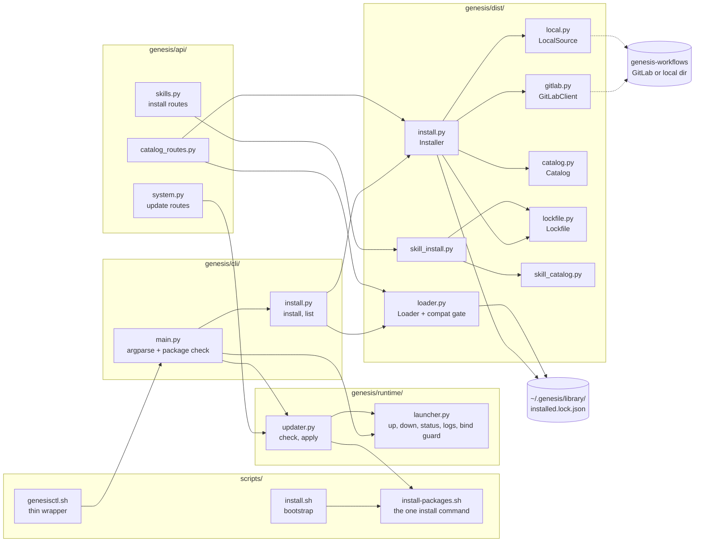
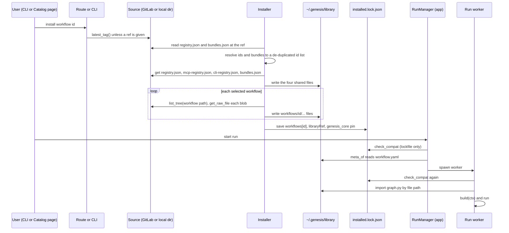
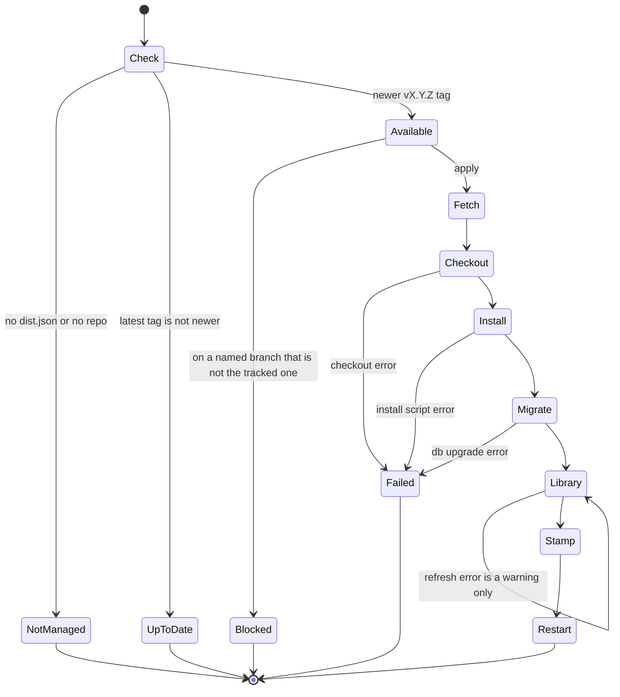

# Module: distribution (`genesis/dist/`, `genesis/cli/`, `genesis/runtime/{launcher,updater}.py`, `scripts/`)

> **Describes:** genesis v0.81.0 (Phase 51) · **Last reviewed:** 2026-11-11 · C4 level 3 · area `distribution`

## 1. Purpose

This module gets Genesis onto a machine, keeps it current, and gets workflows from the shared library into the
place where the run worker loads them. It has two halves.

The first half ships the **platform**. A user clones one repo (`genesis`), runs one install command, starts the
app with `genesis up`, and later updates it in place by git release tag. The repo holds the app and the three
libraries (`genesis-core`, `kiro-agent-sdk`, `genesis-appian-parser`), and they share one version (ADR-046,
ADR-080).

The second half ships the **workflows and skills**. They live in a separate repo, `genesis-workflows`. The user
installs the ones they want. Genesis copies each one into `~/.genesis/library/` and records it in a lockfile. The
run worker later loads the workflow from that copy. A compatibility gate refuses to load a library built for
another `genesis-core` major version (ADR-006, ADR-019).

The central promise: **what runs is exactly what was installed, from a known ref, and a library built for a
different core major never loads.**

The module does not run workflows (see [runs-and-workers.md](runs-and-workers.md)), does not author them (see
[workflow-library.md](workflow-library.md)), and does not manage settings or secrets (see
[configuration-and-secrets.md](configuration-and-secrets.md)). The multi-instance tool `genesis-fleet` (`gsm`) is
not part of the product: it is a separate stdlib-only developer tool that drives the installed `genesis`
executable, and nothing in this module depends on it.

## 2. At a glance

| Item | Value |
|---|---|
| Code | `genesis/dist/` (library install and loader), `genesis/cli/{main,install}.py` (the `genesis` command), `genesis/runtime/launcher.py`, `genesis/runtime/updater.py`, `genesis/api/catalog_routes.py`, the update routes in `genesis/api/system.py`, `scripts/{install,install-packages,genesisctl}.sh`, root `pyproject.toml` |
| Runs in | The CLI process (`genesis ...`), the app process (routes, updater check and apply), and the run worker (the loader imports `graph.py` there) |
| Depends on | `requests` (GitLab client, imported lazily); `git` and `bash` (updater, scripts); `pip`; `genesis_core.types` (`CORE_MAJOR`, `CompatError`); `genesis/skills/store.py` (skill writes); `genesis/runtime/settings.py` (paths); the SecretProvider for `GITLAB_TOKEN` |
| Used by | `genesis/runs/manager.py` and `genesis/runs/worker.py` (loader and gate); `genesis/api/app.py` (wiring); `genesis/api/skills.py` (skill install routes); the web Catalog and System pages; the `genesis-fleet` tool (through the CLI only) |
| Stores | `~/.genesis/library/`, `~/.genesis/installed.lock.json`, `~/.genesis/.kiro/skills/`, `~/.genesis/dist.json`, `~/.genesis/deployed_version`, `~/.genesis/run/genesis.pid` and `genesis.log` |
| Key ids | `CORE_MAJOR` (compatibility key, currently 1), the shared repo version (the tag, `vX.Y.Z`), lockfile `version` 1 |
| Binding decisions | ADR-006, ADR-007, ADR-019, ADR-046, ADR-080 |

## 3. Concepts

| Term | Meaning |
|---|---|
| **Library** | The `genesis-workflows` repo, and its installed copy under `~/.genesis/library/`. The repo is read from GitLab (or from a local checkout). It is not part of the `genesis` clone. |
| **Catalog** | The user-facing list of installable workflows, read from `registry.json` (and `bundles.json`) of the library at one ref. `Catalog` in `genesis/dist/catalog.py`. |
| **Registry file** | `registry.json` at the library root. It lists workflows (`id`, `name`, `version`, `roles`, `summary`, `path`, `required_mcp`, `required_cli`) and the library's `genesis_core_major` and `genesis_core_version`. |
| **Bundle** | A named list of workflow ids in `bundles.json` (for example `developer`). A bundle only expands to ids when resolving a selection. Roles and bundles are filters and shortcuts, never a gate (ADR-007). |
| **Prerequisites** | The MCP servers and CLIs a workflow declares in `required_mcp` and `required_cli`. The catalog reports them; it does not block an install. |
| **Ref** | The git ref (tag or branch) a library is read at. The default is the latest tag, else `main`. A local checkout always uses the ref `local`. |
| **Source** | An object with `latest_tag`, `list_tree`, `get_raw_file` and `get_file_text`. There are two: `GitLabClient` (network) and `LocalSource` (a directory). The installer uses either. |
| **Lockfile** | `~/.genesis/installed.lock.json`. It records the library ref, each installed workflow and skill with its version, ref and files, and the library's core major. `Lockfile` in `lockfile.py`. |
| **Core pin** | The lockfile's `genesis_core` entry (`version`, `major`, `ref`). Its `major` is the compatibility key. |
| **Compat gate** | `Loader.check_compat`: refuse to load when the lockfile's core major differs from `CORE_MAJOR` (ADR-019). |
| **Loader** | `Loader`: reads workflow metadata from `workflow.yaml` (safe in the app process) and imports `graph.py` by file path (only in the worker). |
| **Managed install / dev checkout** | A managed install is a clone set up by `scripts/install.sh`, marked by `~/.genesis/dist.json`. A developer's editable checkout has no `dist.json`, and the updater refuses to act on it. |
| **Tracked branch** | The branch the updater expects the clone to be on (default `master`). A detached HEAD at a release tag is allowed. |
| **Scope** | The updater's answer to "what changed between the deployed tag and the new tag": `deps` (packages must be reinstalled) or `code`. |
| **Shared version** | One version string for the app and the three libraries. It equals the git tag (ADR-080). It is not the compatibility key. |
| **Launcher** | `genesis up/down/status/logs`: the one place that starts, stops and watches the background server (L-052). |
| **Bind guard** | The refusal to serve on a non-loopback host unless the operator opts in (ADR-026). |

## 4. Structure



The install scripts call `install-packages.sh`. The `genesis` command (`main.py`) dispatches to the install
helpers, the launcher and the updater. The installer reads a source (GitLab or a local directory), uses the
catalog to resolve ids, writes files under the library folder, and records them in the lockfile. The loader reads
the same folder and lockfile. The API routes use the installer, the skill installer and the updater. The updater
reruns `install-packages.sh` of the new tag and then uses the launcher's commands to restart.

| File | Main classes and functions |
|---|---|
| `genesis/dist/gitlab.py` | `GitLabConfig` (`base_url`, `project`, `token`), `GitLabClient`: `list_tree` (paged, 100 per page), `get_raw_file`, `get_file_text`, `list_tags`, `latest_tag` |
| `genesis/dist/local.py` | `LocalSource`: the same read surface over a directory; `latest_tag()` returns `"local"`; skips `__pycache__` |
| `genesis/dist/catalog.py` | `CatalogEntry`, `Catalog`: `from_json`, `from_client` (bundles optional), `by_role`, `expand_bundle`, `resolve_selection`, `prerequisites` |
| `genesis/dist/install.py` | `SHARED_FILES`, `InstallPlan`, `Installer`: `resolve`, `install`, `install_selection`, `update_all`, `remove` |
| `genesis/dist/lockfile.py` | `Lockfile` (`load`, `save`, `is_installed`, `updatable`), `InstalledWorkflow`, `InstalledSkill`, `GenesisCorePin` |
| `genesis/dist/loader.py` | `Loader`: `check_compat`, `workflow_dir`, `meta_of`, `graph_of`, `installed`, `load_build`; `InstalledWorkflowInfo` |
| `genesis/dist/skill_catalog.py` | `SKILLS_REGISTRY = "skills-registry.json"`, `SkillCatalogEntry`, `SkillCatalog` |
| `genesis/dist/skill_install.py` | `SkillInstaller`: `catalog`, `install_selection`, `update`, `remove` |
| `genesis/cli/main.py` | `missing_packages`, `main` (every subcommand) |
| `genesis/cli/install.py` | `install`, `list_installed`, `_source`, `DEFAULT_BASE_URL`, `DEFAULT_PROJECT` |
| `genesis/runtime/launcher.py` | `up`, `down`, `status`, `logs`, `bind_guard_error`, `bind_warning`, `is_loopback`, `allow_non_loopback_env` |
| `genesis/runtime/updater.py` | `check`, `apply`, `UpdateStatus`, dist-config helpers, `highest_tag`, `_scope`, `is_managed_install` |
| `genesis/api/catalog_routes.py` | `register_catalog_routes`, `_visible_mcp`, `_INTERNAL_MCP` |
| `genesis/api/system.py` | `register_system_routes` (the `/system/update` routes belong here; the Kiro and preflight routes in the same file belong to other modules) |
| `scripts/install.sh` | The seven-step bootstrap |
| `scripts/install-packages.sh` | The one `pip install` over the four local paths |
| `scripts/genesisctl.sh` | `start/stop/restart/status/logs/open`, delegating to `genesis` |
| `pyproject.toml` | Package metadata, shared version, `genesis` console script, SPA force-include |

## 5. How it works

### 5.1 Installing the platform

The user runs `scripts/install.sh` from a clone, or from nowhere (it then clones). The script is safe to run
again. It has seven steps:

1. Check for Python 3.13 and `git` (both required) and `kiro-cli` (only a warning if absent).
2. Check that the user's SSH key can read the `genesis` repo on GitLab (`git ls-remote`). It stops with a clear
   message if not.
3. Find the clone: the repo that contains the script, else `~/genesis` (or `GENESIS_CLONE_DIR` or `--dir`), else
   clone `genesis` at the branch (`--branch`, default `master`).
4. Create `.venv` in the clone with Python 3.13 if it does not exist.
5. Run `scripts/install-packages.sh --python .venv/bin/python`.
6. Run `genesis db upgrade` (skipped with `--no-migrate`).
7. Create `~/.genesis/run` and write `~/.genesis/dist.json` with `repo_dir`, `branch` and `remote` (`origin`).

The SPA ships prebuilt in `web/static`, so the install needs no Node or npm.

### 5.2 The one install command

`scripts/install-packages.sh` is the only file that lists the four local paths. `install.sh`, the updater, the
developer setup and every CI job call it. It issues exactly one `python -m pip install` over, in this order:

```
./packages/kiro-agent-sdk  ./packages/genesis-core  ./packages/genesis-appian-parser  .
```

| Flag | Effect |
|---|---|
| `--editable` | Each path is installed with `-e`. |
| `--dev` | Each path takes its own `[dev]` extra (`./packages/<name>[dev]` and `.[dev]`), so a library's test tools do not depend on the app's extra. |
| `--python PATH` | The interpreter that receives the packages. Default `<repo>/.venv/bin/python`. A relative path is made absolute before the script changes directory. |

The developer setup is `scripts/install-packages.sh --editable --dev`. Nothing is read from a package index for an
internal name. This is deliberate: no `pyproject.toml` lists another internal package as a dependency (ADR-080),
because the names `genesis` and `genesis-core` belong to unrelated projects on public PyPI. The cost is that pip
cannot see a missing library, which is why the CLI checks (section 5.7).

### 5.3 From the GitLab catalog to the loader

This is the full path of a workflow from the library repo to a running graph.



The user picks a workflow in the Catalog page or runs `genesis install`. The installer reads the registry at the
ref, resolves the selection, copies the four shared files and the workflow's folder into the library folder, and
writes the lockfile. When a run starts, the app checks the gate and reads `workflow.yaml`. The worker checks the
gate again and imports `graph.py`.

Step by step:

1. **Choose a source.** The CLI builds a `GitLabClient` from the stored `GITLAB_TOKEN` (default base
   `https://gitlab.appian-stratus.com`, project `ramaswamy.u/genesis-workflows`), or a `LocalSource` when
   `--from <dir>` is given. The API does the same through `source_factory`; the default factory answers 400 when
   no token is stored. Tests inject a factory that returns a `LocalSource`.
2. **Pick a ref.** `Installer.resolve` uses the given ref, else `client.latest_tag()`, else `"main"`.
3. **Read the catalog.** `Catalog.from_client` reads `registry.json` at the ref. It reads `bundles.json` too and
   treats a failure to read it as "no bundles".
4. **Resolve the selection.** `resolve_selection` expands bundles first, then adds explicit ids, and removes
   duplicates while keeping order. An id that is not in the catalog raises `KeyError`. Ids from different roles
   can be mixed (ADR-007).
5. **Write the shared files.** `registry.json`, `mcp-registry.json`, `cli-registry.json` and `bundles.json` are
   written at the library root. A failure on `bundles.json` is ignored; a failure on any other raises.
6. **Write each workflow.** For each id the installer lists the tree under the entry's `path` (for example
   `workflows/hello-appian`), writes every blob to the same relative path under the library folder, and keeps
   the list of files it wrote.
7. **Write the lockfile.** Each workflow gets an `InstalledWorkflow` (`version` from the registry entry, `ref`,
   `files`). `libraryRef` is set to this ref. The `genesis_core` pin is set from the registry's
   `genesis_core_major` and `genesis_core_version`. If the registry has no `genesis_core_major`, the installer
   records the platform's own `CORE_MAJOR`, so the gate then passes.
8. **Use it.** `Loader.installed()` lists lockfile entries whose `workflow.yaml` exists. The merged MCP and CLI
   registries are read from `library/mcp-registry.json` and `cli-registry.json` by the worker
   (`genesis/runs/worker.py`) and the config service. The workflow itself is loaded as in 5.4.

The library folder looks like this after an install of one workflow:

```
~/.genesis/library/
  registry.json  mcp-registry.json  cli-registry.json  bundles.json
  workflows/<id>/workflow.yaml  graph.py  ...
```

A newly released workflow is not available until it is installed (L-033). A running `genesis serve` picks up a
new workflow at the next run start with no restart, because the loader reads the folder each time. Only a change
to server code needs a restart. The "workflow not installed" answer is handled in several API modules
(`api/features.py`, `api/workbench.py`, `api/applications.py`, `api/documents.py`) so the user sees a message
instead of a bare 500.

**Prerequisites.** The catalog entry carries `required_mcp` and `required_cli`. `GET /api/catalog` and
`GET /api/catalog/available` return them, with the platform-injected MCP servers removed (`_INTERNAL_MCP`:
`genesis-kb`, `genesis-memory`, `genesis-introspection`, `genesis-control`, `appian-dev`, `appian-devops`,
`appian-dev-write`, `appian-dev-packages`). Without that filter these managed servers would show as missing
prerequisites and disable Launch. The web app compares the lists with the user's configuration. A
`Catalog.prerequisites` method also exists, but no production code calls it (only `tests/test_dist.py`). An
install never checks prerequisites.

**Bundles and roles.** `bundles.json` exists in the library and `resolve_selection` accepts bundle names, but
no CLI flag or API route passes a bundle (`genesis install` takes ids, or installs everything). The Catalog page
filters by role in the browser; `Catalog.by_role` is not used by any route.

### 5.4 The loader and the compat gate

The gate is `Loader.check_compat`:

1. Load the lockfile. If it has no `genesis_core` pin (nothing installed yet), return without checking.
2. Compare `lock.genesis_core.major` with `CORE_MAJOR` from `genesis_core.types`.
3. If they differ, raise `CompatError` with a message that names both majors. The message says to upgrade the
   platform or install a library ref built for the platform's major.

The gate is read-only and checks the lockfile, not the files. It runs in three places:

- `RunManager._meta` calls it on every run start, before reading `workflow.yaml` (`genesis/runs/manager.py`).
- `Loader.load_build` calls it first (`genesis/runs/worker.py` and `genesis/api/studio.py` use `load_build`).
- `Loader.installed()` and `meta_of` do not call it.

`load_build(wid)` then loads the graph:

1. `importlib.util.spec_from_file_location("_installed_<wid>", <library>/workflows/<wid>/graph.py)`, and run the
   module. No package import is involved, so `graph.py` must be self-contained.
2. Read the module's `META` and `build`.
3. Raise `ValueError` if `META["id"]` is not the folder name.
4. Return `(build, META)`.

The app process never calls `load_build` for a run; only the worker does (ADR-012). `meta_of` reads
`workflow.yaml` with `yaml.safe_load`, which has no side effects. `graph_of` returns the `graph:` section of that
file, or builds a straight chain from `steps` when there is no `graph:` section (used by the Run Detail view).

The compat key is the **major** only. The lockfile also stores `genesis_core.version`, but nothing compares it.
The pip version of the packages is not the key (ADR-019 as amended by ADR-080): the shared version moves with
every release, while `CORE_MAJOR` changes only on a breaking change.

One consequence of how the lockfile is written: each install overwrites `libraryRef` and the core pin with the
values from the registry it just read. Workflows installed earlier keep their own `ref` entries, but the gate
only knows the most recent registry's major.

### 5.5 Installing, updating and removing workflows and skills

| Action | Route | What it does |
|---|---|---|
| Install | `POST /api/library/install` `{id, ref?}` | `Installer.install_selection(ids=[id], ref=ref)`; 404 if the id is not in the library; 502 for other failures |
| Update | `POST /api/library/update` `{id}` | Same call with `ref=None`, so it uses the latest tag |
| Remove | `DELETE /api/library/{workflow_id}` | `Installer.remove`: delete the files listed in the lockfile entry, drop the entry, keep shared files. Needs no source or token. |

`Installer.update_all` exists and reinstalls every locked id at a ref, but no route or CLI command calls it.

**Skills** follow the same pattern with a separate registry file and a different target:

1. `SkillCatalog.from_client` reads `skills-registry.json` at the ref. It is a different file from
   `registry.json` so the two concepts stay apart (ADR-034).
2. `SkillInstaller.install_selection` fetches every blob under the skill's `path`, keyed relative to the skill
   folder, and requires a `SKILL.md`.
3. It writes through `SkillStore.create(..., source=SOURCE_LIBRARY, replace=True)` into
   `settings.skills_dir` (`~/.genesis/.kiro/skills/<id>/`). The store validates the skill, so a pulled skill is
   checked like an authored one.
4. It records an `InstalledSkill` in `lockfile.skills`.

The skill routes are `GET /api/skills/available`, `POST /api/skills/install`, `POST /api/skills/update` and
`DELETE /api/skills/{skill_id}` in `genesis/api/skills.py`. The delete route removes the lockfile entry as well.
After an install or update, the route reloads open chat clients so they see the change. The chat and skills
module ([chat-and-skills.md](chat-and-skills.md)) describes the store and what happens inside chat.

### 5.6 Launching: `up`, `down`, `status`, `logs`

`genesis/runtime/launcher.py` is the only place that controls the background server (L-052). The CLI commands and
`scripts/genesisctl.sh` both call it; the script only maps `start/stop/restart/status/logs/open` onto the CLI.

Files live in `~/.genesis/run/`: `genesis.pid` and `genesis.log`.

**`up`** (idempotent):

1. If the PID file names a live process, print the URL, optionally open the browser, and return 0.
2. Otherwise start `<venv>/bin/genesis serve --host H --port P` with `subprocess.Popen`: no shell, output
   appended to `genesis.log`, `start_new_session=True` so it survives the terminal.
3. Write the PID.
4. Poll once a second for up to 30 seconds. If the process exits, print the last 20 log lines, delete the PID
   file and return 1. If `GET /api/config/health` returns 2xx, print the URL, open the browser (unless
   `--no-open`) and return 0.
5. After 30 seconds without health, print a message pointing to the log and return 1. The process keeps
   running.

For health checks and the browser, the host `0.0.0.0`, `::` or an empty string is mapped to `127.0.0.1`.

**`down`**: if the PID is not alive, remove the PID file and say "not running" (exit 0). Otherwise send SIGTERM,
wait up to 10 seconds, then send SIGKILL. The PID file is removed in every case.

**`status`**: prints one line: stopped, running and healthy, or running with failing health. It always returns 0.

**`logs`**: prints the last 50 lines, or runs `tail -n 50 -f` with `-f`.

**`serve`** (what `up` starts, also usable in the foreground) does three extra things in `cli/main.py`:

- It applies the bind guard (5.8).
- It sets `GENESIS_API_BASE` (default only if unset) to the loopback URL so the in-process copilot chat can call
  back into `/api`.
- It starts the **reports origin** on a second port (`--reports-port`, else `GENESIS_REPORTS_PORT`, else the app
  port + 100) before the app and stops it when the app stops. It sets `GENESIS_REPORTS_URL`. If the port cannot
  be opened, `serve` prints a message and exits 2. The reports origin is described in
  [testing.md](testing.md) (ADR-085).

### 5.7 The missing-package check

Because no `pyproject.toml` names another internal package, `pip install .` alone installs the app without the
libraries, and `pip check` still reports success. The console script would then fail three imports deep.

`main()` in `cli/main.py` therefore calls `missing_packages()` first. It uses `importlib.util.find_spec` for
`genesis_core`, `kiro_agent_sdk` and `genesis_appian_parser`. If any is missing, it prints one line that names the
`packages/` folders and `scripts/install-packages.sh`, and returns 1 (L-098). Every `genesis.*` import in the
module is inside `main()`, after this check, so the check runs before any import that reaches a library.

A second guard is a test: `tests/test_platform_packages.py` reads each library's PEP 610 `direct_url.json` and
requires that it was installed from this repo's `packages/<name>` folder. It exists because a dev venv kept
editable installs of the old sibling repos and imported them without any error.

### 5.8 The bind guard

Genesis ships without authentication (ADR-026). `bind_guard_error(host, allow=...)` returns an error text for any
host other than `127.0.0.1`, `::1`, `localhost` or the empty string, unless the operator gave
`--i-understand-no-auth` or set `GENESIS_ALLOW_NON_LOOPBACK` to `1`, `true` or `yes`. When an override is used,
`bind_warning` returns a warning that `serve` logs. Both `up` and `serve` run the guard and exit 2 on refusal. The
reports origin binds the same host, so the same refusal covers it.

### 5.9 Updating in place by release tag



The check never changes anything. The apply steps run in order; each failure before the restart stops the update
and leaves the clone at the tag it reached. The refresh of the workflow library is the one step whose failure only
warns.

**Check** (`updater.check`, also `genesis update --check-only` and `GET /api/system/update`):

1. Read the deployed version: `~/.genesis/deployed_version` if it holds text, else the installed `genesis`
   package version, else `0.0.0`.
2. Find the clone: `repo_dir` from `dist.json` if it has a `.git`, else walk up from the package to a folder with
   `.git` and `pyproject.toml`.
3. If there is no clone or no `dist.json`, return `managed=False` and never advertise an update. A dev checkout
   would otherwise get its editable installs overwritten.
4. Run `git fetch --quiet --tags <remote>` (remote from `dist.json`, default `origin`).
5. List tags, keep only `vMAJOR.MINOR.PATCH` names, take the highest by number. Other tags are ignored.
6. `update_available` is true when that tag is higher than the deployed version.
7. `on_tracked_branch` is false only when HEAD is on a named branch that differs from the tracked branch
   (default `master`). A detached HEAD, the normal state after an update, is fine.
8. `scope` is `deps` when `git diff --name-only <deployed>..<latest>` touches the root `pyproject.toml`,
   `scripts/install-packages.sh` or anything under `packages/`, else `code`. If the diff fails (for example the
   deployed tag does not exist locally), it answers `deps`.

**Apply** (`updater.apply`, a generator of progress lines; `genesis update` prints them; `POST /api/system/update`
streams them as `text/plain`):

1. Refuse with an error line if there is no clone, no `dist.json`, or the branch is blocked.
2. Fetch tags again. If nothing newer exists, say "Already up to date."
3. `git checkout --quiet <latest>`. The clone is now detached at the tag.
4. Run `bash <repo>/scripts/install-packages.sh --python <current interpreter>`. This is the script of the **new**
   tag, because the checkout already happened, so it lists that version's packages. The install is not editable.
5. Run `<venv>/bin/genesis db upgrade`.
6. Run `<venv>/bin/genesis install` to refresh the workflow library from GitLab. A failure only yields a warning.
7. Write the new version to `~/.genesis/deployed_version`.
8. Start a detached `bash -c "sleep 1; genesis down; genesis up --no-open --host H --port P"` in a new session so
   it outlives the request-serving process. The web page polls `/api/config/health` and reloads.

Apply always reinstalls the packages, whatever the `scope` says. `scope` is reported to the caller (the CLI
prints it for `--check-only`), not used to skip steps. Step 6 runs `genesis install` with no ids, which installs
**every** workflow in the library catalog at the latest tag, not only the ones the user had installed.

### 5.10 The shared version

All of these state the same version, and `tests/test_version_sync.py` checks it:

| Source | Where |
|---|---|
| App | `pyproject.toml` `[project].version` (the reference value) |
| Libraries | `packages/genesis-core/pyproject.toml`, `packages/kiro-agent-sdk/pyproject.toml`, `packages/genesis-appian-parser/pyproject.toml` |
| Parser module | `__version__` in `packages/genesis-appian-parser/genesis_appian_parser/__init__.py` |
| API | `FastAPI(title="Genesis", version="…")` in `genesis/api/app.py` |
| SPA | `GENESIS_VERSION` in `web/src/version.ts` |

The test reads these seven values as text (it imports nothing), so it checks the checkout and not whatever is
installed. It asserts that exactly seven values were found and that each equals the app's version. Other tests in
the file change one value in a copy and confirm that exactly that source is reported, and that a source with no
version is reported as `None`.

The version is not a compatibility key. `CORE_MAJOR` (in `genesis-core`) gates workflow libraries, and the
parser's `KB_FORMAT_VERSION` gates a full knowledge-base re-sync (L-099: move behaviour that depended on a version
string to its own constant before unifying versions).

### 5.11 Packaging the SPA

The SPA is built into `web/static` (committed) at the repo root, outside the Python package. A wheel contains
only the `genesis` package, so `pyproject.toml` force-includes `web/static` as `genesis/web_static`
(`[tool.hatch.build.targets.wheel.force-include]`). At start-up `_resolve_web_static()` in `genesis/api/app.py`
checks `genesis/web_static` first (installed wheel), then `<repo>/web/static` (editable tree), and uses the first
one that contains `index.html`. If neither does, the app runs API-only. Without the force-include, `/` returned
404 on a real install while `/api` worked (L-048). `index.html` is served with `Cache-Control: no-cache,
must-revalidate`, so a reload always finds the newest hashed bundle (L-068).

## 6. Interfaces

### 6.1 HTTP endpoints (all under `/api`)

| Method and path | Purpose |
|---|---|
| `GET /catalog` | Installed workflows: `id`, `version`, `name`, `roles`, `summary`, `required_mcp` (internal servers removed), `required_cli` |
| `GET /catalog/available` | Library workflows not yet installed, at the latest tag, with `ref`. 400 without a GitLab token; 502 if the library cannot be read |
| `POST /library/install` | Install one workflow (`{id, ref?}`) |
| `POST /library/update` | Reinstall one workflow at the latest tag (`{id}`) |
| `DELETE /library/{workflow_id}` | Remove one workflow's files and lockfile entry |
| `GET /workflows/{workflow_id}` | The workflow's `workflow.yaml` as JSON (404 if not installed) |
| `GET /workflows/{workflow_id}/graph` | The topology for the run graph (404 if not installed) |
| `GET /system/update` | `UpdateStatus` as JSON: `current`, `latest`, `update_available`, `on_tracked_branch`, `scope`, `repo_available`, `managed` |
| `POST /system/update?host=&port=` | Apply the update; streams progress lines |
| `GET /skills/available`, `POST /skills/install`, `POST /skills/update` | Library skills (the skill routes in `api/skills.py`) |
| `GET /home` | The home overview, registered in the same file but built by `genesis/api/home.py`; not part of this module's logic |

### 6.2 Python API used by other modules

| Call | Used by |
|---|---|
| `Loader(library_dir, lockfile_path)` with `check_compat`, `meta_of`, `graph_of`, `installed`, `load_build` | `RunManager`, the worker, `api/app.py`, `api/studio.py`, `mcp/introspection_server.py`, `cli/install.py` |
| `Installer`, `Catalog`, `GitLabClient`, `LocalSource`, `Lockfile` | `cli/install.py`, `api/catalog_routes.py`, `api/skills.py` |
| `SkillInstaller`, `SkillCatalog` | `api/skills.py` |
| `launcher.bind_guard_error`, `bind_warning` | `cli/main.py` (`serve`, `up`) |
| `updater.check`, `updater.apply` | `cli/main.py`, `api/system.py` |
| `Settings.library_dir`, `.lockfile_path`, `.skills_dir`, `.state_dir` | all of the above |

### 6.3 The `genesis` command

Defined in `genesis/cli/main.py`; the console script is `genesis = "genesis.cli.main:main"`.

| Subcommand | Arguments | What it does |
|---|---|---|
| `create-workflow` | `workflow_id`, `--name` (required), `--dest`, `--roles`, `--summary`, `--mcp` | Scaffold a workflow package with the reliability trio wired (see [workflow-library.md](workflow-library.md)) |
| `test-workflow` | `path` | Contract lint, reliability lint and the workflow's tests |
| `serve` | `--host`, `--port` (8760), `--i-understand-no-auth`, `--reports-port` | Run the app in the foreground, plus the reports origin |
| `up` | `--host`, `--port`, `--no-open`, `--i-understand-no-auth` | Start in the background, wait for health, open the browser |
| `down` | none | Stop the background server |
| `status` | `--host`, `--port` | Show whether it runs and is healthy |
| `logs` | `-f/--follow` | Show or follow the server log |
| `update` | `--check-only`, `--host`, `--port` | Show the version delta; without `--check-only`, apply. Exits 1 with no clone, or on a non-tracked branch |
| `install` | `ids...`, `--from DIR`, `--ref`, `--project`, `--base-url` | Install workflows (all of the catalog when no ids). Needs `GITLAB_TOKEN` unless `--from` |
| `list` | none | Print installed workflows: id, version, name |
| `db upgrade`, `db status` | none | Apply or show migrations for `genesis.db` and `memory.db` (see [data-and-migrations.md](data-and-migrations.md)) |
| `mcp install-native`, `status`, `rollback-native` | `server_id` (`appian-dev` or `appian-devops`), `--bundle` | Managed-native MCP servers (see [configuration-and-secrets.md](configuration-and-secrets.md)) |
| `cli install-native`, `status`, `rollback-native` | `cli_id` (`gws`), `--binary` | Managed-native CLIs (same document) |

`scripts/genesisctl.sh` maps `start` and `open` to `up`, `stop` to `down`, `restart` to `down` then `up`, `status`
to `status` and `logs` to `logs -f`. It uses `$GENESIS_BIN` or `<repo>/.venv/bin/genesis`.

## 7. Data

### 7.1 Files on disk

| Path | Owner / writer | Reader | Meaning |
|---|---|---|---|
| `~/.genesis/library/` | `Installer` | `Loader`, worker, config service | Installed copy of the shared files and `workflows/<id>/` |
| `~/.genesis/installed.lock.json` | `Installer`, `SkillInstaller`, `DELETE /skills/{id}` | `Loader`, `Installer`, routes | The lockfile (below) |
| `~/.genesis/.kiro/skills/<id>/` | `SkillInstaller` through `SkillStore` | chat, workflow skill provisioning | Installed library skills |
| `~/.genesis/dist.json` | `scripts/install.sh` | `updater` | `repo_dir`, `branch`, `remote`. Its presence marks a managed install |
| `~/.genesis/deployed_version` | `updater.apply` | `updater.deployed_version` | Last applied version |
| `~/.genesis/run/genesis.pid`, `genesis.log` | `launcher` | `launcher` | PID and appended server log |

`~/.genesis` is `Settings.state_dir`: `GENESIS_STATE_DIR` or the home folder's `.genesis`. The `run/` folder also
holds the run-owner lock written by the runs module ([runs-and-workers.md](runs-and-workers.md)).

The module owns no database tables.

### 7.2 Lockfile shape

`Lockfile.save` writes this JSON (indented). `load` accepts a file without `skills`, so lockfiles from before skills
existed still load. The file is written with `Path.write_text`, not with the atomic JSON helper that `dist.json` uses.

```json
{
  "version": 1,
  "libraryRef": "v0.25.0",
  "installedAt": "2026-11-08T10:00:00+00:00",
  "workflows": {
    "hello-appian": {
      "version": "0.1.0",
      "ref": "v0.25.0",
      "files": ["workflows/hello-appian/workflow.yaml", "workflows/hello-appian/graph.py"],
      "installedAt": "2026-11-08T10:00:00+00:00"
    }
  },
  "skills": {
    "<skill-id>": { "version": "…", "ref": "v0.25.0", "files": ["SKILL.md"], "installedAt": "…" }
  },
  "genesis_core": { "version": "0.81.0", "major": 1, "ref": "v0.25.0" }
}
```

(The values are examples. `Lockfile.updatable(catalog_versions)` returns the ids whose catalog version differs
from the locked one.)

### 7.3 The library repo contract this module reads

| File | Read by | Fields used |
|---|---|---|
| `registry.json` | `Catalog`, `Installer` | `workflows[]` (see section 3), `genesis_core_major`, `genesis_core_version` |
| `bundles.json` | `Catalog` | `bundles{name: {title, workflows[]}}` (optional) |
| `skills-registry.json` | `SkillCatalog` | `skills[]`: `id`, `path`, and optional `name`, `version`, `description`, `summary`, `roles`, `tags` |
| `mcp-registry.json`, `cli-registry.json` | copied by `Installer`; read by the worker and config service | the curated MCP and CLI tiers |

## 8. Failure handling

| Situation | Behaviour |
|---|---|
| No `GITLAB_TOKEN` and no `--from` | CLI: exit with a message that suggests `--from <dir>`. API: 400 "GitLab token not set…" |
| Library unreadable (network, parse) | `GET /catalog/available` and skills `available`: 502 with the cause. Install and update routes: 502 "install failed" / "update failed" |
| Workflow id not in the catalog | `KeyError` from `resolve_selection`; routes answer 404 |
| `bundles.json` missing at the ref | Treated as no bundles; install continues |
| Another shared file missing | The install raises and the lockfile is not saved. Files already written stay on disk |
| Library core major differs from `CORE_MAJOR` | `CompatError` at run start (`RunManager._meta`) and at `load_build`; the run does not start |
| `registry.json` lacks `genesis_core_major` | The installer records the platform's `CORE_MAJOR`; the gate passes |
| `META.id` differs from the folder name | `load_build` raises `ValueError` |
| Removing a workflow whose lockfile entry is missing | `remove` does nothing and returns the lockfile; shared files are kept |
| An internal library is not importable | CLI prints the missing `packages/` folders and exits 1 |
| `up`: process exits during start | Print the last 20 log lines, delete the PID file, exit 1 |
| `up`: health not passing after 30 seconds | Message pointing to the log, exit 1; the process keeps running |
| `up` while already running | Print the URL (optionally open the browser), exit 0 |
| `down` when not running | "not running", exit 0, stale PID file removed |
| `down`: no exit after SIGTERM and 10 seconds | SIGKILL; "Stopped (forced)" |
| Non-loopback bind without an override | Print the refusal, exit 2 |
| Reports port in use | `serve` prints the error and exits 2 |
| Update check on a dev checkout (no `dist.json`) | `managed=False`, no update offered; `apply` yields an error that explains why |
| Update with HEAD on another named branch | `on_tracked_branch=false`; `genesis update` exits 1 and says `git checkout <branch>`; `apply` yields the same error |
| Scope diff fails | `scope` is `deps` |
| Checkout, install script or `db upgrade` fails during apply | The generator yields an error line (the last 500 characters of output for the latter two) and stops. The clone stays at the new tag; the deployed-version file is not written |
| Library refresh fails during apply | Warning line; the update continues to the restart |
| Tags not fetched / no newer tag | `Already up to date.` |

## 9. Configuration

| Setting | Where | Default and effect |
|---|---|---|
| `GENESIS_STATE_DIR` | env, `Settings.state_dir` | `~/.genesis`. The root of every file in section 7 |
| `GENESIS_ALLOW_NON_LOOPBACK` | env | Unset. `1`, `true` or `yes` lets `serve` and `up` bind a non-loopback host |
| `GENESIS_REPORTS_PORT` | env, `Settings.reports_port` | 0, meaning app port + 100 |
| `GENESIS_API_BASE`, `GENESIS_REPORTS_URL` | set by `serve` | Callback and reports URLs for child processes |
| `GENESIS_GITLAB_BASE` | env of `install.sh` | `git@gitlab.appian-stratus.com:ramaswamy.u` (SSH base for clone and preflight) |
| `GENESIS_CLONE_DIR` | env of `install.sh` | `~/genesis` |
| `GENESIS_BIN` | env of `genesisctl.sh` | `<repo>/.venv/bin/genesis` |
| `GITLAB_TOKEN` | SecretProvider | Needed for library access; read with `resolve("GITLAB_TOKEN")` |
| `--base-url`, `--project` | `genesis install` | `https://gitlab.appian-stratus.com` and `ramaswamy.u/genesis-workflows`. The API uses the same two values from constants in `api/app.py` and cannot override them |
| `dist.json` keys | file | `repo_dir`, `branch` (default `master`), `remote` (default `origin`) |
| `install.sh` flags | CLI | `--dir`, `--branch` (default `master`), `--no-migrate`, `-h` |
| Host and port | `up`, `serve`, `status`, `update` | `127.0.0.1`, `8760` |
| Launcher constants | `launcher.py` | health timeout 2 s, start wait 30 s, SIGTERM wait 10 s, log tail 50 lines |

## 10. Extending this module

**Add a file that the library must carry (a new shared file).** Add its name to `SHARED_FILES` in
`genesis/dist/install.py`. Decide whether a missing file may be ignored (only `bundles.json` is).

**Add a field to the registry entry.** Add it to `CatalogEntry` and `Catalog.from_json` with a default, so older
libraries still parse. Return it from `catalog_routes.py` and update the web type. Keep library changes additive
within a major (ADR-019).

**Add a new installable kind (like skills).** Create a catalog class that reads its own registry file, an
installer that writes into its own target folder, and a new top-level map in `Lockfile` that `load` reads with a
default, so old lockfiles still load. Do not reuse `registry.json`.

**Change the `genesis-core` major.** Change `CORE_MAJOR` in `genesis-core`, release the library with the new
`genesis_core_major` in `registry.json`, and expect every installed library of the old major to be refused until
it is reinstalled. This is a breaking change by design.

**Add a library package under `packages/`.** Add the folder to the `PACKAGES` array of
`scripts/install-packages.sh` (the only list), to `_INTERNAL_PACKAGES` in `cli/main.py`, to `_LIBRARIES` in
`tests/test_platform_packages.py`, and to `PYPROJECTS` in `tests/test_version_sync.py` (and its expected count).
Give the package a `dev` extra, because a test requires each package to declare one. Do not list it as a
dependency in any `pyproject.toml`.

**Bump the version.** Change all seven values in section 5.10 together, or the sync test fails. Commit every
changed file, including the built `web/static` bundle, before tagging (L-056). When a downstream repo pins the
chain, move every pin that must move with the tag (L-057).

**Add a `genesis` subcommand.** Add the parser in `main()` and a handler branch. Keep imports of `genesis.*`
inside `main()` so the package check still runs first. Put process-control logic in `launcher.py`, not in the
command (L-052).

**Change the update steps.** Edit `updater.apply`. Keep the order: checkout, install (of the new tag's script),
migrate, library refresh, version stamp, restart. Update `tests/test_updater.py` (`test_apply_updates_whole_stack`
and the failure test).

## 11. Design decisions

| Decision | In plain words | ADR |
|---|---|---|
| A workflow is a folder package in a catalog | Each workflow is `workflow.yaml` plus `graph.py` in its own folder, listed in `registry.json`. Users install only the ones they want, pinned by ref in a lockfile. | ADR-006 |
| Roles and bundles are not gates | Roles are filter tags and bundles are shortcuts. A user may install workflows from any role. | ADR-007 |
| Refuse an incompatible library | The loader reads the library's `genesis_core` major from the lockfile and refuses to load on a mismatch with `CORE_MAJOR`. Changes inside a major are additive. | ADR-019 |
| Ship as a clone with tag updates | Users clone `genesis`, install into a venv, start with `genesis up`, and update by checking out release tags. No package index, no per-user token for the platform. The tracked branch is `master`. | ADR-046 |
| One repo, one tag, one version | The app and three libraries live in one repo with one shared version. No package lists another as a dependency. One command installs all. | ADR-080 |
| Library code loads only in the worker | The app reads `workflow.yaml`; only the worker imports `graph.py`. | ADR-012 (see [runs-and-workers.md](runs-and-workers.md)) |
| Refuse non-loopback binds | `serve` and `up` stop unless the operator opts in, because Genesis has no auth. | ADR-026 |
| Update only managed installs | No `dist.json` means no update, so an editable dev tree is never overwritten. | ADR-046 (code behaviour) |

The deployed code differs from the text of ADR-046 in one way: the ADR describes `pip install .` with the
internal packages resolved from tag pins. ADR-080 replaced that with `scripts/install-packages.sh`, and the code
follows ADR-080.

## 12. Known pitfalls

- **Install the library before using a new workflow.** A workflow released in `genesis-workflows` does not exist
  locally until `genesis install` (or the Catalog page) copies it (L-033).
- **`pip check` cannot see a missing internal library.** Use the CLI check and the install command, never a bare
  `pip install .` (L-098).
- **A venv built before the monorepo may import old sibling repos.** The PEP 610 test catches it (L-098).
- **The default branch is `master`, not `main`.** The updater default and `install.sh --branch` must say `master`,
  or the clone and the update check fail (L-051).
- **Probe the installed tools, not the docs.** Distribution code that talks to `kiro-cli` or `git` was wrong until
  checked against the real binaries (L-051).
- **Keep process control in one place.** Both the CLI and the shell wrapper call `launcher.py`; do not copy logic
  into the script (L-052). The updater restarts through a detached `down; up` so the serving process can exit
  (L-052).
- **The SPA is outside the package.** Anything not under `genesis/` is missing from the wheel unless it is
  force-included. Test the installed artifact, not only the editable tree. The `clean-install` CI job checks that
  `/` serves the shell (L-048).
- **Serve `index.html` with `no-cache`.** An open tab otherwise keeps an old bundle after an update (L-068).
- **Commit every changed file before tagging.** A forgotten file ships a test without its code and fails CI at
  the tag (L-056).
- **Move the whole pin chain with a tag.** A stale transitive pin in `genesis-workflows` fails only in CI's clean
  install (L-057).
- **Version-keyed behaviour belongs in its own constant.** Unified versions made the parser's minor version move
  every release; the full-resync decision uses `KB_FORMAT_VERSION` instead. In an editable dev venv a version bump
  is live at commit time, not at release (L-099).
- **Prerequisites are not enforced at install time.** The catalog lists them and the web app shows them; the
  installer installs regardless.

## 13. Tests

| File | What it covers (from the file) |
|---|---|
| `tests/test_dist.py` | Catalog filtering and bundles across roles; prerequisites; lockfile round trip and `updatable`; GitLab client tree and raw-file reads against a fake; install writes files and lockfile; loader metadata and the compat gate refusing a changed major; remove keeps shared files; an end-to-end install, load and run |
| `tests/test_skill_install.py` | Skills catalog from `skills-registry.json`; install writes files and the lockfile; the lockfile persists; unknown id raises; remove cleans up and is idempotent; old lockfiles without `skills` load; coexistence with installed workflows |
| `tests/test_launcher.py` | Loopback mapping of wildcard hosts; PID reading and liveness; health false on a refused connection; `status` when stopped or unhealthy; `down` when not running |
| `tests/test_bind_guard.py` | Loopback and non-loopback hosts; guard refuses without an override and allows with the flag or the environment variable; `serve` refuses a non-loopback host |
| `tests/test_updater.py` | Tag selection ignoring non-semver; version parsing; deployed-version and dist-config handling; no repo and dev checkout suppress updates; apply refuses a dev checkout; update available; scope rules (`code` versus `deps`, diff failure); blocked on a feature branch; the system update endpoint; whole-stack apply; apply stops when the install script fails |
| `tests/test_cli_missing_packages.py` | The CLI names every missing library and exits 1; the check runs before any library import; normal behaviour when all are present; the CLI module imports without the libraries |
| `tests/test_platform_packages.py` | Each library is installed from this repo's `packages/<name>` (PEP 610) |
| `tests/test_install_packages_script.py` | The script issues one pip call over the four paths; editable and dev modes; every package declares a dev extra; pip failure exit; relative interpreter path; missing interpreter and unknown flag; help; the installer calls the script |
| `tests/test_version_sync.py` | All seven version sources agree; deliberate mismatches and a missing version are reported |
| `tests/test_web_static_packaging.py` | The SPA path resolves to a folder with `index.html`; the resolver prefers the packaged path, then the dev path |
| `tests/test_phase44.py` | Internal and managed MCP servers are removed from catalog prerequisites (fix 9) |
| `tests/test_workflow_skill_provisioning.py` | The resolver that finds a skill source for workflow nodes (managed workspace first, then the global folder); it uses the skills folder this module fills |

CI also runs a `clean-install` job (`.gitlab-ci.yml`): a non-editable install with the script, `genesis db upgrade`
in a throwaway state dir, `genesis up --no-open`, a check that `/` returns 200 with the SPA shell, `genesis status`,
`genesis down`, `shellcheck scripts/*.sh`, and `bash scripts/install.sh --help`.

Gate commands (from the `distribution` area):

```
cd genesis && .venv/bin/python -m pytest -q -p no:warnings
cd genesis && .venv/bin/ruff check genesis
```

## 14. Code map

| To change… | Look in |
|---|---|
| Which files an install copies | `genesis/dist/install.py` (`SHARED_FILES`, `_fetch_workflow_files`) |
| How ids, bundles and roles resolve | `genesis/dist/catalog.py` |
| How GitLab is read (paging, tags) | `genesis/dist/gitlab.py` |
| Offline installs from a directory | `genesis/dist/local.py` |
| The lockfile shape | `genesis/dist/lockfile.py` |
| The compat gate or the standalone import | `genesis/dist/loader.py` |
| Skill install | `genesis/dist/skill_catalog.py`, `genesis/dist/skill_install.py`, `genesis/api/skills.py` |
| Catalog and library routes | `genesis/api/catalog_routes.py` |
| Update routes | `genesis/api/system.py` |
| Any `genesis` subcommand | `genesis/cli/main.py` |
| `genesis install` and `genesis list` | `genesis/cli/install.py` |
| Start, stop, health wait, PID and log files | `genesis/runtime/launcher.py` |
| The bind guard | `genesis/runtime/launcher.py` (`bind_guard_error`), `genesis/cli/main.py` |
| Update check, scope, apply steps | `genesis/runtime/updater.py` |
| Which packages the install command installs | `scripts/install-packages.sh` |
| First-time bootstrap and `dist.json` | `scripts/install.sh` |
| The shell wrapper | `scripts/genesisctl.sh` |
| Packaging and the SPA force-include | `pyproject.toml`, `genesis/api/app.py` (`_resolve_web_static`) |
| The version check | `tests/test_version_sync.py` and the seven sources in section 5.10 |
| State folder paths (`library`, lockfile, skills) | `genesis/runtime/settings.py` |
