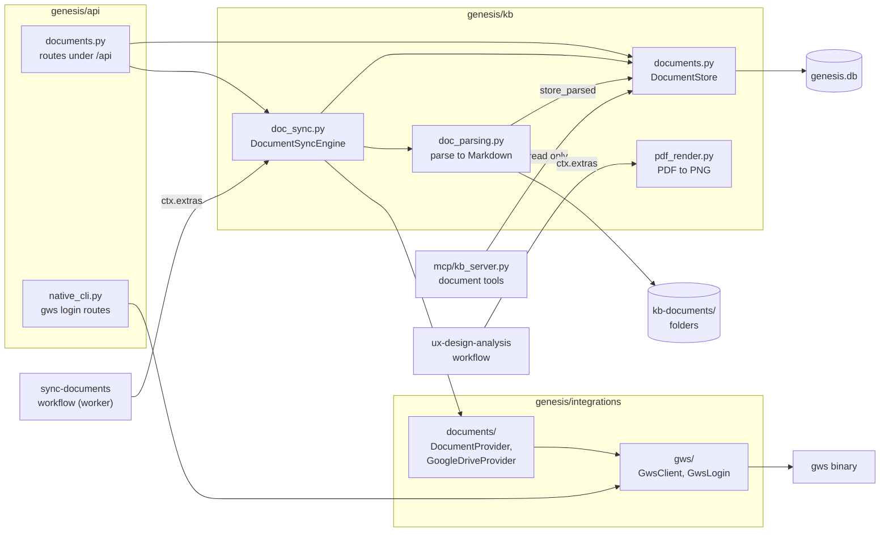
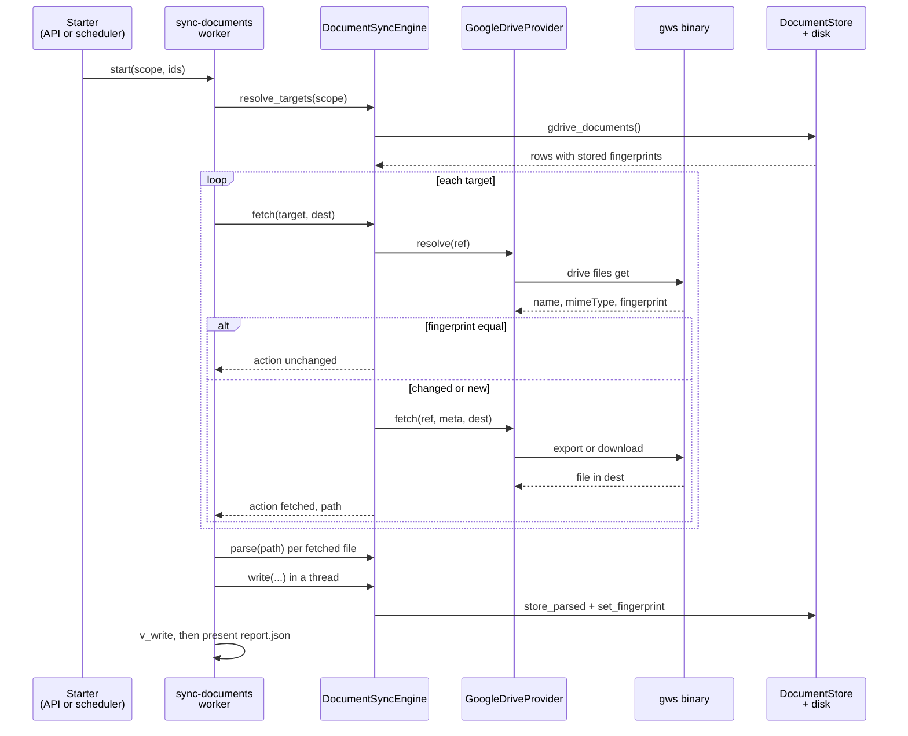
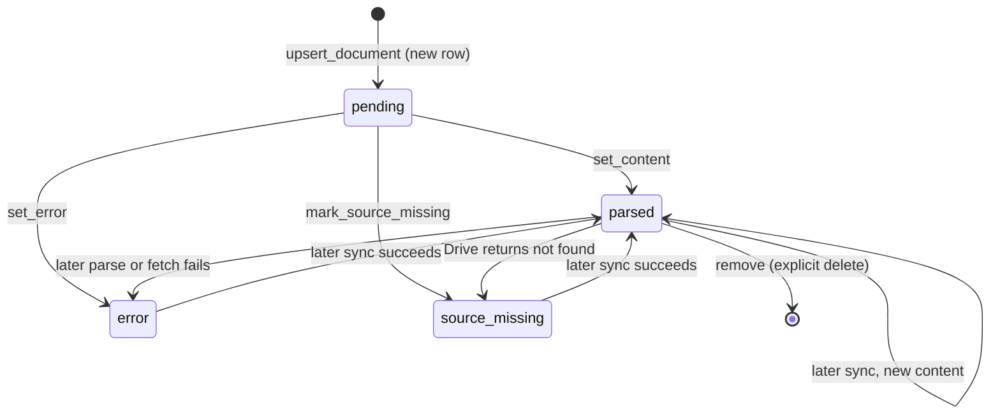

# Module: Documents (`genesis/kb/documents.py`)

> **Describes:** genesis v0.81.0 (Phase 51) · **Last reviewed:** 2026-11-11 · C4 level 3 · area `documents`

## 1. Purpose

The Documents module is the global library of business documents: requirements, meeting notes, specifications,
spreadsheets. A person adds a file (upload) or a Google Drive link. Genesis turns it into clean Markdown (and JSON
tables for spreadsheets), stores that text on disk, and keeps one row per document in `genesis.db`. Agents and the
chat then read the Markdown instead of the original file.

The central promise is in ADR-041: **there is one copy of each document, and applications only link to it.** Two
applications can use the same Drive file without a second copy. Removing an application's link, or untracking the
whole application, never deletes the document. Only an explicit delete of the document removes it.

Three more rules shape the module:

- **Latest version only.** A sync overwrites the stored Markdown. Genesis keeps no history of a document, only a
  small change fingerprint so the next sync can skip an unchanged file.
- **Sources sit behind an interface** (ADR-052). The sync engine asks a `DocumentProvider` to resolve and fetch a
  document. Google Drive is the only provider today.
- **Google access is read-only** (ADR-040). Genesis reaches Drive through the managed `gws` command-line tool, and
  a single client class refuses every call that is not a read.

This document also covers two small neighbours that live in the same files: the PDF-to-PNG renderer used by UX
design, and the `gws` login flow.

## 2. At a glance

| Item | Value |
|---|---|
| Code | `genesis/kb/documents.py`, `genesis/kb/doc_sync.py`, `genesis/kb/doc_parsing.py`, `genesis/kb/pdf_render.py`, `genesis/integrations/documents/`, `genesis/integrations/gws/`, `genesis/api/documents.py` |
| Library code | `genesis-workflows/workflows/sync-documents/` (the sync workflow) |
| Runs in | The app process (API add paths, store reads, the `genesis-kb` MCP server process) and the run worker (the `sync-documents` workflow, through `ctx.extras["document_sync"]`) |
| Depends on | `genesis/db` (`Database`, migration `m0009_documents`), `genesis/runtime/settings.py` (paths), `genesis/cli_tools/native` (finds the `gws` binary), `genesis/config/service.py` (builds and caches the `gws` client), `pypdf`, `python-docx`, `openpyxl`, `PyMuPDF` |
| Used by | The API and the SPA library pages; the `sync-documents` and `ux-design-analysis` workflows; the `genesis-kb` MCP server (chat and agents); the application evidence builder (`genesis/kb/_evidence_mixin.py`); the feature API, which copies documents into a spec chat; global search; the scheduler's `document-library-sync` job |
| Stores | Tables `kb_documents`, `kb_document_links`, `kb_document_sections` in `~/.genesis/genesis.db`; files under `~/.genesis/kb-documents/<document_id>/` |
| Key ids | Dedup keys `gdrive:<fileId>` and `upload:<sha256>`; ADR-010, ADR-040, ADR-041, ADR-052 |
| Source of Google credentials | The OAuth client file `~/.config/gws/client_secret.json` (read, never written); the user's tokens live in `gws`'s own config dir |

## 3. Concepts

| Term | Meaning |
|---|---|
| **Document** | One row in `kb_documents`: identity, source, status, pointers to files on disk, and a change fingerprint. |
| **Global library** | The one store of all documents. A document does not belong to an application. |
| **Link** | A row in `kb_document_links` joining a document to an application (`app_uuid`). The UI calls the linked set an application's business artifacts. |
| **Dedup key** | The unique identity of a document: `gdrive:<fileId>` for Drive files, `upload:<sha256 of the bytes>` for uploads. Adding the same source twice returns the same row. |
| **Source type** | `upload` or `gdrive`. Only `gdrive` documents have a source to poll. |
| **Status** | `pending` (row created, no content yet), `parsed`, `error`, `source_missing`. The column comment and the web filter also list `stale`; no backend code sets it. |
| **Latest-only content** | `latest.md` (and `tables.json`) in the document's folder. A new sync overwrites them. |
| **Fingerprint** | Three Drive values: `modifiedTime`, `version`, `md5Checksum`. A sync skips a document whose stored and live values are all equal. |
| **Section** | A heading-scoped slice of the Markdown, stored in `kb_document_sections`. Keyword search runs over sections. |
| **`DocumentProvider`** | The Protocol a document source implements: `supports`, `resolve`, `fetch` (ADR-052). |
| **`DocRef` / `DocMeta`** | The provider-neutral reference to a source document, and its resolved title, mime type and fingerprint. |
| **`DocumentSyncEngine`** | The platform-side object that resolves targets, fetches, parses and writes. A run reaches it as `ctx.extras["document_sync"]`. |
| **`gws`** | The Google Workspace command-line tool, installed as a managed binary (ADR-040). |
| **Isolated mode** | Genesis gives `gws` its own config dir and a file keyring, so it never touches the user's own `~/.config/gws` credentials. |
| **Google-native file** | A Google Doc, Sheet or Slides file. It has no bytes to download, so `gws` exports it to a form the parser handles. |

## 4. Structure



The API and the sync workflow both go through `DocumentSyncEngine`. The engine owns the sync steps and delegates
Drive access to a provider, which uses `GwsClient`. Parsing and the on-disk write sit in `doc_parsing.py`; the
store owns every SQL statement. The `genesis-kb` MCP server and the feature API read the store but never write it.
`pdf_render.py` is separate: it does not touch documents, and the `ux-design-analysis` workflow calls it.

| File | Main classes and functions |
|---|---|
| `genesis/kb/documents.py` | `DocumentStore` (`upsert_document`, `link`, `unlink`, `apps_for_document`, `set_content`, `set_sections`, `set_error`, `mark_source_missing`, `set_fingerprint`, `get_fingerprint`, `get_document`, `get_by_dedup_key`, `list_documents`, `gdrive_documents`, `search`, `remove_document`); `gdrive_key`, `upload_key` |
| `genesis/kb/doc_sync.py` | `DocumentSyncEngine` (`resolve_targets`, `fetch`, `parse`, `write`, `write_error`, `write_source_missing`, `add_upload`, `add_gdrive`, `remove`); `DocumentSyncError` (with `kind`); `parse_gdrive_url`; `sha256_hex`; `_fingerprints_match` |
| `genesis/kb/doc_parsing.py` | `parse_document`, `parse_bytes`; `ParsedDocument`; `DocumentParseError`; `ALLOWED_EXTS`; `is_google_native`, `google_export_target`; `store_parsed`; private per-type parsers and `_sections_from_markdown` |
| `genesis/kb/pdf_render.py` | `render_pdf_to_pngs`; `PdfRenderError`; `DEFAULT_DPI`, `DEFAULT_MAX_PAGES` |
| `genesis/integrations/documents/provider.py` | `DocumentProvider` Protocol, `DocRef`, `DocMeta`, `DocumentProviderError` |
| `genesis/integrations/documents/gdrive.py` | `GoogleDriveProvider` (`resolve` uses `get_file`; `fetch` exports or downloads) |
| `genesis/integrations/documents/__init__.py` | `build_document_providers(gws_provider)`: the `{source_type: provider}` map |
| `genesis/integrations/gws/client.py` | `GwsClient`, `GwsError`, the read-only allowlist, exit-code mapping |
| `genesis/integrations/gws/login.py` | `GwsLogin`: starts `gws auth login`, captures the sign-in URL |
| `genesis/integrations/gws/factory.py` | `build_gws_client`, `build_gws_login` (isolated-mode wiring) |
| `genesis/api/documents.py` | `register_documents_routes`, request bodies, upload checks |
| `genesis/db/migrations/m0009_documents.py` | The three tables |
| `genesis-workflows/workflows/sync-documents/graph.py` | `META`, `build`, the program nodes, `check_write`, `summarize` |

## 5. How it works

### 5.1 Adding an upload

1. The browser posts a multipart form to `POST /api/documents/upload` with `file` and optional `app_uuid` and `title`.
2. The route keeps only the base name of the file (no path parts), and rejects an extension outside `ALLOWED_EXTS`
   (`.pdf .docx .xlsx .md .markdown .txt .csv`) with 400.
3. It rejects an empty file with 400 and a file over 10 MB with 413.
4. It runs `DocumentSyncEngine.add_upload` in a thread (`asyncio.to_thread`), because parsing is blocking work.
5. `add_upload` computes the SHA-256 of the bytes and calls `upsert_document` with key `upload:<sha256>`. The same
   bytes always return the same row. A repeat upload refreshes the stored title.
6. If `app_uuid` is given, it links the document to the application.
7. It parses the bytes (section 5.4) and calls `store_parsed` (section 5.5). The route returns the document row.

### 5.2 Adding a Google Drive link

1. The browser posts `{url, app_uuid?}` to `POST /api/documents/gdrive`.
2. If the `gws` client is not connected, the route returns 409 with a message that points to Settings → CLI.
3. `add_gdrive` extracts the file id from the URL (`parse_gdrive_url`). It understands `/d/<id>`, `?id=<id>` and a
   bare id. No id gives a `validation` error (400).
4. It asks the Drive provider to `resolve` the file. That runs `gws drive files get` and returns the title, mime
   type and fingerprint. An auth or connector failure becomes 409.
5. It upserts the row under key `gdrive:<fileId>` with the source URL, and links it if `app_uuid` was given. The
   row has status `pending` and no content yet.
6. The route then starts a one-document `sync-documents` run to pull the content (`_autosync`). This is best effort:
   if the workflow is not installed, the connector is not ready, or the start fails, the add still succeeds and
   `sync_run_id` is `null`. Otherwise the response carries the run id.

### 5.3 The sync run

A sync is a deterministic workflow with no agent and no credits (ADR-001). The API and the scheduler start it with
`run_manager.start("sync-documents", inputs)`. The input `scope` is `document` (with `document_id`), `app` (with
`app_uuid`) or `library`.



The diagram shows one run. Targets are resolved first, then each target is fetched or skipped, then the fetched
files are parsed and written, and a validator checks the result.

The graph is `resolve_targets → fetch_or_export → parse → write_documents → v_write → present`, with
`surface_error` on a failed validation. Step by step:

1. **`resolve_targets`** checks the inputs (`document_id` is required for scope `document`; `app_uuid` for scope
   `app`). It gets `ctx.extras["document_sync"]` and calls `resolve_targets`. The engine lists Drive-sourced
   documents and keeps only rows with `source_type == "gdrive"` and a `gdrive_file_id`. Uploads have no source to
   refresh, so they are skipped. Each target carries the stored fingerprint.
2. **`fetch_or_export`** calls `engine.fetch(target, <run folder>/fetched)` for each target.
   - `provider.resolve` reads the live fingerprint. If every one of the three values equals the stored value, the
     result is `unchanged`. A document with no stored fingerprint always counts as changed.
   - Otherwise `provider.fetch` writes the file. A Google-native file is exported (Docs to Markdown, Sheets to
     `.xlsx`, Slides to plain text). A binary Drive file is downloaded. The file name is `doc-<fileId><suffix>`.
   - The result is `fetched` with the path, `source_missing`, or `error` (a per-document failure).
   - An auth, not-installed or client-missing failure raises `DocumentSyncError(kind="auth")`. This stops the whole
     run, so the person is asked to reconnect instead of seeing the same error on every document.
3. **`parse`** parses each fetched file with `engine.parse`. It never raises: it returns `{ok, parsed}` or
   `{ok: False, error}`. The parsed result goes to `parsed/doc-<id>.json` on the run's blackboard; state keeps only
   a pointer and a `has_body` flag (ADR-010).
4. **`write_documents`** is a raw async node. It runs the blocking writes in a thread with `asyncio.to_thread`,
   so the database write does not block the event loop that the checkpointer uses. For each document it calls
   `write_source_missing`, `write_error`, or `write` (which stores content, then the fingerprint). It counts
   `written`, `errors` and `source_missing`.
5. **`v_write`** (`check_write`) fails if the write did not succeed, if some changed document was neither written
   nor recorded as an error, or if a parsed document has an empty body.
6. **`present`** writes `report.json` (scope, summary counts, one line per document). **`surface_error`** raises a
   `RuntimeError` that names the failed validator.

The write order inside `engine.write` is: Markdown and tables files, then the row (`set_content`, `set_sections`),
then the fingerprint. The fingerprint comes last. If a parse or write fails, no fingerprint is saved, so the next
sync tries the document again.

### 5.4 Parsing to Markdown

`parse_bytes(data, filename=..., title=..., mime_type=...)` picks a parser by file extension. It never invents a
body: a failure raises `DocumentParseError`, and the caller records status `error`.

| Type | Result |
|---|---|
| `.md`, `.markdown`, `.txt` | The text, decoded as UTF-8 (bad bytes replaced). |
| `.csv` | A Markdown table, and one table entry `{sheet: null, rows}`. |
| `.pdf` | One `## Page N` section per page, text from `pypdf`. A page with no text reads `_(no extractable text)_`. |
| `.docx` | Paragraphs with headings mapped from the Word style (`Title` becomes `#`, `Heading N` becomes level N, at most 6). Word tables are appended as Markdown tables and listed in `tables`. |
| `.xlsx` | One `## <sheet>` section per sheet with a Markdown table (values, not formulas), and one `{sheet, rows}` entry per sheet. Trailing blank rows are trimmed. |

Then the parser trims the text, adds a final newline, computes `content_hash` (SHA-256 of the Markdown) and
splits the Markdown into heading-scoped sections. Text before the first heading becomes an untitled section.

A Google-native file needs no extra parser. The provider exports it first: Docs to `text/markdown`, Sheets to
`.xlsx`, Slides to `text/plain`. The exported file then goes through the same parser as an upload (L-040). A
Google type outside that map (for example Forms) fails with an `api` provider error.

### 5.5 Writing to the store and disk

`store_parsed(store, docs_dir, document_id, parsed)`:

1. Creates `<docs_dir>/<document_id>/` and writes `latest.md`, replacing any older copy.
2. If the parse produced tables, writes `tables.json` in the same folder.
3. Calls `set_content` (paths, hash, byte size, status `parsed`, clears `parse_error`) and `set_sections`
   (deletes the old sections, inserts the new ones).

If a later version has no tables but an earlier one had, `tables.json` stays on disk and `tables_path` becomes
`NULL`. The row is the source of truth for which files are current.

### 5.6 Document status



A new row starts as `pending`. A successful write sets `parsed`. A failure sets `error` with a message cut to 2000
characters. A missing Drive file sets `source_missing`; the old content stays on disk and stays readable. Any later
successful write moves the row back to `parsed`. Only an explicit delete removes the row.

### 5.7 Linking, untracking and deleting

- `POST /api/documents/{id}/link` and `DELETE /api/documents/{id}/link?app_uuid=...` add and remove a link. Unlink
  never deletes the document (ADR-041).
- Untracking an application runs a delete on `kb_document_links` for that application inside the KB store's untrack
  transaction (`genesis/kb/store.py`). The `kb_documents` rows stay. See [knowledge-base.md](knowledge-base.md).
- `DELETE /api/documents/{id}` calls `engine.remove`. It deletes the sections, the links and the row, then removes
  the whole `<document_id>/` folder.

### 5.8 Searching

`DocumentStore.search(query, app_uuid=None, limit=20)` is a keyword search: SQL `LIKE %query%` over the title and
the section text. It returns distinct documents (`id`, `title`, `source_type`, `status`). With `app_uuid` it joins
the links table. Semantic search is left for a future move to another database (ADR-030). The route
`GET /api/documents/search`, the global search (`GET /api/search`) and the MCP tool `search_documents` all use it.

### 5.9 How documents reach chat and agents

Agents never see the original file. They see the parsed Markdown, through three paths:

1. **MCP tools.** The `genesis-kb` MCP server (`genesis/mcp/kb_server.py`) opens the store read-only and offers
   `list_documents`, `get_document` and `search_documents`. The chat adds every tool of this server to its trusted
   list, so a chat session can use them without a prompt. `get_document` returns metadata, the Markdown body and
   the tables. See [chat-and-skills.md](chat-and-skills.md).
2. **Evidence for business understanding.** `_evidence_documents` in `genesis/kb/_evidence_mixin.py` selects an
   application's linked documents with status `parsed` and returns a capped excerpt of each. Bulk stays on disk.
3. **Spec chat context.** The feature API lists an application's linked documents and, on request, copies the chosen
   ones as files into the spec chat's `context/` folder (`api/features.py`). The agent reads them with its file
   tools, and the transcript holds only a short note. The route rejects a document that is not linked to the
   feature's application. See [features-and-stages.md](features-and-stages.md).

### 5.10 The scheduled library sync

The job `document-library-sync` is one of the fixed defaults in `genesis/runtime/sync_jobs.py`. It runs on weekdays
at 08:00, 12:00, 16:00 and 20:00 (Asia/Kolkata). Its handler skips with a message if `sync-documents` is not
installed or the `gws` connector is not connected. Otherwise it starts one `scope: library` run and reports
`library sync started: <run_id>`. The handler does not wait for the run. See
[scheduler-and-jobs.md](scheduler-and-jobs.md).

### 5.11 Connecting `gws`

1. The person opens Settings → CLI. `GET /api/config/gws/auth` reports `installed`, `client_present`, `connected`
   and the login state. These routes live in `genesis/api/native_cli.py`.
2. `POST /api/config/gws/auth/login` calls `GwsLogin.begin()`. It starts `gws auth login --readonly -s
   drive,docs,sheets,slides` with an isolated config dir, the `file` keyring, and the OAuth client id and secret
   from `client_secret.json`. It reads the sign-in URL from the process's stderr and returns it. Failure to find
   the client or the binary gives 409.
3. The person approves in the browser. Google calls back to the localhost listener that `gws` started, and the
   process exits with code 0.
4. `GET /api/config/gws/auth/login/state` returns `idle`, `pending` (with the URL), `connected` or `failed`.
5. `POST /api/config/gws/auth/logout` runs `gws auth logout` against Genesis's own config dir.

`GwsClient.connected()` is true when the client file is present and `gws auth status` reports an
`auth_method` other than `none` or `unknown`.

### 5.12 PDF to PNG (used by UX design)

`render_pdf_to_pngs(pdf_path, out_dir, dpi=150, max_pages=40)` renders each page with PyMuPDF to
`out_dir/001.png`, `002.png` and so on, and returns the paths. It raises `PdfRenderError` if the file is not a
`.pdf`, cannot be opened, has no pages, or has more pages than `max_pages`. The platform hands it to workflows as
`ctx.extras["pdf_render"]`; the `ux-design-analysis` workflow calls it in a thread from its `render_pages` node.
See [features-and-stages.md](features-and-stages.md).

## 6. Interfaces

### 6.1 HTTP endpoints (`genesis/api/documents.py`, all under `/api`)

| Method and path | Purpose |
|---|---|
| `POST /documents/upload` | Add a file (multipart `file`, optional `app_uuid`, `title`). Max 10 MB. |
| `POST /documents/gdrive` | Add a Drive document from a URL; starts a baseline sync run. 409 if `gws` is not connected. |
| `POST /documents/{document_id}/link` | Link a document to an application (`{app_uuid}`). |
| `DELETE /documents/{document_id}/link?app_uuid=` | Remove a link. Never deletes the document. |
| `POST /documents/{document_id}/sync` | Start a `scope: document` sync. Returns `{run_id}`. |
| `POST /applications/{app_uuid}/documents/sync` | Start a `scope: app` sync. |
| `POST /documents/sync` | Start a `scope: library` sync. |
| `GET /documents?app_uuid=` | List documents, each with `linked_apps`. |
| `GET /documents/search?q=&app_uuid=&limit=` | Keyword search. |
| `GET /documents/{document_id}` | The row and the Markdown body (`content_md`). |
| `GET /documents/{document_id}/tables` | The `tables.json` sheets, or `[]`. A corrupt file also gives `[]`. |
| `DELETE /documents/{document_id}` | Delete the document and its files. |

A sync request returns 409 when `sync-documents` is not installed or the connector is not connected, never 500.
The fixed route `GET /documents/search` is registered before `GET /documents/{document_id}`, so the word
"search" is not read as an id (L-096).

Related routes in `genesis/api/native_cli.py`: `GET /config/gws/auth`, `POST /config/gws/auth/login`,
`GET /config/gws/auth/login/state`, `POST /config/gws/auth/logout`. The CLI also has `genesis cli install-native
gws` and a rollback command (`genesis/cli/main.py`).

### 6.2 Python API

| Caller | Uses |
|---|---|
| API and tests | `DocumentStore(db)`; `DocumentSyncEngine(store, docs_dir, gws_provider=None, providers=None)`; both exported from `genesis.kb` |
| The sync workflow | `ctx.extras["document_sync"]`: `resolve_targets`, `fetch`, `parse`, `write`, `write_error`, `write_source_missing` |
| Providers | `build_document_providers(gws_provider)` returns `{"gdrive": GoogleDriveProvider}`; `gws_provider` is a zero-argument function that returns a `GwsClient`, so nothing is built until a Drive call happens |
| UX design | `ctx.extras["pdf_render"]` is `render_pdf_to_pngs` |
| Config | `ConfigService.gws()` and `.gws_login()` build and cache the client and login |

`DocumentStore` accepts a `Database`, a path, or a read-only database object (the MCP server passes one).

### 6.3 `DocumentProvider` Protocol

```python
class DocumentProvider(Protocol):
    id: str
    def supports(self, ref: DocRef) -> bool: ...
    def resolve(self, ref: DocRef) -> DocMeta: ...          # title, mime, fingerprint
    def fetch(self, ref: DocRef, meta: DocMeta, dest_dir: Path) -> Path: ...
```

A provider raises `DocumentProviderError` with `kind` of `auth`, `not-installed`, `source-missing`, `validation`
or `api`. The engine turns `auth`, `not-installed` and `client-missing` into a run-stopping
`DocumentSyncError(kind="auth")`, and `source-missing` into a marked document. Parsing is not part of the
provider; it stays in the engine.

### 6.4 MCP tools (`genesis-kb`, read-only)

| Tool | Result |
|---|---|
| `list_documents(app_uuid?)` | `id`, `title`, `source_type`, `status`, `mime_type`, `last_synced_at`, `linked_apps` |
| `get_document(document_id)` | Selected metadata, `content_md`, `tables`; or `{error}` if the id is unknown |
| `search_documents(query, app_uuid?, limit?)` | `{results: [{id, title, source_type, status}]}` |

### 6.5 The `gws` client (`GwsClient`)

| Method | What it runs |
|---|---|
| `client_present`, `auth_status`, `connected` | Client file check; `gws auth status` |
| `list_files`, `get_file` | `gws drive files list` / `get` with `--params` JSON |
| `export_file(file_id, mime_type, out_path)` | `gws drive files export ... -o <name>` |
| `download_file(file_id, out_path)` | `gws drive files get` with `alt=media` and `-o <name>` |
| `login_command`, `logout` | The read-only login argv; `gws auth logout` |

## 7. Data

### 7.1 Tables (migration `m0009_documents`)

| Table | Key columns | Meaning |
|---|---|---|
| `kb_documents` | `id`, `dedup_key` (unique), `source_type`, `title`, `mime_type`, `gdrive_file_id`, `source_url`, `status`, `parse_error`, `content_path`, `content_hash`, `tables_path`, `raw_path`, `byte_size`, `gdrive_modified_time`, `gdrive_version`, `gdrive_md5`, `created_at`, `updated_at`, `last_synced_at` | One row per unique document. Paths point to files on disk. The `gdrive_*` columns are the fingerprint. |
| `kb_document_links` | `(document_id, app_uuid)` primary key, `linked_at` | Which applications use which document. Foreign keys cascade from both the document and the application. Index on `app_uuid`. |
| `kb_document_sections` | `id`, `document_id`, `ordinal`, `heading`, `text` | Heading-scoped slices for search and future retrieval. Cascades from the document. |

`raw_path` exists in the table and in `set_content`, but the current code never writes a raw copy of the source
file. Its value stays `NULL`.

### 7.2 Files on disk

`Settings.kb_documents_dir` is `~/.genesis/kb-documents/`. Each document has its own folder:

```
~/.genesis/kb-documents/<document_id>/
  latest.md       the canonical Markdown body (overwritten by each sync)
  tables.json     [{sheet, rows}] for spreadsheets and Word tables, when present
```

Fetched source files and parsed JSON from a sync live on the run's blackboard (`fetched/`, `parsed/`), not in this
folder.

The `gws` config dir is `Settings.gws_config_dir`: `~/.genesis/cli-tools/gws/config`, or the path in
`GENESIS_GWS_CONFIG_DIR`. The `gws` binary is under `~/.genesis/cli-tools/gws/versions/<version>/`.

### 7.3 Who writes and who reads

| Data | Writers | Readers |
|---|---|---|
| `kb_documents` and sections | `DocumentStore`, called by the API (add paths, link, delete) and by the sync workflow (through the engine) | API, `genesis-kb` MCP server, evidence builder, feature API, global search |
| `kb_document_links` | `DocumentStore.link/unlink`; the KB store's untrack removes an application's rows | The same readers |
| Files in `kb-documents/` | `store_parsed`; `engine.remove` | API (`GET /documents/{id}`, `/tables`), MCP server, evidence builder, feature API |

## 8. Failure handling

| Situation | Behaviour |
|---|---|
| Upload with a bad extension | 400 with the allowed list. |
| Upload over 10 MB | 413. |
| Empty upload | 400. |
| Parse failure (corrupt file, wrong type) | `DocumentParseError`; the sync records `status=error` with the message; an upload request fails with 400. No body is made up. |
| Drive URL with no file id | `DocumentSyncError(kind="validation")`, returned as 400. |
| `gws` binary missing, client file missing, or not signed in (add path) | 409 from `/documents/gdrive`; 409 from sync routes before a run starts. |
| `sync-documents` not installed | 409 with an install hint (L-033 style: friendly error, not 500). |
| Auth failure during a sync | The run fails fast with `DocumentSyncError(kind="auth")`. No other documents are processed. |
| Drive file not found (`gws` exit code 4, kind `discovery`, or empty result) | The document is marked `source_missing`; old content stays. |
| Other Drive/API error on one document | Action `error`; the document gets `status=error` and the message; the batch continues. |
| Unchanged fingerprint | Document skipped; no download, no write. |
| Parse or write failure for one document | No fingerprint saved, so the next sync retries it. |
| `gws` call outside the read-only allowlist | `GwsError(kind="disallowed")` before any process starts. |
| `gws` timeout | `GwsError(kind="timeout")`. Default is 60 s; export and download use at least 120 s. |
| `gws` non-JSON output | `GwsError(kind="bad-output")`. |
| `gws` exit codes | 1 api, 2 auth, 3 validation, 4 discovery, 5 internal; other codes map to internal. |
| Login prints no URL within 45 s | The login process is stopped; `GwsError(kind="timeout")`. |
| Corrupt `tables.json` | `GET /documents/{id}/tables` returns an empty list. |
| PDF unreadable, empty or over 40 pages | `PdfRenderError`; the workflow node fails with that message. |
| Library sync job when workflow or connector is unavailable | The job result is `skipped`, with the reason. |

## 9. Configuration

| Setting | Default | Notes |
|---|---|---|
| `Settings.kb_documents_dir` | `~/.genesis/kb-documents/` | Where the folders live. |
| `GENESIS_GWS_CONFIG_DIR` | `~/.genesis/cli-tools/gws/config` | The isolated `gws` config dir. Never point it at `~/.config/gws` (ADR-040). |
| `GENESIS_GWS_CLIENT_SECRET` | `~/.config/gws/client_secret.json` | The OAuth client file Genesis reads. Genesis ships no client and no token. |
| Upload limit | 10 MB (`_MAX_UPLOAD_BYTES`) | In `api/documents.py`. |
| Allowed extensions | `.pdf .docx .xlsx .md .markdown .txt .csv` | `ALLOWED_EXTS` in `doc_parsing.py`. |
| PDF render | 150 dpi, 40 pages | `DEFAULT_DPI`, `DEFAULT_MAX_PAGES`. |
| `gws` timeouts | 60 s default; 120 s minimum for export and download; 45 s for the sign-in URL | `GwsClient`, `GwsLogin.begin`. |
| Keyring and client injection | `file` keyring, client injected | Set by `build_gws_client`. Without these arguments `GwsClient` uses "reuse mode" and overrides nothing. |
| Library sync schedule | Weekdays 08:00, 12:00, 16:00, 20:00 Asia/Kolkata | `DEFAULT_JOBS` in `sync_jobs.py`. |
| Workflow `META` | `auto_approve: true`, `retry_defaults: {max: 2}`, `required_mcp: []`, `required_cli: []`, `hitl_points: []` | `gws` is reached through `ctx.extras`, not `ctx.clis`. |
| Parser pins | `pypdf`, `python-docx`, `openpyxl`, `PyMuPDF` at exact versions | In `pyproject.toml`. |

## 10. Extending this module

**Add a new source (for example SharePoint).**
1. Write a class with `id`, `supports`, `resolve` and `fetch` in `genesis/integrations/documents/`. Raise
   `DocumentProviderError` with a proper `kind`.
2. Add it to `build_document_providers`.
3. Note that `DocumentSyncEngine.fetch` calls `self._provider("gdrive")`, `resolve_targets` keeps only
   `source_type == "gdrive"`, and `DocumentStore.gdrive_documents` filters on that value. A second source needs
   those three places changed to choose the provider by the document's `source_type`. The Protocol is ready; the
   engine is not.
4. Add a new dedup key helper next to `gdrive_key` and `upload_key`.

**Support a new file type.**
1. Add the extension to `ALLOWED_EXTS` and a parser branch in `parse_bytes`. Return Markdown and, for tabular data,
   `{sheet, rows}` tables.
2. Raise `DocumentParseError` for bad input. Do not return an empty or guessed body.
3. If the type is a Google-native type, add it to `_GOOGLE_EXPORT` with an export mime type and a suffix that the
   parser already handles (L-040).
4. Add a test file builder in `tests/test_doc_parsing.py`.

**Add a column or table.** Write a new numbered migration. The store never creates tables. Update
`get_document`/`list_documents` readers, and the MCP `list_documents` field list if the column should be visible
to agents. A list method must fill the same derived fields as the single get (L-039): `list_documents` attaches
`linked_apps` for every row in one grouped query.

**Add a Drive method.** Put it in `GwsClient`. If it is not a read, it will be rejected by `_check_allowed`; do
not widen the allowlist without an ADR change (ADR-040 makes read-only a rule).

**Run `gws` writing a file.** Always pass `cwd=<output parent>` and a relative `-o <name>` (L-054).

**Change what the sync workflow does.** Keep `graph.py` self-contained: it may import only `genesis_core`,
LangGraph and the standard library. New platform behaviour goes into `DocumentSyncEngine` and is reached through
`ctx.extras["document_sync"]`. Blocking database or file work must run in a thread. See
[workflow-library.md](workflow-library.md).

## 11. Design decisions

| Decision | In plain words | ADR |
|---|---|---|
| One global store, linked to applications | A document is stored once, deduplicated by source id or content hash. Applications hold links. Untracking removes links, not documents. | ADR-041 |
| Latest version only | A sync overwrites the content. Only a fingerprint is kept, to skip unchanged files. | ADR-041 |
| Sources behind `DocumentProvider` | The sync engine does not know Google. A new source is an adapter and a map entry. The Appian deployment export is deliberately not behind this interface. | ADR-052 |
| `gws` as a managed CLI, read-only | Genesis installs and versions `gws`, owns its config dir, and reads the shared OAuth client from the dotfiles file. It requests read-only scopes and allows only read commands. | ADR-040 |
| Bulk text on disk, pointers in the database | Markdown and tables are files; the database holds paths, hashes and sections. | ADR-010 |
| Sync is a workflow without an agent | Control flow is deterministic and costs no credits. | ADR-001 |
| Google-native files export to formats the parser already handles | One parser path for uploads and Drive files. | (L-040) |
| Keyword search only | `LIKE` over titles and sections. Embeddings wait for a database change. | ADR-030 |

## 12. Known pitfalls

- **Google-native files do not download.** Export them, then parse the exported file with the normal parser. Do
  not add a separate Google parser (L-040).
- **`gws` 0.22.5 rejects an `--output` path outside its working directory.** `export_file` and `download_file`
  run from the output's parent folder with a relative name. A new method that writes a file must do the same
  (L-054).
- **Do not render a large document to HTML on the main thread.** The viewer picks "source" view above 200,000
  characters of Markdown and "sheets" view for documents with tables. See [web-app.md](web-app.md) (L-055).
- **A list method must return the same derived fields as the single get.** A missing `linked_apps` once crashed
  the web list (L-039).
- **Never point Genesis at the user's real `~/.config/gws`.** A forced-keyring probe once invalidated personal
  credentials. Use the isolated config dir (ADR-040).
- **Blocking writes in a workflow node** must run in a thread, or the checkpointer can deadlock (L-026). The sync
  workflow's `write_documents` node exists as a raw async node for this reason.
- **Register a fixed route before a path-parameter route** that could match it (L-096).

## 13. Tests

Backend tests are in `tests/` of the genesis repo. The workflow test is in the library.

| Test file | Covers (from the test names) |
|---|---|
| `tests/test_document_store.py` | Migration version, upsert dedup, upload dedup by hash, link and unlink across apps, untrack keeps the document, latest-only content and fingerprint, error and source-missing, sections and search, remove cascades |
| `tests/test_doc_parsing.py` | Markdown and TXT pass-through and sections, CSV, DOCX headings and table, XLSX per-sheet tables, PDF text, unsupported and corrupt files raise, Google export mapping, Sheets export through the XLSX parser, `store_parsed` writes files and row |
| `tests/test_doc_sync.py` | URL parsing variants, SHA-256, `resolve_targets` skips uploads, unchanged versus fetched, source missing and auth, parse ok and error, write and fingerprint, upload dedup, Drive add upserts by file id, remove cleans disk |
| `tests/test_document_provider.py` | A fake provider satisfies the Protocol; resolve, fetch, parse and store without `gws`; fingerprint skip; provider auth error fails fast; source-missing marks the document |
| `tests/test_documents_api.py` | Upload parses and dedupes, bad extension, link and unlink, list/get/search/delete, sync with workflow missing gives 409, Drive add without connector gives 409, tables endpoint |
| `tests/test_gws_client.py` | Client present and connected, missing client, list/get fingerprint, exit code 2 to auth, allowlist rejects and permits, read-only login argv, export and download, output-confinement behaviour (cwd and relative `-o`) |
| `tests/test_gws_login.py` | Login captures the URL and completes, missing client, binary not installed, no URL emitted |
| `tests/test_pdf_render.py` | One PNG per page, rejects non-PDF, page cap, corrupt PDF |
| `genesis-workflows/workflows/sync-documents/tests/test_workflow.py` | `summarize`, `check_write`, baseline pull-parse-store, unchanged skipped, source missing on 404, auth failure fails fast, scope `document` requires an id |
| `web/src/features/library/library.test.tsx`, `document-view-mode.test.ts`, `spreadsheet.test.ts`, `SpreadsheetView.test.tsx` | Library page, viewer mode choice, spreadsheet helpers and grid |

Gate commands, from the genesis repo root: `.venv/bin/python -m pytest -q -p no:warnings`, `.venv/bin/ruff check
genesis`, and in `web/`: `npm run lint && npm run typecheck && npm test`, then `npm run build` and commit
`web/static/`.

## 14. Code map

| To change… | Look in |
|---|---|
| Dedup, links, status, search, delete | `genesis/kb/documents.py` |
| The sync steps (resolve, fetch, parse, write), add paths | `genesis/kb/doc_sync.py` |
| What Markdown a file type produces; sections; the on-disk write | `genesis/kb/doc_parsing.py` (`parse_bytes`, `store_parsed`) |
| Google-native export targets | `genesis/kb/doc_parsing.py` (`_GOOGLE_EXPORT`) |
| A new document source | `genesis/integrations/documents/` and the three Drive-only spots in `doc_sync.py` |
| Drive calls, export and download | `genesis/integrations/gws/client.py`, `integrations/documents/gdrive.py` |
| The read-only rule for `gws` | `GwsClient._check_allowed`, `LOGIN_SERVICES` |
| `gws` login flow | `genesis/integrations/gws/login.py`, `genesis/api/native_cli.py` |
| Where `gws` finds its config dir and client | `genesis/runtime/settings.py` (`gws_config_dir`, `gws_client_secret_path`), `integrations/gws/factory.py` |
| HTTP routes, upload limits | `genesis/api/documents.py` |
| What the workflow does | `genesis-workflows/workflows/sync-documents/graph.py` and `workflow.yaml` |
| How the workflow reaches the engine | `genesis/runtime/context.py` (`extras["document_sync"]`, `extras["pdf_render"]`) |
| The scheduled library sync | `genesis/runtime/sync_jobs.py` (`document-library-sync`) |
| Document tools for chat and agents | `genesis/mcp/kb_server.py` (`TOOLS`, `list_documents`, `get_document`, `search_documents`) |
| Document excerpts in business-understanding evidence | `genesis/kb/_evidence_mixin.py` (`_evidence_documents`) |
| Untrack behaviour for links | `genesis/kb/store.py` (untrack transaction) |
| PDF page images | `genesis/kb/pdf_render.py` |
| The table definitions | `genesis/db/migrations/m0009_documents.py` |
| Library and viewer pages | `web/src/features/library/`, `web/src/features/documents/renderers/`, `web/src/lib/api/documents.ts` |
