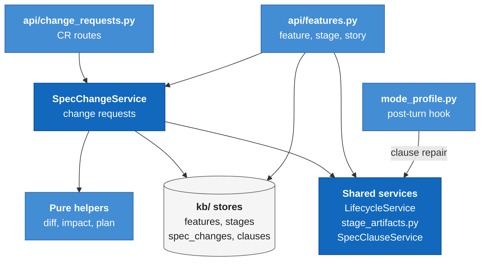
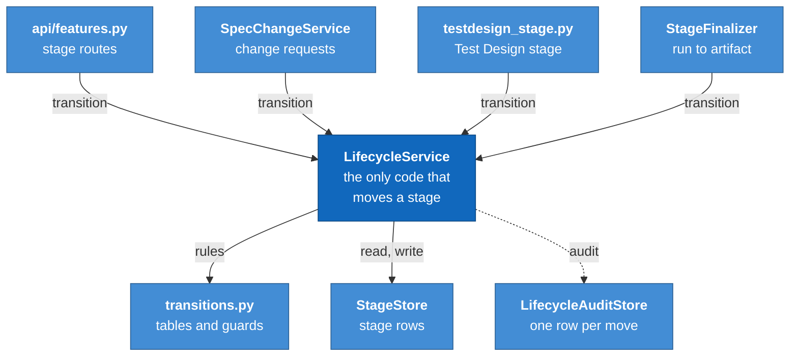
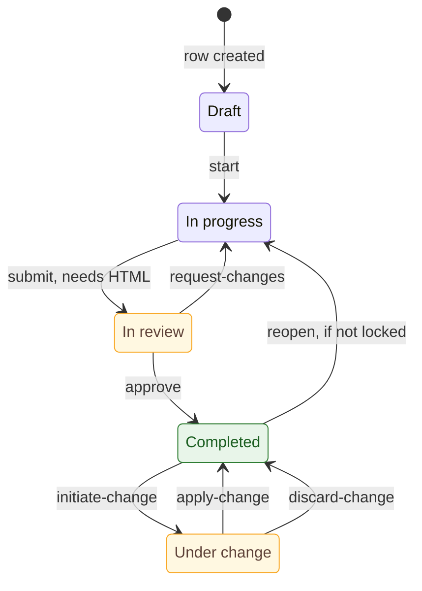
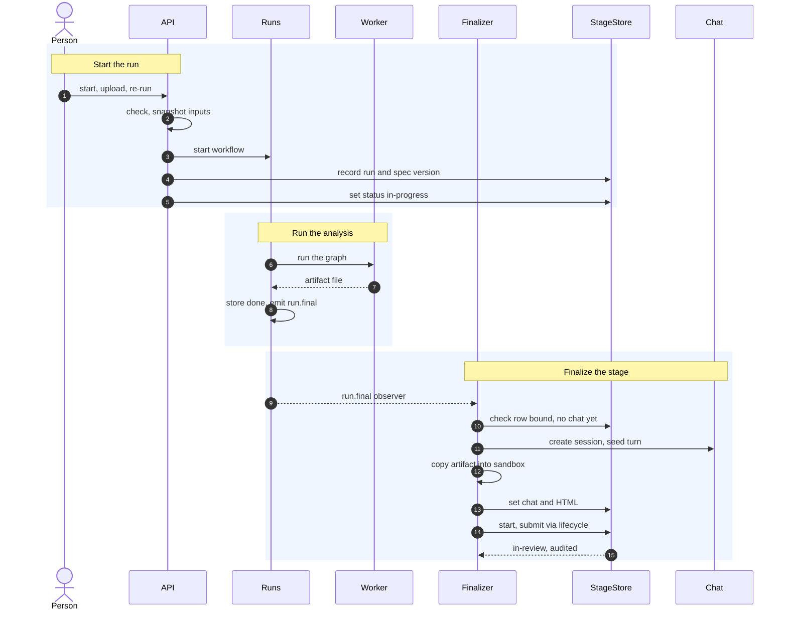
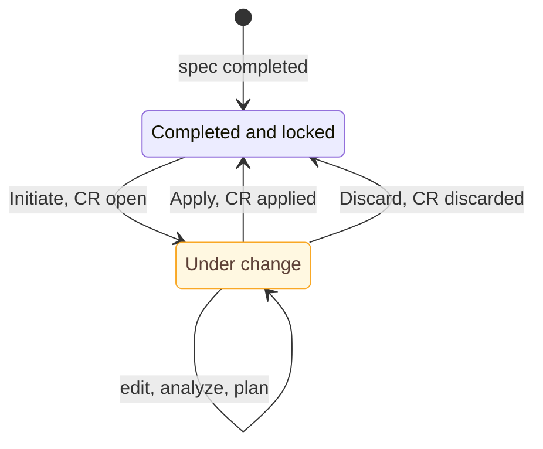

# Module: features and stages (`genesis/kb/features.py`, `genesis/kb/stages.py`, `genesis/domain/`)

> **Describes:** genesis v0.81.0 (Phase 51) · **Last reviewed:** 2026-11-11 · C4 level 3 · area `features-stages`

## 1. Purpose

A **feature** is a unit of product work inside one application. This module gives each feature a workspace of
**stages**: Spec, UX Design, Technical Design, Feature Breakdown and Test Design. Every stage holds one
authored document (HTML) and has its own lifecycle. The stages are mostly independent of each other. A few
stages need earlier stages to have a document first.

The module also owns three things that make the stages safe to change over time:

- **One lifecycle authority.** Every status change of a stage goes through `LifecycleService.transition`. It
  looks up a table of legal moves, so an illegal move cannot happen by accident (ADR-050).
- **Program-owned clause ids.** Each requirement in a spec carries a hidden `data-cid` id that program code
  assigns and repairs, so a story can point at a requirement and survive edits to the spec (ADR-075).
- **Change requests.** A spec that already has stories is locked. It changes only through a numbered change
  request (CR). The chat drafts the plan, and program code applies it in one database transaction (ADR-076).

The central idea: agents write documents, but program code owns state, ids and every write that affects other
records.

## 2. At a glance

| Item | Value |
|---|---|
| Code | `genesis/kb/{features,stages,spec_clauses,spec_changes,spec_diff,spec_impact,cr_plan,cr_document,cr_apply,backlog_doc,story_trace,lifecycle_audit}.py`; `genesis/domain/`; `genesis/services/{stage_artifacts,spec_clauses,spec_change,testdesign_stage}.py`; `genesis/chat/stage_finalizer.py`; `genesis/api/{features,change_requests}.py` |
| Runs in | The app process (FastAPI). Stage analyses run in worker subprocesses, started through the run manager ([runs-and-workers.md](runs-and-workers.md)). |
| Depends on | `genesis/db` (SQLite), the chat manager (`genesis/chat/manager.py`), the run manager, `genesis/collab` (optional publish), `genesis_core.util.atomic_json` (`path_lock`, `atomic_write_json`), `beautifulsoup4` and `markdownify` |
| Used by | The web app ([web-app.md](web-app.md)), stories and the Workbench ([stories-and-workbench.md](stories-and-workbench.md)), test design ([testing.md](testing.md)), collaboration ([collaboration-hub.md](collaboration-hub.md)) |
| Stores | Tables `kb_features`, `kb_feature_stages`, `kb_feature_stage_revisions`, `kb_spec_change_requests`, `lifecycle_transitions`; HTML files under `<state>/feature-stage-artifacts/<stage_id>/`; chat sandboxes under `<state>/skill-output/<session_id>/` |
| Migrations | `m0010_features`, `m0013_lifecycle`, `m0014_row_version`, `m0015_feature_stages`, `m0016_stories`, `m0019_collab`, `m0022_story_sequence`, `m0024_spec_change_requests` |
| Workflows it launches | `ux-design-analysis`, `technical-design-analysis`, `feature-breakdown-analysis`, `test-design-analysis` (all in `genesis-workflows/workflows/`) |
| Key ids | `CR-nn` (change request label), `c-<8 hex>` (clause id), `GNS_<6 digits>` (story key), `TC-` / `TS-` (test case / scenario keys, see [testing.md](testing.md)) |

## 3. Concepts

| Term | Meaning |
|---|---|
| **Feature** | A row in `kb_features`. It belongs to an application (`app_uuid`) and is deleted with it. It has a name, a description and a `stories_finalized_at` marker. |
| **Stage** | A row in `kb_feature_stages`, unique per `(feature_id, stage)`. The stage keys are `spec`, `ux_design`, `technical_design`, `breakdown`, `test_design` (`StageStore.VALID_STAGES`). A feature has no status of its own. The UI rolls the stage statuses up. |
| **Stage artifact** | The HTML document of a stage. The HTML is authoritative (ADR-042). Markdown is only an export. |
| **Working copy** | The freshest artifact: the file in the stage chat's sandbox, or the last saved milestone if there is no sandbox file. Only authoring screens read it. |
| **Consumer copy** | What other stages and runs read. It equals the working copy, except for a spec that is `under-change`: then it is the change request's base revision. |
| **Milestone / revision** | A saved snapshot of the artifact: a row in `kb_feature_stage_revisions` and a file `revisions/<n>.html`. |
| **Completion chat** | The chat session bound to a stage (`chat_session_id`). For Spec it is the authoring chat. For the other stages it is opened by the finalizer when the analysis run ends. |
| **Binding** | An entry in `_BINDINGS` in `genesis/chat/stage_finalizer.py`: workflow id → stage, artifact file name, chat mode, seed text. |
| **Lifecycle state** | `draft`, `in-progress`, `in-review`, `completed`, `under-change` for stages. Other entity kinds use other states (section 5.1). |
| **Action** | A named move in a transition table, such as `submit` or `approve`. |
| **Precondition (`ctx`)** | A small dict of facts (`has_html`, `downstream_locked`, ...) that a guard reads. The table itself stays pure. |
| **Prerequisite stage** | A stage that needs other stages to be at least `in-review` with a readable artifact before it can start (Technical Design, Feature Breakdown, Test Design). |
| **Clause** | A non-heading block of a spec: `p`, `li`, `dt`, `dd`, `blockquote`, `pre`, or a body `tr`. A **section** is an `h2`, `h3` or `h4`. Both can carry a `data-cid`. |
| **Fingerprint** | The first 16 hex characters of the SHA-256 of a block's normalized text. It changes only when the wording changes. |
| **Label** | A number such as `3.2` or `§3.2-1`, computed from document order. It is never stored. |
| **Traceable feature** | A feature whose breakdown backlog carries `specRevision`, or whose stories have `spec_refs`. Only a traceable feature uses change requests. |
| **`downstream_locked`** | The spec's stories or backlog exist: the feature is traceable and its breakdown is `completed` or its stories are finalized. |
| **Change request (CR)** | A numbered record (`CR-01`, `CR-02`, ...) of one change to a locked spec. At most one is open per spec. |
| **Mode (of a CR)** | `stories` when the stories are finalized, `backlog` when only the breakdown is complete. |
| **Impact input / plan** | `impact-input.json` is computed by program code. `plan.json` is written by the agent and checked by program code. |
| **Finalize Stories** | The one-time, irreversible step that turns the backlog into `kb_epics` and `kb_stories` rows (ADR-060). |

## 4. Structure



The two route files call `SpecChangeService`; `api/features.py` also calls the shared services and the stores
directly. The shared services are `LifecycleService`, the HTML helpers in `stage_artifacts.py` and
`SpecClauseService`, which works on the clause model. The `feature_spec` post-turn hook in `mode_profile.py` also
calls `SpecClauseService`. The stores are `FeatureStore`, `StageStore`, `SpecChangeStore` and the clause model in
`kb/spec_clauses.py`. `SpecChangeService` uses the pure helper modules in `genesis/kb/` for the diff, the impact
input, the plan check and the document: `spec_diff`, `spec_impact`, `cr_plan`, `cr_document`, `cr_apply`,
`backlog_doc` and `story_trace`.



`LifecycleService` is the only code that moves a stage between states. The stage routes, `SpecChangeService`, the
Test Design stage service and the `StageFinalizer` all call it. It reads the rules from `transitions.py` and reads
and writes through `StageStore` (the Test Design service and the finalizer also read `StageStore` directly). It
sends every successful move to `LifecycleAuditStore`. The `StageFinalizer` is
attached to the run manager and turns a finished analysis run into a stage artifact.

| File | Main classes and functions |
|---|---|
| `genesis/kb/features.py` | `FeatureStore`: `create_feature`, `list_features` (joins the spec stage), `update_feature`, `delete_feature`, `counts`. It also holds the older `kb_feature_specs` methods (`create_spec`, `set_status`, `add_revision`), which the live routes no longer use. |
| `genesis/kb/stages.py` | `StageStore`: `get`, `get_for_feature`, `get_by_chat_session`, `list_for_feature`, `get_or_create`, `set_html`, `set_status`, `set_source`, `set_upstream_versions`, `set_chat_session`, `add_revision`, `next_revision_no`, `list_revisions`, `reset_for_reupload`. Writes are compare-and-swap on `row_version`. |
| `genesis/domain/enums.py` | `LifecycleState`, `EntityKind`, `ArtifactKind`, `TestStatus` |
| `genesis/domain/transitions.py` | `SPEC_TRANSITIONS`, `SPEC_PRECONDITIONS`, `SPEC_FILTERING_PRECONDITIONS`, `CHANGE_REQUEST_ACTIONS`, `STORY_STAGE_TRANSITIONS`, `STORY_LANES`, `TEST_TRANSITIONS`, `LIBRARY_TRANSITIONS`, `ACTION_TRANSITIONS`, `allowed_actions` |
| `genesis/domain/lifecycle.py` | `LifecycleService` (`allowed`, `current`, `transition`), `EntityLifecycle`, builders `build_stage_lifecycle(_service)`, `build_spec_lifecycle`, `build_story_lifecycle(_service)`, `build_test_lifecycle(_service)`, `build_library_lifecycle(_service)` |
| `genesis/domain/errors.py`, `events.py`, `entities.py` | Domain errors (`IllegalTransitionError`, `PreconditionFailedError`, `StaleWriteError`, `AlreadyFinalizedError`, `ConflictError`, ...), `LifecycleEvent`, typed entities (`Feature`, `Spec`, `Story`, `Stage`) |
| `genesis/kb/lifecycle_audit.py` | `LifecycleAuditStore.record` (the `emit` sink), `list_for` |
| `genesis/kb/spec_clauses.py` | The pure clause model: `clause_map`, `normalize_spec`, `rewrite_start_tags`, `overlay_labels`, `fingerprint`, `Clause`, `RepairReport` |
| `genesis/services/spec_clauses.py` | `SpecClauseService`: `normalize_file`, `normalize_working_copy`, `normalize_for_session`, `reset_working`, `revision_html` |
| `genesis/services/stage_artifacts.py` | `artifact_file`, `current_stage_html`, `consumer_stage_html`, `base_revision_html`, `write_revision`, `spec_version`, `consumer_spec_map` |
| `genesis/kb/spec_changes.py` | Coverage helpers (`is_traceable`, `build_coverage`, `make_spec_refs`, `backlog_items`, `story_items`) and `SpecChangeStore` (`create`, `get_open`, `list_for_feature`, `set_analysis`, `set_summary`, `close`), `cr_label` |
| `genesis/kb/spec_diff.py` | `diff_specs` and `SpecDiff` |
| `genesis/kb/spec_impact.py` | `build_impact_input`, `story_item`, `backlog_item`, `lane_group` |
| `genesis/kb/cr_plan.py` | `parse_plan`, `load_plan`, `validate_plan` (rules V1 to V12), `plan_counts` |
| `genesis/kb/cr_document.py` | `render_cr_document`, `placeholder_document`, `word_diff` |
| `genesis/kb/cr_apply.py` | `refresh_refs`, `edit_refs`, `move_answers`, `change_entry`, `apply_backlog` |
| `genesis/kb/backlog_doc.py` | `render_breakdown`: a copy of the workflow's breakdown renderer |
| `genesis/kb/story_trace.py` | Story answers, `enrich_refs`, `story_flags`, `stage_spec_changed`, `BADGED_STAGES` |
| `genesis/services/spec_change.py` | `SpecChangeService` (`initiate`, `analyze`, `plan`, `document`, `apply`, `discard`, `stage_ctx`, `allowed`, `downstream_locked`), `ChangeRequestError` |
| `genesis/chat/stage_finalizer.py` | `StageFinalizer`, `_Binding`, `_BINDINGS`, the four seed texts |
| `genesis/services/testdesign_stage.py` | `TestDesignStageService` (start, re-run, finalize, top-up), `TopupRunObserver` (stage part only here; see [testing.md](testing.md)) |
| `genesis/api/features.py` | `register_features_routes`: features, spec, generalized stage routes, breakdown routes, Finalize Stories, story routes |
| `genesis/api/change_requests.py` | `register_change_request_routes` |
| `web/src/features/features/` | The feature workspace in the SPA: `stages.ts` (stage descriptors, `deriveAvailability`, `deriveFeatureStatus`), `stage-registry.tsx`, `ChangeRequestFlow.tsx` |

## 5. How it works

### 5.1 The lifecycle service

`LifecycleService` holds a registry from `EntityKind` to an `EntityLifecycle`. An `EntityLifecycle` bundles a
transition table, optional guards, optional reason texts, and two functions that read and write the state. The
service has no database code. The `domain` package imports no database, network or FastAPI code.

`transition(kind, entity_id, action, actor=, ctx=, conn=)` does this:

1. Read the current state. Raise `UnknownEntityError` if the entity is missing.
2. Merge the caller's `ctx` under any store-derived context (the store wins).
3. Look up `(state, action)` in the table. A missing pair raises `IllegalTransitionError`, which carries the
   list of actions that are allowed from the current state. There is no `if state == ...` branch anywhere.
4. Run the guard for that pair, if there is one. A false result raises `PreconditionFailedError` with a reason
   text.
5. Write the new state. The stage writer passes `expected_status`, so the update is a compare-and-swap. If a
   concurrent writer changed the row, the store raises `StaleWriteError`.
6. Build a `LifecycleEvent` and call `emit`. The API wires `emit` to `LifecycleAuditStore.record`, which appends
   a row to `lifecycle_transitions`.

When `conn` is given, steps 5 and 6 run on the caller's open transaction. The change-request service uses this
to commit a status change together with its own rows.

`allowed(kind, id, ctx=)` returns the legal actions. With a `ctx`, it leaves out actions whose guard fails, but
only for guards listed in the entity's `filtering_preconditions`. For stages these are `reopen`,
`initiate-change`, `apply-change` and `discard-change`. The `submit` guard (needs HTML) is deliberately not
filtered: the button stays visible and a click returns a 409 with the reason, because the UI does not re-read
`allowed` after a chat turn writes the artifact.

The registered entity kinds and their tables are:

| Kind | Table (in `transitions.py`) | States and actions |
|---|---|---|
| `stage` (every feature stage, including Spec) | `SPEC_TRANSITIONS` | Section 5.2 |
| `spec` | `SPEC_TRANSITIONS` | Same table, keyed by the old `kb_feature_specs` row. `build_default_lifecycle` registers it, but the live routes use `stage`. |
| `story` | `STORY_STAGE_TRANSITIONS` | The eight Workbench lanes. See [stories-and-workbench.md](stories-and-workbench.md). A manual drag on the board does not use this table. |
| `test_case`, `test_scenario` | `TEST_TRANSITIONS` | `draft`, `ready`, `retired`. See [testing.md](testing.md). |
| `test_action`, `test_setup` | `ACTION_TRANSITIONS`, `LIBRARY_TRANSITIONS` | Library items, with replay guards. See [testing.md](testing.md). |

### 5.2 The stage lifecycle

Every stage shares one table. The Spec stage and the four other stages move through the same states.



`In progress` is the state `in-progress`, `In review` is `in-review` and `Under change` is `under-change`. The
diagram shows the stage table. A new stage row starts as `draft`. Forward moves go `start`, `submit`,
`approve`. A reviewer can send a stage back with `request-changes`. A completed stage goes back to
`in-progress` with `reopen`, except when the guard blocks it. Only a spec can use `initiate-change`. The three
change-request actions are listed in
`CHANGE_REQUEST_ACTIONS` and only `SpecChangeService` may use them. The guard needs `via_change_request`, which
the generic action routes never set.

The guards are:

| Move | Guard |
|---|---|
| `in-progress` → `in-review` (`submit`) | `has_html`: an artifact exists. |
| `completed` → `in-progress` (`reopen`) | `downstream_locked` is false. The refusal text depends on the stage. For `test_design` it says the test design is finalized. Otherwise it says to use Initiate change request. |
| `completed` → `under-change` (`initiate-change`) | `is_spec`, `downstream_locked` and `via_change_request` are all true. |
| `under-change` → `completed` (`apply-change`, `discard-change`) | `via_change_request` is true. |

`SpecChangeService.stage_ctx(row)` builds this `ctx`. It sets `downstream_locked` for a spec when the feature
is traceable and its breakdown is `completed` or its stories are finalized. For `test_design` it sets
`downstream_locked` when the feature's test suite is finalized, so a finalized test design cannot be reopened.
Every route that transitions a stage builds its `ctx` through `stage_ctx`.

`StageStore.PRESENT_STATUSES` is `in-review`, `completed` and `under-change`. A stage in one of these states
counts as "has an artifact" for the prerequisite checks.

### 5.3 The parallel and prerequisite model

ADR-044 first described a feature as a workspace of artifact stages, each with its own status, and unlocked
them one after another. ADR-056 superseded the sequential unlock. Stages are plug-in containers over one
shared table, and no stage gates another by default. ADR-058 then amended this: a stage may declare
prerequisites. L-063 records that this must be enforced on both sides, and the code does so.

| Stage | Prerequisite | Backend check | Web check (`stages.ts`) |
|---|---|---|---|
| Spec | none | none | `available: true` |
| UX Design | none (the Spec, if any, is passed to the run but not required) | none | none |
| Technical Design | Spec and UX Design present | `_td_prereqs_ready` in `api/features.py` | `requires: ["spec", "ux"]` |
| Feature Breakdown | Spec, UX Design, Technical Design present | `_fb_prereqs_ready` | `requires: ["spec", "ux", "design"]` |
| Test Design | Breakdown present, and the stories finalized with at least one `Story` (Tasks get no cases) | `TestDesignStageService.prereqs_ready` | `requires: ["breakdown"]` plus `gate: storiesFinalized` |

"Present" means the stage row has a status in `PRESENT_STATUSES` and a readable consumer copy
(`_consumer_html`). A failed check returns HTTP 409 with a message that names the missing stage. The web app
derives the same answer with `deriveAvailability`, which shows a locked card with the text "Complete X first".

The feature's rolled-up status is derived in the web app by `deriveFeatureStatus`. It is "Completed" when every
available stage is `completed`, "Draft" when none has started, and "In progress" otherwise. Adding a stage to
the roll-up changes what "Completed" means for every feature (L-063).

### 5.4 The Spec stage: authored in chat

The Spec is the only stage authored by a person talking to an agent, not by a workflow (ADR-042).

1. `POST /api/features/{id}/spec` creates a chat session in mode `feature_spec`, queues a system turn with the
   application and feature identity, creates the `spec` stage row (`draft`) and binds the session to it.
   It returns 409 if a spec already exists.
2. The `feature_spec` profile (`genesis/chat/mode_profile.py`) runs with the sandbox as its working directory and
   trusts `fs_read` and `fs_write`, so the agent writes `spec.html` in
   `<state>/skill-output/<session_id>/`. Permissions are `auto_deny` and MCP is read-only.
3. After every non-command turn, the chat manager runs the profile's post-turn hook `spec_clauses`. That is
   `SpecClauseService.normalize_for_session` (section 5.5).
4. The person saves a **milestone** with `POST /api/features/{id}/spec/milestone` (or the generic
   `/stages/spec/milestone`). The route normalizes the working copy, copies `spec.html` to
   `<stage_id>/spec.html` and `<stage_id>/revisions/<n>.html`, sets `html_path` and `content_hash`, and adds a
   revision row. It is refused with 409 while the spec is `under-change`. Apply creates the revision then.
5. The person moves the stage through the lifecycle with `POST .../spec/actions/{action}`.

Until a milestone is saved, `html_path` is NULL, and the real content is the sandbox file. L-073 records the
bug this caused (a UX run saw "no spec"). All launches therefore read the artifact through
`current_stage_html` or `consumer_stage_html`, never the raw column.

### 5.5 Clause ids and the normalizer

This section covers ADR-075 and L-086. The agent is asked to keep one requirement per element and to leave the
`data-cid` attributes alone (the `_STEERING_SPEC` text says so). Program code does not rely on this.

`normalize_spec(html, previous, registry)` in `genesis/kb/spec_clauses.py` is pure. It runs these steps:

1. Parse the HTML and collect blocks. Anything inside `head`, `header`, `nav`, `footer`, `script`, `style`,
   `template`, `title`, `h1` or an element marked `data-gn-ignore` is excluded. A `p`, `blockquote` or `pre`
   inside another block is part of that block.
2. Keep each valid id (`c-` followed by 8 hex characters) that the previous version also had. Resolve
   duplicates: if one id appears on several blocks, the block with the same fingerprint wins, or else the most
   similar text.
3. Re-anchor blocks without an id to an unused previous id. First try an exact fingerprint match. Then try a
   fuzzy match by text similarity: 0.85 within the same section, 0.92 across the document. Sections are
   matched before clauses.
4. Mint a new random id (`c-` plus 4 random bytes in hex) for any block still without one. A minted id never
   equals a previous id, an id in the registry, or an id seen in the input.
5. Remove ids that are invalid or not known from the previous version (foreign ids), and strip render-only
   `data-gn-*` attributes.
6. Return the new HTML, the clause map and a `RepairReport`.

The function edits only the start tags of the elements it changes (`rewrite_start_tags`). All other markup
stays byte-identical, so a repaired file produces no diff noise (L-086). It falls back to re-serializing with
BeautifulSoup only if a tag's source position cannot be verified.

`SpecClauseService` adds the files around this pure function. Under a per-directory lock it:

- reads the previous version from `<stage_id>/working/last-normalized.html`, or else the latest revision, or
  else `html_path`;
- reads the **registry** `<stage_id>/working/clause-registry.json`, which lists every id ever issued, so an id
  is never reused after its clause is removed;
- writes the normalized file back atomically (temp file and `os.replace`) only if it changed, and updates the
  last-normalized copy and the registry.

The previous copy lives outside the agent's sandbox, so the agent cannot damage it. `reset_working` replaces
the working copy byte for byte without normalizing (used by Discard).

The served copy is a different thing. `overlay_labels` adds visible labels (and optional story-coverage
badges) to the HTML that the artifact endpoint returns. It is never written to disk, and the normalizer strips
`data-gn-*` attributes if they ever appear in a source file.

### 5.6 The generalized stage routes and the artifact files

Every stage, including Spec, is served by the routes under `/api/features/{id}/stages/{stage}/...` (section
6.1). They read and write the same `kb_feature_stages` rows as the older `/spec/...` routes.

- `_stage_or_404` checks the stage key, then returns the row. If the row has a `run_id` but no
  `chat_session_id`, it first asks the recovery `StageFinalizer` to finalize it (section 5.7).
- The artifact file name per stage comes from `STAGE_ARTIFACT_FILE`: `spec.html`, `analysis.html` (UX Design),
  `technical-design.html`, `breakdown.html`, `test-design.html`.
- `GET .../artifact` returns the working copy wrapped for the iframe: theme tokens, and (with `annotate=1`) the
  vendored Lavish annotation SDK (ADR-043). For Spec, it also adds clause labels (`labels=1`). If nothing is
  authored, it returns a themed placeholder page.
- `GET .../export.md` converts the working copy to Markdown with `markdownify` and records the path in
  `md_export_path`.
- `POST .../context` copies chosen linked documents into `<sandbox>/context/` and posts an agent note that the
  files exist. The documents are not placed in the chat itself.

### 5.7 How an analysis stage is produced

UX Design, Technical Design, Feature Breakdown and Test Design all follow the same pattern.



The diagram shows one analysis stage from start to review. The person starts the stage and the API checks the
prerequisites and starts the run. The worker writes the artifact. `RunManager` stores the status and then announces
`run.final`. The `StageFinalizer` creates the completion chat, copies the artifact and moves the stage to `in-review`
through the lifecycle service.

The start routes snapshot the inputs to files in `<stage_id>/` and pass paths to the run:

| Stage | Start route | Inputs the platform passes |
|---|---|---|
| UX Design | `POST /stages/ux_design/upload` (PDF only; the file must not be empty) | The PDF as file input `mockup` (ADR-035), `spec_path` (the consumer copy of the spec, if any), `stage_id`, `feature_id`, `app_uuid`. The PDF is also saved as `source.pdf`. |
| Technical Design | `POST /stages/technical_design/start` (JSON, optional `comment`) | `spec_path`, `uxdesign_path`, `comment` |
| Feature Breakdown | `POST /stages/breakdown/start` (multipart: `notes`, up to 3 files) | `spec_path`, `uxdesign_path`, `techdesign_path`, `notes`, files `doc1` to `doc3`, and `spec_clauses_path` only if the installed workflow declares that input |
| Test Design | `POST /stages/test_design/start` (see [testing.md](testing.md)) | The three snapshots plus `stories_path` and `mode` |

The start routes reject a second start when the stage already has a completion chat ("use re-run") or a bound
run ("already in progress"). A missing workflow gives a friendly 409 telling the user to run
`genesis install`. Any other start failure also becomes a 409, never a bare 500. After the run starts, the
route records the run id with `set_source`, and records the spec version the run consumed in
`upstream_versions_json` (`{"spec": {revision_no, content_hash}}`).

**Re-run** (`/stages/ux_design/reupload`, `/stages/technical_design/rerun`, `/stages/breakdown/rerun`) deletes
the stage's artifact folder, calls `StageStore.reset_for_reupload` (drops revisions, clears the html, chat, run
and source pointers, sets `in-progress`), and starts a fresh run. Clearing `chat_session_id` is required: the
finalizer treats a set `chat_session_id` as "already finalized".

`StageFinalizer` does the bridge from run to stage. It registers as a run-event observer in `create_app`
(`stage_finalizer.attach()`). `_finalize(run_id)` returns early unless all of these hold:

- the run record exists and its status is `done`;
- the run's workflow id has a binding (an unknown workflow is skipped);
- the run's input `mode` is not in the binding's `skip_modes` (test-design top-up runs belong to
  `TopupRunObserver`);
- the `stage_id` input points to a stage row of the binding's stage (a run can never finalize another stage);
- the row has no `chat_session_id` yet (idempotent: the live event and the startup sweep finalize once);
- the row's current `run_id` equals this run (L-061: an old, superseded done run must not finalize the stage
  again after a re-run);
- the artifact file exists in the run's folder (a run that escalated without a draft leaves the stage
  `in-progress`).

If all hold, it creates the completion chat in the binding's mode, queues the seed text, writes the artifact
into the new session's sandbox, sets `chat_session_id` and the content hash, and moves the stage to
`in-review`. The `_to_in_review` helper runs `start` (if the stage is `draft`) and then `submit` through the
lifecycle service, with the actor from `canonical_username`. If the lifecycle call raises, it falls back to the
raw `StageStore.set_status("in-review")` and logs a warning only if that also fails.

The binding registry (L-062) is a module-level dict:

| Workflow id | Stage | Artifact | Chat mode | Skips |
|---|---|---|---|---|
| `ux-design-analysis` | `ux_design` | `analysis.html` | `ux_design` | none |
| `technical-design-analysis` | `technical_design` | `technical-design.html` | `technical_design` | none |
| `feature-breakdown-analysis` | `breakdown` | `breakdown.html` | `feature_breakdown` | none |
| `test-design-analysis` | `test_design` | `test-design.html` | `test_design` | `mode=topup` |

A new stage-producing workflow needs one new binding here, not new finalizer code.

Three recovery paths make this safe when an event is missed:

1. **Live.** `_observe` handles `run.final` with status `done`. It catches and logs every exception, so a
   finalize failure cannot crash the run reader thread.
2. **Startup.** `reconcile()` in the app's startup hook walks every done run of each bound workflow.
3. **On read.** `reconcile_stage(stage_id)` is called from the feature detail and stage reads for a stranded
   stage (a `run_id` but no chat). The routes use a second `StageFinalizer` that is not attached to the event
   stream, so there is no duplicate observer (L-058).

L-093 sits underneath all three. The run manager must store the terminal status before it announces
`run.final`. Before the fix, the finalizer saw a run that was not yet `done` and returned early on every live
run. The `_finalize` check `rec.status != "done"` relies on the store-then-announce order.

### 5.8 Technical Design, Feature Breakdown and the large-document rule

The finished documents are produced by the workflows, but one design rule shapes them. A single agent turn
that must emit a large multi-part document hits `turn_timeout` and truncates the output (L-064). The
Technical Design workflow therefore plans workstreams, grounds each one in a separate turn, and assembles the
final HTML with a program node. The platform side has no code for this; it only expects a finished artifact
file. All four workflows declare `healing: {max_heal: 1, max_restart: 1}` in their `workflow.yaml`
([core-engine.md](core-engine.md), healing tier).

The Feature Breakdown artifact has one extra contract. `breakdown.html` embeds the canonical backlog as JSON in
`<script type="application/json" id="genesis-backlog">`. `_parse_embedded_backlog` in `api/features.py` reads
it. The completion chat is told to keep this JSON and the visible cards in step (the seed text says so). The
backlog the platform uses is read by `_resolve_backlog`: first the embedded JSON in the current working copy,
and if that is missing, `backlog.json` in the bound run's folder. The same backlog feeds the Jira CSV export
(`GET /stages/breakdown/export.csv`), which has one row per epic and per story or task, with hierarchy through
Issue ID and Parent ID.

### 5.9 Finalize Stories

`POST /api/features/{id}/stages/breakdown/finalize` is a one-time, irreversible action (ADR-060). The route
checks, in order:

1. `kb_features.stories_finalized_at` is empty, else 409.
2. The spec is not `under-change`, else 409 (a change request on the backlog names backlog ids that Finalize
   would change).
3. The breakdown stage is `completed`, else 409.
4. A backlog with at least one epic can be read, else 422.

It then calls `StoryStore.finalize` (`genesis/kb/stories.py`). In one transaction it inserts one `kb_epics` row
per epic and one `kb_stories` row per story or task, and stamps `stories_finalized_at`. Each story gets
`status` `to-do` and a key from `_next_story_key`, which increments the `story` row of `kb_sequences` inside
the same transaction and formats `GNS_` plus six digits (ADR-072). The key is global across all features and
applications. A second concurrent finalize raises `AlreadyFinalizedError`, which becomes 409.

For a traceable backlog, `_finalize_refs` converts each story's `clauseRefs` into `spec_refs` records
(`clause_id`, `fingerprint`, `origin: "breakdown"`, `linked_at`). It prefers the clause map saved at launch
(`spec_clauses.json`, if its content hash matches the backlog's `specRevision`) and otherwise uses the current
spec. Clause ids that no longer exist are dropped and returned as `dropped_refs`. The stories, their lanes and
the Workbench belong to [stories-and-workbench.md](stories-and-workbench.md).

### 5.10 Test Design as a stage

Test Design is the fifth stage. This module owns only its stage behaviour; the cases, scenarios, execution and
top-ups are in [testing.md](testing.md).

- It plugs in like Feature Breakdown: one stage key, one binding, one chat mode profile (ADR-078).
- `TestDesignStageService.start` and `rerun` snapshot the Spec, UX and Technical Design consumer copies plus the
  finalized stories as `stories.json`, then launch `test-design-analysis`. Re-run is refused once the suite is
  finalized.
- `finalize_test_design` requires the stage `completed`, reads the embedded JSON
  (`<script id="genesis-test-design">`) from the current working copy (L-073), drops what does not resolve,
  validates, and writes the suite in one transaction. It does not change the stage status.
- After Finalize, `stage_ctx` sets `downstream_locked` for the stage, so `reopen` is refused. There is no change
  request for it. The refusal text says to use Generate tests for uncovered stories.
- Its artifact never goes to the Hub (section 5.12).

### 5.11 Change requests

A change request lets a person edit a spec whose stories already exist, and carry that edit into the stories
in a controlled way (ADR-076). The chat proposes. Only the program paths in `SpecChangeService` change state.
All of Initiate, Discard, Analyze and Apply run under an in-process lock for the spec
(`<stage_id>/change-requests/` via `path_lock`).



The diagram shows the spec stage. While the spec is `Under change` (state `under-change`), the change request
row is `open`. It ends as `applied` or `discarded`.

**Initiate** (`POST /features/{id}/change-requests`):

1. Check that the spec is `completed`, `downstream_locked`, has a chat session, the chat is not busy, and no CR
   is open.
2. Normalize the working copy. If it differs from the latest revision (or none exists), save it as a new
   revision with the note "Baseline for CR-nn". The base is always a real revision.
3. Choose the mode: `stories` if the stories are finalized, else `backlog`.
4. Write the frozen folder `<stage_id>/change-requests/<cr_no>/` with `base.html`, and the sandbox folder
   `./cr/CR-nn/` with `instructions.md` and the base spec.
5. In one transaction, create the CR row (`cr_no` is the feature's maximum plus one) and run the audited
   `initiate-change` transition. If anything fails, the files are removed.
6. Post a divider into the spec chat and set the optional "spec under change" marker for collaboration.

**While open.** The spec's consumer copy is the base revision, so developers and other stages keep reading the
old text (`consumer_stage_html`). Milestones are refused. Finalize Stories is refused. The raw `PATCH
/spec/status` is refused.

**Analyze** (`POST .../analyze`) never calls the agent:

1. Normalize the working copy and compute the clause maps of base and working.
2. `diff_specs` classifies each block, keyed by `data-cid`: `unchanged`, `moved`, `formatting`, `modified`,
   `added`, `removed`. A move or a formatting-only change has no impact. Position is measured with a longest
   common subsequence per section, so inserting one clause does not mark its siblings as moved.
3. If nothing differs, return `no_changes` and write nothing.
4. `build_impact_input` finds the affected items: every story (or backlog item) linked to a modified or
   removed clause, matched `linked` (directly) or `broad` (through an ancestor section). Added clauses that no
   item references are `new_clauses`, each with candidate stories from the same section. Each story carries its
   lane group: `editable` for To Do and Design, `locked` for Design Review and later.
5. Write `impact-input.json` (a program-owned copy in the frozen folder and a copy in the sandbox) and
   `plan-format.md`. Record the analysis id and the hash of the analyzed spec on the CR row. Post a note that
   tells the agent to write `plan.json`.

**Plan.** The agent writes `./cr/CR-nn/plan.json` (schema `genesis.cr-plan/1`). `validate_plan` checks it in
program code, with rules V1 to V12. Errors block Apply and warnings are only shown. Examples: every affected
item needs exactly one decision (V2), ids must exist (V3), a story past Design may only change when the user
asked and `user_requested` is set (V4), acceptance criteria must be Gherkin (V6), clause ids must exist (V7),
every new clause needs a story or `no_story_needed` (V8), and no removal of a story that has an implementation
run (V10). The analysis state is `none`, `awaiting_plan`, `current` or `stale`. It is `stale` when the working
spec's hash no longer matches the analyzed hash, or the plan's `analysis_id` is old.

**The document.** `render_cr_document` renders the "CR-n Impact Analysis" HTML from the impact input and the
plan. The agent never writes this document, so what the person reads is what Apply executes. It is script-free.

**Apply** (`POST .../apply`, body `confirm_locked_story_ids`). Checks A1 to A8 run first and return 409
`apply_blocked` with a list of blockers if any fails: the CR is open and the spec is `under-change` (A1), no
chat turn is running (A2), an analysis and a plan exist for the exact bytes of the working copy (A3), the plan
validates (A4), no story changed since the analysis, by `row_version` (A5), no design or implementation run is
running for a changed story (A6), every locked-lane story that changes or records answers is confirmed (A7),
and in backlog mode the breakdown did not change (A8). Then, in one transaction:

1. Add a spec revision and set `html_path` and `content_hash`.
2. In `stories` mode, apply the plan to the stories: create follow-up stories (new `GNS_` keys, placed after
   their parent, added to the board's To Do lane if the parent was on a board), update fields, move answered
   questions into `answers`, remove stories (with a snapshot), refresh the stored fingerprints of every link to
   a changed clause, and append a `change_log` entry. In `backlog` mode, reconcile the embedded backlog,
   re-render `breakdown.html` with `render_breakdown`, save a breakdown revision and record the consumed spec
   revision.
3. Close the CR as `applied` with a summary, and run the audited `apply-change` transition.

If anything raises, the transaction rolls back, the revision files written for it are deleted, and the caller
gets 409 `apply_failed`. Only after the commit does the service do best-effort work and report each failure as
a warning, never as a rollback: write the latest files, freeze `result.html`, `plan.json`, `document.html` and
`apply-report.json`, publish to the Hub when collaboration is on, clear the marker, and post the
`cr-applied` note.

**Discard** restores the working copy to the base revision byte for byte, then closes the CR as `discarded`
and runs `discard-change` in one transaction. If the transaction fails, the edited copy is put back. No story
changes.

**Badges.** After a CR is applied, `story_trace.stage_spec_changed` marks UX Design, Technical Design and
Feature Breakdown with "spec changed (CR-n)" when the revision they consumed (recorded in
`upstream_versions_json`) is older than the CR's result revision. A stage with no recorded revision falls back
to comparing times. `POST .../spec-reviewed` records that a person reviewed the stage against the latest spec.
The badge is a notice only and never changes the artifact.

### 5.12 Publish hooks

When collaboration is on, publishing a stage, the stories a CR touched, and the CR record itself goes through
`genesis/collab`. The Test Design stage is local-only (`LOCAL_ONLY_STAGES` in `genesis/collab/service.py`). How publish, pull and merge work is in
[collaboration-hub.md](collaboration-hub.md).

## 6. Interfaces

### 6.1 HTTP endpoints

All routes are under `/api` and are registered by `register_features_routes` (called from `genesis/api/app.py`),
which also registers the change-request routes. The Test Design routes (`/stages/test_design/start|rerun|finalize`)
are registered earlier in `app.py` so they win over the generic `/stages/{stage}/...` routes (L-096).

Features and spec:

| Method and path | Purpose |
|---|---|
| `GET /applications/{app_uuid}/features` | List features with their spec stage's id and status |
| `POST /applications/{app_uuid}/features` | Create a feature (name required) |
| `GET /features/{id}` | Feature, its spec row and all stage rows (with `spec_changed` badges). Self-heals stranded stages. |
| `PATCH /features/{id}`, `DELETE /features/{id}` | Rename or edit; delete (removes the stage artifact folders) |
| `POST /features/{id}/spec` | Create the spec stage and its `feature_spec` chat |
| `GET /features/{id}/spec` | The spec row |
| `GET /features/{id}/spec/context`, `POST .../spec/context` | List and inject linked documents into the chat sandbox |
| `POST /features/{id}/spec/milestone` | Save a milestone from the sandbox |
| `GET /features/{id}/spec/allowed` | Status, allowed actions and the change-request block (`downstream_locked`, `open`, `count`) |
| `POST /features/{id}/spec/actions/{action}` | Apply a lifecycle action |
| `PATCH /features/{id}/spec/status` | Deprecated. Sets a status without transition rules (see section 12) |
| `GET /features/{id}/activity` | Lifecycle history of the spec from the audit table, with CR labels |
| `GET /features/{id}/spec/artifact`, `.../spec/sdk.js`, `.../spec/export.md` | Themed HTML (optionally a saved `revision`), the annotation SDK, Markdown export |
| `GET /features/{id}/spec/clauses`, `.../spec/coverage` | Clause map and per-clause story coverage (`revision` = `working` or a number) |

Generalized stage routes (`stage` is one of the five keys):

| Method and path | Purpose |
|---|---|
| `GET /features/{id}/stages/{stage}` | The stage row with its badge |
| `POST .../stages/{stage}/spec-reviewed` | Record the spec version a UX, TD or breakdown stage was reviewed against |
| `POST .../stages/ux_design/upload`, `.../reupload` | Start or replace the UX analysis from a PDF |
| `POST .../stages/technical_design/start`, `.../rerun` | Start or replace the Technical Design |
| `POST .../stages/breakdown/start`, `.../rerun` | Start or replace the Feature Breakdown (multipart) |
| `GET .../stages/breakdown/export.csv` | Jira-importable CSV of the backlog |
| `POST .../stages/breakdown/finalize` | Finalize Stories (one time) |
| `GET .../stages/{stage}/allowed`, `POST .../actions/{action}` | Allowed actions; apply an action |
| `POST .../stages/{stage}/milestone` | Save a milestone |
| `GET/POST .../stages/{stage}/context` | List and inject linked documents |
| `GET .../stages/{stage}/artifact`, `.../export.md` | Themed HTML; Markdown export |

Stories (the CRUD belongs to [stories-and-workbench.md](stories-and-workbench.md)): `GET/POST
/features/{id}/stories`, `GET/PATCH/DELETE /features/{id}/stories/{story_id}`, and the answer routes
`POST/PATCH/DELETE .../stories/{story_id}/answers[/{index}]`.

Change requests (`genesis/api/change_requests.py`):

| Method and path | Purpose |
|---|---|
| `GET /features/{id}/change-requests` | List CRs |
| `POST /features/{id}/change-requests` | Initiate (optional `title`) |
| `GET /features/{id}/change-requests/{cr_no}` | Detail: analysis state, validation, `can_apply`, `apply_blockers`, `chat_busy`, `next_revision_no`, `locked_confirmations` |
| `POST .../{cr_no}/analyze` | Compute the impact input |
| `GET .../{cr_no}/plan` | The plan and its validation |
| `GET .../{cr_no}/document` | The CR document (themed; annotation SDK with `annotate=1`) |
| `GET .../{cr_no}/export.md` | The CR document as Markdown |
| `POST .../{cr_no}/apply` | Apply (body `confirm_locked_story_ids`) |
| `POST .../{cr_no}/discard` | Discard |

Error mapping: `IllegalTransitionError` gives 409 `{error: "illegal_transition", current, action, allowed}`.
`PreconditionFailedError` gives 409 `{error: "precondition_failed", reason}`. `StaleWriteError` gives 409
`{error: "stale_write"}`. A `ChangeRequestError` carries its own status and a code such as `apply_blocked`.

### 6.2 Python API used by other modules

| Call | Used for |
|---|---|
| `StageStore(...)`, `FeatureStore(...)` | Read and write stage and feature rows |
| `build_stage_lifecycle_service(stage_store, emit=audit.record)` | The one way to change a stage status (API, finalizer, test design service) |
| `LifecycleService.transition(kind, id, action, actor=, ctx=, conn=)` | Section 5.1 |
| `SpecChangeService.stage_ctx(row)`, `.allowed(row)`, `.downstream_locked(feature_id)` | Guard context and the action list |
| `current_stage_html`, `consumer_stage_html`, `consumer_spec_map`, `spec_version`, `write_revision` | Reading artifacts and recording versions (also used by the Workbench and test design) |
| `clause_map(html)`, `make_spec_refs`, `build_coverage`, `is_traceable` | Story links and coverage |
| `StageFinalizer.attach()`, `.reconcile()`, `.reconcile_stage(id)` | Attached once by `create_app`; also used by test design reads |
| `story_trace.*` | Story answers, flags, enriched references, stage badges |

### 6.3 Events and contracts

- The module emits `LifecycleEvent` objects (entity kind, id, from, to, action, time, actor). They are stored in
  `lifecycle_transitions`. There is no other event bus use.
- It consumes the canonical run event `run.final` through `RunManager.add_event_observer` (section 5.7).
- It writes the plan and document files of a change request (section 7).
- It has no MCP tools and no CLI commands. The chat agent reaches this module only through files in its
  sandbox (`spec.html`, `./cr/CR-nn/...`) and the notes the services post.

## 7. Data

| Table | Key columns | Meaning |
|---|---|---|
| `kb_features` | `id`, `app_uuid` (FK, cascade), `name`, `description`, `sync_uuid`, `stories_finalized_at`, `row_version` | One feature. `stories_finalized_at` is the one-time Finalize marker (m0016). |
| `kb_feature_stages` | `id`, `feature_id` (FK, cascade), `stage`, `title`, `status`, `chat_session_id`, `html_path`, `content_hash`, `md_export_path`, `source_doc_path`, `run_id`, `upstream_versions_json`, `sync_uuid`, `row_version`; unique `(feature_id, stage)` | One row per feature and stage (m0015; `sync_uuid` and `upstream_versions_json` from m0019). `status` is free text validated in `StageStore.VALID_STATUSES`. |
| `kb_feature_stage_revisions` | `stage_id` (FK, cascade), `revision_no`, `html_path`, `note`, `created_at`; unique `(stage_id, revision_no)` | Milestone snapshots |
| `kb_spec_change_requests` | `feature_id`, `stage_id`, `cr_no`, `title`, `status` (`open`, `applied`, `discarded`), `mode`, `opened_by`, `closed_by`, `base_revision_no`, `base_content_hash`, `result_revision_no`, `analysis_id`, `analyzed_spec_hash`, `dir_path`, `summary_json`, `sync_uuid`; unique `(feature_id, cr_no)` | One row per CR (m0024). A partial unique index `ux_spec_cr_one_open` allows one `open` row per stage. |
| `lifecycle_transitions` | `entity_kind`, `entity_id`, `from_state`, `to_state`, `action`, `actor`, `at` | Append-only audit of every transition (m0013). Stage rows use kind `stage`, entity id = the stage row id. |
| `kb_epics`, `kb_stories` | see [stories-and-workbench.md](stories-and-workbench.md) | Written by Finalize Stories and by Apply. `kb_stories` has `spec_refs`, `answers` and `change_log` columns from m0024. |
| `kb_sequences` | `name`, `next_val` | The `story` counter behind `GNS_` keys (m0022) |
| `kb_feature_specs`, `kb_feature_spec_revisions` | | The pre-Phase-29 spec tables (m0010). m0015 copied their rows into `kb_feature_stages`. The live routes do not read them. `FeatureStore` still has methods for them. |

Every update to `kb_features`, `kb_feature_stages` and `kb_spec_change_requests` bumps `row_version`. A write
that supplies `expected_status` or `expected_version` and finds no matching row raises `StaleWriteError`.

Files on disk (the owner writes, the listed readers read):

| Path | Writer | Readers |
|---|---|---|
| `<state>/feature-stage-artifacts/<stage_id>/<artifact>.html` | milestone routes, `write_revision`, Apply | artifact and export routes, downstream launches |
| `.../<stage_id>/revisions/<n>.html` | milestone routes, Apply | `SpecClauseService`, CR base lookup |
| `.../<stage_id>/source.pdf`, `spec_snapshot.html`, `ux_snapshot.html`, `td_snapshot.html`, `spec_clauses.json` | launch routes | the workflows, `_finalize_refs` |
| `.../<stage_id>/working/last-normalized.html`, `clause-registry.json` | `SpecClauseService` | `SpecClauseService` |
| `.../<stage_id>/change-requests/<cr_no>/` (`base.html`, `impact-input.json`, `result.html`, `plan.json`, `document.html`, `apply-report.json`) | `SpecChangeService` | the CR routes, `consumer_stage_html` |
| `<state>/skill-output/<session_id>/spec.html` (and the other artifact names), `context/`, `cr/CR-nn/` | the chat agent and the services | `current_stage_html`, the services |

`feature_specs_dir` (`<state>/feature-specs`) is the old spec folder. It still exists in settings but the stage
routes do not use it.

## 8. Failure handling

| Situation | Behaviour |
|---|---|
| Illegal action for the current state | `IllegalTransitionError` → 409 with the allowed actions. Nothing changes. |
| Guard fails (`submit` without HTML, `reopen` when locked) | `PreconditionFailedError` → 409 with a reason text |
| Two writers change the same stage | The compare-and-swap update matches no row → `StaleWriteError` → 409. One writer wins. |
| Start with a prerequisite missing | 409 naming the missing stage |
| Workflow not installed | 409 "... workflow is not installed; run `genesis install`" |
| Any other run-start failure | 409 "could not start the ... run: ...", never a bare 500 |
| Run finished but the live `run.final` was missed (app restart, orphaned worker) | The startup `reconcile()` and the on-read `reconcile_stage` finalize it. Both are idempotent. |
| Finalize raises inside the run observer | Logged at warning level; the run is not affected |
| `_to_in_review` lifecycle call fails | Falls back to the raw status setter and logs a warning if that fails too |
| A re-run replaced the stage while an old run finishes | The old run is ignored because its id no longer equals the stage's `run_id` (L-061) |
| Clause normalizer fails | Logged; the file is left as is. A milestone is not blocked by it. The next trigger retries. |
| Unparseable spec when building a clause map for refs | The map is `None` and refs show as not resolvable. No 500. |
| Spec registry file unreadable | Logged; the registry is rebuilt from the current map |
| Finalize Stories twice | 409; Finalize on a non-completed breakdown 409; empty backlog 422 |
| Initiate: leftover CR files from a crash | 500 `stale_files`. The service refuses to write into or delete files it did not create. |
| Initiate or Apply fails inside the transaction | Rollback. Initiate removes its files. Apply deletes the revision files it wrote. Apply returns 409 `apply_failed`. |
| Apply blocked by a pre-check | 409 `apply_blocked` with `blockers` listing every reason |
| After-commit step fails in Apply (freezing, publishing) | The apply stands. Each failure is logged and added to `warnings` in the report. |
| Discard transaction fails | The edited working copy is restored; the error is raised |
| Collaboration unreadable or Hub conflict during CR publish | The CR still stands. Conflicts are reported as `pending`, other errors per item. |
| The agent changes a `data-cid` or drops ids | The normalizer repairs them by exact then fuzzy match, or mints new ids |

## 9. Configuration

| Setting | Default | Meaning |
|---|---|---|
| `settings.feature_stage_artifacts_dir` | `<state>/feature-stage-artifacts` | Root of the per-stage artifact folders (the property is defined in `genesis/runtime/settings.py`) |
| `settings.skill_output_dir` | `<state>/skill-output` | Root of the per-session chat sandboxes |
| `settings.feature_specs_dir` | `<state>/feature-specs` | Old spec folder, no longer used by the stage routes |
| Chat mode profiles | `feature_spec`, `ux_design`, `technical_design`, `feature_breakdown`, `test_design` in `PROFILES` | All run read-only MCP with `auto_deny`, the sandbox as working directory, and `fs_read`/`fs_write` trusted. Only `feature_spec` has a `post_turn` hook (`spec_clauses`). |
| Workflow `META.healing` | `max_heal: 1, max_restart: 1` in each stage workflow | Bounds for the healing tier |
| Collaboration | Two gates (ADR-065) | Publish hooks run only when collaboration is on |

Constants in code that act as configuration: fuzzy match thresholds `IN_SECTION_RATIO = 0.85` and
`DOCUMENT_RATIO = 0.92`; the supporting-document limit of 3 per breakdown start; the "spec under change" marker
lifetime `MARKER_TTL = 86_400` seconds. `<state>` is `settings.state_dir`.

## 10. Extending this module

**Add a stage that a workflow produces.**
1. Add the key to `StageStore.VALID_STAGES`, an `ArtifactKind` member, and the artifact name in
   `STAGE_ARTIFACT_FILE`.
2. Add a chat mode profile in `genesis/chat/mode_profile.py` and add the mode to the allowed modes in
   `genesis/chat/store.py`.
3. Add a `_Binding` and a seed text in `genesis/chat/stage_finalizer.py`. This is the only finalizer change.
4. Add start and re-run routes. Check prerequisites with the "present" rule, snapshot the consumer copies,
   call `set_source` and `set_upstream_versions`, then set `in-progress`.
5. In the web app, add a descriptor to `STAGE_DEFS` in `stages.ts`, with `requires` and, if needed, `gate`.
   Adding an available stage changes the roll-up (L-063); update the tests that assert it.
6. List every consumer of stage keys before you finish: the Hub publish rules, the CSV and export paths, the
   web registry (L-094).

**Change a lifecycle rule.** Edit the table or the guard in `genesis/domain/transitions.py`. Add a reason text
in the matching `*_PRECONDITION_REASONS` map. If the guard must hide the action from `allowed`, add the pair to
the filtering set. Cover it in `tests/test_domain_transitions.py`. Do not write a status with `set_status` in a
new route; call `LifecycleService.transition`.

**Change what the clause model counts as a block.** Edit `_candidate`, `_EXCLUDED_ZONES` or `_TOP_CLAUSE` in
`genesis/kb/spec_clauses.py`. Run `tests/test_spec_clauses.py`. A change here changes ids for existing specs
only through the normal repair path, but it changes the diff and the coverage, so re-check the CR tests too.

**Add a plan rule.** Add the check to `validate_plan` in `genesis/kb/cr_plan.py` and the field to
`plan_format_md` in `genesis/services/spec_change.py`. If Apply must act on the field, extend `cr_apply.py`
and the `_apply_stories` method. Keep Apply's single transaction: do not write outside `c`.

**Change the breakdown HTML.** `genesis/kb/backlog_doc.py` is a verbatim copy of the workflow's renderer, because
genesis cannot import workflow code (ADR-012). Change both together. A parity test in `genesis-workflows`
compares them.

**Add a lifecycle action to the UI.** Return it from `allowed`; the web app renders the buttons from that
list. Do not infer it from the status.

## 11. Design decisions

| Decision | In plain words | ADR |
|---|---|---|
| Features and specs are first-class sub-entities | A feature belongs to its application and is deleted with it. The spec is written in chat and the HTML is the source of truth. | ADR-042 |
| Stages have their own status | No feature status is derived from one artifact. | ADR-044 |
| One lifecycle authority | Every status change goes through `LifecycleService.transition`, with a declarative table, guards and an audit row. | ADR-050 |
| Parallel plug-in stages | Stages share one table and are independent. The sequential unlock of ADR-044 no longer applies. | ADR-056 |
| UX Design from a PDF | An uploaded PDF mockup is turned into a grounded analysis by a deterministic workflow. | ADR-057 |
| Prerequisites are allowed | A stage may require other stages to have an artifact; the check runs in the backend and the web app. | ADR-058 |
| Feature Breakdown produces a backlog | A grounded, Jira-ready backlog with `backlog.json` and an HTML document with embedded JSON. | ADR-059 |
| Finalize Stories is irreversible | The backlog becomes story records once. Stories are then edited as records. | ADR-060 |
| Global story keys | Each story gets `GNS_` and six digits from one counter, allocated inside the creating transaction. | ADR-072 |
| Program-owned clause ids | `data-cid` ids are assigned and repaired by program code. Stories link to them. | ADR-075 |
| Locked specs change through change requests | The chat drafts the CR; program code validates and applies it in one transaction. | ADR-076 |
| A fifth stage, Test Design | Starts after stories are finalized; finalized once; retire, not delete. | ADR-078 |

## 12. Known pitfalls

- **Never read `html_path` for the current artifact.** It is NULL until a milestone is saved. Use
  `current_stage_html` (authoring) or `consumer_stage_html` (downstream readers) (L-073).
- **Scope a finalizer to the stage's current run.** A sweep over all done runs resurrects a superseded
  artifact and then blocks the new run. `_finalize` compares `row.run_id` with the run (L-061). Do not restart
  `genesis serve` while a run is active: the worker is a child of the server and dies with it (L-061).
- **Add a stage with a binding, not a copy of the finalizer.** Keep the stage-match guard (L-062). Gate a start
  on both "finalized" and "in progress", or a second start launches a run the finalizer will skip (L-062).
- **Enforce a prerequisite on both sides.** A stage that becomes available changes the feature roll-up (L-063).
- **Do not ask one agent turn to write a large document.** It times out and truncates. Generate parts under the
  reliability trio and assemble them in a program node (L-064).
- **Store the run status before announcing `run.final`.** The finalizers return early on a run that is not yet
  `done`. Test run-to-app bridges through the real `RunManager._finalize` (L-093).
- **Edit start tags only when repairing ids.** Re-serializing the whole document rewrites unrelated markup
  (L-086).
- **Use real value shapes in test fixtures.** A stub label without `§` hid a doubled `§§` in the coverage
  popover. Clause labels carry the `§` already (L-083).
- **The raw status setters bypass the lifecycle table.** `StageStore.set_status` and the deprecated
  `PATCH /spec/status` write a status without checking transitions. The start routes call the raw setter to
  set `in-progress` right after a run starts, so that move is not in `lifecycle_transitions`. Prefer
  `LifecycleService.transition` in new code (ADR-050).
- **Spec reads have a side effect.** `GET .../spec/clauses`, `.../spec/coverage` and a story link check
  normalize the working copy first. This is on purpose and is safe because the work is serialized by a lock
  and rewrites the file only when ids changed.
- **Test Design cannot be reopened and has no change request.** After Finalize, the records are authoritative
  (ADR-078).

## 13. Tests

| File | What it covers (from its docstring) |
|---|---|
| `tests/test_feature_store.py` | `FeatureStore` and `m0010`: feature CRUD, spec lifecycle, revisions, the app cascade |
| `tests/test_stage_store.py` | `StageStore` and `m0015` |
| `tests/test_domain_transitions.py` | Pure tests of the transition tables and typed entities |
| `tests/test_domain_lifecycle.py` | `LifecycleService` against a fake store and against `FeatureStore`; typed errors with allowed actions |
| `tests/test_features_api.py` | Feature and spec routes; the generalized stage routes; UX, Technical Design and Breakdown start and finalize; the self-heal and superseded-run cases; CSV export; Finalize Stories |
| `tests/test_spec_clauses.py` | The clause model: block extraction, labels, fingerprints, the normalizer, the overlay |
| `tests/test_spec_clauses_api.py` | The post-turn hook, milestone normalization, the never-reuse registry, the clauses route, the overlay |
| `tests/test_spec_links.py` | Story to spec links: launch passes the clause map, Finalize stores `spec_refs`, manual refs, coverage modes, legacy features |
| `tests/test_change_requests.py` | The `under-change` status, precondition-aware `allowed`, `SpecChangeStore`, Initiate, list, detail, Discard, CR files and notes, consumer isolation |
| `tests/test_spec_diff.py` | The deterministic spec diff |
| `tests/test_cr_impact_plan.py` | The impact input and plan validation |
| `tests/test_cr_document.py` | The CR document renderer |
| `tests/test_cr_analyze.py` | Analyze end to end: endpoint, files, analysis states, plan validation, document, plan and export endpoints, discarded document freezing |
| `tests/test_cr_apply.py` | Apply: pre-checks A1 to A8, the one-transaction apply in both modes, rollback, after-commit freezing and publishing |
| `tests/test_cr_web_reads.py` | The small reads the web app renders the CR UI from |
| `tests/test_story_trace.py` | Story answers, references, change history flags, the "spec changed" badge, spec-reviewed, story fields for workflows |
| `tests/test_collab_trace.py` | Story trace arrays and change requests over the Hub (collaboration side) |
| `tests/test_test_design_stage.py` | The Test Design stage services and wiring: binding, observer, the Reopen lock |

Gate commands (from the area definition):

```
cd genesis && .venv/bin/python -m pytest -q -p no:warnings
cd genesis && .venv/bin/ruff check genesis
cd genesis/web && npm run lint && npm run typecheck && npm test
cd genesis/web && npm run build   # then commit web/static/
```

## 14. Code map

| To change... | Look in |
|---|---|
| Which moves a stage may make, and their guards | `genesis/domain/transitions.py` (`SPEC_TRANSITIONS`, `SPEC_PRECONDITIONS`) |
| How a transition runs, is audited or is made transactional | `genesis/domain/lifecycle.py`, `genesis/kb/lifecycle_audit.py` |
| The guard context (`downstream_locked`, `has_html`) | `SpecChangeService.stage_ctx` in `genesis/services/spec_change.py` |
| Stage rows, revisions, re-upload reset | `genesis/kb/stages.py` |
| Feature rows, delete cascade | `genesis/kb/features.py` |
| Which HTML a screen or a run reads | `genesis/services/stage_artifacts.py` |
| How a finished run becomes a stage artifact | `genesis/chat/stage_finalizer.py` (`_BINDINGS`, `_finalize`) |
| Start, re-run and prerequisite checks for a stage | `genesis/api/features.py` (`_launch_*`, `_td_prereqs_ready`, `_fb_prereqs_ready`) |
| The embedded backlog, CSV export, Finalize Stories | `genesis/api/features.py` (`_parse_embedded_backlog`, `finalize_stories`), `StoryStore.finalize` in `genesis/kb/stories.py` |
| How clause ids are assigned or repaired | `genesis/kb/spec_clauses.py` (`normalize_spec`) |
| Where the normalized files live; the id registry | `genesis/services/spec_clauses.py` |
| The agent's instructions for the spec | `_STEERING_SPEC` in `genesis/chat/mode_profile.py` |
| Spec coverage and traceability | `genesis/kb/spec_changes.py` (`is_traceable`, `build_coverage`) |
| The diff of base and working spec | `genesis/kb/spec_diff.py` |
| Which stories a change affects | `genesis/kb/spec_impact.py` |
| What the agent writes as a plan, and its checks | `plan_format_md` in `genesis/services/spec_change.py`, `genesis/kb/cr_plan.py` |
| The CR document | `genesis/kb/cr_document.py` |
| What Apply writes to stories and the backlog | `genesis/kb/cr_apply.py`, `_apply_stories` and `_apply_backlog` in `genesis/services/spec_change.py` |
| The breakdown HTML renderer | `genesis/kb/backlog_doc.py` (and the workflow's `graph.py`) |
| Story answers, "spec changed" badges | `genesis/kb/story_trace.py` |
| CR HTTP routes and error mapping | `genesis/api/change_requests.py` |
| Test Design as a stage | `genesis/services/testdesign_stage.py`, [testing.md](testing.md) |
| The feature workspace UI, stage availability | `web/src/features/features/stages.ts`, `stage-registry.tsx` |
| Hub publish of stages and CRs | `genesis/collab/service.py`, [collaboration-hub.md](collaboration-hub.md) |
