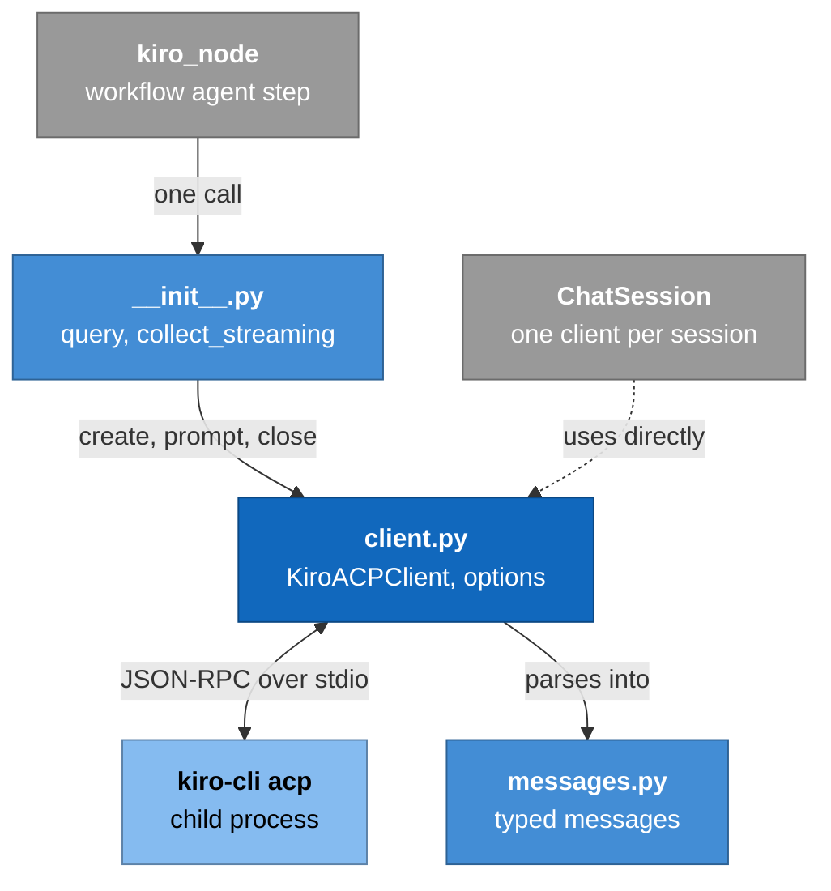
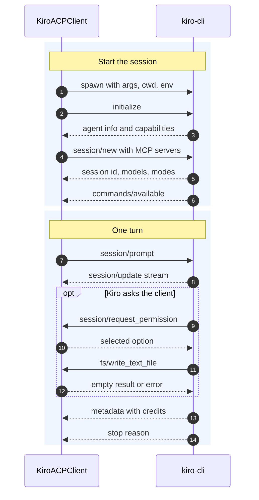

# Module: Kiro agent SDK (`kiro-agent-sdk`)

> **Describes:** genesis v0.81.0 (Phase 51) · **Last reviewed:** 2026-11-11 · C4 level 3 · area `sdk-acp`
>
> Phase 53 is replacing this client with one for Kiro's v3 engine. This document describes the client that
> shipped in v0.81.0 (`client.py`). It will be rewritten when Phase 53 is released.

## 1. Purpose

`kiro-agent-sdk` is the only code in Genesis that talks to the Kiro agent. It starts `kiro-cli acp` as a child
process, speaks the **Agent Client Protocol (ACP)** with it, and gives Python callers a simple interface: send a
prompt, receive a stream of typed messages, get a result with the metered credits.

It also answers the questions Kiro asks the client during a turn: "may I run this tool?" and "please read or write
this file". The answers to those questions are how Genesis enforces read-only chat and the chat write sandbox.

## 2. At a glance

| Item | Value |
|---|---|
| Package / import name | `kiro-agent-sdk` / `kiro_agent_sdk` |
| Code | `packages/kiro-agent-sdk/src/kiro_agent_sdk/` (`__init__.py`, `client.py`, `messages.py`, `handoff.py`) |
| Dependencies | None outside the Python standard library |
| Used by | `genesis-core`'s agent node (through `KiroAcpProvider`) for workflow turns; `genesis/chat/manager.py` for chat sessions |
| Talks to | `kiro-cli acp`, a local program the user installs and signs in to |
| Protocol | JSON-RPC 2.0, one JSON object per line, over the child's stdin and stdout; protocol version 1 |
| Version | The repo's shared version (ADR-080); it has no compatibility key of its own |

## 3. Concepts

| Term | Meaning |
|---|---|
| **ACP** | A JSON-RPC protocol between an editor-like *client* and an *agent*. Here Genesis is the client and `kiro-cli acp` is the agent. |
| **Session** | One conversation with the agent, opened with `session/new`. It fixes the working folder (`cwd`) and the MCP servers. |
| **Turn** | One `session/prompt` request and everything the agent streams until it answers that request. |
| **Update** | A `session/update` notification during a turn: a piece of the answer, a thought, a tool call, a tool result, a plan. |
| **Agent → client request** | A request the agent sends to the client during a turn: `session/request_permission`, `fs/read_text_file`, `fs/write_text_file`. The client must answer or the turn waits. |
| **Trust** | Tools Kiro may run without asking, set by launch flags (`--trust-all-tools` or `--trust-tools a,b`). For MCP tools Kiro matches the namespaced form `@server/tool` (L-017). |
| **Permission mode** | How the client answers a permission request for an untrusted tool: `auto_approve`, `auto_deny` or `ask`. |
| **Metering** | Kiro's `_kiro.dev/metadata` notification, which carries the credits a turn used. |

## 4. Structure



A workflow agent node calls the one-call helpers in `__init__.py`, which create a client, run one prompt and
close it. Chat holds a client for the life of a session and calls it directly (dotted line). The client is the
only part that talks to the `kiro-cli` process; it sends requests and answers, reads responses and updates, and
turns them into the typed messages in `messages.py`.

| File | Contents |
|---|---|
| `__init__.py` | `query()` (start, stream one prompt, close), `collect_streaming()` (the same plus an observer callback, returning a `TurnResult`), `collect()`, `collect_json()`, `extract_json()`, `load_mcp_servers()` (read an `mcp.json` into ACP form), `load_dotenv()` |
| `client.py` | `KiroAgentOptions`, `KiroACPClient` (process, JSON-RPC plumbing, dispatch, permission and file answers, metering, turn loop, update translation), `extract_tool_output()` |
| `messages.py` | `SystemInit`, `AgentMessageChunk`, `AgentThoughtChunk`, `ToolCall`, `ToolCallUpdate`, `PlanUpdate`, `ResultMessage`, `UnknownMessage`, `TurnResult`, `PermissionRequest` |
| `handoff.py` | An older `RunWorkspace` / `Doc` pair, kept for compatibility. Genesis uses the one in `genesis-core` |

## 5. How it works

### 5.1 Starting a session

`KiroACPClient.start()`:

1. **Find the binary:** `options.kiro_cli_path`, else `kiro-cli` on `PATH`, else `~/.local/bin/kiro-cli`. If none
   exists it raises `FileNotFoundError`.
2. **Build the arguments:** `acp`, then `--trust-all-tools` (when `trust_all_tools` is true and no list is given)
   or `--trust-tools <comma list>`, then `--agent`, `--model`, `--agent-engine` if set, then `extra_args`.
3. **Start the process** with `cwd` = `options.cwd`, the parent's whole environment, and a 64 MB line limit
   (asyncio's default 64 KB is too small for large tool results).
4. **Start two background tasks:** the stdout reader (`_read_loop`) and a stderr drain that keeps the last 200
   lines for error messages.
5. **`initialize`** with protocol version 1 and the client's capabilities: file reads yes, file writes =
   `allow_fs_write`, terminal no. Store the agent's capabilities (for example whether prompts may carry images).
6. **`session/new`** with `cwd` and `mcpServers` (each `{name, command, args, env: [{name, value}]}`). Store the
   session id, the available models and modes.
7. **Wait up to one second** for the `_kiro.dev/commands/available` notification, so the result carries the
   slash-command catalog.
8. Return a `SystemInit` message with the agent's name, version, session id, capabilities, models, modes,
   commands, prompts and tools.

Steps 5 and 6 each time out after `startup_timeout` (default 30 s; workflow nodes pass 120 s). A timeout raises.



The first phase starts the process, initialises the protocol and opens a session with the MCP servers. In the
second phase the client sends the prompt and Kiro streams updates. Kiro may also ask the client questions
(permission, file writes), which the client must answer. A metering notification carries the credits. The prompt
request's answer, with the stop reason, ends the turn.

### 5.2 A turn

`prompt(text, images=None)` sends `session/prompt` with the content parts. Text is always the first part. Image
parts are added only if the agent advertised `promptCapabilities.image`; otherwise they are dropped. The content
is sent under both the `content` and the `prompt` keys, because Kiro versions have used both.

The shared turn loop (`_turn`) then:

1. Creates a queue. The reader puts every notification of this turn into it.
2. Waits for whichever comes first: a queued notification or the answer to the prompt request.
3. For each notification, folds metering data into a per-turn accumulator and translates it into zero or more
   typed messages, which it yields to the caller.
4. When the prompt answer arrives, drains anything still queued and stops.
5. Yields a final `ResultMessage` with the stop reason (default `end_turn`), the concatenated answer text, an
   `error` string if the request failed or timed out, and `usage`.

The prompt request waits at most `turn_timeout` (default 300 s; workflow nodes pass 420 s). A timeout or a JSON-RPC
error does not raise; it becomes `ResultMessage.error`.

`collect_streaming(prompt, options, on_message=…)` wraps all of this: start a client, stream one prompt, call
`on_message` for each message (exceptions in the callback are swallowed), collect tool calls, close the client,
return a `TurnResult(text, stop_reason, error, tool_calls, messages, usage)`.

### 5.3 How updates become messages

The reader accepts `session/update`, `session/notification` and `session/notify`, and update kinds in snake_case
or PascalCase, because ACP naming has varied across Kiro versions.

| Update kind | Message | Notes |
|---|---|---|
| `agent_message_chunk` | `AgentMessageChunk(text)` | Also appended to the turn's answer text |
| `agent_thought_chunk`, `agent_reasoning_chunk` | `AgentThoughtChunk(text)` | |
| `tool_call` | `ToolCall(tool_call_id, title, kind, status, name, raw_input)` | `name` is `_meta.kiro.toolName` when present, else the part after the last `/` in the title |
| `tool_call_update` | `ToolCallUpdate(tool_call_id, status, name, raw_input, output, content)` | `output` is the text found in `rawOutput` (MCP results are there, not in `content`); a JSON dump of `rawOutput` if it has no text parts |
| `plan` | `PlanUpdate(entries)` | |
| anything else | `UnknownMessage(method)` | Kept so nothing is silently lost |

Three notifications are handled outside any turn: `_kiro.dev/commands/available` (stored and passed to
`on_commands`), and `_kiro.dev/compaction/status` and `_kiro.dev/clear/status` (passed to `on_session_status`).

### 5.4 Permission requests

Kiro asks `session/request_permission` before it runs a tool that is not trusted. The request carries a tool
call id, a title such as `Running: @server/tool`, and a list of options (allow and reject variants). It does not
carry the tool's arguments; a caller that needs them matches the tool call id with the preceding `tool_call`
update.

| `permission_mode` | Answer | Used by |
|---|---|---|
| `auto_approve` (default) | The first option whose kind starts with `allow` | Workflow agent nodes |
| `auto_deny` | The first option whose kind starts with `reject` or `deny`; if there is none, the request is cancelled so the turn continues | Read-only chat and the feature-spec chat |
| `ask` | Calls `on_permission(PermissionRequest)` on a background task, so the reader is never blocked. The callback returns an option id or `None`. An unknown id, `None`, an exception or a timeout (`permission_timeout`, default 300 s) is a denial | Copilot chat: each mutating control tool shows the user a confirm card |

`ask` without a callback behaves like `auto_deny`. Failing closed is deliberate: nothing can approve a tool by
accident (ADR-031, ADR-033).

### 5.5 File requests

| Request | Answer |
|---|---|
| `fs/read_text_file` | Reads the path as UTF-8 and returns its content. There is no path restriction on reads |
| `fs/write_text_file` | Refused if `allow_fs_write` is false. If `fs_write_root` is set, the target is resolved (collapsing `..` and following symlinks) and refused unless it is the root or inside it; a relative path is taken relative to the root. Otherwise writes the file, creating folders |
| Any other request | Answered with an empty result, so the agent is never left waiting |

Chat sets `allow_fs_write=True` with `fs_write_root` = `~/.genesis/skill-output/<session id>`, so a skill can write
documents there and nowhere else (ADR-034).

### 5.6 Metering

During a turn Kiro sends `_kiro.dev/metadata` one or more times. Intermediate ones carry
`contextUsagePercentage`. The final one carries `meteringUsage`, a list of `{value, unit, unitPlural}`, and
`turnDurationMs`. The client sums the values whose unit is `credit`; the last complete metering wins.
`ResultMessage.usage` is always a dict:

```json
{"credits": 1.42, "context_pct": 18.5, "turn_duration_ms": 41230, "provenance": "metered"}
```

When no metering arrives, `credits` is `null` and `provenance` is `unavailable`. The SDK never estimates (ADR-032).

### 5.7 Other session controls

| Method | ACP call | Notes |
|---|---|---|
| `set_model(model_id)` | `session/set_model` | Also settable at launch with `options.model` |
| `set_mode(mode_id)` | `session/set_mode` | Agent personas advertised on `session/new` |
| `execute_command(command)` | `_kiro.dev/commands/execute` | Streams like a prompt, bounded by `command_timeout` (120 s). Chat does not use it for slash commands: it sends them as ordinary prompts (L-046) |
| `available_models`, `current_model_id`, `available_commands`, `available_tools` | — | From `session/new` and the commands notification |
| `stderr_text` | — | The last 30 stderr lines, for error messages |
| `close()` | — | Sends SIGTERM to `kiro-cli`, waits 5 s, then SIGKILL; cancels the reader tasks |

## 6. Interfaces

### 6.1 `KiroAgentOptions`

| Field | Default | Meaning |
|---|---|---|
| `cwd` | current folder | Working folder for the process and the session |
| `trust_all_tools` | `True` | Pass `--trust-all-tools` when no list is given |
| `trust_tools` | `None` | Pass `--trust-tools` with this list; MCP tools as `@server/tool` |
| `permission_mode` | `auto_approve` | Section 5.4 |
| `on_permission`, `permission_timeout` | `None`, 300 s | The `ask` callback and its limit |
| `allow_fs_write` | `True` | Whether file writes are allowed at all |
| `fs_write_root` | `None` | The only folder writes may land in |
| `agent`, `model`, `agent_engine` | `None` | Kiro launch flags |
| `kiro_cli_path`, `extra_args` | `None`, `[]` | Binary path and extra flags |
| `mcp_servers` | `[]` | ACP MCP entries; `env` must be a list (L-001) |
| `startup_timeout`, `turn_timeout`, `command_timeout` | 30, 300, 120 s | Limits |
| `stream_limit_bytes` | 64 MB | Longest single line the reader accepts before switching to chunked recovery |
| `on_commands`, `on_session_status` | `None` | Callbacks for the extension notifications |
| `debug` | `False` | Print every frame to stderr (also `KIRO_ACP_DEBUG=1`) |

### 6.2 How Genesis sets the options

| Caller | cwd | Trust | Permission mode | File writes | Lifetime |
|---|---|---|---|---|---|
| Workflow agent node (`kiro_node`) | The run folder | All, or the node's tools capped by allowlists | `auto_approve` | Allowed, no root | One turn (`collect_streaming`) |
| Chat, read-only | `~/.genesis` (finds the managed skills) | The chat read list | `auto_deny` | Only in the session's output folder | The live session; one `prompt` per message |
| Chat, copilot | `~/.genesis` | Read list plus the control server's read tools | `ask` | Only in the session's output folder | As above |
| Chat, feature spec | The session's output folder | Read list plus Kiro's file read and write tools | `auto_deny` | Only in the session's output folder | As above |

## 7. Data

The SDK stores nothing. It keeps in memory: the session id, pending request futures, the last 200 stderr lines,
the models, modes and command catalog, and per turn a notification queue, the answer text and the metering
accumulator.

## 8. Failure handling

| Failure | Behaviour |
|---|---|
| `kiro-cli` not found | `FileNotFoundError` from `start()` |
| `initialize` or `session/new` too slow | `asyncio.TimeoutError` from `start()`; the caller decides (a workflow run fails) |
| The agent answers a request with a JSON-RPC error | The prompt's `ResultMessage.error` holds the error text |
| A single line longer than the stream limit | The reader reads it in chunks up to the newline and stays in sync |
| A line that is not JSON | Ignored |
| `kiro-cli` exits during a turn | The reader stops at end of file. The pending prompt request is not failed early, so the turn ends with a timeout error after `turn_timeout` |
| An observer callback raises | Swallowed; the turn continues |

## 9. Configuration

The SDK reads one environment variable itself, `KIRO_ACP_DEBUG`. Everything else comes from `KiroAgentOptions`.
The child process inherits the caller's whole environment; Genesis never sets `KIRO_HOME` in v0.81.0, so Kiro uses
the user's own `~/.kiro` (sign-in, global settings, global MCP servers).

## 10. Extending the SDK

- **A new ACP request from the agent:** add a branch in `_handle_agent_request`. Answer every request, even with
  an error, or the turn hangs.
- **A new update kind:** add it to `_translate` and, if the platform should show it, map it in
  `genesis-core`'s `_emit_message` and in chat's event mapping.
- **Before relying on a Kiro behaviour, probe the installed CLI.** The extension surface is richer than the public
  docs and changes between versions (L-044).

## 11. Design decisions

| Decision | In plain words | ADR |
|---|---|---|
| Narrow Kiro turns over ACP | Kiro is driven as a protocol peer, not as a CLI that prints text | ADR-002 |
| MCP servers per session | Each session gets its servers in `session/new`; no global `mcp.json` | ADR-004, ADR-020 |
| Name: `kiro-agent-sdk` | | ADR-016 |
| Chat is fail-closed | `auto_deny` or `ask`, never trust-all, `@server/tool` allowlists | ADR-031, ADR-033 |
| Real metered credits | Read `_kiro.dev/metadata`; never estimate | ADR-032 |
| Bounded file writes for skills | `fs_write_root` confines writes to the session's folder | ADR-034 |
| Mirror the CLI surface in chat | Models, modes, slash commands, compaction, images | ADR-045 |

## 12. Known pitfalls

- MCP `env` must be a list of `{name, value}` (L-001).
- Trust lists for MCP tools must use `@server/tool` (L-017).
- Skills load from `<cwd>/.kiro/skills/`; there is no ACP parameter for them (L-024).
- Probe the installed CLI before designing against documentation (L-044).
- Send slash commands through `prompt()`, not `_kiro.dev/commands/execute` (L-046).
- Exported chat Markdown must use the real return shapes (L-047).
- In an `auto_approve` session, trust does not limit what runs (see
  [core-engine.md](core-engine.md#53-how-tool-trust-is-computed) and ADR-083).

## 13. Tests

Tests in `packages/kiro-agent-sdk/tests/` at v0.81.0 drive the client against fake processes; none needs Kiro.

| Test file | Covers |
|---|---|
| `test_transport.py` | Name normalisation, text extraction, update translation, launch arguments |
| `test_permission_policy.py`, `test_permission_ask.py` | The three permission modes, fail-closed behaviour |
| `test_fs_write_sandbox.py` | Write refusal, the write root, traversal and symlink escapes |
| `test_usage_metering.py` | Credit accumulation and provenance |
| `test_tool_output.py` | Extracting tool results from `rawOutput` |
| `test_acp_extensions.py` | Images, the command catalog, model and mode switching, `execute_command` |
| `test_sdk_helpers.py` | `extract_json`, `load_mcp_servers`, `load_dotenv`, `collect_streaming` |
| `test_handoff.py` | The legacy workspace helpers |

Gate commands, from `packages/kiro-agent-sdk/`: `../../.venv/bin/ruff check src tests` and
`../../.venv/bin/python -m pytest -q`.

## 14. Code map

| To change… | Look in |
|---|---|
| Launch flags | `KiroACPClient._build_args` |
| The handshake | `KiroACPClient.start` |
| Permission answers | `_handle_permission`, `_resolve_permission_ask`, `_first_deny`, `_permission_request` |
| File answers and the write sandbox | `_handle_agent_request` |
| The turn loop | `_turn`, `prompt`, `execute_command` |
| Update translation | `_translate`, `_tool_name`, `extract_tool_output` |
| Credits | `_accumulate_meta`, `_finalize_usage` |
| The one-call helpers | `__init__.py` (`query`, `collect_streaming`, `collect`) |
