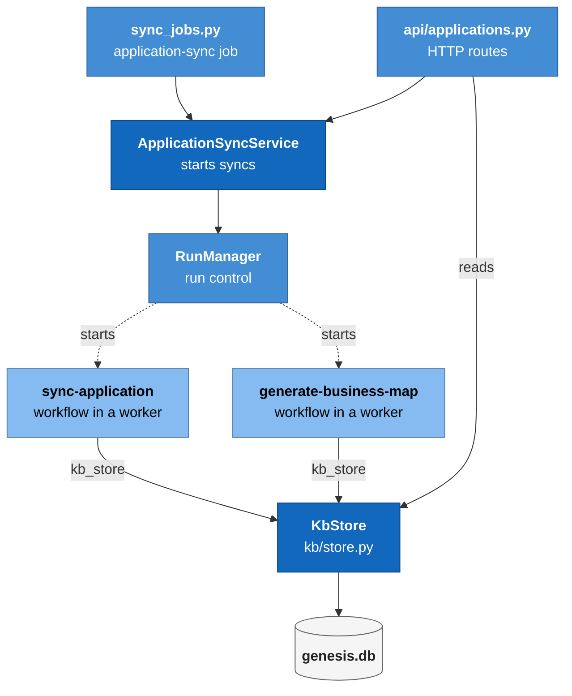
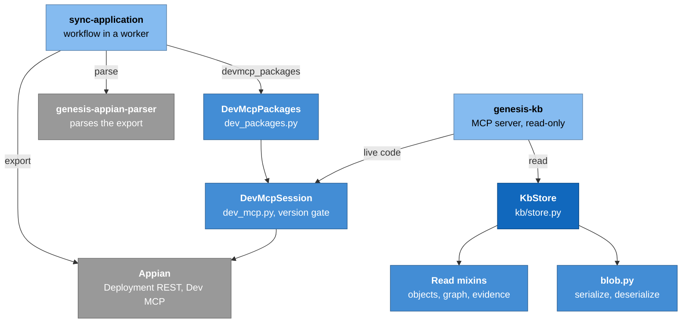
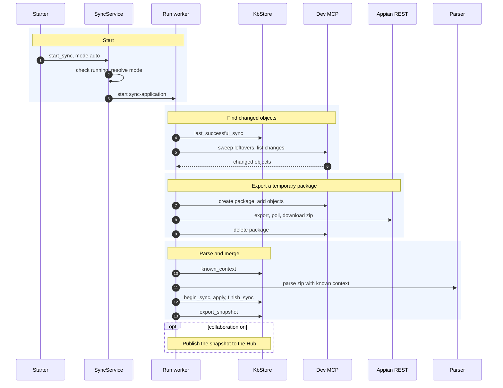

# Module: knowledge base and sync (`genesis/kb/store.py`)

> **Describes:** genesis v0.81.0 (Phase 51) · **Last reviewed:** 2026-11-11 · C4 level 3 · area `kb-sync`

## 1. Purpose

This module keeps a local, code-free model of each Appian application that a team works on. The model is the
knowledge base (KB). It lists the application's objects, the dependencies between them, the bundles that group
them, and the history of how all of that changed from one sync to the next. It also stores the business map: a
business-language summary of what the application does.

The central promise is **the KB never holds object source code** (ADR-037). The parser reads SAIL only to find
references and descriptions, and throws the SAIL away. When someone needs code, Genesis asks the Appian
environment live through the Dev MCP. A second promise follows from the first: **the only source of KB data is the
one environment marked Dev** (ADR-036, ADR-048). Nothing else feeds the KB, except a teammate's published copy
through the Hub (see [collaboration-hub.md](collaboration-hub.md)).

The module has four parts:

- **`KbStore`**: the repository over the `kb_*` tables. It applies parse results and answers every read.
- **The sync path**: `ApplicationSyncService`, the `sync-application` workflow, the Dev MCP client and the package
  client. Together they decide how to refresh an application and write the result into `KbStore`.
- **The business map**: the evidence pack that `KbStore` builds, the `generate-business-map` workflow that turns it
  into a business model, and the storage of that model (ADR-039).
- **Read surfaces**: the `/api/applications` routes and the read-only `genesis-kb` MCP server.

## 2. At a glance

| Item | Value |
|---|---|
| Code | `genesis/kb/store.py` and mixins `_object_reads_mixin.py`, `_graph_reads_mixin.py`, `_relationship_reads_mixin.py`, `_evidence_mixin.py`; `genesis/kb/blob.py`, `object_types.py`, `dev_mcp.py`, `dev_packages.py`; `genesis/services/application_sync.py`; `genesis/api/applications.py`; `genesis/runtime/sync_jobs.py`; `genesis/mcp/kb_server.py` |
| Library code | `genesis-workflows/workflows/sync-application/`, `genesis-workflows/workflows/generate-business-map/` |
| Runs in | The app process (`KbStore`, routes, service, scheduler job). The two workflows run in a run worker and reach `KbStore` through `ctx.extras["kb_store"]`. The `genesis-kb` server runs as its own stdio process started by Kiro. |
| Depends on | `genesis/db` (`Database`, migrations); `genesis-appian-parser` (lazy import in `known_context` only); `genesis/runs` (`RunManager.start`); `genesis/config` (environments, MCP registry, secrets); the Dev MCP (a managed-native server); the Appian Deployment REST API |
| Used by | The web Applications pages (through `/api/applications`); chat and workflow agents (through `genesis-kb`); the Object Wiki, stories, test impact and test design (they read `kb_objects`); the Hub sharing code (`export_snapshot`, `hydrate_from_blob`); the scheduler |
| Stores | Tables `kb_applications`, `kb_syncs`, `kb_objects`, `kb_dependencies`, `kb_bundles`, `kb_bundle_members`, `kb_releases`, `kb_business_maps` in `genesis.db`. Run artifacts (export zip, `result.json`, `report.json`) live on the run blackboard, not in the KB. |
| Key ids and versions | `sync-application` workflow (modes `auto`, `baseline`, `full`, `incremental`); `KB_FORMAT_VERSION` from the parser; `covered_until` watermark; `genesis-delta-` package prefix; `BusinessModel` `schema_version` 1 |
| Decisions | ADR-036, ADR-037, ADR-038, ADR-039, ADR-047, ADR-073, ADR-074 |

## 3. Concepts

| Term | Meaning |
|---|---|
| **KB (knowledge base)** | The local, code-free model of each tracked application, kept in the `kb_*` tables. |
| **Tracked application** | An application with a row in `kb_applications`, keyed by `app_uuid`. A user adds it from the list of applications found in the Dev environment. |
| **Dev environment** | The one environment tagged Dev in Settings. It supplies the URL and credentials for every KB export and Dev MCP call (ADR-036, ADR-048). |
| **Sync** | One attempt to refresh an application's KB. It has a row in `kb_syncs` with a `kind`, a `status` and counts. |
| **Sync kind** | `baseline` (first full sync), `full` (re-export the whole app and diff), `incremental` (only changed objects), `delta` (the old name for `full`, still present in old rows), `hub-pull` (a teammate's snapshot applied locally). |
| **Mode** | What a caller asks for: `auto`, `baseline`, `full`, `incremental`. `refresh` means `auto`; `delta` means `full`. |
| **SCD-2** | "Slowly changing dimension, type 2": an object or edge row is never edited when it changes. The old row is closed (`valid_to_sync` set) and a new row is opened (`valid_from_sync` set). Current rows have `valid_to_sync IS NULL`. |
| **`diff_hash`** | A hash of an object's content, computed by the parser. Equal hashes mean the object did not change. |
| **Derived fields** | Values that depend on the whole graph, not on one object: inbound and outbound counts, hub flag, bundled flag, orphan flag. They are refreshed in place without a new version. |
| **Bundle** | A group of objects reachable from one entry point (a process, an action and so on), computed by the parser. See [appian-parser.md](appian-parser.md). |
| **Partial parse** | A parse result that covers only some objects of an application, produced by an incremental parse. It carries `stats.incremental`. |
| **`covered_until`** | A UTC instant stored in a sync's details. It is the moment just before the sync started listing or exporting. The next incremental sync lists changes from there. |
| **Delta package** | A temporary Appian package named `genesis-delta-<UTC timestamp>` that holds the changed objects. Genesis creates it, exports it and always deletes it (ADR-073). |
| **Delta roots** | Objects that the parser says must be in every delta package so the incremental parse can rebuild bundles (all entry points and similar). They come from `genesis_appian_parser.delta_roots`. |
| **Known context** | The current objects and edges of the KB, given to the parser as `KnownObject` and `KnownEdge` so an incremental parse can resolve references to objects that are not in the package. |
| **Snapshot** | The whole current KB as one parse-result-shaped dict (`export_snapshot`). It is what gets published to the Hub. |
| **Evidence pack** | A capped, code-free summary of the current KB. It is the only input the business-map agents see. |
| **Business map** | The stored `BusinessModel` for an application: summary, domain, entities, capabilities, actors and value streams. Status is `generating`, `ready`, `stale`, `failed` or `absent`. |
| **Dev MCP** | The managed-native server `appian-dev`. It reads design objects live. The sync uses it directly for package work (ADR-038, ADR-073). |
| **Version gate** | A check in newer Dev MCP builds: every call is refused unless the site plugin and the server bundle come from the same build. |

## 4. Structure



The routes and the scheduler job both start syncs through `ApplicationSyncService`, which asks `RunManager` to start the `sync-application` workflow. The workflow and the business-map workflow run in workers. They write into `KbStore` through `ctx.extras["kb_store"]`. The routes read the KB directly from `KbStore`, and `KbStore` keeps everything in `genesis.db`.



The workflow exports from Appian and parses the export with the parser library. Incremental syncs also use `DevMcpPackages` through `ctx.extras["devmcp_packages"]`, which talks to Appian through `DevMcpSession`. The `genesis-kb` server opens the same database read-only and reuses the read methods that `KbStore` gets from its mixins; it fetches live SAIL code through `DevMcpSession` (ADR-037).

| File | Main classes and functions |
|---|---|
| `genesis/kb/store.py` | `KbStore`: `register_application`, `get_application`, `archive_application`, `untrack_application`, `upsert_business_map`, `get_business_map`, `business_map_status`, `set_business_map_status`, `begin_sync`, `finish_sync`, `update_sync_details`, `apply`, `hydrate_from_blob`, `list_syncs`, `latest_sync`, `last_successful_sync`, `known_context`, `export_snapshot`, `tag_release`, `list_releases`, `list_applications`, `get_app_overview`. Private: `_apply_delta`, `_apply_incremental`, `_apply_derived`, `_refresh_object_in_place`, `_open_object`, `_close_object`, `_open_edge`, `_recompute_bundles`. Helper `_dedupe_by`. Constant `FULL_KINDS`. |
| `genesis/kb/_object_reads_mixin.py` | `KbObjectReadsMixin`: `search_objects`, `get_dependencies`, `get_object`, `search_bundles`, `get_bundle`, `list_orphans` |
| `genesis/kb/_graph_reads_mixin.py` | `KbGraphReadsMixin`: `get_dependency_path`, `get_transitive_dependencies` (breadth-first over current edges); module function `current_adjacency` |
| `genesis/kb/_relationship_reads_mixin.py` | `KbRelationshipReadsMixin`: `get_entry_points_for_object`, `get_dependents_batch`, `get_precedents_batch`, `get_shared_objects`, `get_hub_objects` |
| `genesis/kb/_evidence_mixin.py` | `KbEvidenceMixin`: `build_evidence_pack`, `_evidence_documents`, `_evidence_entity`, `_evidence_activity` |
| `genesis/kb/blob.py` | `serialize_result` (gzip, deterministic), `deserialize_result` (returns `_ResultShim`) |
| `genesis/kb/object_types.py` | `CANONICAL_TYPES`, `normalize_object_type`: one place that maps raw type strings to a fixed set of keys, used by surfaces that show an object type (Object Wiki and others) |
| `genesis/kb/dev_mcp.py` | `object_code`, `available_applications`, `version_info`, `parse_version_info`, `classify_tool_error`, `mismatch_message`, `tool_result_data`, `DevMcpSession`, `DevMcpToolError` |
| `genesis/kb/dev_packages.py` | `DevMcpPackages`, `PackageGuardError`, `ALLOWED_TOOLS`, `DELTA_PREFIX`, `package_type`, `parse_modified_on`, `delta_package_name`, `resolve_spec`, `open_packages` |
| `genesis/services/application_sync.py` | `ApplicationSyncService` (`start_sync`, `resolve_mode`, `is_sync_running`, `latest_sync_run`, `supports_incremental`, `dev_label`), `SyncBusyError` |
| `genesis/api/applications.py` | `register_applications_routes` |
| `genesis/runtime/sync_jobs.py` | `DEFAULT_JOBS`, `APP_SYNC_DEFAULT_OPTIONS`, `app_sync_skip_reason`, `register_sync_jobs` (handlers `application_sync`, `document_library_sync`, `kb_hub_pull`) |
| `genesis/mcp/kb_server.py` | `TOOLS`, `KbAccessor`, `_call`, `_dispatch`, `main` |
| `genesis-workflows/workflows/sync-application/graph.py` | `META`, `build`, pure helpers (`normalize_mode`, `merged_options`, `full_sync_reason`, `size_fallback_reason`, `look_back_from`), validators `check_export`, `check_parse`, `check_kb`, nodes and routers |
| `genesis-workflows/workflows/generate-business-map/graph.py` | `META`, `build`, validators `check_evidence`, `check_capabilities`, `check_value_streams`, `check_model`, `COVERAGE_MIN` |

## 5. How it works

### 5.1 Adding an application and the first sync

1. The Applications page calls `GET /api/applications/available`. The route calls `dev_mcp.available_applications`,
   which starts the Dev MCP and pages through `listApplications`. It returns applications not yet tracked, plus the
   Dev environment label. If the Dev MCP is missing, a secret is missing or the call fails, the result is
   `available: false` with a reason, and the page offers to type an application UUID instead. The helper never
   raises.
2. The user picks an application. `POST /api/applications` checks that `app_uuid` is not empty and that it is not
   the Genesis Hub application (409 if it is). It then requires a Dev environment (400 if none).
3. The route calls `KbStore.register_application`, an upsert that sets status `active`. It then starts a sync in
   `baseline` mode through `ApplicationSyncService.start_sync`.
4. `start_sync` first checks `is_sync_running`. It looks at the newest `sync-application` run whose
   `inputs.app_uuid` matches, reconciles its status, and refuses (`SyncBusyError`, mapped to HTTP 409) if it is not
   terminal. The Appian export runs one at a time, so a second sync for the same app would fail anyway.
5. `start_sync` resolves the mode (section 5.2) and calls `RunManager.start("sync-application", inputs,
   environment=<dev label>)`. The response carries the run id as `sync_run_id`.
6. The workflow runs (section 5.4). The page follows the run and the sync through `GET
   /api/applications/{app_uuid}/sync-status`, which returns the run's status and the newest `kb_syncs` row.

### 5.2 How the mode is resolved

`ApplicationSyncService.resolve_mode(app_uuid, requested)` works as follows:

1. An empty, `auto` or `refresh` request becomes `baseline` if the application has no `baseline_sync_id`, and
   `auto` otherwise.
2. `full` or the legacy `delta` becomes `full`.
3. `baseline` and `incremental` pass through.
4. Any other value raises `ValueError`, which the route maps to HTTP 400.
5. The service then reads the installed workflow's `inputs_schema`. If the `mode` enum lacks the resolved mode, the
   library is older than `sync-application` 0.3.0. Every resolved mode other than `baseline` then maps to `delta`
   (a full re-export). If the schema cannot be read (no loader, or the workflow is not installed), the current
   contract is assumed.

`start_sync` passes `options` (`full_every_days`, `max_changed`, `max_changed_pct`) into the run inputs only when
the installed workflow declares an `options` property.

### 5.3 The sync-application workflow, step by step

```mermaid
flowchart TB
    S(( )):::startpt
    A["<b>resolve_inputs</b>"]:::comp
    B["<b>plan_sync</b>"]:::comp
    D["<b>build_delta_package</b>"]:::comp
    X["<b>export_package</b>"]:::comp
    E["<b>record_empty_sync</b>"]:::comp
    V["<b>v_export</b><br/>validator"]:::proc
    P["<b>parse_package</b>"]:::comp
    VP["<b>v_parse</b><br/>validator"]:::proc
    W["<b>write_kb</b>"]:::comp
    VK["<b>v_kb</b><br/>validator"]:::proc
    H["<b>publish_hub</b>"]:::comp
    PR["<b>present</b>"]:::comp
    ERR["<b>surface_error</b>"]:::bad
    F(( )):::endpt
    F2(( )):::endpt

    S --> A --> B
    B -- "incremental" --> D
    B -- "full" --> X
    B -- "empty" --> E
    D -- "no full sync yet" --> X
    D -- "validate" --> V
    X --> V
    V -- "retry_delta" --> D
    V -- "retry" --> X
    V -- "pass" --> P --> VP
    VP -- "pass" --> W --> VK
    VK -- "pass" --> H
    E --> H
    H --> PR --> F
    V -- "fail" --> ERR
    VP -- "fail" --> ERR
    VK -- "fail" --> ERR
    ERR --> F2

    classDef comp fill:#438dd5,stroke:#2e6295,color:#ffffff
    classDef proc fill:#85bbf0,stroke:#5d82a8,color:#000000
    classDef bad fill:#ffebee,stroke:#c62828,color:#b71c1c
    classDef startpt fill:#212121,stroke:#212121
    classDef endpt fill:#ffffff,stroke:#212121,stroke-width:3px
```



The graph has no agent step and no gate. LangGraph owns the control flow (ADR-001). The only write to Appian is
the temporary delta package (ADR-073). The nodes:

1. **`resolve_inputs`** validates `app_uuid` and decides the mode.
   - `baseline` is refused if the application already has a baseline. To re-baseline, the user untracks the
     application first.
   - `auto` with no baseline becomes `baseline`. Any other mode with no baseline raises an error.
   - If an explicit `package_uuid` is given, the sync is `full`.
   - For `auto` or `incremental`, the mode starts as `incremental` and becomes `full` with a recorded
     `fallback_reason` when any of these hold: `full_sync_reason` says so (section 5.7), the store has no
     `last_successful_sync`, `ctx.extras` has no `devmcp_packages`, or the parser has no `delta_roots`.
   - It records `covered_until` as "now". A full or baseline export snapshots the application after this instant.
2. **`plan_sync`** (incremental only; runs off the event loop with `asyncio.to_thread`).
   - It finds the last successful own sync (kinds `baseline`, `full`, `delta`, `incremental`; never `hub-pull`) and
     computes the listing start with `look_back_from`: that sync's `covered_until` (else `started_at`) minus 5
     minutes. If there is no such sync, the mode becomes `full`.
   - It records `listing_started` (the new `covered_until`) before it lists anything.
   - It opens a Dev MCP session, sweeps leftover `genesis-delta-*` packages older than 60 minutes (best effort),
     and calls `list_changed`.
   - A `version_mismatch` or `auth` Dev MCP error ends the run with a clear message. Any other Dev MCP failure
     falls back to `full`.
   - No changed objects: plan `empty`. Too many changed (`size_fallback_reason`): fall back to `full`. Otherwise it
     writes `delta/plan.json` to the blackboard and the plan is `incremental`.
3. **`build_delta_package`** (incremental only).
   - It reads the plan, reads `known_context`, and asks the parser for `delta_roots`.
   - It creates a `genesis-delta-*` package and adds the changed objects plus the roots.
   - Objects that cannot be added are recorded as `not_added`; this is a warning, not a failure. If none of the
     changed objects could be added, the mode becomes `full`.
   - It exports the package through the same Deployment REST function as a full export, and writes the zip to
     `uploads/package.zip`.
   - In a `finally` block it deletes the package. A failed delete is logged and recorded as `package_deleted:
     false`; the next run's sweep retries it.
4. **`export_package`** (full and baseline). It exports the whole application, or the one explicit package.
   See section 5.5 for the REST calls.
5. **`v_export`** checks the file exists and starts with ZIP magic bytes. On failure the router retries the export
   node while its attempt count is at most `retry_defaults.max` (2), so a node runs at most three times. After
   that the run goes to `surface_error`.
6. **`parse_package`** parses the zip with `genesis_appian_parser.parse`. An incremental parse also receives
   `known_objects` and `known_edges`. The result is written to `result.json` as plain data.
7. **`v_parse`** requires at least one object and refuses a result where errors are at least as many as objects.
   For an incremental sync it requires `stats.incremental` and requires that every changed object that was added
   to the package appears in the parse (unless the export finished with export errors). There is no retry.
8. **`write_kb`** (off the event loop). It calls `register_application`, `begin_sync`, `apply`, and `finish_sync`
   with the details record (section 5.6). On any exception it calls `finish_sync(sync_id, "failed")` with no
   details and re-raises. An incremental merge that removed any object raises, so a bad merge is never marked
   succeeded.
9. **`v_kb`** checks the write. For `baseline`, `0 < added <= parsed`. For the other modes, the three counters must
   exist and not be negative. For `incremental`, nothing may be removed and `added + modified` may not exceed the
   package's object count. It also requires the application to have a `baseline_sync_id`. There is no retry
   because a blind retry could duplicate a baseline.
10. **`record_empty_sync`** (plan `empty`). It writes a zero-count `incremental` sync so `covered_until` moves
    forward.
11. **`publish_hub`** calls `ctx.extras["kb_publish"]`. That function publishes `export_snapshot` to the Hub when
    collaboration is on and healthy, and returns `skipped` or `error` otherwise. A failure never fails the sync.
    When a version is published, the node stores it in the sync's details.
12. **`present`** writes `report.json`. **`surface_error`** raises a `RuntimeError` that names the first failed
    validator.

### 5.4 An incremental sync, end to end



The scheduler or a user asks the service to start a sync. The worker finds the last own sync, lists the objects changed since then, builds and exports a temporary package, deletes it, parses it against the KB's known context, and merges only the package objects. A snapshot goes to the Hub afterwards if collaboration is on.

### 5.5 The export calls

`_fetch_package_zip` in `sync-application/graph.py` is the one function that talks to the Deployment REST API.
Tests replace it. The calls are:

1. A multipart `POST {base}/suite/deployment-management/v2/deployments` with header `Action-Type: export` and a
   `json` part holding `uuids`, `exportType` (`application`, or `package` when a package uuid is given) and a name.
   The auth header is `appian-api-key` (L-031: the shape was copied from the vendor's own client after a guessed
   endpoint returned 405).
2. Polling `GET .../deployments/{uuid}` every 3 seconds, for at most 240 seconds, until the status is
   `COMPLETED`, `COMPLETED_WITH_EXPORT_ERRORS` or `PUBLISHED`.
3. Downloading the `packageZip` URL from the poll response.

The base URL comes from the Dev environment (`APPIAN_BASE_URL`). The API key comes from the Dev environment
(`APPIAN_API_KEY`), with a legacy fallback to the `appian-devops` secret scope for older installs (ADR-048).

HTTP 409 (a deployment is already running), 5xx, timeouts, and network errors are transient: the function records
`decisions.export_error` and returns nothing, and the validator retries. A 401, 403 or 404, or a missing URL or
key, is terminal and raises with an actionable message.

### 5.6 How `KbStore.apply` merges a parse result

`apply(sync_id, result, mode=..., removed_uuids=None)` is the single entry point for parse results. The
transaction is opened with `Database.tx()`.

1. A `delta` mode is treated as `full`.
2. **The partial-parse guard (L-077).** If `result.stats.incremental` is set, `baseline` and `full` raise
   `ValueError`. If `mode` is `incremental` and the result has no `stats.incremental`, it also raises. The caller
   cannot pass a partial result through a whole-app merge. The guard lives in the store because an earlier caller
   bug shrank a 2,763-object KB to 41.
3. Objects are de-duplicated by `object_uuid` and edges by `(source, target, dep_type)`. A real export can list the
   same object twice, and the table has `UNIQUE(app_uuid, object_uuid, valid_from_sync)` (L-032).
4. **`baseline`**: open every object and edge, and set `baseline_sync_id` if the application has none.
5. **`full`** (`_apply_delta`): compare each object's `diff_hash` with the current row. New objects are opened.
   Changed objects are closed and reopened. Unchanged objects get their derived fields refreshed in place. Objects
   absent from the result (or listed in `removed_uuids`) are closed. Edges are compared by their triple: missing
   ones are closed and new ones opened.
6. **`incremental`** (`_apply_incremental`): only the package's objects are compared. Nothing is ever closed as
   removed. For each package object, current outgoing edges absent from the result are closed and new ones opened.
   Edges whose source is outside the package are untouched. Bundles are replaced with the result's set, except
   when the parse reports `skipped_entry_points` or `incomplete_flow_bundles`: then existing bundles that were not
   rebuilt are kept. Finally `_apply_derived` updates the derived fields of every other current object in place,
   using `stats.derived`: `inbound_count`, `outbound_count`, `is_hub` and `is_bundled` inside the metadata JSON,
   and the `is_orphan` column.
7. For `baseline` and `full`, `_recompute_bundles` replaces the current bundle set (`release_label IS NULL`) and its
   members.
8. The business map is marked `stale` if it was `ready`. For `incremental`, only when an object or edge was added,
   modified or removed.
9. The method returns the counts. The workflow passes them to `finish_sync` together with the details record.

`finish_sync` records the status, the end time, and the three counters. If `details` is given it is stored as JSON
in `details_json`. The workflow's details record holds `sync_kind`, `requested_mode`, `covered_until`,
`parser_version`, `kb_format_version`, `fallback_reason`, `changed_count`, `package_name`, `package_objects`,
`skipped_count`, `skipped_objects` (at most 20) and `export_warnings`. A failed sync has no details, so
`covered_until` never moves on a failure (L-080).

### 5.7 When an automatic sync goes full

For `auto`, `resolve_inputs` calls `full_sync_reason` with the last successful full sync. The sync is full when:

1. No full sync is recorded.
2. The KB was built in an older format. The parser exports `KB_FORMAT_VERSION`. The workflow compares it with
   `details.kb_format_version` of the last full sync. If the field is missing but `details.parser_version` is 0.3
   or later, the recorded format counts as 1. If the field is missing and the parser is older, or nothing is
   recorded, the sync goes full. When the installed parser has no `KB_FORMAT_VERSION`, the workflow compares parser
   minor versions instead. See [appian-parser.md](appian-parser.md#57-the-diff-hash-and-kb_format_version).
3. For `auto` only, the last full sync is at least `full_every_days` old (default 7). This bounds drift from
   deletions, which an incremental sync never sees. An explicit `incremental` request skips this age check.

`plan_sync` adds two more reasons: the change set is above `max_changed` (default 500) or above `max_changed_pct`
(default 25) of the application's current objects, or the Dev MCP listing failed.

### 5.8 The watermark (`covered_until`)

1. A full or baseline sync records the instant before it exports. An incremental sync overwrites that value in
   `plan_sync` with the instant before it listed changes.
2. The value is stored only when the sync succeeds (L-080). An object edited while a sync runs is listed again by
   the next sync.
3. The next incremental sync lists from `covered_until` minus 5 minutes. `listObjects` filters by date, so
   `list_changed` asks from the day before and then filters on the exact `lastModifiedOn` timestamp. An object
   with an unreadable timestamp is kept, because refreshing an unchanged object is harmless.
4. Only the machine's own syncs count as anchors (`baseline`, `full`, `delta`, `incremental`). A `hub-pull` is
   a teammate's content as of the publisher's own coverage point, which this machine does not know (L-080).
5. The watermark moves past changed objects that could not be packaged, for example types a package cannot hold.
   Holding it back would pin it forever for objects that can never be packaged. Those objects are listed in
   `skipped_objects`, and the next full sync picks them up.

### 5.9 The package client and its guards (ADR-073)

`DevMcpPackages` wraps one open `DevMcpSession`. Its guards are in code, not configuration:

1. `ALLOWED_TOOLS` is fixed: `listObjects`, `listPackages`, `getPackage`, `createPackage`, `addPackageObjects`,
   `deletePackage`. Any other tool raises `ValueError` before anything is sent.
2. Packages it creates are named `genesis-delta-<UTC yyyymmddTHHMMSSZ>`.
3. `delete_delta_package` always re-reads the package with `getPackage` and refuses unless the name starts with
   `genesis-delta-` (`PackageGuardError`). A human's package cannot be deleted by this client.
4. `add_objects` writes only to a package this client created, or one that `getPackage` confirms is a
   `genesis-delta-*` package. It sends objects in batches of 50 and skips types a package cannot hold.
5. A failed batch is bisected. One unresolvable object makes the live Appian side fail every object in its batch
   (L-078), so the client retries the half-sets to isolate the bad ones. Partial failure is reported in the
   return value, not raised.
6. `sweep_leftovers` deletes `genesis-delta-*` packages older than 60 minutes (by created time, else last modified
   time). An undated package is left alone.
7. Paging (`PAGE_SIZE` 50) stops if the server ignores `offset`, and raises after 400 pages.

`DevMcpSession` is a blocking wrapper around one Dev MCP process. It runs on a private event loop in a daemon
thread and serialises calls. It passes resolved environment values to the child process only; it does not log them
or put them in error messages. Workflow nodes call it through `asyncio.to_thread`.

`resolve_spec` picks the launch spec from the `appian-dev-packages` registry entry, and falls back to `appian-dev`
(the same managed binary and environment) when the installed library has no such entry.

### 5.10 The Dev MCP version gate

Newer Dev MCP builds refuse every call unless the site plugin and the server bundle match. The refusal is a normal
`isError` result whose text starts with `Refused:`. `classify_tool_error` sorts failure text into
`version_mismatch`, `auth`, `unreachable` or `other`. `tool_result_data` raises `DevMcpToolError(kind, ...)` for an
error result. The sync treats `version_mismatch` and `auth` as terminal and shows the message from
`mismatch_message`. `version_info` calls `getDevMcpVersionInfo` (exempt from the gate) and returns a block with
`available`, `match`, both versions and a message. `GET /api/config/devmcp/version` serves it, and the "Test
connection" check in Settings reuses it. See [configuration-and-secrets.md](configuration-and-secrets.md).

### 5.11 The business map

1. `POST /api/applications/{app_uuid}/business-map/generate` requires a tracked application with a baseline
   (409 otherwise) and requires the `generate-business-map` workflow to be installed (409 otherwise). It starts the
   run and then sets an existing map's status to `generating`. If no map exists the status call does nothing.
2. **`resolve_inputs`** requires a baseline and records the latest sync id as the source.
3. **`extract_evidence`** calls `KbStore.build_evidence_pack`. The pack is deterministic and capped: entities (record
   types, ranked by inbound count, 60), activities (process and action bundles, by size, 80), surfaces (control
   panels and sites, 40), capability signals (AI skills, connected systems, integrations, web APIs, 40), actors
   (groups, 40), and up to 12 linked documents with up to 4,000 characters each. It also carries hubs, bundle counts,
   object-type counts and a `truncated` record of what was cut. It reads only `kb_*` tables and the parsed
   document text on disk. It reads no code and makes no network call.
4. **`v_evidence`** requires at least one entity and one activity.
5. Two agent steps, **`synthesize_capabilities`** and **`synthesize_value_streams`**, each wear the reliability
   trio with `retry_defaults.max` 2 and an `escalate` gate (ADR-011). They use no MCP server. The evidence pack is
   their whole input.
6. The validators require evidence grounding (every element cites object UUIDs that are in the pack), business
   language (a banned-word guard on object, bundle, interface, SAIL markers and similar), and well-formed value
   streams (a start and an end stage, no dangling links, decisions with at least two conditional branches).
7. **`compose_model`** builds the `BusinessModel` and computes coverage: how many of the pack's significant
   objects the model cites. `COVERAGE_MIN` is 0.3. **`v_model`** checks the structure and cross-references.
8. If coverage is below the floor, or the run was started with `review`, the run stops at the `review` gate. Otherwise
   **`persist_map`** calls `KbStore.upsert_business_map` (off the event loop), which deletes the current map row and
   inserts the new one with status `ready`, the source sync id, the run id and the metered credits.
9. A later sync marks a `ready` map `stale`. The map is point-in-time, and regeneration is on demand.

### 5.12 Scheduled syncs

`register_sync_jobs` wires three handlers onto the scheduler. The scheduler itself is described in
[scheduler-and-jobs.md](scheduler-and-jobs.md).

1. **`application-sync`**: skips with a reason when collaboration is on and this machine is not the designated one
   (`run_on_this_machine` option), when no Dev environment exists, when `sync-application` is not installed, or when
   the installed workflow predates incremental sync (L-081: an old library would turn every slot into a full
   re-export). Otherwise it goes through the tracked applications one at a time. It skips an app whose sync is
   already running, starts `start_sync(mode=None, options=...)`, and waits until the run is terminal or 1,200
   seconds pass. The job result is `ok`, `partial` or `error`, with a count by sync kind.
2. **`document-library-sync`**: starts one `sync-documents` library run. See [documents.md](documents.md).
3. **`kb-hub-pull`**: calls `collab.pull_kb_if_newer` for each tracked application, off the event loop.

### 5.13 Hub sharing: snapshot and hydrate

1. **Publish.** `export_snapshot(app_uuid)` returns the current KB in the shape of a parse result. Objects follow KB
   row order, edges are sorted, bundles are sorted by id and members by uuid, and there are no timestamps. An
   unchanged KB therefore produces identical bytes, and the Hub's content-hash check finds a duplicate.
   `blob.serialize_result` gzips with a fixed modification time for the same reason.
2. **Pull.** `blob.deserialize_result` rebuilds an attribute-style shim without importing the parser.
   `hydrate_from_blob` records a `hub-pull` sync. If the app already has current rows, it runs the same diff as a
   full merge. If not, it opens the whole pulled snapshot. In both cases it recomputes bundles, adopts the pull as
   the baseline if the app had none, and marks the business map stale. It runs in one transaction and blocks, so
   callers use `asyncio.to_thread`.
3. The publish route and the pull route live in `genesis/api/applications.py`. The Hub provider, the identity
   checks and the auto-pull loop belong to [collaboration-hub.md](collaboration-hub.md).

## 6. Interfaces

### 6.1 HTTP endpoints (`genesis/api/applications.py`)

| Method and path | Purpose |
|---|---|
| `GET /api/applications` | List tracked applications with object counts, bundle coverage and the last sync |
| `GET /api/applications/available` | Applications in the Dev environment not yet tracked (Dev MCP, best effort) |
| `POST /api/applications` | Track an application and start a `baseline` sync. Body: `app_uuid`, `name`. Returns `sync_run_id`. |
| `GET /api/applications/{app_uuid}` | The application row, overview, releases and recent syncs (404 if not tracked) |
| `DELETE /api/applications/{app_uuid}` | Untrack: delete the application's KB and related rows (section 7) |
| `POST /api/applications/{app_uuid}/sync` | Start a sync. Body: `mode` (optional). 409 if one is running, 400 on a bad mode or no Dev environment. |
| `GET /api/applications/{app_uuid}/sync-status` | The latest sync run's status plus the latest `kb_syncs` row |
| `POST /api/applications/{app_uuid}/pull` | Pull the Hub's KB copy if it is newer (409 if collaboration is off) |
| `POST /api/applications/{app_uuid}/publish` | Publish the current KB snapshot to the Hub (needs onboarding and a completed sync) |
| `GET /api/applications/{app_uuid}/objects` | Search objects. Query: `query`, `type`, `limit` |
| `GET /api/applications/{app_uuid}/objects/{object_uuid}` | One object's metadata, calls and called-by, bundles (no code) |
| `GET /api/applications/{app_uuid}/bundles` | Search bundles. Query: `query`, `type` |
| `GET /api/applications/{app_uuid}/bundles/{bundle_id}` | One bundle with its members |
| `GET /api/applications/{app_uuid}/business-map` | The stored map, or `{status: "absent"}` |
| `POST /api/applications/{app_uuid}/business-map/generate` | Start `generate-business-map`. Returns `run_id`. |
| `GET /api/applications/{app_uuid}/business-map/status` | The latest generation run plus the stored map's status |
| `GET /api/config/devmcp/version` | Live comparison of the Dev MCP plugin and bundle (route lives in `genesis/api/config_routes.py`) |
| `GET` and `PUT /api/system/sync-settings`, `POST /api/system/sync-settings/run-now` | The scheduled-sync settings. They live in `genesis/api/schedules.py`; see [scheduler-and-jobs.md](scheduler-and-jobs.md). |

The Object Wiki routes in `genesis/api/object_wiki.py` read `kb_objects` too. They belong to
[stories-and-workbench.md](stories-and-workbench.md).

### 6.2 Python API used by other modules

- `KbStore(db_or_path)`. The app builds one in `genesis/api/app.py`, and `genesis/runtime/context.py` builds one for
  each run context as `ctx.extras["kb_store"]`.
- `ctx.extras["devmcp_packages"]()` returns a context manager: `with ctx.extras["devmcp_packages"]() as pk:`. It
  starts one Dev MCP process for the block.
- `ctx.extras["kb_publish"](app_uuid)` returns `{published_version}`, `{skipped}` or `{error}` and never raises.
- `ApplicationSyncService(run_manager, kb_store, config)`: `start_sync`, `is_sync_running`, `resolve_mode`,
  `supports_incremental`. The route module, the scheduler job and the collaboration auto-pull (to avoid pulling
  during a sync) use it.
- `dev_mcp.object_code(config, object_uuid=..., object_type=..., object_name=...)` fetches live code. It returns
  `code_status: "unavailable"` with a reason when it cannot, and never invents code.
- `normalize_object_type(raw)` returns one of `CANONICAL_TYPES`; unknown or empty input returns `"other"`.

### 6.3 The `genesis-kb` MCP server

`python -m genesis.mcp.kb_server --db <genesis.db>` is a stdio JSON-RPC server. It opens the database with a
read-only SQLite connection (`mode=ro`) and reuses `KbStore`'s reads, so any attempt to write fails at SQLite.
Results are capped at 32 KB; an oversized result is replaced by a note asking for a narrower question. The tools:

| Group | Tools |
|---|---|
| Applications | `list_applications`, `get_app_overview` |
| Objects | `search_objects`, `get_dependencies`, `get_object_detail`, `get_orphan`, `list_orphans`, `get_object_code` |
| Graph | `get_dependency_path`, `get_transitive_dependencies`, `get_entry_points_for_object`, `get_dependents_batch`, `get_precedents_batch`, `get_shared_objects`, `get_hub_objects` |
| Bundles | `search_bundles`, `get_bundle` |
| Documents | `list_documents`, `get_document`, `search_documents` |

`get_object_code` and `get_orphan` fetch code live through `dev_mcp.object_code`. The library's `genesis-kb`
registry entry lists exactly these 20 tools as its allowlist. Chat trust and tool injection are in
[chat-and-skills.md](chat-and-skills.md).

### 6.4 Run events and contracts

- The sync workflows emit the canonical run events through the engine. The module adds no event kinds.
- The `kb_syncs.details_json` record (section 5.6) is a contract between the workflow, the scheduler's summary
  code, `GET /api/system/sync-settings` and the Applications page.
- `BusinessModel` (`schema_version` 1) is the contract between `generate-business-map`, `KbStore` and the web view.
- The snapshot and blob shape is the parse-result shape (`application`, `objects`, `edges`, `bundles`, `orphans`,
  `errors`, `stats`). See [appian-parser.md](appian-parser.md).

## 7. Data

All tables are in `genesis.db`. `m0007_kb.py` creates the core tables, `m0008_business_map.py` creates
`kb_business_maps`, and `m0023_incremental_sync.py` adds `kb_syncs.details_json`. The store never creates tables
(dependency rule 5 in [06-building-blocks.md](../06-building-blocks.md#63-dependency-rules)). See
[data-and-migrations.md](data-and-migrations.md).

| Table | Key columns | Meaning |
|---|---|---|
| `kb_applications` | `app_uuid` (primary key), `name`, `env_label`, `version_constant`, `baseline_sync_id`, `current_release`, `status` | One row per tracked application. `baseline_sync_id` is set by the first baseline or the first hub pull. `status` is `active` or `archived`. |
| `kb_syncs` | `sync_id`, `app_uuid`, `kind`, `status`, `run_id`, `window_start`, `window_end`, `objects_added`, `objects_modified`, `objects_removed`, `started_at`, `finished_at`, `details_json` | One row per sync attempt. `run_id` links to the run. A run that fails before `write_kb` has no row here. |
| `kb_objects` | `object_uuid`, `app_uuid`, `name`, `type`, `qname`, `type_id`, `description`, `diff_hash`, `is_entry_point`, `entry_point_kind`, `is_orphan`, `metadata_json`, `valid_from_sync`, `valid_to_sync` | Object metadata with SCD-2 validity. Unique on `(app_uuid, object_uuid, valid_from_sync)`. No code column exists. |
| `kb_dependencies` | `source_uuid`, `target_uuid`, `dep_type`, names and types of both ends, `valid_from_sync`, `valid_to_sync` | Dependency edges with SCD-2 validity. |
| `kb_bundles` | `bundle_id`, `bundle_type`, `root_uuid`, `name`, `parent_name`, `object_count`, `key_objects_json`, `entry_point_json`, `flow_json`, `snapshot_sync`, `release_label` | The current bundle set has `release_label` NULL. A tagged release keeps a copy under its label. `flow_json` is the stored code-free process flow. |
| `kb_bundle_members` | `bundle_pk`, `object_uuid`, `name`, `type`, `role`, `flow_order` | The objects in a bundle. |
| `kb_releases` | `app_uuid`, `version_label`, `sync_id`, `tagged_at`, `env_version_ref`, `notes` | A named point in time, pointing at a sync. |
| `kb_business_maps` | `app_uuid`, `release_label`, `schema_version`, `source_sync_id`, `model_json`, `summary`, `domain`, `coverage_json`, `status`, `run_id`, `credits`, `generated_at` | The stored business model. One current row per application (`release_label` NULL). |

**Who writes and who reads.**

- `KbStore` is the only writer of these tables. The `sync-application` and `generate-business-map` workflows write
  through it. The collaboration code writes through `hydrate_from_blob`.
- The route module, the `genesis-kb` server, the Object Wiki, test impact and test design, the feature stages and the
  stories code read them. The evidence pack also reads `kb_documents` and `kb_document_links` (read only).
- `untrack_application` deletes, in one transaction: bundles and their members, objects, dependencies, releases,
  business maps, the application's document links (never the documents, ADR-041), its features, its Workbench
  board, its syncs and the application row. The comments in the code say the features go with the application
  because they belong to it. The regression suite also goes with the application through the foreign key.
- `archive_application` sets the status to `archived`. No route or other code calls it.
- `tag_release` snapshots the current bundles under a label and records the release. `list_releases` feeds
  `GET /api/applications/{app_uuid}`. No route calls `tag_release`; tests do.

**Files on disk.** The module owns none outside the database. A sync's export zip (`uploads/package.zip`),
`result.json`, `report.json` and `delta/plan.json` sit on the run's blackboard under the artifacts root, and
retention cleans them with the run. The Dev MCP server install is under `~/.genesis/mcp-servers/`; the
configuration module owns it.

## 8. Failure handling

| Situation | Behaviour |
|---|---|
| A sync is already running for the app | `start_sync` raises `SyncBusyError`; the route returns 409; the scheduler counts the app as skipped |
| Bad `mode` value | `ValueError`; the route returns 400 |
| No Dev environment tagged | `dev_label()` raises `ValueError`; routes return 400; the scheduled job skips with "no dev environment configured" |
| Dev MCP missing or call fails while listing applications | `available: false` with a reason; the page offers manual entry. A failure after the first page returns the pages already read. |
| Export returns 409, 5xx, timeout or network error | Transient. The error is recorded, `v_export` fails, the router retries; after the third attempt the run fails with `surface_error` |
| Export returns 401, 403 or 404, or URL or key missing | Terminal `RuntimeError` with an actionable message |
| Dev MCP `version_mismatch` or `auth` during `plan_sync` or `build_delta_package` | The run fails with a message that points to Settings |
| Dev MCP unreachable or other error during `plan_sync` | Falls back to a full sync, with the reason in `fallback_reason` |
| Dev MCP other error during `build_delta_package` | No zip is produced, `v_export` fails, the build is retried up to the limit |
| Some changed objects cannot be added to the delta package | A warning; recorded in `skipped_objects`. If none can be added, the sync falls back to full. |
| Delta package cannot be deleted | Logged; `package_deleted: false`; the next run's sweep deletes packages older than 60 minutes |
| Parse produces 0 objects, or errors at least equal to objects | `v_parse` fails; no retry; the run fails |
| Incremental parse is not KB-aware, or a packaged changed object is missing from the parse | `v_parse` fails; the run fails |
| A partial result is passed to `apply` as `baseline` or `full`, or a full result as `incremental` | `ValueError` before any write (L-077) |
| `apply` raises inside the transaction | The transaction rolls back; the workflow marks the sync `failed` with no details; `covered_until` does not move |
| Incremental merge removes an object | The workflow raises and marks the sync failed |
| Duplicate object or edge in a result | Collapsed to the first occurrence before writing (L-032) |
| Hub publish fails or is skipped | Recorded in the run's decisions; the sync still succeeds |
| `hydrate_from_blob` raises | The `hub-pull` sync is marked `failed`; the exception propagates |
| Business map: validator fails after retries | Escalation gate. A human can approve (compose again) or reject (run fails). |
| Business map: coverage below 0.3 | Review gate instead of automatic persist |
| Object code requested but the Dev MCP is unavailable | A structured `code_status: "unavailable"` result with a reason; code is never fabricated |
| `genesis-kb` result over 32 KB | Replaced by a truncation note that asks for a narrower question |
| Old workflow library without incremental support | `resolve_mode` maps refresh modes to `delta`; the scheduled job skips |

## 9. Configuration

| Setting | Where | Default and meaning |
|---|---|---|
| Dev environment | Settings, Environments (type Dev) | Exactly one. Supplies `APPIAN_BASE_URL`, `APPIAN_API_KEY` and the Dev MCP credentials (ADR-048). Without it, syncs refuse to start. |
| `mode` | Request body or run input | `auto`. Values: `auto`, `baseline`, `full`, `incremental`; `refresh` and `delta` are aliases. |
| `full_every_days` | Run input `options`; schedule options | 7. Age of the last full sync that forces a full sync in `auto` mode. |
| `max_changed` | Same | 500. More changed objects than this forces full. |
| `max_changed_pct` | Same | 25. A larger share of the application forces full. |
| `run_on_this_machine` | `application-sync` job options | `false`. With collaboration on, only the designated machine runs the scheduled sync. Not passed to the run. |
| `application-sync` schedule | `DEFAULT_JOBS` | Enabled; every 4 hours from 08:00 to 20:00, weekdays, `Asia/Kolkata`. A user edit in Settings is kept (`user_modified`, L-081). |
| `document-library-sync` schedule | `DEFAULT_JOBS` | 08:00, 12:00, 16:00, 20:00 on weekdays, `Asia/Kolkata` |
| `kb-hub-pull` | `DEFAULT_JOBS` | Disabled by default; 06:30 on weekdays when enabled |
| Per-app wait in the scheduled job | `_PER_APP_CAP_SECONDS` | 1,200 seconds; poll every 5 seconds |
| Look-back | `LOOK_BACK_MINUTES` in the workflow | 5 minutes |
| Export timeouts | `_fetch_package_zip` | 60 seconds per request; 240 seconds poll window; 3 seconds between polls |
| Dev MCP timeouts | `dev_mcp.py` | 60 seconds default for one-off calls and listing; session start 120 seconds; 120 seconds per session call |
| Package limits | `dev_packages.py` | `PAGE_SIZE` 50, `ADD_BATCH` 50, at most 400 pages, sweep age 60 minutes |
| Evidence caps | `build_evidence_pack` `limits` | 60 entities, 80 activities, 40 surfaces, 40 signals, 40 actors, 12 documents, 4,000 characters per document |
| `COVERAGE_MIN` | `generate-business-map` | 0.3. Below it the run goes to review. |
| `retry_defaults.max` | Both workflows | 2 |
| `review` | `generate-business-map` input | `false`. When true, the run pauses at the review gate before persisting. |
| `GENESIS_COLLAB_ENABLED` and the Settings switch | Collaboration | Both must be on for `kb_publish` to publish and for the pull routes to work (ADR-065). |

## 10. Extending this module

**Add a new stored field on objects.** Parser output goes to `metadata_json` without a migration. Add the field in
the parser, then read it from `metadata_json` in the store. Add a column only for something the store must filter or
join on, and add it with a numbered migration. If the field comes from the whole graph, include it in
`stats.derived` and in `_DERIVED_MD_KEYS` so `_apply_derived` refreshes it for objects outside the package. Changing
what the parser emits for existing objects usually needs a `KB_FORMAT_VERSION` bump so the next automatic sync is a
full one (see [appian-parser.md](appian-parser.md)). Never store SAIL or any code (ADR-037).

**Add a new KB read.** Put it on the right mixin, open a connection with `self._db.connect()`, resolve the app with
`self._resolve_app` (it accepts a name or a UUID), return `{"error": ...}` for a missing app, and filter current rows
with `valid_to_sync IS NULL`. Return the same derived fields from a list method that a single-get promises (L-039).
If agents need it, add a tool to `TOOLS` and `_call` in `kb_server.py` and to the `genesis-kb` allowlist in the
library registry. Keep the tool read-only.

**Add a new sync mode or fallback.** Change the pure helpers in `sync-application/graph.py` (`normalize_mode`,
`full_sync_reason`, `size_fallback_reason`), then the matching `resolve_mode` in `ApplicationSyncService`. The app
can be newer than the installed library, so keep `resolve_mode` working against the older `inputs_schema`. Raise the
workflow `version` and mirror `META` in `workflow.yaml`.

**Write to the KB from a new workflow.** Take `ctx.extras["kb_store"]`. Run blocking writes with
`asyncio.to_thread`, never directly in an async node (L-026). Use `begin_sync` then `apply` then `finish_sync`, and
mark the sync `failed` in an `except` block. Do not call `store.apply(mode="incremental")` with a result that was not
parsed with the known context.

**Use a Dev MCP package tool.** Go through `DevMcpPackages` only. Do not give an agent the `appian-dev-packages`
entry without a new decision: ADR-073 limits package work to program code. To allow a new tool in the client, add it
to `ALLOWED_TOOLS` and write the guard for it in the same change.

**Add a business-map section.** Change the evidence pack in `_evidence_mixin.py` first (with a cap), then the
prompts and validators in `generate-business-map`, then the `BusinessModel` contract. A new section that agents can
cite needs its object UUIDs in the pack's allowed set.

**Link an object by UUID from another module.** Store the UUID only when `kb_objects` has a current row for it;
otherwise store the name and type unresolved (L-095). Use the store's helpers instead of writing to link tables by
hand. See [testing.md](testing.md).

## 11. Design decisions

| Decision | In plain words | ADR |
|---|---|---|
| Genesis owns the KB | The parser and the KB are Genesis code. The external Atlas and Jarvis knowledge bases are no longer sources. | ADR-036 |
| One source environment | Only the environment marked Dev feeds the KB and the Dev MCP. Its credentials are stored per environment. | ADR-036, ADR-048 |
| Sync is a program workflow | The export, parse and write steps are plain code with no agent, so a sync costs no credits and behaves the same every time. | ADR-001, ADR-036 |
| The KB is code-free | The KB keeps metadata, structure, dependencies and bundles. Code is read live from the Dev MCP when someone asks. | ADR-037 |
| History is SCD-2 | A changed object or edge gets a new row and the old row is closed, so any sync can be reconstructed. | ADR-037 |
| Managed Dev MCP | The Dev MCP is a vendored, versioned local install, replaced rather than forked. | ADR-038 |
| Business map is synthesized and grounded | Agents write business-language text, but only from a capped KB evidence pack. Program validators reject unknown object ids, technical words and low coverage. | ADR-039 |
| The map is stored and goes stale | Generation costs credits, so the map is saved against a sync and marked stale when a newer sync lands. | ADR-039 |
| Scheduled syncs are fixed and backend-defined | A scheduler starts the same run a user starts. Apps run one at a time because Appian exports one at a time. | ADR-047 |
| Package tools are program-only | Only `DevMcpPackages` creates and deletes packages, only named `genesis-delta-*`. It is the one sanctioned write that is not a design object. | ADR-073 |
| Incremental sync is package-scoped | List what changed since this machine's last sync, export only those objects in a temporary package, and parse them against what the KB already knows. | ADR-074 |
| Incremental never deletes | Deletions show up on the next full sync, which runs on a schedule. | ADR-074 |
| Snapshot publishing, not run results | The Hub gets a deterministic snapshot built from the KB, because a partial run result would wipe a teammate's KB. | ADR-074, ADR-063 |
| Read-only KB server | Agents get structure and dependencies through a server that opens the database read-only. | ADR-036, ADR-031 |

## 12. Known pitfalls

- **Never merge a partial parse through a whole-app merge.** `apply` refuses the combination, and the check lives in
  the store because a caller bug once shrank a 2,763-object KB to 41 (L-077).
- **Real exports repeat UUIDs.** `apply` de-duplicates objects and edges. The baseline check in `check_kb` is
  `0 < added <= parsed`, not equality (L-032).
- **An unchanged object can look modified.** The parser blanks a generated per-export `versionKey` before hashing a
  decision. Diff two exports of the same object before you suspect the merge (L-079).
- **Capture the watermark before the work, and only advance it on success.** A `hub-pull` is not an anchor (L-080).
- **A "delta" is not an environment patch.** The legacy `delta` kind is a full re-export with a local diff. The
  Appian export is one at a time, so scheduled syncs must run applications serially (L-050).
- **Copy the vendor's export call.** The export is a multipart `POST` with `Action-Type: export`, not a JSON body to
  `/deployments/export` (L-031).
- **Live Appian differs from the documented contract.** One unresolvable object fails its whole `addPackageObjects`
  batch, so the client bisects. Probe new vendor tools live (L-078).
- **Blocking KB writes must stay off the event loop.** The workflows wrap them in `asyncio.to_thread`. A blocking
  write in an async node can deadlock the checkpointer (L-026).
- **New defaults must respect user edits and old libraries.** The scheduled sync skips when the installed workflow
  predates incremental sync, and a user-edited schedule is not overwritten (L-081).
- **Store an object UUID only when the KB confirms it.** Otherwise a correct link reads as "object removed" (L-095).
- **List methods must return the fields the single get promises.** API tests should assert the shape the web
  depends on (L-039).
- **Version skew between the app and the library is normal.** The app can be newer than the installed
  `sync-application`. Check the installed `inputs_schema` before sending new inputs.
- **The `appian-dev-packages` registry entry exists but nothing injects it.** The library has a test that no
  workflow injects it. Adding it to a node would break ADR-073.

## 13. Tests

| File | What it covers (from the test names) |
|---|---|
| `tests/test_kb_store.py` | Tables exist after migration; baseline apply and reads; delta transitions and explicit removals; cross-app search and scoping; untrack is table-scoped; point-in-time overview; no code in reads; a real package end to end; context injects the store; duplicate UUID de-duplication; dependents and precedents; shared and hub objects; dependency path and transitive dependencies; business map upsert, replace, status transitions and stale after sync; untrack removes the map; evidence pack shapes, documents, caps, determinism and missing app |
| `tests/test_kb_incremental.py` | The `m0023` migration is idempotent; `finish_sync` details and `last_successful_sync`; incremental touches only package objects and their edges; unrebuilt bundles kept; an unchanged package object marks nothing stale; the guard against partial results; full refreshes metadata in place; `known_context` shape and order; the snapshot is deterministic and round-trips; a real delta package never shrinks the KB |
| `tests/test_dev_packages.py` | Session handshake and shutdown; error classification and no env leaks; allowlist enforced before sending; delete guard; add with batching, types and error aggregation; `list_changed` paging and filtering; no double counting; paging stops if `offset` is ignored; sweep deletes only stale delta packages; end-to-end package lifecycle; `resolve_spec`; the context exposes a lazy package factory |
| `tests/test_devmcp_version_gate.py` | `classify_tool_error`; `parse_version_info` match, mismatch, unreachable and error envelope; the Settings check headless and live; `version_info` never raises; the internal MCP hides the packages entry |
| `tests/test_dev_mcp_and_api_path.py` | `isError` detection; `available_applications` surfaces errors and paginates |
| `tests/test_application_sync_service.py` | `TestResolveMode` and `TestStartSync` |
| `tests/test_applications_api.py` | List, available, add, get and browse, sync-status, sync modes and 409/400 cases, untrack, business-map routes, Hub-app exclusion, pull and publish edge cases |
| `tests/test_sync_jobs.py` | Serial application sync and mode pick; skips (no Dev environment, workflow missing, already running, collaboration not designated, old library); partial result; document sync; the schedules and sync-settings endpoints |
| `tests/test_kb_server.py` | Tool shapes; no write tools and no code in structural reads; graceful `get_object_code`; error paths; the 32 KB cap; a stdio JSON-RPC smoke test; a real package through the server; document tools and trust surface |
| `tests/test_collab_kb.py`, `tests/test_kb_collab_sync.py` | Blob round trip and determinism; `hydrate_from_blob`; two-instance publish and pull; content-hash dedup; Hub app excluded; repeat hydrate is a diff; the publish route uses the snapshot; best-effort `kb_publish` |
| `tests/test_object_types.py` | `normalize_object_type` aliases, fixed points and canonical output |
| `genesis-workflows/workflows/sync-application/tests/test_workflow.py`, `test_incremental_sync.py`, `test_package_registry.py` | Mode and option normalisation; full-sync reasons and KB format handling; incremental happy path, empty, size and age fallbacks; export failure deletes packages and keeps the watermark; Dev MCP version and auth failures are terminal; check rules; publish never fails the sync; hub-pull rows are not anchors; registry allowlists and that no workflow injects `appian-dev-packages` |
| `genesis-workflows/workflows/generate-business-map/tests/test_workflow.py` | The workflow's checks and graph |

Gates (from the `kb-sync` area):

```
cd genesis && .venv/bin/python -m pytest -q -p no:warnings
cd genesis && .venv/bin/ruff check genesis
```

The workflow tests run from the `genesis-workflows` checkout with its own gates.

## 14. Code map

| To change… | Look in |
|---|---|
| How a parse result is merged (baseline, full, incremental) | `KbStore.apply`, `_apply_delta`, `_apply_incremental` in `genesis/kb/store.py` |
| The partial-parse guard | The start of `KbStore.apply` |
| Derived graph fields kept in place | `_apply_derived`, `_DERIVED_MD_KEYS`, `_refresh_object_in_place` |
| Bundle replacement | `_recompute_bundles` |
| What a sync row records | `finish_sync`, `update_sync_details`, `_sync_details` in `sync-application/graph.py` |
| The incremental look-back anchor | `last_successful_sync`, `look_back_from`, `OWN_SYNC_KINDS` |
| When an automatic sync goes full | `full_sync_reason`, `size_fallback_reason`, `_resolve_inputs` in `sync-application/graph.py` |
| Mode names and old-library handling | `ApplicationSyncService.resolve_mode` |
| The one-sync-per-app rule | `ApplicationSyncService.is_sync_running`, `start_sync` |
| Sync routes and status | `genesis/api/applications.py` |
| The scheduled sync | `genesis/runtime/sync_jobs.py` (`DEFAULT_JOBS`, `register_sync_jobs`); the scheduler in [scheduler-and-jobs.md](scheduler-and-jobs.md) |
| The Deployment REST export | `_fetch_package_zip` in `sync-application/graph.py` |
| Delta package guards and batching | `genesis/kb/dev_packages.py` |
| Dev MCP process handling and timeouts | `DevMcpSession` in `genesis/kb/dev_mcp.py` |
| The version gate message | `classify_tool_error`, `parse_version_info`, `mismatch_message` |
| Live code for an object | `dev_mcp.object_code` and `_CODE_GETTERS` |
| The list of applications in Dev | `dev_mcp.available_applications` |
| Untrack behaviour | `KbStore.untrack_application` |
| Hub snapshot and hydrate | `export_snapshot`, `hydrate_from_blob`, `genesis/kb/blob.py`; the Hub side in [collaboration-hub.md](collaboration-hub.md) |
| KB reads for the web and agents | The four mixins in `genesis/kb/` |
| Agent tools over the KB | `TOOLS` and `_call` in `genesis/mcp/kb_server.py`; the allowlist in `genesis-workflows/mcp-registry.json` |
| Business map input | `KbEvidenceMixin.build_evidence_pack` |
| Business map checks and coverage | `check_*` functions and `COVERAGE_MIN` in `generate-business-map/graph.py` |
| Business map storage | `upsert_business_map`, `get_business_map`, `business_map_status`, `set_business_map_status` |
| Object type names shown in the UI | `genesis/kb/object_types.py` |
| Table shapes | `genesis/db/migrations/m0007_kb.py`, `m0008_business_map.py`, `m0023_incremental_sync.py` |
