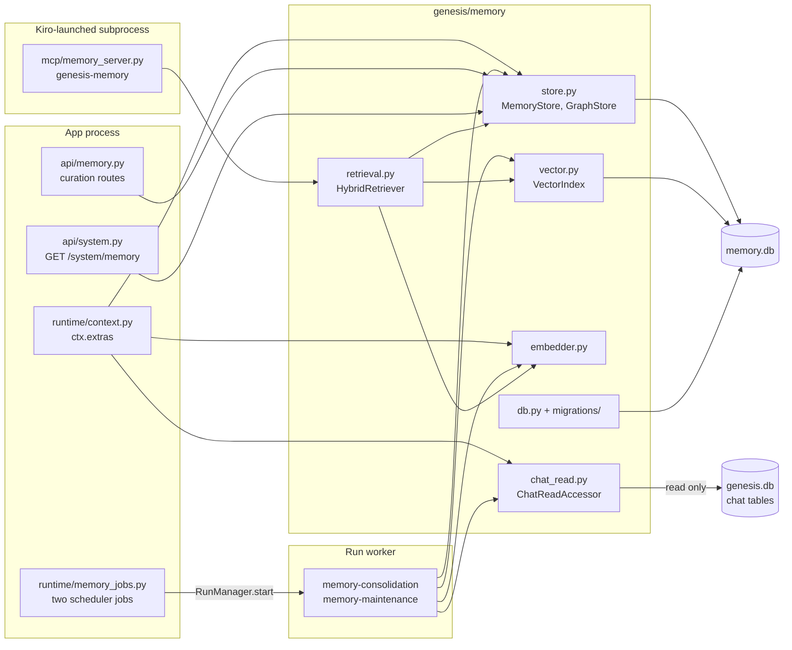
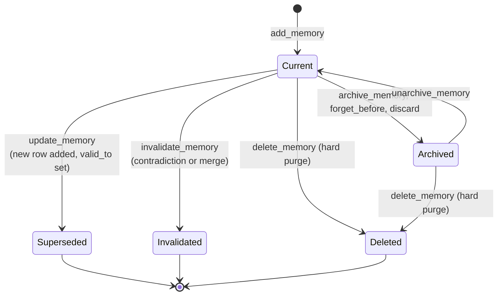
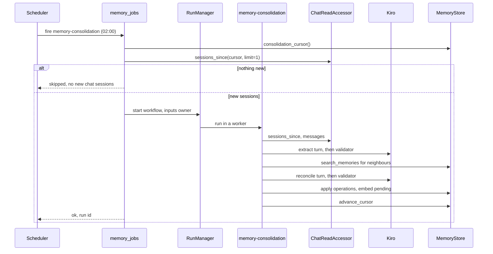

# Module: memory (`genesis/memory/`)

> **Describes:** genesis v0.81.0 (Phase 51) · **Last reviewed:** 2026-11-11 · C4 level 3 · area `memory`

## 1. Purpose

The memory module gives Genesis a long-term memory. Every night it reads the chat sessions that Genesis has
already stored, asks Kiro to pick out the facts worth keeping, and saves them as short statements in a separate
database, `memory.db`. Later, a chat session can ask for those statements through a read-only MCP server, so the
assistant does not make the user repeat themselves.

The central promise is the privacy rule: **personal memory is never shared** (ADR-053). A memory is either
`personal` (it belongs to one named user: their preferences, instructions and habits) or `shared` (it is about an
application or feature and is tied to named entities). Personal memories carry an owner, and every read path
filters on that owner. Nothing in `genesis/collab/` touches memory, so memory is never published to the Hub.

Four more ideas shape the module:

- **Nothing is overwritten.** A change closes the old row (`valid_to` is set) and adds a new one. History stays.
- **Humans win.** A person's edit, pin, protect or verify marks a memory as authoritative. The automated
  maintenance job never changes it.
- **The agent can only read.** The `genesis-memory` MCP server has no write tools and opens the database
  read-only. All human edits go through the browser API.
- **It always works.** The embedding model is optional. Without it, retrieval falls back to keyword and graph
  search.

## 2. At a glance

| Item | Value |
|---|---|
| Code | `genesis/memory/` (store, models, vector index, embedder, retrieval, chat reader, migrations), `genesis/runtime/memory_jobs.py`, `genesis/mcp/memory_server.py`, `genesis/api/memory.py`, the `/api/system/memory` route in `genesis/api/system.py` |
| Workflows | `genesis-workflows/workflows/memory-consolidation/` and `memory-maintenance/` (see [workflow-library.md](workflow-library.md)) |
| Web | `web/src/features/memory/` (the `/memory` page; see [web-app.md](web-app.md)) |
| Runs in | The app process (API routes, scheduler jobs, stores). The run worker (the two workflows and the embedder). The `genesis-memory` MCP subprocess that Kiro launches for a chat session (retrieval and the embedder). |
| Depends on | `genesis/db/` (`Database` and the migration runner), `genesis/collab/identity.py` (owner name), `genesis/runtime/settings.py`, `genesis/runs/` (the jobs start workflows), the chat tables in `genesis.db` (read only), optional `sqlite-vec` wheel, optional `model2vec` or `fastembed` |
| Used by | The context builder (`genesis/runtime/context.py`, which puts the stores in `ctx.extras`), `genesis/chat/mcp.py` (adds the MCP server to every chat session), the scheduler, the `genesis db` CLI, the web app |
| Stores | `~/.genesis/memory.db` (SQLite, WAL). Scheduler job state for the two jobs lives in `genesis.db`. |
| Key ids | Migration set `mm0001` (its own `schema_migrations` table). MCP server name `genesis-memory`, version `1.0.0`. Workflows `memory-consolidation` and `memory-maintenance`. Job keys with the same names. |
| Binding decisions | ADR-030 (SQLite now, Postgres and pgvector later), ADR-053 (the memory layer and its two scopes), ADR-054 (separate database, local embedder) |

## 3. Concepts

| Term | Meaning |
|---|---|
| **Memory** | One atomic statement in the `memories` table. Never a raw transcript. Has a type, a scope, an importance from 0 to 1 and provenance (the chat session it came from). |
| **Memory type** | `semantic` (a fact), `episodic` (a decision or event) or `procedural` (a rule, preference or how-to). |
| **Scope** | `personal` (one owner, never shared) or `shared` (about applications and features, `owner` is empty). |
| **Owner** | The user name stored on personal memories, entities and relationships. Chosen as described in section 5.7. |
| **Entity** | A node of the graph: an application, feature, record type, concept or user. Keyed by kind, ref, scope and owner. The consolidation workflow creates entities only for shared memories. |
| **Relationship** | A typed edge between two entities (`depends_on`, `part_of`, …) with a plain-language `fact`. Has validity dates. |
| **Bi-temporal** | Each memory and relationship has `valid_from` and `valid_to` (when it was true) and `created_at` (when Genesis learned it). A contradiction closes a row; it does not delete it. |
| **Current** | A memory with `valid_to` empty and `archived = 0`. Retrieval returns only current memories. |
| **Origin** | Where a row came from: `consolidation`, `reflection` or `user`. |
| **Curation flags** | `pinned` (never auto-forgotten), `protected` (exempt from auto merge, decay and invalidation), `user_verified` (reviewed and trusted). A row with any of them, or with origin `user` or `reflection`, is "human-curated" or "authoritative" and the maintenance job leaves it alone. |
| **Review status** | `pending`, `approved` or `discarded`. New rows default to `approved`. |
| **Embedding status** | `pending`, `embedded` or `skipped`. `skipped` means no embedder was available. |
| **Embedder** | A small local model that turns text into a vector. Backends: `model2vec` (default), `fastembed`, `none`, `fake`. |
| **Vector index** | The store of vectors: `sqlite-vec` if the SQLite build can load it, else a pure-Python table. |
| **Hybrid retrieval** | Ranking that mixes meaning (vector), keywords (FTS5), graph closeness, recency and importance. |
| **Consolidation** | The nightly workflow that turns new chat sessions into memories. |
| **Maintenance** | The weekly workflow nicknamed "dreaming": reflect, merge duplicates, recompute communities, forget stale low-value memories. |
| **Community** | A cluster of connected shared entities, recomputed by maintenance. |
| **Cursor** | The single row in `memory_consolidation_state` that records the newest chat session already processed. |

## 4. Structure



The diagram shows three places where memory code runs. The app process serves the curation API and fires the two
scheduler jobs. The run worker runs the two workflows, which reach the stores through `ctx.extras`. A subprocess
that Kiro starts for each chat session runs the MCP server, which builds its own retriever and embedder. All of
them write to or read from `memory.db`. The only access to `genesis.db` is the read-only chat reader.

| File | Main classes and functions |
|---|---|
| `genesis/memory/__init__.py` | Re-exports the public names (`MemoryStore`, `GraphStore`, `build_embedder`, `build_vector_index`, `embed_pending`, `purge_vectors`, `migrate_memory`, …) |
| `genesis/memory/db.py` | `memory_database(settings)` (a `Database` on `settings.memory_db_path`), `migrate_memory(settings)` |
| `genesis/memory/migrations/__init__.py` | `MEMORY_MIGRATIONS` (a list with one entry) |
| `genesis/memory/migrations/mm0001_memory.py` | Creates every table, index, the FTS5 table and its three sync triggers |
| `genesis/memory/models.py` | Dataclasses `Memory`, `MemoryEntity`, `MemoryRelationship`, each with `_from_row`; JSON columns are decoded here |
| `genesis/memory/store.py` | `MemoryStore` (memories, entities, relationships, links, communities, cursor, stats, curation, forgetting) and `GraphStore` (`related_entities`, `relationships_of`, `neighbors`) |
| `genesis/memory/vector.py` | `VectorIndex` protocol, `SqliteVecIndex`, `BruteForceVectorIndex`, `build_vector_index`, `embed_pending`, `purge_vectors` |
| `genesis/memory/embedder.py` | `Embedder` protocol, `NullEmbedder`, `FakeEmbedder`, `LocalEmbedder`, `build_embedder` |
| `genesis/memory/retrieval.py` | `RetrievalWeights`, `HybridRetriever`, `ScoredMemory`, and the pure helpers `recency_score`, `minmax`, `combine_relevance` |
| `genesis/memory/chat_read.py` | `ChatReadAccessor` with `sessions_since` and `messages`; no write methods |
| `genesis/runtime/memory_jobs.py` | `DEFAULT_MEMORY_JOBS`, `register_memory_jobs` |
| `genesis/mcp/memory_server.py` | `TOOLS`, `TOOL_NAMES`, `MemoryAccessor`, a newline-delimited JSON-RPC loop |
| `genesis/api/memory.py` | `register_memory_routes` and the request bodies |
| `genesis/api/system.py` | `memory_status` for `GET /system/memory` |
| `genesis-workflows/workflows/memory-consolidation/` | `workflow.yaml`, `graph.py` (`META`, `build`, pure helpers) |
| `genesis-workflows/workflows/memory-maintenance/` | `workflow.yaml`, `graph.py` |

## 5. How it works

### 5.1 The two-database rule and migrations

`memory.db` is a separate SQLite file from `genesis.db` (ADR-054). The runs, checkpoints and chat tables are
therefore untouched, and a later move to Postgres and pgvector (the trigger in ADR-030) only has to re-home this
module behind the store interfaces.

1. `memory_database(settings)` builds a standard `Database` (WAL, busy timeout 30 s, foreign keys on) on
   `settings.memory_db_path`, which is `<state dir>/memory.db`.
2. `migrate_memory(settings)` runs the same forward-only runner as `genesis.db` over `MEMORY_MIGRATIONS`. The
   runner keeps a `schema_migrations` table inside `memory.db`, so this database has its own version number,
   starting at 1.
3. `create_app` calls `migrate_memory` at boot. `genesis db upgrade` applies both migration sets, and
   `genesis db status` prints both versions.
4. `MemoryStore` and `GraphStore` never create tables. Only the migration does. The one exception is the vector
   index, described in 5.3.

The module has no migration after `mm0001_memory`. Adding one is described in section 10.

### 5.2 Memory lifecycle

A memory is never edited in place. The store closes it and adds a new row.



A `Current` memory has `valid_to` empty and `archived = 0`. `update_memory(old_id, **fields)` inserts a new
current row from the old values plus the changes (origin is set to `user` unless the caller overrides it), then
sets `valid_to` and `superseded_by` on the old row. `invalidate_memory` sets `valid_to` only, and records
`superseded_by` when the caller names the replacing memory. `archive_memory` is a reversible soft hide.
`delete_memory` is the only real delete. It removes the row, its entity links, its note links and its
brute-force vector in one transaction. The FTS5 index follows through the delete trigger.
`memory_history(id)` walks the `superseded_by` chain backwards and forwards and returns it oldest first.

### 5.3 Embeddings and the vector index

1. `build_embedder(settings)` picks a backend from `GENESIS_MEMORY_EMBEDDER` (default `model2vec`). `none`
   returns `NullEmbedder` (dimension 0). `fake` returns `FakeEmbedder` (hashed vectors, for tests).
2. For `model2vec` or `fastembed`, `build_embedder` creates a `LocalEmbedder` and loads the model at once. If the
   optional package is missing, it logs a warning and returns `NullEmbedder`. The memory layer then works with
   keywords and graph only.
3. `LocalEmbedder` imports its package lazily. Nothing loads in the always-on web process: the context builder
   passes a factory (`ctx.extras["embedder_factory"]`), and the model loads only when a workflow node or the MCP
   server calls it.
4. `build_vector_index(db, dim)` returns `None` when `dim` is 0. Otherwise it tries `SqliteVecIndex`, which loads
   the `sqlite-vec` extension and creates a `memory_vectors` virtual table (cosine metric) sized to the
   embedder's dimension. If the extension cannot load, it returns `BruteForceVectorIndex`, which keeps JSON
   vectors in `memory_vectors_bf` and scores them in Python.
5. `embed_pending(store, embedder, index)` takes up to `limit` rows that are current, not archived and still
   `pending`. With no embedder or no index, it marks them `skipped`. Otherwise it embeds `text` plus `summary`,
   upserts the vectors and marks the rows `embedded`.

The vector tables are created lazily and are not part of `mm0001`. A deployment with no embedder never has them.
The tables hold a vector for one dimension, so changing the model needs a re-embed plan (section 10).

### 5.4 The nightly consolidation

Consolidation turns new chat sessions into memories. The scheduler and the workflow cooperate.



The job checks first whether there is anything to do, so an idle night costs no Kiro turn. The workflow then
reads the sessions, asks Kiro twice, and writes the result.

Job-side steps (`genesis/runtime/memory_jobs.py`):

1. The scheduler seeds two jobs through `ensure_defaults`: `memory-consolidation` daily at 02:00 and
   `memory-maintenance` on Sundays at 03:00 (`days=[6]`), both in the `Asia/Kolkata` time zone. Both are enabled
   by default. See [scheduler-and-jobs.md](scheduler-and-jobs.md).
2. For consolidation, `_has_new_sessions()` reads the cursor and asks `ChatReadAccessor` for one session newer
   than `last_processed_session_created_at`. If it cannot tell (an exception), it returns true and lets the
   workflow decide.
3. `_run(workflow_id)` returns `("skipped", "Kiro is not signed in")` when `kiro_auth.status()` does not say
   authenticated. It returns `("skipped", "<id> workflow not installed")` when the library loader does not list
   the workflow.
4. Otherwise it calls `run_manager.start(workflow_id, {"owner": owner})` and polls `reconcile_status` every
   5 seconds, for at most 1800 seconds.
5. A `done` run returns `("ok", …)`. Any other end state, or a timeout, returns `("error", …)`.

Workflow steps (`memory-consolidation/graph.py`, with the node ids from `workflow.yaml`):

1. `resolve_window` (program) takes `since` from the input or the stored cursor, `until` from the input or now,
   and loads up to `max_sessions` (default 200) sessions, oldest first. No sessions routes straight to
   `advance_cursor`.
2. `load_sessions` (program) reads each session's messages and writes `transcripts.json`. It first removes lines
   that look like credentials (`api_key:`, `password=`, `token`, …) and inline tokens that look like `sk-…`,
   `ghp_…` or JWTs.
3. `extract` (agent, no MCP servers) writes `memories.json`: atomic memories with scope, type, importance, and
   for shared ones, entities and relationships. `v_extract` checks the shape. An empty list is valid.
4. `reconcile_prep` (program) finds up to five similar current memories for each candidate with the keyword
   search, using the same scope, owner and type, and writes `candidates.json`.
5. `reconcile` (agent) writes `operations.json` with exactly one of `ADD`, `UPDATE`, `INVALIDATE` or `NOOP` per
   candidate. `v_reconcile` checks the count and that `UPDATE` and `INVALIDATE` carry a `target_id`.
6. `apply` (async node, with the blocking work in `asyncio.to_thread`) writes the result. Shared memories get
   their entities upserted and their relationships added. `UPDATE` calls `update_memory`. `INVALIDATE` adds the
   new memory and closes the target. Then it embeds pending rows using the embedder factory.
7. `advance_cursor` stores the newest processed session's id and creation time. On an empty window it only
   records `last_run_at`. `present` writes `report.json`.
8. Both agent steps use the reliability trio (retry up to 2). When retries run out, the `escalate` gate asks a
   person. Approve goes on with the current extraction. Reject goes to `surface_error`, writes nothing and
   leaves the cursor where it was. See [core-engine.md](core-engine.md).

The workflow only reads chat. The only writes are to `memory.db`.

### 5.5 The weekly maintenance

`memory-maintenance` keeps the store tidy. Its job wrapper is the same `_run` function (Kiro check, install
check, start, poll). It has no "new sessions" check.

1. `load_candidates` (program) lists up to 2000 memories and keeps those that are **not** human-curated: not
   pinned, protected or user-verified, and origin not `user` or `reflection`. It builds reflection clusters
   (three or more eligible memories sharing an entity, not yet the target of an `elaborates` link) and
   near-duplicate groups (same scope, owner and type, token Jaccard of 0.6 or more). It stores the eligible ids
   in state.
2. `reflect` (agent) writes higher-level memories from clusters. `curate` (agent) decides `MERGE`, `INVALIDATE`
   or `NOOP` for each duplicate group. Each has a validator and an escalation gate.
3. `apply` only acts on ids in the eligible set. A reflection needs at least two eligible sources of the same
   scope. A merge or invalidation never crosses scope or owner. Closed duplicates use `invalidate_memory`, and
   the links `elaborates`, `merged` and `supersedes` record why.
4. `recompute_communities` clears the shared communities and rebuilds them as connected components over current
   shared relationships (components of two or more entities).
5. `decay_forget` calls `forget_before(cutoff, max_importance)`. It archives current memories older than
   `decay_days` (default 90) with importance at or below `decay_max_importance` (default 0.3). The SQL skips
   pinned, protected, user-verified and `origin = 'user'` rows.
6. `embed_new` embeds anything still pending, then `present` writes `report.json`.

Nothing is hard-deleted, and every step is reversible through the curation API.

### 5.6 Hybrid retrieval

`HybridRetriever.search(query, scope, owner, entity_ids, types, top_k, depth)` ranks memories in these steps:

1. **Pool.** `shared` and `all` add shared memories. `personal` and `all` add the caller's personal memories, but
   only when an owner is given. Each pool holds at most 200 current, non-archived memories. Vector search is
   always limited to this pool.
2. **Keyword.** If there is a query, the FTS5 search over the same scope gives each matching pool member a
   keyword score of 1.0. The store does not expose BM25 scores.
3. **Semantic.** If the embedder has a dimension above 0 and an index exists, the query is embedded and the
   index returns the nearest pool members. The score is `1 - cosine distance`, limited to 0..1.
4. **Graph.** Each queried entity gets proximity 1.0. Entities within `depth` hops get `1 / (1 + hops)`. A
   memory takes the best proximity among its entities.
5. **Fuse.** `relevance = 0.60 × semantic + 0.30 × keyword + 0.10 × entity`, with the semantic weight set to 0
   when no embedder is active. Relevance is min-max scaled over the candidates.
6. **Score.** `score = 0.55 × relevance + 0.20 × recency + 0.25 × importance`. Recency is `exp(-days / 30)` on
   `last_used_at`, or `created_at` if never used.
7. If no signal matched, all pool members are candidates (a browse). The top `top_k` by score come back.

The weights are a frozen dataclass (`RetrievalWeights`). They are not settings.

### 5.7 Who owns personal memory

Two rules protect personal memory.

**How the owner is chosen.** `canonical_username(settings)` in `genesis/collab/identity.py` returns the first of:

1. the Appian username in the cached collaboration identity (`collab_identity`);
2. `settings.memory_owner_username`, which comes from the environment variable `GENESIS_MEMORY_OWNER`;
3. the literal `"local"`.

Callers use it in these places: the scheduler jobs (once, when the jobs are registered), the chat session
builder (each time it builds the MCP entry, passing `--owner`), the API editor name, and the status route. The
consolidation and maintenance workflows receive it as their `owner` input and tag personal memories with it. A
workflow started by hand without the input uses `"local"`. A solo install with no identity and no variable is
therefore all `"local"`.

**Where the filter is applied.**

- *MCP server:* `search_memory` defaults to `shared`. Personal results come only when the model asks for
  `personal` or `all`, and then only for the owner passed at launch. `get_personal_memory` is always limited to
  that owner. Entity lookup checks shared entities first, then that owner's personal entities.
- *Consolidation:* personal memories get the run's owner. Shared memories get no owner. Neighbour search uses the
  candidate's own scope and owner.
- *Maintenance:* clusters, duplicate groups and merges are keyed by scope and owner. A merge between different
  scopes or owners is skipped.
- *Hub:* no module under `genesis/collab/` imports the memory package, so no code path publishes memory.

The browser API is the exception by design. `GET /api/memory` can list any scope and owner, because it is the
local user's own management page. Genesis ships no authentication (ADR-026), and the loopback bind rule is what
keeps this page private.

### 5.8 Human curation through the API

The `/memory` page of the web app calls the routes in `genesis/api/memory.py`. They are the only write path for
people. The agent has none.

1. **Create** (`POST /memory`) writes a memory with origin `user`, `user_verified` true and `edited_by` set to
   the editor name. A personal memory without an owner gets the editor name. The row stays `pending` for
   embedding, so the web process never loads a model; the next job embeds it.
2. **Edit** (`PATCH /memory/{id}`) calls `update_memory`, so the old row is closed and the history is kept. The
   new row has origin `user` and `user_verified` true. Changing the scope needs `confirm_scope_change=true`,
   because it changes who can see the memory. A change to personal sets the owner to the editor.
3. **Flags** (`pin`, `unpin`, `protect`, `unprotect`, `verify`, `unverify`) call `set_flags`.
4. **Forget.** `invalidate` closes the row. `archive` and `DELETE /memory/{id}` (without `hard`) hide it.
   `DELETE …?hard=true` runs `purge_vectors` (both vector tables, best effort) and then `delete_memory`.
5. **Review queue.** `GET /memory/review` lists rows with review status `pending`. `approve` and `discard`
   change the status. `discard` also archives the row.
6. **Bulk** (`POST /memory/bulk`) applies `archive`, `pin`, `unpin`, `verify`, `protect` or `tag` to many ids.
7. **Graph.** Relationships and entities can be listed, created, edited and invalidated or deleted. The graph
   route returns nodes and edges, optionally around one entity.

### 5.9 Reading memory from chat

1. When a chat session starts, `build_chat_mcp` in `genesis/chat/mcp.py` always adds the `genesis-memory` entry:
   `python -m genesis.mcp.memory_server --db <memory.db> --owner <canonical username>`.
2. All six tools are put in the trusted list as `@genesis-memory/<tool>`. They are safe to trust because none
   can write. See [chat-and-skills.md](chat-and-skills.md).
3. `genesis/chat/mode_profile.py` adds a short note to every mode's instructions. It names the tools and tells
   the assistant to query memory at the start of a conversation and when an application or feature is in
   context. Genesis does not prefetch memory into the prompt. Injection is by tool call only (ADR-053).
4. The server reads newline-delimited JSON-RPC from stdin. It builds the store and graph over a `mode=ro`
   connection, and builds the retriever and embedder on the first tool call, in this subprocess.
5. Results are capped at 32 KB. A larger result is replaced by a `truncated` note with a preview.
6. The server does not call `mark_used`, so reading never changes `access_count` or `last_used_at`.

## 6. Interfaces

### 6.1 HTTP endpoints

All paths are under `/api` (ADR-028). The memory routes are registered by `register_memory_routes`. The status
route is in `genesis/api/system.py`.

| Method and path | Purpose |
|---|---|
| `GET /system/memory` | Read-only status: owner, `memory.db` version, counts (`memories_total`, by type, by scope, embedding status, entities, relationships, communities), last consolidation and maintenance time |
| `GET /memory` | List memories. Filters: `scope`, `owner`, `memory_type`, `entity_id`, `query` (FTS), `pinned`, `review_status`, `include_invalidated`, `include_archived`, `page`, `page_size` (at most 200) |
| `GET /memory/review` | The review queue (status `pending`, up to 200) |
| `GET /memory/graph` | Nodes and edges. Filters: `scope`, `owner`, `entity_ref`, `depth`, `at`, `include_invalidated` |
| `GET /memory/entities`, `GET /memory/entities/{id}` | Entities, and one entity with its current relationships and memories |
| `GET /memory/relationships` | Relationships, optionally including closed ones |
| `GET /memory/{id}` | One memory and its version history |
| `POST /memory` | Create a memory by hand |
| `PATCH /memory/{id}` | Edit by superseding. Scope change needs `confirm_scope_change` |
| `POST /memory/{id}/pin`, `unpin`, `protect`, `unprotect`, `verify`, `unverify` | Set curation flags |
| `POST /memory/{id}/invalidate`, `archive`, `unarchive` | Close, hide, restore |
| `DELETE /memory/{id}` | Soft archive; `?hard=true` is the purge |
| `POST /memory/{id}/approve`, `discard` | Review queue decisions |
| `POST /memory/bulk` | Bulk `archive`, `pin`, `unpin`, `verify`, `protect`, `tag` |
| `POST /memory/relationships`, `PATCH`, `DELETE /memory/relationships/{id}` | Relationship curation; delete is an invalidation unless `?hard=true` |
| `PATCH /memory/entities/{id}` | Rename an entity or change its attributes |

The fixed paths `/memory/review`, `/memory/graph`, `/memory/entities` and `/memory/relationships` are registered
before `/memory/{memory_id}`, so the generic route does not capture them (L-096).

### 6.2 Python API

| Call | Used by |
|---|---|
| `MemoryStore(db_or_path)`: `add_memory`, `update_memory`, `invalidate_memory`, `archive_memory`, `unarchive_memory`, `delete_memory`, `set_flags`, `search_memories`, `list_memories`, `memory_history`, `upsert_entity`, `add_relationship`, `list_relationships`, `consolidation_cursor`, `advance_cursor`, `forget_before`, `stats`, `pending_embeddings`, `mark_embedded`, `mark_used`, … | Workflows, the API, the MCP server, the status route |
| `GraphStore(db_or_path)`: `related_entities(id, rel_type, depth, current)`, `relationships_of`, `neighbors` | The MCP server, the API, the retriever |
| `HybridRetriever(store, graph, embedder, index).search(...)` | The MCP server |
| `build_embedder(settings)`, `build_vector_index(db, dim)`, `embed_pending(...)`, `purge_vectors(db, id)` | Workflows, the MCP server, the API |
| `ChatReadAccessor(db).sessions_since(created_after, limit)`, `.messages(session_id)` | Workflows, the job pre-check |
| `migrate_memory(settings)`, `memory_database(settings)`, `MEMORY_MIGRATIONS` | `create_app`, the `genesis db` command |
| `register_memory_jobs(scheduler, run_manager, settings)`, `DEFAULT_MEMORY_JOBS` | `create_app` |

`MemoryStore` is built with a path or a `Database`. Reads use `connect()`. Writes use `tx()`, which commits on
success and rolls back on error.

### 6.3 `ctx.extras` keys (for workflows)

`genesis/runtime/context.py` adds three keys for every run. A workflow's `graph.py` must not import the platform,
so it reads these instead.

| Key | Value |
|---|---|
| `memory_store` | `MemoryStore(settings.memory_db_path)` |
| `chat_read` | `ChatReadAccessor(settings.db_path)` (read-only view of the chat tables) |
| `embedder_factory` | A function that calls `build_embedder(settings)` when asked. The model loads only then. |

### 6.4 MCP tools (server `genesis-memory`)

The server sends no other tool. A test asserts that no tool name looks like a write.

| Tool | Returns |
|---|---|
| `search_memory(query, scope=shared, entity_refs, types, top_k=8)` | Ranked memories with score, importance and tags |
| `get_personal_memory(query, types, top_k=8)` | The owner's personal memories only |
| `get_entity(entity_ref, entity_kind)` | One entity and its current relationship count |
| `get_entity_memories(entity_ref, entity_kind, top_k=20)` | Memories linked to the entity |
| `get_related_entities(entity_ref, entity_kind, rel_type, depth=1)` | Entities within `depth` hops with hop distance, and the entity's direct edges |
| `get_relationships(entity_ref, entity_kind, current=true)` | The direct edges of the entity |

### 6.5 CLI

`genesis db upgrade` and `genesis db status` handle `memory.db` along with `genesis.db`. There is no memory
command of its own.

### 6.6 Events and contracts

The module emits no event of its own. The two workflows emit the normal run events ([runs-and-workers.md](runs-and-workers.md)).
The scheduler records the job result (`ok`, `skipped` or `error`, plus a detail string) in `genesis.db`.

## 7. Data

### 7.1 Tables in `memory.db` (all from `mm0001_memory`)

| Table | Key columns | Meaning |
|---|---|---|
| `memories` | `id`, `memory_type`, `scope`, `owner`, `text`, `summary`, `importance`, `tags_json`, `entities_json`, `source_session_id`, `origin`, `valid_from`, `valid_to`, `superseded_by`, `archived`, `pinned`, `protected`, `user_verified`, `confidence`, `review_status`, `edited_by`, `access_count`, `last_used_at`, `embedding_status` | One atomic memory. Bi-temporal. `entities_json` copies the linked entity ids for quick filtering. |
| `memory_entities` | `id`, `entity_kind`, `entity_ref`, `name`, `scope`, `owner`, `attributes_json`; unique on kind, ref, scope, owner | Graph nodes |
| `memory_relationships` | `source_entity_id`, `target_entity_id`, `rel_type`, `fact`, `scope`, `owner`, `confidence`, `source_memory_id`, `valid_from`, `valid_to`, `invalidated_by_memory_id` | Graph edges. Removed with their entities (cascade). |
| `memory_entity_links` | `memory_id`, `entity_id` | Which memory concerns which entity |
| `memory_links` | `from_memory_id`, `to_memory_id`, `link_type` | Note links: `elaborates`, `merged`, `supersedes` and the other types the schema comments name |
| `memory_communities` | `label`, `summary`, `scope`, `owner`, `member_entities_json` | Entity clusters written by maintenance |
| `memory_consolidation_state` | One row (`id = 1`): `last_processed_session_created_at`, `last_processed_session_id`, `last_run_at`, `last_maintenance_at` | The restart-safe cursor |
| `memories_fts` | FTS5 over `text` and `summary`, external content | Keyword index, kept in step by three triggers (`memories_ai`, `memories_ad`, `memories_au`) |
| `schema_migrations` | Written by the shared runner | Version of this database |
| `memory_vectors` (created lazily) | `memory_id`, `embedding float[dim]` | `sqlite-vec` vectors, cosine |
| `memory_vectors_bf` (created lazily) | `memory_id`, `vec_json` | Pure-Python vector fallback |

An entity is unique on four columns, one of which (`owner`) is empty for shared entities. SQLite treats empty
values as distinct in a unique index, so `upsert_entity` does a select first and then writes, instead of using
`ON CONFLICT`. Without this, shared entities would be duplicated.

### 7.2 Who writes and who reads

| Data | Writers | Readers |
|---|---|---|
| `memories`, entities, relationships, links | The two workflows (through `MemoryStore`), the curation API | The API, the MCP server, the maintenance workflow, the status route |
| Vector tables | `embed_pending` (workflows), `purge_vectors` and `delete_memory` (API) | The MCP server (retriever) |
| `memory_consolidation_state` | `advance_cursor` (workflows) | The job pre-check, the workflow, the status route |
| Chat tables in `genesis.db` | Chat (not this module) | `ChatReadAccessor` |
| Scheduler job rows in `genesis.db` | The scheduler | The scheduler, the schedules API |

Files on disk: only `~/.genesis/memory.db` and its WAL files. Each workflow run also writes its own blackboard
files (`transcripts.json`, `memories.json`, `candidates.json`, `operations.json`, `report.json`, and for
maintenance `reflections.json`). Those belong to the run, not to this module.

## 8. Failure handling

| Situation | Behaviour |
|---|---|
| Kiro is not signed in at job time | The job returns `skipped` ("Kiro is not signed in"). No run starts. |
| The workflow is not installed | The job returns `skipped`. The user must run `genesis install`. |
| No new chat sessions | The consolidation job returns `skipped` before any Kiro turn. |
| The pre-check itself fails | The job treats it as "there may be something" and starts the workflow. |
| `run_manager.start` raises | The job returns `error` with the message. |
| A run does not end within 30 minutes | The job returns `error` ("timed out"). The run itself is not cancelled by the job. |
| An agent output fails its validator | The reliability trio retries up to 2 times, then opens the escalation gate. |
| Escalation rejected in consolidation | `surface_error` fails the run. Nothing is written and the cursor stays. |
| The model package or `sqlite-vec` is missing | `build_embedder` logs a warning and returns `NullEmbedder`, or `build_vector_index` falls back to brute force. Memories are marked `skipped`. Retrieval uses keywords and graph. |
| `GENESIS_MEMORY_EMBEDDER` names an unknown backend | `LocalEmbedder` raises `ValueError` on load, and the error is not caught by `build_embedder` (only `RuntimeError` is). |
| A hallucinated id appears in a maintenance output | `apply` ignores ids that are not in the eligible set, and counts them as skipped. |
| An MCP tool raises | The server logs to stderr and returns `{"error": …}` as the tool result. It does not exit. |
| An entity ref is not found in the MCP server | The tool returns `{"error": "entity '…' not found"}`. |
| A tool result is over 32 KB | It is replaced by a `truncated` note and a preview. |
| `GET /system/memory` cannot read the version | `memory_db_version` is `null`. The route does not fail. |
| `memory.db` is locked by another writer | The connection waits up to 30 s (busy timeout). |
| `PATCH /memory/{id}` changes scope without confirmation | HTTP 400 with an explanation. |
| An invalid type or scope in a create or edit | HTTP 400. |
| Unknown memory, entity or relationship id | HTTP 404. |

## 9. Configuration

| Setting | Source | Default | Effect |
|---|---|---|---|
| `memory_embedder_backend` | env `GENESIS_MEMORY_EMBEDDER` | `model2vec` | `model2vec`, `fastembed`, `none` (or `null`), `fake` |
| `memory_embedder_model` | env `GENESIS_MEMORY_EMBED_MODEL` | empty, meaning the backend default: `minishlab/potion-base-8M` for model2vec, `BAAI/bge-small-en-v1.5` for fastembed | Model id |
| `memory_owner_username` | env `GENESIS_MEMORY_OWNER` | empty | Second choice for the owner name, after the collaboration identity (section 5.7) |
| `memory_db_path` | derived: `<state dir>/memory.db` | `~/.genesis/memory.db` | Location of the database. Moves with `GENESIS_STATE_DIR`. |
| Optional package extra `embeddings` | `pyproject.toml` | not installed by default | Adds `model2vec` |
| Optional package extra `embeddings-onnx` | `pyproject.toml` | not installed by default | Adds `fastembed` |
| Required package `sqlite-vec` | `pyproject.toml` | pinned `0.1.9` | The fast vector index. The brute-force fallback needs nothing. |
| Job schedules | `DEFAULT_MEMORY_JOBS` | consolidation daily 02:00; maintenance Sundays 03:00; zone `Asia/Kolkata` | Seeded once; the seed never overwrites a later change of `enabled` or last-run state |
| Job caps | constants in `memory_jobs.py` | 1800 s wait, 5 s poll | |
| Workflow inputs, consolidation | `workflow.yaml` | `owner` = `local`, `since`, `until`, `max_sessions` = 200 | |
| Workflow inputs, maintenance | `workflow.yaml` | `owner` = `local`, `decay_days` = 90, `decay_max_importance` = 0.3 | |
| Workflow META | both workflows | `auto_approve: true`, `retry_defaults.max: 2` | Escalation gates are the only pauses |
| Ranking weights | `RetrievalWeights` defaults | 0.55 / 0.20 / 0.25; 0.60 / 0.30 / 0.10; tau 30 days | Constants in code, not user settings |

The `pyproject.toml` comment says the installer includes the `embeddings` extra. I found no mention of that
extra in the scripts under `scripts/`. On a machine without `model2vec`, memory runs with keywords and graph only.

## 10. Extending this module

**Add a column or table to `memory.db`.**
1. Add `mm0002_<name>.py` in `genesis/memory/migrations/` with a `Migration(version=2, …)`. Versions must be
   contiguous from 1.
2. Append it to `MEMORY_MIGRATIONS`. Do not edit `mm0001`.
3. Make it additive and idempotent (`IF NOT EXISTS`), like `mm0001`.
4. Update `models.py` (`_from_row` already tolerates a missing column through `row.keys()` for some fields; add
   yours the same way) and the store methods.
5. Test with `tests/test_memory_store.py`. The shared runner test pattern is in that file.

**Add a memory field that people can edit.** Add it to `MemoryPatch`, pass it through `patch_memory` into
`update_memory`, add it to `_mem()` in the API and to `web/src/types/memory.ts`.

**Add an MCP tool.**
1. Add the entry to `TOOLS` and a branch in `_call`, and a method on `MemoryAccessor`.
2. It must only read. Filter by scope and owner, as `search_memory` does.
3. `TOOL_NAMES` feeds the trusted list in `genesis/chat/mcp.py` automatically.
4. Cover it in `tests/test_memory_server.py`, including the read-only check.

**Change ranking.** Change `RetrievalWeights` or the fuse in `retrieval.py`. Keep `combine_relevance` pure so the
tests can pin it. Check the effect with a `NullEmbedder`, because the semantic weight drops to zero there.

**Add an embedder backend.** Add a branch in `LocalEmbedder._ensure` (or a new class) and in `build_embedder`.
Keep the import lazy, and keep the fallback to `NullEmbedder` when the package is missing. A new model with a
different dimension needs a re-embed of every memory: mark rows `pending` again and drop the old vector table.
No code does this for you.

**Change what the nightly job extracts.** Edit the prompt and the validators in
`genesis-workflows/workflows/memory-consolidation/graph.py` and bump the workflow version in both `META` and
`workflow.yaml`. Keep `graph.py` free of platform imports (see 12 for one existing exception).

**Add a new memory job.** Add an entry to `DEFAULT_MEMORY_JOBS`, register a handler in `register_memory_jobs`, and
follow the `_run` pattern: check Kiro, check the install, start, poll, return a status and detail.

**Add a database back end.** Implement the same method signatures as `MemoryStore`, `GraphStore` and
`VectorIndex`. No SQLite type may leak through them (ADR-030, ADR-054).

## 11. Design decisions

| Decision | In plain words | ADR |
|---|---|---|
| Memory is distilled from stored conversations | Genesis already keeps every chat. A nightly job turns them into short statements instead of replaying whole transcripts. | ADR-053 |
| Two scopes | Personal memory belongs to one named user and is never shared. Shared memory is about applications and features and is tied to entities. | ADR-053 |
| Three types, bi-temporal rows | Semantic, episodic and procedural. A contradiction closes a row and keeps the history. | ADR-053 |
| Injection by tool call only | The assistant is told the memory tools exist and when to use them. Genesis never prefetches memory into the prompt. | ADR-053 |
| Human curation is authoritative | People can edit, pin, protect and verify. The maintenance job skips those rows. | ADR-053 |
| The agent interface is read-only | The MCP server has no write tools and opens the file read-only. Writes go through the browser API. | ADR-053, ADR-031 |
| Separate `memory.db` with its own migrations | The runs and chat database is not touched. A later database move touches only this module. | ADR-054 |
| Store interfaces hide SQLite | `MemoryStore`, `GraphStore`, `VectorIndex` and `Embedder` have no SQLite types in their signatures. | ADR-054, ADR-030 |
| Small local embedder, optional | The default is a static `model2vec` model. It loads only in a worker or MCP subprocess, and falls back to no embeddings. | ADR-054 |
| Stay on SQLite for now | Postgres and pgvector wait for a real trigger (more than one user, transcript search at scale, heavy analytics). | ADR-030 |
| Deterministic control flow | LangGraph decides the steps. Kiro only extracts and judges inside narrow turns, each with a validator. | ADR-001, ADR-011 |
| Jobs reuse the scheduler | No new engine. Memory jobs are two more seeded jobs. | ADR-047 |

## 12. Known pitfalls

- **Run blocking `memory.db` writes off the event loop.** Both workflows do the writes in `asyncio.to_thread`
  inside async nodes. A blocking write in an async node can deadlock the checkpointer (L-026).
- **A route placed after `/memory/{memory_id}` can be shadowed.** Keep fixed paths first and prove the order by
  behaviour (L-096).
- **Unique index and empty owner.** SQLite treats empty values as distinct, so a shared entity cannot rely on
  `ON CONFLICT`. Keep the select-then-write in `upsert_entity` (no lesson id; the reason is in the method's
  docstring).
- **A derived index must not outlive its source.** `delete_memory` removes links and the brute-force vector in
  the same transaction, and the API then calls `purge_vectors` for the `sqlite-vec` table. A new place that
  deletes memories must do the same (L-103).
- **Check every consumer and producer when you add a value.** A new memory type, scope, flag or tool name has to
  be added to the validators in both workflows, the API's `_TYPES` and `_SCOPES`, the web types and the MCP
  schema (L-094).
- **The workflows import the platform in one place.** Both `graph.py` files import `genesis.memory`
  (`build_vector_index`, `embed_pending`) inside the embed function. The comment says this is allowed because
  the node runs in the worker process, but it differs from the rule that a `graph.py` imports only
  `genesis_core` (see [06-building-blocks.md](../06-building-blocks.md#63-dependency-rules)).
- **The MCP server can create vector tables.** The database is opened `mode=ro` for store reads, but the
  retriever hands the vector index a normal path, and the index creates its table if missing. So "read-only"
  holds for memory rows, not for the lazy vector table.
- **Do not log secrets into memory.** Consolidation removes credential-looking lines before the transcript
  reaches Kiro. That filter is pattern based. Keep it, and keep the instruction not to store secrets in the
  prompt.
- **The owner for the jobs is read once.** `register_memory_jobs` calls `canonical_username` when the app
  starts. A collaboration identity set later changes the owner for chat and the API at once, but for the jobs
  only after a restart.

## 13. Tests

| File | What it covers (from its test names) |
|---|---|
| `tests/test_memory_store.py` | Migration applies and is idempotent; `memory.db` is separate from `genesis.db`; add and get; update supersedes and keeps history; invalidate closes without deleting; archive hides; `forget_before` respects human curation; FTS keyword search; scope and owner isolation; entity upsert de-duplicates; graph traversal depth and currency; entity links; cursor round trip; scoped community clearing; link targets |
| `tests/test_memory_vector.py` | Fake and null embedders; `build_embedder` for `none` and `fake`, and its fallback when a backend is missing; brute-force index order, id filter and delete; `sqlite-vec` index round trip; `dim` 0 gives no index; `embed_pending` with a real index and with a null embedder |
| `tests/test_memory_retrieval.py` | `recency_score`, `minmax`, `combine_relevance` with the alpha switch; keyword and semantic ranking; degrade to keyword with a null embedder; scope and owner isolation; entity proximity boost; default weights |
| `tests/test_memory_server.py` | Every tool is read-only; unknown tool; `search_memory` shape and shared default; owner-scoped personal results; default does not leak personal; entity, relationship and graph tools; entity memories; missing entity; `tools/list` dispatch |
| `tests/test_memory_api.py` | Create, list and detail; patch supersedes and keeps history; re-scope needs confirmation; pin, protect, verify; soft delete versus hard purge; invalidate; relationship and entity CRUD and graph; review queue approve and discard; maintenance skips human-curated rows |
| `tests/test_memory_jobs.py` | Weekly Sunday slot; default jobs registered; maintenance skips without Kiro sign-in or install; happy path threads the owner; `GENESIS_MEMORY_OWNER` is threaded; consolidation skips with no new sessions; the `/system/memory` endpoint |
| `genesis-workflows/workflows/memory-consolidation/tests/test_workflow.py` | Redaction; `coerce_memories` and importance; extract and reconcile validators; happy path writes memories, entities and relationships; cursor advance and empty day; UPDATE supersedes; INVALIDATE closes; secrets are redacted before memory |
| `genesis-workflows/workflows/memory-maintenance/tests/test_workflow.py` | Jaccard and duplicate groups; reflection convergence guard; `is_human_curated`; reflection creates a higher-level memory with links; curate merges reversibly; decay skips human-curated rows; communities recomputed idempotently |
| `web/src/features/memory/memory.test.tsx`, `graph.test.ts` | Web tests for the memory workspace and the graph helper |

Gate commands (from the area):

```
cd genesis && .venv/bin/python -m pytest -q -p no:warnings
cd genesis && .venv/bin/ruff check genesis
cd genesis/web && npm run lint && npm run typecheck && npm test
cd genesis/web && npm run build   # then commit web/static/
```

For a quick check of this module: `.venv/bin/python -m pytest -q tests/test_memory_store.py tests/test_memory_vector.py tests/test_memory_retrieval.py tests/test_memory_server.py tests/test_memory_api.py tests/test_memory_jobs.py`.
The workflow tests run from `genesis-workflows` with its own gates.

## 14. Code map

| To change… | Look in |
|---|---|
| The memory tables or indexes | `genesis/memory/migrations/` (new `mm000N_*.py`, append to `MEMORY_MIGRATIONS`) |
| A SQL query on memories, entities or relationships | `genesis/memory/store.py` |
| Graph traversal depth or direction | `GraphStore.related_entities` in `genesis/memory/store.py` |
| What counts as "current" | `search_memories`, `list_memories`, `stats` in `genesis/memory/store.py` |
| Ranking weights and the fuse | `genesis/memory/retrieval.py` |
| The embedder backends or defaults | `genesis/memory/embedder.py`; the settings in `genesis/runtime/settings.py` |
| The vector index | `genesis/memory/vector.py` |
| Which chat data consolidation can read | `genesis/memory/chat_read.py` |
| Job times, the Kiro and install checks, the owner | `genesis/runtime/memory_jobs.py` |
| How the owner is chosen | `genesis/collab/identity.py` (`canonical_username`) |
| What gets extracted, the validators, secret redaction | `genesis-workflows/workflows/memory-consolidation/graph.py` |
| What is merged, reflected or forgotten | `genesis-workflows/workflows/memory-maintenance/graph.py` |
| What workflows can reach in `ctx.extras` | `genesis/runtime/context.py` |
| The MCP tools or their scoping | `genesis/mcp/memory_server.py` |
| How the MCP server is added to chat and trusted | `genesis/chat/mcp.py`; steering text in `genesis/chat/mode_profile.py` |
| Browser curation routes | `genesis/api/memory.py`; client in `web/src/lib/api/memory.ts` |
| The status route | `genesis/api/system.py` |
| The `/memory` page | `web/src/features/memory/` and the route in `web/src/app/router.tsx` |
| Boot-time migration and job registration | `genesis/api/app.py` |
| `genesis db upgrade` and `status` | `genesis/cli/main.py` |
