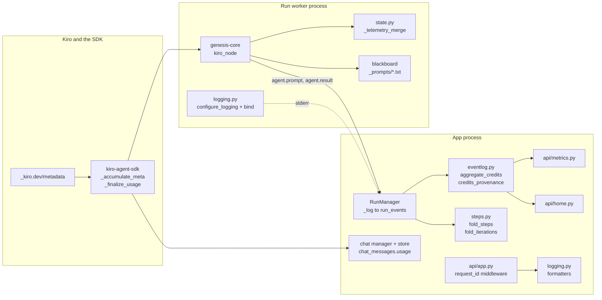
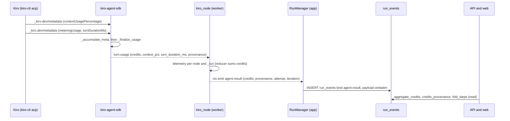
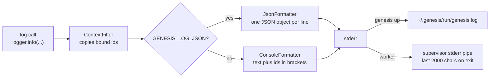

# Module: observability and credits (`genesis/runtime/logging.py`, `genesis/api/metrics.py`)

> **Describes:** genesis v0.81.0 (Phase 51) · **Last reviewed:** 2026-11-11 · C4 level 3 · area `observability-credits`

## 1. Purpose

This module answers two questions about a running Genesis: "what happened, and which run, request or session did
it happen in?" and "how many credits did it cost?".

It has two parts that share one rule: **record what really happened, and say how sure you are.**

- **Logging.** The app process and every run worker write log lines through one small setup. Each line carries
  correlation ids (`request_id`, `run_id`, `workflow_id`) bound with Python `contextvars`, so a line can be tied
  to its request or run without passing ids through every call. Values with secret-looking names are masked.
- **Credits and provenance.** Kiro reports the credits each turn used. Genesis never estimates them (ADR-032).
  It carries the number from Kiro's `_kiro.dev/metadata` notification, through the SDK, the node's `agent.result`
  event and the durable event log, to the API. Every total comes with a `provenance` word that says how complete
  it is: `metered`, `partial` or `unavailable`. A missing value is shown as "n/a" and is never replaced by a guess.

The module also covers two read-only views built from the event log alone: the system metrics snapshot and the run
provenance ("how to reproduce this run") view. A third piece, the per-iteration capture of what each agent was given
and produced (ADR-066), is described in section 5.6.

There is no new table, no metrics exporter and no tracing library. This is a local, single-user app (ADR-026), so
everything is derived from data other modules already store.

## 2. At a glance

| Item | Value |
|---|---|
| Code | `genesis/runtime/logging.py`, `genesis/api/metrics.py`, `genesis/api/home.py` (credit metrics), the aggregate methods of `genesis/runs/eventlog.py`, the folds in `genesis/runs/steps.py` |
| Runs in | The app process (logging setup, metrics routes, aggregates); each run worker (logging setup, correlation ids, prompt and credit capture inside `genesis-core`); the stdio MCP servers keep their own stderr output |
| Depends on | `genesis/db` (reads `run_events`, `runs`, `kb_features`, `kb_feature_stages`), `genesis/runs` (`EventLog`, `RunStore`, `RunManager`), `packages/genesis-core` (`agent.py`, `state.py`), `packages/kiro-agent-sdk` (the metering source) |
| Used by | The API (`/api/system/metrics`, `/api/runs/{id}/provenance`, `/api/home`, `/api/runs/{id}/steps`, `/api/runs/{id}/nodes/{node}/iterations`), the chat routes (session credit total), the introspection MCP server (`platform_stats`), the web app (credit badges, metrics section, turn explorer) |
| Stores | Nothing of its own. Credits live inside `run_events.payload` (`agent.result`) and `chat_messages.usage`. Logs go to stderr, and the launcher redirects them to `~/.genesis/run/genesis.log`. Captured prompts are files in the run's blackboard under `_prompts/`. |
| Key ids | ADR-032 (real credits, provenance), ADR-066 (per-iteration capture). Lessons L-016, L-060, L-066, L-100. |
| New dependencies | None. Standard library `logging`, `contextvars` and `json` only. |

## 3. Concepts

| Term | Meaning |
|---|---|
| **Correlation context** | A dict bound to the current task or thread with `contextvars`. Its fields are copied onto every log record. The fields are listed in `CONTEXT_FIELDS`: `run_id`, `session_id`, `tool_call_id`, `request_id`, `workflow_id`. |
| **`request_id`** | A 12-character hex id the API middleware binds for each HTTP request. |
| **Redaction** | The formatter replaces the value of any structured `extra` field whose key contains `password`, `token`, `secret`, `api_key`, `apikey`, `authorization` or `credential` with `***`. |
| **Credits** | Kiro's metered usage for one agent turn or one chat message. A fractional number. Credits are real data from Kiro, never an estimate (ADR-032). |
| **Metering** | The `_kiro.dev/metadata` notification Kiro sends during a turn. The last one carries `meteringUsage`. See [kiro-agent-sdk.md](kiro-agent-sdk.md). |
| **`usage`** | The dict the SDK builds for a turn: `credits`, `context_pct`, `turn_duration_ms`, `provenance`. |
| **Provenance** | A word saying how complete a credit figure is. `metered`: real value from Kiro. `partial`: some turns reported a value and some did not. `unavailable`: no turn reported a value. |
| **n/a** | How the UI shows a `null` credit value. It means "Kiro reported nothing", not zero. |
| **Aggregate** | A SQL sum or count over `run_events`, computed on demand. `aggregate_credits` and `aggregate_tool_calls` are the two. |
| **Step fold** | `fold_steps` in `genesis/runs/steps.py`: turns a run's ordered events into one summary per node, including summed credits. |
| **Iteration fold** | `fold_iterations`: turns one node's events into one record per agent turn, for the turn explorer (ADR-066). |
| **Prompt capture** | The exact prompt of each agent turn, written to `<run>/_prompts/…txt` and referenced by `prompt_ref` in an `agent.prompt` event. |
| **`_iteration`** | A reserved state key (`{pass, item_label, item_index}`) that loop and heal nodes set. It labels which pass or item a turn belongs to. |
| **Run provenance view** | `GET /api/runs/{run_id}/provenance`: workflow id and version, nodes, tools, outcome, duration and credits of one run. |

## 4. Structure



The left side shows where a credit number starts: Kiro sends metering, the SDK folds it into `usage`, and the
agent node in the worker puts it on the `agent.result` event. The app's `RunManager` stores that event in
`run_events`. The aggregates, the folds, the metrics route and the home route all read from that table. Chat takes
the same `usage` dict straight from the SDK and stores it on the assistant message. The logging pieces are
separate: both the app and the worker call `configure_logging`, and the app adds a middleware that binds the
`request_id`.

| File | Main classes and functions |
|---|---|
| `genesis/runtime/logging.py` | `configure_logging`, `get_logger`, `bind`, `reset`, `logging_context`, `get_context`, `ContextFilter`, `JsonFormatter`, `ConsoleFormatter`, `CONTEXT_FIELDS`, `_is_sensitive`, `_redact` |
| `genesis/api/metrics.py` | `register_metrics_routes`: `GET /system/metrics`, `GET /runs/{run_id}/provenance` |
| `genesis/api/home.py` | `build_home`: the `metrics` block with `total_credits` and `credits_provenance` |
| `genesis/api/catalog_routes.py` | The `GET /home` route that calls `build_home` |
| `genesis/runs/eventlog.py` | `EventLog.aggregate_tool_calls`, `aggregate_credits`, `run_credits`, `credits_provenance` |
| `genesis/runs/steps.py` | `fold_steps` (per node, with `credits` and `context_pct`), `fold_transitions`, `fold_iterations` (per turn) |
| `genesis/runs/manager.py` | `_CANONICAL_CUSTOM` (the event types stored verbatim), `steps`, `transitions`, `node_iterations` |
| `genesis/api/run_routes.py` | `GET /runs/{id}/steps`, `/transitions`, `/nodes/{node}/iterations`, `/events`, `/artifacts/{name}` |
| `genesis/api/app.py` | The `_correlation_ids` middleware, the `configure_logging()` call |
| `genesis/runs/worker.py` | `configure_logging()` in `main`, `bind(run_id, workflow_id)` in `_run_job` |
| `genesis/runtime/launcher.py` | `_log_file`, `up` (redirects output to the log), `logs` (tail) |
| `genesis/chat/manager.py`, `genesis/chat/store.py` | Store `usage` on the assistant message; `session_usage_total` |
| `genesis/mcp/introspection_server.py` | The `platform_stats` tool |
| `packages/genesis-core/genesis_core/nodes/agent.py` | Prompt capture, `agent.prompt` and `agent.result` events, per-node telemetry |
| `packages/genesis-core/genesis_core/state.py` | `_telemetry_merge`, the `_iteration` state key |
| `packages/kiro-agent-sdk/src/kiro_agent_sdk/client.py` | `_accumulate_meta`, `_finalize_usage` |
| `web/src/shared/ui/format.tsx` | `formatCredits`, `CreditBadge` (web side, see [web-app.md](web-app.md)) |

## 5. How it works

### 5.1 Where a credit number comes from (ADR-032)



The diagram shows one agent turn. Kiro sends the metadata notification at least once. The SDK folds the
notifications into one `usage` dict at the end of the turn. The agent node copies that dict into the node's
telemetry and into an `agent.result` event. The app stores the event as it is. Every reader sums or folds the
stored events.

1. **Kiro sends metadata.** During a turn Kiro sends `_kiro.dev/metadata`. Intermediate notifications carry
   `contextUsagePercentage`. The final one also carries `meteringUsage` (a list of `{value, unit, unitPlural}`) and
   `turnDurationMs`. The ADR-032 spike showed the value is per turn, not a running total.
2. **The SDK accumulates.** `_accumulate_meta` keeps the latest `context_pct` and `turn_duration_ms`. It adds up
   the `meteringUsage` entries whose `unit` is `credit`. If a later notification carries a complete metering, it
   replaces the earlier one ("last complete metering wins"). Odd shapes are skipped.
3. **The SDK finalizes.** `_finalize_usage` always returns a dict. `provenance` is `metered` when `credits` is not
   `None`, and `unavailable` otherwise (for example an older kiro-cli that sends no metering). The dict goes on the
   `ResultMessage`. The SDK document describes this in [kiro-agent-sdk.md](kiro-agent-sdk.md#56-metering).
4. **The agent node reads it.** `kiro_node` in `genesis-core` reads `turn.usage`. A missing `usage` is treated as
   an empty dict, so credits become `None` and provenance becomes `unavailable`.
5. **The node writes telemetry.** The node returns a `telemetry` update for its own name and for the `_run`
   aggregate. The reducer `_telemetry_merge` adds credits across attempts and nodes. A `None` credit never
   replaces a total that is already there (section 5.4). The node entry also keeps `credit_provenance` and
   `context_pct`.
6. **The node emits `agent.result`.** The event payload includes `ok`, `stop_reason`, `error`, `tool_calls`,
   `duration_ms`, `credits`, `context_pct`, `turn_duration_ms`, `provenance`, `attempt` and `iteration`.
7. **The app stores it.** `agent.result` is in `_CANONICAL_CUSTOM`, so `RunManager` writes the payload to
   `run_events` as it is (L-016). No further plumbing is needed: the aggregates, the folds and the SSE stream all
   see the credits. See [runs-and-workers.md](runs-and-workers.md#53-how-worker-output-becomes-events).

Genesis has no pricing table, no tokens-to-credits formula and no fallback estimate. ADR-032 rejected an
estimating model as unnecessary and less honest once real metering was found. If a future kiro-cli stopped sending
metering, the figures would become `unavailable`; they would not become guesses.

### 5.2 How provenance is decided

There are three places where a provenance word is produced. They use the same three words but different rules.

| Where | Rule |
|---|---|
| SDK `_finalize_usage` (one turn, one chat message) | `metered` if `credits` is not `None`, else `unavailable`. A single turn is never `partial`. |
| `EventLog.credits_provenance(run_ids)` (many turns) | Count the `agent.result` events of the given runs. If there are none, or none has a non-null `credits`, return `unavailable`. If all have credits, return `metered`. Otherwise return `partial`. An empty `run_ids` list returns `unavailable`. |
| `GET /api/home` and `/api/system/metrics` | Call `credits_provenance` over the runs they cover. |

Two details matter when you read these rules.

- `credits_provenance` decides from whether `payload.credits` is null. It does not read the per-event
  `provenance` field. The two agree in normal runs, because the SDK sets `credits` to `None` exactly when it sets
  `provenance` to `unavailable`.
- The sum and the word are separate. `aggregate_credits` sums only the non-null values. A `partial` run therefore
  has a real number that is a lower bound, and the word tells the reader so. The web `CreditBadge` adds a `*` and a
  tooltip for `partial`, and shows "n/a" for a null value.

### 5.3 How credits are aggregated

1. **Per run, in SQL.** `aggregate_credits(run_ids)` runs one `GROUP BY run_id` query over `agent.result` events.
   It sums `CAST(json_extract(payload,'$.credits') AS REAL)` and skips rows where the value is null. A run with no
   metered turn is missing from the result. The caller treats "missing" as n/a, not as zero.
2. **One run.** `run_credits(run_id)` calls `aggregate_credits([run_id])` and returns the number, or `None`.
3. **Tool calls.** `aggregate_tool_calls(run_ids)` is the same pattern for `agent.tool_call` events. Absent means
   zero. The home page uses it to avoid reading each run's state.
4. **Per node, in Python.** `fold_steps` walks a run's ordered events. For each `agent.result` it adds a non-null
   `credits` to the node's total, so retries add up because each is a billed turn. A node whose turns all had null
   credits keeps `credits: None`. It also keeps the last seen `context_pct`.
5. **Per turn.** `fold_iterations` copies `credits`, `context_pct`, `duration_ms`, `stop_reason` and `error`
   from each `agent.result` onto its turn record (section 5.6).
6. **Home page.** `build_home` sums `aggregate_credits` over every run. `total_credits` is `None` when no run
   reported credits (rounded to 4 decimals otherwise). `credits_provenance` comes from `credits_provenance`.
7. **Metrics snapshot.** `GET /api/system/metrics` looks at the 500 most recent runs and sums their credits
   (rounded to 6 decimals). The reply reports `window_runs`, the number of runs in that window. When no run is
   metered the snapshot's `total` is `0.0`, with `provenance` `unavailable` (section 5.7).

### 5.4 How a missing value never erases a total

The `telemetry` state key uses the reducer `_telemetry_merge` in `genesis_core/state.py`. For `credits` it works
like this:

1. If the new value is not `None`, add it to the stored value (`(old or 0) + new`).
2. If the new value is `None` and the key is not stored yet, store `None`. This keeps the key present so readers
   see "no data" rather than a missing key.
3. If the new value is `None` and a total is stored, do nothing.

Without rule 3, a retry whose turn reported no metering would reset the node's total to `None`. This was part of
the ADR-032 hardening, and a unit test in `genesis-core` pins it (L-016). `fold_steps` applies the same rule in
the app, for the same reason. See [core-engine.md](core-engine.md) for the state shape.

### 5.5 Chat credits

Chat does not use the event log. It stores the SDK's `usage` dict as a whole on each assistant message.

1. The chat turn finishes and `ChatManager` appends the assistant message with `usage=result.usage`. The message
   is saved even if the turn ended in an error or was cancelled, so a partial answer keeps whatever usage exists.
2. `chat_messages.usage` is a nullable JSON column added by migration `m0003_chat_usage`. Its content is the SDK
   dict: `credits`, `context_pct`, `turn_duration_ms`, `provenance`.
3. The final `agent.result` item of the chat SSE stream carries `credits`, `context_pct` and `provenance`. A
   missing `provenance` defaults to `unavailable`.
4. `session_usage_total(session_id)` sums `json_extract(usage,'$.credits')` over the session's messages and returns
   `None` when no message has a value. `GET /api/chat/sessions/{id}` returns it as `usage_total`.
5. Each message in the API keeps its `usage` field. The Markdown export prints the total and a credit line per
   assistant message.

The session total is a plain sum with no provenance word. The per-message `usage.provenance` is the place to look
for gaps. See [chat-and-skills.md](chat-and-skills.md) for the chat flow itself.

### 5.6 What each agent was given and produced (ADR-066)

ADR-066 asks the platform to capture, for every agent turn, the prompt it received and what it produced, grouped by
pass, item and attempt. The capture follows the blackboard rule: bulk data lives in a file and the event carries a
pointer (ADR-010, ADR-018).

1. **Write the prompt file.** Before the turn, `kiro_node` writes the rendered prompt to
   `<run>/_prompts/<node>-p<pass>[-i<item>]-a<attempt>-<ms>.txt`. The `pass` and `item` come from the state key
   `_iteration`. The `attempt` is the reliability retry count plus one. If the write fails with an `OSError`,
   `prompt_ref` becomes an empty string and the turn goes on (capture never breaks a turn).
2. **Emit `agent.prompt`.** The event carries `prompt_ref`, `model`, `mcp`, `tools` (the effective list, or `"all"`),
   `image_docs`, `iteration` and `attempt`. It holds no prompt text.
3. **Emit `agent.result`.** After the turn the node emits the result event with the same `attempt` and `iteration`
   plus the metrics (section 5.1).
4. **Persist.** `agent.prompt` and `agent.result` are both in `_CANONICAL_CUSTOM`, so they are stored verbatim.
5. **Fold per node.** `fold_iterations(events)` takes one node's events. A turn starts at `agent.prompt` and ends at
   `agent.result`. In between, `agent.message` and `agent.tool_call` events are counted and `artifact.saved`
   documents are listed. A `node.completed` event adds its `delta_keys` to the last turn. A result with no earlier
   prompt (a run from before Phase 39) still makes a turn, with no `prompt_ref`. A turn that has a prompt but no
   result yet has status `running`, and its `seq_end` grows with each event so the live conversation slice
   includes its streamed messages.
6. **Program nodes.** A node with no `agent.prompt` or `agent.result` events yields one turn per `node.completed`,
   of kind `program`, with a summary only.
7. **Add the grouping fields.** Each turn gets `pass`, `item_label`, `item_index` (from `iteration`) and `index`.
   If the turn has no `duration_ms`, the fold computes it from the timestamps.
8. **Serve it.** `GET /api/runs/{run_id}/nodes/{node}/iterations` returns `{node, turns}` using
   `RunManager.node_iterations`. The web turn explorer reads the prompt text through the generic artifact content
   route `GET /api/runs/{run_id}/artifacts/{name:path}` with `name` set to the `prompt_ref`.

The capture covers new runs only. ADR-066 chose not to backfill older runs. No database migration was needed,
because everything fits in `run_events` payloads and blackboard files. The workflows' own part (node
descriptions and `_iteration` stamps) lives in the library; see [workflow-library.md](workflow-library.md).

### 5.7 The metrics snapshot and run provenance routes

`register_metrics_routes(api, settings)` builds a `RunStore`, a `FeatureStore` and an `EventLog` from
`settings.db_path`. All reads go through those repositories.

**`GET /api/system/metrics`**

1. Count runs by status with `RunStore.counts_by_status()`.
2. Take the 500 most recent runs with `RunStore.list(limit=500)`.
3. Sum their credits with `aggregate_credits`, and get the word from `credits_provenance`. With no runs the total is
   `0.0` and the provenance is `unavailable`.
4. Add feature counts from `FeatureStore.counts()` (the number of features, and spec stages grouped by status).
5. Return `generated_at`, `runs {total, by_status}`, `features`, and `credits {total, provenance, window_runs}`.

The `runs.total` counts all runs. The `credits` figures cover only the most recent 500. The `window_runs` field
makes that visible.

**`GET /api/runs/{run_id}/provenance`**

1. Return 404 if the run does not exist.
2. Read up to 5000 events of the run.
3. Collect the distinct node names in order of first appearance, and the distinct tool names from
   `agent.tool_call` events (`tool_name`, or `name` as a fallback).
4. Use the first and last event times as `started_at` and `ended_at`. With no events, use the run's `created_at`
   and `updated_at`.
5. Return `run_id`, `workflow_id`, `version` (the workflow id plus version is the reproduction anchor), `status`,
   the times, `nodes`, `tools`, `credits` (from `run_credits`), `credits_provenance` and `event_count`.

For a run with more than 5000 events, the node list, tool list, end time and `event_count` come from the first
5000 events only.

### 5.8 Logging



The diagram shows one log line. A single stderr handler decorates it with the bound ids and formats it as JSON or
as text. In the app process, `genesis up` points stderr at the log file. In a worker, stderr goes to a pipe owned by
the supervisor.

1. **Configure once.** `configure_logging(level=None, json_output=None, force=False)` sets up the root logger. It
   does nothing if it already ran, unless `force=True`. The level comes from the argument, then
   `GENESIS_LOG_LEVEL`, then `INFO`. JSON output comes from the argument, then `GENESIS_LOG_JSON` (`1`, `true` or
   `yes`), then off. It installs one `StreamHandler` on stderr with a `ContextFilter`, and removes the root
   handlers that were there before.
2. **Who calls it.** `create_app` in `genesis/api/app.py`, the worker `main` in `genesis/runs/worker.py`, and the
   CLI `main` in `genesis/cli/main.py`.
3. **Bind ids.**
   - The API middleware `_correlation_ids` binds `request_id` (a 12-character slice of a UUID hex) before each
     request and resets it in a `finally` block.
   - The worker's `_run_job` binds `run_id` and `workflow_id` at the start of the job and never resets, because the
     process handles one job and exits.
   - `bind` ignores fields whose value is `None`. `logging_context(**fields)` is a context manager that binds and
     resets for a block.
4. **Decorate.** `ContextFilter` copies each bound field onto the record as an attribute, unless the record already
   has one with that name.
5. **Format.** `JsonFormatter` writes `ts` (UTC ISO), `level`, `logger`, `msg`, the bound ids that are present,
   any extra fields, and `exc` for an exception. `ConsoleFormatter` writes the usual line and appends
   `[run_id=… request_id=…]` when ids are present.
6. **Redact.** In JSON output, an extra field whose key matches the sensitive list is written as `***`. For a
   mapping value, the same check applies to each key, recursively through nested mappings.
7. **Name loggers.** `get_logger(name)` returns a logger under the `genesis` namespace.

**Where the log goes.** `genesis up` starts `genesis serve` detached with stdout and stderr appended to
`~/.genesis/run/genesis.log` (under `GENESIS_STATE_DIR` if set). `genesis logs` prints the last 50 lines, and
`genesis logs -f` tails the file. `genesis status` points to the file when the health check fails. When
the server runs in a terminal (`genesis serve`), the same lines go to that terminal. The code does not rotate or
limit the file.

**Where worker logs go.** The supervisor starts a worker with `stdout`, `stderr` and `stdin` as pipes. The worker
uses stdout for its event protocol, so its log lines go to stderr. The supervisor reads stderr only when the worker
exits and passes the last 2000 characters in the `worker_exit` event. Worker log lines are therefore not
written to `genesis.log`; only that tail reaches the run's event log. See
[runs-and-workers.md](runs-and-workers.md#55-inside-the-worker).

**What is not logged through this module.** The CLI launcher commands (`up`, `down`, `status`, `logs`) use
`print()` because that is their user output. The stdio MCP servers under `genesis/mcp/` write their own stderr
lines. A test (`test_no_diagnostic_print_in_app_process_modules`) fails if other app-process modules call `print()`
for diagnostics.

### 5.9 What is never logged

Secrets must not reach logs, events, prompts or agent output. Several layers protect this, and the limits are
worth knowing.

1. **Structured fields are masked.** The formatter masks `extra` fields by key name (section 5.8, step 6).
2. **Message text is not scanned.** The formatter does not look inside the `msg` string. A secret that code
   formats into a log message would be written as it is. Code must not log secret values. Reference a secret by its
   key name only.
3. **Secrets are kept out of events by design.** Secret values live in the SecretProvider and are resolved at the
   point of use. The registry and config modules hold that rule; see
   [configuration-and-secrets.md](configuration-and-secrets.md). The introspection tool `integration_health`
   returns only whether a secret is set.
4. **Agents must not read CI variables.** L-100 records a case where an agent called the GitLab CI-variables API and
   the token value appeared in the session output. Masking in GitLab hides a value in job logs only. The rule is:
   agents never call that API, and a value that reaches any agent output is treated as leaked and rotated.
5. **Prompts are stored whole.** `_prompts/*.txt` holds the exact prompt text of each turn, including any content
   the workflow put in it. The files sit in the run's blackboard, which is a local folder. A workflow author must not
   put secret values into a prompt.

### 5.10 Platform stats for the chat agent

The introspection MCP server (`genesis/mcp/introspection_server.py`) offers a read-only tool `platform_stats`. It
reads the 100 most recent runs and returns `total_recent`, `active`, `failed` and `by_status`. The `active` count
adds the statuses that start with `running`, `pending` or `awaiting`. The tool returns no credit figures. The
same server's `get_run_steps` tool reuses `fold_steps` (the module is framework-free for that reason), so an agent
can read per-node credits there. The server and its allowlist are described in
[chat-and-skills.md](chat-and-skills.md#63-mcp-tools).

## 6. Interfaces

### 6.1 HTTP endpoints

All routes are under `/api` (ADR-028).

| Method and path | Purpose |
|---|---|
| `GET /system/metrics` | JSON snapshot: runs by status, feature and spec counts, credit total with provenance over the 500 most recent runs |
| `GET /runs/{run_id}/provenance` | The "how to reproduce" view of one run (section 5.7) |
| `GET /home` | Overview aggregate; its `metrics` block holds `tool_calls`, `total_credits`, `credits_provenance` |
| `GET /runs/{run_id}/steps` | Per-node summaries including `credits`, `context_pct`, `attempts`, `executions` |
| `GET /runs/{run_id}/transitions` | Executed path and per-node execution counts |
| `GET /runs/{run_id}/nodes/{node}/iterations` | Per-turn records for one node (ADR-066) |
| `GET /runs/{run_id}/events` | Raw durable events; filters `after`, `kinds`, `node`, `limit` (default 1000), `offset` |
| `GET /runs/{run_id}/artifacts/{name:path}` | Reads a blackboard file, including a captured prompt |
| `GET /chat/sessions/{id}` | Session and messages, with `usage_total` |
| `GET /chat/sessions/{id}/export.md` | Markdown export with total and per-message credits |

The routes for steps, transitions, iterations, events and artifacts are defined in `genesis/api/run_routes.py`.
Their run-control neighbours are described in [runs-and-workers.md](runs-and-workers.md#61-http-endpoints). The
chat routes are in [chat-and-skills.md](chat-and-skills.md).

### 6.2 Python API

| Call | Returns |
|---|---|
| `configure_logging(*, level=None, json_output=None, force=False)` | Sets up the root logger once |
| `get_logger(name)` | A logger under the `genesis` namespace |
| `bind(**fields)` / `reset(token)` / `logging_context(**fields)` / `get_context()` | Bind, reset and read the correlation context |
| `EventLog.aggregate_credits(run_ids)` | `{run_id: total}`, with unmetered runs omitted |
| `EventLog.run_credits(run_id)` | A float, or `None` |
| `EventLog.credits_provenance(run_ids)` | `"metered"`, `"partial"` or `"unavailable"` |
| `EventLog.aggregate_tool_calls(run_ids)` | `{run_id: count}`, with zero-call runs omitted |
| `fold_steps(events)`, `fold_transitions(events)`, `fold_iterations(events)` | Pure folds over `EventRecord` lists |
| `ChatMessageStore.session_usage_total(session_id)` | Summed chat credits, or `None` |

### 6.3 Events and payloads this module depends on

| Event kind | Fields used here |
|---|---|
| `agent.prompt` | `prompt_ref`, `model`, `mcp`, `tools`, `image_docs`, `iteration`, `attempt` |
| `agent.result` | `ok`, `stop_reason`, `error`, `tool_calls`, `duration_ms`, `credits`, `context_pct`, `turn_duration_ms`, `provenance`, `attempt`, `iteration` |
| `agent.tool_call` | Counted by `aggregate_tool_calls`; `tool_name` or `name` read by the provenance route |
| `agent.message` | Counted per node and per turn |
| `artifact.saved` | `document`, listed on a turn |
| `retry.scheduled`, `node.completed`, `gate.awaiting`, `error` | Set status, `attempts`, `executions` and times in `fold_steps` |

### 6.4 MCP tools

`platform_stats` and `get_run_steps` on the introspection server (section 5.10).

### 6.5 CLI

`genesis logs [-f]`, `genesis up`, `genesis status` (the launcher; owned by
[distribution.md](distribution.md)). `genesis serve` writes to the terminal.

## 7. Data

This module owns no tables. It reads these.

| Where | Key columns or keys | Meaning | Writer | Reader |
|---|---|---|---|---|
| `run_events` | `seq`, `run_id`, `node`, `kind`, `payload` (JSON), `ts` | The durable event log; credits are in `agent.result` payloads | `RunManager` through `EventLog.append` | The aggregates, the folds, the metrics, provenance and home routes |
| `runs` | `run_id`, `workflow_id`, `version`, `status`, `created_at`, `updated_at` | Run records | `RunStore` | Metrics, provenance, home |
| `kb_features`, `kb_feature_stages` | `status`, `stage` | Counted by `FeatureStore.counts()` | The features module | The metrics snapshot |
| `chat_messages` | `session_id`, `role`, `usage` (JSON) | Per-message `usage` from `m0003_chat_usage` | `ChatManager` | Chat routes, export |
| `<artifacts root>/<workflow_id>/<run_id>/_prompts/` | `<node>-p<pass>[-i<item>]-a<attempt>-<ms>.txt` | Captured prompts | `kiro_node` in the worker | The artifact route, the turn explorer |
| `~/.genesis/run/genesis.log` | Text or JSON lines | App process output when started by `genesis up` | The launcher redirect | `genesis logs`, people |
| `~/.genesis/run/genesis.pid` | A pid | Owned by the launcher | Launcher | Launcher |

`run_events` is the single source for run credits (ADR-030 keeps credits derived, not stored in a separate table).
Deleting a run's events through retention also removes its credits from the totals; see
[runs-and-workers.md](runs-and-workers.md#7-data).

## 8. Failure handling

| Situation | Behaviour |
|---|---|
| Kiro sends no `meteringUsage` (older kiro-cli, odd shape) | `credits` is `None`, `provenance` is `unavailable`. The UI shows "n/a". Nothing is estimated. |
| A metering item has a bad `value` | That item is skipped; if no item parses, credits stay unset. |
| Some turns of a run are metered and some are not | The sum covers the metered turns. `credits_provenance` returns `partial`. The badge shows `*`. |
| A retry turn has no metering after a metered one | The reducer and `fold_steps` keep the earlier total (section 5.4). |
| No run has metered credits | `/home` returns `total_credits: null`. `/system/metrics` returns `total: 0.0` with provenance `unavailable`. |
| `run_ids` is empty | `aggregate_*` return `{}`, `credits_provenance` returns `unavailable`. |
| The prompt file cannot be written | `prompt_ref` is an empty string and the turn runs. The explorer has no prompt for that turn. |
| An old run has no `agent.prompt` events | `fold_iterations` still builds a turn from the `agent.result`, without a prompt. |
| A turn is still running | `fold_iterations` reports status `running` and extends `seq_end` to the latest event. |
| `GET /runs/{id}/provenance` for an unknown run | 404. |
| A run has over 5000 events | The provenance view reads only the first 5000. |
| A run has over 100000 events | `fold_steps`, `fold_transitions` and `node_iterations` read at most 100000 events (the limit passed in `RunManager`). |
| A credit total in chat has no metered message | `session_usage_total` returns `None`. |
| Logging is configured twice | The second call is ignored unless `force=True`. |
| The log file grows | Nothing rotates it. |
| A worker writes many log lines | Only the last 2000 characters of stderr reach the run when the worker exits. |
| Introspection server fails to read stores | Its tools return a short error object; details go to its own stderr. |

## 9. Configuration

| Setting | Where | Default | Effect |
|---|---|---|---|
| `GENESIS_LOG_LEVEL` | Environment | `INFO` | Root log level |
| `GENESIS_LOG_JSON` | Environment | off | `1`, `true` or `yes` selects JSON lines. The docstring suggests a managed install can set it for a machine-readable `genesis.log`. |
| `GENESIS_STATE_DIR` | Environment | `~/.genesis` | Moves `run/genesis.log` and `run/genesis.pid` with the rest of the state. The supervisor passes it to workers. |
| `GENESIS_ARTIFACTS_DIR` | Environment | `~/Genesis/runs` | Where `_prompts/` files live (inside each run's blackboard) |
| `configure_logging` arguments | Code | none | `level`, `json_output` and `force` override the environment |
| `CONTEXT_FIELDS`, `_SENSITIVE` | `genesis/runtime/logging.py` | See section 3 | Which ids are promoted and which keys are masked |
| Metrics window | `genesis/api/metrics.py` | 500 runs | Hard-coded in the route |
| Provenance event limit | `genesis/api/metrics.py` | 5000 events | Hard-coded in the route |
| `META.healing`, `retry_defaults` | Workflow META | n/a | Affect how many turns (and credits) a run uses; not read here |

There is no setting that turns credit capture on or off.

## 10. Extending this module

**Add a correlation field.**
1. Add the name to `CONTEXT_FIELDS` in `genesis/runtime/logging.py`. Both formatters then include it.
2. Bind it where the id is known, with `logging_context` or `bind` and a matching `reset`.
3. Add a case in `tests/test_logging_context.py`.

**Mask another kind of key.** Add a lower-case fragment to `_SENSITIVE`. It matches as a substring of the key, so
choose a fragment that does not hide ordinary fields. Remember the limit in section 5.9: only keys are checked.

**Add a number to the turn summary** (for example a new field from Kiro's metadata).
1. Read it in `_accumulate_meta` and return it from `_finalize_usage` (SDK; see [kiro-agent-sdk.md](kiro-agent-sdk.md)).
2. Put it on the telemetry and on the `agent.result` payload in `kiro_node`. The event is stored verbatim, so no
   app change is needed to store it.
3. If it is a number to add up, give it a rule in `_telemetry_merge`, and keep the rule that a missing value
   never erases a total. Core changes must stay additive within `CORE_MAJOR` ([core-engine.md](core-engine.md)).
4. Add it to `fold_steps` and `fold_iterations`, and to the web types and mirrored fixtures.
5. Do not derive it by calculation. If Kiro does not report it, show it as unavailable.

**Add a new aggregate.** Write it in `EventLog` with one `GROUP BY` query over indexed columns, and return only the
runs that have data. Add a test in `tests/test_credits.py` style with `append` and an assertion on the result.

**Add a new metric to `/system/metrics`.** Read through a repository method (`RunStore`, `FeatureStore`,
`EventLog`), not raw SQL in the route. Extend `tests/test_metrics_api.py`. Add any new web field to
`web/src/types` and the fixtures (see [web-app.md](web-app.md)).

**Add another provenance source.** Keep the three words. If a new source can be "estimated", that is a design
change that contradicts ADR-032 and needs a new decision.

**Show new per-turn data in the explorer.** Capture it with an event field or a blackboard file pointer in
`kiro_node`, fold it in `fold_iterations`, then render it. Never inline bulk text in an event (ADR-010, ADR-018).

## 11. Design decisions

| Decision | In plain words | ADR |
|---|---|---|
| Credits are real metered data | Take the number Kiro reports for each turn. Do not build a pricing model or estimate from tokens. | ADR-032 |
| Provenance on every figure | Each total says `metered`, `partial` or `unavailable`, so a gap shows as "n/a" and never as a made-up number. | ADR-032 |
| No credits table | Derive credits from `run_events` with `json_extract`. Chat adds one nullable column. | ADR-032, ADR-030 |
| Capture the prompt as a file pointer | The event carries a path, not the prompt text, so the event log stays small. | ADR-066, ADR-010, ADR-018 |
| An adaptive iteration tree | The turn explorer groups turns by pass, item and attempt only as far as the data goes. Older runs are not backfilled. | ADR-066 |
| Standard-library logging | `logging`, `contextvars` and a small JSON formatter; no tracing or metrics stack for a local app. | ADR-026 (local, single user) |
| A JSON snapshot, not Prometheus | The metrics route returns JSON. An exporter can be added if Genesis is ever hosted. | ADR-026 |

## 12. Known pitfalls

- **Do not turn n/a into zero or an estimate.** A run without metering must show "n/a". Summing `None` as zero in a
  new aggregate would present an unmetered run as free (L-016, ADR-032).
- **Do not let a `None` credit clobber a total.** Any new merge or fold over credits needs the same guard as
  `_telemetry_merge` (L-016).
- **Credits reach the app only if the event type is in `_CANONICAL_CUSTOM`.** A new event type that carries data
  must be added there, or it is stored as a generic `custom` event (L-016).
- **Never derive node status from a capped event fetch.** The `/events` default limit is 1000. A large run missed its
  later `node.completed` events and showed a finished run as "running". Use `/steps` as the authority, and page the
  log when the whole stream is needed (L-060).
- **Never fold the whole event log per render.** Large agent runs have tens of thousands of `agent.thought` events.
  Use the small `/steps` aggregate, fetch events per node with `/events?node=`, and stream only while the run is
  active (L-066).
- **A node can run more than once without a retry.** `executions` counts `node.completed`. `attempts` counts
  reliability retries. A loop in the graph raises `executions` only (L-060).
- **Never put secrets into logs, prompts or agent output, and never let an agent call the CI-variables API.** A
  value that reached agent output is treated as leaked (L-100).
- **Metered totals are lower bounds when `partial`.** Do not compare a `partial` total with a `metered` one as if
  they were alike.

## 13. Tests

| File | What it covers |
|---|---|
| `tests/test_credits.py` | `aggregate_credits`, `run_credits` and `credits_provenance` over metered, partial and unmetered runs and an empty list; `fold_steps` per-node credits; `executions` for a looped node |
| `tests/test_metrics_api.py` | The shape and counts of `/system/metrics`; the provenance route and its 404; feature activity checks |
| `tests/test_logging_context.py` | Bind, reset and `logging_context`; `ContextFilter`; JSON output with context and extras; redaction of sensitive and nested keys; console format; idempotent configure and `force`; logger naming; an end-to-end capture; the guard against diagnostic `print()` |
| `tests/test_run_inspection.py` | `fold_iterations`: turns grouped by item and attempt, one turn per completion for a program node, a single-shot agent without an iteration |
| `packages/genesis-core/tests/test_agent_capture.py` | The prompt captured as a file pointer; iteration and attempt labels on the events |
| `packages/genesis-core/tests/test_core_units.py` | `_telemetry_merge`, including credit sums and the no-clobber rule |
| `packages/kiro-agent-sdk/tests/test_usage_metering.py` | `_accumulate_meta` for credits and context, absent metering, ignored shapes, several credit entries, last metering wins; usage through `collect_streaming` |

Gate commands (from the area definition):

```
cd genesis && .venv/bin/python -m pytest -q -p no:warnings
cd genesis && .venv/bin/ruff check genesis
```

## 14. Code map

| To change… | Look in |
|---|---|
| Log format, level, redaction, correlation fields | `genesis/runtime/logging.py` |
| Which ids are bound per request | `genesis/api/app.py` (`_correlation_ids`) |
| Which ids are bound in a worker | `genesis/runs/worker.py` (`_run_job`) |
| Where `genesis up` writes the log | `genesis/runtime/launcher.py` (`_log_file`, `up`, `logs`) |
| How a worker's stderr reaches the run | `genesis/runs/supervisor.py` (`worker_exit` event) |
| How the SDK reads metering | `packages/kiro-agent-sdk/src/kiro_agent_sdk/client.py` (`_accumulate_meta`, `_finalize_usage`) |
| What the agent node emits and records | `packages/genesis-core/genesis_core/nodes/agent.py` |
| How telemetry and credits merge | `packages/genesis-core/genesis_core/state.py` (`_telemetry_merge`) |
| Which events are stored verbatim | `genesis/runs/manager.py` (`_CANONICAL_CUSTOM`) |
| Credit sums and the provenance word | `genesis/runs/eventlog.py` |
| Per-node and per-turn folds | `genesis/runs/steps.py` |
| The metrics snapshot and the provenance view | `genesis/api/metrics.py` |
| Home page credit and tool-call metrics | `genesis/api/home.py` |
| Chat message credits and session total | `genesis/chat/manager.py`, `genesis/chat/store.py`, `genesis/api/chat.py` |
| The agent's platform stats | `genesis/mcp/introspection_server.py` |
| How the web shows credits | `web/src/shared/ui/format.tsx`, `web/src/features/settings/components/MetricsSection.tsx`, `web/src/features/run-detail/` (see [web-app.md](web-app.md)) |
