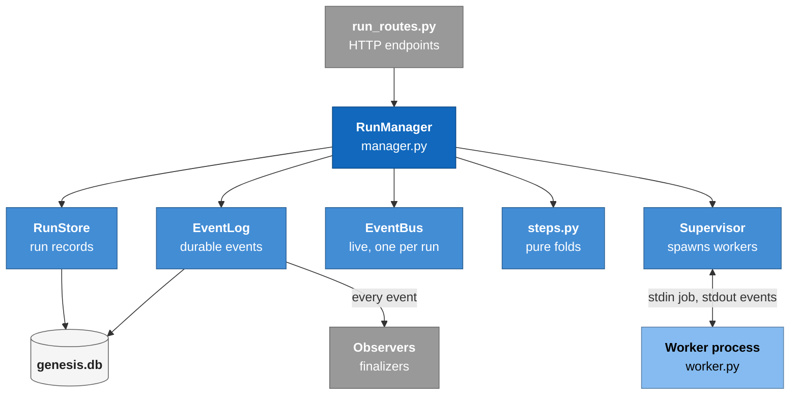
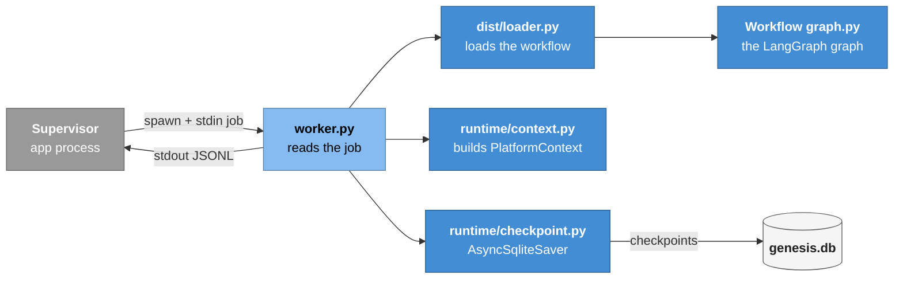
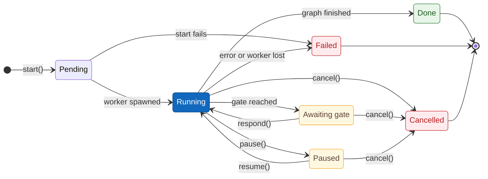

# Module: runs and workers

> **Describes:** genesis v0.81.0 (Phase 51) · **Last reviewed:** 2026-11-11 · C4 level 3 · area `runs-worker`

## 1. Purpose

This module runs workflows. It creates a run, starts a worker process that executes the workflow graph, turns
the worker's output into a durable event history, streams that history to the browser, and gives people the
controls to step in: answer a gate, pause, resume, cancel, edit state and fork. It also recovers runs that were
left behind when the app stopped.

The design has one central promise: **a run's history is never lost and a run never ends twice.** Most of the
code in `genesis/runs/manager.py` exists to keep that promise when processes die or race each other.

## 2. At a glance

| Item | Value |
|---|---|
| Code | `genesis/runs/` (`manager.py`, `worker.py`, `supervisor.py`, `store.py`, `eventlog.py`, `events.py`, `steps.py`, `validation.py`); `genesis/runtime/checkpoint.py`, `genesis/runtime/context.py`, `genesis/runtime/engine.py`; routes in `genesis/api/run_routes.py` |
| Runs in | The app process (manager, store, event log, bus, routes) and a child process per run operation (worker) |
| Depends on | `genesis-core` (state, context, registries), LangGraph and its async SQLite saver, `genesis/db`, `genesis/dist` (loader), `genesis/config` (secrets, environments) |
| Used by | The run API, chat's copilot tools, every finalizer and observer, scheduled jobs, test execution, the stage and story services |
| Stores | `runs` and `run_events` tables and LangGraph's checkpoint tables, all in `~/.genesis/genesis.db`; the run's folder under the artifacts root |

## 3. Concepts

| Term | Meaning |
|---|---|
| **Run** | One execution of one workflow with one set of inputs. Its id looks like `r-1a2b3c4d5e6f`. The run id is also the LangGraph thread id. |
| **Run record** | A row in `runs`: workflow, version, inputs, status, cursor (last completed node), artifacts folder, detail (an error summary), timestamps. A convenience copy of the current state; the event log is authoritative. |
| **Status** | `pending`, `running`, `awaiting_input:gate`, `awaiting_input:paused`, `done`, `failed`, `cancelled`. The last three are **terminal**: nothing changes a terminal run. |
| **Worker** | A child process, `python -m genesis.runs.worker`, that performs one **operation** (`run`, `resume`, `get_state`, `update_state`, `fork`) and exits. |
| **Job** | The JSON the manager writes to the worker's stdin: `op`, `run_id`, `workflow_id`, plus `inputs`, `environment`, `resume`, `values`, `as_node`, `new_run_id` as the op needs. |
| **Event** | One row in `run_events`: `seq` (global order), `run_id`, `node`, `kind`, `payload`, `ts`. Kinds are canonical (section 6.3). |
| **Event bus** | An in-memory, per-run fan-out of new events to live subscribers (the SSE endpoint). It replays its own history to late subscribers. It is not durable. |
| **Gate descriptor** | What a waiting gate shows: `node`, `kind`, `prompt`, `options`, `context_refs`, `raised_at`. Built by `hitl_gate` in the core. |
| **Observer** | A callback registered with `add_event_observer` that sees every canonical event. Finalizers use it to turn finished runs into domain records. |
| **Run-owner lock** | An exclusive file lock on `~/.genesis/run/runs.lock`, taken by the one app process that may treat untracked runs as orphaned. |

## 4. Structure

The routes call the `RunManager`, which owns the store, the event log, the per-run buses, the step folds and the
supervisor. The store and the log write to `genesis.db`. The supervisor starts a worker per operation, sends it the
job on stdin and reads its JSON lines from stdout on a thread. Every logged event also goes to the observers.

The worker reads the job, loads the workflow through the loader and builds its context. It checkpoints into the
same database that the store and the log use. Its output goes back to the supervisor as JSON lines.

| File | Main parts |
|---|---|
| `runs/manager.py` | `RunManager`: `start`, `pause`, `resume`, `cancel`, `respond`, `get_state`, `patch_state`, `fork`, `pending_gate`, `reconcile_status`, `fail_orphaned_runs`, `list`, `steps`, `transitions`, `node_iterations`, `log_events`, `cbus`, `add_event_observer`; the private `_spawn`, `_log`, `_finalize`, `_announce_final`, `_claim_status` |
| `runs/supervisor.py` | `Supervisor.spawn(job, on_event, on_exit)` starts a worker and a reader thread; `Worker.kill()` sends SIGTERM, then SIGKILL after 5 s |
| `runs/worker.py` | `main()` reads the job, `_run_job` loads and runs the graph, `_snapshot` turns LangGraph's state into a final event |
| `runs/store.py` | `RunRecord`, `RunStore` (`create`, `get`, `set_status`, `claim_status`, `note_progress`, `list`, `count`), the status constants and allowed transitions |
| `runs/eventlog.py` | `EventLog` (`append`, `list`, `latest`, `last_seq`, `purge`, credit and tool-call aggregates) |
| `runs/events.py` | `Event`, `EventBus` (`publish`, `close`, `history`, `subscribe`) |
| `runs/steps.py` | Pure folds over events: `fold_steps`, `fold_transitions`, `fold_iterations` |
| `runs/validation.py` | `validate_inputs` (JSON Schema), `check_editable` (state-edit guard), `FileUploadError` |
| `runtime/checkpoint.py` | `checkpointer(db_path)`: `AsyncSqliteSaver` with WAL and a 30 s busy timeout |
| `runtime/context.py` | `build_context(...)`: the `PlatformContext` for a run, including every `ctx.extras` service |
| `runtime/engine.py` | Thin async helpers (`run`, `resume`, `get_state`, `stream`) that inject the context into the LangGraph config; used by tests and the harness |

## 5. How it works

### 5.1 The run lifecycle

A run starts as Pending and is Running once its worker starts. From Running it can stop at a gate or be paused
(yellow); answering the gate or resuming takes it back to Running. It ends in exactly one of three terminal
statuses: Done (green), Failed or Cancelled (red). Cancel works from Running, Awaiting gate and Paused. The stored
values are `pending`, `running`, `awaiting_input:gate`, `awaiting_input:paused`, `done`, `failed` and `cancelled`.
A fork creates a new run that starts in Paused (section 5.6).

### 5.2 Starting a run

`RunManager.start(workflow_id, inputs, environment=None, files=None, idempotency_key=None, prepare=None)`:

1. **Idempotency.** If the same `idempotency_key` started a run that still exists, return that run id. A double
   click never starts two runs. The map is in memory, which is enough for one local user.
2. **Read metadata safely.** Check the library's core major against `CORE_MAJOR`, then read `workflow.yaml`. The
   app never imports `graph.py`.
3. **Pick the run id and folder:** `r-<12 hex>` and `<artifacts root>/<workflow_id>/<run_id>/`.
4. **Provision uploaded files** (ADR-035). Each file must be for an input whose schema has `format: "file"`, at
   most 25 MB, with one of the extensions `.txt .md .html .htm .csv .png .jpg .jpeg .pdf`. The file is written to
   `<run>/uploads/<safe name>` and the input becomes that relative path.
5. **Run the optional `prepare(run_id, run_dir)` hook.** Test execution uses it to put the test checkout into the
   run folder before the run exists. If it or validation fails, a folder this call created is removed.
6. **Validate inputs** against `META.inputs_schema` (JSON Schema draft 2020-12). A failure raises
   `InputValidationError` and the API answers 400 with the list of problems.
7. **Create the record** as `pending`, set it to `running`, log `run.started`.
8. **Spawn the worker** with `{"op": "run", "run_id", "workflow_id", "inputs", "environment"}`.

### 5.3 How worker output becomes events

The worker prints one JSON object per line. The supervisor's reader thread parses each line and calls the
manager's `on_event`. Lines that are not JSON are ignored. Every event the manager records goes through `_log`,
which does three things in order: append to `run_events` (getting the `seq`), publish to the run's bus, then call
every observer.

| Worker line | What the manager does |
|---|---|
| `{"kind": "node", "node", "delta"}` | Logs `node.completed` with the changed state keys; moves the cursor (`note_progress`, which never overwrites a stop status) |
| `{"kind": "custom", "data": {"type": …}}` with a canonical type | Logs it under that type as the kind, with `node` from the data. The canonical types are `agent.message`, `agent.thought`, `agent.tool_call`, `agent.tool_update`, `agent.result`, `agent.prompt`, `validator.result`, `retry.scheduled`, `telemetry` |
| `{"kind": "custom", …}` with any other type | Logs kind `custom` with the whole data object and no node |
| `{"kind": "final", "status", "next", "interrupts", "state"}` | If there is an interrupt, logs `gate.awaiting` with the gate descriptor. A terminal status goes through `_finalize`. A non-terminal stop (gate) is stored with a compare-and-set and announced with `run.final`; the bus stays open |
| `{"kind": "error", "error", "traceback"}` | `_finalize(failed)` with the error |
| `{"kind": "worker_exit", "code", "stderr"}` (added by the supervisor on a non-zero exit) | `_finalize(failed)` with the stderr tail, unless an `error` event already explained the failure (L-008) |

When the worker exits, `on_exit` makes sure a run that is still `running` with no final event and a non-zero exit
code is failed.

**Intended stops are not failures.** `pause` and `cancel` mark the current worker as stopped *before* killing it.
Every later line from that worker, including its non-zero exit, is then ignored. The mark is per worker, not per
run, so a resumed run's new worker is unaffected (L-108).

### 5.4 Ending a run exactly once

`_finalize(run_id, status, …)` is the only way a run becomes `done`, `failed` or `cancelled`:

1. If the record is already terminal, do nothing.
2. **Store first.** `claim_status` runs a single
   `UPDATE runs SET status=? … WHERE run_id=? AND status NOT IN ('done','failed','cancelled')`. If two threads
   race (a cancel on a request thread and a `worker_exit` on the reader thread), exactly one update changes a row.
   Only that caller continues (L-091).
3. **Then announce.** Log `error` if there is one, then exactly one `run.final` with the terminal status, then
   close the bus. An observer that re-reads the record on `run.final` sees it terminal (L-093).
4. **Clean up.** Delete `<run>/_toolcalls/` (unless `GENESIS_PURGE_TOOL_STORE_ON_FINAL=0`) and stop any process
   groups recorded under `<run>/.pids/` by test steps (L-104).

If storing the status itself fails, the error is logged loudly and the announcement still happens, so the log
keeps the terminal event; a later reconcile adopts it.

### 5.5 Inside the worker

`worker.py` is the only place workflow Python is imported. For one job it:

1. Loads `Settings`, the SecretProvider and the environment registry; sets the active environment if the job names
   one.
2. Calls `Loader.load_build(workflow_id)`: checks the core major again, imports
   `~/.genesis/library/workflows/<id>/graph.py` by file path, checks `META.id`, returns `build` and `META`.
3. Builds the MCP and CLI registries from the installed library's **curated** registry files only (the user's
   custom tier is not merged here). The MCP launch provider resolves managed servers from their local installs,
   and resolves `genesis-kb` to `python -m genesis.mcp.kb_server`. The CLI registry gets no launch provider.
4. Opens the checkpointer on `genesis.db` and builds the `PlatformContext`. `ctx.emit` prints a `custom` line.
5. Calls `build(ctx)` and sets the config: `thread_id = run_id`, the context under `genesis_ctx`, and
   `recursion_limit` from `META.execution.recursion_limit` (default 150).
6. Performs the op:
   - `run`: `astream(new_state(...))`; `resume`: `astream(Command(resume=decision))`, or `astream(None)` to
     continue a paused run. Both stream `updates` (one `node` line per node) and `custom` (the `ctx.emit` events),
     then print `final`.
   - `get_state`: print `final` with the current snapshot.
   - `update_state`: `aupdate_state(values, as_node)`, then print `final`.
   - `fork`: copy the run's current state, apply the edits, set the new run id, write it as the new thread's state
     `as_node`, print `final` for the new thread.
7. On any exception, including cancellation, prints `error` with a message and the traceback tail, then exits 1.
   A cancellation gets a hint that an MCP server may have failed to start or the turn timed out.

`_snapshot` decides the final status: an interrupt means `awaiting_input:gate`; a graph with no next node is
finished, so its status is `done` unless the graph itself set `failed` or `cancelled`. A leftover `running` in
state never leaks out of a finished graph (L-065).

### 5.6 The three ways a person steps in

| Mode | API | What the manager does |
|---|---|---|
| **Gate answer** | `POST /api/runs/{id}/respond` with `decision` | Refuses a missing or terminal run (409) and a plain string that is not one of the gate's options (400); free-text feedback `{"feedback": …}` is always allowed. Logs `gate.resolved`, sets `running`, spawns `resume` with the decision. |
| **Pause** | `POST /api/runs/{id}/pause` | Marks the worker stopped, stores `awaiting_input:paused`, kills the worker, stops the run's test processes. No `run.final` is logged. The last completed checkpoint is the resume point; the node that was running will run again. |
| **Resume** | `POST /api/runs/{id}/resume` | Refuses a terminal run (409); sets `running`; spawns `resume` with no decision. |
| **Cancel** | `POST /api/runs/{id}/cancel` | Marks the worker stopped, stores `cancelled` with the compare-and-set, kills the worker, and only if its store won announces one `run.final{cancelled}`. |
| **Read state** | `GET /api/runs/{id}/state` | Reads the latest checkpoint directly from SQLite in the app process; no worker, no workflow import. Internal `__` channels are hidden. |
| **Edit state** | `PATCH /api/runs/{id}/state` | `check_editable` refuses read-only keys (`run_id`, `status`, `cursor`, `retries`, `_validation`, `_last_turn`, `workflow_id`, `workflow_version`, `telemetry`, `errors`) and any key not in `inputs`, `decisions`, `artifacts` or `META.editable`. Then spawns `update_state` and waits up to 60 s. |
| **Fork** | `POST /api/runs/{id}/fork` with `as_node`, `values` | Checks the edits the same way, creates a new run record, spawns `fork` (its events are recorded under the new run), waits up to 60 s, sets the new run to `paused`. The original run is untouched (ADR-025). |

**Where a waiting gate is read from.** `pending_gate` uses the durable log first: the latest `gate.awaiting` that
no later `gate.resolved` follows. If the log has none (an old run), it reads the interrupt from the checkpoint's
pending writes. The UI can show a gate at any time, even after a restart.

### 5.7 Streaming to the browser

`GET /api/runs/{id}/events/stream?after=<seq>` is a Server-Sent Events stream:

1. Replay every logged event after `after` from `run_events`.
2. Subscribe to the run's bus and send each new event, skipping any whose `seq` was already replayed.
3. Stop when the bus closes, which happens at the terminal `run.final`.

The bus stays open through gates and pauses, so a resumed run keeps streaming to an open tab (L-003). The client
de-duplicates by `seq` and closes its `EventSource` on a terminal `run.final` or `error`; otherwise the browser
reconnects and replays forever. sse-starlette separates frames with CRLF, so the reader accepts both CRLF and LF
(L-018).

Other read endpoints fold the same log (`steps.py`): `/steps` (per-node status, attempts, tool calls, messages,
credits, timing), `/transitions` (the edges actually taken and how often, for the run graph highlight),
`/nodes/{node}/iterations` (every agent turn of one node: prompt pointer, attempt, pass and item labels, metrics),
and `/events` (paged raw events). Do not fold the whole log on every UI tick for a large run; it is quadratic
(L-066).

### 5.8 Recovering after a restart

Workers are children of the app process. When the app stops, its runs lose their workers. Two mechanisms clean
up:

- **At startup, `fail_orphaned_runs`.** First take the run-owner lock (`flock` on `~/.genesis/run/runs.lock`). If
  another live Genesis process on the same home holds it, do nothing: its runs are not orphans (L-097). Otherwise,
  for every `pending` or `running` run: if the log's latest `run.final` is terminal, or is a gate marker with no
  later events, adopt that status; else fail the run with "worker lost across a server restart". `paused` and
  gated runs have no worker by design and are never touched. This sweep runs before every finalizer's startup
  reconcile, so those see a terminal run instead of one that can never finish.
- **On read, `reconcile_status`.** When the run list or a run page is read and no worker for that run is tracked
  here, a stale `running` record adopts the latest `run.final` status and cursor from the log. It never touches a
  terminal or paused run.

### 5.9 Observers and finalizers

`add_event_observer(cb)` registers `cb(run_id, kind, payload, node)` for every logged event. It is called on the
worker's **reader thread**, so it must be thread-safe, must not block, and must hand async work to the app's loop.
An observer that raises is ignored. In v0.81.0 these observers are registered in `genesis/api/app.py`:

| Observer | Turns this run into |
|---|---|
| `ChatRunSupervisor` | Chat notes for runs a chat session started (copilot) |
| `StageFinalizer` | A feature stage artifact (UX, Technical Design, Breakdown, Test Design runs) |
| `StoryDesignFinalizer`, `StoryImplementationFinalizer`, `StoryVerificationFinalizer` | Story stage artifacts and Workbench lane moves |
| `SyncLinkObserver` | Re-resolved test-to-object links after a KB sync |
| `TopupRunObserver` | Test Design top-up results |
| `TestExecutionFinalizer` | Test execution results, then the next queued execution |
| `CaptureFinalizer`, `ComposeFinalizer` | Recorded-action proposals and composed data setups |

Each finalizer also reconciles at startup and when its page is read, so a missed event is caught later (L-058).
A finalizer that sweeps finished runs must only take the run currently bound to its record (L-061).

## 6. Interfaces

### 6.1 HTTP endpoints

| Method and path | Purpose |
|---|---|
| `POST /api/runs` | Start (`workflow_id`, `inputs`, `environment`, `idempotency_key`). With a chat control token, copilot limits apply first (section 8) |
| `POST /api/runs/upload` | Start with files (multipart: a `payload` JSON part plus file parts named after inputs) |
| `GET /api/runs` | Page of runs (`status` incl. `active`, `workflow`, `q`, `limit` ≤ 100, `offset`) and `total` |
| `GET /api/runs/{id}` | The record plus `gate` (the pending gate descriptor or null) |
| `GET`/`PATCH /api/runs/{id}/state` | Read or edit state |
| `POST /api/runs/{id}/pause` · `resume` · `cancel` · `respond` · `fork` | The controls in 5.6 |
| `GET /api/runs/{id}/artifacts` | The blackboard manifest with media types |
| `GET /api/runs/{id}/artifacts/{name}` (`mode=preview|full`) · `…/download` | One artifact's text, or the file. Names may contain `/`; paths that leave the run folder are refused |
| `GET /api/runs/{id}/events` · `/events/stream` · `/steps` · `/transitions` · `/nodes/{node}/iterations` | History and folds (5.7) |

### 6.2 The Python API other modules use

`RunManager.start(...)`, `cancel`, `get`, `list`, `pending_gate`, `log_events`, `add_event_observer`,
`holds_run_owner_lock`. Services such as test execution and the stage services start runs through `start` and
learn about their end through an observer, never by polling the worker.

### 6.3 Canonical event kinds

`run.started`, `node.completed`, `agent.prompt`, `agent.message`, `agent.thought`, `agent.tool_call`,
`agent.tool_update`, `agent.result`, `validator.result`, `retry.scheduled`, `telemetry`, `gate.awaiting`,
`gate.resolved`, `run.final`, `error`, and `custom` for everything else. There is no `node.started` or
`node.failed`: a node is running when it is the cursor's successor, and a failure is an `error` (L-005). The web
types in `web/src/types` and the golden fixtures mirror these shapes, so a drift fails a test (L-011).

## 7. Data

| Store | Content |
|---|---|
| `runs` | `run_id`, `workflow_id`, `version`, `inputs` (JSON), `status`, `cursor`, `artifacts_dir` (absolute), `detail`, `created_at`, `updated_at` |
| `run_events` | `seq` (autoincrement, global order), `run_id`, `node`, `kind`, `payload` (JSON), `ts` |
| LangGraph checkpoint tables | One thread per run id; one checkpoint per superstep; pending writes hold interrupts |
| Run folder | The blackboard (see [core-engine.md](core-engine.md#72-blackboard-layout)); `uploads/` written by `start` |

Schema is owned by `genesis/db/migrations/` (`m0001_baseline` created `runs` and `run_events`); the stores never
create tables. Retention (`genesis/config/retention.py`) can remove terminal runs' events and folders by count or
age.

## 8. Failure handling and limits

| Situation | Behaviour |
|---|---|
| Input fails the schema | 400 with every problem; no record is created |
| Upload too big, wrong type or for a non-file input | 400; nothing is written |
| Library built for another core major | `CompatError` at start (app side) and again in the worker |
| Worker crashes or is killed by the OS | `worker_exit` → `failed` with the stderr tail |
| Two terminal transitions race | Exactly one wins the compare-and-set and announces |
| Resume or respond on a terminal run | 409 |
| Gate answer not in the options | 400 |
| App restarts mid-run | The run is failed as orphaned at the next start (or adopted if the log shows it ended) |
| Copilot start (chat control token) | Kill-switch, workflow allow/deny list, per-session active-run cap and per-minute rate limit; refused with 403 or 429 (ADR-033) |

## 9. Configuration

| Setting | Default | Effect |
|---|---|---|
| `GENESIS_STATE_DIR` | `~/.genesis` | Database, library, lock and PID files |
| `GENESIS_ARTIFACTS_DIR` | `~/Genesis/runs` | Run folders |
| `GENESIS_PURGE_TOOL_STORE_ON_FINAL` | on | Delete `_toolcalls/` at the end of a run |
| `GENESIS_RETENTION_KEEP_LAST`, `GENESIS_RETENTION_MAX_AGE_DAYS`, `GENESIS_RETENTION_ON_START` | 0, 0, off | Retention of terminal runs |
| `META.execution.recursion_limit` | 150 | LangGraph superstep ceiling per worker operation |

## 10. Extending this module

- **React to run endings** by registering an observer and reconciling at startup and on read; do not add code to
  `_finalize`. Store your own terminal state before announcing it, and test through the real
  `RunManager._finalize` (L-093).
- **A new worker op** needs a branch in `worker._run_job`, a manager method that spawns it, and a decision on how
  its `final` maps to a status.
- **A new canonical event kind** needs `_CANONICAL_CUSTOM`, the web types, the golden fixtures and any fold that
  should count it (L-011, L-094).

## 11. Design decisions

| Decision | In plain words | ADR |
|---|---|---|
| All three HITL modes are required | Gates, pause/resume and state edits with fork | ADR-009 |
| Small state, bulk in the run folder | State is checkpointed and editable; files hold content | ADR-010, ADR-022 |
| Disposable subprocess workers | The app never runs workflow code; pause is a kill | ADR-012 |
| Pause only at sanctioned gates | Workflows run straight through except at approval, escalation and pre-mutation gates | ADR-021 |
| FastAPI embeds LangGraph | No LangGraph Server | ADR-023 |
| Async engine, `AsyncSqliteSaver`, Python 3.13 | The sync saver fails under async execution | ADR-024 |
| Fork seeds a new thread | Never time-travel inside the original run | ADR-025 |
| Files at launch go to the blackboard | Bounded, sanitised, never inline | ADR-035 |

## 12. Known pitfalls

- Keep the bus open until the run is terminal, and have the client close on terminal events (L-003).
- Use only the canonical kinds; there is no `node.started` (L-005).
- A generic worker exit must not replace a specific error (L-008).
- `Command(resume=…)` needs a graph compiled with a checkpointer (L-009).
- Accept CRLF in SSE frames (L-018).
- Raise the recursion limit for looping workflows (L-020).
- Do blocking database writes off the event loop (L-026).
- Give every run-to-record bridge a level-triggered recovery and make its failures loud (L-058).
- A capped `/events` fetch cannot be the source of node status; use the folds (L-060).
- Scope a finalizer sweep to the run bound to its record (L-061).
- A gate → END path must set a terminal status (L-065).
- Never refold the whole log per tick (L-066).
- Store the terminal state before announcing it (L-093).
- Take the run-owner lock before treating untracked runs as orphans (L-097).
- Record each detached process's own pid and match full command lines when reaping (L-104).
- Every background job must reach a terminal state on every error path (L-107).
- Record an intended stop per worker before the kill, and make the terminal write a compare-and-set (L-108).

## 13. Tests

| Test file (in `tests/`) | Covers |
|---|---|
| `test_runs.py` | The run lifecycle and its controls |
| `test_run_inspection.py` | Run inspection: steps, transitions, iterations |
| `test_run_idempotency.py` | Idempotent start |
| `test_dataplane.py` | The durable data plane |
| `test_credits.py` | Credit aggregation and provenance |
| `test_retention.py` | Retention of terminal runs |
| `test_api.py` | The HTTP API, including the run routes |

Gate commands, from the repo root: `.venv/bin/ruff check genesis` and `.venv/bin/python -m pytest -q`.

## 14. Code map

| To change… | Look in |
|---|---|
| How a run starts or validates inputs | `RunManager.start`, `_provision_files`, `runs/validation.py` |
| How worker lines become events | `RunManager._spawn` (`on_event`, `on_exit`) |
| How a run ends | `RunManager._finalize`, `_announce_final`, `RunStore.claim_status` |
| Pause, resume, cancel, respond, fork | the methods of the same name in `RunManager` |
| What the worker does per op | `runs/worker.py` (`_run_job`, `_snapshot`) |
| What a node can reach through `ctx.extras` | `runtime/context.py` |
| The SSE stream | `api/run_routes.py` (`events_stream`) |
| Restart recovery | `RunManager.fail_orphaned_runs`, `reconcile_status`, startup hooks in `api/app.py` |
| Per-node and per-turn summaries | `runs/steps.py` |
