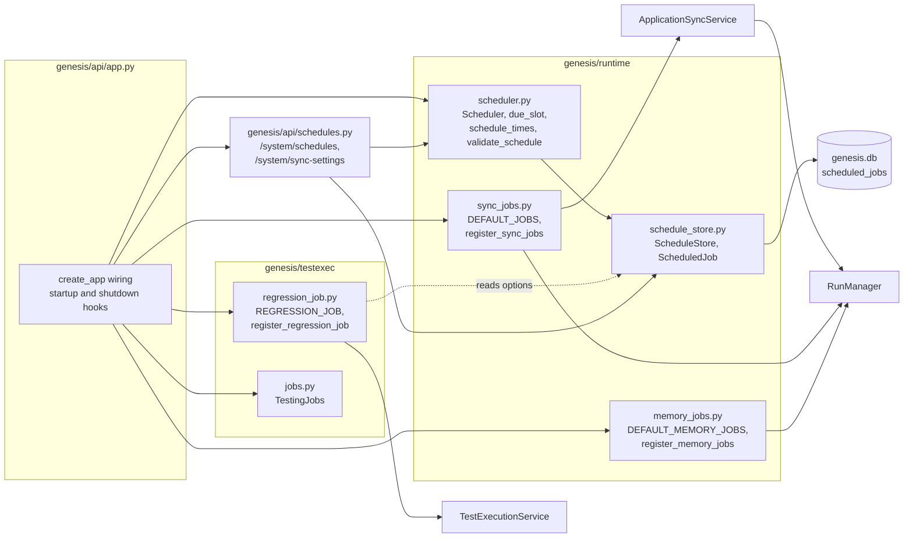
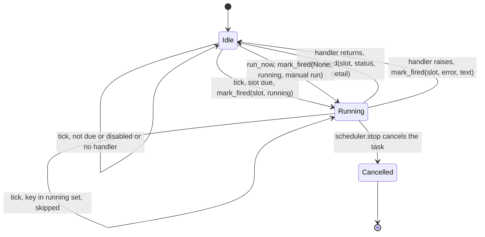
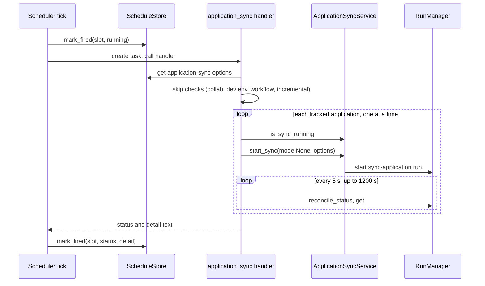

# Module: scheduler and jobs (`genesis/runtime/scheduler.py`)

> **Describes:** genesis v0.81.0 (Phase 51) · **Last reviewed:** 2026-11-11 · C4 level 3 · area `runs-worker`

## 1. Purpose

This module runs work on a timetable while Genesis is open. It has two parts that do not share code.

1. **The scheduler** is a small loop inside the app process. Once a minute it looks at a table of job definitions,
   decides which jobs are due, and starts each due job as its own background task. The jobs it knows about are fixed
   in the backend (ADR-047). A user can change the timing and options of some of them, but cannot add a job.
2. **The testing jobs** (`TestingJobs`) are a separate, in-memory registry for long actions that a user starts from the
   Testing screens: creating a test workspace, installing Chromium, replaying a library item. They are not
   scheduled. They sit here because they are "background work started by the app" and share the lesson about
   reaching a terminal state (L-107).

The central promise of the scheduler is that **a due slot fires once**. The slot is written to the database before the
work starts, and the slot key contains the local date. So a long job cannot fire twice on the next tick, a restart
cannot fire a slot twice, and a restart on the same day still catches up a slot that passed while Genesis was off.

Most jobs do not do the work themselves. They start a workflow run through the same `RunManager.start` that a person
clicks, then (for some jobs) wait for it to end. The runs are described in [runs-and-workers.md](runs-and-workers.md).

## 2. At a glance

| Item | Value |
|---|---|
| Code | `genesis/runtime/scheduler.py`, `genesis/runtime/schedule_store.py`, `genesis/runtime/sync_jobs.py`, `genesis/runtime/memory_jobs.py`, `genesis/testexec/regression_job.py`, `genesis/testexec/jobs.py`, `genesis/api/schedules.py` |
| Runs in | The app process (`genesis serve`). The scheduler is one asyncio task on the server's event loop. `TestingJobs` use one daemon thread per job. The workflow runs that jobs start are subprocess workers, as always (ADR-012). |
| Depends on | `genesis/db` (`Database`, table `scheduled_jobs`), `RunManager` (`genesis/runs/`), `ApplicationSyncService` (`genesis/services/application_sync.py`), `KbStore`, the config service (environments, `gws`), the collaboration service, `kiro_auth`, `TestExecutionService` (for regression), `genesis/testexec/procs.py` and `runner.scrub_text` (for testing jobs) |
| Used by | `genesis/api/app.py` (builds, wires, starts and stops everything); `genesis/api/schedules.py`; `genesis/testexec/regression_service.py` (writes the regression schedule into the job's options); `genesis/api/testing.py` (submits testing jobs) |
| Stores | Table `scheduled_jobs` in `genesis.db` (migrations `m0012_scheduled_jobs`, `m0023_incremental_sync`). Testing jobs store nothing on disk except process-id records. |
| Job keys | `application-sync`, `document-library-sync`, `kb-hub-pull`, `regression-run`, `memory-consolidation`, `memory-maintenance` |
| Time zone | All six default definitions use `Asia/Kolkata`. Each job's schedule carries its own zone. |
| Tick | `Scheduler.TICK_SECONDS = 60` |

## 3. Concepts

| Term | Meaning |
|---|---|
| **Job** | A row in `scheduled_jobs`: a key, a name, an enabled flag, a schedule, options, and the result of the last run. Code: `ScheduledJob`. |
| **Job definition / default** | A dict in `DEFAULT_JOBS` or `DEFAULT_MEMORY_JOBS` that the scheduler writes into the table at start. |
| **Handler** | The function that does a job's work. It takes no arguments and returns `(status, detail)`, either directly or as an awaitable. It is registered under the job key with `Scheduler.register`. |
| **Handler status** | One of `ok`, `skipped`, `partial`, `error`. The scheduler stores the text it receives; it does not check it against this list. |
| **Schedule** | A JSON object with a `kind`, a `timezone`, and optionally `weekdays_only` and `days`. Two kinds exist: `daily_times` and `interval_window`. |
| **`daily_times`** | A list of fixed local `HH:MM` times. |
| **`interval_window`** | "Every N hours between a start and an end time". `schedule_times` expands it to fixed times, so the same slot logic applies. |
| **Slot** | One scheduled firing, written as `YYYY-MM-DDTHH:MM` in the job's local time. |
| **`last_fired_slot`** | The slot most recently started for a job. It is the restart-safety marker. |
| **Due** | A job is due when the latest slot at or before now (today only) differs from `last_fired_slot`. |
| **Run now** | A manual start. It does not move `last_fired_slot`. |
| **Options** | A JSON object per job (`options_json`). It holds the application sync thresholds, or the per-application regression schedules. |
| **`user_modified`** | A flag set when a person saved a job's settings. Boot-time seeding then leaves the schedule and options alone (L-081). |
| **Dispatcher job** | `regression-run` is a job that fires every hour and decides, per application, whether anything is due. |
| **Testing job** | An in-memory background job of `TestingJobs`. Kinds: `workspace-create`, `workspace-update-runtime`, `chromium-install`, `library-replay`. |
| **Flight key** | The string that makes a testing job single-flight: a second submit with the same key while one runs returns the running job. |

## 4. Structure



The scheduler owns the loop and knows nothing about specific jobs. It reads and writes `scheduled_jobs` through
`ScheduleStore`. Three modules (`sync_jobs`, `memory_jobs`, `regression_job`) each define their default rows and
register handlers on the scheduler. `app.py` creates all of it. `schedules.py` exposes the table and the application
sync settings over HTTP. `TestingJobs` stands apart: it is created in `app.py` and handed to the testing routes.

| File | Main classes and functions |
|---|---|
| `genesis/runtime/scheduler.py` | `Scheduler` (`register`, `start`, `stop`, `wait_idle`, `tick`, `is_running`, `run_now`, `_fire`), `schedule_times`, `validate_schedule`, `due_slot` |
| `genesis/runtime/schedule_store.py` | `ScheduledJob` (dataclass), `ScheduleStore` (`list_jobs`, `get`, `ensure_defaults`, `update_settings`, `update_option_entry`, `mark_fired`, `set_enabled`, `update_schedule`) |
| `genesis/runtime/sync_jobs.py` | `DEFAULT_JOBS`, `APP_SYNC_DEFAULT_OPTIONS`, `RUN_OPTION_KEYS`, `app_sync_skip_reason`, `register_sync_jobs` (handlers `application_sync`, `document_library_sync`, `kb_hub_pull`) |
| `genesis/runtime/memory_jobs.py` | `DEFAULT_MEMORY_JOBS`, `register_memory_jobs` (handlers `memory_consolidation`, `memory_maintenance`) |
| `genesis/testexec/regression_job.py` | `REGRESSION_JOB`, `latest_slot`, `next_slot`, `is_due`, `register_regression_job` |
| `genesis/testexec/jobs.py` | `TestingJobs`, `JobContext`, `JobNotFound`, `JobError`, constants `JOB_KINDS`, `JOB_STATUSES`, `CANCELLABLE`, `KEEP_FINISHED_S` |
| `genesis/api/schedules.py` | `register_schedules_routes`, `validate_sync_options`, `_next_due` |
| `genesis/runtime/collab_autopull.py` | Not part of this module. A separate always-on loop; see [collaboration-hub.md](collaboration-hub.md). |

## 5. How it works

### 5.1 Startup and shutdown

`create_app` in `genesis/api/app.py` builds the objects in this order (the wiring is described in [api.md](api.md)):

1. `ScheduleStore(settings.db_path)`.
2. `Scheduler(schedule_store, defaults=DEFAULT_JOBS + DEFAULT_MEMORY_JOBS)`. `DEFAULT_JOBS` already contains
   `REGRESSION_JOB`.
3. `register_sync_jobs(...)`, `register_memory_jobs(...)` and `register_regression_job(...)`. Each calls
   `scheduler.register(job_key, handler)`.
4. `register_schedules_routes(...)`, then `app.state.schedule_store` and `app.state.scheduler` are set.

A FastAPI `startup` hook then calls `scheduler.start()`. A `shutdown` hook awaits `scheduler.stop()`. The collab
auto-pull loop has its own pair of hooks and is not driven by the scheduler.

`Scheduler.start()` does two things:

1. It calls `ScheduleStore.ensure_defaults(defaults)` inside `try/except`. If that fails (for example the table is
   locked), it logs the error and goes on, so a scheduler problem cannot stop the server from booting.
2. It starts the loop task `_run` if none is running.

`Scheduler.stop()` cancels the loop task, then cancels every in-flight job task and waits for them, so a long
application sync does not hang shutdown.

Handlers must be registered before `start()`. A job that has a row but no handler is skipped without being marked
(section 5.3), so a handler registered later would still fire on the next due slot.

### 5.2 The tick loop

`_run` calls `tick()`, then sleeps 60 seconds, forever. The first tick runs immediately at start. A failed tick is
logged and the loop continues. Only cancellation ends the loop.

`tick()` visits every row from `ScheduleStore.list_jobs()` (ordered by `job_key`):

1. Skip the job if it is disabled, or if its key is in the in-memory `_running` set.
2. Read the clock in the job's own time zone (`schedule["timezone"]`, default `UTC`). If the zone is invalid, log a
   warning and skip this job only.
3. Call `due_slot(schedule, now_local, last_fired_slot)`. If it returns `None`, skip.
4. Look up the handler. If there is none, skip **without marking** the slot.
5. Add the key to `_running`, call `mark_fired(key, slot, "running", None)`, then create the task `_fire(...)`.
   The marking happens before the task starts, in the tick itself, so the next tick sees the slot as fired.

`_fire` calls the handler. If the handler returns a coroutine it is awaited. A two-item tuple becomes the status and
detail. Any other return value leaves the status at `ok` with an empty detail. An exception is logged and stored as
status `error` with the exception text. In all cases the key leaves `_running` and the final status is written with
`mark_fired(key, slot, status, detail)`.

`_fire` calls a handler directly. A handler that is a plain (non-async) function would therefore run on the event
loop. The only plain-function work in this module, the regression run, is wrapped in `asyncio.to_thread` (L-026).
See section 5.9.

### 5.3 When a slot is due

`due_slot(schedule, now_local, last_fired_slot)` works on today's date only:

1. If `weekdays_only` is set and today is Saturday or Sunday, return `None`.
2. If the schedule has a `days` list (Monday is 0) and today is not in it, return `None`.
3. Expand the schedule with `schedule_times`. For `interval_window` this gives `start`, `start + every_hours`, and so
   on, up to and including `end`. For `daily_times` it is the sorted `times`.
4. Take the **latest** time that is at or before the current `HH:MM`. If none has passed yet today, return `None`.
5. Build the slot key `<local date>T<HH:MM>`. Return it if it differs from `last_fired_slot`, otherwise `None`.

Three effects follow from this, and tests pin them (`tests/test_scheduler.py`):

- Only the latest passed slot fires. If Genesis was off from 08:00 to 13:00, one run fires for the 12:00 slot, not
  three runs.
- A passed slot catches up within the same day, because the key carries the date and differs from yesterday's.
- A slot from a previous day never fires, because step 4 looks only at today.

A row with no `last_fired_slot` (a new row) fires the latest passed slot of the day at its first tick. A new
`application-sync` row created at 14:00 on a weekday fires for the 12:00 slot at once.



The diagram shows one job's life in the scheduler. A due tick marks the slot and starts the task. While the task
runs, later ticks skip the job. When the handler ends, the final status is written. A shutdown cancels the task;
the cancelled path clears the in-memory flag and does not write a final status (section 8).

### 5.4 Run now

`Scheduler.run_now(job_key)` returns `False` when the job has no handler or is already running. Otherwise it adds the
key to `_running`, calls `mark_fired(key, None, "running", "manual run")` and creates the same `_fire` task with
`slot=None`. With `slot=None`, the SQL `COALESCE(?, last_fired_slot)` keeps the old slot, so a manual run never moves
the regular cadence.

`run_now` creates a task, so it must be called on the running event loop. The HTTP route that uses it is `async def`
for that reason. Only `application-sync` has a "Run now" route. The other jobs have none in this module.

The manual run uses the same handler as the timed run, so the same skips apply. For example, with collaboration on
and `run_on_this_machine` off, "Run now" ends as `skipped` with the designated-machine text.

### 5.5 Seeding defaults without overwriting user edits

`ScheduleStore.ensure_defaults(defaults)` runs in one transaction. For each default dict it reads
`options_json` and `user_modified` of the existing row and picks one of four branches:

| Existing row | What happens |
|---|---|
| None | Insert it. `enabled` comes from the default (default `True`), `options_json` from the default or `NULL`. |
| `user_modified = 1` | Update only `name`. Schedule, options and `enabled` stay as the user left them. |
| Default has options and the row's `options_json` is `NULL` (and not user modified) | **Adopt** once: write name, schedule, options **and** `enabled` from the default. This moved pre-Phase-45 `application-sync` rows to the new 4-hourly schedule. |
| Anything else | Refresh `name` and `schedule_json` from the default. Keep `enabled`, `last_fired_slot` and `last_run_*`. `options_json` is kept (`COALESCE(?, options_json)`). |

This is the L-081 rule: a new default that switches a job on must respect what the user already set. Two consequences
follow from the code.

- A job without `user_modified` has its schedule rewritten from the code on every boot. Changing a default schedule
  in code reaches every such row.
- `update_option_entry` (used for regression schedules) sets `user_modified = 1` on the `regression-run` row. After
  the first saved application schedule, the `regression-run` row keeps the schedule it has and only its name is
  refreshed on boot. That is harmless today because the hourly dispatcher schedule is not user-edited.

`update_settings(job_key, enabled, schedule, options)` is the write used by the Settings API. It sets
`user_modified = 1`. `update_option_entry(job_key, section, key, entry)` is a narrower write. It runs
`BEGIN IMMEDIATE`, reads `options_json`, sets or removes `options[section][key]`, writes it back and sets
`user_modified`. It leaves `enabled` and the schedule alone. Taking the write lock first means two applications
saved at the same moment both keep their entries (L-091). It raises `LookupError` if the job is not seeded.

`ScheduleStore` also has `set_enabled` and `update_schedule`. No production code under `genesis/` calls them; the
tests do.

### 5.6 The `application-sync` job

`register_sync_jobs` builds one `ApplicationSyncService(run_manager, kb_store, config)` and registers
`application_sync`. The handler runs these steps:

1. Read the job's options from the store and merge them over `APP_SYNC_DEFAULT_OPTIONS`.
2. Ask `app_sync_skip_reason`. If collaboration is on and `run_on_this_machine` is false, return `skipped` with the
   text "scheduled syncs run on another machine ...". An unreadable collaboration config counts as "off".
3. Return `skipped` if no dev environment is configured, if the `sync-application` workflow is not installed, or if
   the installed workflow does not support incremental sync (`supports_incremental()`). The last check is L-081's
   second half: the app can be newer than the installed library, and an old library would turn every 4-hourly slot
   into a full re-export. The refusal text tells the user to update the library. A manual Refresh or Full sync on
   the application page still works.
4. List tracked applications. If there are none, return `ok` with "no tracked applications".
5. For each application, one at a time:
   - skip it (counted as skipped) if a sync run for it is still going (`is_sync_running`);
   - start a run with `sync_service.start_sync(app_uuid, name, mode=None, options=run_options)`. `run_options` holds
     only `full_every_days`, `max_changed` and `max_changed_pct`. `run_on_this_machine` stays local. A failure to
     start counts as an error and the loop goes on;
   - wait for the run to end with `_wait_terminal(run_id, 1200)`.
6. Count the application as ok if the final status is `done`. A `failed` or `cancelled` run, or a wait that hit the
   20-minute cap, counts as an error. After a cap the loop moves on; the run itself is not cancelled.
7. Return `ok` when there are no errors, `partial` when there are errors and at least one success, and `error`
   otherwise. The detail reads like `3 apps: 2 ok, 1 skipped, 0 error (1 empty, 1 incremental)`. The kind words
   come from `_sync_kind`, which reads the newest `kb_syncs` row: `empty` for an incremental sync that changed
   nothing, `full` for the legacy `delta` kind, otherwise the stored kind.

Applications run **one after another** because the Appian Deployment export allows one export at a time and answers
HTTP 409 to a second (L-050). The handler never fans out.

`_wait_terminal` loops: call `run_manager.reconcile_status(run_id)`, read the record with `run_manager.get`, return
the status if it is in `TERMINAL`, otherwise `asyncio.sleep(5)`. It returns `None` when the cap passes. The
reconcile call lets the wait notice a run whose worker died.

`start_sync` resolves the mode. With `mode=None`, it picks `baseline` when the application has no baseline sync yet
and `auto` otherwise, then adapts the mode to what the installed workflow supports. The workflow, not the scheduler,
decides in the run whether an `auto` sync is incremental or falls back to full (for example when the last full sync
is `full_every_days` old or more than `max_changed` objects or `max_changed_pct` percent changed). That logic, the
`sync-application` workflow and the parser are described in [knowledge-base.md](knowledge-base.md) and
[appian-parser.md](appian-parser.md).



The sequence shows that the scheduler only starts the handler. The handler talks to the sync service, which starts
workflow runs. It polls each run until it ends, then moves to the next application. The scheduler writes the result
text at the end.

### 5.7 The `document-library-sync` and `kb-hub-pull` jobs

`document_library_sync` returns `skipped` if the `sync-documents` workflow is not installed, or if `gws` is not
connected (`config.gws().connected()`; any error counts as not ready). Otherwise it calls
`run_manager.start("sync-documents", {"scope": "library"})` and returns `ok` with "library sync started: <run id>".
**It does not wait for the run.** An `ok` status means "the run started". The run's own outcome is on the Runs page.
A start failure returns `error`. The document library itself is described in [documents.md](documents.md).

`kb_hub_pull` returns `skipped` when collaboration is off or missing. Otherwise, for each tracked application, it
calls `collab.pull_kb_if_newer(app_uuid, kb_store)` through `asyncio.to_thread` (L-026) and counts the applications
that were hydrated. One application's failure is logged and does not stop the others. The job always returns `ok`
once it gets past the collaboration check, even if some pulls failed. The job is seeded **disabled** and does
nothing unless collaboration is configured. See [collaboration-hub.md](collaboration-hub.md).

### 5.8 The memory jobs

`memory-consolidation` (nightly) and `memory-maintenance` (weekly) are defined in `memory_jobs.py`. This document
covers only how they are scheduled. What they do to the memory store is in [memory.md](memory.md).

`_run(workflow_id)` follows the same pattern as the sync jobs:

1. Return `skipped` if Kiro is not signed in (`kiro_auth.status()["authenticated"]`) or the workflow is not installed.
2. Call `run_manager.start(workflow_id, {"owner": owner})`. `owner` is `canonical_username(settings)`, read once when
   the job is registered at startup.
3. Wait up to 1800 seconds for a terminal status, polling every 5 seconds as above.
4. Return `ok` for `done`, otherwise `error` with the final status or "timed out".

Consolidation first checks whether any chat session is newer than the stored cursor. If none is, it returns
`skipped`. If the check itself fails, it does not skip and lets the workflow decide.

### 5.9 The `regression-run` job

`REGRESSION_JOB` is an hourly dispatcher: an `interval_window` every 1 hour from `00:00` to `23:00`, every day,
enabled, with no options. Each application's own cadence lives in the job's options:

```json
{"apps": {"<app_uuid>": {"cadence": "off|daily|weekly", "days": [0-6], "time": "HH:MM", "since": "<ISO>"}}}
```

`days` applies to `weekly` only. Every application is off by default: the seeded row has no options and
`ensure_defaults` never writes options for this job.

`regression_run` runs `run_once` through `asyncio.to_thread`, because it does database and git work (L-026). `run_once`:

1. Read `options.apps` and keep entries whose cadence is not `off`. If none, return `ok` ("no application has a
   regression schedule").
2. Take the current time in the job's time zone.
3. For each such application, in sorted order: skip if the application is no longer tracked; skip if it already has a
   queued or running regression execution; find the newest regression execution; ask `is_due`; if a slot is due,
   call `service.start_regression(app_uuid, trigger={"source": "schedule", "slot": ...})`.
4. Return `ok`, `partial` or `error` with counts of started, skipped and errored applications.

`latest_slot` finds the application's most recent slot at or before now, looking back up to eight days. `is_due`
returns that slot only if it is later than both the newest regression execution's `created_at` and the schedule's
`since`. Two effects follow:

- After downtime, a missed slot runs once. Only the latest slot counts.
- Turning a schedule on stamps `since` with the current time (done in `genesis/testexec/regression_service.py`), so
  the most recent past slot does not fire at the next tick.

Starting a regression only queues an execution. The one-at-a-time execution queue makes the job serial. The queue,
the execution service and the Setup view that writes the schedule are in [testing.md](testing.md). The Setup view's
"next run" uses `next_slot`, which is advisory, because the hourly tick starts a run within an hour of its slot.

### 5.10 Testing jobs

`TestingJobs` is a separate registry. A route calls `submit(kind, flight=..., work=..., app_uuid=..., item=...)` and
returns **202** with the job dict at once. The screen then polls `GET /api/testing/jobs/{job_id}`.

`submit`:

1. Reject an unknown `kind` with `ValueError`.
2. Under a lock, prune finished jobs older than the keep time (one hour), then look for a running job with the same
   `flight`. If one exists, return it with `created = False`.
3. Otherwise create a `_Job` with a random hex id, put the shared `jobs/.pids` folder in its `pid_dirs`, and start a
   daemon thread named `genesis-job-<kind>` running `_run`.

`_run` is built so that a job always ends (L-107):

1. Run `work(JobContext)` inside `procs.record_children_in(pid_dir)`. Each bounded child process the work starts is
   recorded as a pid file in `<testing_dir>/jobs/.pids`.
2. An exception becomes status `failed` and an error text (the text, or the exception type name if empty).
3. If a cancel was requested, the status becomes `cancelled`.
4. Scrub the error and the result of the application's test-user passwords (`scrub_text`, every written form). If
   scrubbing itself fails, the job is stored as `failed` (or `cancelled`) with the fixed text "the job finished but
   its outcome could not be stored".
5. Write the status, error, result and finish time under the lock. A `finally` always sets the `done` event. Without
   this, a failure while storing the outcome would leave the job `running` and block its flight key until restart.

`cancel(job_id)` works only for kind `library-replay` (`CANCELLABLE`). Any other kind raises `JobError` (a 409). For a
running replay it sets `cancel_requested`, reaps the job's own pid folders (everything in `pid_dirs` except the first,
shared one), and starts a helper thread that reaps again every 0.5 seconds until the job's thread returns or 60
seconds pass. A child started just after the first reap is caught by a later one.

`reap_stale()` runs at startup. It kills the child process groups that a previous server's jobs left in the shared
`jobs/.pids` folder. `procs.reap` kills a group only when its recorded marker text is still found in the group's
command lines, so a reused process id is not killed by mistake.

Jobs live only in memory. After a restart `get` answers `JobNotFound` (404). The Setup and runtime reads report the real
state, so nothing needs to be saved.

## 6. Interfaces

### HTTP (all under `/api`, ADR-028)

| Method and path | Purpose |
|---|---|
| `GET /system/schedules` | Every job: key, name, enabled, schedule, `last_fired_slot`, last run time, status and detail, and an advisory `next_due` (only for enabled jobs). |
| `GET /system/sync-settings` | The `application-sync` settings view: `enabled`, `schedule`, `options` (defaults merged in), `user_modified`, `collab_enabled`, `running`, last run fields, `next_due`, and a `per_app` list (last sync kind, time, status, changed count, fallback reason, last full sync, last published version). 404 if the job is not seeded. |
| `PUT /system/sync-settings` | Validate and save `enabled`, `schedule`, `options`. Marks the row `user_modified`. Returns the new view. 400 on invalid input, 404 if not seeded. |
| `POST /system/sync-settings/run-now` | Start `application-sync` now. 503 if there is no scheduler, 409 if it is running or could not start. |
| `GET /testing/jobs/{job_id}` | Status of a testing job. 404 if unknown, older than an hour, or lost in a restart. |
| `POST /config/testing/runtime/chromium` | 202 plus a `chromium-install` job. |
| `POST /applications/{app_uuid}/testing/workspace` | 202 plus a `workspace-create` job; 409 first if the runtime is not ready. |
| `POST /applications/{app_uuid}/testing/workspace/update-runtime` | 202 plus a `workspace-update-runtime` job; 409 if the workspace does not exist. |
| `POST /applications/{app_uuid}/testing/{actions or setups}/{key}/replay` | 202 plus a `library-replay` job, single flight per item. Refusals known before the start answer at once. |
| `DELETE /applications/{app_uuid}/testing/setups/{key}/replay/{job_id}` | Cancel a data-setup replay. Registered for setups only. |
| `PUT /applications/{app_uuid}/testing/schedule` | Save one application's regression schedule (served by the testing API; it ends in `update_option_entry`). |

The testing endpoints belong to the testing module and are listed here only because they submit or read testing jobs.
See [testing.md](testing.md).

### Python API

| Caller | Call |
|---|---|
| `app.py` | `Scheduler(store, defaults=...)`, `register_sync_jobs`, `register_memory_jobs`, `register_regression_job`, `scheduler.start()`, `await scheduler.stop()` |
| `schedules.py` | `validate_schedule`, `schedule_times`, `scheduler.is_running`, `scheduler.run_now`, `ScheduleStore.update_settings`, `get`, `list_jobs` |
| Tests and graceful shutdown | `await scheduler.wait_idle()` |
| `regression_service.py` | `ScheduleStore.update_option_entry`, `get` |
| `api/testing.py` | `TestingJobs.submit`, `get`, `running`, `cancel`; `app.py` also calls `reap_stale` |
| Tests and scripts | `TestingJobs.wait` (routes never wait) |

### Events and contracts

The scheduler emits no events and has no MCP tools or CLI commands. Jobs that start runs produce the normal run
events through `RunManager`. A job's only output is the `(status, detail)` pair stored in `scheduled_jobs`.

## 7. Data

### Table `scheduled_jobs` (`genesis.db`)

| Column | Meaning |
|---|---|
| `id` | Integer primary key. |
| `job_key` | Unique job name, for example `application-sync`. |
| `name` | Display name. Refreshed from the default on every boot. |
| `enabled` | 1 or 0. |
| `schedule_json` | The schedule object (section 3). |
| `last_fired_slot` | The last slot started; empty until the first timed run. |
| `last_run_at`, `last_run_status`, `last_run_detail` | The latest start or finish: status `running`, then the final status and detail. |
| `created_at`, `updated_at` | UTC ISO timestamps. |
| `options_json` | Job options (added by `m0023_incremental_sync`). `NULL` means "never set". |
| `user_modified` | 1 after a person saved the job (added by `m0023_incremental_sync`). |

`m0012_scheduled_jobs` created the table. The schema belongs to the migration runner and `ScheduleStore` never creates
tables ([data-and-migrations.md](data-and-migrations.md)).

Who writes: `ScheduleStore`, called by the scheduler (`mark_fired`), the boot seeding, the Settings API and
`RegressionService`. Who reads: the scheduler each tick, `schedules.py`, the job handlers (their options), and
`regression_service`.

### Default rows

| `job_key` | Default state | Schedule (zone `Asia/Kolkata`) | Options |
|---|---|---|---|
| `application-sync` | enabled | every 4 hours from 08:00 to 20:00 (08, 12, 16, 20), weekdays only | `full_every_days` 7, `max_changed` 500, `max_changed_pct` 25, `run_on_this_machine` false |
| `document-library-sync` | enabled | 08:00, 12:00, 16:00, 20:00, weekdays only | none |
| `kb-hub-pull` | disabled | 06:30, weekdays only | none |
| `regression-run` | enabled (dispatcher) | every hour 00:00 to 23:00, every day | none; per-app entries are written under `apps` |
| `memory-consolidation` | enabled | 02:00 every day (`weekdays_only` false) | none |
| `memory-maintenance` | enabled | 03:00 on Sundays (`days` is `[6]`) | none |

### Files

Testing jobs write only pid records: `<testing_dir>/jobs/.pids/` (shared) and a replay's own `.pids` folder under its
replay directory. `<testing_dir>` is `~/.genesis/testing/` by default. The test workspaces and execution data belong to
[testing.md](testing.md).

## 8. Failure handling

| Situation | Behaviour |
|---|---|
| `ensure_defaults` fails at start | Logged. The scheduler still starts; existing rows keep working. |
| A tick raises | Logged; the loop sleeps and ticks again. |
| A job's time zone is invalid | A warning is logged and that job is skipped each tick. Other jobs are unaffected. |
| A job has no registered handler | Skipped without marking, so it fires once a handler exists. |
| A handler raises | Logged. Status `error` with the exception text. The slot stays marked, so it does not retry in the same slot. |
| A handler returns something other than a two-item tuple | Status `ok`, empty detail. |
| A job is still running when its next slot comes | The tick skips it (`_running`). A slot that comes and goes during a long run is lost, not queued. |
| Shutdown while a job runs | `stop()` cancels the task. The cancelled path clears `_running` and re-raises. It does not call `mark_fired`, so the row keeps `last_run_status = running` until the job next fires. |
| Genesis was off at a slot | Within the same local day, the latest passed slot fires at the next tick. Slots from earlier days never fire. |
| Crash while a job was marked running | The row keeps `running`. The next due slot overwrites it. `_running` is memory only, so the job can start again after a restart. |
| `application-sync`: collaboration on, machine not designated | `skipped` (also for Run now). |
| `application-sync`: no dev environment, workflow missing, or workflow predates incremental sync | `skipped` with a reason text. |
| `application-sync`: one application fails to start | Counted as an error; the next application is tried. |
| `application-sync`: a run is not done after 20 minutes | Counted as an error; the scheduler moves on and leaves the run running. |
| `application-sync`: an application already syncing | Counted as skipped. |
| `document-library-sync`: `gws` not connected or workflow missing | `skipped`. |
| `document-library-sync`: start fails | `error` with the message. A run that starts and later fails is not reflected in the job's status. |
| `kb-hub-pull`: one pull fails | Logged. Other applications continue. The job still ends `ok`. |
| Memory job: Kiro not signed in or workflow missing | `skipped`. |
| Memory job: run does not finish in 30 minutes | `error` ("timed out"); the run is left running. |
| `regression-run`: one application fails to start | Counted as an error; the others continue. Status `partial` or `error`. |
| `PUT /system/sync-settings` with invalid input | 400 with the message. Nothing is written. |
| Testing job: work raises | Status `failed`, error text scrubbed of test passwords. |
| Testing job: scrub or store step raises | Still finishes: `failed` (or `cancelled`) with a fixed message, and the `done` event is set (L-107). |
| Testing job: cancel requested for a non-replay kind | `JobError`, 409. |
| Testing job: cancel races with a child start | The helper thread keeps reaping every 0.5 s, for at most 60 s, until the job thread returns (L-107). |
| Testing job lookup after restart or after an hour | `JobNotFound`, 404. |
| Server restart with testing children alive | `reap_stale()` kills them at startup, run only by the process that holds the run-owner lock (L-097). |

## 9. Configuration

| Setting | Where | Default and effect |
|---|---|---|
| Tick interval | `Scheduler.TICK_SECONDS` | 60 seconds. Not configurable at run time. |
| Job list | `DEFAULT_JOBS`, `DEFAULT_MEMORY_JOBS` | Fixed in code (ADR-047). |
| Application sync schedule and enabled flag | `PUT /system/sync-settings` (Settings → General) | See section 7. Kinds `interval_window` and `daily_times`. |
| `full_every_days` | application sync option | 7; whole number 1 to 365. |
| `max_changed` | application sync option | 500; whole number 0 to 100000. |
| `max_changed_pct` | application sync option | 25; number 0 to 100. |
| `run_on_this_machine` | application sync option | `false`. Only used when collaboration is on. |
| Per-application regression schedule | `options.apps[<app_uuid>]` of `regression-run` | Off. Written through the regression API. |
| Per-app wait cap, application sync | `_PER_APP_CAP_SECONDS` | 1200 seconds. |
| Wait cap, memory jobs | `_CAP_SECONDS` | 1800 seconds. |
| Poll interval while waiting | `_POLL_SECONDS` | 5 seconds. |
| Finished testing jobs kept | `KEEP_FINISHED_S` | 3600 seconds. |
| Cancel reap interval and limit | `CANCEL_REAP_INTERVAL_S`, `CANCEL_REAP_LIMIT_S` | 0.5 s and 60 s. |

`validate_schedule` rules for `PUT /system/sync-settings`: the time zone must be a valid IANA name (default `UTC`);
`interval_window` needs a whole `every_hours` from 1 to 24 and `start` and `end` as `HH:MM` with `start` before `end`;
`daily_times` needs a non-empty list of `HH:MM`, stored sorted and de-duplicated. The result keeps `kind`,
`weekdays_only` and `timezone` and does not keep a `days` field. `validate_sync_options` starts from the defaults, so
omitted keys get default values.

No environment variable controls the scheduler. The time zone, the dev environment and the `gws` connection come from
the settings and config described in [configuration-and-secrets.md](configuration-and-secrets.md).

## 10. Extending this module

**Add a new fixed job.**

1. Define a default dict with `job_key`, `name`, `schedule` and optionally `enabled` and `options`. Put it in
   `DEFAULT_JOBS` or in a new list that `app.py` adds to the `Scheduler` defaults.
2. Write a handler returning `(status, detail)`. Use only the four statuses. Make every precondition a `skipped`
   result, not an exception.
3. If the handler does blocking work (database, git, files), run it with `asyncio.to_thread` (L-026). `_fire` does
   not do this for you.
4. If it starts a workflow run and should report the outcome, wait with a capped poll that calls `reconcile_status`.
5. Register it before `scheduler.start()`.
6. Decide `enabled`. A job that spends credits, calls a shared system or changes data should be seeded off (as
   `kb-hub-pull` and the per-application regression schedules are).
7. Add tests to `tests/test_scheduler.py` style: a fake clock and an in-memory store.

**Change a default schedule.** Edit the dict. Rows with `user_modified = 0` take the new schedule at next boot. Rows a
user has saved do not, by design (L-081). If a new default must switch on a job that old rows already have, follow the
adoption branch: it only fires when the default has `options` and the old row's `options_json` is `NULL`.

**Add a user setting to a job.** Store it in `options_json`. Write it through `update_settings` or
`update_option_entry`, never through `ensure_defaults`, so `user_modified` is set. Give the options a validator like
`validate_sync_options` and merge defaults on read, as `_app_sync_options` does.

**Add a new schedule kind.** Teach `schedule_times` to expand it to fixed `HH:MM` slots and `validate_schedule` to
check it. `due_slot` then works without change, because it sees only the expanded times.

**Add a new testing job kind.** Add it to `JOB_KINDS`, choose a flight key, and write a `work(ctx)` function that
respects `ctx.cancelled()` if the kind is cancellable. Add the kind to `CANCELLABLE` only if the work records its
child processes in a pid folder it adds with `ctx.add_pid_dir`. Return only data that is safe to store, since the
result is scrubbed of test-user passwords but nothing else.

**Do not** let a handler write to the table with raw SQL, add a user-defined job, or call `run_now` from a thread
that has no event loop.

## 11. Design decisions

| Decision | In plain words | ADR |
|---|---|---|
| Fixed, backend-defined jobs | The job list is in code. People can adjust timing and options of some jobs but cannot create new jobs. | ADR-047 |
| In-process asyncio scheduler | A one-minute tick in the app process, with no extra dependency. APScheduler is the named fallback if cron strings are ever wanted. | ADR-047 |
| Schedule in a table | Definitions and last-run state live in `scheduled_jobs`, so they can be inspected and edited. | ADR-047 |
| Mark the slot before the work | The slot, with the local date, is written before the task starts. This prevents double fires and allows same-day catch-up. | ADR-047 |
| Serial application sync | One export at a time, because the Appian Deployment export refuses a second one. | ADR-047, L-050 |
| Scheduled runs use the human path | Jobs call `RunManager.start`, with no HITL gates and `auto_approve`. LangGraph still owns each run's control flow. | ADR-047 |
| Application sync is incremental by default and user-configurable | The default schedule is every 4 hours on weekdays, enabled. The sync is incremental with full fallbacks decided inside the run. | ADR-074 |
| Designated machine for sync | With collaboration on, only a machine with `run_on_this_machine` runs the scheduled sync. Others pull the published KB. | ADR-074 |
| Regression is one fixed job with per-application entries | Applications' cadences live in the job's options. The job stays one fixed row. All applications are off by default. | ADR-081 |
| Test code runs only through program-run executions | The regression job only queues executions. It runs no agent. | ADR-081 |

### Where the ADR text and the code differ

- **ADR-047 body versus code.** The body describes `application-sync` at weekday 07:00 IST, `mode=delta`, and "no
  write/config surface". The code has the 4-hourly window, mode `None` (resolved to baseline or auto) and a settings
  API. ADR-047's own status line says ADR-074 changed these, and calls the old details historical. The code follows the
  amendment.
- **ADR-047 says two jobs are seeded.** The code seeds six. `kb-hub-pull` (Phase 37) and the two memory jobs (Phase 26;
  the `memory_jobs.py` docstring cites ADR-053) came later. `regression-run` came with ADR-081, which records it as
  the first job with per-application entries.
- **ADR-074 describes the incremental and full decision.** The scheduler does not make it. It passes
  `full_every_days`, `max_changed` and `max_changed_pct` to the run only if the installed `sync-application` declares an
  `options` input. If it does not, they are dropped. The decision itself is made in the workflow.
- **Stale comment.** A comment in `memory_jobs.py` says consolidation runs "before the 07:00 app-sync". The current
  `application-sync` first slot is 08:00.
- **ADR-047 says "one `sync-documents` run".** True, but the job returns `ok` when the run starts, not when it ends.
  The ADR does not say whether the job waits.

## 12. Known pitfalls

- **Blocking work on the event loop.** `_fire` calls a plain-function handler directly. Wrap blocking work in
  `asyncio.to_thread`, as `regression_run` and `kb_hub_pull` do (L-026). The loop is shared with the HTTP server.
- **Overwriting user edits.** Boot seeding must not reset a schedule, options or `enabled` that a person saved. Any
  new write path for user settings must set `user_modified` (L-081).
- **Version skew between app and library.** The scheduled sync skips when the installed `sync-application` predates
  incremental sync. Without that check, every 4-hourly slot would be a full re-export (L-081).
- **Parallel exports.** Do not start several application syncs at once. The Appian export is one-at-a-time (L-050).
- **A background job must always end.** A testing job sets `done` in a `finally`, and the store step is inside its own
  `try`. Keep that when you change `_run` (L-107).
- **Late children after cancel.** One reap is not enough; keep the periodic reap until the thread returns (L-107).
- **Read-then-write on the options column.** Use `update_option_entry`, which takes the write lock first. A plain
  read, change and `update_settings` would lose a concurrent save from another application (L-091).
- **`ok` does not always mean finished.** `document-library-sync` reports `ok` when the run starts. `kb-hub-pull`
  reports `ok` even when single pulls failed.
- **New rows fire at once.** A row with no `last_fired_slot` fires the latest passed slot of the day at its first
  tick. This is by design; a fresh install at 14:00 starts its first sync at once.
- **The `testing` job registry is memory only.** Do not store anything in it that must survive a restart.
- **Test class names.** `TestingJobs` sets `__test__ = False` so pytest does not collect it (L-092).

## 13. Tests

| File | What it covers (from the test names) |
|---|---|
| `tests/test_scheduler.py` | `due_slot` (latest passed time, none before first time, weekend skip, no re-fire, same-day catch-up but not across days, single-time job, `interval_window` bounds); `schedule_times` expansion; `validate_schedule` rejections and normalising; `ensure_defaults` seeding, idempotence, preserving state, adopting a new default once and respecting user edits; `mark_fired`, `update_schedule`; `tick` firing once and recording, skipping without a handler, skipping a disabled job, recording a handler error, awaiting an async handler; `run_now` not moving the cadence |
| `tests/test_sync_jobs.py` | `application_sync` (serial runs and mode pick, no dev env, workflow missing, an already running app, partial on a failed run, no apps, collaboration and designated machine, solo install, configured options, workflow predating incremental); `document_library_sync` (starts a run, `gws` down, workflow missing); `GET /system/schedules`; `GET` and `PUT /system/sync-settings` (validation, `user_modified`), `run-now`; per-app summary fields |
| `tests/test_memory_jobs.py` | Weekly Sunday slot; the default memory jobs are registered; maintenance skips when Kiro is not signed in or the workflow is missing; owner passed to the run; consolidation skips with no new sessions; the `/system/memory` endpoint |
| `tests/test_testexec_execution.py` | `latest_slot` and `is_due` cases, and the regression job handler registration |
| `tests/test_testexec_regression.py` | The job skips a retired reference; the schedule round trip keeps other applications and writes `since`; turning a schedule on does not run the latest past slot; `next_slot`; schedule routes |
| `tests/test_testing_api.py` | `TestingJobs`: single flight, status and scrubbed error; a job whose outcome cannot be stored still finishes; finished jobs kept one hour; children recorded and reaped at startup; setup jobs answer 202 and 404 after a restart; replay single flight and cancel |

Gate commands (from the area definition):

```
cd genesis && .venv/bin/python -m pytest -q -p no:warnings
cd genesis && .venv/bin/ruff check genesis
```

## 14. Code map

| To change… | Look in |
|---|---|
| How often the loop ticks, or how a job is launched and finished | `genesis/runtime/scheduler.py` (`TICK_SECONDS`, `tick`, `_fire`) |
| Which slot is due, catch-up rules, weekday and `days` handling | `genesis/runtime/scheduler.py` (`due_slot`, `schedule_times`) |
| What a user may enter as a schedule | `genesis/runtime/scheduler.py` (`validate_schedule`) |
| Boot seeding, adoption and `user_modified` rules | `genesis/runtime/schedule_store.py` (`ensure_defaults`) |
| A write to one entry of a job's options | `genesis/runtime/schedule_store.py` (`update_option_entry`) |
| Default schedules and the job list | `genesis/runtime/sync_jobs.py` (`DEFAULT_JOBS`), `genesis/runtime/memory_jobs.py` (`DEFAULT_MEMORY_JOBS`), `genesis/testexec/regression_job.py` (`REGRESSION_JOB`) |
| Application sync skip reasons, per-app loop, result text | `genesis/runtime/sync_jobs.py` (`application_sync`, `app_sync_skip_reason`, `_sync_kind`) |
| Application sync option names and validation | `genesis/runtime/sync_jobs.py` (`APP_SYNC_DEFAULT_OPTIONS`, `RUN_OPTION_KEYS`), `genesis/api/schedules.py` (`validate_sync_options`) |
| Document library sync preconditions | `genesis/runtime/sync_jobs.py` (`document_library_sync`) |
| Hub KB pull job | `genesis/runtime/sync_jobs.py` (`kb_hub_pull`); the always-on loop is `genesis/runtime/collab_autopull.py` ([collaboration-hub.md](collaboration-hub.md)) |
| Memory job preflight and waiting | `genesis/runtime/memory_jobs.py` (`_run`, `_has_new_sessions`) |
| Per-application regression due logic | `genesis/testexec/regression_job.py` (`latest_slot`, `is_due`, `run_once`) |
| Saving a regression schedule | `genesis/testexec/regression_service.py` (`save_schedule`, `set_schedule`), route `PUT /applications/{app_uuid}/testing/schedule` in `genesis/api/testing.py` |
| Settings → General sync card endpoints | `genesis/api/schedules.py` |
| Startup, shutdown, wiring of the scheduler | `genesis/api/app.py` (see [api.md](api.md)) |
| Background setup jobs and replays | `genesis/testexec/jobs.py`; submitting routes in `genesis/api/testing.py` |
| Table columns | `genesis/db/migrations/m0012_scheduled_jobs.py`, `m0023_incremental_sync.py` ([data-and-migrations.md](data-and-migrations.md)) |
