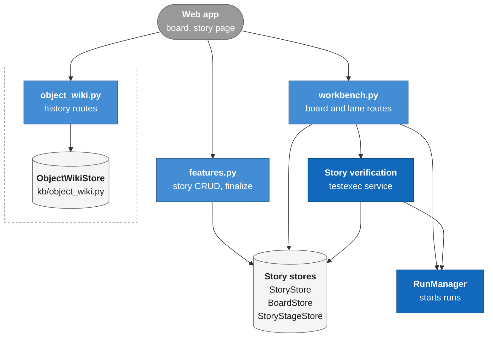
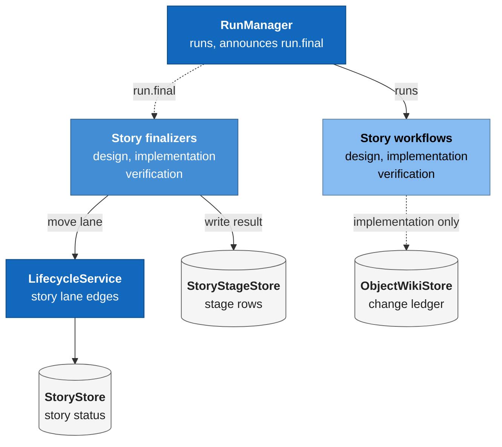
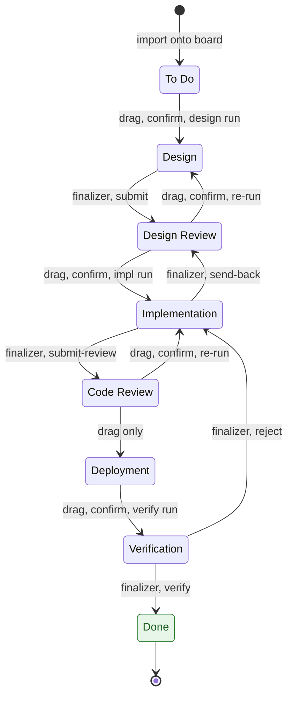
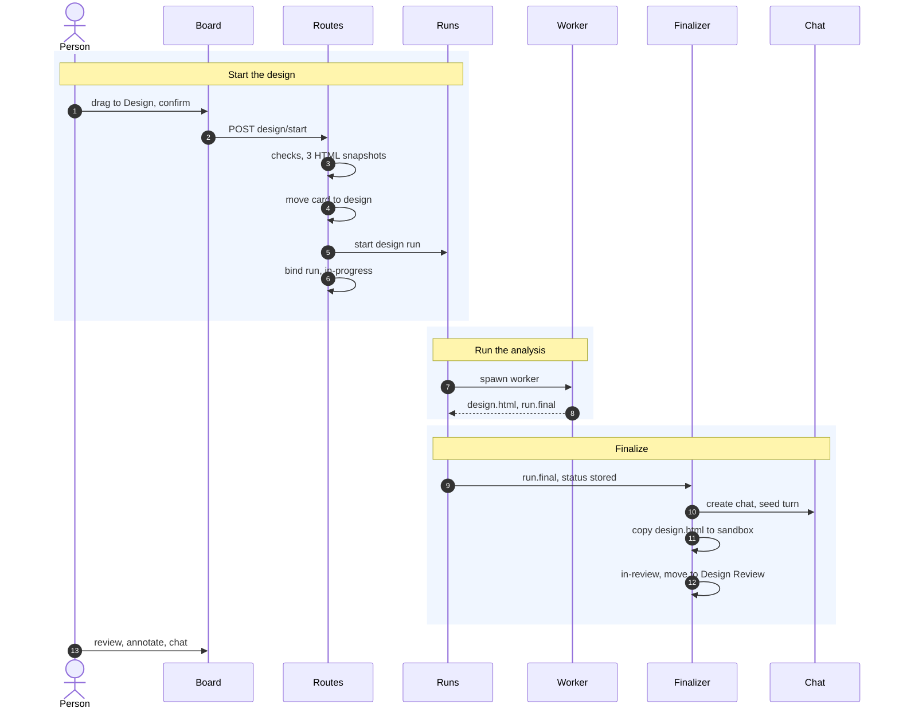

# Module: stories and Workbench (`genesis/kb/stories.py`, `genesis/kb/boards.py`, `genesis/api/workbench.py`)

> **Describes:** genesis v0.81.0 (Phase 51) · **Last reviewed:** 2026-11-11 · C4 level 3 · area `stories-workbench`

## 1. Purpose

This module holds the work items of a feature (the **stories**), the Kanban boards that show them (the **Workbench**),
and the three automations that move a story from idea to done: **design**, **implementation** and **verification**.
It also holds the **Object Wiki**, the change history of each Appian object that the implementation lane writes.

The central idea is that a card's lane is its story's `status`. There is no separate lane column. A person can drag a
card to any lane. Three lanes are special: when a card is dropped into Design, Implementation or Verification, the
board asks for a confirm, and the confirm starts a workflow. When the workflow ends, program code in the app process
(a **finalizer**) reads the result and moves the card on. The agent never moves a card itself (ADR-001, ADR-062).

## 2. At a glance

| Item | Value |
|---|---|
| Code | `genesis/kb/{stories,story_stages,boards,object_wiki,story_trace}.py`; `genesis/chat/story_{design,implementation,verification}_finalizer.py`; `genesis/testexec/verification_service.py` and `genesis/testexec/verification.py` (the Verification lane's start side); `genesis/api/workbench.py`, `genesis/api/object_wiki.py`; story CRUD routes in `genesis/api/features.py`; web in `web/src/features/workbench/` |
| Runs in | The app process. The three workflows run in subprocess workers ([runs-and-workers.md](runs-and-workers.md)). Finalizers run on the worker reader thread inside the app process. |
| Depends on | `genesis/db` (stores take a `Database`), `genesis/domain` (`LifecycleService`, `STORY_LANES`, story transitions), `RunManager` (starts runs, emits `run.final`), `ChatManager` (the design review chat), the test execution queue ([testing.md](testing.md)), `CollaborationService` (best-effort publish, [collaboration-hub.md](collaboration-hub.md)), `genesis/services/stage_artifacts.py` (the feature-stage HTML a run reads) |
| Used by | The web Workbench and the canonical story page ([web-app.md](web-app.md)); the Feature workspace (finalize and story edit, [features-and-stages.md](features-and-stages.md)); the Test Design module (links tests to stories, [testing.md](testing.md)); the collaboration puller |
| Stores | Tables `kb_epics`, `kb_stories`, `kb_sequences`, `workbench_boards`, `kb_board_cards`, `kb_story_stages`, `kb_story_stage_revisions`, `wiki_object_pages`, `wiki_object_entries`; files under `story-stage-artifacts/<story_stage_id>/` in the state folder |
| Key ids | Story key `GNS_<6 digits>` (ADR-072); story-stage names `design`, `implementation`, `verification`; the eight lane values in section 5.1 |
| Workflows it launches | `story-design-analysis`, `story-implementation`, `story-verification` (all in `genesis-workflows/workflows/`) |

## 3. Concepts

| Term | Meaning |
|---|---|
| **Epic** | A group of stories in one feature. Rows in `kb_epics`, created once at finalize from the backlog's epics. |
| **Story** | A row in `kb_stories`: a finalized backlog item (type `Story` or `Task`) with description, Gherkin acceptance criteria, questions, answers and spec references. The edit unit. |
| **Finalize Stories** | The one-time, irreversible step that turns a completed Feature Breakdown into epics and stories (ADR-060). A marker, `kb_features.stories_finalized_at`, makes it one-time. |
| **`GNS_` key** | The global, increasing story id such as `GNS_000123`. Stored in `kb_stories.key`. Allocated from the `kb_sequences` row named `story` inside the same transaction that inserts the story (ADR-072). |
| **Board** | One Kanban board per application, a row in `workbench_boards`. An application is added to the Workbench on purpose (ADR-061). |
| **Card** | A row in `kb_board_cards`: membership of one story on one board plus `board_position` inside its lane. It has no lane column. |
| **Lane** | A board column. The eight values, in order: `to-do`, `design`, `design-review`, `implementation`, `code-review`, `deployment`, `verification`, `done`. The lane is `kb_stories.status`. |
| **`on_board` flag** | `kb_stories.on_board`: 1 when the story was imported onto a board, 0 after it is removed. It is shared with teammates, so membership is explicit (ADR-061 amendment, L-074). |
| **Story stage** | A row in `kb_story_stages` for one `(story, stage)` pair, with `stage` one of `design`, `implementation`, `verification`. It holds the artifact pointer, the stage status, the bound run and (for design) the bound chat session. |
| **Finalizer** | App-side code that turns a finished run into a stage update and a lane move. It runs live on `run.final`, at startup (some of them) and when the board is read. See the glossary. |
| **Design review chat** | A chat session of mode `story_design`, opened when the design run finishes. The person walks the design's open questions with the agent. |
| **Lavish SDK** | The vendored annotation script that lets a reviewer mark up the rendered design HTML (ADR-043). |
| **Rollback document** | `rollback.md`, written locally by the implementation workflow before any write. It records the current code and version of each object it will update. |
| **Object Wiki** | The per-object change history: one page per Appian object (`wiki_object_pages`) and one entry per change (`wiki_object_entries`). Descriptions only, never object code (ADR-037, ADR-070). |
| **Queued card** | A card in Verification whose verification is waiting behind a running test execution. The board shows it as Queued. |
| **Spec flags** | Derived hints on a card: `design_rerun` (the spec changed and the design should be redone) and `not_applied` (a change request could not be applied to a story already past Design). See [features-and-stages.md](features-and-stages.md). |

## 4. Structure



The web app calls the routes in `workbench.py`, `object_wiki.py` and the story routes of `features.py`. The Workbench
and story routes read and write through the story stores in `genesis/kb` (`StoryStore`, `BoardStore`,
`StoryStageStore`); the story routes also use the pure helpers in `story_trace.py` (not drawn). The Workbench routes
start runs through `RunManager`, and the verification start goes through `StoryVerificationService`. The Object Wiki
routes (dashed box) use only their own store.



When a run ends, `RunManager` announces `run.final` and the three finalizers react. They update the story stage and
move the lane through the story `LifecycleService`. The implementation workflow writes the Object Wiki directly,
through a store that the platform puts in `ctx.extras`.

| File | Main classes and functions |
|---|---|
| `genesis/kb/stories.py` | `StoryStore`: `finalize`, `list_for_feature`, `get_story`, `get_by_id`, `create_story`, `update_story`, `delete_story`, `snapshot`, `get_status`, `set_status`; `_next_story_key` (the `GNS_` allocator); field lists `_SCALAR_FIELDS` and `_JSON_FIELDS` |
| `genesis/kb/story_stages.py` | `StoryStageStore`: `get_or_create`, `get_for_story`, `set_html`, `set_status`, `set_source`, `set_chat_session`, `add_revision`, `reset_for_rerun`, `run_states_for_feature`; `run_state()` |
| `genesis/kb/boards.py` | `BoardStore`: `list_boards`, `available_applications`, `add_board`, `remove_board`, `get_board`, `get_card`, `importable`, `import_stories`, `move_card`, `reorder_lane`, `remove_card`, `card_lane`, `append_to_todo`; `LANE_VALUES`; the `_VERIFICATION_ACTIVE` subquery; errors `BoardExistsError`, `WorkbenchNotFoundError` |
| `genesis/kb/object_wiki.py` | `ObjectWikiStore`: `upsert_page`, `append_entry`, `get_object_history`, `list_objects`, `get_object`; the read-model SQL and the `_object_row`, `_entry_row`, `_resolve_stories` builders |
| `genesis/kb/story_trace.py` | Pure helpers, no I/O: answer operations (`answer_question`, `edit_answer`, `reopen_question`, `validate_answers`), `enrich_refs`, `spec_clauses`, `workflow_story_fields`, `story_flags`, `stage_spec_changed`; `ANSWER_MAX` (3000), `EDITABLE_LANES` |
| `genesis/chat/story_design_finalizer.py` | `StoryDesignFinalizer`: `attach`, `reconcile`, `reconcile_story_stage`, `_finalize`, `_advance_lane`, `_publish_move` |
| `genesis/chat/story_implementation_finalizer.py` | `StoryImplementationFinalizer`: the same methods plus `_decision`, `_link_tests`, `_transition` |
| `genesis/chat/story_verification_finalizer.py` | `StoryVerificationFinalizer`: `finalize_run`, `_finish_execution`, `_finish_story`, `_store_proposals`, `_mark_broken`, `_transition`; `MOVES`; `classifications`, `classify_rows` |
| `genesis/testexec/verification_service.py` | `StoryVerificationService`: `check`, `start`, `_launch`, `withdraw_queued`, `_withdraw_if_moved`, `active`, `view`, `decide`, `apply` |
| `genesis/testexec/verification.py` | `VerificationError`, the overlay schema check `overlay_problems`, `VerificationTools` (the worker side), constants `WORKFLOW_ID`, `STAGE`, `EXECUTION_KIND` |
| `genesis/api/workbench.py` | `register_workbench_routes`: boards, cards, lanes, the three start routes, the design artifact and SDK routes, the implementation report, the verification routes, the story workspace read |
| `genesis/api/object_wiki.py` | `register_object_wiki_routes`: the two read routes |
| `genesis/api/features.py` (story part) | `finalize_stories`, `_finalize_refs`, story list/create/get/update/delete, the three answer routes |
| `genesis/domain/transitions.py`, `genesis/domain/lifecycle.py` | `STORY_STAGE_TRANSITIONS`, `STORY_LANES`, `build_story_lifecycle_service` (shared domain code; ADR-050) |
| `web/src/features/workbench/` | `WorkbenchPage`, `BoardPage` (drag, confirms), `StoryCard`, `StoryWorkspacePage`, `StoryDesignChatPage`, `VerificationDialog`, `QueuedVerificationDialog`, `VerificationSection`, `hooks.ts`, `lanes.ts` |

## 5. How it works

### 5.1 The lanes and which transition starts which workflow



The diagram uses the display names of the lanes (`to-do`, `design-review` and so on). Each arrow labelled "drag,
confirm" is a person's drag followed by a confirm dialog whose Yes button calls a start route. The label ends with
the run it starts: `story-design-analysis`, `story-implementation` or `story-verification`. Each arrow labelled
"finalizer" is made by program code after a run ends, through the audited story `LifecycleService` (the second word
is the action name from `STORY_STAGE_TRANSITIONS`). An arrow labelled "drag only" is a plain move with no workflow.
Any lane can also be reached by a plain drag, because the board does not enforce the transition table
(section 5.2).

The web asks for a confirm when a card enters Design or Implementation from another lane, and when a card goes from
Deployment to Verification (`BoardPage.tsx`). The Design and Implementation confirms also offer "No", which only moves
the card. Moves between other lanes, for example Code Review to Implementation after a review, are plain drags that
start nothing, except that entering Implementation always asks. The server does not check the source lane of a start
route: `start_verification` refuses for the reasons in section 8 but does not require the card to be in Deployment.

### 5.2 Boards, import and moves

1. A person adds an application to the Workbench: `POST /api/workbench/boards`. `BoardStore.add_board` checks the
   application is tracked (400 otherwise) and has no board yet (409 otherwise).
2. The person opens the import dialog. `importable()` lists the application's finalized stories that are not on the
   board, grouped by feature and epic.
3. Import (`import_stories`) runs in one transaction. For each id it skips a story that is not finalized, not owned by
   the application, or already on the board. It inserts a `kb_board_cards` row at the end of the To Do lane, sets the
   story `status` to `to-do` and sets `on_board=1`. It never fails halfway: it returns `{added, skipped, cards}`.
4. A **move** writes `kb_stories.status`. `PATCH /workbench/boards/{app}/cards/{story}` calls `move_card`, which
   checks the lane is one of `LANE_VALUES` (400) and updates with a `row_version` compare-and-swap (409 on
   `StaleWriteError`). `PATCH /workbench/boards/{app}/lanes/{lane}` calls `reorder_lane`, which sets `board_position`
   to the list index and `status` to the lane for each listed card, in one transaction, without a version check.
5. Moves are free: any lane to any lane, with no check against `STORY_STAGE_TRANSITIONS`. ADR-061 records this on
   purpose. Only the finalizers use the audited transition table.
6. **Remove from board** (`DELETE .../cards/{story}`) deletes the card row and sets `on_board=0`. The story stays.
7. After any move that leaves a card outside Verification, and after remove, the route calls `_withdraw_queued`,
   which cancels that story's queued verification (section 5.6).

The membership rule has a history. Before v0.69.0 the board carded every finalized story, and an always-on pull loop
kept re-adding them (L-074). Now `CollaborationService.reconcile_board_membership` adds a card only for a story with
`on_board=1`, and only on a board this user created. New stories default to `to-do`, the entry lane, not `design`.
The web does not refresh the board from the 10-second poll while a move is being saved (`reorder.isPending`).

### 5.3 The Design lane (ADR-062)



The start route does its checks first. After the checks it moves the card, starts the run and binds it. When the run
ends, the finalizer creates the review chat and moves the card to Design Review.

Steps of `POST /workbench/boards/{app}/cards/{story}/design/start` (`start_design`):

1. It needs a run manager (409 otherwise) and the card on the board (404 otherwise).
2. It refuses with 409 when no environment is tagged Dev, when the application is not in the KB, or when the workflow
   is not installed.
3. For the feature's Spec, UX Design and Technical Design it reads the current HTML through `consumer_stage_html`. A
   spec under change yields its change request's base revision, so unfinished edits never reach a design run. A missing
   artifact is a 409. The three snapshots are written to `story-stage-artifacts/<story_stage_id>/` and passed by path
   (ADR-010, L-042).
4. It gets or creates the `design` story stage. If the stage already has a run or chat, `reset_for_rerun` clears the
   revisions, the artifact pointers, the chat and the run, and sets the status back to `in-progress`. A re-run
   replaces the one design of the story.
5. It moves the card to `design` with the card's `row_version` (409 if the card changed meanwhile) and withdraws a
   queued verification.
6. It starts `story-design-analysis` with the story fields. The story dict includes answers, open questions and spec
   clauses from `story_trace.workflow_story_fields`. It then binds the run (`set_source`) and sets the stage
   `in-progress`.

The workflow (`research` → `design` in one agent turn → `render` → grounded `verify` → bounded `revise` → `escalate`
gate) is described in [workflow-library.md](workflow-library.md). It is one agent in one context on purpose: splitting
a small design into one turn per object lost the cross-object context (L-076).

`StoryDesignFinalizer._finalize` runs when a `story-design-analysis` run ends `done`:

1. It reads the run and the story stage. It stops when the stage already has a `chat_session_id` (already finalized),
   when the stage is bound to a different run (a re-run rebound it), or when `design.html` does not exist.
2. It creates a chat session of mode `story_design` and enqueues a system turn that names the ticket and tells the
   agent to walk the open questions.
3. It copies `design.html` into that session's sandbox under `skill_output_dir/<session_id>/`. The chat edits that copy,
   and the design artifact route serves it.
4. It sets the chat session, the HTML path and hash, and the stage status `in-review`.
5. It moves the lane with the audited action `submit` (Design to Design Review). If the audited edge fails, it sets the
   status directly. On success it publishes the move to the Hub if collaboration is on.

The review surface is `GET /workbench/boards/{app}/cards/{story}/design/artifact`. It returns the freshest design HTML:
the chat sandbox copy if the chat exists, otherwise the saved `html_path`. With `annotate=1` it injects the theme style
and the script tag for `GET /workbench/design-sdk.js`, which serves the vendored Lavish SDK from
`genesis/api/assets/lavish/sdk.js` (shared with the feature stages, ADR-043). Both are same-origin so the iframe can load
the script and pass messages.

### 5.4 The Implementation lane (ADR-068, ADR-082 amendment)

This is the only lane that writes design objects to the Dev environment. The drag confirm is the single blanket
approval for all the writes of the run. The workflow has no `pre_mutation` gate (ADR-021 allows a confirm to be the
approval).

`POST .../cards/{story}/implementation/start` (`start_implementation`):

1. It refuses with 409 when there is no Dev environment, the application is not in the KB, the design stage is not
   `in-review` or `completed`, the design HTML is missing, the feature's Technical Design is missing, or the workflow
   is not installed.
2. It writes `design.html` and `techdesign.html` into the implementation story-stage folder and gets or creates the
   `implementation` stage. A stage with a run is reset for a re-run.
3. It moves the card to `implementation`, withdraws a queued verification, starts `story-implementation`, binds the
   run and sets the stage `in-progress`.

The workflow reverifies the design against the Technical Design (a gap opens the `escalate_reverify` gate with
`PROCEED_ANYWAY` or `SEND_BACK`), writes `rollback.md` first, implements object by object with the `appian-dev-write`
server, verifies and heals only the touched objects, authors the Object Wiki, and renders a report. The write server
has zero `delete*` tools. A design that retires an object updates the object's description to mark it deprecated
(ADR-068). Section 5.5 covers the wiki write.

`StoryImplementationFinalizer._finalize` runs on `done`. It acts only while the card is still in `implementation`; the
lane move is the sentinel that makes a second pass a no-op. It reads `decision` from `result.json`:

- **`send_back`**: moves the lane with action `send-back` to Design Review. No artifacts are bound.
- **otherwise**, if `implementation-report.html` exists: copies the report, `rollback.md` and `implementation.json` from
  the run folder into the story-stage folder, sets the artifact pointer, marks the stage `completed`, moves the lane
  with action `submit-review` to Code Review, then calls `TestImpactService.link_implemented_objects` so the story's
  test cases get the changed objects (best-effort, [testing.md](testing.md)).
- **otherwise** (done but no report): logs a warning and leaves the card in Implementation.

A run that ends `failed` leaves the card in Implementation. There is no completion chat for this lane. The review
surface is `GET .../implementation/report`, which is story-scoped and has no lane gate: it returns the report HTML,
`rollback.md`, the per-object result and the run status.

### 5.5 The Object Wiki (ADR-070)

1. The `persist_wiki` step of `story-implementation` gets the store from `ctx.extras["object_wiki"]`, calls
   `upsert_page(app_uuid, object_uuid, type, name)` for each touched object, then `append_entry(...)` with a business
   description, a technical description, a change kind (`created`, `updated` or `deprecated`), the story key, a bug flag
   and a reason. It then calls `ctx.extras["object_wiki_publish"]` to push to the Hub (best-effort). `wiki.json` stays in
   the run folder either way.
2. `append_entry` writes one row and moves the page's `latest_entry_id` and `current_summary` in the same transaction.
   When the story key already has an entry on that page, the entry is refreshed in place and keeps its id, `created_at`
   and `sync_uuid`. This stops a re-run of the same story from adding duplicates (store docstring and
   `tests/test_object_wiki.py`). So "append-only" holds across stories; within one story a re-run replaces that
   story's entry.
3. Reads come from local tables only. Teammates' entries arrive through the collaboration pull
   ([collaboration-hub.md](collaboration-hub.md)). `list_objects` is one SQL query with a join to the current
   (`valid_to_sync IS NULL`) KB object. "Latest change" is derived from the entries ordered by parsed timestamp, not from
   `latest_entry_id`, which is null on pulled pages. Name precedence is KB name, then page name, then the UUID. Story
   links resolve by `story_sync_uuid`, then by `story_key`, scoped to the application. A key shared by several stories is
   ambiguous and links to none (ADR-071, L-084).

### 5.6 The Verification lane (ADR-084)

The execution mechanics (the queue, the workspace, the report origin) belong to [testing.md](testing.md). This section
covers only the lane side.

1. The person drags a card from Deployment to Verification. The web asks "are this story's changes deployed to QA?".
   Confirm calls `POST .../cards/{story}/verification/start`.
2. `StoryVerificationService.check` refuses before anything is written. Each refusal is a 409 with
   `{detail, problems, code}` (section 8).
3. `start` gets or creates the `verification` story stage (a stage with a run is reset; the stored overlay of the last
   verification is kept so a re-run resumes), writes the run's input files (`story.json`, `cases.json`,
   `scenarios.json`, `roles.json`, `library.json` and the implementation report when it exists) into the stage's
   `inputs` folder, calls the route's `move()` (the card goes to `verification`), then creates a **queued** `verification`
   test execution and pumps the one execution queue.
4. The queue launches the run when the machine is free. Until then the card shows Queued
   (`verification_active` in the card payload comes from one correlated subquery, so a board is read in one statement).
5. `_launch` re-checks that the card is still in Verification (`_withdraw_if_moved`), checks readiness again, exports the
   workspace head into `<run>/checkout`, lays the previous overlay over it, records the execution as running, and binds
   the story stage to the run before the worker spawns (L-093). It then calls `RunManager.start("story-verification")`.
6. **Leaving Verification withdraws the approval.** Any move that takes a card out of Verification, the Design and
   Implementation starts, and Remove from board call `withdraw_queued`, which cancels that story's **queued** execution
   with a reason. A running verification is left alone. The same check runs at launch for a card moved by a
   collaboration pull or while the server was down. A cancel failure is logged and does not undo the move.
7. When the run ends, `StoryVerificationFinalizer.finalize_run` first finishes the test execution (shared test-execution
   code), then, for a `done` run whose story stage is still bound to it and whose card is still in Verification, it
   copies the report, `result.json`, `triage.json`, `proposals.json` and the overlay into the story-stage folder and
   marks cases `broken` when a failure stayed a script defect after healing. It then reads `decision`:

| `result.json` decision | Result |
|---|---|
| `passed` or `accepted` | Stores the proposals (a `verification` capture for a person to accept or reject), marks the stage `completed`, moves the lane with action `verify` to Done |
| `failed` | Writes `defects.json`, marks the stage `completed`, moves the lane with action `reject` to Implementation |
| anything else (for example `stopped`) | Leaves the card in Verification with a warning |

8. The **blocked** outcome is handled inside the workflow: when failures could not be classified as product or script
   defects, the `escalate_blocked` gate offers `retry`, `send_back` and `accept`. Its prompt is built from the run's
   state so every option does what it says (L-106). `send_back` becomes decision `failed`; `accept` becomes `accepted`
   (or stays `passed`).
9. On the story page, the Verification section reads `GET /applications/{app}/stories/{story}/verification`. Proposals
   are decided and applied through two POST routes. The report is served as a script-free page with a restrictive
   Content-Security-Policy; its links to the execution's report files are rewritten to the separate reports origin
   (ADR-085).

### 5.7 Finalizer recovery

All three finalizers follow the same rules. Each of them:

- reacts to `run.final` on the run reader thread, wrapped so a failure never crashes the reader;
- acts only on the run its stage is currently bound to, so a re-run's old run cannot overwrite the new one;
- uses a durable sentinel to be idempotent: design uses `chat_session_id`; implementation and verification use "the card
  is still in the lane";
- relies on `RunManager` storing the terminal status **before** it announces `run.final`. Before Phase 49 the order was
  reversed and every live finalizer silently did nothing (L-093).

Recovery for a missed event:

| Finalizer | At startup | On board read |
|---|---|---|
| Design | `story_design_finalizer.reconcile()` is called from a startup hook in `app.py` | `_maybe_recover`: a card with a bound `done` run and no chat |
| Implementation | The class has `reconcile()`, but `app.py` does not call it | `_maybe_recover`: a card in `implementation` with a `done` run |
| Verification | `story_verify_finalizer.reconcile` runs in a startup hook (done, failed and cancelled runs) | `_maybe_recover` and the verification view, when the run is terminal |

`GET /workbench/boards/{app}` runs `_maybe_recover` and re-reads the board once when something was finalized.

### 5.8 Stories: finalize, edit, answers, traceability

1. `POST /features/{id}/stages/breakdown/finalize` requires the breakdown stage `completed` and the feature not yet
   finalized (409 otherwise), no change request open on the spec (409), and a non-empty backlog (422). It calls
   `StoryStore.finalize` in one transaction: it inserts epics, then each story with `status='to-do'` and a `GNS_` key, and
   stamps `stories_finalized_at`. A second call raises `AlreadyFinalizedError` (409).
2. For a traceable backlog (one that carries `clauseRefs`), `_finalize_refs` turns the refs into `spec_refs` records
   `{clause_id, fingerprint, origin, linked_at}`. The fingerprint comes from the spec version the breakdown read. Refs
   that cannot be resolved are dropped and reported as `dropped_refs` (ADR-075). Clause ownership is in
   [features-and-stages.md](features-and-stages.md).
3. Edit: `PATCH /features/{f}/stories/{s}` sends the fields and the `row_version` the client read. `update_story` adds
   `AND row_version=?` and raises `StaleWriteError` on no match (409 with `{error: "stale_write", expected, actual}`).
   An `answers` list goes through `validate_answers`, which keeps the provenance of unchanged entries and treats new ones
   as manual answers by the current user.
4. Answer, edit an answer and reopen a question each call `_answer_op`, which compares `row_version`, applies the pure
   helper from `story_trace`, saves, and then publishes the story at once when collaboration is on (a conflict merges
   with `answers` and `questions` taken from this machine).
5. `story_trace.story_flags` derives the card's spec-changed icon from the latest `change_log` entry. A design run that
   started after the entry clears `design_rerun`.
6. `GET /applications/{app}/stories/{story}/workspace` is the one read for the canonical story page (ADR-071). It works
   with or without a board card. It returns the story with enriched spec refs, the context (lane, `on_board`,
   traceable), the flags, and the design and implementation stage state. The artifact bytes are fetched lazily from the
   design and implementation routes.

## 6. Interfaces

### 6.1 HTTP, `genesis/api/workbench.py` (all under `/api`)

| Method and path | Purpose |
|---|---|
| `GET /workbench/boards` | Every added board with per-lane counts and a total |
| `GET /workbench/applications/available` | Tracked, non-archived applications without a board |
| `POST /workbench/boards` | Add a board (`{app_uuid}`); 400 untracked, 409 duplicate |
| `DELETE /workbench/boards/{app_uuid}` | Remove a board; its cards cascade; 404 if absent |
| `GET /workbench/boards/{app_uuid}` | The board: lanes, counts, cards (runs on-read recovery) |
| `GET /workbench/boards/{app_uuid}/importable` | Finalized stories not yet on the board, grouped by feature and epic |
| `POST /workbench/boards/{app_uuid}/cards` | Import stories (`{story_ids}`) into To Do |
| `PATCH /workbench/boards/{app_uuid}/cards/{story_id}` | Move one card (`{lane, position, row_version}`); 409 on a stale version |
| `PATCH /workbench/boards/{app_uuid}/lanes/{lane}` | Set a lane's card order (`{story_ids}`); persists the new lane of a moved card |
| `DELETE /workbench/boards/{app_uuid}/cards/{story_id}` | Remove a card from the board |
| `POST /workbench/boards/{app_uuid}/cards/{story_id}/design/start` | Move to Design and start `story-design-analysis` |
| `GET /workbench/design-sdk.js` | The vendored Lavish SDK script |
| `GET /workbench/boards/{app_uuid}/cards/{story_id}/design/artifact` | The design HTML for the review iframe (`theme`, `annotate` query params) |
| `POST /workbench/boards/{app_uuid}/cards/{story_id}/implementation/start` | Move to Implementation and start `story-implementation` |
| `GET /workbench/boards/{app_uuid}/cards/{story_id}/implementation/report` | Report HTML, rollback document, per-object results, run status |
| `POST /workbench/boards/{app_uuid}/cards/{story_id}/verification/start` | Move to Verification and queue `story-verification` |
| `GET /applications/{app_uuid}/stories/{story_id}/verification` | Stage, run status, execution, defects, result, proposals, `report_url` |
| `GET /applications/{app_uuid}/stories/{story_id}/verification/report` | The verification report page (no scripts) |
| `POST /applications/{app_uuid}/stories/{story_id}/verification/proposals/decisions` | Record accept or reject per proposal (`row_version` checked) |
| `POST /applications/{app_uuid}/stories/{story_id}/verification/proposals/apply` | Apply accepted proposals in one workspace commit |
| `GET /applications/{app_uuid}/stories/{story_id}/workspace` | The consolidated story read |

### 6.2 HTTP, other files that serve this module

| Method and path | File | Purpose |
|---|---|---|
| `GET /applications/{app_uuid}/wiki` | `api/object_wiki.py` | Every documented object of the application, newest change first |
| `GET /applications/{app_uuid}/wiki/{object_uuid}` | `api/object_wiki.py` | One object page with its entries, newest first |
| `POST /features/{feature_id}/stages/breakdown/finalize` | `api/features.py` | Finalize Stories |
| `GET`, `POST /features/{feature_id}/stories` | `api/features.py` | List, create |
| `GET`, `PATCH`, `DELETE /features/{feature_id}/stories/{story_id}` | `api/features.py` | Read, edit, delete one story |
| `POST /features/{f}/stories/{s}/answers`, `PATCH`, `DELETE .../answers/{index}` | `api/features.py` | Answer, edit an answer, reopen a question |

### 6.3 Python API

| Call | Used by |
|---|---|
| `BoardStore`, `StoryStore`, `StoryStageStore`, `ObjectWikiStore` (exported from `genesis.kb`) | Routes, finalizers, the collaboration service, the test-impact service |
| `BoardStore.append_to_todo(board_id, story_id, conn=)` | The change-request flow, to put a follow-up story at the end of To Do |
| `BoardStore.card_lane(app_uuid, story_id)` | The verification launch guard |
| `StoryVerificationService.check/start/withdraw_queued/active/view/decide/apply` | `workbench.py` |
| `StoryVerificationService._launch` | Registered in `TestExecutionService.launchers["verification"]` |
| `story_trace.*` | Routes, the board card builder, the story workflows' inputs |
| `ctx.extras["object_wiki"]`, `ctx.extras["object_wiki_publish"]` | The `story-implementation` workflow (built in `genesis/runtime/context.py`) |

### 6.4 Events and contracts

- **Consumed:** `run.final` with status `done` (design, implementation) or `done`, `failed`, `cancelled` (verification).
  See [runs-and-workers.md](runs-and-workers.md).
- **Emitted:** the audited lifecycle events of the story edges (the `LifecycleAuditStore`, migration `m0013`).
- **Workflow inputs:** `story-design-analysis` takes `story_id, feature_id, app_uuid, story_stage_id, spec_path,
  uxdesign_path, techdesign_path, story`. `story-implementation` takes the same without `spec_path`, plus `design_path`.
  `story-verification` takes `execution_key, app_uuid, story_id, story_stage_id, inputs_dir, checkout_dir, qa_url,
  site_path, roles, scenario_ids, story_case_keys` and more (see its `workflow.yaml`).
- **Workflow outputs the finalizers read:** `design.html`; `result.json` with `decision` (`implemented` or `send_back`)
  and `implementation-report.html`, `rollback.md`, `implementation.json`; `result.json` with `decision` (`passed`,
  `failed`, `accepted`, `stopped`), `defects`, `triage.json`, `proposals.json`, `authored.json`.
- **Collaboration publish (one sentence each).** A lane move, by a person or by a finalizer, publishes the story status
  plus a board-state signal through `CollaborationService.publish_board_move`; the web calls it after a move and the
  finalizers call it directly. Story create, edit, answer and import publish the story record; see
  [collaboration-hub.md](collaboration-hub.md).
- **Canonical story page.** The web route `/applications/:appUuid/stories/:storyId` is the single story view, and the old
  card and feature-side routes redirect to it (ADR-071; `web/src/app/router.tsx`, [web-app.md](web-app.md)).

## 7. Data

| Table | Key columns | Meaning | Writer and readers |
|---|---|---|---|
| `kb_epics` (m0016) | `feature_id`, `key`, `title`, `workstream`, `position` | Backlog epics | Written at finalize and by collaboration pull; read by story grids and the board |
| `kb_stories` (m0016, m0014, m0019, m0020, m0022, m0024) | `feature_id`, `epic_id`, `key` (the `GNS_` id), `status` (the lane), `row_version`, `sync_uuid`, `on_board`, `acceptance_criteria`, `questions`, `labels`, `spec_refs`, `answers`, `change_log` (JSON text) | The story. `status` is the lane. | `StoryStore`, `BoardStore` (status, `on_board`), finalizers (status), collaboration pull; read everywhere |
| `kb_sequences` (m0022) | `name`, `next_val` | The `story` counter; stores the next value to hand out | `_next_story_key`, inside the insert transaction |
| `workbench_boards` (m0017) | `app_uuid` (unique), `sync_uuid` | One board per application; cascades with the application | `BoardStore` |
| `kb_board_cards` (m0017) | `board_id`, `story_id`, `board_position`, `sync_uuid`; unique `(board_id, story_id)` | Membership and in-lane order. No lane column. | `BoardStore`, `reconcile_board_membership` |
| `kb_story_stages` (m0018) | `story_id`, `stage`, `status`, `html_path`, `content_hash`, `chat_session_id`, `run_id`, `source_doc_path`, `row_version`; unique `(story_id, stage)` | One artifact per story and stage | `StoryStageStore`; finalizers and start routes |
| `kb_story_stage_revisions` (m0018) | `story_stage_id`, `revision_no`, `html_path`, `note` | Milestone snapshots | `StoryStageStore.add_revision` |
| `wiki_object_pages` (m0021) | `app_uuid`, `object_uuid` (unique pair), `object_type`, `object_name`, `current_summary`, `latest_entry_id`, `sync_uuid` | One page per Appian object | `ObjectWikiStore`, collaboration pull |
| `wiki_object_entries` (m0021) | `page_id`, `change_kind`, `business_description`, `technical_description`, `story_key`, `story_sync_uuid`, `is_bugfix`, `change_reason`, `object_version`, `author_username`, `created_at`, `sync_uuid` | One entry per change | `ObjectWikiStore.append_entry` |

The lane lifecycle audit (`m0013`) records each finalizer move. Test execution tables are in [testing.md](testing.md).
The story and card tables are owned by migrations (rule: stores own SQL, migrations own schema, see
[data-and-migrations.md](data-and-migrations.md)). The `kb_stories.status` column's SQL default is `design`, set in
`m0016` before the board existed. Every code path that inserts a story passes `to-do` explicitly.

Files, under `settings.story_stage_artifacts_dir` (`<state dir>/story-stage-artifacts/`), folder `<story_stage_id>/`:

| File or folder | Written by | Meaning |
|---|---|---|
| `spec_snapshot.html`, `ux_snapshot.html`, `td_snapshot.html` | `start_design` | The feature HTML a design run reads |
| `design.html`, `techdesign.html` | `start_implementation` | The inputs of an implementation run |
| `implementation-report.html`, `rollback.md`, `implementation.json` | `StoryImplementationFinalizer` | The durable results; the run folder is disposable |
| `inputs/`, `authored/`, `verification-report.html`, `result.json`, `triage.json`, `proposals.json`, `defects.json` | `StoryVerificationService`, `StoryVerificationFinalizer` | Verification inputs and results |

The design review's working copy of `design.html` lives in the chat sandbox `skill_output_dir/<session_id>/`.

## 8. Failure handling

| Situation | Behaviour |
|---|---|
| Add a board for an untracked application | 400 |
| Add a second board for an application | 409 (`BoardExistsError`) |
| Move to a lane not in `LANE_VALUES` | 400 |
| Move with a stale `row_version` | 409 (`StaleWriteError`) |
| Board, card or story not found | 404 (`WorkbenchNotFoundError`, or an explicit check) |
| Design or implementation start with no run manager | 409 "run manager unavailable" |
| Design or implementation start with no Dev environment, an unsynced application, a missing input artifact, or a missing design | 409 with the reason; nothing is moved. Checks run before the card moves. |
| Workflow not installed | 409 "run `genesis install`" (L-033). The design and implementation routes catch `FileNotFoundError` from `RunManager.start`. |
| Any other exception from `RunManager.start` in design or implementation | 409 "could not start the run", never a bare 500. The card has already moved by then. |
| Card changed between read and move in a start route | 409 "this card changed elsewhere" |
| Verification start refused | 409 with `{detail, problems, code}`. Codes: `no_qa` (no QA environment; the card stays in Deployment), `no_cases` (no Ready test cases), `no_scenario` (cases in no scenario), `not_installed`, `not_ready` (readiness problems listed), `busy` (already queued or running) |
| Card leaves Verification while queued | The queued execution is cancelled with a reason. A running one is not stopped. |
| Queued execution cannot launch (readiness, export, git) | The queue records it as `error` with the reason and tries the next one |
| Design run fails or ends without `design.html` | The card stays in Design; the card shows the failed run state |
| Implementation run fails, or ends `done` with no report and no `send_back` | The card stays in Implementation |
| Verification run is cancelled or fails | The execution is recorded `cancelled` or `error`; the card stays in Verification |
| Verification ends with an unknown decision | The card stays in Verification; a warning is logged |
| Audited lane edge cannot apply (the lane was edited meanwhile) | The finalizer sets the status directly, so a moved lane never strands the finalization |
| Hub publish fails after a finalizer move | Logged; the move stands (best-effort, gated on the collaboration switch) |
| Finalizer raises | Logged; never propagates to the run reader thread |
| Missed `run.final` | Recovered at startup (design, verification) or on board read (all three), section 5.7 |
| Concurrent story edit | 409 `stale_write` with expected and actual versions |
| Finalize twice | 409 |
| Verification proposal conflicts | `stale_write` shape on the decisions and apply routes; a type error on apply gives 422 `{detail, typecheck}` and commits nothing |

## 9. Configuration

| Setting | Where | Meaning |
|---|---|---|
| `story_stage_artifacts_dir` | `genesis/runtime/settings.py` | `<state dir>/story-stage-artifacts`; the per-stage artifact root |
| `skill_output_dir` | settings | Where chat sandboxes live; holds the design review's `design.html` |
| `reports_url` / `GENESIS_REPORTS_URL` | settings | The reports origin the verification report links to; set by `serve` (ADR-085) |
| `GENESIS_COLLAB_ENABLED` and the Settings switch | collaboration (ADR-065) | Both must be on for any publish from this module |
| `META` of each workflow | `genesis-workflows` | Retries, healing bounds, recursion limit, `hitl_points` (`escalate`; `escalate_reverify`, `escalate`; `escalate`, `escalate_blocked`) |
| Environment types | Settings → Environments (ADR-082) | Design and implementation need a Dev environment; verification needs a QA environment |
| Web board poll | `web/src/features/workbench/hooks.ts` | The board refetches every 10 seconds while open |
| `ANSWER_MAX` | `genesis/kb/story_trace.py` | 3000 characters per answer |

The module has no environment variable of its own.

## 10. Extending this module

**Add a lane automation.** Follow the pattern of the three existing ones.
1. Add a stage name to `StoryStageStore.VALID_STAGES`. Then list every consumer (L-094): the card joins in
   `BoardStore.get_board` and `get_card`, `run_states_for_feature`, the story workspace read, collaboration (story stages
   are not synced), and the web.
2. Add the transition edges to `STORY_STAGE_TRANSITIONS` if the finalizer should use audited moves.
3. Write a start route in `workbench.py` with its checks before the card moves, and bind the run before the worker
   spawns.
4. Write a finalizer with the standard guards (bound run, durable sentinel, broad exception guard, publish move), attach
   it in `app.py`, call its `reconcile` at startup, and add it to `_maybe_recover`.
5. Test it through the real `RunManager._finalize`, not by setting the run status by hand (L-093).

**Add a story field.** Add a column in a new migration, add it to `_SCALAR_FIELDS` or `_JSON_FIELDS`, and update the
`StoryCreate` and `StoryUpdate` models in `api/features.py`. Check the collaboration payload and the Hub contract
([collaboration-hub.md](collaboration-hub.md)): a field that is not in the frozen Hub contract needs the handling
described in L-072.

**Change a gate's wording.** If the route after an answer depends on run state, build the prompt from that state too
(L-106).

**Change what a card shows.** Add the value to the single card query in `BoardStore` so `get_board` and `get_card` stay
equal (L-039). Do not add a per-card call.

**Add a Hub-visible Object Wiki field.** The wiki tables are bound into the collaboration service; a new field needs the
binding and the Hub record type changed together.

## 11. Design decisions

| Decision | In plain words | ADR |
|---|---|---|
| The lane is the story status | One value, no drift between card and story. Cards store only membership and order. | ADR-061 |
| Board membership is explicit | A story is on a board only after Import. The flag is shared with teammates. | ADR-061 (v0.69.0), L-074 |
| Moves are free | A drag is a lane assignment. Only finalizer moves use the audited transition table. | ADR-061 |
| Drag into Design asks first, then runs the design workflow | The confirm is the gate. Design is read-only against Appian. | ADR-062 |
| Design is one agent turn in one context | A small deliverable stays coherent when one agent sees all of it. | ADR-062 (amendment), L-076 |
| Implementation is the only lane that writes design objects | The drag confirm is the single blanket approval. The rollback document is written first. No delete tool exists. | ADR-068 |
| Test users write only QA application data | Test execution and agent browser sessions run on the QA environment and change data through the UI, never design objects. | ADR-082 |
| Object Wiki is a per-object ledger of descriptions | Local first, shared through the Hub, no object code stored. | ADR-070 |
| One canonical story page | Every entry point goes to `/applications/:appUuid/stories/:storyId`. | ADR-071 |
| Story ids come from a counter in the insert transaction | `GNS_<6 digits>` is global and increasing within one `genesis.db`. Existing stories from before the counter keep their old keys. | ADR-072 |
| Finalize Stories is one-time | The stories become the source of truth; the breakdown is not re-read. | ADR-060 |
| Deployment comes before Verification | A story is on QA before it is tested there. Dragging into Verification, after confirming the deploy, starts the run. Pass goes to Done, a product defect to Implementation, blocked to a gate. | ADR-084 |
| Annotate designs with the vendored Lavish SDK | The app serves the script itself and does not run the SDK's server. | ADR-043 |
| Finalizers live in the app process | The worker cannot touch the app's stores (ADR-012); the app reads the result and moves the card. | ADR-012, ADR-062 |

## 12. Known pitfalls

- **Store the terminal status before announcing `run.final`.** A finalizer that checks `rec.status == "done"` did
  nothing for months when the order was reversed. Test finalizers through the real `RunManager._finalize` (L-093).
- **A registry value reaches only what you grep.** Adding the `verification` stage required listing every consumer; the
  Design and Implementation starts and Remove from board had to withdraw a queued verification too; "no run yet" meant
  both queued and never launched (L-094).
- **Do not derive board membership.** An unscoped derivation run by a background loop re-added every story; a lane default
  of `design` hid the To Do lane; a periodic refetch raced an optimistic drag (L-074).
- **A publish hook nothing calls does nothing.** Test the trigger (the button to the publish call), not only the hook
  (L-085).
- **Do not split a small design into per-object agent turns.** The agent loses the other objects' context (L-076).
- **A gate's prompt is a promise.** Build the option text from the run's state so the route after the answer matches
  (L-106).
- **Re-runs rebind the stage.** `reset_for_rerun` clears `chat_session_id` on purpose, because the design finalizer treats
  a set chat as "already finalized". Keep that when changing the reset.
- **Wiki entries are refreshed per story.** `append_entry` updates the existing entry of the same story key on a page
  instead of adding a second one. A change that relies on strict one-row-per-run history must account for this.

## 13. Tests

| File | Covers (from the file's own description) |
|---|---|
| `tests/test_board_store.py` | Board registry, importable scoping, batched import into To Do, lane counts, free moves with the version check, remove, untrack cascade |
| `tests/test_workbench_api.py` | Board endpoints: CRUD with 409 and 404, available applications, import, move (409 stale, 400 bad lane), remove |
| `tests/test_story_design.py` | The story-stage store, the story lane lifecycle, the design finalizer, with a fake run manager and chat |
| `tests/test_story_implementation.py` | The send-back edge, the implementation finalizer (implemented, send_back, bound-run guard, recovery), the start route's refusals, the review surface |
| `tests/test_story_verification.py` | The verification flow offline: lane order and its consumers, overlay schema, start 409s, the queue, launch, the finalizer outcomes, recovery, the routes |
| `tests/test_story_verification_apply.py` | Applying a verification's proposals over a real workspace; skipped without node or npm |
| `tests/test_story_trace.py` | Answers, spec references, change-history flags, the spec-changed badge, story fields for the workflows |
| `tests/test_object_wiki.py` | The wiki store: page upsert, append-only entries and pointer, the per-story dedupe, change-kind validation, history read |
| `tests/test_object_wiki_api.py` | The two read routes: 404s, list equals detail, KB name precedence, pulled-shape pages, story resolution rules |
| `tests/test_object_wiki_collab.py` | Wiki pages and entries over the local Hub provider: round trip, parent resolution, no leak of local pointers, publish helpers |
| `web/src/features/workbench/*.test.ts(x)` | `workbench.test.tsx`, `StoryCard.test.tsx`, `StoryWorkspacePage.test.tsx`, `verification.test.tsx`, `design-state.test.ts`, `story-trace.test.ts`, `story-view.test.ts` (the names only; contents not summarised here) |
| `genesis-workflows/workflows/story-verification/tests/` | The verification workflow's own test and fixtures |

Gate commands (from the area definition):

```
cd genesis && .venv/bin/python -m pytest -q -p no:warnings
cd genesis && .venv/bin/ruff check genesis
cd genesis/web && npm run lint && npm run typecheck && npm test
cd genesis/web && npm run build     # then commit web/static/
```

## 14. Code map

| To change… | Look in |
|---|---|
| The set or order of lanes | `genesis/domain` (`STORY_LANES`, `STORY_STAGE_TRANSITIONS`), `web/src/features/workbench/lanes.ts`, `BoardStore.LANE_VALUES` is derived from `STORY_LANES` |
| How a card is moved or ordered | `genesis/kb/boards.py` (`move_card`, `reorder_lane`), `web/.../BoardPage.tsx`, `hooks.ts` |
| Which stories belong on a board | `BoardStore.import_stories`, `remove_card`, `CollaborationService.reconcile_board_membership` |
| The card payload | `BoardStore.get_board`, `get_card`, `_card_dict`, `_VERIFICATION_ACTIVE` |
| The `GNS_` id format | `genesis/kb/stories.py` `_next_story_key` |
| Finalize Stories | `genesis/api/features.py` `finalize_stories`, `_finalize_refs`; `StoryStore.finalize` |
| Story edit rules and conflicts | `StoryStore.update_story`; `update_story` route in `api/features.py` |
| Answers and spec-change flags | `genesis/kb/story_trace.py` |
| The design start checks or inputs | `workbench.py` `start_design`; `genesis/services/stage_artifacts.py` |
| What happens when a design run ends | `genesis/chat/story_design_finalizer.py`; chat steering in `genesis/chat/mode_profile.py` (`story_design`) |
| The design review preview and annotation | `workbench.py` `design_artifact`, `design_sdk_js`; `genesis/api/assets/lavish/` |
| The implementation start checks | `workbench.py` `start_implementation` |
| What happens when an implementation run ends | `genesis/chat/story_implementation_finalizer.py` |
| The write tool allowlist (no deletes) | `genesis-workflows/mcp-registry.json` entry `appian-dev-write`; `story-implementation/graph.py` |
| The Object Wiki write | `genesis/kb/object_wiki.py`; `genesis/runtime/context.py` (`object_wiki`, `object_wiki_publish`); `persist_wiki` in `story-implementation/graph.py` |
| The Object Wiki read model | `ObjectWikiStore.list_objects`, `get_object`; `genesis/api/object_wiki.py` |
| The verification start and queue behaviour | `genesis/testexec/verification_service.py`; execution queue in [testing.md](testing.md) |
| What happens when a verification run ends | `genesis/chat/story_verification_finalizer.py` (`MOVES`) |
| The blocked-gate options | `genesis-workflows/workflows/story-verification/graph.py` (`escalate_blocked`, `_escalate_prompt`) |
| Startup and on-read recovery | `genesis/api/app.py` (startup hooks), `workbench.py` `_maybe_recover` |
| The canonical story page | `web/src/app/router.tsx`, `web/.../StoryWorkspacePage.tsx`, `workbench.py` `story_workspace` |
| Publishing a move or a story to the Hub | `genesis/collab/service.py` `publish_board_move`, `publish_story`; [collaboration-hub.md](collaboration-hub.md) |
