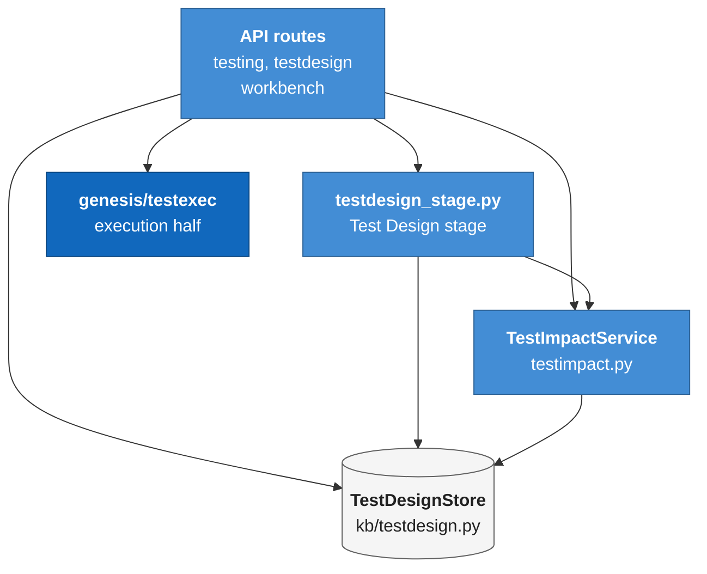
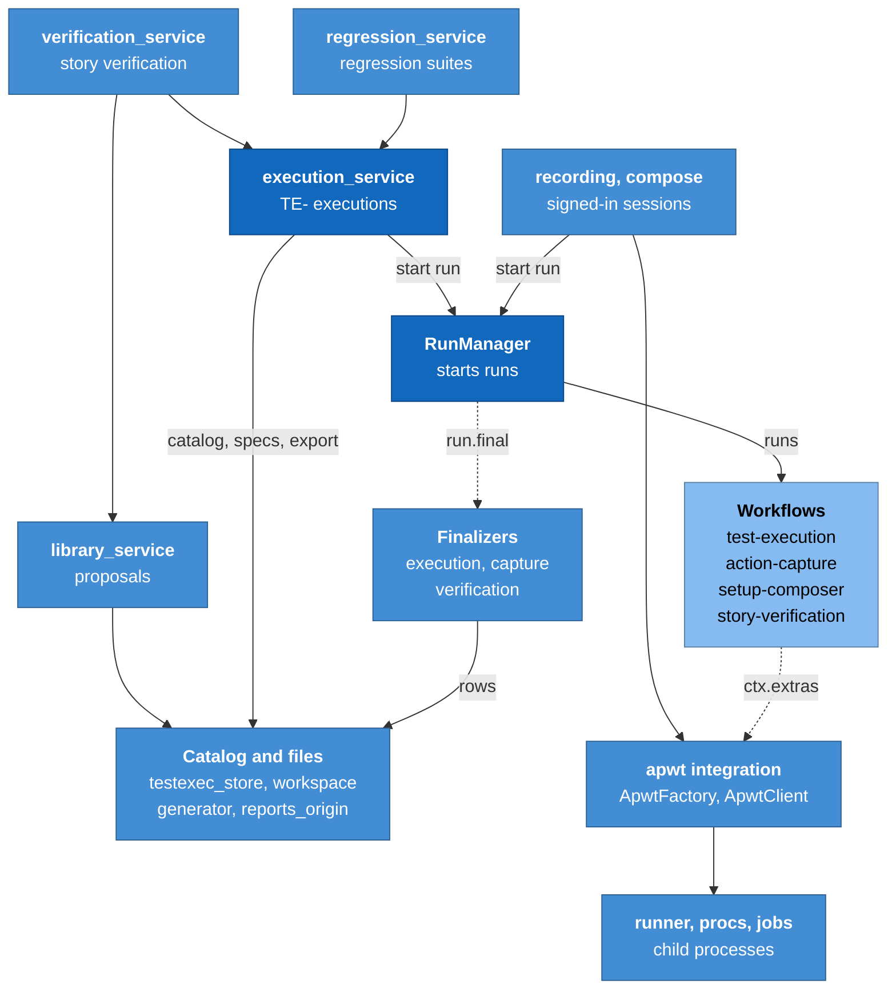
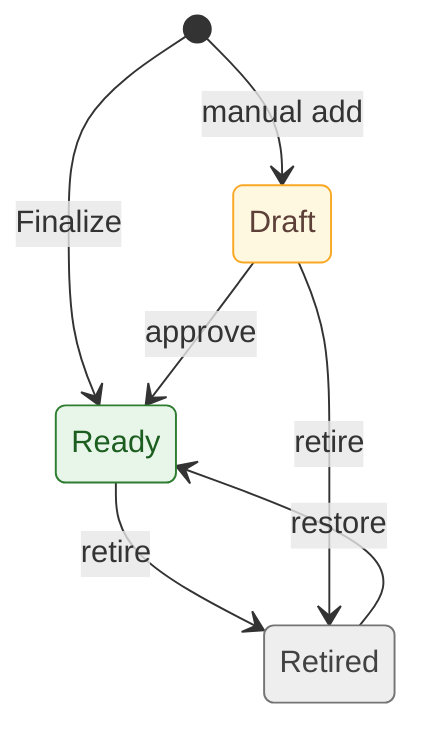
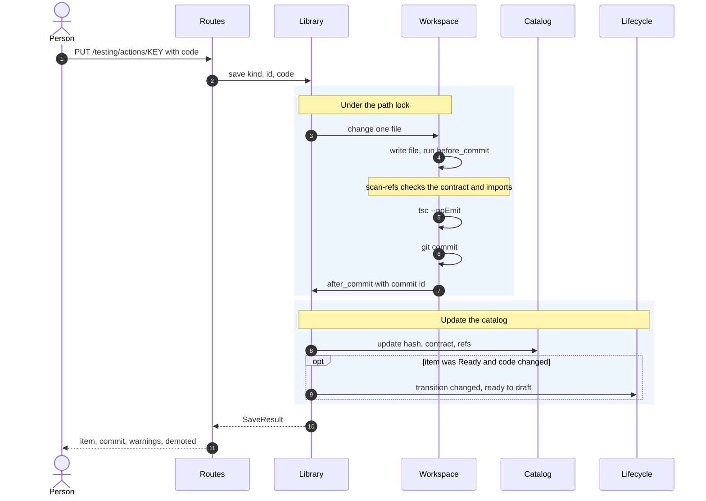
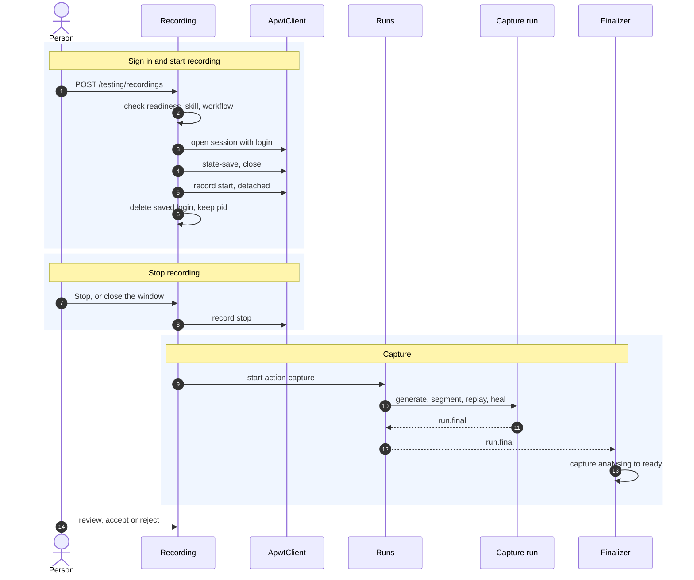
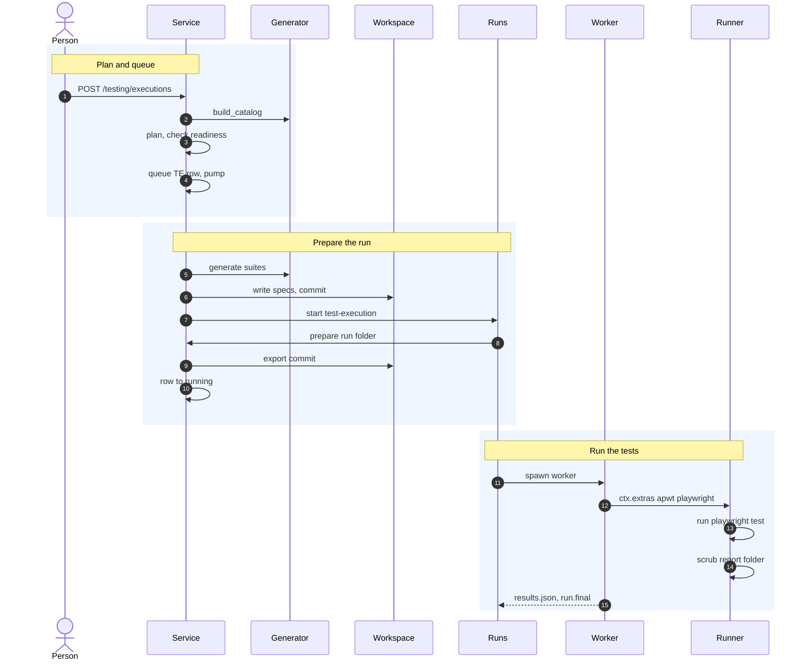
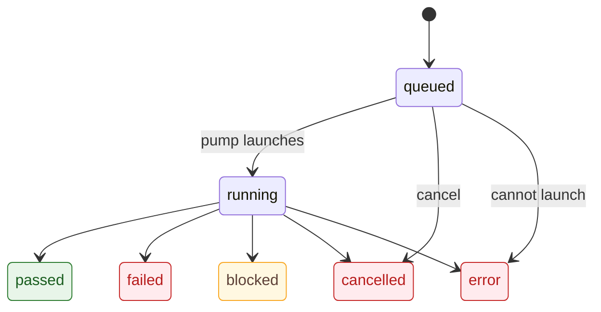

# Module: test design and execution (`genesis/testexec/`)

> **Describes:** genesis v0.81.0 (Phase 51) · **Last reviewed:** 2026-11-11 · C4 level 3 · area `browser-testing`

## 1. Purpose

This module records what to test and then runs the tests. It has two halves that share one data model.

The **design half** (Phase 49) keeps test cases (`TC-`) and test scenarios (`TS-`) as editable records. Each case
links to the stories it verifies and to the Appian objects it exercises. When a story or an object changes, the
module shows which cases are at risk. It never rewrites a case by itself.

The **execution half** (Phase 51) turns those records into browser tests. The test code lives as files in one git
repository per application. Genesis writes the files, commits every change, and runs the committed code with
Playwright on the QA environment. A person or an agent authors the code. Only program code runs it.

The central promise: **tests run on QA only, as the application's own test users, through the UI only, from
committed code, one execution at a time.** No agent runs an execution, no password reaches an agent or a file, and
no run changes a design object (ADR-082).

## 2. At a glance

| Item | Value |
|---|---|
| Code | `genesis/testexec/` (execution side), `genesis/kb/testdesign.py` and `genesis/kb/testexec_store.py` (stores), `genesis/services/testimpact.py` and `genesis/services/testdesign_stage.py`, `genesis/integrations/apwt/`, `genesis/api/testing.py`, `genesis/api/testdesign.py` |
| Runs in | The app process. The test run itself is a `test-execution` workflow run in a worker, and the worker calls back into this module through `ctx.extras["apwt"]` (`ApwtFactory`). |
| Depends on | `genesis/db` (stores), `genesis/runs` (`RunManager.start`, `run.final`), `genesis/config` (SecretProvider, environments with the QA type), `genesis/domain` (`LifecycleService`), `genesis/runtime` (scheduler, settings), `genesis/kb` (applications, objects, stories, dependencies). Outside tools: `git`, Node 20 or newer, `npm`, Playwright's Chromium. |
| Used by | The API routes (`genesis/api/testing.py`, `testdesign.py`, `workbench.py`), the Workbench Verification lane ([stories-and-workbench.md](stories-and-workbench.md)), the scheduler (`regression-run` job), `genesis/cli/main.py` (starts the reports origin) |
| Stores | `genesis.db` catalog tables (section 7); git workspaces and browsers under `~/.genesis/testing/`; run folders under the artifacts root |
| Workflows it launches | `test-execution`, `action-capture`, `setup-composer`, `story-verification`; `test-design-analysis` for the design stage |
| Key ids and versions | Ids `TC-`, `TS-`, `ACT-`, `DS-`, `TE-` (6 digits, from `kb_sequences`). Vendored `playwright-appian` 0.3.0. Playwright 1.59.1. TypeScript 5.9.3. Migrations `m0025_test_design` to `m0028_capture_request`. |
| Decisions | ADR-078, ADR-079, ADR-081, ADR-082, ADR-083, ADR-084, ADR-085 |

## 3. Concepts

| Term | Meaning |
|---|---|
| **Test suite** | The set of cases and scenarios of one feature (`kind = feature`, one per feature) or the application's regression suite (`kind = regression`, one per application). |
| **Test case (`TC-`)** | One reusable Given/When/Then check with a type (positive, negative, boundary, end-to-end) and a priority. Cases link to stories and objects. Scenarios reference cases; they never copy them. |
| **Test scenario (`TS-`)** | An ordered list of references to cases of one suite, plus an optional data setup. It is the unit that runs. |
| **Status** | `draft`, `ready` or `retired` for cases, scenarios and library items. A record is retired, not deleted, once it has been used. |
| **Story link and fingerprint** | A case links to a story with a hash of the story's title and acceptance criteria. If the story changes, the case reads *Needs review*. |
| **Object link** | A case links to an Appian object by `(app_uuid, object_uuid)` plus name and type. States, computed on read: `resolved`, `suspect` (the object's `diff_hash` changed), `removed`, `unresolved`. |
| **Test impact** | A computed answer to "which cases does this change put at risk?". It is never stored. |
| **Test workspace** | One git repository per application at `~/.genesis/testing/apps/<app_uuid>/`: an npm and Playwright project that also runs on its own. |
| **Action (`ACT-`)** | A reusable block of test code with a declared contract of inputs and outputs. Lives in `actions/<area>/<slug>.ts`. |
| **Data setup (`DS-`)** | A named precondition built from actions. It runs once per execution and returns named outputs. It runs as one main role and may name extra roles. Lives in `setups/<slug>.ts`. |
| **Case script** | The When and Then of one `TC-` case, as code in `cases/TC-<n>.ts`. |
| **Library** | The actions, data setups and case scripts of an application. |
| **Contract** | The literal `inputs` and `outputs` (and roles) written in `defineAction`, `defineSetup` or `defineCase`. It exists only in the code; the catalog stores a copy read from the code (L-109). |
| **Scenario spec** | A generated Playwright file for one scenario, under `suites/`. Genesis regenerates and commits it before every execution. Nobody edits it. |
| **Test execution (`TE-`)** | One Playwright run of selected scenarios. Kinds: `adhoc`, `impact`, `regression`, `verification`. |
| **Test user** | A login (role key, label, username) for the application on QA. The password is only in the SecretProvider (ADR-082). |
| **Role** | A role key such as `approver`. A case script, a data setup and the generated `auth:<role>` project name roles. |
| **QA environment** | The one environment of type QA. All execution and all agent browser sessions use it ([configuration-and-secrets.md](configuration-and-secrets.md#54-how-environments-work)). |
| **Readiness** | The list of problems that stop tests from running. Empty means ready. |
| **Capture** | A row in `kb_test_captures`. It holds a recording, a story verification's proposals, or a composed setup, and its review decisions. |
| **Proposal** | A suggested new or changed library item that a person accepts or rejects. Nothing joins the library unreviewed. |
| **Overlay** | The files a verification agent writes in its own checkout. Nothing reaches the workspace or the catalog until a person accepts the proposals. |
| **Reports origin** | A second loopback port that serves Playwright reports and nothing else (ADR-085). |

## 4. Structure



The API routes call the design half and the execution half. The design half is the Test Design stage service, the
impact service and `TestDesignStore`. The stage service uses the store and the impact service, and the impact
service reads the store. The execution half is `genesis/testexec`, shown in the next diagram.



The execution service builds a catalog from the database and the workspace, regenerates the scenario specs, exports a
commit into a run folder and starts a `test-execution` run through `RunManager`. The "Catalog and files" box stands
for four modules: `testexec_store.py`, `workspace`, the spec generator and `reports_origin`. The workflows reach
Playwright through `ApwtFactory` in `ctx.extras`; recording and compose also open their signed-in sessions through
it. When a run ends, `RunManager` announces `run.final` and the finalizers turn the run's files into database rows.
The regression and verification services build on the execution service. The settings service is left out of the
picture.

### Files

| File | Main classes and functions |
|---|---|
| `genesis/kb/testdesign.py` | `TestDesignStore`: suites, cases, scenarios, steps, links, top-ups, `create_from_design`, `mark_reviewed`, `story_fingerprint`, `object_link_state`, `allocate_key` |
| `genesis/services/testimpact.py` | `TestImpactService` (`resolve_object`, `link_implemented_objects`, `resolve_unresolved`, `reconcile_all`, `impact`), `SyncLinkObserver`, `_walk` |
| `genesis/services/testdesign_stage.py` | `TestDesignStageService` (start, re-run, finalize, top-up, CSV), `TopupRunObserver`, `validate_design`, `clean_design` |
| `genesis/kb/testexec_store.py` | `TestSettingsStore`, `TestLibraryStore`, `TestScriptStore`, `RegressionStore`, `regression_selection`, `ExecutionStore`, `CaptureStore`, `is_flaky` |
| `genesis/kb/regression_notes.py` | `record_losses`: change notes written when a delete removes regression references |
| `genesis/testexec/settings_service.py` | `TestSettingsService`, `TestCredentialResolver`, `TestCredentials`, `user_secret_scope`, `password_key` |
| `genesis/testexec/runtime.py` | `detect` (Node, npm, git, Chromium, vendored apwt), `install_chromium`, pinned versions |
| `genesis/testexec/vendor.py`, `vendor/` | `vendored_tarball` (sha256 check), `VENDORED_APWT_VERSION`; the tarball `playwright-appian-0.3.0.tgz` |
| `genesis/testexec/workspace.py` | `TestWorkspace`: create, install, `write`, `change`, `commit`, `export`, `scan_refs`, `library_drift`, `status`, `update_runtime`, `write_generated`; `TypecheckError` |
| `genesis/testexec/templates/` | Files copied into every workspace: `package.json`, `tsconfig.json`, `gitignore.txt`, `README.md`, `lib/index.ts`, `lib/scan-refs.mjs` |
| `genesis/testexec/library_service.py` | `TestLibraryService`: create, save, revert, adopt, save as new, case scripts, retire/restore, delete, replay, `promote_proven_actions`, `breaking_changes` |
| `genesis/testexec/roles.py` | `read_defines`, `RoleReader`, `case_role_of`, `setup_roles_of`: the one reader of roles (L-109) |
| `genesis/testexec/generator.py` | `build_catalog`, `generate`, `Catalog`, `ScenarioPlan`, `Overlay`, `support_ts`, `projects_for`, `grep_for` |
| `genesis/testexec/replay.py` | `replay_spec_ts`, `replay_config_ts`, `replay_outcome`, `passed_action_keys` |
| `genesis/testexec/recording.py` | `RecordingService`: start, stop, refresh, discard, `reap_stale` |
| `genesis/testexec/capture_finalizer.py` | `CaptureFinalizer`, `ComposeFinalizer`: store a run's proposals on its capture |
| `genesis/testexec/compose.py` | `ComposeService`, `compose_request` |
| `genesis/testexec/proposals.py` | `ProposalService`: `decide`, `apply`; `dependency_problems` |
| `genesis/testexec/execution_service.py` | `TestExecutionService`: `start`, `start_impact`, `start_regression`, `cancel`, `pump`, `detail` |
| `genesis/testexec/runner.py` | `PlaywrightRunner`, `scrub_dir`, `scrub_zip`, `scrub_html`, `scrub_text` |
| `genesis/testexec/finalizer.py` | `TestExecutionFinalizer`, `result_rows`, `outcome` |
| `genesis/testexec/regression_service.py`, `regression_job.py` | `RegressionService`, schedule validation, `register_regression_job`, `latest_slot`, `is_due` |
| `genesis/testexec/verification.py`, `verification_service.py` | `VerificationTools` (worker side), overlay checks, `StoryVerificationService` (app side) |
| `genesis/testexec/jobs.py` | `TestingJobs`: in-memory background jobs with single flight |
| `genesis/testexec/procs.py` | `minimal_env`, `run_bounded`, `start_long_lived`, `record_group`, `reap` |
| `genesis/testexec/reports_origin.py` | `ReportsServer`, `resolve`, `default_roots`, `report_url` |
| `genesis/integrations/apwt/` | `ApwtFactory` (`factory.py`), `ApwtClient` (`client.py`), typed errors (`errors.py`) |
| `genesis/api/testing.py` | Routes for runtime, setup, users, workspace, executions, regression, library, captures, recordings, compose |
| `genesis/api/testdesign.py` | Routes for the Test Design stage, cases, scenarios, top-ups, CSV, impact |
| `genesis/chat/story_verification_finalizer.py` | The run-to-card finalizer of the Verification lane (described in [stories-and-workbench.md](stories-and-workbench.md)) |

## 5. How it works

### 5.1 Test design records

The `test-design-analysis` workflow writes a test design document for a feature. The stage service
(`testdesign_stage.py`) starts it only after the Feature Breakdown is completed and the stories are finalized.
The workflow itself is described in [workflow-library.md](workflow-library.md); the stage is described in
[features-and-stages.md](features-and-stages.md). This module owns what happens after.

**Finalize** (`TestDesignStageService.finalize_test_design`, then `TestDesignStore.create_from_design`):

1. The service refuses unless the stage is completed and the feature has no finalized suite.
2. It reads the embedded test design JSON from the stage HTML, drops unknown story keys and checks the rules
   (`clean_design`, `validate_design`). A bad document answers 422.
3. The store resolves every object reference first, with the impact service's resolver (section 5.2).
4. In one transaction it creates the suite, the scenarios first and then the cases, all with status `ready` and
   origin `design`. Ids come from `kb_sequences` inside that transaction and are never reused (`allocate_key`).
5. It links each case to its stories (with fingerprints) and objects, and each scenario step to a case.
6. A second Finalize raises `AlreadyFinalizedError`. After Finalize, a **top-up** run proposes more cases for chosen
   stories; a person accepts them one by one.

Cases and scenarios use one lifecycle in `domain/transitions.py` (`TEST_TRANSITIONS`), applied by
`LifecycleService`:



The diagram shows the three statuses. A manual add starts as `draft`. Finalize creates `ready` records. A case
cannot retire while a live scenario uses it. A scenario cannot become `ready` with no steps and cannot be restored
while it uses a retired case. A hard delete is allowed only for an unreferenced `draft` (`delete_case`,
`delete_scenario`). Anything else raises `ConflictError` and the person retires it instead. A delete that removes
regression references writes a change note (`kb_regression_notes`).

**Needs review.** `story_fingerprint` hashes the normalised story title and acceptance criteria. The case DTO
compares the stored fingerprint with the current story on every read (`_case_dtos`). A mismatch sets
`needs_review`. *Mark reviewed* (`mark_reviewed`) refreshes every story fingerprint and every resolved object hash.
Nothing is stored about the mismatch itself, and no case text changes (ADR-079).

**Object link state** (`object_link_state`): no UUID means `unresolved`; no current `kb_objects` row means
`removed`; a different `diff_hash` means `suspect`; otherwise `resolved`. The join takes the newest open row so a
duplicate open row cannot double a link.

### 5.2 Test impact

`TestImpactService` has four jobs, all program code with no agent:

1. **Resolve an object** (`resolve_object`). It keeps a UUID only when the application has a current `kb_objects`
   row for it. Otherwise it matches exactly one current row by name (trimmed, case-insensitive) and normalised type.
   Otherwise the link stays unresolved with name and type. A made-up UUID can never become a resolved link (L-095).
2. **Link implemented objects** (`link_implemented_objects`). When a story's implementation completes, every
   non-retired case of that story gets every object the story changed (from Object Wiki entries, or the copied
   `implementation.json`). Resolved links keep their old `diff_hash_at_link`, so the case reads `suspect`.
3. **Resolve later.** `SyncLinkObserver` watches for `run.final` with status `done` on a `sync-application` run and
   calls `resolve_unresolved(app_uuid)`. `reconcile_all` does the same for every application at startup. The suite,
   case, object and impact reads also resolve pending links first. Each call is idempotent (level-triggered, L-058).
4. **Compute impact** (`impact`). The input is a *changed set* from picked objects, a story, or a succeeded KB sync
   (`changed_from_objects`, `changed_from_story`, `changed_from_sync`). The service walks `kb_dependencies` inbound
   over current edges, breadth first, from all changed objects at once (`_walk`). The default is 2 hops, clamped to
   1 to 5. Objects at 0 hops are *direct*; the others are *indirect*. Cases linked to any reached object come back,
   minus retired cases. They roll up case, scenario, suite, direct first. An object removed in the chosen sync counts
   as a direct hit. The regression suite appears as its own group. Nothing is stored and no Hub call is made.

Every write to `kb_test_case_objects` goes through the store's in-transaction helpers (`_link_object`,
`_resolve_object_link`, `_delete_object_link`), so there is one INSERT in the code base (L-095).

### 5.3 Setting an application up for testing

`TestSettingsService` backs the Setup view.

1. **Site path.** `kb_test_settings.site_path` must start with `/` and contain no `://`. The service suggests paths
   from the KB's Site objects (`/suite/sites/<url_stub>`). The full URL is the QA environment URL plus the site path
   (`qa_site_url`).
2. **Test users.** `kb_test_users` holds role key, label, username and notes. The password goes only to the
   SecretProvider under `testusers-<first 16 hex of sha1(app_uuid)>/<ROLE>_PASSWORD` (`-` becomes `_`, upper case).
   The API shows only whether a password is set. A username equal to the Dev-MCP service account (`LCP_USERNAME`)
   gets a warning.
3. **Runtime.** `runtime.detect` reports Node (20 or newer), npm, git, Playwright's Chromium (revision 1217 under
   `~/.genesis/testing/browsers`) and the vendored `apwt`. Genesis never downloads Node. *Install Chromium* runs
   `npx --no-install playwright install chromium` from a scratch npm project under `~/.genesis/testing/runtime`
   that pins `@playwright/test`.
4. **Workspace.** *Set up workspace* creates the repository (section 5.4) and runs `npm install` or `npm ci`.
   *Update testing runtime* replaces the vendored tarball, runs `npm install`, then applies the template
   `tsconfig.json` in a second commit only if the existing code typechecks with it.
5. **Background jobs.** Create workspace, Update runtime, Install Chromium and a setup Replay answer 202 with a job.
   The client polls `GET /api/testing/jobs/{job_id}` (`TestingJobs`). Jobs live in memory, one thread each, with
   single flight by a key (one Chromium install per machine, one workspace job per application, one replay per
   item). A restart forgets them. Finished jobs stay for one hour. Error text and results are scrubbed of the
   application's test-user passwords before they are stored.
6. **Readiness** (`readiness`) lists blocking problems: no QA environment, a QA host that another environment
   shares, no site path, no test user, a missing password for a needed role, Node, Chromium, or the workspace not
   installed. Every start endpoint refuses with 409 and this list.

### 5.4 The test workspace

`TestWorkspace` creates the repository in a sibling `<root>.creating` folder and moves it into place after the first
commit, so a failure never leaves a half-built workspace. The content comes from `templates/`: `package.json` with
exact versions and `playwright-appian` as a `file:` dependency on the vendored tarball, `tsconfig.json`,
`.gitignore`, `README.md`, `lib/`, empty `actions/ setups/ cases/ suites/ captures/` folders, and a copy of the
tarball in `vendor/`. `vendored_tarball` checks its sha256 before every use.

Every change follows the same shape: write, typecheck with `npx --no-install tsc --noEmit`, program checks, one
commit. `write` handles one file. `change` handles several files under one path lock, takes `before_commit` and
`after_commit` hooks, and undoes the files and the commit if either hook fails. Git runs with argument lists, the
fixed author `Genesis <genesis@localhost>`, a `Genesis-User:` trailer, and signing and hooks off. A typecheck failure
restores the files and raises `TypecheckError` (422 at the API).

An edit made outside Genesis is detected by comparing the file hash with the catalog's `content_hash`. The Setup
view lists such files as changed, missing or untracked, and *Adopt* takes them through the normal save checks.

`export(commit, dest)` runs `git archive` into a run folder. `node_modules` becomes a symlink to the workspace's
when the lockfiles match; otherwise `npm ci` runs there. Executions run from an export, never from the working
files (ADR-081).

### 5.5 Saving library code



The diagram shows one save as a single operation under the workspace lock. The `before_commit` step scans the code,
checks the contract and imports, and compares the contract with the old one. The steps:

1. `before_commit` reads the file with `lib/scan-refs.mjs` (the workspace's TypeScript compiler API) through
   `_check_code`. The file must make exactly one `defineAction`, `defineSetup` or `defineCase` call, with the
   expected key. An action is exported by name. A setup or case is the default export. A setup's `role` must equal
   the catalog's role. Every import must be a non-retired library item.
2. The contract must be a literal declaration in the code. A save without one is refused. A `contract` field in the
   request is refused, never ignored (L-109).
3. `breaking_changes` compares old and new contracts. Removing or renaming an input or output, changing a type,
   making an optional input required, or adding a required input is breaking. It is refused while anything uses the
   item (`BreakingContractError`, 409). The way out is *Save as new*, which creates a new item.
4. `tsc --noEmit` runs, then the commit.
5. `after_commit` writes the new hash, the contract read from the code, and the derived `kb_test_refs` rows (the
   imports). It also demotes a `ready` item whose code changed to `draft` through `LifecycleService`
   (`ready` and `changed`), unless that code already replayed green.
6. If the catalog write fails, the commit and files are undone.

*Revert* is a save of the file's text at an earlier commit, as a new commit. *Adopt* is a save of the working file.
A save that changes nothing returns `changed: false`.

Case scripts use the same path (`save_case_script`). A script whose `defineCase` role is not a readable literal saves
with a warning that scenarios using it will not run. `remove_case_script` is refused while an execution of the case's
scenarios is queued or running (`CaseScriptInUse`).

**Delete** is allowed only for an item nothing ever used (`ever_referenced` is false and no ref points to it).
Otherwise the person retires it. Retire is refused while a non-retired item, case script or scenario uses it.

### 5.6 How a library item becomes Ready

Status describes an item. It never blocks an execution or authoring (D20 in the Phase 51 findings).

| Item | How it becomes `ready` | Why |
|---|---|---|
| Data setup | *Replay* passes at the setup's current `content_hash` | A setup has a start state of its own (a blank page), so it can run alone. |
| Action | A library execution passes a scenario or setup that uses it, at the committed code, and the action's own `test.step('<key> <name>')` ran and passed | An action assumes a starting page, so it is proven in use (L-110). |

`replay` exports the workspace head, writes a temporary spec (`replay_spec_ts`) that signs in with `loginAs` and
calls the item, and runs Playwright on QA through the same runner as an execution. A replay of an action is refused.
On a pass at the current hash, a `draft` setup moves to `ready`.

`promote_proven_actions` runs from `TestExecutionFinalizer` after a `done` run that is not a verification. It walks
`kb_test_refs` from the passed cases and setups to the actions they use, but only through files whose content at the
execution's commit equals their current content. It then promotes only actions whose own step ran and passed
(`passed_action_keys`). An imported action that was never called proves nothing. Verification executions never prove
library code, because their overlay may change it (L-110).

Restore differs by kind: a retired setup returns to `ready` only after a passing replay; a retired action returns to
`draft` with no precondition.

### 5.7 Record workflow



The diagram shows that the recorder never holds the password. The password is only in the environment of the login
subprocess, and the saved login is deleted before the recorder runs. After the stop, the capture workflow produces
proposals for review. The steps:

1. `start` checks readiness for the role, that the `genesis-test-authoring` skill is installed, and that the
   `action-capture` workflow is installed at version 0.2.2 or newer, because an older one can prove code its replay never ran. A request for a
   data setup also needs at least 0.2.0, which is the first version that reads it. One recording per machine; a
   second answers 409.
2. It creates the workspace if needed, then a `kb_test_captures` row of kind `recording`.
3. `ApwtClient.open_session` runs `apwt -s rec-<id> open <QA site> --login --allow-host <QA host> --mode full`. The
   role's `APPIAN_USERNAME` and `APPIAN_PASSWORD` are in that one subprocess's environment. The login is saved to a
   state file, the session is closed, and `apwt record start --detach --state <file>` starts a headed Chromium
   already signed in. The state file and the login's temp artifacts are deleted at once, so the recorder never holds
   the password (ADR-083 decision 4).
4. The recorder is detached, so its pid is recorded in `~/.genesis/testing/recordings/.pids` with markers.
5. *Stop* (or the person closing the window, seen by `refresh` through `record list`) runs `record stop`, reaps the
   recorder, checks the trace has recorded actions, and starts the `action-capture` run. The capture becomes
   `analysing` and is bound to the run.
6. The workflow generates a spec from the trace with `apwt generate`, an agent splits it into reuse, update and new
   actions (and one data setup if asked), a validator typechecks the result, the proposals replay on QA as the
   recording's role, and one bounded heal can patch a failure (ADR-067). The run copies each proposal's code and
   replay result into `result.json`.
7. `CaptureFinalizer` observes `run.final` for that workflow. It copies the proposals' code into the capture row
   (run folders are pruned later) and moves the capture `analysing` to `ready` with a compare-and-set. A failed or
   cancelled run moves it to `failed` with a reason. `reconcile` at startup and `reconcile_capture` on read catch
   anything missed (L-058, L-061).

**Compose with AI** (`ComposeService.start`) is the same pattern with kind `compose` and the `setup-composer`
workflow. The person picks library items, the main role, extra roles and the end state in words. The workflow
writes one data setup from library items only. It has no browser tool and writes no screen steps. It checks the
setup like a library save and replays it as each role. If no library item does a needed step it returns `missing`
and names the step. `ComposeFinalizer` stores the result. One compose per application at a time.

### 5.8 Accepting proposals

`ProposalService` stores per-item accept or reject decisions on the capture (compare-and-set on `row_version`). `apply`
then writes every accepted item in one workspace commit that names the capture:

- `new`: a new item. The `ACT-NEW` or `DS-NEW` literal in the code becomes the allocated key.
- `update`: a code save of the existing item with the full contract and demotion rules.
- `reuse`: nothing to write.

An item whose replay passed at exactly the accepted code becomes `ready`; the others stay `draft`. A proposal for a
data setup lists the action proposals it calls. Accepting the setup requires accepting or reusing each one
(`ProposalDependencyError`, 409). A composed setup lists library keys instead; each must be a non-retired library
item, and its proof counts only while the code it ran is still the library's code, checked over the whole refs
closure against the compose's export commit (L-110). A recording's raw trace is committed with the proposals.

### 5.9 Starting an execution



The diagram shows the order from click to results files. The person asks for scenarios. The execution service builds
the catalog, plans the run, queues it and prepares the checkout. The worker runs Playwright and writes the results.
The steps:

1. **Catalog** (`build_catalog`). It reads the application's non-retired scenarios from the database. A scenario is
   **automated** only if it has steps, its data setup (if any) is committed and not retired, every step's case has a
   committed case script, and a role can be found for each step. The role is the one the case script declares, else
   the scenario's data-setup role, else the application's only test user. Anything else goes to `not_automated` with a
   reason. Committed means the workspace `HEAD`: an uncommitted file does not count.
2. **Plan** (`plan`). Chosen scenarios in catalog order: regression references first, then regression-owned
   scenarios, then feature scenarios. It returns roles, Playwright projects and a `--grep` string.
3. **Queue.** `start` refuses if nothing is automated (400 with `not_automated`) or readiness fails (409 with
   `problems`). Otherwise it creates a `queued` `TE-` row and calls `pump`.
4. **One at a time per machine.** `pump` launches the oldest queued execution only when no `test-execution` or
   `story-verification` run is pending or running (`busy`). The finalizer pumps again when an execution ends and at
   startup. A run waiting at a gate does not hold the queue. A queued execution that cannot launch ends `error` with
   the reason, and the pump tries the next.
5. **Generate.** `generate` writes `suites/auth/<role>.setup.ts` (project `auth:<role>`), `suites/setups/<instance>.setup.ts`
   (project `setup:<instance>`), `suites/<instance or none>/<NNN>-<TS-key>.spec.ts` (project `scn:<instance>`) and
   `playwright.config.ts`. Each scenario is one `test`, with one `test.step('<TC-key> <title>')` per step, so results
   map back to cases. A data setup instance is the setup's key, shared by the scenarios that name it. A scenario
   flagged *changes shared data* gets a private instance named `<DS-key>.<TS-key>` and runs last. `write_generated`
   replaces the generated files and commits only those paths. The config sets `workers: 1`, `retries: 1`, a 10
   minute scenario timeout, a 15 second action timeout, and reporters `json`, `junit` and `html`.
6. **Start the run.** `RunManager.start('test-execution', inputs, prepare=...)`. The `prepare` hook exports the
   commit into `<run>/checkout` and moves the execution to `running` with the reproducibility columns (commit,
   `apwt` and Playwright versions, QA URL and label, site path, report folder). It does this before the worker spawns
   (L-093). See [runs-and-workers.md](runs-and-workers.md#52-starting-a-run).
7. **Run Playwright.** The workflow's `run_playwright` node asks `ctx.extras["apwt"].playwright(app_uuid, run_dir)`
   for a `PlaywrightRunner` and runs `npx --no-install playwright test` in the checkout. The child gets the minimal
   environment plus `SITE_URL`, folders, timeouts, and per role `GENESIS_TEST_USER_<ROLE>` and
   `GENESIS_TEST_PASSWORD_<ROLE>`. It runs in its own process group recorded in `<run>/.pids`. The runner waits off
   the event loop with a hard timeout of the global timeout plus 120 seconds.
8. **Normalise.** `parse_results` maps the Playwright JSON report to `results.json` (per scenario: `passed`,
   `failed`, `flaky`, `skipped`, `blocked`; per case step; attempts, duration, error, attachments, and the action
   steps that ran). A step that failed in an earlier attempt and passed in the last is `flaky`. A scenario with no
   result whose setup or sign-in failed is `blocked`. No report means the run fails.

Entry points besides *Run*: `start_impact` runs every automated scenario, feature or regression, that contains an
affected case (and lists affected cases no automated scenario covers); `start_regression` runs the regression suite's
selection; the library's *Run dependents* runs the scenarios that use an item.



The diagram shows an execution's status. The five end states are `passed`, `failed`, `blocked`, `cancelled` and
`error`. Only `queued` and `running` change.

### 5.10 Finishing an execution

`TestExecutionFinalizer` observes `run.final` for `test-execution` runs ending `done`, `failed` or `cancelled`.

1. It looks up the execution bound to that run and acts only while it is `running` (L-061).
2. A cancelled run gives `cancelled`; a failed run gives `error` with the run's detail; a done run reads
   `results.json`. A missing file gives `error`.
3. `result_rows` combines the plan with the results into one scenario row and one row per step, in plan order.
   A planned scenario missing from the report is `not-run`. Rows for scenarios or cases deleted while the run ran
   are dropped.
4. `outcome` decides the status: `error` if nothing ran; `failed` if any scenario failed; `blocked` if some were
   blocked and none failed; else `passed`. Flaky counts as passing.
5. `ExecutionStore.finish` writes every result row and the status in one transaction, as a compare-and-set from
   `running`. A second pass loses with `StaleWriteError` and does nothing.
6. After the finish, each step is best effort and logged loudly: `automation_status` follows the steps, the run's
   saved logins (`checkout/.auth`) are deleted, retention prunes report files and checkouts beyond the newest 20
   executions of the application (the rows stay), the next queued execution starts, and for a `done` non-verification
   run, actions are promoted (section 5.6).

`automation_status` is `not-automated`, `automated` or `broken`. One rule, `_follow_script`, sets it. A saved script
makes the case `automated`. A deleted script makes it `not-automated`. A passed or flaky step with a script makes it
`automated`, also over `broken`. Any other step that ran makes it `automated` only over `not-automated`. An unhealed
script defect in a verification makes it `broken`.

A case or scenario is **flaky** when at least 3 of its last 10 results are `flaky` (`is_flaky`).

Recovery: `reconcile` at startup finalizes every `running` execution whose run ended or no longer exists (the latter
only while this process holds the run-owner lock, L-097), then pumps. `reconcile_execution` does the same on read
when the execution detail is requested.

### 5.11 Regression

`RegressionService` manages one regression suite per application.

- Members are **references** to feature scenarios and the suite's **own** scenarios, which may use cases of any
  feature of the same application.
- A retired member stays in the suite, shown as not run. `regression_selection` is the one answer to "what runs":
  non-retired references in item order, then non-retired own scenarios. The plan preview, Run now, the scheduled job
  and the generator's order all use it.
- Deletes that remove references or steps write change notes the person can dismiss.
- `latest`, `trend` (the last 20) and `summary` feed the application header badge.
- **Schedule.** Each application has `{cadence: off | daily | weekly, days, time, since}` stored under
  `options.apps[<app_uuid>]` of the `regression-run` job. The default is off. Turning a schedule on is the person's
  approval for unattended runs (ADR-082).

The `regression-run` job is one fixed job that ticks every hour (the seeded default). On each tick (`run_once`) an
application is due when its latest slot is later than both its newest regression execution and its `since` stamp.
Only the latest missed slot runs once after downtime. An application with a queued or running regression execution
is skipped. A due application calls `start_regression`, so the one-at-a-time queue makes the job serial. See
[scheduler-and-jobs.md](scheduler-and-jobs.md).

### 5.12 Story verification (testing side)

Dragging a story card from Deployment to Verification runs the `story-verification` workflow (ADR-084). The lane,
the card moves and the confirm dialog belong to [stories-and-workbench.md](stories-and-workbench.md). This module
holds the engine.

`StoryVerificationService`:

1. `check` refuses early, each with a code: `no_qa`, `no_cases` (no Ready cases), `no_scenario` (cases in no
   scenario), `not_installed`, `not_ready`, `busy`.
2. `start` creates the `verification` story-stage row, writes the run's input files, calls the caller's card move, and
   queues a `verification` execution. It uses the same queue, so it can wait behind another execution and show
   *Queued*.
3. `_launch` is called by `TestExecutionService.pump` through `launchers["verification"]`. It first re-checks that
   the card is still in Verification, because moving the card out withdraws the confirm. It exports the workspace head
   into `<run>/checkout`, lays the previous verification's stored overlay over it, and binds the execution and stage to
   the run before the worker spawns.
4. The workflow explores each affected role's screens on sessions Genesis opened, authors case scripts and data setups
   in the checkout only, runs the scenarios as a program step, triages each failure as script, product or blocked
   defect with one bounded heal, decides, and on a pass proposes library and regression updates.
5. `VerificationTools` (worker side, reached as `ctx.extras["apwt"].verification(...)`) generates the overlay catalog
   into the checkout, scans for hard-coded passwords (`secret_hits`), lists the tests Playwright sees
   (`playwright test --list`), and scrubs the sessions' `apwt-out` with the roles' passwords (`cleanup`).
6. `overlay_problems` is the one schema check of `authored.json`, used by the workflow's validator and by the apply.
7. `apply` writes the accepted proposals in one commit through the library save path, then sets scenario setups and
   adds regression items.

The decision rule: every story case passed (flaky counts as passed) gives `verify` (Done); any product defect gives
`reject` (back to Implementation); otherwise a gate asks the person (retry, send back, accept). The gate prompt is
built from the run's state so each answer is honoured (L-106).

### 5.13 The reports origin

`genesis serve` starts `ReportsServer` before the app and stops it after. It listens on the same host at the app port
plus 100 (override with `--reports-port` or `GENESIS_REPORTS_PORT`). A busy port makes `serve` exit with code 2. The
URL is exported as `GENESIS_REPORTS_URL`.

The server is a small read-only static file server with no `/api`. `resolve` accepts a path only if:

- its first segment names a registered root and the rest matches that root's pattern
  (`executions/{test-execution|story-verification}/r-<hex>/report/...` or `library-replays/<app>/<ACT|DS>-<n>-<stamp>/report/...`);
- it has no empty, `.` or `..` segment, no backslash, no NUL and no encoded NUL;
- the resolved path (symlinks followed) stays inside the root, is a file, and still matches the pattern.

A run's `checkout/` never matches, because saved logins live there. Directories are never listed. Only GET and HEAD
are allowed (405 otherwise). A `Host` header other than this listener's gets 421 (a DNS-rebinding guard). Every
answer carries `X-Content-Type-Options: nosniff`, and `index.html` carries `no-cache`.

Why: a Playwright report runs scripts and embeds QA page text, error messages and agent-written step titles. Served
from the app's origin, a report script could call every `/api` route, and Genesis has no auth (ADR-085). The old
`/api/.../report/{path}` route now answers 410 with the new URL. Genesis's own `verification-report.html` has no
scripts. It stays on `/api`, with `Content-Security-Policy: script-src 'none'; object-src 'none'`, and its links are
rewritten to the reports origin.

A script in a report has the reach of any other website. Reports on this origin can read each other. The pre-existing
exposure to a body-less cross-origin POST to `/api` is unchanged.

### 5.14 Keeping processes and secrets under control

**Environment.** Every `apwt`, `npm`, `npx` and `playwright` call goes through `procs.run_bounded` or
`start_long_lived`: argument lists, no shell, a timeout, and an allow-listed environment (`minimal_env`: `PATH`,
`HOME`, `USER`, `LOGNAME`, `SHELL`, `TMPDIR`, `LANG`, `LC_ALL`, `TERM`, proxy variables and
`NODE_EXTRA_CA_CERTS`; `npm_config_*` only for install calls). Role credentials are added by the one caller that
needs them and exist only in that child's environment.

**Process groups.** Each child starts in its own session. Its group id is written to a `.pids/` folder while it
runs. A timeout kills the whole group. Children that detach (the `apwt` session daemon, the recorder) are recorded by
their own pid with `record_group` (`ApwtClient._track_daemon`). `reap(pid_dir)` signals a recorded group only while a
process in it still names a recorded marker (workspace, run folder or browsers folder) in its full command line, so
a recycled group id is never killed. It reads `/proc/<pid>/cmdline` on Linux and `ps -A -ww` elsewhere, and logs a
`ps` failure instead of reading it as empty (L-104). `RunManager` calls `reap` on `<run>/.pids` when a run ends, is
cancelled or is paused. The startup sweep does the same for recordings, library replays and jobs, but only for the
process holding the run-owner lock (L-097).

**Scrubbing.** After a Playwright run, `scrub_dir` replaces every test-user password with `***` in every text file
and every zip under the report folder, including the base64 zip embedded in the HTML report and nested trace zips.
It replaces the raw value and its JSON, `\u`-JSON, XML and HTML escaped forms, longest first (L-105). It skips a
secret shorter than 3 characters. A screenshot of a visible password cannot be scrubbed. `ApwtClient` also replaces
the raw password in the output of the one call that carries it. A verification's `apwt-out` is scrubbed the same way
before the finalizer copies anything.

**Agent browser sessions (ADR-083).** Program steps open and sign in one session per role. The agent gets the session
names and an exact prefix, `cd <checkout> && PLAYWRIGHT_APPIAN_HOME=<run>/.apwt npx --no-install apwt -s <name>`.
It must be `--no-install`: in a non-TTY shell `npx` assumes `--yes` and would install whatever the public registry
serves under the name (L-101). `ApwtClient` pins every session to the QA host with `--allow-host`, refuses any other
URL before spawning, and runs in `--mode full` so every step lands in the session's action log.

## 6. Interfaces

### 6.1 HTTP endpoints

All under `/api`. No route returns a password.

**Runtime, setup and jobs**

| Method and path | Purpose |
|---|---|
| `GET /config/testing/runtime` | Node, npm, git, Chromium, vendored apwt, problems |
| `POST /config/testing/runtime/chromium` | 202 + `chromium-install` job |
| `GET /testing/jobs/{job_id}` | Poll a job (404 when unknown, old or after a restart) |
| `GET`, `PUT /applications/{app_uuid}/testing/setup` | Settings, users, workspace, readiness, schedule |
| `POST /applications/{app_uuid}/testing/users` | Add a test user |
| `PATCH`, `DELETE /applications/{app_uuid}/testing/users/{role}` | Edit or remove a test user |
| `PUT /applications/{app_uuid}/testing/users/{role}/password` | Set a password (write only) |
| `POST /applications/{app_uuid}/testing/workspace` | 202 + `workspace-create` job |
| `POST /applications/{app_uuid}/testing/workspace/update-runtime` | 202 + `workspace-update-runtime` job |

**Executions, impact and regression**

| Method and path | Purpose |
|---|---|
| `GET`, `POST /applications/{app_uuid}/testing/executions` | List; start an ad-hoc execution |
| `GET /applications/{app_uuid}/testing/executions/{key}` | Detail with the results tree (reconciles a running one first) |
| `POST /applications/{app_uuid}/testing/executions/{key}/cancel` | Cancel a queued or running execution |
| `GET /applications/{app_uuid}/testing/executions/{key}/report/{path}` | 410; reports are on the reports origin |
| `POST /applications/{app_uuid}/test-impact/run` | Run impacted tests |
| `GET /applications/{app_uuid}/testing/regression` | The regression suite |
| `GET /applications/{app_uuid}/testing/regression/plan` | What Run now will do |
| `POST /applications/{app_uuid}/testing/regression/run` | Run now |
| `POST /applications/{app_uuid}/testing/regression/references` | Add a reference |
| `DELETE /applications/{app_uuid}/testing/regression/references/{scenario_id}` | Remove a reference |
| `PATCH /applications/{app_uuid}/testing/regression/order` | Reorder |
| `POST /applications/{app_uuid}/testing/regression/scenarios` | Create an own regression scenario |
| `POST /applications/{app_uuid}/testing/regression/notes/{note_id}/dismiss` | Dismiss a change note |
| `PATCH /applications/{app_uuid}/test-scenarios/{key}/setup` | Set a scenario's data setup |
| `PUT /applications/{app_uuid}/testing/schedule` | Set the regression schedule |
| `GET /applications/{app_uuid}/testing/summary` | Header badge data |

**Library, scripts, recordings and captures**

| Method and path | Purpose |
|---|---|
| `GET`, `POST /applications/{app_uuid}/testing/actions` and `/testing/setups` | List; create a Draft item from the template |
| `GET`, `PUT`, `DELETE .../{key}` | Read (with code, history, file state); save; delete |
| `POST .../{key}/save-as-new`, `/revert`, `/transition`, `/run-dependents` | Save as new; revert to a commit; approve, retire, restore; run the scenarios that use it |
| `POST .../{key}/replay`, `DELETE .../{key}/replay/{job_id}` | 202 + `library-replay` job; cancel it (setups only) |
| `GET /applications/{app_uuid}/testing/changes`, `POST .../changes/adopt` | Files edited outside Genesis; adopt them |
| `GET`, `PUT`, `DELETE /applications/{app_uuid}/test-cases/{case_key}/script` | A case's script |
| `POST /applications/{app_uuid}/testing/recordings`, `.../{capture_id}/stop` | Start and stop a recording |
| `POST /applications/{app_uuid}/testing/compose` | 202 + a compose capture |
| `GET .../testing/captures`, `GET .../captures/{capture_id}` | List; read (reconciles an analysing one) |
| `POST .../captures/{capture_id}/decisions`, `/apply`, `/discard` | Review proposals |

The action routes are registered per kind with literal paths, never a `{kind}` parameter, because that would also
match `/testing/setup` and `/testing/users` (L-096).

**Verification (in `genesis/api/workbench.py`)**

| Method and path | Purpose |
|---|---|
| `POST /workbench/boards/{app_uuid}/cards/{story_id}/verification/start` | Move the card to Verification and queue the run |
| `GET /applications/{app_uuid}/stories/{story_id}/verification` | Stage, run, execution, defects, proposals |
| `GET .../verification/report` | Genesis's script-free HTML report |
| `POST .../verification/proposals/decisions`, `/apply` | Review proposals |

**Test design (`genesis/api/testdesign.py`)**

| Method and path | Purpose |
|---|---|
| `POST /features/{feature_id}/stages/test_design/start`, `/rerun`, `/finalize` | Stage actions (registered before the generic stage routes) |
| `GET /features/{feature_id}/test-suite`, `/test-suite/export.csv` | The suite tree; CSV with one row per case |
| `POST /features/{feature_id}/test-suite/topups`, `GET .../topups/latest` | Start and read a top-up |
| `POST /test-topups/{topup_id}/apply`, `/discard` | Accept or drop a top-up |
| `GET`, `PATCH`, `DELETE /test-cases/{case_id}` | A case (`POST /features/{feature_id}/test-cases` adds one) |
| `POST /test-cases/{case_id}/transition`, `/mark-reviewed` | Lifecycle; refresh fingerprints |
| `PUT /test-cases/{case_id}/stories` | Replace story links |
| `POST /test-cases/{case_id}/objects`, `DELETE .../objects/{link_id}` | Add or remove an object link |
| `GET`, `PATCH`, `DELETE /test-scenarios/{scenario_id}` | A scenario (`POST /features/{feature_id}/test-scenarios` adds one) |
| `PUT /test-scenarios/{scenario_id}/steps`, `POST .../transition` | Reorder steps; lifecycle |
| `GET /applications/{app_uuid}/stories/{story_id}/test-cases` | A story's cases |
| `GET /applications/{app_uuid}/objects/{object_uuid}/test-cases` | An object's cases |
| `POST /applications/{app_uuid}/test-impact` | Compute impact (POST because of the body) |
| `GET /applications/{app_uuid}/test-impact/syncs` | Succeeded syncs for the picker |

**Error shapes** (`api/testing.py`): 404 unknown record; 400 `{detail, problems?, not_automated?}` for a bad request;
409 `{detail, problems}` for readiness, lifecycle or contract refusals (a stale `row_version` is
`{detail: {error: "stale_write", expected, actual}}`); 422 `{detail, typecheck: [...]}`; 502 for a failed git or npm
call outside a job.

### 6.2 Python API other modules use

| Call | Used by |
|---|---|
| `TestExecutionService.start / start_impact / start_regression / cancel / pump / launchers` | API, scheduler job, verification |
| `TestExecutionFinalizer.attach / reconcile / reconcile_execution` | `api/app.py` startup |
| `TestLibraryService`, `RecordingService`, `ComposeService`, `ProposalService` | `api/testing.py` |
| `StoryVerificationService.check / start / view / apply / withdraw_queued` | `api/workbench.py` |
| `TestImpactService.link_implemented_objects` | `StoryImplementationFinalizer` after submit-review |
| `TestImpactService.resolver()` | `TestDesignStore.create_from_design` |
| `ApwtFactory.playwright / verification / for_run / for_recording / library_drift / run_bounded / cleanup_run` | Workflow program steps through `ctx.extras["apwt"]` |
| `TestSettingsService.readiness / qa_site_url / credentials` | Every start path |
| `register_regression_job(scheduler, ...)` | `api/app.py` |
| `ReportsServer`, `default_roots`, `report_url` | `genesis serve`; DTO builders |

### 6.3 Workflow contracts

| Workflow | Started by | Inputs the platform supplies | Output the platform reads |
|---|---|---|---|
| `test-execution` | `TestExecutionService._launch` | `execution_key`, `app_uuid`, `checkout_dir` (from `prepare`), `qa_url`, `site_path`, `roles`, `projects`, `grep`, `global_timeout_s` | `results.json`, `result.json` |
| `action-capture` | `RecordingService._stop` | `capture_id`, `app_uuid`, `role_key`, `intent`, `trace_path`, `library_path`, `checkout_dir`, `qa_url`, optional `setup_request` | `result.json` with proposals, replay results and code hashes |
| `setup-composer` | `ComposeService.start` | `capture_id`, `app_uuid`, `name`, `role_key`, `roles`, `item_keys`, `end_state`, `library_path`, `checkout_dir`, `qa_url` | `result.json` with `status: ready \| missing \| failed` |
| `story-verification` | `StoryVerificationService._launch` | `execution_key`, `app_uuid`, `story_id`, `story_stage_id`, `inputs_dir`, `checkout_dir`, `qa_url`, `site_path`, `roles`, `scenario_ids`, case and scenario keys | `results.json`, `proposals.json`, `verification-report.html`, `result.json` |

`test-execution` has no agent step, no MCP server and no gate. The other three have agent steps with the reliability
trio and healing, use the skills `genesis-test-authoring` and the workspace's own `playwright-appian` skill, and set
a `turn_timeout` of 900 s on explore, author, segment, compose and heal turns (600 s on triage, propose and the
verification heal). They carry an escalation gate; they carry no `pre_mutation` gate (ADR-082, see section 11).

The platform consumes only the canonical `run.final` event. It emits no events of its own; run events come from
`RunManager`.

## 7. Data

### 7.1 Tables in `genesis.db`

| Table | Key columns | Meaning |
|---|---|---|
| `kb_test_suites` | `kind` (`feature` or `regression`), `feature_id`, `app_uuid`, `finalized_at` | One feature suite per feature; one regression suite per application (unique index) |
| `kb_test_cases` | `key` `TC-`, `suite_id`, `gherkin_json`, `test_type`, `priority`, `status`, `automation_status`, `origin` | Cases |
| `kb_test_scenarios` | `key` `TS-`, `suite_id`, `status`, `setup_id`, `changes_shared_data` | Scenarios |
| `kb_test_scenario_steps` | `scenario_id`, `case_id`, `position` (1-based) | Ordered references |
| `kb_test_case_stories` | `case_id`, `story_id`, `fingerprint`, `reviewed_at` | Story links |
| `kb_test_case_objects` | `case_id`, `app_uuid`, `object_uuid` (nullable), `object_name`, `object_type`, `diff_hash_at_link`, `origin` | Object links; two partial unique indexes (resolved, unresolved) |
| `kb_test_topups` | `feature_id`, `run_id`, `status`, `proposals_json`, `decisions_json` | Top-up proposals |
| `kb_test_settings` | `app_uuid`, `site_path`, `browser_channel` | One row per application |
| `kb_test_users` | `app_uuid`, `role_key`, `username` | Test users (no password) |
| `kb_test_actions`, `kb_test_setups` | `key`, `app_uuid`, `path`, `content_hash`, `contract_json`, `status`, `origin`, `last_replay_json`, `ever_referenced`, `role_key` | Library catalog; the code is in git |
| `kb_test_case_scripts` | `case_id`, `path`, `content_hash`, `last_commit` | Case script binding |
| `kb_test_refs` | `app_uuid`, `from_kind`, `from_key`, `to_kind`, `to_key` | Derived index of imports, replaced whole per source on every save |
| `kb_regression_items` | `suite_id`, `scenario_id`, `position` | Regression references |
| `kb_regression_notes` | `suite_id`, `cause`, `detail_json`, `dismissed_at` | Change notes (m0027) |
| `kb_test_executions` | `key` `TE-`, `kind`, `status`, `run_id`, `workspace_commit`, `apwt_version`, `playwright_version`, `selection_json`, `totals_json`, `report_dir`, `files_pruned_at` | One execution |
| `kb_test_results` | `execution_id`, `scenario_id`/`scenario_key`, `case_id`/`case_key`, `step_position`, `setup_key`, `status`, `attempts`, `error_text`, `classification`, `attachments_json` | Scenario row (`case_key` null) plus one row per step. Kept forever; a delete leaves the stored keys. |
| `kb_test_captures` | `kind` (`recording`, `verification`, `compose`), `status`, `run_id`, `proposals_json`, `decisions_json`, `request_json` (m0028), `row_version` | Recordings and proposals |
| `kb_sequences` | `test_case`, `test_scenario`, `test_action`, `test_setup`, `test_execution` | Id counters |

Schema comes from `m0025_test_design`, `m0026_test_execution`, `m0027_regression_notes` and `m0028_capture_request`;
see [data-and-migrations.md](data-and-migrations.md). `m0026` rebuilds `kb_test_suites` and runs with the migration
runner's `foreign_keys_off` flag (L-102). `kb_test_refs` has no foreign key, so its rows are deleted with their source
and readers join to the source (L-103).

Writers: the stores, called by the services above. Readers: the services, the generator, the API.
The test design and test-impact tables carry collaboration columns, but the Test Design stage is local only (ADR-078).

### 7.2 Files and folders

| Path | Owner and content |
|---|---|
| `~/.genesis/testing/apps/<app_uuid>/` | The test workspace (git). Written only through `TestWorkspace` |
| `~/.genesis/testing/browsers/` | Playwright's Chromium (`PLAYWRIGHT_BROWSERS_PATH`) |
| `~/.genesis/testing/runtime/` | Scratch npm project used to install Chromium |
| `~/.genesis/testing/jobs/.pids/` | Process records of background jobs |
| `~/.genesis/testing/recordings/<capture_id>/` and `recordings/.pids/` | A recording's session home and the recorder's pid record |
| `<artifacts>/test-execution/<run_id>/` | `checkout/`, `report/` (JSON, JUnit, HTML, test results), `data/`, `.pids/`, `results.json`, `result.json` |
| `<artifacts>/story-verification/<run_id>/` | `checkout/`, `report/`, `apwt-out/`, `.apwt/`, authored files, `verification-report.html` |
| `<artifacts>/library-replays/<app>/<KEY>-<stamp>/` | A setup replay's `checkout/` and `report/`; the newest 20 per application are kept |
| `~/.genesis/secrets.json` | Test-user passwords under `testusers-<hash>/<ROLE>_PASSWORD` (owned by [configuration-and-secrets.md](configuration-and-secrets.md)) |

`testing_dir` is `~/.genesis/testing` unless `GENESIS_TESTING_DIR` is set.

## 8. Failure handling

| Situation | Behaviour |
|---|---|
| No QA environment, QA host shared with another environment, no site path, no test user, missing password, no Node, no Chromium, no workspace | `readiness` lists it; start endpoints answer 409 with `problems`. A queued execution that finds this at launch ends `error` with the problems. |
| Nothing selected is automated | 400 with `not_automated` and a reason per scenario |
| Typecheck fails on a save, create or adopt | Files restored, nothing committed, 422 with `typecheck` errors |
| Breaking contract change to a used item | 409 with `where_used` and `save_as_new` |
| Catalog write fails after the commit | The commit and files are undone; the original error is raised |
| Stale `row_version` | 409 `stale_write` |
| Workspace creation fails | The `.creating` folder is removed; no half-built workspace exists |
| Vendored tarball missing or altered | `VendorError`; runtime detect reports it; workspace create and update refuse |
| Playwright exceeds the global timeout | Playwright's own `globalTimeout` stops first and still writes reports; the hard timeout (global + 120 s) kills the group if it does not |
| Run fails or is cancelled | Execution ends `error` (with the run's detail) or `cancelled`; no result rows |
| `run.final` missed (app down, event lost) | Startup `reconcile`, and `reconcile_execution` or `reconcile_capture` on read, finalize it; a ghost run is failed only by the run-owner (L-097) |
| Second finalize pass | Compare-and-set from `running` fails with `StaleWriteError`; nothing happens |
| Pause or cancel | `RunManager` reaps `<run>/.pids`; the execution run does not hold the queue while paused |
| Background job store fails | `done` is set in a `finally`; the job ends `failed`, so its single-flight key is never stuck (L-107) |
| Replay cancelled | The job's pid folders are reaped every 0.5 s until its thread returns, up to 60 s (L-107) |
| A check added before a protected call in the recording start | Wrapped by the same try/except as the call, so the capture never stays `recording` (L-107) |
| Recorder gone or window closed | `refresh` sees `STOPPED`, `FAILED` or `STALE` and treats it as Stop |
| Recording leaves no trace or no actions | Capture `failed` with a reason |
| Stale recorders, replays, job children after a crash | Startup sweep reaps them, only in the process that holds the run-owner lock |
| Queued verification whose card left Verification | Cancelled with a reason; the pump tries the next |
| Edit made outside Genesis | Shown as changed, missing or untracked; never run, because executions use committed code. A replay refuses if the checkout's library files differ from the export commit. |
| Report path with traversal, symlink out, directory, foreign host, non-GET | 404, 404, 404, 421, 405 on the reports origin |
| Reports port busy at `serve` | Exit code 2 with a hint |
| Test-user password shorter than 3 characters | Not scrubbed from reports |
| Screenshot of a visible password | Cannot be scrubbed (Appian masks password inputs) |

## 9. Configuration

| Setting | Default | Notes |
|---|---|---|
| `GENESIS_TESTING_DIR` | `~/.genesis/testing` | Root for workspaces, browsers, runtime, jobs, recordings |
| `GENESIS_REPORTS_PORT`, `--reports-port` | app port + 100 | Reports origin port. `GENESIS_REPORTS_URL` is set by `serve` |
| QA environment | none | Settings → Environments, type QA. One at most. Its host must differ from every other environment's host |
| Site path | none | Per application, Testing → Setup |
| Test users | none | Per application and role; password in the SecretProvider |
| `browser_channel` | `chromium` | `chromium` or `chrome` |
| Regression schedule | off | Per application: `off`, `daily` or `weekly`, with `time` and `days` |
| `regression-run` job | hourly tick, time zone `Asia/Kolkata` | Fixed job; per-application options live inside it |
| Node | 20 or newer | Never downloaded by Genesis |
| Playwright / TypeScript / `@types/node` | 1.59.1 / 5.9.3 / 20.19.43 | Pinned in every workspace |
| Vendored `playwright-appian` | 0.3.0, minimum 0.3.0 | sha256 checked |
| Global timeout | 7200 s regression, 3600 s others | Passed to Playwright as `GENESIS_GLOBAL_TIMEOUT_MS`; hard kill at +120 s |
| Scenario / action timeout | 600 s / 15 s | In the generated `playwright.config.ts`; `workers: 1`, `retries: 1` |
| Executions that keep files | newest 20 per application | Rows stay forever |
| Library replays kept | newest 20 per application | |
| Finished jobs kept | 1 hour | In memory |
| Flaky rule | 3 of the last 10 results | `FLAKY_THRESHOLD`, `FLAKY_WINDOW` |
| Impact hops | default 2, range 1 to 5 | |
| `apwt` session idle timeout / open timeout | 30 min / 120 s | `ApwtClient` |
| Process allow-list | `minimal_env` | Section 5.14 |

## 10. Extending this module

**Add a result status or execution kind.** Add it to the value sets in `kb/testexec_store.py`, then check every
consumer: `finalizer.outcome`, the workflow's `normalize_report`, the web types, and the generator's grep. Search for
the old values in backend and web (L-094).

**Change what a generated scenario spec looks like.** Edit `generator.py`. Golden files in `tests/fixtures/testexec/`
pin the output; regenerate them with `GENESIS_WRITE_GOLDEN=1` and review the diff. Existing workspaces get the new
specs at the next execution, because specs are regenerated every time.

**Change the helper library (`lib/`).** Edit `templates/lib/`. `sync_lib` brings every workspace up to the template in
its own commit at the next save, so the template and its generated `suites/_support.ts` must stay compatible with
old library code.

**Read something new from test code.** Do not add a regex. Add the field to `templates/lib/scan-refs.mjs` and read it
through `roles.py` or `library_service._scan`. Add a parity test that compares scanner results over the fixtures
(L-109).

**Add a library rule.** Put it in `TestLibraryService._check_code` so create, save, adopt, revert and proposal apply
all share it.

**Add a testing route.** Register a specific route before any generic path-parameter route that could also match it,
and test the order by behaviour (L-096). Return passwords nowhere; the settings tests scan responses for them.

**Start a new kind of browser work.** Open sessions in program code with `ApwtFactory`, never in an agent. Pass the
agent the session name and prefix only. Use `npx --no-install`. Record every long-lived child's pid
(`record_group`) so cancel can reap it, and mark any background work done in a `finally` (L-104, L-107).

**Add a run-to-record bridge.** Follow the finalizer pattern: observe `run.final`, act only on the bound run in the
expected status, write with a compare-and-set, and add a startup and an on-read reconcile. Test through the real
`RunManager._finalize` (L-093, L-058).

**Add a table.** Add a numbered migration and a store method. Use `BEGIN IMMEDIATE` or a compare-and-set write before
validating (L-091). A derived index without a foreign key must be deleted with its source (L-103).

## 11. Design decisions

| Decision | In plain words | ADR |
|---|---|---|
| Test Design is a fifth feature stage | It starts after stories are finalized and is finalized once into `TS-` scenarios that reference `TC-` cases. Records move Draft to Ready to Retired. Retire, do not delete. | ADR-078 |
| Only cases store links | Cases link to stories (with a fingerprint) and to objects. Scenario and suite object sets are computed on read. | ADR-079 |
| Program code resolves objects | A UUID is kept only if the KB has a current row for it. Agents may name hallucinated UUIDs. | ADR-079, L-095 |
| Impact is computed, not stored | It walks dependencies inbound, 2 hops by default, on demand. | ADR-079 |
| Code in git, catalog in the database | Test code is files in a per-app git repository. The database holds ids, contracts, where-used and results. Scripts reference actions and cases and never copy them. | ADR-081 |
| Executions are program-only | A run uses no agent, runs committed code from a clean export, and regenerates scenario specs first. | ADR-081 |
| One contract home | The contract is written in code and read by one scanner. | ADR-081, L-109 |
| One execution at a time per machine | A shared queue serves executions and verifications. | ADR-081, ADR-084 |
| Tests run on QA only | Exactly one Dev and at most one QA environment. Sessions are pinned to the QA host. Only the application's test users. Application data through the UI only; no design objects, no MCP writes, no deployments. | ADR-082 |
| The click is the approval | The Verification confirm, turning on a schedule, and each user-started run replace a `pre_mutation` gate for QA data writes. | ADR-082 |
| Agents use Kiro's shell with the workspace's `apwt` | Program steps own the sessions. Credentials never reach the agent. The missing isolation is an accepted risk until Phase 52. | ADR-083 |
| Deployment before Verification | The card moves into Verification after the person confirms QA has the changes. Pass goes to Done; a product defect goes back to Implementation. | ADR-084 |
| Reports on their own origin | A second loopback port, static files only, no `/api`. | ADR-085 |

### Accepted risks of ADR-083 (until Phase 52)

These are stated in the decision and visible in the code:

1. **Nothing enforces the session rules against the agent.** The agent has an ordinary shell. It can open its own
   session to another host, read the user's files (including the secrets file and the database), and call the local
   Genesis API, which has no authentication. Live QA page text is new untrusted input to such a turn.
2. **The agent's shell inherits the worker's whole environment.** The clean environment of `minimal_env` applies to
   the child processes that program code starts, not to the agent's shell.
3. **A role's password is in the environment of the `open --login` and Playwright subprocesses** while they run
   (about 10 seconds). A same-user `ps -Eww` could see it.
4. **Every workflow turn loads the user's global Kiro MCP servers with full trust.** Phase 51 does not change this.

In the code, the library-drift check compares `actions/`, `setups/`, `cases/` and `lib/` of a run's checkout with the
export commit (`LIBRARY_DIRS`). A checkout's `node_modules` is normally a symlink to the workspace's, and the check
does not cover it.

## 12. Known pitfalls

- **Prove code only by what ran.** A unit counts as proven only when its own step ran and passed, at the recorded
  code, over its whole refs closure, from files nobody changed. An import or a lone replay proves nothing (L-110).
- **One parser for roles and contracts.** A second reader (a regex) once disagreed with the scanner and made a setup
  lose its extra roles everywhere but the save. Route every reader through `roles.py` (L-109).
- **Store a UUID only if the KB confirms it.** Otherwise the link reads *object removed* (L-095).
- **Scrub every escaped form, and zips.** The HTML report keeps step titles such as `Fill "<password>"` inside an
  embedded base64 zip. A password with `"`, `\` or `&` is written escaped (L-105).
- **Run internal tools with `npx --no-install`.** A bare `npx apwt` can install whatever the public registry serves
  (L-101).
- **Reap by full command line and by recorded pid.** `apwt open` returns while its daemon and the daemon's Chromium
  keep running. On Linux `ps` cuts lines to `$COLUMNS`, so markers vanished and `reap` did nothing in CI (L-104).
- **Every error path must reach a terminal state.** A job, a capture or a recording that raises before its `finally`
  wedges its single-flight key or stays `recording` (L-107).
- **Record an intended stop per worker before the kill, and make the terminal write a compare-and-set.** Otherwise
  the killed worker's exit fails the run or sends a second `run.final` (L-108).
- **A gate's prompt is a promise.** If the route after an answer depends on state, build the prompt from that state
  (L-106).
- **Store the terminal state before announcing it.** Announce-then-store made live finalizers silent no-ops (L-093).
- **Register specific routes before generic ones**, and prove the order by behaviour (L-096).
- **Code review does not replace live acceptance.** Phase 51 shipped with live acceptance steps 1 to 27 still open on
  QA; findings ship as v0.81.x patches (L-111).
- **Long local work needs one CI run before the release commit.** Two failures appeared only at the tag: a Linux `ps`
  truncation and a test that assumed Node on `PATH` (L-112).
- **Name non-test modules and symbols so pytest does not collect them.** `testdesign.py` and `testexec_store.py`, and
  `__test__ = False` on every `Test…` class (L-092).
- **Do not inline a library write.** The store's helpers are the only place that writes `kb_test_case_objects` and
  `kb_test_refs` (L-095, L-103).

## 13. Tests

| File | What it covers (from its own description) |
|---|---|
| `tests/test_test_design_store.py` | m0025, `TestDesignStore`, `TC-`/`TS-` ids, the test lifecycle and derived link states |
| `tests/test_test_design_stage.py` | The Test Design stage services and wiring over the real app, with runs ended through `RunManager._finalize` |
| `tests/test_test_design_api.py` | Every Test Design route and error; contract fixtures for the web types |
| `tests/test_test_impact.py` | Link maintenance and the impact engine over real KB syncs, stories and wiki entries |
| `tests/test_testexec_migration.py` | m0026, the first table rebuild, and the runner's `foreign_keys_off` flag |
| `tests/test_testexec_store.py` | The execution stores, the library lifecycle and the Phase 49 changes |
| `tests/test_testexec_settings.py` | Settings, users with SecretProvider-only passwords, the credential resolver, readiness, and a scan of responses for the password |
| `tests/test_testexec_workspace.py` | `TestWorkspace`: creation, install (npm stubbed), write-typecheck-commit, history, outside edits, export, runtime update, vendored tarball check |
| `tests/test_testexec_library.py` | Library service over a real workspace (git, `tsc`, `scan-refs`): save, contract rules, retire, delete, revert, adopt, role checks, demotion |
| `tests/test_testexec_roles.py` | The one reader of roles, including names containing `async`, `function` or `=>`, and parity with a recorded scan |
| `tests/test_testexec_generator.py` | The scenario spec generator against golden files |
| `tests/test_testexec_execution.py` | Executions end to end in the app process: prepare, live finalize, idempotency, failed and cancelled runs, reconcile, the queue, readiness |
| `tests/test_testexec_procs.py` | Environment allow-list, process-group timeout kill, `.pids` records, `reap` including long command lines and `ps` failure |
| `tests/test_testexec_recording.py` | `RecordingService` with `apwt` stubbed from recorded real outputs, `CaptureFinalizer`, `ProposalService` |
| `tests/test_testexec_compose.py` | Multi-role data setups and Compose with AI |
| `tests/test_testexec_regression.py` | `RegressionService`, retired references, change notes, schedule settings, routes |
| `tests/test_apwt_client.py` | `ApwtClient` argument building, the QA host pin, the environment allow-list, scrubbing, error-code mapping, the factory's QA binding |
| `tests/test_reports_origin.py` | The reports origin: refusals on the resolver and over a real socket |
| `tests/test_story_verification.py` | Verification in the app process: lane order, overlay, start refusals, queue, launch, finalizer |
| `tests/test_story_verification_apply.py` | Applying a verification's proposals over a real workspace |
| `tests/test_testing_api.py` | The Phase 51 HTTP API: jobs, library, replay, changes, case scripts, recordings, captures, error shapes, route order, no secret in any response |
| `tests/test_environment_types.py` | Environment types, single Dev and QA, QA host isolation, `qa_environment()` |
| `scripts/probes/reports-origin-isolation.mjs` | The real-browser check that a report on the reports origin cannot read `/api` |
| `genesis-workflows/workflows/{test-execution,action-capture,setup-composer,story-verification,test-design-analysis}/tests/` | Each workflow's own tests |

Some library, workspace and apply tests need Node and npm and are skipped without them.

Gate commands (from the area `browser-testing`):

```
cd genesis && .venv/bin/python -m pytest -q -p no:warnings
cd genesis && .venv/bin/ruff check genesis
cd genesis/web && npm run lint && npm run typecheck && npm test
cd genesis-workflows && ../genesis/.venv/bin/python ci/validate_library.py
cd genesis-workflows && ../genesis/.venv/bin/python -m pytest -q workflows --ignore=workflows/_fixtures
cd playwright-appian && npm run lint && npm run typecheck && npm test
```

The last command applies when the `playwright-appian` package changes; `playwright-appian` is a separate repository
with its own design record.

## 14. Code map

| To change… | Look in |
|---|---|
| A case or scenario field, status rule or link | `genesis/kb/testdesign.py`; transitions in `genesis/domain/transitions.py` |
| The Needs review or object link state rule | `story_fingerprint`, `object_link_state` in `genesis/kb/testdesign.py` |
| Finalize, top-up or CSV of test design | `genesis/services/testdesign_stage.py`, `genesis/api/testdesign.py` |
| Object resolution, the implementation linker, impact hops | `genesis/services/testimpact.py` |
| A catalog table or id counter | `genesis/kb/testexec_store.py` and a new migration in `genesis/db/migrations/` |
| QA site, test users, passwords, readiness | `genesis/testexec/settings_service.py` |
| Node or Chromium detection and install | `genesis/testexec/runtime.py` |
| The vendored `apwt` | `genesis/testexec/vendor.py`, `genesis/testexec/vendor/`, `VENDORED_APWT_*` |
| Workspace layout, git, export, typecheck | `genesis/testexec/workspace.py`, `genesis/testexec/templates/` |
| The helper library or scanner in every workspace | `genesis/testexec/templates/lib/` |
| Library save rules, contracts, Ready by use or replay | `genesis/testexec/library_service.py`, `genesis/kb/testexec_store.py` |
| Roles read from test code | `genesis/testexec/roles.py`, `templates/lib/scan-refs.mjs` |
| Generated scenario specs, projects, Playwright config | `genesis/testexec/generator.py` |
| Replay specs | `genesis/testexec/replay.py` |
| Recording flow | `genesis/testexec/recording.py`, `genesis/integrations/apwt/client.py` |
| Proposal storage and apply | `genesis/testexec/capture_finalizer.py`, `genesis/testexec/proposals.py` |
| Compose with AI | `genesis/testexec/compose.py`, workflow `setup-composer` |
| Queue, start, plan, cancel | `genesis/testexec/execution_service.py` |
| Playwright child, environment, scrubbing | `genesis/testexec/runner.py`, `genesis/testexec/procs.py` |
| Result rows, status, flaky, promotion, retention | `genesis/testexec/finalizer.py`, `genesis/kb/testexec_store.py`, workflow `test-execution` |
| Regression suite and schedule | `genesis/testexec/regression_service.py`, `regression_job.py`, `genesis/kb/regression_notes.py` |
| Story verification engine and proposals | `genesis/testexec/verification.py`, `verification_service.py`, `genesis/chat/story_verification_finalizer.py` |
| Background setup jobs | `genesis/testexec/jobs.py` |
| Process reaping | `genesis/testexec/procs.py`, `RunManager._reap_run_processes` in `genesis/runs/manager.py` |
| Reports origin | `genesis/testexec/reports_origin.py`, `genesis/cli/main.py` |
| `apwt` sessions for workflows | `genesis/integrations/apwt/factory.py`, wiring in `genesis/runtime/context.py` |
| Environment types and the QA rules | `genesis/config/environments.py` |
| HTTP routes and wiring | `genesis/api/testing.py`, `genesis/api/testdesign.py`, `genesis/api/workbench.py`, `genesis/api/app.py` |
| Startup recovery order | `_reconcile_test_links` in `genesis/api/app.py` |
