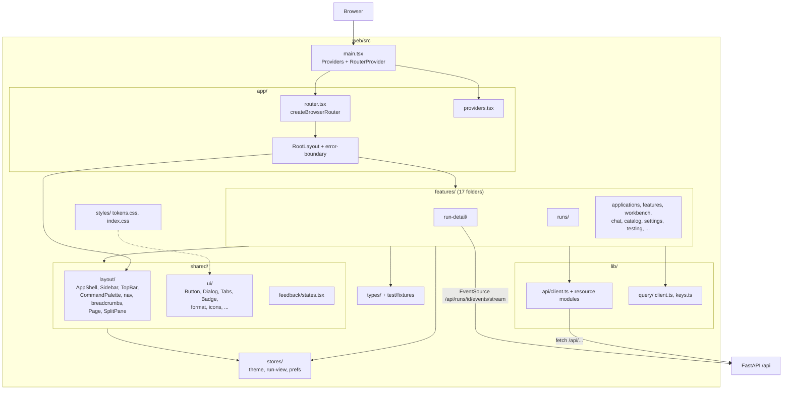
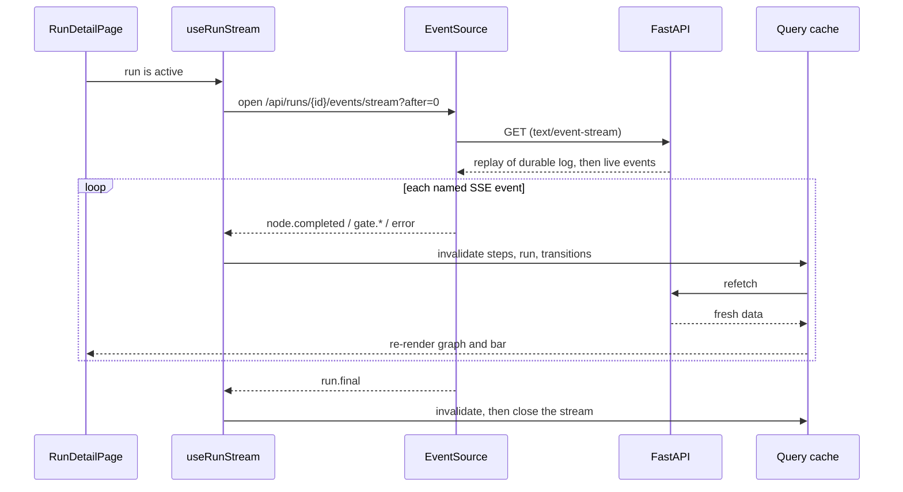
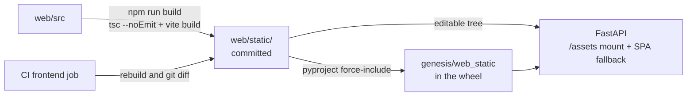

# Module: web app (`web/`)

> **Describes:** genesis v0.81.0 (Phase 51) · **Last reviewed:** 2026-11-11 · C4 level 3 · area `web-shell`

## 1. Purpose

The web app is the only user interface of Genesis. It is a React and TypeScript single-page app (SPA) that a
person opens in a browser at `http://127.0.0.1:8760`. It shows applications, features, stories, runs, chat,
documents, memory and settings, and it calls the backend API to read and change all of them.

The central promise is simple: the SPA holds no business logic that the backend does not also hold. It shows
what the API returns, sends the user's decisions back, and keeps its own state small. Server data lives in a
TanStack Query cache. Only view preferences (theme, graph or list view, inspector position) live in client
stores. The app is local and single-user. It has no login, no roles and no tenant concept (ADR-026).

Two parts of the app need more explanation than the rest, so this document covers them in depth:

- **The shell and the shared kit.** The frame (sidebar, top bar, command palette), the central API client, the
  query-key registry, the design tokens and the UI primitives that every page uses.
- **The Run Detail page.** It draws a workflow's graph, shows each node's status, lets a person open the
  conversation of any agent turn, and exposes the human-in-the-loop controls (HITL).

The build is also part of the module. The production bundle is built with Vite and **committed** to
`web/static/`, so a user needs no Node.js at run time.

## 2. At a glance

| Item | Value |
|---|---|
| Code | `web/` (sources in `web/src/`, built output in `web/static/`) |
| Runs in | The user's browser. The FastAPI process serves the built files. |
| Language and stack | TypeScript (strict) · React 18 · Vite · React Router 6 (data router) · TanStack Query 5 · Zustand · Tailwind CSS 3 with Radix-based primitives · React Flow (`@xyflow/react`) with `elkjs` · react-hook-form with zod · react-markdown, mermaid, CodeMirror · Recharts · lucide-react icons (ADR-027) |
| Depends on | The backend HTTP API under `/api` (module [api.md](api.md)). Nothing else: the SPA never talks to Kiro, MCP servers or the database. |
| Used by | A person in a browser. The backend serves the bundle ([distribution.md](distribution.md) covers how it ships). |
| Stores | Browser `localStorage` key `genesis.theme` only. Everything else is in memory or on the server. |
| Version shown | `web/src/version.ts` holds `GENESIS_VERSION` by hand. It is shown in the sidebar footer and must be bumped at each release together with the Python version. |
| Dev server | `npm run dev` in `web/` serves on `:5173` and proxies `/api` to `127.0.0.1:8760`. |
| Build output | `web/static/` (`index.html` plus content-hashed files in `web/static/assets/`). Committed to git. |
| Gates | `npm run lint` · `npm run typecheck` · `npm test` · `npm run build` (then commit `web/static/`). |

## 3. Concepts

| Term | Meaning |
|---|---|
| **SPA shell** | The `AppShell` component: sidebar, top bar, update banner and the scrolling content area where the routed page appears. It also mounts the first-run checklist, the collaboration onboarding dialog, the collaboration auto-pull driver and the command palette. |
| **Feature folder** | One folder under `web/src/features/` that owns the pages, hooks and tests of one product area (for example `run-detail`). Feature folders import from `shared/`, `lib/`, `stores/` and `types/`. A few import from each other (for example `run-detail` imports `runs` and `catalog` hooks). |
| **Resource module** | One file under `web/src/lib/api/` that builds the calls for one backend resource (for example `runsApi`). Components and hooks call these. They never call `fetch` with a URL of their own. |
| **Query key registry** | `qk` in `web/src/lib/query/keys.ts`. Every TanStack Query key is built there, so a page can invalidate a whole family of queries by prefix. |
| **Primary navigation** | The list `PRIMARY_NAV` in `web/src/shared/layout/nav.ts`. The sidebar and the command palette both read it. |
| **Design token** | A CSS custom property such as `--bg` or `--primary`, defined in `web/src/styles/tokens.css`. Tailwind colour names map to these variables, so a theme switch is a variable swap. |
| **Theme** | `light` or `dark`. Light is the default (ADR-055). The class `theme-light` or `theme-dark` sits on `<html>`. |
| **Topology** | The static shape of a workflow graph: nodes (`id`, `label`, `kind`, `description`) and edges (`from`, `to`). It comes from `GET /api/workflows/{id}/graph` (type `GraphTopology`). |
| **Node state** | `NodeDerived`: the status of one node on one run (`pending`, `running`, `ok`, `failed`, `awaiting`, `retrying`, `skipped`) plus counters. It is computed on the client from `/steps`, the run's cursor and, optionally, events. |
| **Steps** | The server-side fold of a run's whole event log into one row per node (`GET /api/runs/{id}/steps`). It is small and authoritative (L-060, L-066). |
| **Transitions** | Per-edge traversal counts and per-node execution counts (`GET /api/runs/{id}/transitions`). They drive the green "executed path" on the graph. |
| **Turn** | One agent model call on a node. A node can have many turns (retries, loop rounds, items). The API returns them from `GET /api/runs/{id}/nodes/{node}/iterations` as `NodeTurn` rows. |
| **Transcript** | The ordered list of message, thought, tool, result and note items built from a node's `agent.*`, `validator.result` and `retry.scheduled` events by `buildTranscript`. `groupTurns` then groups it into turns for display. |
| **Turn explorer** | The large dialog (`NodeIterationsDialog`) that shows a node's turns as a tree and one turn's prompt, artifacts, conversation, output and metrics (ADR-066). |
| **Stale-bundle guard** | A CI step that rebuilds `web/static/` and fails if the result differs from what is committed. |
| **Kitchen sink** | The design-system gallery at `/dev`, used for visual checks of tokens and primitives. |

## 4. Structure



The diagram shows the layers. `main.tsx` wraps the router in the providers. The router renders `RootLayout`,
which puts every page inside `AppShell`. Feature folders use the shared kit, the API modules and the query
registry. Only `lib/api` and two stream hooks reach the backend.

### 4.1 Files by area

| File or folder | What it holds |
|---|---|
| `web/package.json` | Dependencies and the five scripts: `dev` (`vite`), `build` (`tsc --noEmit && vite build`), `typecheck` (`tsc --noEmit`), `lint` (`eslint .`), `test` (`vitest run`). The package is private (`genesis-workbench`). |
| `web/vite.config.ts` | `@` alias to `src`, dev proxy `/api` to `http://127.0.0.1:8760`, build to `static/` with `emptyOutDir: true` and `assetsDir: "assets"`, and the Vitest config (jsdom, globals, setup file, `css: false`). |
| `web/tsconfig.json` | Strict TypeScript, `noUnusedLocals`, `noUnusedParameters`, path alias `@/*`, only `src` included. |
| `web/eslint.config.js` | Flat config: ESLint recommended, typescript-eslint, React hooks rules, react-refresh (warn). `no-explicit-any` is a warning (off in tests). `static/**` is ignored. |
| `web/tailwind.config.ts` | Colours, radii, fonts, shadows, motion tokens mapped to CSS variables. Dark mode is the class `.theme-dark`. |
| `web/index.html` | The SPA entry: inline favicon, a no-flash theme script, and a pre-JavaScript splash that React replaces on mount. |
| `web/dev.html`, `web/src/dev/main.tsx` | A second entry that mounts only the `KitchenSink`. Served by the dev server at `/dev.html`. It is not part of the production build. |
| `web/src/main.tsx` | Mounts `Providers`, a `Suspense` fallback and `RouterProvider`. Imports the self-hosted Poppins font files and `styles/index.css`. |
| `web/src/app/router.tsx` | The full route table (section 6.2) and two small redirect components. |
| `web/src/app/RootLayout.tsx` | `AppShell` with the router `Outlet`. |
| `web/src/app/providers.tsx` | `QueryClientProvider`, theme application, `TooltipProvider`, `Toaster`. |
| `web/src/app/error-boundary.tsx` | `RouteError`: the route-level error page with a Retry button that reloads the window. |
| `web/src/app/routes/Overview.tsx` | `ComingSoon`, the placeholder used for the catch-all "Not found" route. |
| `web/src/shared/layout/` | `AppShell`, `Sidebar`, `TopBar`, `CommandPalette` and its store, `nav.ts`, `breadcrumbs.ts`, `Page` and `Section`, `SplitPane`. |
| `web/src/shared/ui/` | The primitives: `button`, `badge` (incl. `StatusPill`, `StatusDot`, `statusMeta`), `card`, `chip`, `dialog` (and drawer), `tabs`, `select`, `switch`, `input`, `popover`, `tooltip`, `toast`, `segmented`, `skeleton`, `metric-card`, `trend-chart`, `file-drop`, `health-dot`, `logo`, `format` (`Duration`, `RelativeTime`, `CreditBadge`, ...), `icons` (lucide re-exports and `NODE_KIND_ICON`), `appian-object-types`. `index.ts` re-exports them. |
| `web/src/shared/feedback/states.tsx` | `EmptyState`, `ErrorState`, `LoadingState`, `LoadingScreen`. |
| `web/src/lib/api/client.ts` | `api.get/post/postForm/put/patch/del` and `ApiError`. |
| `web/src/lib/api/*.ts` | One resource module per backend resource (section 4.2). `index.ts` re-exports them. |
| `web/src/lib/query/` | `queryClient` (`client.ts`) and the `qk` key registry (`keys.ts`). |
| `web/src/lib/cn.ts` | `cn()`: `clsx` plus `tailwind-merge`. |
| `web/src/stores/` | `theme.ts` (`useTheme`, `applyTheme`), `run-view.ts` (`useRunView`), `prefs.ts` (`useUiPrefs`). |
| `web/src/types/` | TypeScript mirrors of backend shapes (`run.ts`, `event.ts`, `catalog.ts`, `artifact.ts`, `applications.ts`, `features.ts`, `workbench.ts`, `testing.ts`, `testdesign.ts`, ...) and the ambient `jest-axe.d.ts`. |
| `web/src/test/fixtures/` | Golden fixtures (`events.ts`, `data.ts`, JSON files under `testing/` and `testdesign/`) and `contract.test.ts`. |
| `web/src/test-setup.ts`, `web/src/vitest-axe.d.ts` | Global Vitest setup (jest-dom, the `toHaveNoViolations` matcher, `ResizeObserver` and `matchMedia` stubs) and the matcher type augmentation. |
| `web/src/styles/` | `tokens.css` (all variables, light and dark) and `index.css` (Tailwind layers, base rules, motion utilities). |
| `web/src/dev/` | `KitchenSink.tsx` and `mockups/` (four mockup pages used during design phases). |

### 4.2 Resource modules and the routes they call

| Module (`web/src/lib/api/`) | Backend routes it calls (all under `/api`) |
|---|---|
| `runs.ts` | `/runs`, `/runs/{id}`, `/runs/{id}/events`, `/steps`, `/transitions`, `/state`, `/nodes/{node}/iterations`, `/artifacts[/{name}[/download]]`, `/pause`, `/resume`, `/cancel`, `/respond`, `/fork` |
| `catalog.ts` | `/catalog`, `/catalog/available`, `/workflows/{id}`, `/workflows/{id}/graph`, `/library/install`, `/library/update`, `/runs`, `/runs/upload` |
| `skills.ts` | `/skills`, `/skills/available`, `/skills/install`, `/skills/{id}` |
| `applications.ts`, `objectWiki.ts` | `/applications...` (applications, sync, KB objects, business map, Object Wiki) |
| `features.ts`, `testdesign.ts` | `/applications/{app}/features`, `/features/{id}...` (spec, stages, stories, change requests), `/test-cases`, `/test-scenarios`, `/test-suite`, `/test-topups` |
| `workbench.ts` | `/workbench/boards...`, `/workbench/applications/available` |
| `testing.ts` | `/testing/jobs/{id}`, `/config/testing/runtime...`, per-application testing routes |
| `chat.ts` | `/chat/sessions...`, `/chat/models`, `/chat/commands`, `/chat/runs`, `/chat/sessions/{id}/notifications[/stream]` |
| `documents.ts` | `/documents...` |
| `memory.ts` | `/memory...` |
| `collab.ts` | `/collab...` |
| `config.ts`, `integrations.ts` | `/config/...` (health, environments, secrets, GitLab token, MCP and CLI cards and servers, native MCP and CLI, retention), `/artifacts/usage`, `/chat/actions` |
| `system.ts`, `metrics.ts`, `home.ts`, `search.ts` | `/system/kiro`, `/system/update`, `/system/sync-settings`, `/system/metrics`, `/home`, `/search` |

`PreflightChecklist` calls `/system/preflight` through the generic `api` client, and `UpdateBanner` polls
`/config/health` with a plain `fetch` while the server restarts. The exact route list belongs to
[api.md](api.md) and the live Swagger page at `/docs`.

### 4.3 Feature folders

Each line names the page or pages and the resource modules the folder uses.

| Folder | Pages and parts | Resource modules |
|---|---|---|
| `applications/` | Home (`/applications`), application detail with tabs, business map canvases, add-application dialog | `applicationsApi` |
| `overview/` | The metrics band and run trend shown on the Home page (`OverviewSection`) | `homeApi` |
| `features/` | Feature page, stage workspaces (Spec, UX Design, Technical Design, Feature Breakdown), stories tab, change-request flow, activity feed | `featuresApi`, `metricsApi` |
| `test-design/` | Test Design stage entry, Tests tab, case and scenario pages, Test Impact tab | `testDesignApi`, `featuresApi`, `testingApi` |
| `testing/` | The application's Testing tab (Library, Regression, Executions, Setup), library item page, case-script page, execution page, record and compose dialogs | `testingApi` |
| `workbench/` | Workbench boards, Story Workspace page (ADR-071), design chat page, verification dialogs | `workbenchApi`, `featuresApi`, `collabApi`, `runsApi` |
| `object-wiki/` | Object table and per-object history page | `objectWikiApi` |
| `runs/` | Runs list (`/runs`) | `runsApi` |
| `run-detail/` | Run Detail (`/runs/:runId`), graph, inspector, turn explorer, HITL bar, Documents tab | `runsApi`, `catalogApi` (graph) |
| `catalog/` | Catalog (workflows and skills tabs), workflow detail, launch form | `catalogApi`, `skillsApi`, `configApi` |
| `chat/` | Chat page, thread, composer, session list, launch dialog | `chatApi`, `catalogApi`, `configApi` |
| `library/` | Documents library and document detail (route `/documents`) | `documentsApi` |
| `documents/` | Shared document renderers (`DocumentPreview`, markdown, mermaid, JSON tree, CSV, code) and artifact hooks used by Run Detail | `runsApi` |
| `memory/` | Memory workspace: list, constellation graph, inspector, review queue | `memoryApi` |
| `settings/` | Settings tabs (General, MCP, CLI, GitLab, Environments, Collaboration) | `configApi`, `integrationsApi`, `metricsApi`, `systemApi` |
| `collab/` | Collaboration settings, Hub status, onboarding dialog, auto-pull driver, staleness badge | `collabApi` |
| `system/` | First-run `PreflightChecklist` and `UpdateBanner` | `systemApi`, `api` |

## 5. How it works

### 5.1 Start-up and the shell

1. The browser loads `index.html`. An inline script reads `localStorage["genesis.theme"]` (or the OS
   preference, light when neither is set) and sets `theme-light` or `theme-dark` on `<html>` before first
   paint. A static splash shows until React mounts.
2. `main.tsx` renders `Providers`, a `Suspense` fallback (`LoadingScreen`) and `RouterProvider` in `StrictMode`.
3. `Providers` supplies the query client, applies the theme class from the `useTheme` store, and mounts the
   tooltip provider and the toast container.
4. The router matches the URL. Every page route sits under `RootLayout`, so every page appears inside
   `AppShell`.
5. `AppShell` mounts, beside the page: `PreflightChecklist` (a dismissible dialog that lists missing
   prerequisites, from `/system/preflight`), `OnboardingDialog` and `CollabAutoPull` (collaboration, which is
   off unless the user turns it on), the `Sidebar`, the `TopBar`, the `UpdateBanner` (polls `/system/update`
   every five minutes) and the `CommandPalette`.
6. A route that throws renders `RouteError` in place of the page. It shows the message and offers a reload.

### 5.2 Routes and navigation

The sidebar shows these destinations, in this order: Home (`/applications`), Workbench (`/workbench`, with one
sub-item per application board and a "+" to add one), Chat, Runs, Catalog, Documents, Memory, then Settings
under a "System" label. The sidebar can collapse to an icon rail. The same `PRIMARY_NAV` list feeds the
command palette (opened with Cmd-K or Ctrl-K), which also runs the theme toggle and searches applications,
features and documents through `GET /api/search`.

`/` redirects to `/applications`. The route table:

| Route | Page |
|---|---|
| `/applications`, `/applications/:appUuid` | Home dashboard, application detail (tabs are URL-addressable, for example `?tab=object-wiki`) |
| `/applications/:appUuid/features/:featureId` and `…/stories`, `…/tests`, `…/:stage` | Feature page, stage workspaces |
| `/applications/:appUuid/stories/:storyId` | The one Story Workspace page (ADR-071) |
| `/applications/:appUuid/stories/:storyId/design-chat` | Design chat for a story |
| `/applications/:appUuid/test-cases/:caseId`, `…/test-scenarios/:scenarioId` | Test Design case and scenario pages |
| `/applications/:appUuid/testing/actions/:key`, `…/setups/:key`, `…/case-scripts/:caseKey`, `…/executions/:key` | Testing library item, case script, execution pages |
| `/applications/:appUuid/wiki`, `…/wiki/:objectUuid` | Redirect to the Object Wiki tab, object history page |
| `/workbench`, `/workbench/:appUuid` | Workbench boards |
| `/runs`, `/runs/:runId`, `/runs/:runId/node/:nodeId`, `/runs/:runId/docs/:docName` | Runs list, Run Detail (node and document are in the URL) |
| `/chat`, `/chat/:sessionId` | Chat |
| `/catalog`, `/catalog/skills`, `/catalog/:workflowId`, `/catalog/:workflowId/launch` | Catalog, workflow detail, launch form |
| `/documents`, `/documents/:id` | Document library, document detail |
| `/memory` | Memory workspace |
| `/settings`, `/settings/:tab`, `/settings/:tab/:id` | Settings |
| `/dev`, `/dev/mockups`, `/dev/feature-workspace`, `/dev/ux-design`, `/dev/run-inspection` | Design gallery and mockups, outside the shell |
| `*` | "Not found" placeholder |

Two legacy story routes (`/workbench/:appUuid/cards/:storyId` and `/applications/:appUuid/features/:featureId/stories/:storyId`)
redirect to the Story Workspace route, so every entry point reaches one story page (ADR-071).

Breadcrumbs come from the URL. `breadcrumbs.ts` holds a route-pattern table, matches patterns as prefixes and
drops the current page (the page shows its own title). Detail pages register a readable name for an id segment
with `useSetCrumb`, for example Run Detail registers the workflow id for `run:<runId>`.

The backend serves the SPA with a history fallback, so a refresh on any client route returns `index.html`
(section 5.12).

### 5.3 Talking to the API and caching

1. A component or hook calls a resource module, for example `runsApi.get(id)`.
2. The module calls `api.get("/runs/…")`. `request()` in `client.ts` prepends the constant `API_BASE = "/api"`.
   No component writes `/api` itself (ADR-028). The two direct download links (`artifactDownloadHref`) and
   the raw `EventSource` and `fetch` calls for streams build their `/api/...` paths inside `lib/api` or the
   stream hooks.
3. For a `FormData` body the client leaves `Content-Type` to the browser; otherwise it sends JSON.
4. A network failure becomes `ApiError(0, message)`.
5. A non-2xx response becomes `ApiError(status, message, detail, body)`. `detail` is the FastAPI `detail`
   field and `body` is the whole parsed error body, so extra fields such as `problems`, `typecheck` or `code`
   reach the screen (L-011).
6. A 2xx response whose body is not JSON also becomes an `ApiError`, with a message that says the backend may
   not be running or proxied. This is what stops the SPA fallback page from being parsed as data (L-010).
7. Hooks wrap the call in `useQuery` or `useMutation` with a key from `qk`. The shared `queryClient` retries
   once, treats data as fresh for 30 seconds and does not refetch on window focus.
8. Pages that show live data set `refetchInterval` from the data itself: a hook returns an interval while the
   run (or any run on the page) is active and `false` once it is terminal. Mutations invalidate by `qk`
   prefix.

### 5.4 Run Detail: loading the page

`RunDetailPage` is the page for `/runs/:runId` (and the `/node/:nodeId` and `/docs/:docName` variants). The
selected node and document are route parameters, so a link opens the page on a given node or document.

On mount it starts these queries (all through `features/run-detail/hooks.ts`):

| Hook | Route | Refresh |
|---|---|---|
| `useRun` | `GET /runs/{id}` | Every 3 s while the run is active |
| `useRunSteps` | `GET /runs/{id}/steps` | Every 3 s while any step is `running` |
| `useRunTransitions` | `GET /runs/{id}/transitions` | Every 3 s while the run is active |
| `useRunState` | `GET /runs/{id}/state` | On demand |
| `useWorkflowGraph` | `GET /workflows/{workflow_id}/graph` | Cached |
| `useRunArtifacts` | `GET /runs/{id}/artifacts` | Every 4 s while the run is active |
| `useRunStream` | `GET /runs/{id}/events/stream` (SSE) | While the run is active (section 5.7) |

A run is **active** when its status is `pending`, `running`, `awaiting_input:gate` or `awaiting_input:paused`
(`isActive` in `features/runs/hooks.ts`).

The page picks its topology from the workflow's declared `graph:` section. If the workflow declares none, or
the graph has no nodes, it builds a straight-line fallback from the `/steps` rows (`topologyFromSteps`), so
the graph is never blank (L-006). The page seeds its tab once, when the run first loads: a deep link to a
document or a finished run lands on **Documents**, an active run lands on **Flow**. It does not switch tabs
later, so a run that finishes does not move the user.

### 5.5 Run Detail: node status

`deriveNodeStates(topology, events, run, steps)` in `node-states.ts` returns one `NodeDerived` per node.

1. Every topology node starts as `pending`.
2. If events are passed, they are folded. The page passes `undefined` for events, so this step does nothing
   on the page. The fold still exists and is used by tests and by the contract check.
3. The `/steps` rows are then applied as **authoritative**: status (`ok`, `failed`, `awaiting`, `running`),
   `executions`, `attempts`, `toolCalls` and `messages` are copied from them.
4. The run's `cursor` node is marked `current`. On a `failed` run the cursor node becomes `failed` unless it
   is already `ok`. On `awaiting_input:gate` it becomes `awaiting`. On any other non-terminal status it
   becomes `running`, unless it is already `ok`, `awaiting` or `retrying`.
5. On a terminal run (`done`, `failed`, `cancelled`), a node with no step row and no events becomes `skipped`
   rather than staying `pending`.

The design reason is in two lessons. The client's `/events` fetch is capped, so a status derived from events
left a finished node stuck on "running" (L-060). Folding the whole event log on every tick also grew with the
square of the event count on large agent runs and stalled the page (L-066). Using `/steps`, which the server
folds from the full durable log, avoids both. There is no `node.started` or `node.failed` event (L-005), so
"running" always comes from the cursor, and a failure is attributed to the cursor node of a failed run.

A cursor that jumps backwards is normal: a bounded verify-and-revise loop re-enters earlier nodes (L-059).
`executions` counts how many times a node completed, and the node card shows it as a "rounds" counter when it
is above one.

### 5.6 Run Detail: drawing the graph

`RunGraph` (`graph/RunGraph.tsx`) renders the topology with React Flow. It is read-only: nodes cannot be
dragged or connected.

1. A change of topology triggers `elkLayout` (`graph/layout.ts`).
2. `elkLayout` first finds **back-edges** with an iterative depth-first search: an edge whose target is on the
   current search stack. These are the retry and revise loops.
3. It gives ELK the graph with those edges **reversed**, so ELK sees an acyclic graph. ELK then lays out a
   left-to-right layered graph with orthogonal edge routing. Validators and gates stay after their agent, and
   long edges route around nodes instead of through them (L-067).
4. After layout, the route of each reversed edge is flipped back so the arrow points from source to target.
5. If ELK throws, or returns a layout with every node in one column, `layeredFallback` produces a simple
   longest-path layered layout with straight routes.
6. `RunGraph` turns the layout into React Flow nodes (type `nodeCard`) and edges (type `elk`). Edges whose
   endpoints are not nodes, such as an edge to the `END` sentinel, are dropped before layout.
7. `NodeCard` shows the kind icon, label, a `StatusPill`, and small counters: rounds (executions above one),
   retry attempts, tool calls and messages. A running node pulses, an awaiting node has a warning ring, a
   failed node a danger ring, a pending node a dashed border.
8. `ElkEdge` draws ELK's route with rounded corners. An edge with a count above zero in `/transitions` is
   green and carries a `×N` pill. The edge into the running node is drawn in the primary colour and pulses.
   Edges not taken are muted and dashed. Edges are sorted so idle ones paint first and the running one last.
   The pill is not given a raised `zIndex`, because that would lift the edge above React Flow's label layer
   and paint the line over the pill.
9. After layout settles, the view is fitted once (`fitView` with padding 0.1, `minZoom` 0.3, `maxZoom` 0.9).
   The user can zoom between 0.18 and 1.6, pan, and use the zoom controls. A refresh button re-fetches run,
   steps and transitions on demand.

The graph does not use a minimap or zoom-dependent detail levels. L-034 (from the KB value-stream graph)
recommends a readable zoom floor and click-for-detail instead of fit-to-pane. The run graph follows the first
part (the fit is clamped at 0.3, so a large graph is panned instead of shrunk until unreadable) and follows the
second through the inspector below it.

A **List** view is available through a segmented control. `NodeListView` shows the same nodes and statuses as
keyboard-friendly buttons, next to a stacked `TelemetryStrip` (elapsed time, credits, tool calls, messages,
retries). The choice is kept in the `useRunView` store (`viewMode`) for the browser session.

### 5.7 Run Detail: live updates



The diagram shows that the stream is only a nudge. The page never stores the events. It reacts to a few event
kinds by asking the server for fresh aggregate data.

1. `useRunStream` runs only while the run is active and only where `EventSource` exists (jsdom has none).
2. It opens `/api/runs/{id}/events/stream?after=0`. The server replays the durable log after that sequence
   number and then tails the live bus, without duplicates. The server sends **named** SSE events (`event:
   <kind>`), so the hook registers a listener for each kind in `STREAM_KINDS`, plus a generic `message`
   listener (L-003).
3. The listener ignores streaming deltas (`agent.message`, `agent.thought` and the rest). On `node.completed`,
   `gate.awaiting`, `gate.resolved` or `error` it invalidates `steps`, `detail` and `transitions` and the
   scoped events of the event's node. On `run.final` it does the same and closes the stream.
4. On a stream error it closes the stream and invalidates the same queries once. The durable store decides
   the state, not the transport.
5. The hook reports `idle`, `replaying`, `live` or `closed`. The header badge shows it.

The browser parses the SSE frames itself for `EventSource`. L-018 (the server frames events with CRLF) applies
to the code that reads SSE from a `fetch` body, which is `readSse` in `lib/api/chat.ts`. It splits frames on
`/\r?\n\r?\n/`. Chat uses it for the message stream and for the per-session notification stream
(`streamNotifications`). A test must not use an LF-only fixture for it.

A second hook, `useRunNodeStream`, serves the turn explorer. While the dialog is open and the run is active
it opens the same stream from the newest sequence number already fetched, keeps only events of the selected
node, and closes on `run.final`, on error or on unmount.

### 5.8 Run Detail: inspector, turn explorer and transcript

1. With no node selected, the lower pane tells the user to select one. With a node selected, `Inspector`
   shows the **summary**: the node's authored description (`description` from the topology), a Metrics block
   (turns, total credits with "n of m metered", tool calls, total time) and one chip per turn with its
   duration and credits. Credits that are missing show `n/a`, never an estimate (ADR-032).
2. The turns come from `useNodeIterations` (`GET /runs/{id}/nodes/{node}/iterations`). The node's events come
   from `useRunNodeEvents`, which pages `GET /runs/{id}/events?node=<node>` (2000 per page) to completion and
   polls every 2.5 s while the run is active. The server does the node filtering (L-066).
3. For an agent node with turns, a **View details** button (or a double-click on the pane) opens
   `NodeIterationsDialog`, the turn explorer (ADR-066).
4. The left rail of the dialog is an adaptive tree. It shows a **Pass** level only when there is more than one
   pass, an **Item** level only when turns carry an item label, and **Attempt** or **Run** leaves. Each leaf
   shows a status icon and its credits. A running turn is selected by default.
5. The right pane shows the selected turn: status and badges, four metrics (credits, context percent, tool
   calls, duration), the **Prompt** (fetched lazily from the blackboard file named by `prompt_ref` through
   `GET /runs/{id}/artifacts/{name}?mode=full`), artifacts and image inputs, the **Conversation**, and the
   state keys the turn changed. A run from before Phase 39 has no `prompt_ref`, and the pane says capture is
   unavailable.
6. The conversation is built from the node's events, sliced to the turn's `seq_start` to `seq_end`. A running
   turn has an open end so streamed events appear at once. `buildTranscript` merges consecutive message chunks
   (and consecutive thought chunks) into one item, keys tool cards by `tool_call_id` and updates them in place
   on `agent.tool_update`. `groupTurns` then closes a turn at each `agent.result`. Validator and retry notes
   that arrive after a result stay on that turn, so a retry's failure note belongs to the attempt it describes
   (L-007).
7. `Conversation` shows a "Round k of N" divider when a node completed more than once, auto-scrolls while
   live unless the user scrolled up, and offers "Jump to latest".

Program and validator nodes have no model transcript. Their summary says so and points to the Documents tab.

### 5.9 Run Detail: human-in-the-loop controls

`HitlBar` is a pure function of the run's durable status and gate. It renders nothing for a terminal run.

- **Mode 1, designed gates.** When the status is `awaiting_input:gate` and the run record carries a `gate`, a
  panel shows the gate kind (approval, escalation, pre-mutation or review), the prompt, links to context
  documents, and one button per option (default `approve` and `reject`). A pre-mutation gate adds a warning
  that approval modifies external systems. Reject asks for confirmation. A Feedback box sends
  `{feedback: text}`. Answers go to `POST /runs/{id}/respond`.
- **Mode 2, pause and resume.** A running run shows Pause. A paused run shows Resume and a "Paused — safe in
  checkpoint" badge. Both call `/pause` and `/resume`.
- **Mode 3, edit and fork.** Edit state opens `EditStateDialog` (`PATCH /runs/{id}/state`; the server checks
  which keys are editable and the dialog shows a 400 inline). Fork opens `ForkDialog` and calls
  `POST /runs/{id}/fork` with a node and optional values, then navigates to the new run. The original run is
  untouched (ADR-025).
- **Cancel** asks for confirmation and calls `/cancel`.

Every mutation hook invalidates the run's detail, events, steps, state and the run list (`useReconcileRun`).

### 5.10 Run Detail: documents

The **Documents** tab (`DocumentsTab`) lists the run's blackboard files as cards beside a `DocumentViewer`. A
file whose name matches the result heuristic (`result`, `erd-input`, `output`) is pinned first, labelled
"Result", and selected automatically. Files in `_toolcalls/` (the tool-output store) are hidden unless the
user turns on the "show tool outputs" switch, which is held in `useUiPrefs` for the session. The viewer loads
a preview first and can load the full file, shows raw text, copies, and links to the download route. It uses
the shared renderers in `features/documents/` (markdown, mermaid, JSON tree, CSV table, code block). Mermaid
is imported dynamically on first use (L-015).

### 5.11 Theme and design tokens

1. `styles/tokens.css` defines every variable. `:root` and `.theme-light` hold the light theme, which is the
   default. `.theme-dark` overrides the same names.
2. Two brand variables, `--brand` (indigo `#4f46e5`) and `--brand-secondary` (slate `#475569`), drive the
   primary colour, the gradients and the glows through `color-mix`. Components do not hard-code brand colours
   (ADR-055).
3. `tailwind.config.ts` maps colour names (`bg`, `surface-1..3`, `border`, `fg`, `fg-muted`, `fg-subtle`,
   `primary`, `secondary`, `success`, `warning`, `danger`, `info`, `focus`) to `var(--…)`. Components use
   these names, not raw palette colours (ADR-027).
4. `useTheme` stores the choice in `localStorage["genesis.theme"]` and calls `applyTheme`, which swaps the
   class on `<html>`. The top bar and the command palette both toggle it.
5. The font is Poppins, self-hosted through `@fontsource/poppins` and bundled by Vite, so there is no CDN
   fetch (the app works offline).
6. A global rule reduces motion for users who ask for it.

ADR-055 chose to evolve the existing tokens, Tailwind and shadcn-style primitives into a light-first,
Material-inspired look. It did not adopt `@mui/material`.

### 5.12 Build, ship and serve



The diagram shows one built folder feeding both the installed package and the dev tree. CI rebuilds the folder
and compares.

1. `npm run build` type-checks and then runs `vite build`. The output goes to `web/static/` and replaces its
   old contents (`emptyOutDir`). File names carry content hashes.
2. The developer commits `web/static/`. The runtime then needs no Node.js (ADR-027).
3. The wheel includes the folder as package data. `pyproject.toml` force-includes `web/static` as
   `genesis/web_static`, because the folder sits outside the Python package (L-048).
4. At start, `_resolve_web_static()` in `genesis/api/app.py` picks the first of `genesis/web_static` and the
   repo's `web/static` that contains `index.html`.
5. FastAPI mounts `web_static/assets` at `/assets`. It serves `index.html` at `/` and, through a catch-all
   `GET /{full_path:path}`, for every other path that does not start with `api/` or `assets/` (those return
   404). This is the history fallback for client routes (ADR-028).
6. `index.html` is sent with `Cache-Control: no-cache, must-revalidate`, so a reload always finds the newest
   hashed bundle. The hashed assets can be cached by name (L-068).
7. In CI, the `frontend` job (image `node:20`, run only when files under `web/` change) runs `npm ci`, lint,
   typecheck, test and build, then fails if `git diff` shows a change under `web/static`. This is the
   stale-bundle guard.
8. Because the job runs only on `web/**` changes, a follow-up tag that touches no web file does not repeat the
   guard. If the job failed for an infrastructure reason on the web-changing tag, re-trigger it with a real
   change under `web/` (L-030).
9. The `clean-install` job installs the wheel without editable mode and checks that `/` serves the SPA shell;
   a change to `web/static/**` triggers it.

Playwright reports are not served by this app. They come from a second loopback origin at the app port plus
100 and are opened from the Testing tab (ADR-085; see [testing.md](testing.md)).

### 5.13 The dev loop and the gallery

1. In `web/`, `npm run dev` starts Vite on `http://localhost:5173`. Requests to `/api` are proxied to
   `127.0.0.1:8760`, so a backend must run (`genesis serve`). Only `/api` is proxied, so the proxy never
   shadows a client route (ADR-028).
2. The design-system gallery is the `KitchenSink` page. It is reachable as the route `/dev` in the normal app
   and as the separate entry `http://localhost:5173/dev.html` in the dev server. The mockup pages
   (`/dev/mockups`, `/dev/feature-workspace`, `/dev/ux-design`, `/dev/run-inspection`) are routes of the same
   router. All of these routes are compiled into the production bundle, because they are in `router.tsx`.
   They sit outside the shell.
3. A front-end-only change still needs a genesis release, because the committed `web/static/` is what users
   run.

## 6. Interfaces

### 6.1 HTTP calls the module makes

The web app serves no HTTP routes of its own. The backend serves its files (section 5.12). The calls it
makes are listed by resource in section 4.2. Run Detail uses these run routes, all defined in
`genesis/api/run_routes.py`:

| Method and path | Used for |
|---|---|
| `GET /api/runs` | Runs list with `status`, `workflow`, `q`, `limit`, `offset` |
| `GET /api/runs/{id}` | The run record, including the durable gate |
| `GET /api/runs/{id}/events?after&limit&node` | Paged durable events, optionally for one node |
| `GET /api/runs/{id}/events/stream?after` | SSE: replay, then live |
| `GET /api/runs/{id}/steps` | Per-node fold |
| `GET /api/runs/{id}/transitions` | Edge and node execution counts |
| `GET /api/runs/{id}/nodes/{node}/iterations` | Turns of a node |
| `GET /api/runs/{id}/state`, `PATCH /api/runs/{id}/state` | Read and edit state |
| `POST /api/runs/{id}/pause`, `/resume`, `/cancel`, `/respond`, `/fork` | HITL |
| `GET /api/runs/{id}/artifacts`, `…/{name}`, `…/{name}/download` | Documents |
| `GET /api/workflows/{id}/graph` | Topology |

The Runs list (`RunsPage`) pages 20 runs at a time. The status filter, workflow filter and text search are
sent to the server, the previous page stays on screen while the next loads (`keepPreviousData`), and the list
polls every 3 s only while the current page holds an active run.

### 6.2 Contracts the module consumes

| Contract | Where mirrored | Guard |
|---|---|---|
| Canonical event kinds and payloads (`agent.*`, `validator.result`, `retry.scheduled`, `node.completed`, `gate.*`, `run.final`, `error`, `telemetry`) | `types/event.ts`, `test/fixtures/events.ts` | `test/fixtures/contract.test.ts` feeds the golden log through the real folds |
| Gate descriptor, run record and statuses | `types/run.ts` | Same test file |
| Topology | `types/catalog.ts` (`GraphTopology`) | Same test file (`TOPOLOGY_FIXTURE`) |
| `NodeTurn` and `NodeIterations` (Phase 39) | `types/event.ts` | `NodeIterationsDialog.test.tsx` |
| Test Design and Testing responses | `types/testdesign.ts`, `types/testing.ts`, JSON under `test/fixtures/` | `features/test-design/contract.test.ts`, `features/testing/contract.test.ts` |

L-011 sets the rule: mirror each server shape and flag one to one, keep golden fixtures, and make a drift fail
a test. A fixture also drifts in its values while its shape stays valid, so re-record fixtures when a
response's wording changes.

### 6.3 Events, MCP tools, CLI

The module emits no events, exposes no MCP tools and has no CLI. It reads the SSE streams described above.

## 7. Data

| Place | Owner | Meaning |
|---|---|---|
| `localStorage["genesis.theme"]` | `stores/theme.ts` and the inline script in `index.html` | `"light"` or `"dark"` |
| TanStack Query cache | `lib/query` | Server data, in memory, per tab |
| `useRunView` | `stores/run-view.ts` | `viewMode` (`graph` or `list`), `inspectorPosition`, `inspectorOpen`, `docsOpen`. In memory. |
| `useUiPrefs` | `stores/prefs.ts` | `showToolOutputs`, default off. In memory. |
| Breadcrumb labels | `useCrumbStore` in `breadcrumbs.ts` | Readable names for id segments. In memory. |
| Command palette open state | `command-palette-store.ts` | In memory. |
| `web/static/` | The build | The shipped bundle; written by `npm run build`, read by FastAPI |

`run-view.ts` also defines `inspectorPosition`, `inspectorOpen` and `docsOpen`. Run Detail reads only
`viewMode` from the store (checked by search: no other file imports `useRunView`).

## 8. Failure handling

| Situation | Behaviour |
|---|---|
| Backend not running or not proxied (dev) | A 2xx non-JSON answer or a network error becomes an `ApiError`. Pages show `ErrorState` with a Retry button (L-010). |
| API returns an error | `ApiError` carries status, message, `detail` and the full body. Mutations show a toast (`Could not …`); some dialogs show the error inline instead. |
| A route component throws | `RouteError` renders with the message and a reload button. |
| Run not found or fetch fails | Run Detail shows `ErrorState` with Retry. |
| Workflow declares no graph | Fallback straight-line topology from `/steps`. If there are no steps yet, "Waiting for the first step…". |
| ELK layout fails or collapses to one column | `layeredFallback` draws a simple layered layout. |
| SSE drops without `run.final` | The hook closes the stream and invalidates steps, run and transitions once. The durable store settles the state. |
| `EventSource` missing (tests) | Stream hooks do nothing. Polling still works. |
| Large event log | The per-node events are fetched server-filtered and paged. The page never folds the whole log (L-066). |
| Event fetch capped | Node status does not depend on events; `/steps` is authoritative (L-060). |
| Prompt capture missing (old run) | The Prompt section says capture is unavailable. |
| Document not found or unsupported | `useArtifactContent` does not retry, so a 404 or 415 shows at once. |
| Server restarts during an update | `UpdateBanner` polls `/api/config/health` every 2 s up to 60 times and reloads the page when the server answers. |
| Stale `index.html` after an update | `no-cache` on the shell makes a reload fetch the new bundle (L-068). |

## 9. Configuration

The SPA has almost no configuration.

| Setting | Where | Default |
|---|---|---|
| API base | `API_BASE` in `lib/api/client.ts` | `/api` (same origin) |
| Dev proxy target | `server.proxy["/api"]` in `vite.config.ts` | `http://127.0.0.1:8760` |
| Dev server port | Vite default | 5173 |
| Query defaults | `lib/query/client.ts` | `retry: 1`, `staleTime: 30 000 ms`, `refetchOnWindowFocus: false` |
| Theme | `localStorage["genesis.theme"]`, else OS preference | Light |
| Runs list page size | `PAGE_SIZE` in `RunsPage.tsx` | 20 |
| Run polling | In `features/run-detail/hooks.ts` and `features/runs/hooks.ts` | 3 s for run, steps, transitions and list; 4 s for artifacts; 2.5 s for node events and iterations |
| Event page size | `PAGE` in `useRunNodeEvents` | 2000, up to 500 pages |
| Update check | `UpdateBanner` | Every 5 minutes |
| Backend bind | Not a web setting | Loopback only unless the user opts in (ADR-026, see [distribution.md](distribution.md)) |

## 10. Extending this module

**Add a page.**
1. Create a folder under `web/src/features/<name>/` with the page, a `hooks.ts` and a test.
2. Add the route to `app/router.tsx` as a child of `RootLayout`. Put a more specific route above a generic
   one that also matches it (React Router ranks by specificity, but check `/applications/:appUuid/features/:featureId/:stage`
   when you add a static segment).
3. Add a breadcrumb pattern to `shared/layout/breadcrumbs.ts` and, for a dynamic id, call `useSetCrumb`.
4. If it is a top-level destination, add it to `PRIMARY_NAV` in `shared/layout/nav.ts`. Both the sidebar and
   the command palette pick it up.

**Add an API call.**
1. Add the typed function to the matching file in `lib/api/`. Give paths without `/api`.
2. Mirror the response type in `types/` and add a golden fixture if the shape is part of a contract (L-011).
3. Add the query key to `qk` and invalidate by prefix in mutations.
4. If the same change adds or changes a backend field, search every consumer in the web app before you stop
   (L-094).

**Change Run Detail.**
1. Keep node status derived from `/steps` and the cursor. Do not read the whole event log into the page
   (L-060, L-066).
2. A new event kind that should refresh the graph goes into the transition check in `useRunStream`. A
   streaming delta must not.
3. Keep `buildTranscript` and `groupTurns` pure and cover a payload change with a test using the golden
   fixture (L-007, L-011).
4. If the graph gets a new edge style, set the colour and dash on the edge, not a `zIndex` (section 5.6, step 8).

**Add a UI primitive.** Put it in `shared/ui/`, export it from `index.ts`, use token colours only, and add an
a11y test with `jest-axe` (the matcher is already registered globally).

**Add a heavy library.** Import it with `lazy()` or a dynamic `import()` behind a `Suspense` or an `await`
(L-015). The existing examples are `LazyCodeEditor`, the `PassRateChart` in `RegressionView` and `MermaidView`.

**Change a table.** Measure first with a real-browser geometry probe at several widths in both themes,
including screenshots, then set column widths from the numbers. Keep class-level tests as pins (L-090).

**Ship a change.** Run the four gates in `web/`, then `npm run build`, and commit the updated `web/static/`
in the same release. Bump `GENESIS_VERSION` in `src/version.ts` with the Python version. Check the bundle
commit with `git show --stat <sha> -- web/static` after the build has finished (L-089).

**Test code that uses a button as a link.** Do not use `<Button asChild>`. Render an `<a>` with
`buttonVariants(...)`, or use a plain `<Button onClick>` (L-069).

## 11. Design decisions

| Decision | In plain words | ADR |
|---|---|---|
| React and TypeScript for a local, single-user UI | The SPA ships no auth. The server refuses a non-loopback bind unless the user opts in. | ADR-026 |
| One standard stack | Vite, React Router, TanStack Query, Zustand, Tailwind with Radix primitives, React Flow, react-hook-form and zod. Reuse existing primitives and tokens. | ADR-027 |
| Everything under `/api` | The API and client routes never collide. The client adds the prefix in one place. The server falls back to `index.html` for non-API paths. | ADR-028 |
| Applications-first navigation | The landing is the applications view, not a metrics page. The code has since moved on: see the note below. | ADR-049 |
| Light-first, token-driven design | Light is the default, dark is a persisted toggle, and tokens drive both. No `@mui/material`. | ADR-055 |
| One story page | Every route to a story ends at `/applications/:appUuid/stories/:storyId`. | ADR-071 |
| Run inspection by turns | The node view shows a summary and opens a turn explorer with the prompt, artifacts, conversation and metrics of each turn. | ADR-066 |
| Credits are never estimated | The UI shows metered values and `n/a` or a "partial" mark when metering is missing. | ADR-032 |
| Fork starts a new run | The Fork dialog creates a new run from a checkpoint. It never rewinds the original. | ADR-025 |
| Reports from another origin | The SPA does not host Playwright reports. | ADR-085 |

**Note on ADR-049.** The ADR sets the primary navigation to Applications, Chat, Runs and Documents, with
Overview and Catalog inside Settings, and says `/` renders Applications without a redirect. The code differs.
`PRIMARY_NAV` has Home (`/applications`), Workbench, Chat, Runs, Catalog, Documents and Memory. Settings has six
tabs (General, MCP, CLI, GitLab, Environments, Collaboration) and no Overview or Catalog tab. The Overview
metrics band is a section of the Home page. `/` redirects to `/applications`. The Workbench entry follows
ADR-061, and the Home landing follows a later change recorded in the code comments (Phase 27-11). This
document describes the code.

## 12. Known pitfalls

- **Do not call `fetch` with a hand-written URL for JSON data.** Use a resource module so `/api` is added in one
  place (L-010). The streams are the exception and live in `lib/api/chat.ts` and the Run Detail hooks.
- **Do not derive node status or the full conversation from the whole event log on every tick.** It is
  quadratic on large runs (L-066). Use `/steps`, the cursor and `?node=` event fetches.
- **A capped `/events` fetch leaves finished nodes "running".** Status comes from `/steps` for that reason
  (L-060).
- **A cursor that moves backwards is not corruption.** It is the verify and revise loop (L-059).
- **Do not let ELK break cycles for you.** Reverse back-edges first, or validators and gates scatter (L-067).
- **Name SSE listeners per event kind.** The server sends named events. A `fetch` reader must split on CRLF
  and LF (L-003, L-018).
- **Close the `EventSource` on a terminal event.** Otherwise it reconnects and replays forever (L-003).
- **Keep heavy libraries lazy** (mermaid, CodeMirror, the Testing pass-rate chart). Recharts is imported
  statically by `shared/ui/trend-chart.tsx`, which the Home overview uses; the lazy chart in the Testing tab is
  a separate component (L-015).
- **Never use `<Button asChild>`.** `Button` adds a sibling child inside `Slot`, which throws when it renders.
  Wrapping a plain `<Button>` in a Radix trigger or close (`DialogClose asChild`) is a different case and is
  used in the code (L-069).
- **jest-axe has no bundled types.** Keep the ambient declarations in `types/jest-axe.d.ts` and
  `vitest-axe.d.ts` pure ambient, and extend the matcher only in `test-setup.ts` (L-014).
- **jsdom computes no layout.** A passing class-level test says nothing about overflow, clipping or wrapping.
  Size table columns from a browser probe, and start the probe from `web/` so Tailwind finds its config
  (L-090).
- **Always commit the rebuilt `web/static/`.** CI fails on a stale bundle, and a follow-up tag that touches no
  web file does not re-run the guard (L-030).
- **Ship the bundle as package data.** A file outside the Python package is not in the wheel unless
  force-included. Test the installed artifact, not only the editable tree (L-048).
- **Serve `index.html` with `no-cache`** (L-068).
- **Keep one client field per server flag.** Combining two flags in a helper made a count disagree with the
  server (L-011).
- **A new registry value or a new path that produces a state reaches only what you grep.** List every web
  consumer before you call a change complete (L-094).
- **Render-time crashes hide behind conditional states.** Test the state that actually renders the new
  control (L-069).

## 13. Tests

Tests use Vitest with jsdom, React Testing Library and `jest-axe`. `msw` is installed and used in the
Settings tests. Most other tests replace modules from `@/lib/api` or the network layer. The setup file adds the
jest-dom matchers, the axe matcher, and stubs for `ResizeObserver` and `matchMedia`.

| File | What it covers (from its name and content) |
|---|---|
| `src/test/fixtures/contract.test.ts` | Event, gate, topology, artifacts and card contracts: one fixture per canonical event kind, transcript and node-status folds fed with the golden log |
| `src/features/run-detail/run-detail.test.tsx` | `deriveNodeStates`, `topologyFromSteps`, `NodeListView`, `Conversation` |
| `src/features/run-detail/node-states.test.ts` | The node-status fold |
| `src/features/run-detail/run-detail-hitl.test.tsx` | The HITL bar |
| `src/features/run-detail/NodeIterationsDialog.test.tsx` | The turn explorer |
| `src/features/run-detail/documents.test.tsx` | The Documents tab (mocks mermaid) |
| `src/features/run-detail/credits.test.tsx` | Credit display |
| `src/features/runs/runs.test.tsx` | The Runs list |
| `src/shared/ui/design-system.test.tsx` | Primitives, status mapping, a11y checks |
| `src/shared/ui/logo.test.tsx` | The logo |
| `src/shared/layout/shell.test.tsx` | The shell |
| `src/shared/layout/breadcrumbs.test.tsx` | Breadcrumb derivation |
| `src/features/system/system.test.tsx` | Preflight checklist and update banner |
| `src/features/settings/*.test.tsx` | Settings, Copilot settings, Environments type, Kiro section |
| `src/features/chat/*.test.tsx` | Chat, copilot, skills in chat; `readSse` parsing |
| `src/features/catalog/*.test.tsx` | Catalog and Skills tab |
| `src/features/applications/applications.test.tsx`, `features/overview/overview.test.tsx` | Applications and the overview band |
| `src/features/features/*.test.ts(x)` | Feature page, stages, change requests, spec banner, polling, observability |
| `src/features/workbench/*.test.ts(x)` | Boards, story card, Story Workspace, verification, story view and trace helpers |
| `src/features/test-design/*.test.ts(x)` | Test Design pages, logic, contract |
| `src/features/testing/*.test.ts(x)` | Testing tab: library, item, compose, executions, regression, setup, logic, contract |
| `src/features/library/*.test.ts(x)` | Documents library, spreadsheet view, document view mode |
| `src/features/object-wiki/objectWiki.test.tsx` | Object Wiki |
| `src/features/memory/*.test.ts(x)` | Memory workspace and graph |
| `src/features/collab/*.test.tsx` | Collaboration, SDLC controls, sync |

**Gate commands** (run from `web/`; CI runs the same in this order, after `npm ci`):

```
npm run lint
npm run typecheck
npm test
npm run build      # then commit web/static/
```

CI then fails if `git diff -- static` is not empty after the build.

## 14. Code map

| To change… | Look in |
|---|---|
| A route or a redirect | `web/src/app/router.tsx` |
| The sidebar entries or the command palette list | `web/src/shared/layout/nav.ts`, `Sidebar.tsx`, `CommandPalette.tsx` |
| The frame (top bar, banner, global dialogs) | `web/src/shared/layout/AppShell.tsx`, `TopBar.tsx` |
| Breadcrumb labels | `web/src/shared/layout/breadcrumbs.ts` |
| How requests are sent, or error handling | `web/src/lib/api/client.ts` |
| A backend call for a resource | `web/src/lib/api/<resource>.ts` |
| Query keys or cache defaults | `web/src/lib/query/keys.ts`, `client.ts` |
| Colours, shadows, dark theme | `web/src/styles/tokens.css`, `web/tailwind.config.ts` |
| Theme switching | `web/src/stores/theme.ts`, `web/index.html` (inline script) |
| A shared button, dialog, badge or format helper | `web/src/shared/ui/` |
| Loading, empty and error states | `web/src/shared/feedback/states.tsx` |
| Run Detail page layout and tabs | `web/src/features/run-detail/RunDetailPage.tsx` |
| Node status rules | `web/src/features/run-detail/node-states.ts` |
| Run data hooks and the SSE tail | `web/src/features/run-detail/hooks.ts` |
| Graph layout and back-edges | `web/src/features/run-detail/graph/layout.ts` |
| Graph nodes and edges look | `web/src/features/run-detail/graph/NodeCard.tsx`, `ElkEdge.tsx`, `RunGraph.tsx` |
| Node summary and metrics | `web/src/features/run-detail/components/Inspector.tsx` |
| The turn explorer dialog | `web/src/features/run-detail/components/NodeIterationsDialog.tsx` |
| Transcript folding and turn grouping | `web/src/features/run-detail/conversation.ts` |
| Conversation display | `web/src/features/run-detail/components/inspector/` |
| Gate, pause, edit, fork controls | `web/src/features/run-detail/components/hitl/`, `hitl-hooks.ts` |
| Run documents | `web/src/features/run-detail/components/docs/`, `web/src/features/documents/` |
| The Runs list | `web/src/features/runs/` |
| Chat streaming | `web/src/lib/api/chat.ts` (`readSse`), `web/src/features/chat/` |
| Event, run and topology types | `web/src/types/event.ts`, `run.ts`, `catalog.ts` |
| Golden fixtures | `web/src/test/fixtures/` |
| Global test setup | `web/src/test-setup.ts`, `web/src/vitest-axe.d.ts`, `web/src/types/jest-axe.d.ts` |
| Build, proxy, test config | `web/vite.config.ts`, `web/tsconfig.json`, `web/eslint.config.js` |
| The CI frontend job and stale-bundle guard | `.gitlab-ci.yml` (job `frontend`) |
| How the backend serves the bundle | `genesis/api/app.py` (`_resolve_web_static`, the SPA fallback), `pyproject.toml` (force-include) |
| The design gallery | `web/src/dev/KitchenSink.tsx`, `web/dev.html` |
| The version shown in the sidebar | `web/src/version.ts` |
