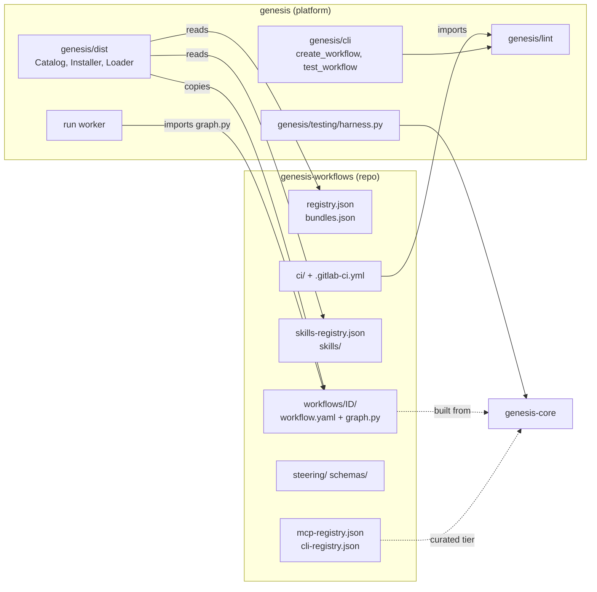
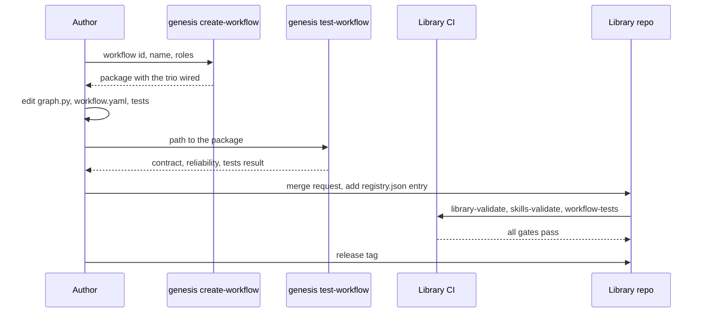
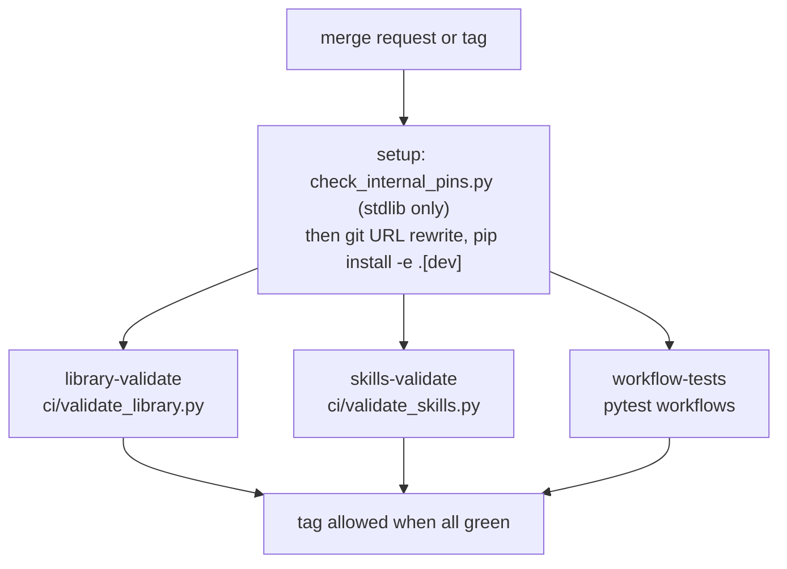
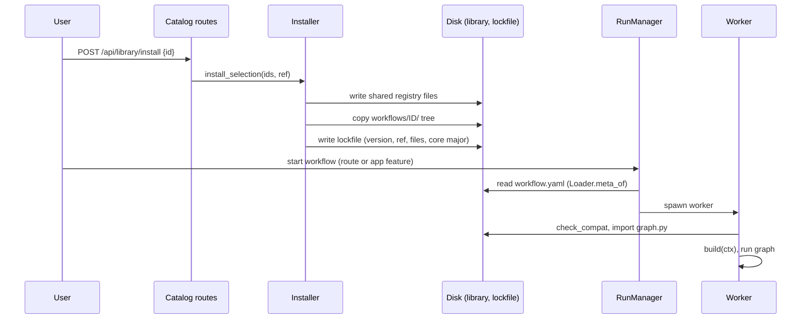

# Module: Workflow library and authoring (`genesis-workflows/`)

> **Describes:** genesis v0.81.0 (Phase 51) · **Last reviewed:** 2026-11-11 · C4 level 3 · area `workflows-library`

## 1. Purpose

The workflow library is the shared catalog of everything a Genesis user can install and run: workflows, skills, the
curated MCP and CLI registries, role bundles and the authoring guides. It lives in its own repo,
`genesis-workflows`, so a Solutions engineer can add a workflow with a merge request and no change to the platform.

This module also covers the tools that keep the library trustworthy: the contract and reliability lints in
`genesis/lint/`, the scaffolder (`genesis create-workflow`), the local check (`genesis test-workflow`), the test
harness, and the library's own publish gates in `ci/`.

The central promise is that a workflow in a tagged library is safe to load. Every workflow has the same shape (a
static `META`, a `build(ctx)` function, a matching `workflow.yaml`). Every agent step is followed by a validator with
retry and escalation. The registries it names exist. CI refuses to let a library tag go out when any of these fails.

This document describes the library at tag `v0.25.0` and the platform side at genesis `v0.81.0`. The engine that
runs the workflows is described in [core-engine.md](core-engine.md) and [runs-and-workers.md](runs-and-workers.md).
Installing the library onto a machine is described in [distribution.md](distribution.md).

## 2. At a glance

| Item | Value |
|---|---|
| Library repo | `genesis-workflows/` (separate repo, tag `v0.25.0`, Python 3.13 or newer) |
| Platform code for this module | `genesis/lint/contract.py`, `genesis/lint/reliability.py`, `genesis/cli/create_workflow.py`, `genesis/cli/test_workflow.py`, `genesis/testing/harness.py` |
| Runs in | The library is data and Python source. A `graph.py` is imported only inside a run worker (ADR-012). The lints and CLI run on a developer machine or in library CI. |
| Depends on | `genesis-core` and `kiro-agent-sdk` (runtime pins); for development and CI also `genesis` (lint, harness, CLI) and `genesis-appian-parser`. All four pins name the same `genesis.git` tag, `v0.81.0`, with `#subdirectory=packages/<name>` for the three libraries (ADR-080, L-057). |
| Used by | `genesis/dist/` (catalog, installer, loader), the run worker, the Catalog and Runs pages, the MCP/CLI registry layer, and the app features that start workflows (section 5.6). |
| Stores | Nothing in a database. Files only: the library checkout, the installed copy under `~/.genesis/library/` and the lockfile `~/.genesis/installed.lock.json`. |
| Compatibility key | `genesis_core_major` in `registry.json` (value 1) against `CORE_MAJOR` in the platform (ADR-019). The pip version of the library is not the key. |
| Library contents at this tag | 18 workflows (plus `_template` and `_fixtures`), 4 skills, 9 curated MCP servers, 3 curated CLIs, 2 bundles, 7 steering guides, 3 JSON schema files |

## 3. Concepts

| Term | Meaning |
|---|---|
| **Library** | The `genesis-workflows` repo and its installed copy under `~/.genesis/library/`. |
| **Workflow package** | One folder under `workflows/<id>/`. It holds `workflow.yaml`, `graph.py`, a `tests/` folder and optional files. The folder name equals the workflow id (ADR-006). |
| **`META`** | The static dict in `graph.py`: id, name, version, roles, summary, `inputs_schema`, required MCP and CLI names, gate list, retry and healing settings, artifact names. It must be importable with no side effects. |
| **`workflow.yaml`** | The twin of `META`, read by the app without importing Python. It also carries the `graph:` topology, which exists only in the YAML. |
| **`graph:` topology** | A list of nodes (`id`, `label`, `kind`, `description`, optional `mcp`) and edges. The Run Detail page and the Catalog preview draw it. Node ids must equal the LangGraph node names (L-006). |
| **`YAML_ONLY_KEYS`** | The set of `workflow.yaml` keys that need not appear in `META`. Today it holds `graph` (L-013). |
| **Catalog (`registry.json`)** | The list of installable workflows with their version, roles, summary, path and required servers. It is a projection of the `workflow.yaml` files. |
| **Bundle** | A named list of workflow ids in `bundles.json` for one-step onboarding. Roles are filter tags and bundles are suggestions. Neither limits what a user may pick (ADR-007). |
| **Curated tier** | The MCP and CLI entries in this repo. They change only by merge request. The user's own entries form the custom tier (ADR-005, ADR-029). |
| **Skill** | A folder with a `SKILL.md` (and optional `references/`, `scripts/`, `assets/`) listed in `skills-registry.json`. It is used in Chat or provisioned into a workflow step (ADR-034, ADR-069). |
| **Publish gate** | A check in `ci/` that must pass before the library can be tagged. |
| **Non-compliant fixture** | `workflows/_fixtures/noncompliant` and `skills/_fixtures/noncompliant`. They are broken on purpose. A gate passes only if it rejects them. |
| **Steering** | The seven authoring guides in `steering/`. |
| **Harness** | `genesis/testing/harness.py`: runs a graph headless on an async checkpointer for tests. |

## 4. Structure



The repo on the left holds only data and workflow source. The platform on the right reads it in three ways. CI imports
the lints to check the repo. `genesis/dist` reads the catalog files and copies a workflow folder onto the user's
machine. The run worker imports one `graph.py`, which builds its graph from `genesis-core` factories.

### 4.1 The library repo

| Path | What it holds |
|---|---|
| `registry.json` | `version`, `genesis_core_major`, `genesis_core_version`, and a `workflows` list (section 6.1). |
| `bundles.json` | `developer` (holds `hello-appian`) and `tester` (empty). |
| `mcp-registry.json` | The curated MCP servers (section 4.3). |
| `cli-registry.json` | The curated CLIs (section 4.4). |
| `skills-registry.json` | The four skills (section 4.5). |
| `workflows/` | One folder per workflow, plus `_template/` and `_fixtures/` (sections 4.2 and 4.6). |
| `skills/` | One folder per skill, plus `_fixtures/noncompliant`. |
| `schemas/` | `workflow.schema.json`, `registry.schema.json`, `mcp-registry.schema.json`. No CI gate, test or platform code reads them (section 12). |
| `steering/` | The authoring guides `01` to `07` (section 4.7). |
| `ci/` | `validate_library.py`, `validate_skills.py`, `check_internal_pins.py` (section 5.5). |
| `.gitlab-ci.yml` | Three jobs: `library-validate`, `skills-validate`, `workflow-tests`. |
| `pyproject.toml` | Package `genesis-workflows`; the four pins; pytest settings `asyncio_mode = "auto"` and `--import-mode=importlib`. |
| `MIGRATION.md` | Traceability from the retired skills to workflows. |

### 4.2 Anatomy of a workflow folder

| File or folder | Rule |
|---|---|
| `workflow.yaml` | Required. Mirrors `META`. Adds the `graph:` topology. |
| `graph.py` | Required. Defines `META` and `build(ctx)`. Loaded standalone by file path, so it imports only `genesis_core`, LangGraph (and `langchain_core`) and the standard library. It never imports the platform or a sibling file (ADR-012). Pure helper functions stay in this file. |
| `__init__.py` | Present in most folders, empty. |
| `tests/` | The workflow's own tests. It must not contain `__init__.py` (gate 8, L-092). It may hold a `fixtures/` folder. |
| `nodes.py`, `prompts/` | Present only in `hello-appian`, `erd-generation` and the template. `nodes.py` in the scaffold is an empty stub. |
| `README.md` | Optional (`code-review`, `erd-generation`, `sync-application`, `sync-documents`). |

The installer copies the whole folder tree of an installed workflow, tests included, into `~/.genesis/library/`
(`Installer._fetch_workflow_files` lists the tree recursively).

### 4.3 Curated MCP servers (`mcp-registry.json`)

Launch kind is `docker` (a container run with `docker run --rm -i`), `managed` (a server Genesis installs and
launches itself, ADR-038) or a plain command. `mode` is one of `read-only`, `read-write`, `read-write-deploy`,
`read-write-data`, `integration`.

| Server | Launch kind | Mode | Purpose |
|---|---|---|---|
| `appian-atlas` | `docker` (Atlas KB image) | `read-only` | Appian code intelligence from the Atlas knowledge base: schema, objects, dependencies. Used by `erd-generation`. Has a `tool_allowlist`. |
| `jarvis` | `docker` | `read-write-deploy` | A live Appian environment: query SQL, evaluate SAIL, write, deploy. The note says it needs a `pre_mutation` gate. Used by `code-review`. No allowlist in the registry; the workflow gives its nodes a tool list. |
| `appian-data-generator` | `docker` | `read-write-data` | Test and demo data create/read/update/delete with rollback. The note says it needs a `pre_mutation` gate. No library workflow requires it. |
| `appian-dev` | `managed` (`appian-dev`) | `read-only` | The Dev MCP (`lcp-mcp-server`). Read tools and test/validate tools. Pins basic auth. Credentials come from the Dev-type environment (ADR-048), so `secretKeys` and `publicKeys` are empty. Has a `tool_allowlist`. |
| `appian-dev-write` | `managed` (`appian-dev`) | `read-write` | The same binary as `appian-dev` with a create/update allowlist for design-object authoring. No delete tools (ADR-068). Injected only by the `implement` and `heal` nodes of `story-implementation`. |
| `appian-dev-packages` | `managed` (`appian-dev`) | `read-write` | The same binary with package maintenance tools. No workflow node and no chat uses it today. The incremental KB sync calls package tools from Genesis code with its own hard-coded allowlist (ADR-073). |
| `appian-devops` | `managed` (`appian-devops`) | `read-only` | The DevOps/deployment MCP restricted to export, inspect, status and download. `sync-application` does not inject it; it exports through the Deployment REST API in a program node. |
| `jira` | `docker` | `integration` | Jira read/write through `jira-mcp-proxy`. Used by `code-review`. |
| `genesis-kb` | `managed` (`genesis-kb`, a module launched by the platform) | `read-only` | Genesis's own read-only KB server. Used by the design, breakdown and test-design workflows. Has a `tool_allowlist`. |

A managed entry has a `managed` key instead of `command` and `args`. `McpRegistry` turns the id into a launch spec at
run time. The three Appian dev entries carry `USERNAME` and `PASSWORD` next to `LCP_USERNAME` and `LCP_PASSWORD`,
because the installed server build reads the bare names (L-049). `genesis-kb`, `appian-dev`, `appian-devops`,
`appian-dev-write` and `appian-dev-packages` are hidden from the user-facing prerequisite list because the platform
injects them itself (`_INTERNAL_MCP` in `genesis/api/catalog_routes.py`).

### 4.4 Curated CLIs (`cli-registry.json`)

| CLI | Kind | Purpose |
|---|---|---|
| `erd-gen` | A binary on `PATH` (`binary: erd-gen`) with `version_check` and `config_check` | Generates and publishes ERDs to Lucidchart. Used by `erd-generation`. |
| `gws` | Managed-native (`managed: gws`) with a command `allowlist` | The read-only Google Drive, Docs, Sheets and Slides connector for the Document Library (ADR-040). |
| `sail` | Managed-native (`managed: sail`) with a command `allowlist` | The SAIL interface driver that ships inside the Dev MCP bundle. The note says no workflow consumes it yet. |

### 4.5 Skills (`skills-registry.json`, `skills/`)

| Skill | What it is |
|---|---|
| `gam` | Government Acquisition Management body of knowledge: draft and review acquisition artifacts. Has `references/`. |
| `appian-object-generation` | Create and maintain Appian design objects through the Dev MCP tools, with a validate-and-iterate loop. Has `references/`. Provisioned into `story-implementation`'s `implement` and `heal` nodes. |
| `sail-mockup-generation` | Generate clickable SAIL mockups and host them through the Dev MCP. Has `references/`. |
| `genesis-test-authoring` | Rules for an agent that writes Playwright test code in a Genesis test workspace. Provisioned into the browser-test workflows. |

Two skills that workflows declare are not in this library. `appian` (used by `story-implementation`) is resolved
from the machine's skill folders (section 5.8). `playwright-appian` (used by the browser-test workflows) comes from the
`playwright-appian` package inside the run's checkout. See [testing.md](testing.md).

### 4.6 Workflows

The `Started by` column names the platform feature that launches the workflow. `Result used by` names the app code
that turns the finished run into a domain record, where one exists. "Catalog Run" means a person starts the workflow
from the Catalog or Runs page through `POST /api/runs`. "Agents" lists the `kiro_node` steps; each wears the
reliability trio. "Healing" means the workflow also uses `attach_healing` (ADR-067) with `META.healing`.

| Workflow | Purpose | Nodes | Needs | Started by | Result used by |
|---|---|---|---|---|---|
| `hello-appian` | Smallest example: one agent step with the trio. | Agent: `make_result`. | none | Catalog Run | none (smoke example) |
| `erd-generation` | Build a Lucidchart ERD for an Appian app: fetch schema, assign domains, assemble, publish with `erd-gen`. | Agents: `fetch_schema`, `assign_domains`. A `cli` node `run_erdgen`. Approval gate `approve-domains`. | `appian-atlas`, `erd-gen` | Catalog Run | none (the run publishes itself) |
| `code-review` | Review an Appian package object by object against the team checklist, with a proposed and confirmed verdict. | Eight agents (ticket, package, object resolution, context, KB check, pre-analysis, `review_object`, `propose_verdict`) and gates `kb_gate`, `review_escalate`, `verdict_gate`. | `jarvis`, `jira` | Catalog Run | none |
| `sync-application` | Keep one application's code-free KB current: baseline, full refresh or incremental sync. | Program nodes and validators only. No agent. | none (uses `ctx.extras` services) | Application sync (`POST /api/applications/{app_uuid}/sync`, `genesis/services/application_sync.py`) and the scheduled sync jobs in `genesis/runtime/sync_jobs.py` | The workflow writes the KB itself (`write_kb`) and may publish to the Hub (`publish_hub`). |
| `generate-business-map` | Synthesize a business-language value stream and capability map from the KB, grounded in real objects. | Agents: `synthesize_capabilities`, `synthesize_value_streams`. Gates `escalate`, `review`. | none | `POST /api/applications/{app_uuid}/business-map/generate` | The workflow persists the map itself (`persist_map`). |
| `sync-documents` | Pull Drive files through `gws` and uploads, parse them to Markdown, store the latest version. | Program nodes and one validator. No agent. | none (read-only `gws`) | Document sync routes (`genesis/api/documents.py`) and the document-library scheduled job | The workflow writes the Document Library itself. |
| `memory-consolidation` | Turn the day's chat sessions into agentic memory (extract, reconcile, write). | Agents: `extract`, `reconcile`. Gate `escalate`. | none | The nightly memory job (`genesis/runtime/memory_jobs.py`) | The workflow writes `memory.db` itself. |
| `memory-maintenance` | The periodic refiner: reflect, curate, recompute communities, decay stale memories. | Agents: `reflect`, `curate`. Gates `escalate_reflect`, `escalate_curate`. | none | The weekly memory job (`genesis/runtime/memory_jobs.py`) | The workflow writes `memory.db` itself. |
| `ux-design-analysis` | Turn an uploaded mockup PDF into a grounded UX Implementation Analysis (HTML). | Agents: `screen_inventory`, `spec_reconcile`, `live_grounding`, `synthesize`, `verify`, `heal`. Healing. | `genesis-kb`, `appian-dev` | PDF upload to the UX Design stage (`POST /api/features/{feature_id}/stages/ux_design/upload` and `/reupload`) | `StageFinalizer` (`genesis/chat/stage_finalizer.py`), stage `ux_design`, artifact `analysis.html` |
| `technical-design-analysis` | Turn the finalized Spec and UX analysis into an object-level Technical Design, one workstream at a time. | Agents: `plan_sections`, `analyze_section`, `draft_section`, `synthesize`, `verify`, `heal`. Healing. | `genesis-kb`, `appian-dev` | `POST /api/features/{feature_id}/stages/technical_design/start` and `/rerun` | `StageFinalizer`, stage `technical_design`, artifact `technical-design.html` |
| `feature-breakdown-analysis` | Turn Spec, UX and Technical Design into an epic and story backlog (HTML plus `backlog.json`). | Agents: `plan_epics`, `break_epic`, `verify`, `heal`. Healing. | `genesis-kb`, `appian-dev` | `POST /api/features/{feature_id}/stages/breakdown/start` and `/rerun` | `StageFinalizer`, stage `breakdown`, artifact `breakdown.html` |
| `test-design-analysis` | Turn finalized stories into reusable test cases and ordered scenarios. A top-up mode proposes additions to an existing suite. | Agents: `design_cases`, `compose_scenarios`, `verify`, `heal`. Healing. | `genesis-kb`, `appian-dev` | `POST /api/features/{feature_id}/stages/test_design/start` (`genesis/services/testdesign_stage.py`) and the top-up route | `StageFinalizer`, stage `test_design`, artifact `test-design.html`. The binding skips `topup` runs; the top-up flow handles those. |
| `story-design-analysis` | Turn one Workbench ticket into an object-level design with the actual code (HTML). | Agents: `research`, `design`, `verify`. | `genesis-kb`, `appian-dev` | Dragging a card into Design (`POST /api/workbench/boards/{app_uuid}/cards/{story_id}/design/start`) | `StoryDesignFinalizer` (`genesis/chat/story_design_finalizer.py`) |
| `story-implementation` | Implement one design-reviewed ticket in the Dev environment: reverify, snapshot a rollback document, write objects, verify and heal, write the Object Wiki. | Agents: `reverify_design`, `prepare_rollback`, `implement`, `verify`, `heal`, `author_wiki`. Gates `escalate_reverify`, `escalate`. Healing. | `genesis-kb`, `appian-dev`, `appian-dev-write` | Dragging a card into Implementation (`POST /api/workbench/boards/{app_uuid}/cards/{story_id}/implementation/start`) | `StoryImplementationFinalizer` (`genesis/chat/story_implementation_finalizer.py`) moves the card to Code Review |
| `test-execution` | Run an application's committed Playwright tests on QA and normalize the results. | Program nodes only: `prepare_env`, `run_playwright`, `parse_results`, `present`. `retry_defaults.max` is 0. | none | `TestExecutionService` (`genesis/testexec/execution_service.py`): Run, Run impacted tests, the regression schedule | `TestExecutionFinalizer` (`genesis/testexec/finalizer.py`) |
| `action-capture` | Turn one browser recording into reviewed Action Library proposals, with a replay on QA and one bounded heal. | Agents: `segment`, `heal`. Gate `escalate`. Healing. | none | Stopping a recording (`genesis/testexec/recording.py`) | `CaptureFinalizer` (`genesis/testexec/capture_finalizer.py`) |
| `setup-composer` | Compose one data setup from Action Library items only, check it, replay it on QA. | Agents: `compose`, `heal`. Gate `escalate`. Healing. | none | `POST /api/applications/{app_uuid}/testing/compose` (`genesis/testexec/compose.py`) | `ComposeFinalizer` (`genesis/testexec/capture_finalizer.py`) |
| `story-verification` | Verify one story on QA: explore screens, author scripts, run, triage, heal once, then move the card. | Agents: `explore`, `author`, `triage`, `heal`, `propose`. Gates `escalate`, `escalate_blocked`. Healing. | none | Dragging a card into Verification (`POST /api/workbench/boards/{app_uuid}/cards/{story_id}/verification/start`), through the execution queue | `StoryVerificationFinalizer` (`genesis/chat/story_verification_finalizer.py`) |

Notes on the table:

- The `Needs` column is `required_mcp` and `required_cli` from `registry.json`. The browser-test workflows list none,
  because the platform opens their `apwt` sessions in program code (ADR-083) and the agents use Kiro's shell.
- Some stage workflows run with `execution.recursion_limit` raised in `META` (section 9).
- Three workflows have no agent step: `sync-application`, `sync-documents` and `test-execution`. The reliability lint
  has nothing to check in a graph without agent nodes.
- `story-implementation` and the browser-test workflows have no `pre_mutation` gate. Their docstrings say the
  confirm that starts the run is the single approval (ADR-068, ADR-082, section 5.7).

### 4.7 Steering guides (`steering/`)

| File | Topic |
|---|---|
| `01-authoring-overview.md` | The model, the six authoring steps, what CI enforces, and `erd-generation` as the reference example. |
| `02-node-taxonomy-and-reliability.md` | The node factories, the tool-output store, the trio, the validator toolkit. |
| `03-state-and-blackboard-rules.md` | Small state, bulk on the blackboard, reducers, file naming. |
| `04-mcp-and-cli-usage.md` | Referencing registry servers by name, `${VAR}` resolution, `mode` values. |
| `05-hitl-gates.md` | The three sanctioned gate classes and how a gate resumes. |
| `06-testing-and-publishing.md` | How to stub agents in tests, and the publish steps. |
| `07-workflow-yaml-reference.md` | The `workflow.yaml` and `META` field table. It does not list the `healing`, `execution` or `graph` keys that library workflows use. |

### 4.8 Platform files

| File | Main contents |
|---|---|
| `genesis/lint/contract.py` | `REQUIRED_META_KEYS`, `SANCTIONED_GATE_KINDS`, `YAML_ONLY_KEYS`, `LintResult`, `load_meta`, `check_meta_yaml_parity`, `check_hitl_posture` |
| `genesis/lint/reliability.py` | `LintResult`, `check_reliability`, `ESCALATION_KEYS`, `RETRY_KEYS`, and graph-walking helpers |
| `genesis/lint/__init__.py` | Re-exports `check_reliability`, `LintResult`, `load_meta`, `check_meta_yaml_parity`, `check_hitl_posture`, `REQUIRED_META_KEYS`, `SANCTIONED_GATE_KINDS` |
| `genesis/cli/create_workflow.py` | `create_workflow(...)` and the three text templates for `graph.py`, `workflow.yaml` and a test |
| `genesis/cli/test_workflow.py` | `test_workflow(path)` |
| `genesis/cli/main.py` | The argument parser; wires `create-workflow` and `test-workflow` |
| `genesis/testing/harness.py` | `HarnessResult`, `run_graph(...)` |
| `genesis/testing/scan_recording.py` | Recorded scanner output for browser-test suites; test support only, nothing in the app imports it |
| `genesis/dist/{catalog,install,loader,lockfile}.py` | How the library is read, installed and loaded. See [distribution.md](distribution.md). |

## 5. How it works

### 5.1 Authoring a workflow



The author scaffolds a package, edits it, checks it locally and opens a merge request. CI runs the same checks plus the
library-wide ones. After a tag, users can install the new version.

1. `genesis create-workflow <id> --name "..." [--dest workflows] [--roles a,b] [--summary ...] [--mcp x,y]` calls
   `create_workflow(...)`. It writes `graph.py`, `workflow.yaml`, `nodes.py`, `tests/test_workflow.py` and an empty
   `__init__.py` under `<dest>/<id>/`, and creates an empty `prompts/` folder.
2. The generated graph has one agent step `make_result`, a validator `v_result`, a `finish` program step and an
   `escalate` gate. `attach_reliability` joins them with the retry count taken from `META["retry_defaults"]["max"]`.
   The `graph.py` text starts with `from __future__ import annotations`, which is safe because the scaffold adds no
   reducer keys (section 5.3).
3. The scaffold does not write a `graph:` topology into `workflow.yaml`, and does not touch `registry.json`. The
   author adds both. Gate 5 fails until `registry.json` lists the new id.
4. `genesis test-workflow <path>` runs `test_workflow(path)`:
   - checks `META` against `workflow.yaml` with `check_meta_yaml_parity`;
   - builds the graph with a no-persistence context (`checkpointer=None`) and runs `check_reliability`;
   - runs `python -m pytest -q <path>/tests` when the folder has a `test_*.py` file.

   It prints `OK: <name> passed ...` and returns 0, or prints `FAIL: test-workflow` with one line per problem
   (prefixes `[contract]`, `[reliability]`, `[build]`, `[tests]`) and returns 1.
5. The author adds the registry entry, opens the merge request, and CI runs (section 5.5).

### 5.2 How META and workflow.yaml are checked

`load_meta(graph_py)` imports the module by file path and returns its `META`. It does not call `build()`. Module-level
code does run, so a `graph.py` must not do work at import time.

`check_meta_yaml_parity(graph_py, workflow_yaml)` then checks:

1. Every key in `REQUIRED_META_KEYS` (`id`, `name`, `version`, `roles`, `summary`, `inputs_schema`) is in `META`.
2. For each key in `workflow.yaml`, except the keys in `YAML_ONLY_KEYS`: the key is in `META`, and the values are
   equal. A missing key gives `workflow.yaml key 'x' not present in META`. A different value gives
   `drift on 'x': META=... vs workflow.yaml=...`.

The check runs in one direction. A key that is only in `META` passes. A required key that is only in `META` passes.
This is why `healing` and `execution` must appear in both files in the workflows that use them.

`check_hitl_posture(compiled, meta)` is also in `contract.py`. Its only working rule is that `META.auto_approve: false`
needs a non-empty `auto_approve_reason`. The loop over gate nodes does nothing, and `SANCTIONED_GATE_KINDS` is not
read by it. No publish gate and no CLI command calls this function (ADR-021 sets a wider posture; section 5.7).

### 5.3 How the reliability lint works

`check_reliability(compiled)` takes a compiled LangGraph graph and reads its builder. It recovers each node's kind from
the `_genesis_kind` marker that the `genesis-core` factories put on the node function. For every node of kind `agent`
it requires:

1. an immediate successor of kind `validator`;
2. an edge from that validator back to the agent (the retry);
3. an escalation path from the validator: a successor of kind `gate`, or a branch key named `escalate`, `escalation`,
   `exhaust` or `exhausted`. A plain pass-to-end edge does not count.

A node built without a core factory has no kind and is not checked. The lint does not look at healing wiring. The
mechanics of the trio are in [core-engine.md](core-engine.md#54-how-validators-and-the-trio-route).

### 5.4 Authoring rules that the platform depends on

| Rule | Why | Lesson or ADR |
|---|---|---|
| `graph.py` is self-contained. | The worker loads it by file path, so a sibling import fails. | ADR-012 |
| `META` is static and importable alone. | The catalog and the lint read it without running `build()`. | ADR-014 |
| `build(ctx)` returns a graph compiled with `ctx.checkpointer`. | The checkpointer is what makes pause and resume work. The lints pass `checkpointer=None`, so `build` must work without services. | ADR-012 |
| Do not use `from __future__ import annotations` when the state class has reducer keys such as `Annotated[list, add]`. | The loader does not register the module in `sys.modules`, so LangGraph cannot resolve string annotations and fails with `NameError: Annotated`. `feature-breakdown-analysis`, `technical-design-analysis`, `test-design-analysis` and `code-review` omit the import for this reason. | L-022 |
| Every `graph:` node id equals a LangGraph node name. | The Run Detail graph and the Catalog preview use the ids. Without a `graph:` section the app builds a linear fallback from a `steps` list or events. | L-006, L-013 |
| Quote YAML scalars that contain `?` or `:`. | An unquoted value breaks `workflow.yaml`. | L-022 |
| A looping workflow sets `META.execution.recursion_limit`, and a re-entered agent loop resets `retries[node]` to 0 on each pass. | LangGraph stops at 25 supersteps by default; the worker default is 150. `attach_reliability` counts retries by node name. | L-020 |
| An agent turn never writes a large multi-part document. Split the work into parts, validate each, then assemble in a program node. | One oversized turn hits `turn_timeout`, truncates the output and loses the credit figure. | L-064 |
| Bulk data goes on the blackboard. State holds paths and small decisions. | Keeps checkpoints small and editable. | ADR-010, ADR-018 |
| Platform services come from `ctx.extras`, never from imports. | The workflow must stay standalone. Keys used by library workflows include `kb_store`, `devmcp_packages`, `document_sync`, `memory_store`, `object_wiki`, `kb_publish`, `chat_read`, `pdf_render`, `apwt` and `actor`. | ADR-012 |
| A step that can be a program is a program. Only judgment or MCP work is an agent step. | Keeps runs cheap and deterministic. | ADR-001, ADR-011 |
| A workflow's `tests/` has no `__init__.py`. Test helpers are not named `test*`. | Pytest imports by module name; two `tests` packages collide. | L-092 |

### 5.5 The publish gates



`.gitlab-ci.yml` has two stages (`validate`, `test`) and three jobs. Each job first runs `python -I ci/check_internal_pins.py`
before any download or build and before the CI token is used (50-08 H2). It then rewrites `ssh://git@gitlab...` URLs to
HTTPS with the `GITLAB_PUSH_TOKEN` CI variable and runs `pip install -e ".[dev]"`. `library-validate` and
`skills-validate` are in the `validate` stage and `workflow-tests` is in the `test` stage. CI runs no `ruff` check
(the `pyproject.toml` comment says so).

`ci/validate_library.py` prints one line per failure with a bracketed prefix and exits 1 when any gate fails. It
walks every folder under `workflows/` that does not start with `_` and has a `graph.py`.

| Gate | Prefix | What it checks |
|---|---|---|
| 1. Schema | `[schema]` | `registry.json`, `mcp-registry.json`, `cli-registry.json` and `bundles.json` parse as JSON. Workflow ids are unique. It does not validate against `schemas/` and does not parse `skills-registry.json`. |
| 2. Contract | `[contract:<id>]` | `check_meta_yaml_parity` for each workflow (section 5.2). |
| 3. Reliability | `[reliability:<id>]`, `[build:<id>]` | The graph builds with a context from `build_context(run_id="ci", ..., checkpointer=None)` and passes `check_reliability`. A build error is reported as `[build:<id>]`. |
| 4. Registry refs | `[refs:<id>]` | Every name in `META.required_mcp` is a server in `mcp-registry.json`, and every name in `META.required_cli` is in `cli-registry.json`. |
| 5. Catalog | `[catalog]` | The sorted ids in `registry.json` equal the sorted ids of the workflow folders. Only ids are compared. Versions, summaries and other fields are not. |
| 6. Fixture | `[fixture]` | `_fixtures/noncompliant` must fail the reliability lint. If it passes, the gate fails. This proves the lint still bites. |
| 7. Tests | (separate job) | `pytest -q workflows --ignore=workflows/_fixtures` in the `workflow-tests` job. |
| 8. Test layout | `[tests:<id>]` | No `workflows/*/tests/__init__.py` exists (L-092). |
| 9. Internal pins | `[pins]` | `pyproject.toml` names `genesis`, `genesis-core`, `kiro-agent-sdk` and `genesis-appian-parser` only as direct `git+ssh://.../genesis.git@vX.Y.Z` references, with `#subdirectory=packages/<name>` for the three libraries and none for the app, all on one repo and one tag. The gate also proves that it rejects nine known-bad tables and accepts a good one. |

Warnings do not fail the build. A graph node in `workflow.yaml` without a `description` prints
`[description:<id>] ...` (Phase 39).

`ci/validate_skills.py` uses only `pyyaml`, so it can run without the platform:

| Check | Prefix | Rule |
|---|---|---|
| Registry | `[registry]` | `skills-registry.json` parses. Skill ids are unique. Each skill has `id`, `name`, `version`, `path`, `description`. |
| Existence and path | `[exists:<id>]`, `[path:<id>]` | The path starts with `skills/`, is relative, has no `..`, and holds a `SKILL.md`. The folder name equals the id. |
| Manifest | `[manifest:<id>]` | `SKILL.md` starts with a YAML frontmatter block. `name` matches `^[a-z0-9-]{1,64}$` and equals the id. `description` is not empty and has at most 1024 characters. The file is at most 256 KiB and the body at most 200,000 characters. |
| Parity | `[parity]` | The registry ids equal the folders under `skills/` that hold a `SKILL.md` (not counting `_fixtures`). |
| Fixture | `[fixture]` | `skills/_fixtures/noncompliant` must fail manifest parsing. |

### 5.6 From tag to running workflow



Installing copies files. Running reads them again at the start of each run.

1. The user picks a workflow (Catalog page, or `genesis install`). `Installer.resolve` reads the latest library tag
   (or the given ref) and the catalog at that ref.
2. `Installer.install` writes the shared files `registry.json`, `mcp-registry.json`, `cli-registry.json` and
   `bundles.json`, then copies the workflow's folder tree. It records the version from the catalog entry, the ref and
   the list of files in the lockfile. It records the library's `genesis_core_major` and `genesis_core_version` from
   `registry.json`.
3. When a run starts, the app reads `workflow.yaml` through `Loader.meta_of`. It never imports `graph.py`.
4. The worker calls `Loader.load_build(wid)`. It runs `check_compat` first, which raises `CompatError` when the
   lockfile's major differs from `CORE_MAJOR` (ADR-019). It imports `graph.py` by file path and checks that
   `META.id` equals the folder name.
5. Skills and MCP names are resolved at the agent step (section 5.8).

Skills follow a separate path: `skills-registry.json` is read by `genesis/dist/skill_catalog.py`, and the skill folders
are installed into the managed skills folder. See [chat-and-skills.md](chat-and-skills.md).

An app feature that starts a library workflow must handle a missing install. `generate-business-map`'s route returns
409 with an install hint when the workflow is not installed (L-033). The scheduled sync and memory jobs report
`skipped` when their workflow is not installed.

### 5.7 Human-in-the-loop posture in the library

Library workflows set `auto_approve: true`. They use three kinds of gate:

- **Escalation gates.** Every workflow with agent steps has at least one `escalate` gate, which is where the trio ends
  when retries are used up.
- **Approval gates.** `erd-generation` (`approve-domains`), `code-review` (`kb_gate`, `verdict_gate`),
  `generate-business-map` (`review`) and `story-implementation` (`escalate_reverify`) pause for a decision.
- **No `pre_mutation` gates.** No library workflow has one. `story-implementation` writes to the Dev environment and
  `test-execution`, `story-verification` and the capture workflows write QA data. In each case the drag, button or
  schedule that starts the run is the approval (ADR-068 for Implementation, ADR-082 for QA data). ADR-021 still lists
  `pre_mutation` as required before a write step unless a confirm is the approval. The lint code does not check this.

### 5.8 What a library workflow gets at run time

A workflow's agent steps name their MCP servers by registry name (`mcp=["genesis-kb"]`), optionally with a tool list
(`tools=["@jira/get_jira_issue"]`). `McpRegistry` merges the curated tier from this repo with the user's custom tier,
resolves `${VAR}` values and injects the servers into the Kiro session. The effective tool set is the node's tool list
intersected with the server's allowlist. A node without a tool list gets every tool the server offers (ADR-029,
ADR-083). See [core-engine.md](core-engine.md#53-how-tool-trust-is-computed) and
[configuration-and-secrets.md](configuration-and-secrets.md).

A node that declares `skills=[...]` has each skill copied into `<run>/.kiro/skills/<id>/` before the turn (ADR-069).
The source folder comes from `ctx.extras["skill_source"]`, which `genesis/runtime/context.py` builds. It checks, in
order, for these ids and folders:

1. the id `playwright-appian`: the run's own `checkout/node_modules/playwright-appian/skills/playwright-appian`;
2. any other id: the managed skills folder (`settings.skills_dir`), then the user's `~/.kiro/skills`.

An unresolved skill raises `RuntimeError` and the step does not run. ADR-069 says the global folder is not to be relied
on. In the code, the global folder is the second place searched, and the `appian` skill that `story-implementation`
declares is not in this library, so on a normal machine it comes from there.

## 6. Interfaces

### 6.1 Library file formats

**`registry.json` entry**

| Key | Meaning |
|---|---|
| `id`, `name`, `version`, `roles`, `summary` | Copied from the workflow's `workflow.yaml`. |
| `path` | `workflows/<id>`. |
| `required_mcp`, `required_cli` | Registry names the workflow needs. Gate 4 checks them. |

Top-level keys are `version` (1), `genesis_core_major` (1), `genesis_core_version` and `workflows`.

**`mcp-registry.json`** is `{"version": 1, "servers": {name: entry}}`. An entry has `command` and `args` (a container
or plain launch) or `managed` (an id the platform resolves), plus `env` (values may be `${VAR}`), `mode`,
`secretKeys`, `publicKeys`, `note` and optionally `tool_allowlist`. `secretKeys` and `publicKeys` decide which fields the
settings page shows.

**`cli-registry.json`** is `{"version": 1, "clis": {name: entry}}`. An entry has `binary` or `managed`, `version_check`,
`install_hint`, optionally `config_check` and `allowlist`, and a `note`.

**`skills-registry.json`** is `{"version": 1, "skills": [...]}`. An entry has `id`, `name`, `version`, `description`,
`summary`, `path`, `roles` and `tags`.

**`workflow.yaml` / `META` keys** used by the library workflows:

| Key | Notes |
|---|---|
| `id`, `name`, `version`, `roles`, `summary`, `inputs_schema` | Required. |
| `required_mcp`, `required_cli` | Names into the two registries. |
| `hitl_points` | Names of gate nodes that may interrupt. |
| `auto_approve`, `auto_approve_reason` | `false` needs a reason (section 5.2). |
| `retry_defaults` | `{max: N}`. |
| `healing` | `{max_heal, max_restart}`, read by `healing_bounds` in core. |
| `execution` | `{recursion_limit: N}`, read by the worker. |
| `artifacts`, `editable` | Blackboard document names; state keys a person may edit at a pause. |
| `graph` | YAML only. `nodes` and `edges`. |

### 6.2 HTTP endpoints

The catalog and install routes are in `genesis/api/catalog_routes.py`. They belong to [distribution.md](distribution.md)
and [api.md](api.md); this list shows how the library is exposed.

| Method and path | Purpose |
|---|---|
| `GET /api/catalog` | Installed workflows with name, roles, summary and the user-facing required servers. |
| `GET /api/catalog/available` | Workflows in the library that are not installed. Needs a GitLab token (400 without one, 502 on a read error). |
| `POST /api/library/install` | Install one workflow at a ref. 404 if the id is not in the library, 502 on other errors. |
| `POST /api/library/update` | Reinstall one workflow at the latest compatible ref. |
| `DELETE /api/library/{workflow_id}` | Remove an installed workflow. Touches only the lockfile and files. |
| `GET /api/workflows/{workflow_id}` | The parsed `workflow.yaml`. 404 if not installed. |
| `GET /api/workflows/{workflow_id}/graph` | The `graph:` topology, or the fallback derived from `steps`. |
| `POST /api/runs` | Start any installed workflow by id (in `genesis/api/run_routes.py`). |

### 6.3 Python API and CLI

| Name | Use |
|---|---|
| `genesis.lint.check_reliability(compiled) -> LintResult` | The trio check (section 5.3). |
| `genesis.lint.check_meta_yaml_parity(graph_py, workflow_yaml) -> LintResult` | The parity check. |
| `genesis.lint.check_hitl_posture(compiled, meta) -> LintResult` | The `auto_approve_reason` check. |
| `genesis.lint.load_meta(graph_py) -> dict` | Read `META` without calling `build()`. |
| `LintResult.raise_if_failed()` | Raises `AssertionError` listing the violations. |
| `genesis.cli.create_workflow.create_workflow(workflow_id, name, dest, roles, summary, required_mcp) -> Path` | Scaffold a package. |
| `genesis.cli.test_workflow.test_workflow(path) -> int` | Local check; returns an exit code. |
| `genesis.testing.harness.run_graph(build, inputs, ...)` | Run a graph to its first stop (section 5.9). |
| `genesis create-workflow`, `genesis test-workflow` | The two CLI commands (section 5.1). |

### 6.4 Events and contracts

The library defines no events. A workflow's steps emit the canonical events through `genesis-core`. The core also emits
`skills.provisioned` when it copies skills into a run. The contract between the library and the platform is:

- the file shapes in section 6.1, which `genesis/dist/` and the lints read;
- `META` and `build(ctx)`, which the worker calls;
- the `ctx.extras` keys listed in section 5.4;
- the artifact names a finalizer expects (for example `analysis.html`, `technical-design.html`, `breakdown.html`,
  `test-design.html` for the four stage workflows).

### 6.5 Running the harness

`run_graph(build, inputs, *, workflow_id="smoke", version="0.0.0", settings=None, mcp=None, clis=None, run_id=None,
resume_command=None)` opens an async checkpointer on `settings.db_path`, builds a `PlatformContext`, compiles the graph
(or uses the compiled graph that `build` returns), makes the initial state with `new_state`, runs it with
`engine.run`, and returns `HarnessResult(state, events, ctx)`. `events` is the list of emitted events.

Library workflow tests use the harness with a stubbed agent. `genesis_core.set_collect_impl` replaces the agent call so
no Kiro is needed (steering `06`).

## 7. Data

This module owns no database tables.

| File or folder | Written by | Read by |
|---|---|---|
| `genesis-workflows/` (the repo) | Authors, through merge requests | CI, the installer (through GitLab or a local source) |
| `~/.genesis/library/` (installed copy: shared registry files plus each installed workflow's folder) | `Installer` | `Loader`, the registry layer, the worker |
| `~/.genesis/installed.lock.json` | `Installer`, `remove` | `Loader.check_compat`, `Loader.installed` |
| `<skills_dir>/<id>/` (managed skills folder) | Skill install | Chat, and `skill_source` for workflow nodes |
| `<run>/.kiro/skills/<id>/` | `kiro_node` before a turn | Kiro in that run |

The lockfile holds, per installed workflow, `version`, `ref` and `files`; plus `libraryRef` and a `genesis_core` pin
(`version`, `major`, `ref`).

## 8. Failure handling

| Situation | Behaviour |
|---|---|
| A workflow's `META` and `workflow.yaml` differ | Gate 2 and `test-workflow` report `drift on '<key>'`. The tag is blocked. |
| An agent node has no validator, no retry edge or no escalation path | Gate 3 and `test-workflow` report which node. The tag is blocked. |
| `build(ctx)` raises when CI calls it with no checkpointer | Reported as `[build:<id>]`. The tag is blocked. |
| A workflow names an MCP server or CLI that is not in the registries | Gate 4 reports `[refs:<id>]`. |
| `registry.json` and the workflow folders list different ids | Gate 5 reports `[catalog]`. |
| The non-compliant fixture passes the lint | Gate 6 fails, because the lint no longer rejects bad graphs. |
| A `tests/__init__.py` exists in a workflow | Gate 8 reports `[tests:<id>]`. |
| A bad or mixed internal pin in `pyproject.toml` | Gate 9 (and the early `check_internal_pins.py` step) reports `[pins]` before anything is installed. |
| A `SKILL.md` breaks the manifest rules, or a skill is missing from the registry | `validate_skills.py` reports the prefix in section 5.5 and exits 1. |
| The installed library's core major is not `CORE_MAJOR` | `CompatError` at load time. The workflow does not run. |
| The workflow is not installed when a run or feature asks for it | `RunManager.start` raises. Routes that check first return 409 with an install hint. Scheduled jobs report `skipped` (L-033). |
| `META.id` differs from the folder name | `Loader.load_build` raises `ValueError`. |
| A declared skill cannot be found | `RuntimeError` before the turn; the step does not run (section 5.8). |
| `catalog/available` is called with no GitLab token | 400. A read error from GitLab gives 502. |
| A workflow in the library is newer than the installed copy | Nothing changes until the user installs or updates it. A newly released workflow must be installed first (L-033). |

## 9. Configuration

| Setting | Where | Default and effect |
|---|---|---|
| `genesis_core_major`, `genesis_core_version` | `registry.json` | 1 and the shared genesis version. The loader compares the major. |
| Internal pins | `pyproject.toml` | All four on `genesis.git@v0.81.0`. They move together on each platform release (L-057). |
| `requires-python` | `pyproject.toml` | `>=3.13`. |
| pytest options | `pyproject.toml` | `asyncio_mode = "auto"`, `--import-mode=importlib`. |
| `GITLAB_PUSH_TOKEN` | CI variable | Used by the CI URL rewrite. Referenced by name only. |
| `META.auto_approve` | workflow | `true` by default. `false` needs `auto_approve_reason`. |
| `META.retry_defaults.max` | workflow | The scaffold uses 2. `test-execution` uses 0. A node with `retry_max=N` runs N+1 times, then escalates. |
| `META.healing` | workflow | `{max_heal: 1, max_restart: 1}` in the eight workflows that use healing. `healing_bounds` falls back to (1, 1) for a bad value. |
| `META.execution.recursion_limit` | workflow | Used by the worker. Library values include 100 (`story-design-analysis`), 120 (`action-capture`, `setup-composer`), 200 (`code-review`, `story-verification`), 250 (`story-implementation`) and 300 (the breakdown, technical-design and test-design workflows). The worker default is 150 when the key is missing or not a positive integer. |
| `GENESIS_ARTIFACTS_DIR` | environment | Moves the blackboard root that workflows write to. |

## 10. Extending this module

**Add a workflow**

1. Run `genesis create-workflow <id> --name "..." --roles ... [--mcp ...]` inside `genesis-workflows/`.
2. Decide which steps are program steps and which are agent steps. Default to a program step.
3. Edit `graph.py`. Keep `META` static. Keep the file self-contained. Check section 5.4 before adding state keys.
4. Mirror every `META` key in `workflow.yaml`, and add a `graph:` section with a `description` for each node.
5. Add an entry to `registry.json` that matches the YAML, and set the name, version, roles and summary equal to it.
   Gate 5 compares ids only, so the other fields are your responsibility.
6. Write tests in `tests/` with no `__init__.py`. Stub the agent and test a forced validator failure.
7. Run `genesis test-workflow workflows/<id>`, then `python ci/validate_library.py` and
   `pytest -q workflows --ignore=workflows/_fixtures` from the library root.
8. If an app feature should launch the workflow, add the route and finalizer in the platform. See
   [features-and-stages.md](features-and-stages.md) for a stage workflow and [stories-and-workbench.md](stories-and-workbench.md)
   for a lane workflow.
9. Release. Install it on a machine with `genesis install` (L-033).

**Add a curated MCP server or CLI**

1. Add the entry to `mcp-registry.json` or `cli-registry.json` with a `mode`, `secretKeys` and `publicKeys`, and a
   `tool_allowlist` (or `allowlist` for a CLI) when the tool set should be capped.
2. For a managed server, check that the platform can resolve the `managed` id (see
   [configuration-and-secrets.md](configuration-and-secrets.md)).
3. When a managed server reads environment variables that differ from the registry's names, inject both names (L-049).
4. Name the server in a workflow's `required_mcp` and in the node's `mcp=[...]`. Gate 4 checks that it exists.

**Add a skill**

1. Create `skills/<id>/SKILL.md` with frontmatter whose `name` equals the folder name.
2. Add the entry to `skills-registry.json`.
3. Run `python ci/validate_skills.py`.
4. If a workflow node needs it, add `skills=["<id>"]` to the `kiro_node`. The id must resolve through `skill_source`.

**Change a lint rule**

1. Edit `genesis/lint/` and add a test in `tests/test_lint.py`.
2. Check that `workflows/_fixtures/noncompliant` still fails and every library workflow still passes. Because CI
   installs `genesis` at the pinned tag, a lint change reaches library CI only after a platform release and a pin bump.

**Change the platform side of the contract** (a new `META` key, a new `ctx.extras` service). Make it additive within
`CORE_MAJOR` 1 (ADR-019). Guard use of the new key in the app, because an installed older workflow will not have it.
For example, the breakdown route passes `spec_clauses_path` only when the installed workflow declares it.

## 11. Design decisions

| Decision | In plain words | ADR |
|---|---|---|
| Registry in the library | One shared MCP and CLI registry lives in the library repo and changes by merge request. There are no per-user profiles. | ADR-005, amended by ADR-029 |
| Two tiers | The library holds the curated tier. Users add a custom tier. Trust is the node's tool list intersected with the server allowlist. | ADR-029 |
| Self-contained packages | Each workflow is a folder with `workflow.yaml` and `graph.py`. Users install chosen workflows and the lockfile pins the ref. | ADR-006 |
| Roles are filters | Roles tag workflows. Bundles help onboarding. Nothing is blocked by role. | ADR-007 |
| The trio is mandatory | Every agent node has a validator, retry and escalation, and CI checks it. | ADR-011 |
| Scaffolder, harness, steering | Authors start from a generator with the trio wired, a local check and written guides. Anyone may contribute. | ADR-014 |
| Compatibility by major | The loader refuses a library built for another `genesis-core` major. Changes inside a major are additive. | ADR-019 |
| Default approval posture | Workflows auto-advance. They pause only at approval, escalation and pre-mutation gates. | ADR-021 (amended by ADR-068, ADR-082) |
| Skills in workflows | A node lists the skills it needs. Genesis copies them into the run folder before the turn. | ADR-069 |
| Skills beside workflows | Skills are a separate registry and folder tree from workflows. | ADR-034 |
| One platform repo, explicit pins | The library names the platform packages as direct git references on one tag, and CI rejects name-only entries. | ADR-080 |
| Library code runs only in the worker | The app reads `workflow.yaml`. Only the worker imports `graph.py`. | ADR-012 |

## 12. Known pitfalls

- **Reducer keys and `from __future__ import annotations`.** The pair fails at import with `NameError: Annotated`
  (L-022). The scaffold uses the import because it adds no reducers; remove it before adding reducers.
- **Node id and topology drift.** A `graph:` id that does not match a node name draws a wrong graph. Without a
  `graph:` section the UI falls back to a linear view (L-006).
- **`graph:` in the YAML only.** Put UI-only keys in `YAML_ONLY_KEYS` if you add one; otherwise parity fails (L-013).
- **Recursion limit.** A looping graph dies at 25 supersteps unless the worker reads a higher limit from `META`, and a
  loop that re-enters an agent must reset its retry counter (L-020).
- **One big agent turn.** A turn that writes a large document times out and truncates. Split and assemble in a
  program node (L-064).
- **A new workflow is not runnable until it is installed.** Release is not install (L-033).
- **Env-var names of a managed MCP.** A registry entry can disagree with the installed server build and give a silent
  401. Diff the installed bundle (L-049).
- **Stale transitive pins.** Move all four pins and the registry's `genesis_core_version` together, or a clean CI
  install fails with `ResolutionImpossible`. A local editable install hides this (L-057).
- **Duplicate test module names.** A `tests/__init__.py` in two workflow folders runs one folder's tests twice and the
  other's never. Do not name helpers or modules `test*` (L-092).
- **Quote YAML values** with `?` or `:` (L-022).
- **`schemas/` is not enforced.** Nothing reads the three schema files, and the MCP schema requires `command`, which
  managed entries do not have. Do not rely on them as a contract.
- **Gate 5 is an id check.** It does not compare versions or summaries between `registry.json` and `workflow.yaml`.
- **The steering text is wider than the code in places.** Steering `01`, `04` and `05` say CI enforces a
  `pre_mutation` gate before mutating MCP nodes and "sanctioned HITL gates only". The gates in `ci/` do not do this
  (section 5.2, section 5.7).
- **The harness uses `settings.db_path`.** Pass a `Settings` that points at a temporary database in tests, as
  `tests/test_smoke.py` does.

## 13. Tests

**Platform side**

| File | What it covers |
|---|---|
| `tests/test_lint.py` | `check_reliability`: a compliant graph passes; an agent wired straight to the end fails with "no immediate validator successor"; a validator with no escalation fails with "no escalation path". |
| `tests/test_library.py` | The install lifecycle through the API, offline with a local library source: available, install, catalog, remove; the default source factory requires a token. |
| `tests/test_dist.py` | Catalog filter and bundles across roles, prerequisites, lockfile round trip, the GitLab client's tree and raw reads, install writes files and lockfile, loader metadata and the compat gate, remove. |
| `tests/test_smoke.py` | A small workflow run through `harness.run_graph`. |
| `tests/test_workflow_skill_provisioning.py` | The `skill_source` resolver: managed folder first, global folder second, unsafe ids rejected. |
| `packages/genesis-core/tests/test_agent_skills.py` | `kiro_node(skills=...)`: skills are copied into `<cwd>/.kiro/skills/<id>/` before the turn; an unresolved skill or an unwired provisioner fails fast; no skills is a no-op. |
| `tests/test_no_internal_dependencies.py` | By its name, guards the rule that no internal package lists another as a dependency (ADR-080). |
| `tests/test_cli_missing_packages.py` | The CLI's check for missing internal packages; its docstring names the `test_workflow` import chain. |
| `packages/genesis-core/tests/test_healing.py` | Includes the `healing_bounds` fallback values. |

**Library side**

| File | What it covers |
|---|---|
| `ci/validate_library.py`, `ci/validate_skills.py`, `ci/check_internal_pins.py` | Not pytest files. They are the gates in section 5.5, and gates 6 and 9 and the skills fixture prove themselves on bad inputs. |
| `workflows/_template/tests/test_workflow.py` | The template's test: builds the graph and asserts the reliability lint passes. |
| `workflows/<id>/tests/` | Each workflow's own tests: `hello-appian`, `erd-generation`, `code-review`, `sync-application` (`test_workflow.py`, `test_incremental_sync.py`, `test_package_registry.py`), `sync-documents`, `generate-business-map`, `memory-consolidation`, `memory-maintenance`, `ux-design-analysis`, `technical-design-analysis`, `feature-breakdown-analysis`, `test-design-analysis`, `story-design-analysis`, `story-implementation` (`test_workflow.py`, `test_write_registry.py`), `test-execution`, `action-capture`, `setup-composer`, `story-verification`. Several have a `fixtures/` folder. |

The platform's `tests/test_testexec_library.py` also holds tests that compare the workflow copies of replay generators and
action-step code with the app's versions.

**Gate commands** (from the area definition)

```
cd genesis-workflows && ../genesis/.venv/bin/python ci/validate_library.py
cd genesis-workflows && ../genesis/.venv/bin/python ci/validate_skills.py
cd genesis-workflows && ../genesis/.venv/bin/python -m pytest -q workflows --ignore=workflows/_fixtures
cd genesis && .venv/bin/python -m pytest -q -p no:warnings
cd genesis && .venv/bin/ruff check genesis
```

## 14. Code map

| To change… | Look in |
|---|---|
| The list of installable workflows | `genesis-workflows/registry.json` (keep it equal to each `workflow.yaml`) |
| Role bundles | `genesis-workflows/bundles.json` |
| A curated MCP server, its mode or allowlist | `genesis-workflows/mcp-registry.json` |
| A curated CLI | `genesis-workflows/cli-registry.json` |
| Which skills exist | `genesis-workflows/skills-registry.json`, `genesis-workflows/skills/<id>/SKILL.md` |
| A workflow's graph or prompts | `genesis-workflows/workflows/<id>/graph.py` and `workflow.yaml` |
| The graph shown in Run Detail | the `graph:` section of `workflow.yaml`; read by `Loader.graph_of` in `genesis/dist/loader.py` |
| What a workflow receives from the platform | `genesis/runtime/context.py` (`ctx.extras`), `packages/genesis-core/genesis_core/types.py` |
| The recursion limit applied to a run | `META.execution.recursion_limit`; `_recursion_limit_of` in `genesis/runs/worker.py` |
| The META/YAML parity rule or `YAML_ONLY_KEYS` | `genesis/lint/contract.py` |
| The reliability lint | `genesis/lint/reliability.py` |
| What the scaffolder writes | `genesis/cli/create_workflow.py` |
| What `genesis test-workflow` runs | `genesis/cli/test_workflow.py` |
| The CLI wiring | `genesis/cli/main.py` |
| The headless run helper | `genesis/testing/harness.py` |
| A publish gate | `genesis-workflows/ci/validate_library.py`, `validate_skills.py`, `check_internal_pins.py` |
| CI jobs and setup | `genesis-workflows/.gitlab-ci.yml` |
| The platform pins | `genesis-workflows/pyproject.toml` (and keep `registry.json` `genesis_core_version` equal) |
| Install, lockfile, compat gate | `genesis/dist/install.py`, `lockfile.py`, `loader.py`; see [distribution.md](distribution.md) |
| Catalog and library HTTP routes | `genesis/api/catalog_routes.py` |
| Skill provisioning into a node | `_provision_skills` in `packages/genesis-core/genesis_core/nodes/agent.py`; `_skill_source` in `genesis/runtime/context.py` |
| The finalizer for a stage workflow | `_BINDINGS` in `genesis/chat/stage_finalizer.py` |
| Authoring guides | `genesis-workflows/steering/` |
